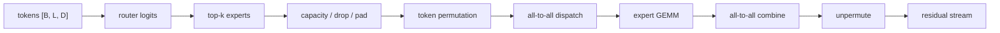

# MoE 路由与稀疏 Kernel

稀疏计算和 `MoE`（Mixture of Experts）常被看成“模型结构创新”，但一旦真正训练或部署，问题很快就会变成 kernel 与通信系统问题。原因很简单：  
**稠密模型的热点大多是规则大矩阵，稀疏和 MoE 的热点则往往是 token 重排、路由、gather/scatter、all-to-all 和不均匀负载。**

<!-- [补充] -->
| 读者 | 建议读法 | 工程落点 |
| --- | --- | --- |
| 初学者 | 先抓“MoE 路由与稀疏 Kernel”要解决的问题、关键术语和最小例子；公式只看变量方向。 | 能说清输入、输出和常见失败信号。 |
| 工程师 | 直接对照结构、指标、成本和边界条件，必要时回到前置页补概念。 | 落到数据、算力、延迟、显存、评测和回滚检查。 |

!!! note "读法定位"
    这页先回答“MoE 路由与稀疏 Kernel”在「算子与编译器」里的位置：它解决什么局部问题，依赖哪些前置，最后会影响哪类工程或研究判断。
    **前置**：先理解张量 shape、显存层次和 GEMM；系统指标卡住时回推理或训练专题。 必要时先回 [算子与编译器入口](index.md)、[基础知识](../foundations/index.md) 或 [术语表](../glossary/index.md)。
    **主线关系**：把模型里的矩阵乘、attention、通信和低精度路径落到 GPU 时间线上，看瓶颈如何被 kernel 与编译栈改变。

这使得稀疏系统的工程难点不在公式，而在如何把 token 送到正确专家、如何让热门专家不成为热点、如何让重排和通信不把省下来的 FLOPs 吃掉，以及如何让路由 kernel 和主计算 kernel 协同。

!!! note "合并提示"
    **note · 初学者先抓住**

    MoE 的系统难点不在“专家层公式”，而在 token 怎么被路由、重排、通信、计算再合并。稀疏节省了部分 FLOPs，但引入了不规则访问、负载不均和 all-to-all。

    **example · 有趣例子：分拣中心**

    包裹送到正确仓库只是第一步。如果某个仓库爆满、传送带堵住、回收路径绕远，整体效率仍然很差。MoE 的 token dispatch 和 combine 也是这个问题。

<!-- [补充] -->
> **踩坑原因**：这类工程问题通常不是单点公式错，而是 shape、资源预算、并发路径和观测指标之间有一个假设没对齐；先把触发条件、监控信号和回滚边界拆开查。

## 为什么稀疏 kernel 和稠密 kernel 不一样

稠密 kernel 往往假设数据布局规则、工作量均匀，并且可以用大块 GEMM 吃满硬件。稀疏 / MoE 场景则相反：token 分布不均，某些 expert 很热、某些很闲，计算前要先 route 和重排，工作负载还会随每批输入变化。

这意味着稀疏系统的优化目标不只是“把 GEMM 做快”，更是“把不规则性控制住”。

## Top-k Routing 的核心代价

一个常见 MoE 流程是 router 为每个 token 产生 expert 分数，选出 top-k expert，将 token dispatch 到对应 expert，expert 各自计算后再把结果 combine 回去。真正的代价通常出现在 token permutation、dispatch / combine、all-to-all、负载不均和小批量 expert GEMM。

## MoE token 流程图

这张图说明 MoE 性能瓶颈不只在 `expert GEMM`。路由、容量、重排、通信、合并和反重排都在热路径里。只优化专家矩阵乘，而不看 dispatch 和 all-to-all，常常会得到“FLOPs 少了，系统没快”的结果。

### 3.1 一个 token 数字账

假设 batch 内共有 `B*L=8192` 个 token，`top-k=2`，expert 数为 64。理论上每个 expert 平均接收：

\[
\frac{8192\times2}{64}=256
\]

<!-- [补充] -->
| 符号 | 含义 | 取值范围 |
| --- | --- | --- |
| 公式整体 | 本公式表达的变量关系 | 按上下文定义 |

个 token。这个 `256` 是平均负载，不是每个 expert 实际收到的数量。工程上常用 capacity factor 给每个 expert 预留容量：

\[
capacity \approx \frac{B L \times topk}{N_{\text{expert}}}\times factor
\]

<!-- [补充] -->
| 符号 | 含义 | 取值范围 |
| --- | --- | --- |
| \(c\) | 公式中的变量或中间量 | 按上下文定义 |
| \(N_{}\) | 公式中的变量或中间量 | 按上下文定义 |
| \(f\) | 公式中的变量或中间量 | 按上下文定义 |

所以 capacity 设为 `320` 相当于 factor 约 `1.25`，设为 `640` 相当于 factor `2.5`。但真实 router 可能不均匀：热门 expert 收 520 个 token，冷 expert 只收 80 个。若 capacity 是 320，热门 expert 会 drop 或 reroute；若 capacity 是 640，padding、空槽和小批量 GEMM shape 会浪费。这个超参同时影响模型质量、kernel shape 和 all-to-all 消息大小。

## Token Permutation 为什么是主痛点

Router 选完 expert 后，token 往往需要按 expert 分组重排。  
这一步本质上是一个复杂的索引、scatter、gather 问题。

### 3.1 为什么它会很慢

它慢在访问不连续、写入位置动态，常要配合 prefix sum 或计数，也很难像 GEMM 那样规则向量化。

在很多 MoE 系统里，真正先成为瓶颈的并不是 expert matmul，而是重排与通信。

## Capacity Factor 与 kernel 的关系

MoE 里常用 capacity factor 控制每个 expert 最多接收多少 token。  
这看似是训练稳定性超参，但实际上也影响 kernel 路径：容量越宽松，负载可能更不均；容量越严格，drop token 风险更高；expert batch 大小分布又会直接决定后续 GEMM 形状。

因此它不是纯模型超参，也是系统超参。

## All-to-All 是什么，为什么难

在多卡 expert 并行里，不同 token 可能要被发往不同 GPU 上的 expert。  
这通常意味着 all-to-all 风格的通信：每个 rank 都向多个 rank 发 token，也从多个 rank 收 token。它比 all-reduce 更复杂，因为消息大小不均、负载可能严重偏斜、与 token permutation 耦合很深，也更难重叠。

## 稀疏系统为什么容易出现“理论省 FLOPs，实际不快”

因为虽然只激活部分 expert，但新增了 router、token 重排、dispatch / combine、all-to-all、小而碎的 expert batch 和热门 expert 拥堵等成本。

只要这些额外成本没有被控制住，稀疏计算的收益就会被抵消。

## 服务态 MoE 的额外问题

在线推理里，MoE 比训练更麻烦，因为 batch 更小、请求更不规则、每步 decode token 少，热 expert 还可能放大 tail latency，多租户也会让路由分布更复杂。因此 MoE 推理服务特别依赖 expert placement、路由缓存、dispatch kernel 和通信调度。

## 稀疏 attention 与 block-sparse 路线

除了 expert 稀疏，还有一类稀疏 kernel 出现在 block-sparse attention、局部窗口 attention、检索增强 attention 和动态剪枝路径中。这些方法试图减少不必要计算，但会引入更复杂的索引、block map、稀疏布局管理、边界条件和实际有效算子粒度问题。

如果 block 设计和硬件不匹配，稀疏反而可能比稠密更慢。

视频 DiT 里的 [SLA / SLA2](../paper-deep-dives/foundations/sla-sparse-linear-attention.md) 是一个典型例子：SLA 不是只做 block-sparse attention，而是把 critical blocks 交给 sparse exact attention，把 marginal blocks 交给 linear attention 补偿；SLA2 又把路由改成可学习的 \(R(Q,K)\)，并用 QAT 给 sparse branch 加 low-bit attention。

## MoE 验收指标

| 指标 | 看什么 | 失败信号 |
| --- | --- | --- |
| expert load | 每个 expert 的 token 数分布 | 热 expert 长期拥堵 |
| dispatch time | permutation + all-to-all 时间 | GEMM 快但端到端不快 |
| drop / reroute rate | capacity 是否过紧 | 质量掉点或训练不稳 |
| expert GEMM shape | 每个 expert 的 batch 大小 | 小而碎，Tensor Core 吃不满 |
| tail latency | 最慢 expert / rank 拖尾 | P99 被少数 rank 拉坏 |

服务态还要单独看租户和 prompt 类型是否改变 expert 分布。一个 MoE 模型在离线 benchmark 上平衡，不代表线上流量也平衡；热门业务路径可能持续打到少数 expert，变成系统热点。

## 稀疏 kernel 的优化重点

与稠密 kernel 相比，稀疏 kernel 更应优先关注索引和重排开销、局部性、token / block 分组、热点负载均衡和通信路径。

也就是说，稀疏系统优化的第一优先级往往不是“更多 Tensor Core”，而是“更少无意义搬运与更少不均衡”。

## 直觉例子

如果稠密模型像每个零件都要走同一条大装配线，那么 MoE 更像每个零件会被动态分发到不同的专业工位。好处是主装配线不用让所有工位同时开工，但坏处是零件分拣、转运和工位排队本身会变成新的瓶颈。MoE 系统真正难的地方，不在工位上的加工，而在整个分拣与物流系统是否高效。

## 本页结论

稀疏、MoE 与路由 kernel 的核心，不是“把矩阵变稀疏”这么简单，而是如何在保持模型容量优势的同时，控制 token 重排、all-to-all、负载不均和小批次 expert 计算带来的系统开销。  
如果没有这层 kernel 与通信视角，MoE 很容易停留在“理论参数效率很高”的纸面优势，而无法转化成真实训练和推理服务系统里的可观收益。

## 工程收束

MoE 路由与稀疏 kernel 要同时看 top-k 路由、token dispatch、expert 负载、combine 路径和稀疏访存。只盯 expert matmul 会忽略重排成本，负载不均也会把尾延迟拉坏；上线前应把 dispatch / gather 一并 profile，监控 expert load，并为 router 建立回归。

!!! tip "下一站"
    - 回到本专题入口：[算子与编译器](index.md)，确认这页在整条路线中的位置。
    - 按导航顺序继续：[自定义算子与框架集成](custom-op-development-and-framework-integration.md)。
    - 概念或符号卡住时，先查 [术语表](../glossary/index.md)，再回到当前页。
