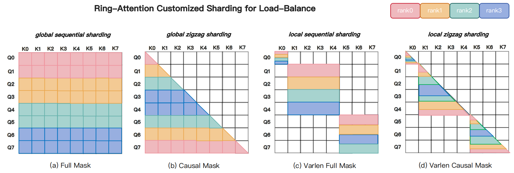
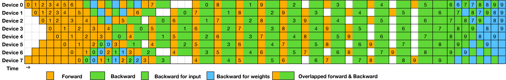

# 可以算清的性能误判

一次 trace 里，某个 kernel 从 2 ms 降到 1.6 ms，整步延迟却从 18 ms 变成 19 ms。原因可能在队列、转换、通信或 fallback，单看这个 kernel 的计时找不到答案。

下面的数字都是为解释机制构造的例子，不对应某个真实生产系统。每个例子先算局部变化，再指出还缺哪一项端到端证据。

## 一个算子快一倍，整步只快一点

若该算子只占整步10%，其余90%不变，算子提速2倍后总时间为原来的95%，整体加速约1.053倍。这个结果完全符合预期。

需要先测算子在关键路径中的占比，再决定优化价值。若新实现还新增2%的转换成本，总节省会进一步减到3%。

## 省了一次launch，却增加更多内存流量

融合前两个kernel各使用小量寄存器，融合后同时保留更多中间值。若因此spill，新增local memory访问可能超过省掉的中间写回。

不能只看kernel数量下降。检查寄存器、spill、实际读写与完整层时间，再缩小融合范围或针对部分shape启用。这个因果假设需要编译和profile证据，不是所有融合变慢的统一解释。

## 调优了最常见的调用，却错过最贵的调用

90次100微秒和10次2毫秒，总时间29毫秒。前者调用最多却只占9毫秒。只按调用次数选热点，可能把主要成本留在后者。

应按累计时间与目标指标加权，同时区分吞吐、P50和P99。不同目标可以产生不同优先级。

## “相同shape”里藏着一次复制

一个快kernel只接受连续输入，wrapper对转置视图执行 `contiguous()`。单测已经连续的tensor看不到复制；真实模型每层都经过转置，复制就反复发生。

比较时记录stride，并把转换放进同一计时边界。可选择支持原layout、让上游直接产出目标layout，或在转换成本高的桶里保留通用实现。

## 平均负载不高，最慢的设备却决定整步时间

四个 rank 的计算时间分别为 4、4、4、12 毫秒。若下一阶段必须等所有 rank，计算阶段至少需要 12 毫秒；平均值 6 毫秒隐藏了三个 rank 的等待。忽略通信时，这一阶段的有效利用率为 24/(4×12)=50%。理想均分成每个 6 毫秒可能把关键路径减半，但重分配新增的通信与调度必须一起计时。

Attention 的有效计算量还与 mask 有关。同样多的 token，落在因果三角形不同位置的分块可能拥有不同数量的有效 query-key 对。下图可用来追踪每个设备实际接到哪些计算块，再对照 trace 中谁最后完成。

{ width="860" }

<small>图源：[MagiAttention 官方文档](https://sandai-org.github.io/MagiAttention/docs/main/index.html) 与 [GitHub](https://github.com/SandAI-org/MagiAttention)，Figure 2。原图意：不同 attention 切分策略会导致计算块在设备间分布不均，长上下文训练需要显式处理 mask 与负载均衡。</small>

## Trace里出现overlap，却没有减少等待

假设计算和通信单独各需10个单位，同时执行因带宽竞争各变成18。虽然色块重叠，完成时间18只比串行20略好。若调度还增加额外同步，甚至可能更慢。

检查最后依赖完成时间与资源竞争，而非只观察两条stream同时有工作。通信的排队时间还可能包含等待其他rank到达。

{ width="900" }

<small>图源：[DeepSeek-V3 Technical Report](https://arxiv.org/abs/2412.19437)，Figure 5。原论文图意：DualPipe 通过更细粒度地组织前向、反向、通信与 pipeline 阶段，减少流水线气泡并提高通信和计算重叠。</small>

## 低比特文件更小，首token更慢

如果每次请求新增激活量化、权重解包或布局转换，prefill的计算收益可能不足以抵消这些步骤。也可能只是首次JIT混进了测试。

先比较冷启动与稳态，再区分权重预处理和每请求操作，最后检查实际GEMM路径。质量下降则走另一条数值对照链，不能用同一种性能解释覆盖所有问题。

每次优化记录“减少的成本”和“新增加的成本”，并把假设放回实际调用分布。这样即使结果不如预期，也能得到下一步应查什么。

## 只优化了常见 shape，fallback 却接管了尾部流量

假设一个服务请求的 shape 分布为：`M=1` 占 60%，`M=8` 占 25%，`M=17` 占 15%。新 kernel 对前两种 shape 分别快 30% 和 20%，但 `M=17` 触发通用实现并慢 3 倍。平均吞吐可能仍然改善，P99 却会被少数长请求主导。

因此优化报告应同时保存 shape bucket、命中路径和各 bucket 的请求权重。一个总体平均值不能说明“常见路径变快”是否转化成用户看到的延迟。若没有足够样本，至少把 fallback 次数和 fallback 原因单独列出。

```text
bucket: M=17, N=4096, K=4096
selected_path: generic_fallback
fallback_reason: unsupported_stride
requests: 150 / 1000
p50_ms: 2.1
p99_ms: 8.7
```

当 fallback 原因是 stride、dtype 或对齐条件时，优先判断能否让上游直接产出目标 layout；当原因是 kernel 本身不支持某个边界，才考虑增加另一条特化路径。无条件扩展候选会增加编译、缓存和维护成本。

## 平均延迟下降，队列等待却把 P99 推高

单请求 kernel 从 2 ms 降到 1.6 ms，并不保证服务 p99 下降。若新 kernel 占用更多寄存器或显存，能够同时运行的请求数可能下降，排队时间会增加。请求总延迟应拆成

\[
T_{\mathrm{e2e}}=T_{\mathrm{queue}}+T_{\mathrm{preprocess}}+T_{\mathrm{kernel}}
 +T_{\mathrm{postprocess}}+T_{\mathrm{transfer}}.
\]

压测时记录每一项的分布，而不是只记录 kernel timer。特别要固定并发、batch 上限和请求到达过程。离线单请求 benchmark 适合比较局部实现，不能独立证明线上尾延迟改善。

如果平均值改善而 p99 变差，先检查显存峰值、并发上限、batch 形成时间和 fallback，再决定是否继续调 tile。把所有尾延迟问题归因于 kernel 指令效率，通常会错过队列层的变化。

## 显存节省也可能制造碎片和同步

融合或缓存复用减少了总字节数，却可能改变临时 buffer 的生命周期。若不同 shape 频繁申请大小不一的 workspace，分配器碎片和同步等待会出现在 kernel 之外。只看峰值显存不等于知道分配器是否在关键路径上阻塞。

可在固定请求序列下记录：分配次数、复用命中率、workspace 大小、同步点和 allocator wait。把同一序列改成预分配或固定 bucket，若延迟变化明显，说明收益来自内存管理，而不只是 kernel 本身。

## overlap 需要看关键路径和资源冲突

两条 stream 同时有色块，只证明工作重叠发生过。若通信使用的链路和计算共享带宽，重叠可能令两者都变慢；若后续操作依赖通信的最后一段，前面的重叠也无法消掉关键路径尾部。

建议在 trace 中标出事件的开始、结束和依赖关系，并记录最后完成的 rank 或 stream。比较优化前后关键路径长度、等待时间、通信带宽和设备利用率，不能只比较“重叠比例”。

## 一个性能提案要有可证伪的账本

可以把每次改动写成下面的卡片：

```text
hypothesis: fuse bias and activation to remove one intermediate write
target_bucket: M=128, N=4096, K=4096, bf16
expected_saving: 2 * M * N * bytes_per_element
new_costs: register_pressure, gelu_math
correctness_gate: max_abs_error <= 2e-2
performance_gate: end_to_end_p95 improves >= 5%
fallback: generic_gemm_if_registers_exceed_limit
observed: ...
decision: keep / narrow / revert
```

`expected_saving` 是假设，不是结果。只有把它和实际 profile、shape 分布及完整层时间放在同一张卡片里，失败实验才会告诉下一步要测什么。

## 把一次失败写成可复查的账本

可以为每个性能提案保留五列：原始关键路径、假设消除的成本、新增成本、命中的 shape 或流量桶、端到端结果。比如“融合减少一次写回”还要同时记录寄存器、spill、转换和同步；“通信与计算重叠”还要记录最后依赖、带宽竞争和等待的 rank。

这张表的作用是让失败也有产出。若局部 kernel 变快而 P99 不变，结论可能是它不在主要关键路径；若平均时间变快而尾延迟变差，下一步要查的是 shape、排队或负载不均，而不是继续把平均值优化得更低。


## 把反模式接到下一次 profile

发现反模式后，应接着看[测试、回归与维护](testing-regression-and-maintenance.md)、[profiling 与数值稳定性](profiling-debugging-and-numerical-stability.md)和[kernel 成本模型](kernel-cost-models-and-selection-heuristics.md)。

## 算例、工具和实现入口

- [输入layout、候选与基准边界](https://github.com/triton-lang/triton/blob/cd2e01c6686d6503802e6cdfac56d5a5dfdb27a1/python/tutorials/03-matrix-multiplication.py)
- [高级调度的资源和架构约束](https://github.com/triton-lang/triton/blob/cd2e01c6686d6503802e6cdfac56d5a5dfdb27a1/python/tutorials/09-persistent-matmul.py)

**来源与改编说明**：Amdahl 风格的加权计算、融合和 persistent 调度例子是本站构造算例；实现边界参考 Triton 官方教程、DeepSeek-V3 技术报告和 MagiAttention 资料。算例用于解释如何找证据，不代表任何真实系统的性能结论。
