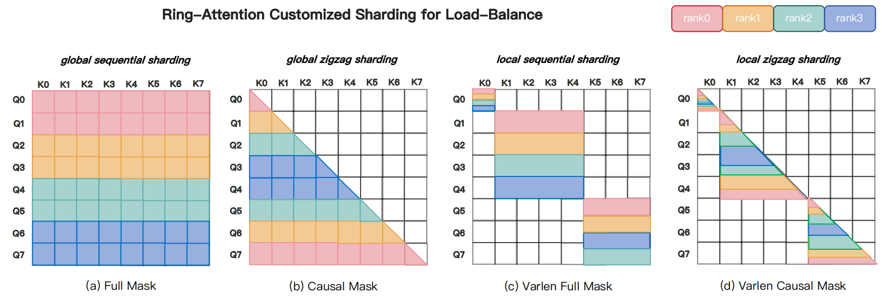

# 性能反模式与失败案例

很多算子优化失败，并不是因为工程师不够努力，而是因为掉进了一些反复出现的性能反模式。它们的共同特点是：单看局部实现似乎合理，放到真实系统里却会不断放大损失，并且往往伴随“理论上应该更快，实际上却不快”的现象。

!!! note "读法定位"
    这页先回答“性能反模式与失败案例”在「算子与编译器」里的位置：它解决什么局部问题，依赖哪些前置，最后会影响哪类工程或研究判断。
    **前置**：先理解张量 shape、显存层次和 GEMM；系统指标卡住时回推理或训练专题。 必要时先回 [算子与编译器入口](index.md)、[基础知识](../foundations/index.md) 或 [术语表](../glossary/index.md)。
    **主线关系**：把模型里的矩阵乘、attention、通信和低精度路径落到 GPU 时间线上，看瓶颈如何被 kernel 与编译栈改变。

把这些反模式单独列出来很有价值，因为它能帮助你少走很多弯路。

!!! note "初学者先抓住"

    性能反模式通常不是“看起来明显错误”的写法，而是局部合理、全局变慢的选择。看到理论 FLOPs 下降、融合更多、低精度更低时，都要回到真实数据流和端到端指标验证。

!!! note "难点解释：为什么局部最优会伤害系统"

    一个 kernel 为某个 shape 极致优化，可能增加 dispatch 复杂度、fallback 比例或维护成本；一次融合减少了 launch，却可能让寄存器溢出。系统性能看的是完整路径，不是单个指标漂亮。

## 反模式一：只看 FLOPs，不看数据流

**最常见的误判是**：算法 FLOPs 更少，所以实现也应该更快。现实里，如果这个算法引入了更多中间张量、更多 layout 变换、更多不连续访存或更多 launch，那么它完全可能比“FLOPs 更多”的老方法更慢。

## 反模式二：为了融合而过度融合

Fusion 通常是好事，但并不是越多越好。过度融合常导致 register pressure 爆炸、occupancy 下降、autotune 空间失控、边界 case 极难维护，某些 shape 上甚至反而更慢。

因此融合的判断标准应该是“是否减少了真正昂贵的数据移动”，而不是“是否把更多逻辑塞进一个 kernel”。

## 反模式三：把训练优化直接照搬到服务

训练里有效的优化，放到服务里未必有效。例如把大 batch GEMM 思路直接搬到 decode，把训练 attention 路径直接搬到 paged KV，或者只看平均吞吐、不看 TTFT 和 tail latency，都会把训练负载和在线服务负载混为一谈。

这种反模式在推理服务系统里非常常见，因为训练和推理的负载画像本来就不同。

## 反模式四：只测最漂亮的 shape

如果一个 kernel 只在完美对齐 shape、固定 batch、单一 dtype 和最适合的设备上测试，那么它的结果很难说明真实系统收益。
真实 workload 往往是 shape 分布，而不是单点 shape。

## 反模式五：没有 fallback 却做大量特化

shape specialization 是有价值的，但如果没有 fallback，就会出现低频边界 shape 无法处理、新模型结构一改就断、线上因为某个罕见请求直接回退失败等问题。

成熟系统通常是“热点 shape 特化 + 低频 shape 保守 fallback”，而不是彻底抛弃通用路径。

## 反模式六：把 profile 结果看成单层真相

只看一个 profile 维度很容易误判：系统级 trace 只能看到慢，不一定知道为什么慢；单 kernel profile 只能看到局部，不一定看到全局瓶颈；微架构级指标很细，但不一定说明端到端最值得优化的地方。真正稳妥的做法，是把系统级、kernel 级和微架构级三层信息串起来看。

实践中可以把一次性能分析拆成三问：端到端 trace 里用户等待在哪里，热点 kernel 里时间花在算力、带宽、同步还是 launch，微架构指标是否支持这个判断。三层证据一致时再动手改 kernel；如果三层证据相互矛盾，优先补测 workload 和 shape 分布，而不是立刻写新实现。

## 反模式七：忽略维护成本

一个 kernel 即使很快，如果只支持一代 GPU、一升级框架就坏、很难调试、没有回归基线，那么它也很难成为真正的系统资产。
这类问题短期内不显眼，长期却最致命。

### 7.1 把反模式写进评审

性能评审最好不要只问“快了多少”，还要问“慢在哪里被转移了”。一次优化如果增加了 layout 变换、编译版本、dispatch 分支或 fallback 风险，就应该把这些代价写进评审记录。这样后续出现 tail latency、冷启动或兼容性问题时，团队能回到当初的取舍，而不是重新猜一遍。

一个简单但有效的做法是为每次性能优化附带反例：哪些 shape 不受益，哪些硬件不支持，哪些路径要禁用，什么指标触发回滚。反模式一旦被制度化记录，就不再只是经验教训，而会变成后续设计的护栏。

这也解释了为什么性能优化要有“退出条件”。如果一个方案只能在单点 benchmark 上赢，但在真实流量下需要大量特判、复杂 fallback 和额外监控，它可能仍然值得放进实验分支，却不一定适合进主服务路径。好的性能工程会把收益、适用范围和代价一起交付。

## 直觉例子

这些反模式就像赛车改装中的典型误区：只换更大马力的引擎却不管传动和轮胎，只在理想赛道测试却忽略真实天气，只追求极端轻量化却不考虑长期可靠性。算子优化也是一样，真正的工程能力不是“做出最极端的一次加速”，而是避开这些高频反模式，稳定地把收益带到真实系统里。

## 本页结论

性能反模式之所以值得专门总结，是因为它们往往比“正向技巧”更能帮助团队建立判断力。知道哪些思路看起来对、实际常错，往往比多背几个优化技巧更重要。高性能系统最终拼的，不只是会做什么优化，更是知道什么优化不该做、什么时候该停下来回到 profile 和 workload 本身。

## 工程收束

性能反模式要围绕无效搬运、错误融合、坏布局、过度特化和同步放大来排查。不要只优化单个指标，也不要把问题藏进复杂 kernel；更稳的做法是为反模式建立案例库，每次优化写反例，将失败模式纳入 code review，并做端到端回归。

这类页面的价值在于帮团队建立“停下来”的判断：当一次优化开始牺牲可解释性、可维护性或尾部稳定性时，应该先回到 profile 和 workload，而不是继续往 kernel 里堆复杂度。

长期看，反模式库本身就是性能团队的知识资产，能让新人少重复踩坑。

它也能让 code review 从“感觉会不会快”变成“哪些代价已经被显式记录”。

## 真实排查案例：低比特路径省显存，却拖慢首 token

**输入症状**：把一个 13B 服务从 FP16 切到 W4A16 后，显存占用下降明显，但 TTFT 从 820ms 增到 1.25s，短问答用户感知变差。

**关键指标**：权重显存下降约一半，batch 上限提高；但短请求 prefill latency 上升，dequant kernel 占比升高，小 batch 下 Tensor Core 利用率下降；长输出请求的 TPOT 反而略有改善。

**Nsight / trace 观察**：trace 显示每层 linear 前后多出 dequant / layout 转换片段；长 decode 中权重带宽收益能摊薄这些开销，短 prefill 中额外 kernel launch 和转换成本更显眼。

**判断**：这是“只看显存，不看请求桶”的反模式。W4A16 并非全局更优，它把瓶颈从显存容量转移到低 batch 的解量化和 kernel 支持上。

**修复**：按请求桶启用量化：长上下文和高并发租户走 W4A16，短问答保留 FP8/FP16 或使用更成熟的 W8A8 路径；把 TTFT、TPOT、显存水位、质量掉点放进同一张验收表。

**反例**：如果服务主要是长输出、高并发、decode 带宽受限，且 runtime 有成熟 fused dequant GEMM，低比特路径可能同时省显存和提吞吐。反模式不是量化本身，而是把一个桶的收益套到所有桶。

## 真实排查案例：kernel launch 太碎，GPU 看着忙但吞吐不涨

**输入症状**：给视频世界模型加了 action head、risk head 和若干 mask 处理后，单步训练从 `1.8s` 涨到 `2.4s`。GPU utilization 面板看起来不低，但 tokens/s 明显下降，CPU 侧也开始出现周期性尖峰。

**关键指标**：每 step kernel launch 数从约 `3k` 增到 `12k`；大量 kernel 的持续时间低于 `20us`；SM active 并不稳定，GPU trace 里出现细密的空洞；PyTorch profiler 中 dispatcher、shape check、cast、contiguous 的 self time 上升。

**Nsight / trace 观察**：热点不在某一个大 GEMM，而在 `permute -> contiguous -> mask fill -> cast -> small reduce -> scatter` 这类碎片链路。每个小算子本身都不慢，但它们反复打断主干 GEMM 和 attention，CPU launch 和 HBM 往返被放大。

**判断**：这是 launch-bound 和 memory-movement-bound，不是 compute-bound。继续调大 GEMM tile 或换更激进的 attention kernel 不会解决主因。

**修复**：把 mask 构造提前到 GPU 常驻 buffer；按固定 shape bucket 做 graph capture；把 residual、norm、cast、quant/dequant 放进融合 epilogue；把多个小 head 合并成一次 batched projection；让 action/risk 旁路共享已经存在的 hidden state，避免重复 materialize。

**反例**：如果处在模型探索期、shape 每天变化，过早 CUDA graph 和深度融合会拖慢迭代。此时先做 profile guard 和少量高频链路融合，比一次性写专用 kernel 更稳。

## 真实排查案例：attention mask 让部分 rank 一直等

{ width="860" }

<small>图源：[MagiAttention 官方文档](https://sandai-org.github.io/MagiAttention/docs/main/index.html) 与 [GitHub](https://github.com/SandAI-org/MagiAttention)，Figure 2。原图意：不同 attention 切分策略会导致计算块在设备间分布不均，长上下文训练需要显式处理 mask 与负载均衡。</small>

**输入症状**：把单样本多视角视频、语言指令和动作历史 pack 到同一条长序列后，平均 step time 只涨一点，但 p95 step time 明显变差；多卡训练里经常看到部分 GPU 先算完，随后等待其它 rank。

**关键指标**：不同 rank 的有效 attention block 数差异超过 `2x`；padding rate 表面不高，但 dense block 集中在少数样本；NCCL wait time 上升；CP 或 ring attention 的每 stage 耗时出现长尾。

**Nsight / trace 观察**：视觉历史段、动作段和语言段的 mask 密度不同。某些 rank 分到的块接近 dense attention，另一些 rank 分到大量空块或短块。通信必须等慢 rank 完成，于是整体吞吐由最重的 mask 分片决定。

**判断**：这是 attention mask topology 和负载均衡问题，不是单卡 kernel 不够快。长上下文训练里 \(L\) 相同不代表工作量相同，mask 形状会改变每个 rank 的真实计算。

**修复**：按 mask 类型和有效长度做 bucket；把 dense 视频段、causal 文本段、局部动作段拆成更可调度的 attention slices；使用能感知异构 mask 的 dispatch/load-balance 方案；减少无效 padding；把高密度段和低密度段错开分配，避免慢 rank 固定出现。

**反例**：如果所有样本长度和 mask 都很规则，简单 sequence parallel 或 context parallel 可能已经足够。复杂 load-balance solver 只有在异构 mask 成为 p95 瓶颈时才值得引入。

## 真实排查案例：通信 overlap 失败，扩到多机后更慢

{ width="900" }

<small>图源：[DeepSeek-V3 Technical Report](https://arxiv.org/abs/2412.19437)，Figure 5。原论文图意：DualPipe 通过更细粒度地组织前向、反向、通信与 pipeline 阶段，减少流水线气泡并提高通信和计算重叠。</small>

**输入症状**：8 卡单机训练吞吐正常，扩到 64 卡多机后 scaling efficiency 掉到 `45%` 左右。显存没满，单卡 kernel 看起来也不慢，但 step time 被 NCCL 片段拉长。

**关键指标**：all-gather 或 reduce-scatter 紧跟在大 GEMM 后串行出现；overlap ratio 低；网络带宽没有跑满；不同 pipeline stage 的 bubble 扩大；梯度 bucket 的 ready time 分布很散。

**Nsight / trace 观察**：collective 没有在 backward 早期启动，而是等一大段反向算完后集中发出。部分 stream 之间存在不必要依赖，MoE dispatch、activation recompute 和 gradient reduce 互相抢同一段窗口。

**判断**：问题不是“通信本身不可避免”，而是通信没有被调度到计算窗口里。分布式训练的瓶颈从单卡算子转成了 schedule、bucket、拓扑和 stream dependency。

**修复**：按层切小 gradient bucket，让 reduce-scatter 在梯度 ready 后尽早启动；把 TP/PP/CP/EP 的通信映射到更贴近硬件拓扑的组；拆开过大的 all-gather；为通信和计算使用独立 stream 并清理多余同步；必要时采用类似 DualPipe 的流水线组织，把前向、反向和通信交错起来。

**反例**：小模型、单机训练或网络很空闲时，过度 overlap 调度会增加复杂度和调试成本。只有当 trace 显示 collective 占据端到端关键路径时，才应该把工程复杂度花在这里。

## 真实排查案例：FP8 训练长跑后突然数值爆炸

**输入症状**：短跑 `5k` step 的 FP8 世界模型训练和 BF16 对齐，但完整训练到中后期后 loss 突然 spike，随后出现 NaN。问题集中在长视频 bucket、接触密集任务和高亮度相机视角。

**关键指标**：某些层 activation amax 长时间贴近 scale 上限；SwiGLU 或 attention output 的 percentile 尾部变厚；gradient norm 在 spike 前数百 step 开始抬升；BF16 shadow run 没有同步爆炸。

**Nsight / trace 观察**：异常前没有明显性能回退，说明不是单纯 kernel 超时。逐层 dump 发现少数 outlier token 经过 FP8 quant/dequant 后误差被放大，随后在 residual 分支和反向梯度里累积。

**判断**：这是数值动态问题，不是吞吐问题。低精度训练的风险会随数据分布、序列长度和训练阶段变化，短实验稳定不能证明长训练稳定。

**修复**：对高风险层保留 BF16 或使用更细粒度 scale；给 activation scale 加滞后和上限监控；对长视频 bucket 单独做 loss/amax dashboard；在 attention output、SwiGLU、final norm 等敏感位置加入高精度保护；保留 BF16 shadow batch 做周期性对照。

**反例**：如果 loss spike 同时伴随数据 loader 重试、坏样本集中或 learning rate schedule 变化，不能先把锅甩给 FP8。数值排查要把数据、优化器、scale 和 kernel 版本一起对齐。

!!! tip "下一站"
    - 回到本专题入口：[算子与编译器](index.md)，确认这页在整条路线中的位置。
    - 按导航顺序继续：[硬件感知排查清单](hardware-aware-debug-checklist.md)。
    - 概念或符号卡住时，先查 [术语表](../glossary/index.md)，再回到当前页。
