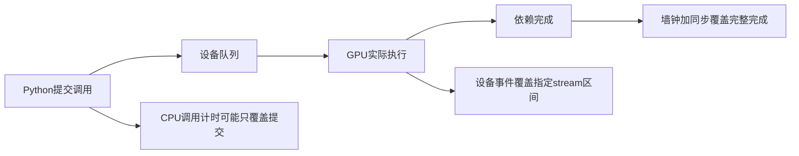
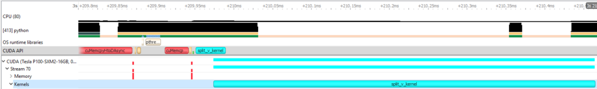
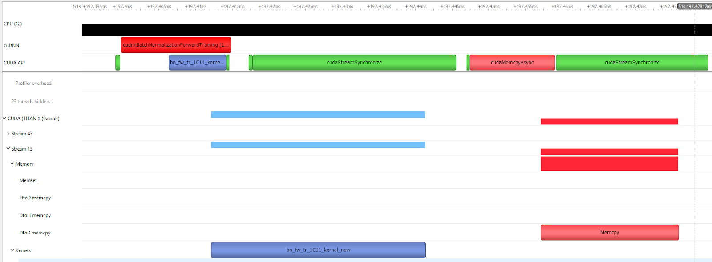
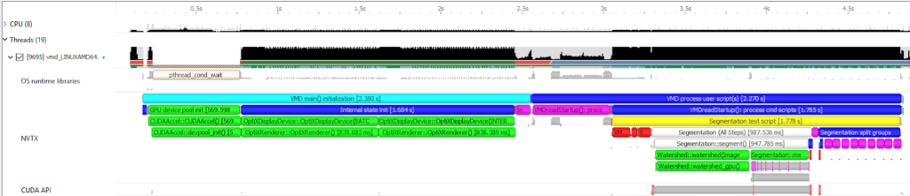

# 怎样确认计时测到了真正的GPU执行

Python 调用一个 GPU 算子后，CPU 可能已经返回，设备还在执行。若直接用 CPU 时钟包住函数调用，测到的可能只是提交开销。优化前先把计时边界和正确性检查写清楚，后面看到的数字才有意义。

## 分开冷启动和稳态

第一次调用可能包含模块初始化、JIT、autotune和内存分配。先单独记录这类冷启动，再预热相同shape，测后续稳定执行。真实服务若会频繁遇到新shape，冷启动依然属于用户延迟，只是不能和纯kernel时间混在一个数字里。

Triton官方教程先对照PyTorch结果，再用其benchmark工具重复测量。借用教程时也要检查wrapper中是否包含输出分配、转换和数据复制。

## 设备事件与CPU墙钟测不同边界

GPU事件可以在同一stream上记录两个点之间的设备时间；CPU墙钟配合适当同步，可以测完整调用完成所需的时间。多stream任务还需保证事件覆盖了目标依赖，不能在一个stream上结束计时，却让另一条工作仍未完成。

计时前后每次强制全设备同步有利于隔离单项，却会破坏真实流水重叠。微基准与完整请求trace应各自报告，不要求它们得到同一数值。

<!-- systems-workflow-visual -->

先选择要测的边界，再解释数字。多stream依赖需要额外确认，不能只在任意一条stream上放结束事件。

{ width="820" }

<small>图源：[Nsight Systems Exposes New GPU Optimization Opportunities](https://developer.nvidia.com/blog/nsight-systems-exposes-gpu-optimization/)，Figure 2。博客截图意：在 GPU kernel 事件上可以回溯到对应的 CPU-side CUDA API launch，从而把 GPU 端空洞和 host 端调度原因连起来。</small>

{ width="720" }

<small>图源：[Nsight Systems Exposes New GPU Optimization Opportunities](https://developer.nvidia.com/blog/nsight-systems-exposes-gpu-optimization/)，Figure 3。博客截图意：CPU 端显式同步可能让原本可异步排队的 GPU 工作被切开，形成不必要等待。</small>

## 先看时间线，再解释单个kernel

若完整step慢，先定位数据读取、CPU空隙、GPU计算、通信与同步的先后关系。一个很长的collective可能是在等尚未到达的rank，而非网络传输本身慢。确认关键路径以后，再查看具体kernel的内存流量、指令、资源和有效并行。

单个util百分比不能同时解释这些原因。高GPU util也可能只是持续有kernel执行，无法证明矩阵单元或带宽已被充分使用。

## 速度之前先定义数值参考

固定输入，比较输出绝对误差与相对误差，检查有限值。若是训练算子，再检查梯度。浮点加法不满足结合律，改变归约顺序可能产生小误差；较低精度还会改变舍入、截断和累加。

Softmax应先减最大值，避免直接对大logit求指数。LayerNorm在接近常量的输入上要检查epsilon和方差算法。误差容限应结合dtype、计算长度和任务使用方式设定，不能通过放宽到任意阈值来“验证”实现。

{ width="820" }

<small>图源：[Nsight Systems Exposes New GPU Optimization Opportunities](https://developer.nvidia.com/blog/nsight-systems-exposes-gpu-optimization/)，Figure 6。博客截图意：NVTX range 可以把应用阶段标到 timeline 上，让 kernel、通信和 CPU 逻辑更容易归因。</small>

## 用一个变化连接证据与修复

先提出可检查假设，例如非连续输入新增一次复制，或大tile导致spill。保持其余条件不变，修改一个因素，比较trace与输出。若只看到时间改善，却没有预期证据变化，原因仍需验证。

保留输入shape/stride、软件版本、设备、编译配置与原始测量分布。本文不提供虚构的Nsight截图或实测倍数，具体机器上的瓶颈必须由相应运行证据确认。

## 对照源码与延伸阅读

- [先对齐输出再计时的官方实例](https://github.com/triton-lang/triton/blob/cd2e01c6686d6503802e6cdfac56d5a5dfdb27a1/python/tutorials/01-vector-add.py)
- [归约与数值路径的具体实现](https://github.com/triton-lang/triton/blob/cd2e01c6686d6503802e6cdfac56d5a5dfdb27a1/python/tutorials/05-layer-norm.py)

接着读[通信 kernel 与计算重叠](communication-kernels-and-overlap.md)，把 ready、launch 和 consumer 的依赖放回 trace；再读[硬件感知调试清单](hardware-aware-debug-checklist.md)，把 shape、dtype、stream、fallback 和版本写进一次可复查的证据包。这样才能区分“计时方法错了”和“kernel 真慢”。

## 一次 profiling 记录应能复现

保存输入 shape、stride、dtype、设备、驱动、编译参数、预热次数、重复次数、计时边界和输出误差。若使用 Nsight，保留对应的 NVTX range、stream、同步点和采集命令。没有这些条件，单个 latency 数字不能作为回归证据。

排查顺序可以固定为：先确认输出正确，再确认计时覆盖目标工作；然后看 CPU 空洞、GPU kernel、通信和同步；最后才钻进内存事务、寄存器和指令。这样能避免用低层优化掩盖错误的上层时间边界。

## 来源与改编说明

- **工具参考**：[NVIDIA Nsight Systems 官方说明](https://developer.nvidia.com/blog/nsight-systems-exposes-gpu-optimization/)，用于理解 CPU API、GPU kernel、同步和 NVTX 的时间线关系。
- **实现参考**：[Triton vector add](https://triton-lang.org/main/getting-started/tutorials/01-vector-add.html)，先做输出校验再做计时。
- **自测**：解释为什么在异步 GPU 调用前后都加同步会改变真实流水，以及为什么第一次 JIT 时间不能与稳态 kernel 时间混成一个均值。
