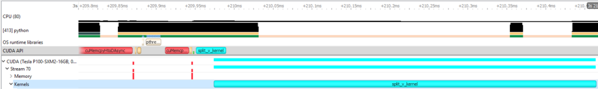
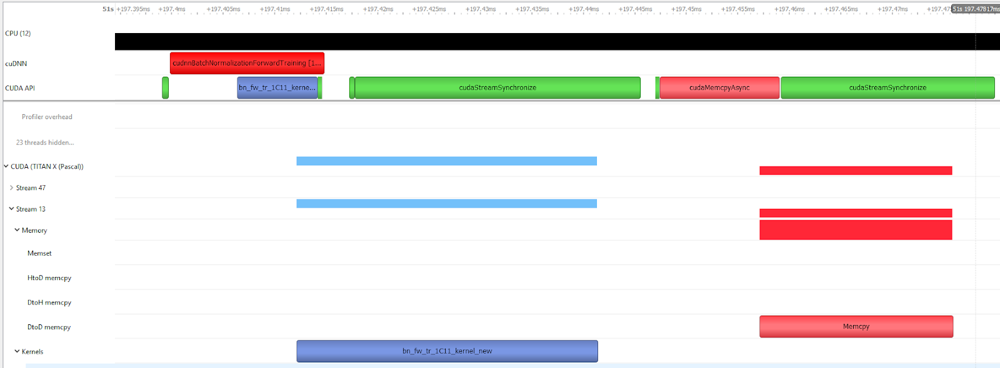
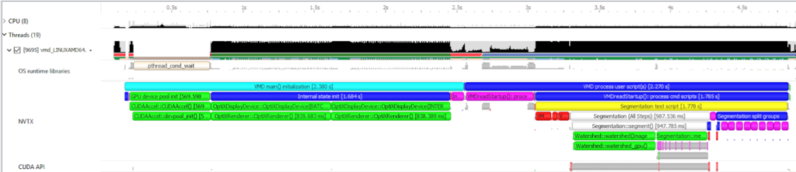
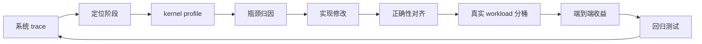

# Profiling、调试与数值稳定

很多 kernel 优化最后不是败在“不会写更快代码”，而是败在三件事上：没有正确测量，优化方向从一开始就错了；没有可靠验证，性能上去了但结果悄悄错了；没有处理数值稳定性，速度和精度之间出现不可接受的偏差。

!!! note "读法定位"
    这页先回答“Profiling、调试与数值稳定”在「算子与编译器」里的位置：它解决什么局部问题，依赖哪些前置，最后会影响哪类工程或研究判断。
    **前置**：先理解张量 shape、显存层次和 GEMM；系统指标卡住时回推理或训练专题。 必要时先回 [算子与编译器入口](index.md)、[基础知识](../foundations/index.md) 或 [术语表](../glossary/index.md)。
    **主线关系**：把模型里的矩阵乘、attention、通信和低精度路径落到 GPU 时间线上，看瓶颈如何被 kernel 与编译栈改变。

成熟算子工程不是“会写 kernel”，而是建立从热点识别、性能定位、正确性验证到数值验收的完整闭环。

!!! note "初学者先抓住"
    Profiling 必须先于优化。否则你可能把时间花在看起来重要、实际不在热路径的 kernel 上。正确流程是先定位瓶颈，再改实现，再验证数值和端到端收益。

!!! example "有趣例子：修水管"
    家里水压低，不应该先随便换水龙头。要先看是总阀、水管堵塞、热水器还是某个弯头漏水。Profiling 就是这套排查流程，避免优化错位置。

## Profiling 先于优化

AI 系统里的直觉经常误导人：

1. 以为 GEMM 是瓶颈，实际热点是 layout transform；
2. 以为 decode 慢是模型太大，实际是 kernel launch 太碎；
3. 以为量化没提速是算法问题，实际是 dequant kernel 带宽受限；
4. 以为 occupancy 太低，实际卡在 shared memory bank conflict。

任何 serious optimization 都应从 profile 开始，而不是从改代码开始。优化前要明确：问题发生在系统调度、单 kernel、内存访问、微架构利用率，还是数值回退路径。

## 三层 Profiling 视角

| 层级 | 关注点 | 常用工具 |
| --- | --- | --- |
| 系统级 | 请求流、prefill/decode、通信、I/O、CPU/GPU 重叠 | Nsight Systems、serving trace、PyTorch profiler timeline |
| Kernel 级 | 单个 kernel 时间、launch 次数、shape 分布、调用路径 | PyTorch Profiler、框架 trace、自定义日志 |
| 微架构级 | 带宽、occupancy、warp stall、Tensor Core、cache 行为 | Nsight Compute、硬件计数器 |

只看系统级，知道哪段慢但不知道为什么；只看 kernel 级，知道哪个 kernel 慢但不知道是否被调度放大；只看微架构级，容易局部最优。有效工作流是在三层之间来回切换。

## Nsight Systems：先看系统时间线

`Nsight Systems` 更像“端到端时间线显微镜”，适合先回答这些问题：GPU 是否持续有活干，CPU 线程是否被 I/O、锁、Python 调度或同步调用挡住，CUDA API 和 GPU kernel 是否能对应起来，cuBLAS/cuDNN/NCCL 是否在预期阶段出现，以及 NVTX 标注出来的模型阶段是否真的互相重叠。

它和 `Nsight Compute` 的分工很清楚：Nsight Systems 先定位**哪段时间**和**哪条链路**可疑；Nsight Compute 再解释某个 kernel 的 occupancy、warp stall、memory throughput、Tensor Core 利用率等微架构原因。一个实用顺序是：

1. 用 Nsight Systems 看端到端 timeline、空洞、同步和通信裸露时间；
2. 在 timeline 里选出真正影响 wall-clock 的 kernel 或阶段；
3. 再用 Nsight Compute / microbenchmark 下钻，不要反过来先挑一个看起来慢的 kernel 优化。

常用起步命令可以写成下面这样，具体 trace 项按环境和开销裁剪：

```bash
nsys profile --trace=cuda,cudnn,cublas,osrt,nvtx -o trace python train.py
```

<small>命令口径参考：[Nsight Systems User Guide](https://docs.nvidia.com/nsight-systems/UserGuide/index.html) 中 `nsys profile` 与 `--trace` 选项说明。User Guide 也说明 CUDA trace 会收集 CUDA API trace 和 CUDA workload trace，后者包括 GPU 上的 memory operation 与 kernel execution。</small>

{ width="820" }

<small>图源：[Nsight Systems Exposes New GPU Optimization Opportunities](https://developer.nvidia.com/blog/nsight-systems-exposes-gpu-optimization/)，Figure 2。博客截图意：在 GPU kernel 事件上可以回溯到对应的 CPU-side CUDA API launch，从而把 GPU 端空洞和 host 端调度原因连起来。</small>

!!! note "图解：从 GPU 事件追回 CPU 调度"
    做算子优化时，不要只盯 GPU row。一个 kernel 后面的空洞，可能来自 CPU 线程没及时发起下一次 launch，也可能是框架 runtime、Python、数据准备或锁等待挡住了调度。Nsight Systems 的价值就在于把 GPU stream、CUDA API、CPU thread 和 NVTX range 放到同一条时间线上。

{ width="720" }

<small>图源：[Nsight Systems Exposes New GPU Optimization Opportunities](https://developer.nvidia.com/blog/nsight-systems-exposes-gpu-optimization/)，Figure 3。博客截图意：CPU 端显式同步可能让原本可异步排队的 GPU 工作被切开，形成不必要等待。</small>

!!! note "图解：误同步会伪装成 kernel 慢"
    如果每个小算子后面都接 `cudaDeviceSynchronize`、`cudaStreamSynchronize`、阻塞式 D2H copy 或框架里的隐式 sync，timeline 会变成“跑一点、停一下”。这时先删同步、改事件依赖或重排 stream，往往比重写 kernel 更有效。

{ width="820" }

<small>图源：[Nsight Systems Exposes New GPU Optimization Opportunities](https://developer.nvidia.com/blog/nsight-systems-exposes-gpu-optimization/)，Figure 6。博客截图意：NVTX range 可以把应用阶段标到 timeline 上，让 kernel、通信和 CPU 逻辑更容易归因。</small>

!!! tip "实践习惯：给 trace 加语义"
    对训练和推理系统，建议用 NVTX 标出 `dataloader`、`prefill`、`decode`、`attention`、`moe_dispatch`、`all_reduce`、`optimizer_step`、`graph_capture` 等阶段。没有 NVTX 的 trace 只能看到一堆 kernel 名；有 NVTX 后，才能把“哪个业务阶段慢”与“哪个 kernel / copy / collective 慢”对齐。

## Microbenchmark 要可信

微基准很容易夸大收益。较稳妥的原则是：

1. 充分 warmup，排除 JIT、memory pool、cache 和 graph capture 前置成本；
2. 固定 shape、dtype、layout 和输入分布；
3. 区分单 kernel 时间与端到端时间；
4. 覆盖真实 shape 分布，而不是只测最漂亮的整齐形状；
5. 报告平均值、p95/p99 和长尾 shape；
6. 明确是否包含编译、autotune、cache miss 和 fallback。

真实系统中 shape 往往不固定。一个 kernel 在某个整齐 shape 下极快，到了 batch、sequence、head dim、量化 group 变化时可能明显退化。优化结论必须按真实 workload 分桶报告。

## 关键指标怎么读

| 指标类 | 看什么 | 常见解释 |
| --- | --- | --- |
| 时间 | latency、throughput、launch 次数、TTFT、TPOT、step time | 判断端到端是否真的变快 |
| 资源 | SM 利用率、Tensor Core、DRAM throughput、shared memory、register、occupancy | 判断算力或带宽是否被用起来 |
| 结构 | warp stall、branch divergence、cache hit/miss、load/store efficiency | 判断为什么没跑满 |
| 数值 | 误差、溢出、归约差异、低精度 scale | 判断是否安全可替换 |

Roofline 是很好的先验判断器。若 kernel 算术强度低且 DRAM throughput 已接近上限，继续做算术优化收益很小；若理论上应是 Tensor Core 热点但 Tensor Core 利用率很低，说明 tile、layout 或 dtype 路径可能有问题。

## 正确性验证

任何优化都必须先通过正确性验证。基础做法包括：

1. 与参考实现逐元素对比；
2. 覆盖多种 shape、dtype、layout 和边界 mask；
3. 测随机输入、极值输入、全零、全同值、非连续 stride；
4. 测训练与推理路径；
5. 测多步迭代误差是否放大；
6. 固定 seed 和输入，保证可复现。

“看起来差不多”远远不够。一个归一化 kernel 某些边界块少算一个元素，单次误差可能很小，多层叠加后会明显偏航。低精度、softmax、attention、norm、optimizer kernel 都应有更严格的误差阈值和边界样本。

## 数值稳定性是一等公民

AI 算子不仅要算得快，还要在低精度、长序列和大动态范围下稳定。常见问题包括：

1. softmax overflow / underflow；
2. 方差计算误差；
3. FP16/FP8 累加损失；
4. quant scale 过大或过小；
5. 原子加法和归约顺序导致非确定性；
6. fused kernel 改变了高精度边界。

Softmax 通常写成：

\[
\mathrm{softmax}(x)_i =
\frac{e^{x_i-m}}{\sum_j e^{x_j-m}},\quad m=\max_j x_j
\]

减去最大值是为了避免指数爆炸。FlashAttention 这类分块实现还要维护在线最大值与归一化项，既减少 I/O，又保持数值精确。LayerNorm、RMSNorm、variance 计算则需要关注 Welford、FP32 accumulation 或其他稳定统计方法。

## 低精度验收

不同低精度类型风险不同：

| 类型 | 主要风险 | 验收重点 |
| --- | --- | --- |
| FP16 | 动态范围窄，易 overflow/underflow | loss scale、FP32 accumulate、极值输入 |
| BF16 | 范围大但尾数少 | 长期误差、归约和 optimizer 路径 |
| FP8 | 强依赖 scaling 和校准 | amax、scale 粒度、溢出/下溢、敏感层 |
| INT8/INT4 | 依赖量化尺度和校准数据 | scale、zero point、outlier、累加精度 |

低精度 kernel 不能只看单层误差。要看长序列、多层堆叠、训练反向、端到端任务指标和异常 bucket。尤其是 FP8/INT 相关 kernel，scale 的读取、更新、广播和融合边界都可能成为真实 bug 来源。

## 调试闭环

一个实用闭环是：

1. 用系统 trace 找到真实热点；
2. 用 kernel profile 判断瓶颈类型；
3. 用 microbenchmark 验证单点优化；
4. 用参考实现做正确性和数值对齐；
5. 用真实 workload 分桶验证端到端收益；
6. 把 shape、dtype、误差阈值和性能基线写入回归测试；
7. 记录硬件、驱动、编译器、框架和 kernel 版本。



这张闭环图的重点是不要跳步。只做系统 trace，容易不知道 kernel 为什么慢；只做 microbenchmark，容易不知道端到端有没有收益；只做性能，不做正确性，低精度和归约类 kernel 会埋隐患。

算子优化的基本纪律是：没有 profiling，不谈优化；没有正确性，不谈性能；没有端到端验证，不谈上线收益。

## 世界模型算子的硬证据模块

如果优化对象服务世界模型 rollout，profiling 报告要比通用 LLM 多三项：候选动作排序是否变、风险校准是否变、长时 latent 是否漂。

| 证据项 | 最小可复算例子 | 失败案例 | 验收指标 |
| --- | --- | --- | --- |
| 本页解决哪项成本 | 单 kernel、端到端 rollout、闭环 loop 三层时间线 | kernel 2x，端到端只有 1.05x | kernel latency、loop latency、Amdahl breakdown |
| 正确性 | 与 BF16/reference 比较未来 latent、event、risk | 逐元素误差小，但 top-1 动作排序翻转 | ranking agreement、event F1 |
| 数值稳定 | 长 horizon 反复 rollout 误差曲线 | 8s 后对象漂移，短测不暴露 | latent drift、object permanence |
| 低精度路径 | scale、dequant、fallback 和 layout transform 计入 trace | 量化 kernel 快，前后 cast 慢 | kernel hit rate、dequant count |
| 闭环回归 | 固定 hard replay 和小闭环任务桶 | profiler 显示快，但 near-miss 漏报 | near-miss recall、cost per success |

一个世界模型 kernel PR 的证据不应只写“attention kernel 快 1.6x”。更稳的写法是：`视频 latent attention kernel 1.6x，端到端候选 rollout 1.23x；与参考实现相比 top-1 candidate ranking agreement 99.4%，risk ECE 变化 +0.002，hard replay 无新增 false negative。`

!!! tip "下一站"
    - 回到本专题入口：[算子与编译器](index.md)，确认这页在整条路线中的位置。
    - 按导航顺序继续：[性能反模式与失败案例](performance-anti-patterns-and-failure-modes.md)。
    - 概念或符号卡住时，先查 [术语表](../glossary/index.md)，再回到当前页。
