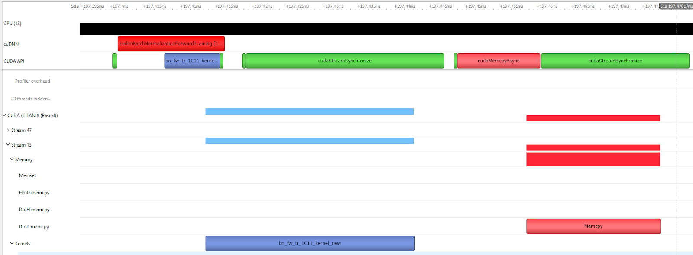

# 从源码假设追到编译结果

假设把GEMM输出tile扩大后，逻辑上的数据复用增加，实际速度却下降。下一步要验证是否增加了寄存器占用、spill或其他成本。编译检查应服务这个具体问题，不能只凭看到某条矩阵指令就宣布优化成功。

## PTX与SASS分别处于哪一层

PTX是NVIDIA虚拟指令集表示，仍需进一步编译为目标GPU的机器指令。SASS反映具体架构上的指令。相同PTX在不同架构或工具链下可能产生不同资源使用与调度，不能把两者当作同一层证据。

高层IR还能帮助确认布局转换与融合是否已经发生。先从接近源码的层看语义变化，再向下追具体指令，通常比直接读完整汇编更容易定位。

## 把比较范围缩到一个shape

固定输入M/N/K、dtype、stride、编译器和GPU，只改变tile参数。保存两版编译输出与资源信息，再比较实际耗时。否则一次编译器升级、dtype改变与tile改变同时发生，很难知道哪项导致差异。

更大的输出tile需要更多累加器。如果寄存器需求超出可用资源，编译器可能产生local memory访问。看到spill统计或相关访存是支持证据，但local memory也可能来自明确的局部数组，仍应追源码用途。

<!-- systems-workflow-visual -->


编译结果与运行测量要绑定同一设备、shape和配置，避免把不同变体的证据拼在一起。

## 源码表达dot不保证目标指令和效率

矩阵尺寸、dtype、对齐、布局和编译配置都影响降级路径。检查是否生成预期矩阵运算，再看周围的转换、搬运与同步。即使矩阵指令存在，数据供给不足或小shape也可能限制整体效率。

同理，向量化load存在不代表全局访问一定连续；需要把线程地址映射与实际内存事务联系起来。编译静态信息解释“程序会怎样执行”，profile解释“这次执行为何耗时”。

## 用同一个 cubin 复查 PTX、SASS 与资源

下面是一条最小的 CUDA C++ 检查路径。`sm_90` 只是示例，实际目标必须换成正在测量的 GPU 架构；如果程序走的是 JIT 或框架预编译 kernel，直接编译一个独立 `.cu` 文件只能验证示例，不能冒充线上实现。

```bash
nvcc -O3 -lineinfo -Xptxas=-v -arch=sm_90 \
  -cubin kernel.cu -o kernel.sm90.cubin 2> ptxas.log
cuobjdump --dump-ptx kernel.sm90.cubin > kernel.ptx
cuobjdump --dump-sass kernel.sm90.cubin > kernel.sass
nvdisasm --print-line-info kernel.sm90.cubin > kernel.disasm
```

`-Xptxas=-v` 的输出通常包含寄存器数、静态 shared memory 和 local memory 使用量。它能帮助确认 tile 变大后是否出现 spill，但不直接给出 occupancy、内存事务或端到端时间。`-lineinfo` 让工具在可用时把机器指令映射回源码行，优化级别和内联会影响映射的完整程度。`cuobjdump` 适合从 fatbin/cubin 中抽取 PTX 或 SASS，`nvdisasm` 更适合继续查看单条指令、控制流和架构编码；两者输出的格式和精度不要混成一个指标。

先把两版结果写成一张固定表：

| 版本 | shape / dtype | registers / thread | local memory | shared memory | kernel time | 端到端时间 |
| --- | --- | ---: | ---: | ---: | ---: | ---: |
| baseline | 记录完整配置 |  |  |  |  |  |
| tiled | 只改变 tile |  |  |  |  |  |

如果 tiled 版本寄存器和 local memory 上升，同时 kernel 时间和端到端时间都上升，spill 假设得到支持。若只有寄存器上升而总时间下降，可能是复用增加抵消了占用下降；若静态资源没变而端到端变慢，应回到 launch、转换、同步和请求调度去找原因。表中空白项不能用编译器猜测补齐。

## 利用库提供的可观测入口

DeepGEMM固定版本README列出 `DG_JIT_DEBUG`、`DG_JIT_PTXAS_VERBOSE`、`DG_JIT_DUMP_PTX`、`DG_JIT_DUMP_SASS`以及检查spill/local memory的选项。这些是该版本查证过的接口，其他库和版本应查询各自文档。

开启检查后先确认输出属于正在基准的那一个变体。JIT缓存、不同shape和fallback可能让源码与实际加载kernel不一致。记录编译配置和实际命中路径，才能把汇编证据与测量对应起来。

对 Python、Triton 或 PyTorch 扩展，先得到实际加载的 kernel 名称和编译产物位置，再决定是否能用 `cuobjdump` 检查。一个常见误区是把框架生成的临时 cubin 与手写 CUDA 的 cubin 放在同一目录，随后拿错文件分析。最小记录至少包含 `kernel_name`、设备 compute capability、运行时版本、JIT key 或源码 commit，以及本次 benchmark 的 shape 和 warmup 规则。

## 什么时候可以停止下钻

若完整请求时间主要在排队或CPU前处理，继续优化一个只占极少时间的kernel汇编，通常缺少收益来源。回到关键路径决定工作优先级。底层检查的目标是验证一个可行动假设，而非把所有指令都解释一遍。

静态检查之后至少要有一次带 warmup 的时间线。比如用 Nsight Systems 先确认请求、CPU 调度、CUDA launch 和 kernel 的先后关系，再用 Nsight Compute 对一个已确认的 kernel 收集 occupancy、内存吞吐和指令统计：

```bash
nsys profile --trace=cuda,nvtx,osrt --sample=none \
  --output=trace ./bench --shape 4096,4096,4096
ncu --set full --kernel-name-base demangled \
  --launch-skip 10 --launch-count 1 ./bench --shape 4096,4096,4096
```

这些命令只表达一种检查顺序。应用的参数、过滤规则和采样开销要按版本调整，不能把一次 profile 的绝对时间当作纯 kernel 时间。`--launch-skip` 与 warmup 逻辑也要在报告里说明；如果 benchmark 每次只启动一个 kernel，就不应照搬适合长服务的过滤设置。时间线中的同步或前置 copy 若占主要比例，SASS 改善可能对用户延迟没有可见影响。

## 给静态证据配一份可回放的记录

每次比较至少保存 GPU 型号、驱动与工具链版本、编译选项、shape、dtype、stride、JIT key、寄存器和 shared memory 使用量，以及 profile 中对应的 kernel 名称。只保存一段 SASS 文本，下一次工具链变化后很难判断差异来自源码、编译器还是设备。

遇到“指令看起来更好但速度没变”的结果，可以按三步回放：先确认 benchmark 命中了这份编译产物，再看时间线是否被前后转换或同步遮住，最后比较资源占用与实际 occupancy。若第一步不成立，继续分析汇编只是在分析另一条路径。

{ width="820" }

<small>图源：[NVIDIA Nsight Systems 文档](https://docs.nvidia.com/nsight-systems/)。原图表达同步调用和 kernel 时间线如何暴露源码意图之外的执行路径；读图重点是提醒编译检查要和 profile 结合：PTX/SASS 说明生成了什么，timeline 说明它何时真正阻塞。它不能替代逐条 SASS 审查。</small>

## 对照源码与延伸阅读

- [该版本JIT调试、汇编与资源检查选项](https://github.com/deepseek-ai/DeepGEMM/blob/5081f8513af57e61696de4f4f04b0e707ffb503e/README.md)
- [tile与架构条件下的不同实现](https://github.com/triton-lang/triton/blob/cd2e01c6686d6503802e6cdfac56d5a5dfdb27a1/python/tutorials/09-persistent-matmul.py)
- [NVIDIA nvcc 编译选项与 `-Xptxas`](https://docs.nvidia.com/cuda/cuda-compiler-driver-nvcc/index.html)
- [NVIDIA CUDA Binary Utilities：`cuobjdump` 与 `nvdisasm`](https://docs.nvidia.com/cuda/cuda-binary-utilities/index.html)

## 编译检查必须回答一个具体假设

不要从“出现某条矩阵指令”直接跳到“优化成功”。先写假设，例如 tile 变大导致寄存器 spill，或 layout 转换阻塞了数据供给；再固定 shape、dtype、GPU、编译器和 JIT 配置，同时保存 IR/PTX/SASS、资源统计和 profile。静态编译证据解释生成了什么，时间线证据解释它何时阻塞。

**来源与改编说明**：[DeepGEMM README](https://github.com/deepseek-ai/DeepGEMM/blob/5081f8513af57e61696de4f4f04b0e707ffb503e/README.md) 的 `DG_JIT_*` 开关只适用于该版本；其他库必须查自己的调试入口。自测时列出一个“静态指令正确但端到端仍慢”的原因，并说明应在哪个 trace 中寻找证据。

如果还没有稳定的时间线，先看[profiling、调试与数值稳定性](profiling-debugging-and-numerical-stability.md)确定计时边界；如果想把 spill 和 tile 选择连起来，再看[高级 kernel 模式与 shape 特化](advanced-kernel-patterns-and-shape-specialization.md)。编译器检查要服务一个明确假设，不能变成逐条罗列汇编指令。
