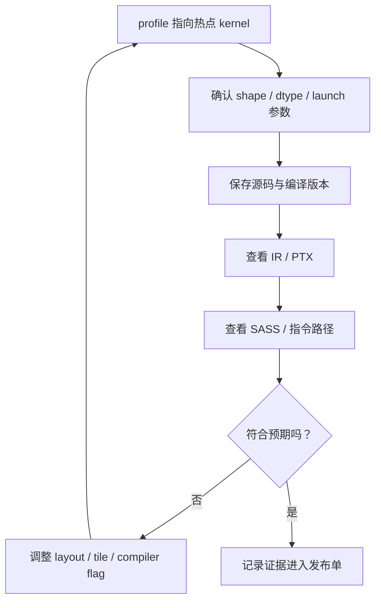

# PTX / SASS 与编译检查

很多 kernel 调优到了后期，真正需要看的已经不只是源码，而是编译之后到底生成了什么。因为同一段高层代码，可能在不同编译器、不同版本、不同 GPU 上生成完全不同的底层结果。  
这也是为什么成熟的算子工程师，最终都会形成一个习惯：**必要时看 PTX，看 SASS，看寄存器和指令路径，而不是只相信源码意图。**

<!-- [补充] -->
| 读者 | 建议读法 | 工程落点 |
| --- | --- | --- |
| 初学者 | 先抓“PTX / SASS 与编译检查”要解决的问题、关键术语和最小例子；公式只看变量方向。 | 能说清输入、输出和常见失败信号。 |
| 工程师 | 直接对照结构、指标、成本和边界条件，必要时回到前置页补概念。 | 落到数据、算力、延迟、显存、评测和回滚检查。 |

!!! note "合并提示"
    **note · 读法定位**

    这页先回答“PTX / SASS 与编译检查”在「算子与编译器」里的位置：它解决什么局部问题，依赖哪些前置，最后会影响哪类工程或研究判断。
    **前置**：先理解张量 shape、显存层次和 GEMM；系统指标卡住时回推理或训练专题。 必要时先回 [算子与编译器入口](index.md)、[基础知识](../foundations/index.md) 或 [术语表](../glossary/index.md)。
    **主线关系**：把模型里的矩阵乘、attention、通信和低精度路径落到 GPU 时间线上，看瓶颈如何被 kernel 与编译栈改变。

    **note · 初学者先抓住**

    源码表达的是你希望编译器做什么，PTX/SASS 反映的是编译器实际生成了什么。调优后期如果性能不符合预期，就要检查是否真的走了 Tensor Core、是否向量化、是否发生 spill、是否被拆成了意外路径。

    **example · 有趣例子：菜谱和成品**

    菜谱写得再清楚，也要看端上来的菜。PTX/SASS 就是 kernel 的成品检查，能揭示源码层面看不到的编译结果。

<!-- [补充] -->
> **踩坑原因**：这类工程问题通常不是单点公式错，而是 shape、资源预算、并发路径和观测指标之间有一个假设没对齐；先把触发条件、监控信号和回滚边界拆开查。

## 为什么要看编译结果

因为源码层面你以为发生的事，未必真的发生了。例如：

1. 你以为某些 load 被向量化了，结果并没有；
2. 你以为用了 Tensor Core 路径，结果编译后走了普通 FMA；
3. 你以为融合成功了，结果中间仍被拆开；
4. 你以为寄存器够用，结果出现了 spill。

所以编译结果检查，是源码和真实性能之间的最后一道验证。

## PTX 和 SASS 分别代表什么

**一个很粗略但够用的理解是**：

1. `PTX` 更像面向虚拟架构的中间汇编；
2. `SASS` 更接近最终在目标 GPU 上执行的机器级指令视图。

**这意味着**：

1. 看 PTX 能帮助你理解编译器大致生成了什么结构；
2. 看 SASS 更能接近真实执行路径。

## 什么情况下值得下钻到这一级

**通常是在这些场景下**：

1. profile 显示 kernel 明显不符合预期；
2. Tensor Core 利用率异常低；
3. 同一源码不同版本性能差异大；
4. 怀疑编译器没有做你预期的优化；
5. 需要确认寄存器、spill 或指令序列问题。

如果只是早期原型期，没必要一开始就钻太深；  
但到了高性能调优后期，这一步往往非常值钱。

## 你在编译结果里通常想确认什么

**最常见的关注点包括**：

1. 是否真的走到了目标指令路径；
2. 是否有额外的 layout / move 指令；
3. 是否有意外的分支；
4. 是否出现过多寄存器占用；
5. 是否有明显 spill；
6. 某些关键内存访问是否按预期被组织。

## Inspection 工作流

这张图的关键是：先有 profile，再看 PTX/SASS。不要为了“看起来专业”而在没有热点证据时读汇编；也不要在 profile 已经指向底层路径时继续只改高层源码。

### 5.1 检查记录模板

| 项 | 示例 |
| --- | --- |
| kernel | `fp8_gemm_bias_gelu_v3` |
| shape / dtype | `M=4096,N=11008,K=4096, FP8/BF16 accumulate` |
| 预期路径 | Tensor Core MMA + vectorized load |
| 实际观察 | MMA 指令存在，寄存器 128/thread，无 spill |
| 风险 | tail shape 走 fallback，H100 与 B200 需分开记录 |
| 结论 | 可发布到指定 bucket，长尾 shape 继续通用路径 |

## 为什么这件事对 Triton 和 CUDA 都有意义

虽然 Triton 抽象更高，但最终也会生成底层代码。  
因此在调优后期，无论是手写 CUDA 还是 Triton kernel，都可能需要做同样的检查：

1. 编译器是否按预期理解了你的 tile；
2. 某些向量化是否真正发生；
3. 某些优化是不是只停留在高层语义里。

这一步不是在否定高层工具，而是在补足它们的“最后一跳可见性”。

### 5.1 一个更稳的阅读顺序

读编译结果时不要一上来就陷进所有指令细节。先从 profile 时间线确认问题是否真的在这个 kernel；再看是否走到预期的 Tensor Core、向量化 load/store 或 memory path；接着检查寄存器数量、spill、额外 move 和分支；最后才比较不同编译选项或不同写法生成的差异。

如果源码改动前后性能差异很大，最好把两版的 IR / PTX / SASS 和关键 shape 绑定保存。这样后续升级编译器或 GPU 时，可以知道退化来自指令路径变化、寄存器压力变化，还是 runtime 选择了另一条 kernel。

### 5.2 不要脱离 profile 读汇编

PTX / SASS 检查最容易走偏的地方，是把所有可疑指令都当成瓶颈。真正该优先看的，是 profile 已经指向的热点：如果瓶颈是 memory throughput，就重点看 load/store、coalescing、cache hint 和额外 move；如果瓶颈是 Tensor Core 利用率，就看 MMA 指令、tile 形状和数据类型路径；如果瓶颈是 occupancy，就看寄存器、shared memory 和 block 配置。汇编是证据，不是起点。

## 直觉例子

可以把 PTX / SASS 检查看成工厂验收时拆开机器外壳看内部传动。设计图纸当然重要，但真正决定机器怎么跑的，是里面最后装出来的齿轮、传动轴和控制逻辑。源码是设计图，编译结果才是实际装配好的机器。高性能调优到后期，很多问题只能通过“拆开机器看内部”才能确认。

## 本页结论

PTX / SASS 与编译检查，是高性能算子工程里靠近终局的一步。它不需要每次都做，但在关键热点和疑难性能问题上非常有价值。只要你建立了这个意识，就会更容易把“高层代码意图”和“底层真实执行”真正接起来，而不是停留在源码层面的想当然。

## 工程收束

PTX / SASS 检查要把 IR 结构、向量化、寄存器、访存指令和 Tensor Core 路径与真实 profile 绑定。不要过度迷信源码层直觉，也不要看到 PTX 就停止；上线前应先看时间线再下钻，把 IR / PTX / SASS 与 shape 绑定，并把 inspection 结果写进发布单。

如果某个性能结论依赖具体编译器版本或 GPU 架构，就应把对应反汇编片段、关键 shape 和 profile 截图一起留档。否则下一次驱动、编译器或框架升级后，很难判断退化来自哪里。

这类记录不需要覆盖所有代码，但要覆盖最贵、最热、最容易随版本漂移的路径。

当性能退化出现时，这些记录能把排查范围从整套栈缩小到具体编译路径。

这就是 inspection 的实际价值。

!!! tip "下一站"
    - 回到本专题入口：[算子与编译器](index.md)，确认这页在整条路线中的位置。
    - 按导航顺序继续：[GEMM 与 Attention Kernel](gemm-attention-and-fused-kernels.md)。
    - 概念或符号卡住时，先查 [术语表](../glossary/index.md)，再回到当前页。
