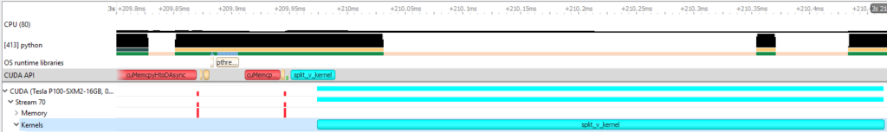

# LayerNorm 这四个数怎样进出 kernel

LayerNorm 的 kernel 常常不慢在乘加本身，而慢在“这一行的所有元素都要先碰到”。给定 `[1,2,3,4]`，它要先算整行统计，再产生四个输出；换成带 padding、切片 stride 或重复索引的输入，错误又会出现在分母和写回位置。把这一行追完，可以同时理解 reduction、mask、stride 和梯度累积。

## 先把一行四个数算完

均值为2.5，平方偏差平均为1.25。忽略epsilon、令gamma=1和beta=0，输出为

$$
\frac{[1,2,3,4]-2.5}{\sqrt{1.25}}
\approx[-1.34164,-0.44721,0.44721,1.34164].
$$

前向至少需要得到均值和方差，再应用逐元素变换。实际算法可能分多遍读取，也可能使用Welford等合并统计的办法；选择受行宽、资源和数值稳定性影响。

RMSNorm不减均值，使用 $\sqrt{\operatorname{mean}(x^2)+\epsilon}$。本例平方均值为7.5，输出约 `[0.36515,0.73030,1.09545,1.46059]`。它与LayerNorm得到的函数不同，不能只因为省一次统计就无条件替换。

## Padding 一旦进了分母，结果就错了

假设真实行长为3，kernel为了方便加载4个位置。无效位置可填0帮助求和，但均值分母仍应为3。算方差时，还要屏蔽无效位置的平方偏差，否则填入的0经过减均值后会产生非零贡献。

Softmax的无效logit通常填负无穷，让指数权重为0。若填0，而有效logit都为负，无效位置反而会抢占概率。Mask既保护内存，也定义计算对象，这两个作用必须同时正确。

## 一个 block 怎样读完不整齐的一行

设物理宽度为 8、真实长度为 5，`BLOCK=8` 的 kernel 可以为每个 lane 生成偏移 `[0,1,2,3,4,5,6,7]`，再用 `offset < 5` 作为有效条件。前五个 lane 读取真实地址，后三个 lane 用中性值参与统计，写回时仍使用同一张 mask。这里的中性值依赖运算。求和可以填 0，求最大值可以填负无穷，乘法累加通常也填 0；把一个随手选的数字塞进去，结果可能只在尾块上错。

用 Triton 风格的伪代码表示，指针和统计逻辑可以拆开检查：

```python
offsets = row_start + tl.arange(0, BLOCK)
mask = tl.arange(0, BLOCK) < width
x = tl.load(x_ptr + offsets, mask=mask, other=0.0)
row_sum = tl.sum(x, axis=0)
tl.store(out_ptr + offsets, normalized_x, mask=mask)
```

这段代码还缺少方差、归一化和数值稳定处理，不能直接当作完整 LayerNorm。它的作用是把三个边界固定下来：地址由 `row_start + offsets` 给出，读入的无效元素由 `other` 控制，写回的无效位置由 `mask` 控制。若只在 `tl.load` 上加 mask，统计可能正确，越界写仍然存在；若只在写回时屏蔽，padding 仍可能进入均值。

真实实现通常让一个 program 负责一行或一组行，`BLOCK` 取不小于行宽的编译期大小。行宽变化会改变寄存器数量、并行度和尾部浪费，不能把 1024 的最佳 block 直接套到 513。应至少测量整齐宽度、刚跨 block 的宽度和很窄的行宽，并记录实际选择的配置。

## 反向时参数梯度还要再归约一次

对每行的LayerNorm，输入梯度可以用该行统计量计算。共享参数gamma和beta却会收到所有行的贡献，$d\beta$是上游梯度按行求和，$d\gamma$是上游梯度乘归一化输入再按行求和。

Triton官方LayerNorm教程先按行计算dx及部分dw/db，再用另一段归约合并参数梯度。这解释了为何一个前向看起来很短的norm算子，训练实现仍需考虑临时缓冲、写入竞争与额外归约。

## 同样的 shape，地址可以完全不同

行优先2×3矩阵的stride为(3,1)，元素(1,2)在偏移5。转置视图为3×2，stride变成(1,3)，元素(2,1)仍在偏移5。转置可只改元数据，原存储没有移动。

若后续kernel要求行连续，转置视图就可能需要真正复制。`contiguous()`的成本来自读写全部元素。优化完整层时要把这次复制算进去，不能只看归一化kernel。

## 重复索引为什么必须累加

若索引为 `[2,0,2]`，gather输出 `[x2,x0,x2]`。反向时x2要收到两处梯度之和，不能简单用后一次写入覆盖前一次。这是scatter-add或等价归约要解决的问题。

在MoE里，同一token可能被送给多个专家，合并时也需要恢复原位置并按路由权重累加。[MoE算子](moe-routing-and-sparse-kernels.md)会把这个索引例子扩展成完整专家输入。

## 融合前先问少了哪次读写

若残差加法后立即做norm，可以尝试在同一kernel读取两路输入、相加、归约并输出，避免把中间和写回后再读。代价是更多同时存活的值及可能更复杂的反向。先用上述小例子确认数学与mask，再在真实行宽和stride上测量。

{ width="820" }

<small>图源：[NVIDIA Nsight Systems 文档](https://docs.nvidia.com/nsight-systems/)。原图表达短 kernel、CPU 调度和 GPU 时间线的关联；读图重点是 reduction、norm、layout 和 indexing 这类小算子往往以“很多短条”拖慢端到端路径。它不能证明具体哪个小算子是瓶颈，仍需按 trace 下钻。</small>

## 继续读

继续看[低精度与量化 kernel](low-precision-and-quantized-kernels.md)和[profiling、调试与数值稳定性](profiling-debugging-and-numerical-stability.md)，把索引错误接到真实性能回归。

## 对照源码与延伸阅读

- [LayerNorm前向、dx与dw/db分段归约](https://github.com/triton-lang/triton/blob/cd2e01c6686d6503802e6cdfac56d5a5dfdb27a1/python/tutorials/05-layer-norm.py)
- [Softmax的负无穷mask与片上归约](https://github.com/triton-lang/triton/blob/cd2e01c6686d6503802e6cdfac56d5a5dfdb27a1/python/tutorials/02-fused-softmax.py)

## 一个 mask/stride 练习

构造一个真实长度为 3、物理宽度为 4 的 row，并分别用连续视图、stride=2 的切片和转置视图调用 norm。要求输出只由三个有效元素决定，参数梯度按真实行数归约，padding 不进入均值、方差或 softmax 分母。再把第四个位置填入极大值，确认结果不变；若结果改变，说明 mask 只保护了写回或只保护了部分归约。

## 性能诊断要回到数据流

若 norm 融合后变快，记录减少的中间写回和新增的寄存器/共享内存；若只在连续输入上变快，报告 fallback 或 copy 的比例。对 scatter/gather，还要记录重复索引造成的梯度累加是否进入原子操作或第二次归约。数学上相同的输出，可能因布局和写入竞争走完全不同的系统路径。

调试时可以把问题分成三张小表：有效元素集合、每个线程读取的地址、每个输出或参数梯度的写入者。三张表都对上以后，再去讨论 fusion 和向量化；否则一个看似性能问题的差异，很可能其实是 mask 或重复索引的正确性问题。

## 来源与自测

LayerNorm、softmax mask 和分段归约参考 Triton 官方教程；文中的小矩阵和梯度数字是可手算例子。自测时分别列出有效元素、读取地址和写入者，确认 padding 不进入统计量或梯度分母。
