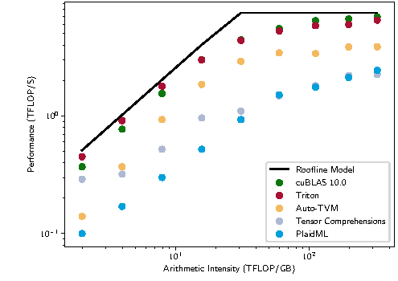

# Roofline怎样解释同一GPU上的两种attention

Roofline把计算吞吐限制和内存带宽限制画在同一关系里。先算运算量F、搬运字节M和算术强度I=F/M，再比较 $\min(P,B I)$。它给出理想上限，实际程序还可能受并行度、访存模式和调度限制。

## 单query decode的低强度从哪来

假设batch为8、query头数32、KV头数也为32、历史长度8192、head dimension128，BF16 K/V。忽略softmax等小项，QK与PV运算量为

$$
F=4\times8\times32\times8192\times128
=1{,}073{,}741{,}824\ \text{FLOPs}.
$$

每个K/V至少读取一次时，主体字节为

$$
M=2\times8\times32\times8192\times128\times2
=1{,}073{,}741{,}824\ \text{bytes}=1\ \text{GiB}.
$$

于是理想强度为1FLOP/byte。若有效带宽假设为2TB/s，读取下界约0.537毫秒，不能把这个下界写成已测延迟。

若GQA改为8个KV头、仍有32个query头，KV主体减到四分之一。理想复用下强度升为4FLOPs/byte，但实际kernel若重复读取共享KV，收益会小于该估算。

## Prefill的query多了，复用也变了

考虑单头长度T=4096、d=128的非因果dense attention。QK与PV主运算约 $4T^2d=8.59$ GFLOPs。Q、K、V、O四个BF16张量主体合计约4MiB。如果能有效分块复用、避免完整score写回，理想算术强度远高于单query decode。

然而完整T×T分数矩阵单份BF16就有32MiB，显式写S/P会显著增加流量。FlashAttention减少这部分I/O，但受片上容量影响，K/V块仍可能被多个query块读取，不能把4MiB直接当作真实HBM总流量。

因果mask还会减少部分有效配对，计算计数需对应实现与报告口径。报告TFLOPS时先写明使用dense还是因果有效FLOPs。

## 为什么没有达到roofline仍不能直接说kernel差

计算与带宽峰值需要合适shape、指令、数据复用和足够并行。小矩阵可能无法填满设备；不规则索引可能产生更多物理事务；寄存器spill和同步也会改变实际成本。Roofline中的M若只是逻辑张量大小，而非实际搬运，预测误差就可能来自模型本身。

因此先在相同计时边界下测kernel，再看实际带宽、指令和资源。不要从一个低util数字直接推断原因。

## 算子加速如何折算到整步

教学设定中，attention占完整请求时间30%，其余70%不变。如果attention提速2倍，整体加速为

$$
S=\frac1{0.7+0.3/2}\approx1.176.
$$

若加入布局转换、队列变化或并发资源竞争，还可能更小。反之，节省显存让batch增大时，也可能出现系统级额外收益。这个公式只描述固定串行占比的情形。

## 一个可比较的结果应包含什么

记录shape、head映射、mask、dtype、layout、设备和软件版本；分别报告预热后的分布与冷启动成本；给出数值误差、逻辑FLOPs/bytes定义和完整层耗时。本文没有附GPU实测，因此所有时间下界都只用于检验计算与单位。

{ width="820" }

<small>图源：[Triton: An Intermediate Language and Compiler for Tiled Neural Network Computations](https://www.eecs.harvard.edu/~htk/publication/2019-mapl-tillet-kung-cox.pdf)。原图表达不同实现相对 roofline 的位置；读图重点是把 microbenchmark 结果先放到“算力上限 vs 带宽上限”的坐标里，再判断优化方向。它不能证明某个 kernel 在端到端服务里必然更快。</small>

## 对照源码与延伸阅读

- [分块attention的实际计算路径](https://github.com/triton-lang/triton/blob/cd2e01c6686d6503802e6cdfac56d5a5dfdb27a1/python/tutorials/06-fused-attention.py)
- [不同shape上的矩阵乘基准组织](https://github.com/triton-lang/triton/blob/cd2e01c6686d6503802e6cdfac56d5a5dfdb27a1/python/tutorials/03-matrix-multiplication.py)
