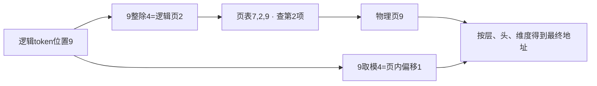
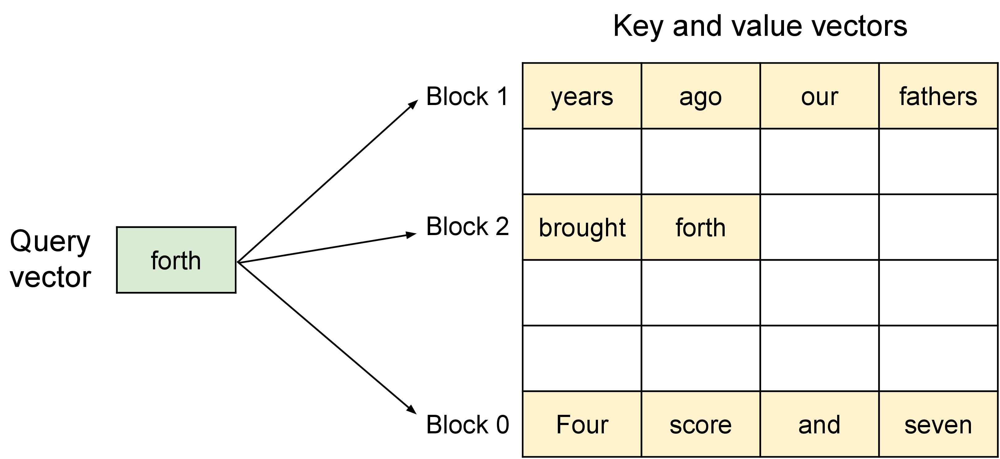

# 一次 decode 怎样找到历史 KV

生成一个新token时，attention需要当前query与历史K计算分数，再用分数加权V。历史长度不断增长，多个请求又共享同一显存池，因此服务kernel通常还要理解逻辑位置、物理页和有效长度。

## 先算一条短请求

假设请求已经计算了10个token的KV，页大小为4，它需要3个逻辑页。页表为 `[7,2,9]`，表示逻辑页0、1、2分别存放在物理页7、2、9。

逻辑token位置i对应

$$
page=\lfloor i/4\rfloor,\qquad offset=i\bmod4.
$$

位置9落在逻辑页2，页表给出物理页9，页内偏移1。Kernel再结合层、KV头和head dimension计算最终地址。这里物理页9与token位置9数值恰巧相同，没有语义关联。

最后一页只使用2个位置，读取attention时必须依据真实长度屏蔽剩余位置。分配了空间不表示其中KV已经计算完成。

<!-- systems-workflow-visual -->

逻辑位置和物理页编号是不同坐标系，页表承担转换；真实长度另行屏蔽无效槽位。

## 页管理和 attention 计算分工不同

调度器在执行前为待计算token分配空间，kernel在执行时写入新K/V并读取允许的历史位置。vLLM V1调度代码维护已计算token数、待处理token和缓存分配，返回输出后再更新请求状态。

共享前缀可让不同请求引用相同历史页。引用关系改变时要避免过早释放仍被其他请求使用的页，生成分叉写入时还需遵循相应共享策略。Kernel正确读页，不会自动保证管理层的引用计数正确。

## 两个请求共享前缀时，谁拥有最后一页

设页大小仍为4。请求A和请求B都先处理相同的4个token，物理页12保存这段前缀，因此两张页表都以12开头。A继续生成两个token，页表为 `[12, 3]`；B继续生成一个token，页表为 `[12, 8]`。两条请求的逻辑位置相同，但第二个逻辑页已经分开，不能把A写入的第5、6个token当成B的历史。

如果两个请求在分叉后仍指向同一物理页，追加写入就会覆盖另一条请求的KV。常见处理是让共享页保持只读，第一次写入时分配新物理页并复制必要内容，也就是 copy-on-write。另一种做法是从一开始就为分叉请求复制页。无论采用哪一种，调度器都要记录引用计数、逻辑长度和最后一个有效槽位；kernel只拿到已经解析好的页表时，无法自行修复错误的所有权。

一个容易漏掉的测试是“前缀相同、后缀不同、同时追加”。先让A和B共享页12，再交错提交A的下一个token和B的下一个token，检查两条请求的输出是否等同于分别独立计算的连续KV结果。这个测试能同时抓住过早释放、错误别名和页内有效长度混用。

## 单query扫描历史为什么昂贵

对于每个query头、T个key、头维d，QK与PV主运算约4Td FLOPs。若每个头各有独立KV且用BF16，读取K与V主体约4Td字节，理想算术强度约1FLOP/byte。

GQA让多个query头共享较少KV头，理论上可减少存储并提高复用。但实际读取是否被复用，取决于kernel工作分配和缓存。不能只把头数代入公式就断言实现达到理论强度。

按字节数也能快速检查数量级。每层、每个token的KV缓存大小是

\[
2\times n_{kv}\times d\times \text{bytes(dtype)},
\]

前面的2来自K和V。假设 \(n_{kv}=8\)、\(d=128\)、dtype为BF16，每层每个token约占 \(2\times8\times128\times2=4096\) 字节。32层、1024个历史token约为128 MiB，1000个历史token约为125 MiB，还没有计入页表、对齐和其他工作区。这个账能帮助区分“单层kernel读了多少”与“一个请求在整模型中占了多少显存”，也能解释为何GQA改变KV头数后，长上下文的显存压力会明显变化。

## 历史太长时怎样增加并行

只有一条query却有很长的KV，单个程序可能工作过久或并行度不足。Split-K把历史分段，各段计算局部最大值、分母和加权输出，再进行一次合并。合并必须使用与[在线softmax](long-context-and-flashattention-evolution.md)相同的重标定，不能直接平均局部归一化输出。

更多分段增加并行，也增加临时统计量、合并kernel与同步。当历史较短时，这些新增开销可能超过收益，所以dispatch通常需要依据长度与batch选择路径。

## Prefix命中改变计算量，不消除后续历史读取

前缀KV可复用时，可以少做重复prefill。后续每个新query仍要关注允许的前缀历史，因此decode仍有KV读取。统计prefix命中率时，应区分请求命中、token命中和节省的计算量。

比较服务attention kernel时固定真实长度、页大小、物理布局、KV头数与dtype，分别测短历史和长历史。只测连续KV张量，不能覆盖分页索引与共享前缀的实际路径。

## 读 vLLM 资料时要标出版本边界

PagedAttention 论文和 vLLM 早期设计文档很适合解释逻辑块到物理块的映射，但当前文档已经明确提示，那份设计页是基于原论文的历史资料，不能直接当成今天实现的逐行说明。读源码时应同时记录 commit、调度器状态字段和实际 kernel 入口。页表公式可以保持不变，具体布局、分块大小和 dispatch 仍要以目标版本为准。

最小回归可以覆盖四种情况：连续 KV 与分页 KV、短历史与长历史、单请求与连续批处理、无共享前缀与共享前缀。每种情况保存真实长度、页表、有效 token 数、输出误差和延迟分位数。这样才能区分地址映射错误、mask 错误、归约数值问题和调度开销。

{ width="820" }

<small>图源：[PagedAttention paper](https://arxiv.org/abs/2309.06180)。原图表达 logical KV blocks 到 physical KV blocks 的映射；读图重点是服务态 attention 的核心难点是动态 KV 内存、page lookup 和连续批处理，不只是 attention 数学。它不能证明 page size 或 block size 的唯一最佳值。</small>

## 继续读

继续看[长上下文与 FlashAttention 演进](long-context-and-flashattention-evolution.md)和[推理缓存与投机](../inference/caching-routing-and-speculative.md)。

## 对照源码与延伸阅读

- [V1调度器的KV分配与computed token状态](https://github.com/vllm-project/vllm/blob/fa3b9d1377219247060d3c8b49eae199c9e7e154/vllm/v1/core/sched/scheduler.py)
- [分块attention的稳定归约](https://github.com/triton-lang/triton/blob/cd2e01c6686d6503802e6cdfac56d5a5dfdb27a1/python/tutorials/06-fused-attention.py)

**来源与改编说明**：页表示例参考 [vLLM Paged Attention 文档](https://docs.vllm.ai/en/latest/design/paged_attention/)和原始 [PagedAttention 论文](https://arxiv.org/abs/2309.06180)。官方文档注明该设计页是历史资料，因此本文只把它用于解释地址映射概念，不据此断言当前 vLLM kernel 的完整实现。共享前缀、copy-on-write 和字节数是本站构造的检查例。
