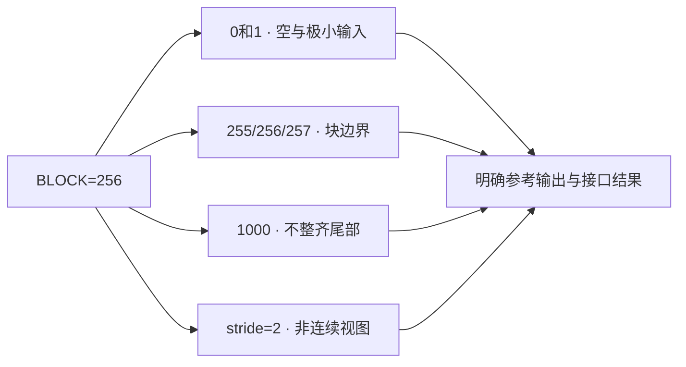
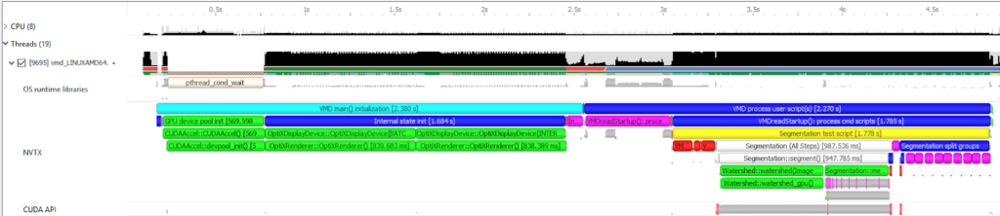

# 用边界输入检验一个kernel是否真的正确

一个向量加kernel若忘了尾部mask，长度1024可能全部通过，长度1000却会越界。测试的价值来自输入能区分正确实现和常见错误，数量本身不能代替这种区分。

## 从具体缺陷反推样本

对BLOCK=256的实现，长度0检查空输入路径，1检查极小输入，255/256/257检查块边界，1000检查不整齐尾块。再把输入换成非连续切片，验证wrapper是正确拒绝、复制还是按stride执行。

若接口承诺支持多dtype，分别检查相应数值容差。对归约添加全相等、正负抵消、大幅度和接近零的输入；softmax加入很大的logit差值，检查稳定化与mask。所有预期都先由明确参考函数定义。

<!-- systems-workflow-visual -->

样本由具体错误假设推导，比重复许多整齐shape更能发现漏mask或错误stride。

## 前向正确不保证反向正确

对 $y=a\times b+c$，反向应为 $g b$ 与 $g a$。可先在小数值上手算，再使用适合的高精度有限差分检查。输入有广播时，要检验梯度是否正确沿广播维归约。

PyTorch官方教程明确区分 `gradcheck` 与 `opcheck`。前者用于梯度数学检查，后者检查自定义算子注册与框架协作。两者都通过，仍需覆盖实际dtype、layout和设备范围。

## 并发与生命周期错误需要另一类测试

前向输出偶尔正确，不能排除shared memory覆盖、跨stream使用或异步释放问题。对声明支持的执行模式重复运行，改变输入填充值与分配顺序，必要时使用设备内存与同步检查工具。复现输入要尽量小，让故障能在同一kernel中出现。

含原子浮点归约的实现可能因顺序不同产生微小差异。先明确要求数学容差还是逐bit确定性，再选择判定方式，避免用过紧阈值掩盖真正的接口问题。

## 性能回归必须保持测量条件

固定设备、软件版本、shape、预热、同步和计时范围，保留多次测量的分布。微秒级变化可能来自时钟、缓存和其他进程，不应仅凭一次最小值判失败。

同时保留完整层或请求测试。某个kernel快了，wrapper转换、JIT或fallback却增加，端到端仍可能退化。每条特化路径记录其适用输入与存在理由，维护者才能判断升级后应修复、禁用还是移除。

<small>图源：[NVIDIA Nsight Systems / NVTX 文档](https://docs.nvidia.com/nsight-systems/)。原图表达用 NVTX 区间把 CPU 调用、kernel 和时间线关联起来；读图重点是：kernel 回归不能只看单测 pass，还要把正确性、性能、shape bucket 和线上 trace 串成闭环。它不能证明某个 kernel 正确，只提供定位性能回归和冷路径变热的观察入口。</small>

## 对照源码与延伸阅读

- [向量加参考对齐与基准](https://github.com/triton-lang/triton/blob/cd2e01c6686d6503802e6cdfac56d5a5dfdb27a1/python/tutorials/01-vector-add.py)
- [opcheck与梯度验证的明确边界](https://github.com/pytorch/tutorials/blob/5672cd98a7671eda4d9122b10f8eec580f74d03e/advanced_source/cpp_custom_ops.rst)
