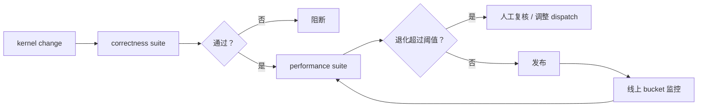

# Kernel 测试、回归与维护

很多 kernel 项目最难的阶段，不是把第一版做快，而是把它长期维持在“正确、快、可升级”的状态。一个高性能算子如果没有测试、性能回归和版本维护机制，最终很容易退化成：

1. 只在作者机器上能跑；
2. 一升级框架就坏；
3. 新 GPU 一上来性能掉很多；
4. 某些边界 shape 悄悄出错；
5. 没人敢继续改。

因此算子工程真正成熟的标志，不只是 benchmark 高，而是维护体系完整。

!!! note "初学者先抓住"
    一个 kernel 第一次跑快只是开始。真正困难的是框架升级、GPU 换代、shape 变化后仍然正确、稳定、可回归。

!!! example "有趣例子：桥梁维护"
    桥刚建好能通车不代表未来十年安全。还要定期检测、限载、修补裂缝、记录异常。Kernel 也需要正确性测试、性能回归和版本维护。

## 1. 正确性测试至少要覆盖什么

一个较可靠的 kernel 测试通常要覆盖：

1. 多种 shape；
2. 多种 dtype；
3. contiguous 与 non-contiguous；
4. 边界 shape；
5. 极值输入；
6. 训练和推理两条路径。

如果只测“最常见 shape + 随机小样本”，很多问题会长期潜伏。

## 2. 性能回归为什么必须自动化

性能是 kernel 的核心价值，但它又很脆弱。  
一个看似无害的改动，可能因为：

1. 多了一个 layout transform；
2. 改了 launch 参数；
3. 失去某个融合机会；
4. 编译器版本变化；

而让性能悄悄下降。  
因此性能基准最好进入持续回归，而不是只在发布前临时测一次。

## 3. 版本维护最容易忽视什么

最容易被忽视的不是功能 bug，而是兼容性边界：

1. 新 GPU 架构；
2. 新驱动；
3. 新 PyTorch / Triton / CUDA 版本；
4. 编译器后端变化；
5. 调度与 runtime 接口变化。

如果没有明确记录适用边界和 fallback 策略，维护成本会迅速失控。

## 4. 为什么需要性能与正确性的双重门禁

只看正确性，你可能保住了结果，却把吞吐悄悄丢掉；  
只看性能，你又可能在某些 shape 上输出错误结果。  
**真正成熟的流程应该同时有**：

1. 正确性基线；
2. 性能基线；
3. 可接受波动区间；
4. 边界 fallback。

这张图把 kernel 维护从“跑几个单测”扩展成生命周期：先正确性，再性能，再线上 bucket 监控。很多真实退化不是在 CI 当天出现，而是流量 shape 变化后某条冷路径变热。

### 4.1 回归矩阵要跟着系统一起长

kernel 的回归矩阵不应只覆盖“当前最热的一组 shape”。模型结构、服务流量、GPU 架构和编译器都会变，今天的边界 case 可能在下一版模型里变成主路径。比较稳的矩阵通常分三层：核心热 shape 用来保护吞吐，边界 shape 用来保护正确性和 fallback，历史事故 shape 用来防止同类问题复发。

性能基线也要写清测量条件，例如驱动、CUDA / ROCm、PyTorch / Triton 版本、GPU 型号、时钟策略、输入 dtype、warmup 轮数和统计口径。否则一次“性能回归”可能只是测试环境变了，而一次真正的退化又可能被环境噪声掩盖。

### 4.2 owner 和回退路径同样重要

很多自定义 kernel 不是因为没人会写而失效，而是因为没人持续负责。每类 kernel 至少要有明确 owner、支持矩阵、禁用开关和 fallback 路径。这样当新框架版本、新 GPU 或新 shape 分布出现时，团队能快速判断：是修 kernel、调整 dispatch、临时回退，还是干脆删除一条维护成本过高的特化路径。

维护文档最好记录“为什么存在这条 kernel”，而不只是“怎么调用”。包括它服务的 shape family、比通用实现快在哪里、什么时候不该用、历史上踩过哪些坑。这样的上下文能帮助后来的人判断是否继续维护，而不是在看不懂意图时选择保守保留，最终让代码库里堆满无人敢删的特化路径。

### 4.3 性能阈值要允许合理波动

性能回归阈值不能设得过死，也不能过松。太死会被噪声淹没，太松会放过真实退化。常见做法是对稳定基准使用较窄阈值，对小 kernel、动态 shape 或共享机器上的基准使用更宽阈值，同时要求连续多次退化才报警。重要的是把阈值和测试环境一起固定下来。

### 4.4 回归矩阵示例

| 层级 | 覆盖内容 | 目的 |
| --- | --- | --- |
| 热 shape | 高频 batch、seq、head dim、dtype | 保护主路径吞吐 |
| 边界 shape | 非整除、极短、极长、non-contiguous | 保护正确性和 fallback |
| 数值 shape | 极值输入、低精度 scale、softmax 大范围 | 防止低精度事故 |
| 历史事故 | 曾经触发 bug 的 shape 和输入 | 防止同类复发 |
| 新硬件 | 新 GPU、新驱动、新编译器 | 防止架构迁移退化 |

## 5. 一个形象比喻

可以把 kernel 维护想成赛车保养。第一次跑出好成绩，只说明车那一场状态很好；真正难的是每次比赛前都能确认引擎、轮胎、底盘和传感器仍在正常区间，并在换赛道、换天气、换零件后还能稳定发挥。高性能算子也是一样，真正稀缺的不是偶然跑得快，而是持续跑得对、跑得稳。

## 6. 小结

Kernel 测试、回归与维护，是高性能算子真正进入生产系统的最后一道门槛。没有这层机制，再快的 kernel 也很难长期成为系统资产；有了它，算子优化才会从“个人技巧”变成“团队能力”和“可持续基础设施”。

## 工程收束

Kernel 维护要同时看正确性、性能、数值边界、兼容性和可维护性。只有单测没有性能回归、只有热 shape 没有尾 shape、无人维护旧 kernel，都会让优化变成技术债；上线前应建立 golden set、记录支持矩阵、版本升级后重跑，并为每类 kernel 指定 owner。

维护计划也应覆盖退役路径：当某个 kernel 的适用 shape 消失、框架已有更好实现，或硬件代际变化导致收益不再成立时，应有明确的下线条件，而不是让旧路径无限期留在 dispatch 中。

能上线、能回滚、能退役，这三件事一起成立，kernel 优化才算进入工程生命周期。

否则性能收益越多，后续版本升级时背负的隐性维护成本也会越高。

这类成本迟早会回到主线服务里。

提前治理更便宜。

也更不折腾值班的人。

这很实际。
