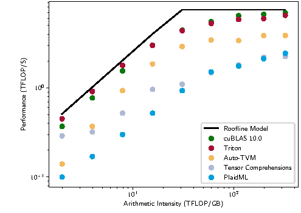

# 用 Triton 把一段向量分给多个 program

Triton让程序员描述一个program负责的一块数据，编译器再把块内操作映射到GPU执行资源。先实现长度1000的向量加，便能看清program、地址、mask与launch之间的对应关系，然后再把同样思路扩展到矩阵乘。

## 一个 program 负责256个位置

令BLOCK=256。program 0处理0到255，program 1处理256到511，program 3处理768到1023。总共只需4个program，但最后24个位置超出输入范围。

`tl.arange(0,BLOCK)`产生块内索引集合，`tl.program_id(0)*BLOCK`给出当前块起点。这个program不等于一个CUDA线程；块内这些元素由编译器分配到线程和寄存器，具体分配受dtype、操作和配置影响。

下面是完整教学实现，需要支持的GPU、PyTorch与Triton环境。这里没有在GPU上测量它的速度。

```python
import torch
import triton
import triton.language as tl

@triton.jit
def add_kernel(X, Y, Z, N, BLOCK: tl.constexpr):
    offsets = tl.program_id(0) * BLOCK + tl.arange(0, BLOCK)
    valid = offsets < N
    x = tl.load(X + offsets, mask=valid, other=0.0)
    y = tl.load(Y + offsets, mask=valid, other=0.0)
    tl.store(Z + offsets, x + y, mask=valid)

def add(x, y):
    assert x.is_cuda and y.is_cuda and x.device == y.device
    assert x.ndim == y.ndim == 1 and x.shape == y.shape
    assert x.is_contiguous() and y.is_contiguous() and x.dtype == y.dtype
    z = torch.empty_like(x)
    if x.numel():
        add_kernel[(triton.cdiv(x.numel(), 256),)](x, y, z, x.numel(), BLOCK=256)
    return z

x = torch.arange(1000, device='cuda', dtype=torch.float32)
y = torch.ones_like(x)
torch.testing.assert_close(add(x, y), x + y)
```

Load和store都带mask。无效位置填0不会影响有效位置的逐元素加法，但归约类算子要选择不同填充值，例如softmax的无效logit应填负无穷。

## 为什么 wrapper 要检查连续性

本例使用 `X+offsets`，假定相邻逻辑元素在存储中也相邻。若传入 `big_tensor[::2]`，逻辑shape虽然正确，stride却为2，当前kernel会读取错误位置。可选择在wrapper拒绝这种输入，也可把stride作为参数传进kernel并改地址计算。

自动调用 `contiguous()` 是第三种选择，但它增加一次拷贝。若只测kernel，不把这次转换算进完整算子延迟，就会高估收益。

## 矩阵乘只是换成二维输出块

对 $C_{M\times N}=A_{M\times K}B_{K\times N}$，一个program负责一块 $B_M\times B_N$ 的C，沿K反复读取A、B小块并累加。官方矩阵乘教程在循环中调用 `tl.dot`，最后把累加结果转换并写回。

$B_M,B_N$增大会增加复用，也增加输出累加器；$B_K$改变每次读入量和流水节奏。选择tile时必须同时看矩阵shape、寄存器、shared memory和尾块浪费。没有一个BLOCK设置能覆盖所有问题。

## Autotune 比较的是有限候选

`triton.autotune`可以在给定shape key下测试一组配置，例如不同tile、warp数和流水stage。它不会自动发明正确的索引、修复越界或理解业务流量。

对有副作用的kernel，候选试跑可能多次修改输出，必须按接口正确重置状态。调优key还要包含真正影响性能或语义的维度。遗漏stride、dtype等条件，可能复用错误选择；把每个无关值都纳入key，又会增加编译和缓存数量。

首次JIT与调优耗时应和预热后的执行时间分别报告。线上请求若会触发新shape，这些冷启动成本就需要计入对应延迟。

{ width="760" }

<small>图源：[Triton: An Intermediate Language and Compiler for Tiled Neural Network Computations](https://www.eecs.harvard.edu/~htk/publication/2019-mapl-tillet-kung-cox.pdf)，Figure 1。原图比较 Triton、cuBLAS、AutoTVM、Tensor Comprehensions 和 PlaidML 在矩阵乘 roofline 图上的位置；这里的重点是 Triton 的价值不是替代所有库，而是在高层框架和手写 CUDA 之间提供 tile 级表达能力。</small>

## 对照源码与延伸阅读

- [官方向量加教程](https://github.com/triton-lang/triton/blob/cd2e01c6686d6503802e6cdfac56d5a5dfdb27a1/python/tutorials/01-vector-add.py)
- [官方矩阵乘的地址、tile和autotune](https://github.com/triton-lang/triton/blob/cd2e01c6686d6503802e6cdfac56d5a5dfdb27a1/python/tutorials/03-matrix-multiplication.py)
