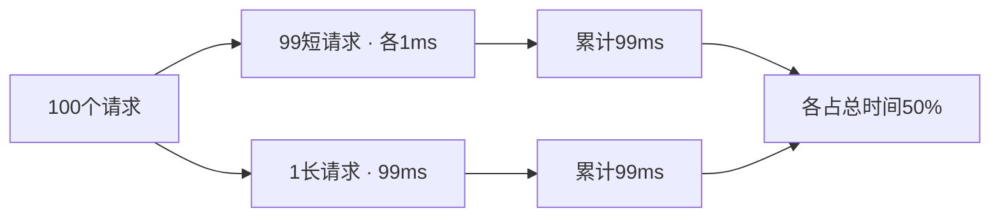

# 怎样从shape分布选出值得优化的路径

平均序列长度不能代表kernel看到的工作。一个请求会触发许多层和许多decode迭代，同一个请求的shape还在变化。建模时需要连接请求分布、实际调用次数与累计时间。

## 一百分之一的请求可以占一半时间

教学设定中，99个短请求各花1毫秒，1个长请求花99毫秒。长请求只占1%，却占总时间的一半。若目标是总计算成本，长请求值得关注；若目标是普通请求P50，结论可能不同。

再设长请求包含很多decode步，就会多次访问增长中的KV。只按请求入口记一次长度，会丢掉真实kernel调用分布。应记录每次调用的M/N/K、query/key长度、head结构、dtype与stride。

<!-- systems-workflow-visual -->

请求频率和累计成本是两种权重，优化优先级取决于目标指标。

## Bucketing会同时改变调度与计算量

把长度33和63都放进64桶，可以复用执行shape，但有效token共96，分配槽位128，利用率75%。若分别按实际长度执行，padding少了，动态shape和调度开销却可能增加。

对于dense attention，按长度平方计的配对计算更敏感。两条真实长度的平方和为5058，若都按64完整计算则为8192；是否真的支付这些padding计算，还要看mask和变长kernel实现。

## 优化权重应使用累计时间

对桶b记录调用次数 $n_b$、基准延迟 $t_b$，简化串行总成本为 $\sum_b n_bt_b$。新路径比较的是 $\sum_b n_bt'_b$，而非每桶加速倍数的算术平均。

例如90次100微秒与10次2毫秒，总共29毫秒。前一桶快2倍，后一桶慢10%，新总量26.5毫秒，整体只快约9.4%。只汇报高频桶“快2倍”会掩盖代价。

## 桶必须包含会改变语义的条件

相同shape但不同stride，可能需要不同地址计算；相同长度但不同mask，可能采用不同attention实现；相同FP8数据但不同scale布局，也未必兼容。桶可以为统计合并一些相近输入，dispatch却不能省略正确性条件。

建立候选桶后，保留每桶代表性真实输入与边界输入。特别检查桶边界前后、空输入、尾块和非连续视图。真实流量迁移后重新计算频率与累计时间，旧热点不应永久占据特化预算。

{ width="860" }

<small>图源：[vLLM 官方博客](https://vllm.ai/blog/2023-06-20-vllm)。原图表达请求调度、KV 管理和 worker 执行之间的关系；读图重点是把 shape bucket 看成 runtime 调度和 kernel 选择的前置条件。它不能证明某一组 bucket 适合所有业务，bucket 必须从真实流量统计中来。</small>

## 对照源码与延伸阅读

- [按M/N/K选择配置并测量的实际教程](https://github.com/triton-lang/triton/blob/cd2e01c6686d6503802e6cdfac56d5a5dfdb27a1/python/tutorials/03-matrix-multiplication.py)
- [不同shape上的persistent候选](https://github.com/triton-lang/triton/blob/cd2e01c6686d6503802e6cdfac56d5a5dfdb27a1/python/tutorials/09-persistent-matmul.py)
