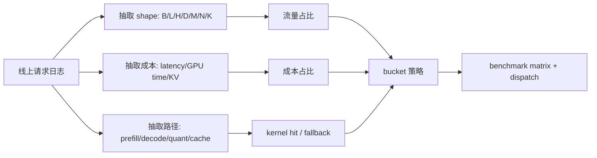

# Workload 建模与 Shape Bucketing

很多 kernel 优化最终之所以有效，不是因为它在所有 shape 上都快，而是因为它精准命中了真实 workload 中最常出现的那些 shape bucket。  
因此在进入特化和 autotune 之前，先理解 workload 分布本身，往往比直接写新 kernel 更重要。

!!! note "初学者先抓住"

    Shape bucket 是 kernel 优化的需求画像。先知道哪些 batch、长度、hidden size、LoRA、量化路径最常出现，再决定哪里值得特化；否则很容易为低频形状写出昂贵但没收益的优化。

!!! note "难点解释：为什么平均 shape 会误导"

    平均长度可能根本不是线上常见长度。真实流量往往由短请求高频、长请求高成本共同组成；benchmark 应按 bucket 覆盖率和成本占比设计，而不是只测一个“平均形状”。

## 1. 为什么 shape bucket 重要

真实系统的输入通常不是均匀分布的：

1. 某些 batch 特别常见；
2. 某些 head dim / hidden size 固定；
3. 某些请求长度集中在少数区间；
4. 某些 LoRA 或模型配置只占很小一部分。

如果不先做 workload 建模，很容易把大量工程时间浪费在低频 shape 上。

## 2. Workload 建模在回答什么

**至少要回答**：

1. 高频 shape 是哪些；
2. 长尾 shape 有多长；
3. prefill 和 decode 各自的 shape 分布如何；
4. 量化与非量化路径比例如何；
5. 哪些 bucket 值得特化，哪些应走通用 fallback。

## 3. Shape 画像应该怎么画

一个常见错误是只画长度直方图。对 kernel 优化来说，长度只是其中一维，还要看它消耗了多少 GPU 时间、是否命中量化路径、是否触发编译、是否属于 prefill 或 decode。真正的 bucket 应该服务 dispatch 和 benchmark。

### 一个 bucket 表示例

| bucket | 请求占比 | GPU 时间占比 | 主路径 | 优先级 |
| --- | ---: | ---: | --- | --- |
| short chat 0-2k | 64% | 18% | decode + launch | 中 |
| doc QA 8k-16k | 20% | 32% | prefill + KV | 高 |
| long report 32k+ | 4% | 28% | KV / page / prefill | 高 |
| image QA | 9% | 16% | vision encoder + prefill | 中 |
| tool agent | 3% | 6% | tool latency | 低 GPU 优先级 |

如果只按请求占比，短聊天看起来最重要；按 GPU 时间占比，长文档才是最该优化的桶。这就是 workload 建模的价值。

## 4. 为什么这会影响 kernel 设计

因为：

1. autotune 搜索空间要围绕高频 bucket 设计；
2. shape specialization 的收益取决于 bucket 覆盖率；
3. benchmark 不应只测理想 shape；
4. dispatch 逻辑需要围绕 bucket 组织。

换句话说，workload 建模是特化内核、调度系统和基准设计的共同前提。

### 3.1 采集 shape 时不要只记维度

一个可用的 workload 画像，通常不只记录 `M/N/K`、batch size 或序列长度，还要记录它们出现的频率、贡献的 token 数、消耗的端到端时间、是否命中 cache、是否走量化路径、是否属于 prefill 或 decode。否则一个低频但极贵的长上下文请求，可能被“出现次数”掩盖；一个高频但很便宜的小请求，又可能被“总耗时”掩盖。

更稳的做法是同时看两种占比：**流量占比**和**成本占比**。前者告诉你哪些 bucket 最常见，后者告诉你哪些 bucket 最值得优化。只有这两者都清楚，shape specialization 才不会只服务漂亮的 benchmark。

### 3.2 bucket 边界要能被 dispatch 使用

分桶不是为了画图，而是为了让 runtime 能据此选择 kernel。边界太细，dispatch 规则会碎，编译缓存和 autotune 版本会膨胀；边界太粗，热点 shape 又无法得到足够特化。一个实用口径是：先保留少数覆盖率最高的热桶，再为尾部 shape 准备保守通用路径，并在灰度期记录每个桶的命中率和回退率。

在 LLM serving 里，还要把 prefill 和 decode 分开建模。prefill 更接近长序列大矩阵，decode 更接近 small-M、KV 读取和 page lookup；把两者混在一个平均 shape 里，会让优化方向变得含糊。训练场景也类似：micro-batch、sequence packing、activation checkpointing 和并行策略都会改变真实 shape 家族。

### 3.3 什么时候该重算 bucket

只要模型版本、tokenizer、上下文窗口、流量来源、LoRA 租户或量化策略发生明显变化，旧 bucket 就可能失效。比较成熟的系统会把 bucket 统计做成周期性任务，并把“热桶变化”接进性能回归：如果热桶迁移了，原来的特化 kernel 可能不再值得维护，新的热点则需要进入 benchmark 和 dispatch 规则。

## 5. 一个形象比喻

可以把 shape bucket 想成工厂的订单画像。不是每种尺寸的零件都值得单独开一条专用产线，只有那些真正高频、长期出现的规格，才值得配专用模具。kernel 特化也是一样：先知道订单分布，再决定哪里值得投入特化成本。

## 6. 小结

Workload 建模与 shape bucket 的价值，在于把“我能优化什么”转化成“我最应该优化什么”。没有这一步，很多高性能算子开发都会陷入局部最优；有了这一步，特化、autotune、dispatch 和回归测试才会真正围绕真实系统收益展开。

## 工程收束

Workload 建模要把长度桶、批量桶、head 维、expert 分布和请求混合比放在一起看。桶太细会碎片化，桶太粗会浪费性能，只看均值会漏掉尾部；上线前应让 shape 分桶和线上流量对齐，保留热桶统计，并在灰度期重点看尾桶。

分桶策略还要定期重算，因为线上请求、模型版本和产品入口都会改变 shape 分布。一个曾经合理的 bucket，过一段时间可能就会变成吞吐浪费或 P99 抖动来源。

因此 bucket 配置最好和流量快照、模型版本、kernel 版本绑定，避免调度策略和真实 workload 悄悄脱节。

一旦入口流量变化，先复查桶命中率和尾桶延迟，通常比直接换 kernel 更快定位问题。

这一步很朴素，却经常省掉大量误调。

## 真实排查案例：平均长度没变，P99 却变差

**输入症状**：线上平均输入长度从 3.8k 到 4.1k，看起来变化很小，但推理 P99 从 5.2s 涨到 8.7s，GPU 利用率和请求量都没有明显异常。

**关键指标**：按请求数统计，短请求仍占多数；按 GPU 时间统计，32k 以上长上下文请求从 6% 成本占比涨到 28%；prefix cache 命中率从 71% 降到 43%；尾桶 KV 占用长期贴近水位。

**Nsight / trace 观察**：trace 中 prefill 阶段出现更多长条块，decode 阶段频繁等待 KV page 分配；kernel 本身没有明显退化，但 scheduler 中长请求和短请求混排后，短请求被长 prefill 挤压。

**判断**：平均长度掩盖了长尾迁移。真实变化不是“模型变慢”，而是新产品入口引入了少量长文档请求，它们改变了成本占比和 KV 生命周期。

**修复**：重算 shape bucket，把请求数占比和 GPU 时间占比分开看；长文档请求进入单独队列，prefill 分离并限制最大并发；为 16k/32k/64k bucket 单独记录 cache 命中、KV 水位和 P99。

**反例**：如果所有 bucket 的 P99 都同步上涨，且 queue time 明显升高，问题更可能是整体容量不足；如果只有某个 kernel 的时间上涨，才回到 kernel 版本或 dtype 路径排查。
