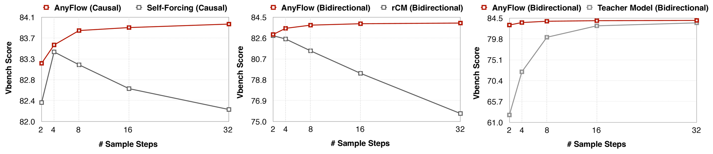
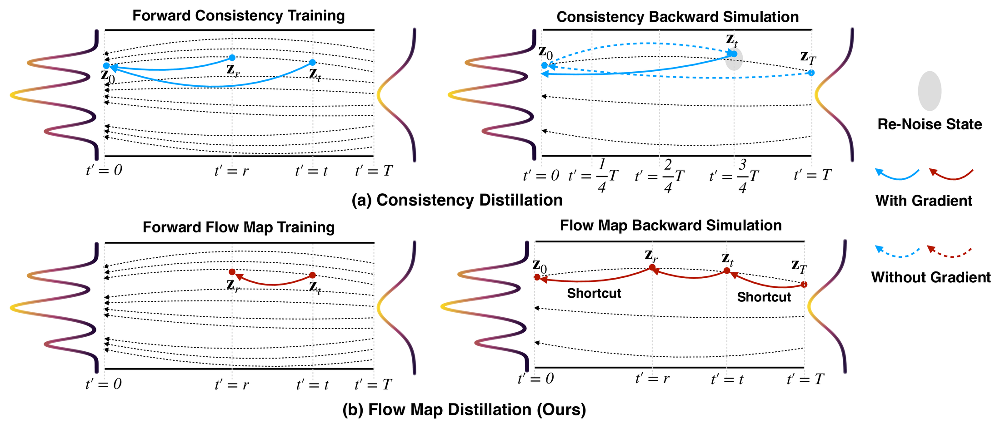
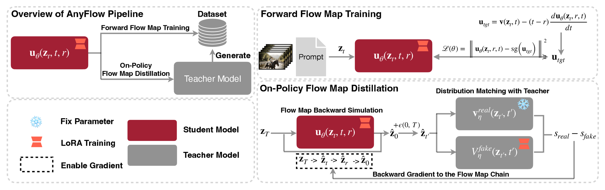
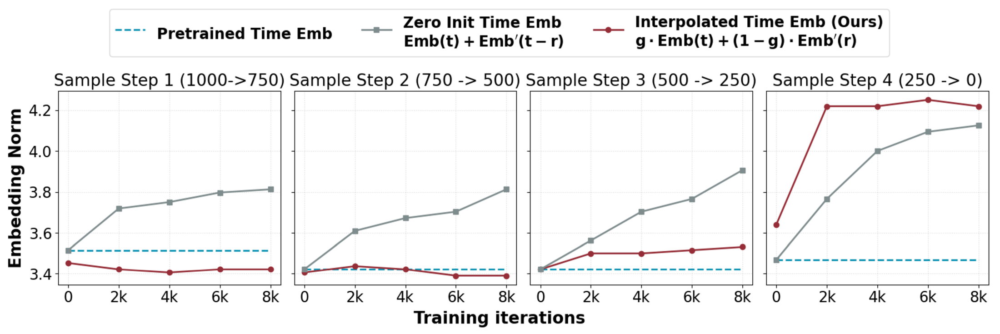
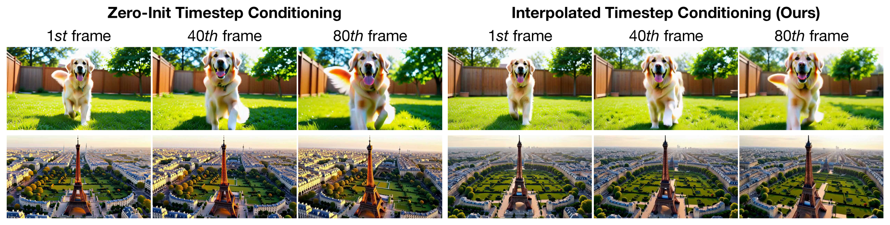
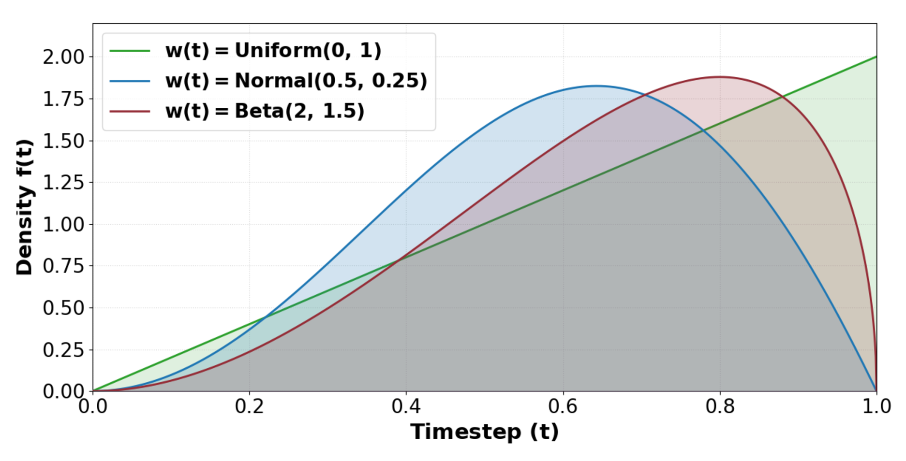
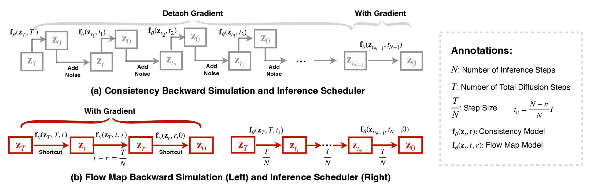
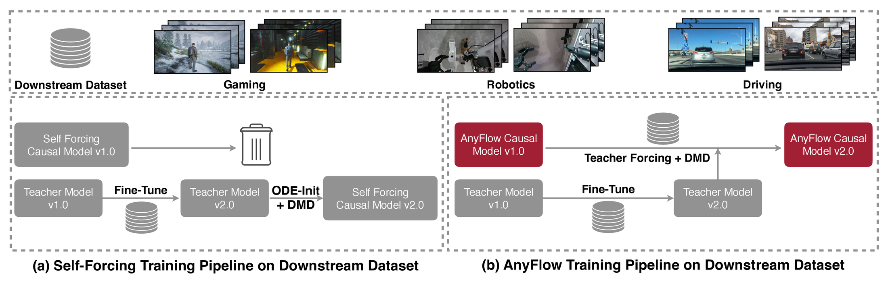
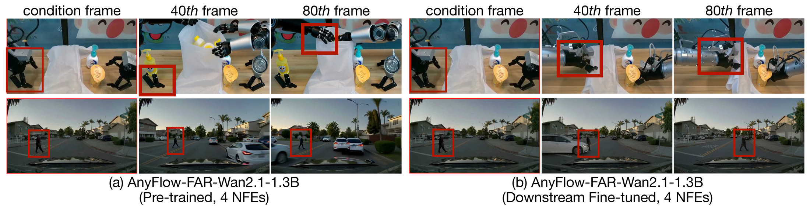

# AnyFlow：任意步视频扩散蒸馏

!!! note "读法定位"
    这页先按“论文证据节点”读：先问它解决哪一个瓶颈，再看核心图表、实验 setting 和不能外推的边界。背景概念先回 [论文专题讲解](../index.md) 和 [扩散模型](../../diffusion/index.md)。
    **前置**：建议先知道 probability-flow ODE、Flow Matching、DMD / DMD2 和 causal video diffusion 的基本含义。
    **主线关系**：读完后把结论回填到「扩散模型」里的少步蒸馏、视频生成推理加速和世界模型 rollout 成本三条线。

!!! info "论文信息"
    - 论文：`AnyFlow: Any-Step Video Diffusion Model with On-Policy Flow Map Distillation`
    - 链接：[arXiv:2605.13724](https://arxiv.org/abs/2605.13724)
    - 版本：2026-05-13 首次提交
    - 项目页：[AnyFlow](https://nvlabs.github.io/AnyFlow/)
    - 代码：[NVlabs/AnyFlow](https://github.com/NVlabs/AnyFlow)
    - 模型：[NVIDIA AnyFlow collection](https://huggingface.co/collections/nvidia/anyflow)
    - Checked Date：2026-05-19
    - 关键词：video diffusion、any-step generation、flow map、on-policy distillation、DMD、Wan2.1、FAR、causal video diffusion、LoRA

这篇论文的核心价值是把视频扩散蒸馏从“固定少数采样步好用”推进到“**同一个蒸馏模型可以随测试时采样步数变多而继续变好**”。它要解决的不是单纯 4-step 视频生成，而是 consistency distillation 的一个结构性问题：很多 consistency / endpoint mapping 学出来的学生在 4 steps 很强，但测试时给 8、16、32 steps 反而退化。

AnyFlow 的答案是：不要只学 \(z_t \to z_0\)，而是学任意时间区间的 **flow map transition**：

\[
\mathbf f_\theta:(\mathbf z_t,t,r)\mapsto \mathbf z_r,
\qquad 1\ge t\ge r\ge 0.
\]

这样学生模型既能跨大步做快速预览，也能跨小步做细致 refinement；再用 on-policy flow map distillation 修正学生自己 rollout 时的误差。

## 它的效率贡献是什么

| 维度 | 贡献 |
| --- | --- |
| 节省的成本 | 用 LoRA 后训练把 Wan2.1 级视频模型蒸馏成 few-step / any-step 生成器，减少视频扩散推理中的 NFE 成本 |
| 核心机制 | Flow map training 学任意 \((t,r)\) transition；flow map backward simulation 用 shortcut 分解 Euler rollout；DMD-style on-policy distillation 修正学生自 rollout 误差 |
| 对世界模型主线的意义 | 交互世界模型需要快速 preview 和高质量 refinement 两种模式；AnyFlow 说明少步模型不必放弃 test-time scaling |
| 主要风险 | 主要证据来自 VBench / VBench-I2V 和官方开源模型；它证明视频生成质量和采样弹性，不证明动作因果性、闭环规划收益或真实物理准确性 |
| 应接到本站哪里 | [视频与多模态扩散](../../diffusion/video-and-multimodal-diffusion.md)、[DMD2](dmd2.md)、[CausVid](causvid.md)、[Phased DMD](phased-dmd.md)、[Wan2.1](wan.md) |

## 证据等级与外推边界

| 论文结论 | 证据来源 | 证据等级 | 可外推到世界模型高效训练 | 不能直接外推 |
| --- | --- | --- | --- | --- |
| Flow map 比 endpoint consistency 更适合 any-step sampling | Figure 1/2、paradigm table、VBench step-scaling 曲线 | Benchmark + Mechanism | 少步蒸馏目标应该保留 ODE trajectory 的局部 refinement 能力 | 不能证明所有 flow-map 方法都优于 consistency；还依赖训练 recipe |
| On-policy flow map distillation 能减少 test-time errors | Flow map backward simulation、ablation、DMD-style rollout loss | Ablation + System design | 世界模型 rollout 训练要尽量在学生自己的状态分布上纠偏 | 不等于解决动作条件 exposure bias 或闭环策略分布偏移 |
| 同一模型支持 causal 和 bidirectional video diffusion | 1.3B / 14B、FAR causal 与 Wan bidirectional 实验 | Benchmark | 可以把蒸馏框架接到离线视频生成和流式生成两类模型 | 不能推出实时交互延迟已满足所有应用 |
| AnyFlow 支持 downstream continued training | downstream pipeline 与机器人/驾驶可视化 | Official demo + qualitative evidence | 蒸馏模型仍保留可微 flow field，适合领域微调 | 不能证明小数据下不会遗忘或过拟合 |
| 开源代码与模型增强可复现性 | GitHub、HF collection、Diffusers pipeline | Reproducibility signal | 可直接作为 Wan2.1 any-step baseline | 主训练数据是 teacher 合成数据；完整训练成本仍较高 |

对本站主线来说，AnyFlow 最值得吸收的是一个判断：**少步蒸馏不应把模型锁死在固定 NFE 上；如果测试时有更多预算，质量应继续上升。**

## 论文位置

传统视频扩散的采样路径可以看成沿 probability-flow ODE 从高噪声状态走向数据状态。多步 teacher 虽慢，但采样步数增加通常能让数值积分更细，质量更稳。

Consistency distillation 的问题是，它常把目标改写成 endpoint projection：

\[
\mathbf z_t \to \mathbf z_0.
\]

这对 2-step / 4-step 很有效，因为每一步都像在做一次强投影。但当测试时采样步数变多，模型会反复执行“投到 \(z_0\)，再 re-noise 到中间状态”的路径，采样轨迹可能偏离原来的 PF-ODE。结果就是：更多 steps 没有带来更好结果，甚至让视频质量下降。

AnyFlow 把目标改成两时间点之间的 transition：

\[
\mathbf z_t \to \mathbf z_r.
\]

这表达两种行为：

| Step gap | Model behavior | Inference meaning |
| --- | --- | --- |
| large \(t-r\) | long-range shortcut transition | few-step fast generation |
| small \(t-r\) | local ODE refinement | higher-step quality scaling |

{ width="920" }

<small>图源：`AnyFlow`，Figure 1(a)。原论文图意：AnyFlow 在 causal 和 bidirectional 设置下随 sample steps 增加保持或提升 VBench score；Self-Forcing / rCM 等 consistency-based 方法在更多 steps 下会下降；teacher model 则体现原始 flow-matching 采样的 test-time scaling。</small>

!!! note "这张图怎么读"
    左图比较 causal AnyFlow 与 Self-Forcing：Self-Forcing 从 4 steps 后开始下降，而 AnyFlow 继续上升。中图比较 bidirectional AnyFlow 与 rCM：rCM 随 steps 增加明显退化。右图比较 AnyFlow 与原始 teacher：AnyFlow 在少步区间大幅补强，同时仍保留“多给 steps 会更好”的趋势。

    这张图支撑的不是“AnyFlow 永远最高”，而是一个更具体的 claim：**蒸馏后的学生仍能使用额外测试时计算预算**。这对生产系统很重要，因为用户常需要 4-step 快速预览和 16/32-step 最终渲染共用同一个模型。

## Flow Map 是什么

令 \(\mathbf z_t\) 是 PF-ODE 在时间 \(t\) 的 latent state：

\[
\frac{d\mathbf z_t}{dt}=\mathbf v(\mathbf z_t,t).
\]

精确 flow map \(\Phi_{r\leftarrow t}\) 表示把状态从 \(t\) 传送到 \(r\)：

\[
\Phi_{r\leftarrow t}(\mathbf z_t)=\mathbf z_r.
\]

它有两个自然性质：

| Property | Meaning |
| --- | --- |
| identity | \(\Phi_{t\leftarrow t}(\mathbf z)=\mathbf z\) |
| composition | \(\Phi_{q\leftarrow r}\circ \Phi_{r\leftarrow t}=\Phi_{q\leftarrow t}\) |

AnyFlow 用神经网络近似这个 flow map：

\[
\mathbf f_\theta(\mathbf z_t,t,r)\approx \mathbf z_r.
\]

和普通 denoiser 或 consistency model 的区别在于，模型输入里同时有 \(t\) 和 \(r\)。所以它不是只回答“从当前噪声去到干净样本”，而是回答“从当前时间去到任意更低噪声时间”。这就是 any-step 的根。

## 蒸馏范式对比

{ width="920" }

<small>图源：`AnyFlow`，Figure 2。原论文图意：上半部分展示 consistency distillation 学 endpoint consistency mapping，并在 backward simulation 中需要 re-noise state；下半部分展示 flow map distillation 学 \(z_t\to z_r\) transition，并用 shortcut transition 分解 Euler sampling trajectory。</small>

!!! note "这张图怎么读"
    蓝色 consistency 路线的核心是 endpoint：每次都往 \(z_0\) 投影，再通过 re-noise 回到中间状态。这让少步效果强，但多步时轨迹不再像原始 ODE refinement。

    红色 flow map 路线的核心是 transition：forward training 学 \(z_t\to z_r\)，backward simulation 也沿 Euler trajectory 做区间分解。它不是每一步都假装已经到终点，而是让学生保留“从一个噪声水平过渡到另一个噪声水平”的局部能力。

论文 Table 1 把几类视频扩散蒸馏方法放在同一个坐标里。这里保留英文表头和原术语：

| Method | Forward Training | On-Policy Distillation | Causal | Bidirectional | Any-Step |
| --- | --- | --- | --- | --- | --- |
| APT1&2 | Consistency Training | One-Step Backward Simulation + GAN Loss | ✓ | ✓ | ✗ |
| rCM | Consistency Training | Consistency Backward Simulation + DMD Loss | ✗ | ✓ | ✗ |
| Self-Forcing | Consistency ODE Init | Consistency Backward Simulation + DMD Loss | ✓ | ✗ | ✗ |
| AnyFlow | Flow Map Training | Flow Map Backward Simulation + DMD Loss | ✓ | ✓ | ✓ |

<small>表源：`AnyFlow`，Table 1。原论文表格要点：AnyFlow 与 APT、rCM、Self-Forcing 的差异在于 forward training 和 on-policy distillation 都换成 flow map 形式，同时覆盖 causal、bidirectional 和 any-step。</small>

这张表要和 [CausVid](causvid.md) 放在一起读。CausVid 证明了 causal student 可以流式少步生成；AnyFlow 进一步追问：如果学生要在 2/4/8/16/32 steps 都可用，训练目标该怎么改。

## 方法总览

{ width="920" }

<small>图源：`AnyFlow`，Figure 3。原论文图意：AnyFlow 由 forward flow map training 和 on-policy flow map distillation 两阶段组成；student 使用 LoRA 训练，teacher 参数冻结；on-policy 阶段通过 flow map backward simulation 得到学生 rollout，再用 teacher real score 与 fake score 的差做 distribution matching。</small>

!!! note "这张 pipeline 图怎么读"
    左侧说明系统对象：红色是学生模型，灰色是 teacher，雪花表示固定参数，红色 LoRA 标记表示只训练低秩适配参数。右上是 Stage 1：用合成数据做 forward flow map training。右下是 Stage 2：学生自己 rollout 到 \(\hat z_0\)，再 re-noise 到 \(z_{t'}\)，用 teacher / fake score difference 做 DMD-style on-policy distillation。

    这张图最重要的信息是“LoRA 后训练 + frozen teacher + on-policy rollout”三者同时存在。AnyFlow 不是从零训练视频模型，也不是只做 supervised teacher trajectory fitting；它先让学生学会 flow map，再让学生在自己的测试时状态分布上被 teacher 纠偏。

可以把整条方法压成：

```text
Wan2.1 video diffusion teacher
  -> synthetic prompt-video dataset
  -> Stage 1: forward flow map training
  -> Stage 2: on-policy flow map distillation
  -> any-step causal / bidirectional video generator
```

## Stage 1：Forward Flow Map Training

AnyFlow 采用 MeanFlow 风格的 flow map 训练。模型不是直接预测 \(\mathbf z_r\)，而是预测区间平均速度 \(\mathbf u_\theta\)，再用：

\[
\mathbf f_\theta(\mathbf z_t,t,r)
=
\mathbf z_t-(t-r)\mathbf u_\theta(\mathbf z_t,r,t).
\]

训练目标是：

\[
\mathcal L(\theta)
=
\mathbb E
\left[
\left\|
\mathbf u_\theta(\mathbf z_t,r,t)
-
\operatorname{sg}(\mathbf u_{\text{tgt}})
\right\|_2^2
\right],
\]

其中 \(\operatorname{sg}\) 是 stop-gradient。论文重点不在重新发明 MeanFlow，而是在视频扩散后训练里补了几个很实际的 recipe。

### Interpolated Timestep Conditioning

预训练视频 diffusion model 通常只有一个 timestep embedding。Flow map 需要同时输入 \(t\) 和 \(r\)。最直接的做法是新增一个 \(r\) 或 \(t-r\) embedding projection，但论文发现 zero-init projection 会让新 embedding norm 在训练中膨胀，导致生成结果过饱和。

AnyFlow 改用插值形式：

\[
g\cdot\operatorname{emb}(t)+(1-g)\cdot\operatorname{emb}'(r),
\]

其中 \(\operatorname{emb}'\) 从预训练的 \(\operatorname{emb}\) 初始化，论文实验固定 \(g=0.25\)。这个设计有两个作用：

1. 当 \(t=r\) 时，模型更接近原预训练 timestep 表示，保住 instantaneous flow field；
2. 当 \(t\ne r\) 时，模型也能看到目标时间 \(r\)，不必从一个完全冷启动的新 projection 学起。

{ width="820" }

<small>图源：`AnyFlow`，Figure 7(a)。原论文图意：zero-init timestep conditioning 的 embedding norm 会在训练中变得明显大于 pretrained embedding；interpolated timestep conditioning 的 norm 更接近预训练模型。</small>

{ width="920" }

<small>图源：`AnyFlow`，Figure 7(b)。原论文图意：zero-init timestep conditioning 容易带来过饱和视觉结果；interpolated timestep conditioning 能抑制该问题。</small>

### Time Sampler 与 Loss Reweighting

论文先从 uniform 采样 \(t,r\) 开始，再重排成 \(t=\max(t,r)\)、\(r=\min(t,r)\)。但直接 uniform 不匹配 Wan2.1 预训练里的时间分布，于是作者引入 \(w(t)\) 来平衡不同噪声水平的 loss。

{ width="660" }

<small>图源：`AnyFlow`，Figure 6(a)。原论文图意：展示不同 \(w(t)\) 诱导的 timestep density \(f(t)=p(t)\cdot w(t)\)，其中 \(p(t)=2t\)。</small>

论文的 time sampler 消融如下，表头和原文保持英文：

| \(w(t)\) | Bidirectional 4 NFEs | Bidirectional 32 NFEs | Causal 4 NFEs | Causal 32 NFEs |
| --- | ---: | ---: | ---: | ---: |
| \(\text{Uniform}(0, 1)\) | 83.46 | 83.75 | **83.58** | 83.91 |
| \(\text{Normal}(0.5, 0.25)\) | 83.40 | 83.79 | 83.54 | 83.93 |
| \(\text{Beta}(2, 1.5)\) | **83.48** | **83.96** | 83.54 | **83.96** |

<small>表源：`AnyFlow`，Figure 6(b)。原论文表格要点：\(w(t)=\text{Beta}(2,1.5)\) 在 bidirectional 和 causal 设置下给出最好的整体 step-scaling 表现，因此主实验采用该配置。</small>

AnyFlow 还使用 adaptive loss reweighting。直觉是：后训练时模型在 \(t=r\) 的 instantaneous field 已经比较可靠，所以用 \(t=r\) 的 loss 当 baseline，动态缩放 \(t\ne r\) 的 loss：

\[
w_{t,r} =
\begin{cases}
1, & t=r, \\
\displaystyle\frac{\mu_{t=r}}{\|\Delta\|_2^2+c}, & t\ne r.
\end{cases}
\]

这一步是为了避免远距离 transition 的梯度把预训练好的局部速度场冲坏。

### Guidance-Fused Training

AnyFlow 把 CFG 融进训练，使测试时可以省掉 conditional / unconditional 双分支计算。论文采用：

\[
\mathbf u =
\frac{1}{g}
\left(
\mathbf u_c
-
(1-g)\operatorname{sg}(\mathbf u_{\varnothing})
\right),
\]

其中 \(\mathbf u_c\) 是条件预测，\(\mathbf u_{\varnothing}\) 是空条件预测。注意这里的 \(g\) 是 CFG scale，不要和前面 timestep embedding interpolation 里的 \(g=0.25\) 混淆。

工程含义是：如果训练时已经把 guidance 行为融合进学生，测试时可以用更少 forward pass 得到接近 CFG 的 prompt-following。

## Stage 2：On-Policy Flow Map Distillation

Stage 1 学到的是一个能做任意区间 transition 的学生，但它仍可能在测试时遇到两个误差：

| Error | Where it appears | Why it matters |
| --- | --- | --- |
| discretization error | few-step sampling | 大步跳跃时，每一步的数值误差更大 |
| exposure bias | causal generation | 学生推理时看到的是自己生成的历史，不是 teacher-forced 真实历史 |

因此 Stage 2 从 Stage 1 checkpoint 出发，联合优化 forward flow map 目标和 DMD-style on-policy 目标。核心不是直接完整 rollout 所有 steps，而是用 flow map backward simulation。

{ width="820" }

<small>图源：`AnyFlow`，Figure 4。原论文图意：consistency backward simulation 需要沿 consistency trajectory 做 re-noise，且常用 truncated gradient 控制成本；flow map backward simulation 把 Euler sampling trajectory 拆成 shortcut segments，用 learned flow map 高效模拟不同 step budgets。</small>

!!! note "Flow map backward simulation 怎么读"
    假设目标测试预算是 \(N\) steps。AnyFlow 先在采样轨迹上选中一个中间 timestep \(t\)，再令 \(r=t-T/N\)。完整 \(T\to0\) rollout 被拆成三段：\(T\to t\)、\(t\to r\)、\(r\to0\)。第一段和最后一段用 flow map shortcut 跳过，中间 \(t\to r\) 是目标 transition。

    这个设计让训练可以模拟不同 \(N\) 的测试轨迹，但计算成本不随 \(N\) 线性增长。它也解释了为什么 Table 训练成本里 4-step flow map simulation 比 consistency 略贵，但 16-step 时明显更便宜。

DMD 部分仍然沿用 real / fake score 差分：

\[
\nabla_\theta \mathcal L_{\text{DMD}}
=
-
\mathbb E_{t,\mathbf z}
\left[
\left(
s_{\text{real}}(\mathbf z_t,t)
-
s_{\text{fake}}(\mathbf z_t,t)
\right)
\frac{\partial\mathbf f_\theta(\mathbf z)}{\partial\theta}
\right].
\]

其中 \(s_{\text{real}}\) 来自强 teacher，\(s_{\text{fake}}\) 学当前学生生成分布。这个目标的意义是：不是让学生逐点复刻 teacher 的采样路径，而是把学生 rollout 分布推回 teacher / data 的高密度区域。

## Causal AnyFlow：接到 FAR 视频模型

AnyFlow 同时支持 bidirectional video diffusion 和 causal video diffusion。对 causal 模型，论文采用 FAR pipeline，并补了几项系统设计：

| Design | Detail | Why it matters |
| --- | --- | --- |
| context compression | keep three full-token chunks; compress remaining chunks with a larger patchify kernel size 4 | 降低 teacher-forcing 训练成本和 KV-cache 体积 |
| non-uniform chunk partition | first chunk size 1; subsequent chunks size 3 | 第一帧条件更精确，同时保住后续运动建模吞吐 |
| unified causal generator | same causal model supports T2V, I2V and V2V | 让一个 few-step 模型覆盖多种视频任务 |
| KV reuse in rollout | cache and reuse KV states during causal rollouts | 降低 on-policy simulation 和采样成本 |

这里可以看到 AnyFlow 和 CausVid / Self-Forcing 的连续性：它同样关心 causal rollout 和 exposure bias，但它把 forward training 与 backward simulation 都改成 flow map 版本，目标是让同一个 causal 模型在不同 steps 下都可靠。

## 模型训练细节

论文的训练 setting 值得单独记，因为 AnyFlow 的效果来自“强 teacher + 合成数据 + LoRA + 两阶段后训练”，不是低成本 prompt trick。

| Item | Detail |
| --- | --- |
| Base implementation | Wan2.1 in Diffusers |
| Training data | synthetic dataset of 256K prompt-video pairs |
| Data source | generated from Wan2.1-T2V-14B |
| Video shape | up to 81 frames |
| Resolution | \(480\times832\) |
| Trainable parameters | parameter-efficient fine-tuning with LoRA |
| LoRA rank | 256 |
| Stage 1 objective | forward flow map objective |
| Stage 1 optimizer | AdamW |
| Stage 1 learning rate | \(5\times10^{-5}\) |
| Stage 1 global batch | 32 for 1.3B, 16 for 14B |
| Stage 1 iterations | 6,000 for 1.3B, 4,000 for 14B |
| Stage 2 objective | jointly optimize forward flow map and on-policy objectives |
| Stage 2 optimizer | AdamW |
| Stage 2 learning rate | \(2\times10^{-6}\) |
| Stage 2 iterations | 800 |

<small>表源：`AnyFlow`，Section 5.1 Implementation Details。原论文要点：所有主模型都基于 Wan2.1，用 Wan2.1-T2V-14B 生成的 256K 合成 prompt-video pairs 做后训练，并以 LoRA rank 256 执行两阶段训练。</small>

这组配置里有几个信号：

1. **合成数据是 teacher 生成的**：AnyFlow 没有直接宣称用真实大规模视频重新训练，它是在强 Wan2.1 teacher 上做 distillation / post-training。
2. **LoRA rank 很高**：rank 256 说明视频 DiT 的后训练容量需求不小，不能把它理解成极小 adapter。
3. **Stage 1 比 Stage 2 长很多**：先学稳定 flow map，再上 on-policy DMD 纠偏。
4. **14B batch 更小、iteration 更少**：这符合大模型视频训练的系统约束。大模型不是简单把 1.3B 配方无脑放大。
5. **训练目标保留 forward flow map**：Stage 2 不是只做 DMD；它联合保留 forward flow map training，避免 on-policy 目标把任意步 transition 能力带偏。

开源仓库也给出了一些落地信号：训练配置位于 `options/train/anyflow/`，FAR causal 示例包含 `chunk_partition: [1,3,3,3,3,3,3,2]`、`compressed_patch_size: [1,4,4]`、`lora_rank: 256`、`gate_value: 0.25`、`weight_type: beta08` 和 `fuse_guidance_scale: 3.0`。这说明 AnyFlow 发布的是完整训练 pipeline，而不只是权重。

### 训练成本表

| Method | Causal | Bidirectional |
| --- | ---: | ---: |
| Standard Flow-Matching | 5.8 | 9.7 |
| + Guidance-Fused Training | 7.8 | 12.3 |
| + Guidance-Fused Training + Differential Derivation Equation | 10.4 | 16.8 |
| Consistency Backward Simulation (4 Steps) | 45.9 | 41.8 |
| Flow Map Backward Simulation (4 Steps) | 53.1 (+15.7%) | 51.2 (+22.5%) |
| Consistency Backward Simulation (16 Steps) | 93.8 | 96.6 |
| Flow Map Backward Simulation (16 Steps) | 53.1 (-43.4%) | 51.2 (-47.0%) |

<small>表源：`AnyFlow`，Table 4。原论文表格要点：成本在 Wan2.1-1.3B-T2V、batch size 16、8×NVIDIA H100 上测得，单位是 seconds/iter；on-policy distillation 报告的是包含一次 generator 和一次 discriminator update 的 simulation upper-bound cost。</small>

这张表很重要，因为它解释了 flow map backward simulation 的取舍：

1. 在 4 steps 下，flow map simulation 需要反传完整 shortcut chain，比 consistency backward simulation 略贵；
2. 在 16 steps 下，consistency simulation 成本随 steps 增长，而 flow map shortcut 基本保持不变；
3. 如果目标只是固定 4-step，收益不一定来自训练吞吐；如果目标是 any-step，flow map 的训练成本结构更合理。

## 实验结果

T2V 使用 VBench，报告 Quality、Semantic 和 Total。I2V 使用 VBench-I2V，报告 Quality、I2V 和 Total。论文为了公平比较，对 Wan2.1 base、Self-Forcing、rCM 以及若干 community 14B causal models 使用官方 VBench augmented prompts 重新评测；表中 \(\dagger\) 表示 re-evaluate under the same setting。

这点要注意：AnyFlow 对关键近邻模型做了统一协议重评测，但 VBench 仍是自动评测，不能替代用户偏好、真实工作流或世界模型闭环能力。

### T2V 结果

| Model | #Params | Resolution | NFEs | Quality | Semantic | Total |
| --- | ---: | --- | ---: | ---: | ---: | ---: |
| *Bidirectional Video Diffusion Models* |  |  |  |  |  |  |
| LTX-Video | 1.9B | \(512\times768\) | \(40\times2\) | 82.30 | 70.79 | 80.00 |
| CogVideoX-2B | 2B | \(480\times720\) | \(50\times2\) | 82.48 | 77.81 | 81.55 |
| HunyuanVideo | 13B | \(720\times1280\) | \(50\times2\) | 85.09 | 76.88 | 83.24 |
| \(\dagger\)Wan2.1-T2V-1.3B | 1.3B | \(480\times832\) | \(50\times2\) | 84.99 | 76.23 | 83.24 |
| \(\dagger\)rCM-Wan2.1-T2V-1.3B | 1.3B | \(480\times832\) | 4 | 84.71 | 73.74 | 82.51 |
| \(\dagger\)AnyFlow-Wan2.1-T2V-1.3B | 1.3B | \(480\times832\) | 4 | 85.24 | 76.41 | 83.48 |
| \(\dagger\)AnyFlow-Wan2.1-T2V-1.3B | 1.3B | \(480\times832\) | 32 | **85.70** | **76.99** | **83.96** |
| \(\dagger\)Wan2.1-T2V-14B | 14B | \(480\times832\) | \(50\times2\) | 85.77 | 75.58 | 83.74 |
| \(\dagger\)rCM-Wan2.1-T2V-14B | 14B | \(480\times832\) | 4 | 85.47 | 76.72 | 83.73 |
| \(\dagger\)AnyFlow-Wan2.1-T2V-14B | 14B | \(480\times832\) | 4 | 85.70 | 77.38 | 84.04 |
| \(\dagger\)AnyFlow-Wan2.1-T2V-14B | 14B | \(480\times832\) | 32 | **85.76** | **77.44** | **84.10** |
| *Causal Video Diffusion Models* |  |  |  |  |  |  |
| MAGI-1 | 4.5B | \(720\times720\) | 8 | 80.98 | 65.68 | 77.92 |
| SkyReels-V2 | 1.3B | \(540\times960\) | \(50\times2\) | 84.70 | 74.53 | 82.67 |
| \(\dagger\)Self-Forcing | 1.3B | \(480\times832\) | 4 | 85.23 | 76.01 | 83.39 |
| \(\dagger\)AnyFlow-FAR-Wan2.1-1.3B | 1.3B | \(480\times832\) | 4 | 85.60 | 75.30 | 83.54 |
| \(\dagger\)AnyFlow-FAR-Wan2.1-1.3B | 1.3B | \(480\times832\) | 32 | **85.92** | **76.12** | **83.96** |
| \(\dagger\)LightX2V-Wan2.1-14B-CausVid | 14B | \(480\times832\) | 9 | 85.29 | 75.96 | 83.42 |
| \(\dagger\)FastVideo-CausalWan2.2-A14B-Preview | 14B | \(480\times832\) | 8 | 84.28 | **78.49** | 83.12 |
| \(\dagger\)Krea-Realtime-Wan2.1-14B | 14B | \(480\times832\) | 4 | 84.80 | 77.07 | 83.25 |
| \(\dagger\)AnyFlow-FAR-Wan2.1-14B | 14B | \(480\times832\) | 4 | 85.82 | 76.97 | 84.05 |
| \(\dagger\)AnyFlow-FAR-Wan2.1-14B | 14B | \(480\times832\) | 32 | **86.12** | 77.55 | **84.41** |

<small>表源：`AnyFlow`，Table 2。原论文表格要点：AnyFlow 在 1.3B 和 14B、bidirectional 和 causal 设置下都能在 few-step regime 匹配或超过 consistency baseline，并在 32 NFEs 继续提升。</small>

读表时抓四点：

1. **14B bidirectional**：AnyFlow-Wan2.1-T2V-14B 在 4 NFEs 得到 84.04，高于 rCM-Wan2.1-T2V-14B 的 83.73；32 NFEs 进一步到 84.10。
2. **14B causal**：AnyFlow-FAR-Wan2.1-14B 在 4 NFEs 得到 84.05，32 NFEs 到 84.41，是表里 causal 14B 的最高 Total。
3. **Semantic 不是所有项都最高**：FastVideo-CausalWan2.2-A14B-Preview 的 Semantic 是 78.49，高于 AnyFlow-FAR-14B 的 76.97/77.55，说明不能只读 Total。
4. **核心 claim 是 step scaling**：AnyFlow 最重要的证据不是单个 4-step 数值，而是 4 到 32 steps 的趋势仍然向上。

### I2V 结果

| Model | #Params | Resolution | NFEs | Quality | I2V | Total |
| --- | ---: | --- | ---: | ---: | ---: | ---: |
| CogVideoX-5B-I2V | 5B | \(480\times720\) | \(50\times2\) | 78.61 | 94.79 | 86.70 |
| HunyuanVideo-I2V | 13B | \(720\times1280\) | \(50\times2\) | 78.54 | 95.10 | 86.82 |
| Step-Video-TI2V | 30B | \(540\times960\) | \(50\times2\) | 81.22 | 95.50 | 88.36 |
| MAGI-1 | 24B | \(720\times1280\) | \(32\times2\) | 82.44 | 96.12 | 89.28 |
| \(\dagger\)Wan2.1-I2V-14B | 14B | \(480\times832\) | \(50\times2\) | 80.30 | 95.12 | 87.71 |
| \(\dagger\)FastVideo-CausalWan2.2-A14B-Preview | 14B | \(480\times832\) | 8 | 78.82 | 94.81 | 86.82 |
| \(\dagger\)AnyFlow-FAR-Wan2.1-14B | 14B | \(480\times832\) | 4 | **80.39** | **95.35** | **87.87** |

<small>表源：`AnyFlow`，Table 3。原论文表格要点：AnyFlow-FAR-Wan2.1-14B 只用 4 NFEs 就达到 87.87，总分接近或略高于 Wan2.1-I2V-14B 的 \(50\times2\) NFEs。</small>

I2V 表说明了 causal AnyFlow 的多任务性：同一个 FAR causal generator 不只做 T2V，还能接第一帧做 I2V。这里最重要的是 NFE 差异：AnyFlow 4 NFEs 对比 Wan2.1-I2V-14B 的 \(50\times2\) NFEs。这是非常大的推理预算差异。

## Downstream Continued Training

AnyFlow 还强调一个和很多蒸馏模型不同的性质：它保留了细粒度 instantaneous flow field，所以蒸馏后仍然适合继续在下游数据上训练。Self-Forcing 这类已经强绑定到特定 consistency / causal 采样范式的模型，继续训练更麻烦。

{ width="820" }

<small>图源：`AnyFlow`，Figure 5。原论文图意：AnyFlow 支持从 pretrained checkpoint 继续在下游数据上训练，避免重新训练一个 causal generator。</small>

{ width="920" }

<small>图源：`AnyFlow`，Figure 6。原论文图意：AnyFlow-FAR-Wan2.1-1.3B 在机器人和驾驶等 specialized domains 上继续训练后，identity preservation 和 trajectory accuracy 都有改善。</small>

!!! note "下游训练图怎么读"
    这部分证据目前更像官方 qualitative demonstration，而不是完整 benchmark。它支撑的结论是：AnyFlow 的 flow map 形式没有把模型变成只能固定采样的死学生，仍可做领域继续训练。它不能单独证明下游小数据训练一定稳定，也不能证明机器人或自动驾驶闭环收益。

对工程而言，这个性质很有吸引力：如果少步模型仍能继续训练，品牌、机器人、驾驶等特殊域就不必每次都重新蒸馏。

## 和 CausVid / Phased DMD / Wan 的关系

| Dimension | CausVid | Phased DMD | Wan2.1 | AnyFlow |
| --- | --- | --- | --- | --- |
| Main target | streaming causal video diffusion | preserve diversity and motion in few-step DMD | open video foundation model | any-step video diffusion distillation |
| Key object | causal student with KV cache | SNR phase expert / subinterval score | VAE + Video DiT + Flow Matching | flow map transition \((z_t,t,r)\to z_r\) |
| Main bottleneck | latency and causal rollout | one-step degeneration / biased score | large-scale video data and training system | fixed-step student cannot use extra test-time budget |
| Training emphasis | ODE init + asymmetric DMD | progressive distribution matching | staged pretraining/post-training | forward flow map + on-policy flow map distillation |
| Best use case | low-latency streaming video | few-step image/video distillation quality | base video generation model | one model for fast preview and higher-step refinement |

AnyFlow 不是替代 Wan，而是站在 Wan2.1 上做后训练和蒸馏。它吸收了 CausVid 的 causal rollout 问题意识，但主要突破是 any-step scaling；相较 Phased DMD，它更关注任意步测试预算。

## 最值得复用的设计经验

### 1. 少步模型也要保留 test-time scaling

很多蒸馏系统只追 4-step 分数，结果是多给 steps 反而坏。AnyFlow 的核心提醒是：真实产品常有两种模式，快速预览和高质量导出。如果同一模型不能随预算伸缩，部署上就要维护多个模型或多个蒸馏版本。

### 2. Endpoint mapping 会改变采样轨迹

Consistency distillation 很强，但 endpoint projection + re-noise 的路径不等于原始 PF-ODE。AnyFlow 把目标改成 \(z_t\to z_r\)，本质是在保护 ODE transition 的局部结构。

### 3. On-policy 训练要和推理路径一致

Stage 2 不是在 teacher-forced 状态上训练，而是让学生自己 rollout，再用 teacher / fake score 差分纠偏。这和 Self-Forcing、CausVid 的训练-推理对齐思想一致，只是这里的 backward simulation 换成了 flow map shortcut。

### 4. Timestep embedding 是后训练稳定性的核心

增加第二个 timestep \(r\) 看起来是小改动，但 zero-init embedding 会导致 norm 膨胀和视觉过饱和。AnyFlow 的 interpolated timestep conditioning 是很实用的后训练 trick。

### 5. 合成 teacher 数据不是坏事，但要承认证据边界

256K prompt-video pairs 来自 Wan2.1-T2V-14B。这使训练数据可控、版权和质量更易管理，也让学生直接继承 teacher 分布。但这意味着模型上限、偏差和内容覆盖也强依赖 teacher。

## 局限与风险

1. **不是动作条件世界模型**：AnyFlow 支持 T2V/I2V/V2V 视频生成，但没有证明固定历史下不同动作会导致可验证的未来分叉。
2. **主要评测是自动指标**：VBench / VBench-I2V 有价值，但不能替代人类偏好、生产工作流和长期一致性评测。
3. **训练仍然不轻**：虽然用 LoRA，Stage 1/2 仍依赖强 teacher、合成视频数据、H100 训练和 DMD-style teacher/fake score。
4. **合成数据继承 teacher 偏差**：Wan2.1-T2V-14B 生成的 256K 样本会把 teacher 的视觉偏好、失败模式和安全过滤边界带进学生。
5. **下游继续训练证据偏 qualitative**：机器人和驾驶可视化说明方向成立，但还缺系统 ablation、数据规模曲线和任务指标。
6. **Any-step 不等于任意长上下文**：采样步数弹性不等于视频时长、记忆窗口或物理状态长期一致性都解决。
7. **4-step 成本收益和 16/32-step 成本收益不同**：训练成本表显示 flow map backward simulation 在 4 steps 下略贵，真正优势在更高 step simulation。

## 读完应该记住什么

AnyFlow 的关键贡献是把视频扩散蒸馏目标从 endpoint consistency 改成 flow map transition，让蒸馏学生不再被固定 NFE 锁死。它通过两阶段训练实现这一点：

```text
forward flow map training
  -> learn arbitrary z_t to z_r transitions
on-policy flow map distillation
  -> correct student rollout errors with teacher-guided DMD
```

工程上最值得带走的是：**少步学生也要能把额外采样预算转化成更好质量。**

!!! info "本站判断"
    AnyFlow 要按任意步 flow-map 蒸馏读；实验同时验 NFE-质量曲线、吞吐、长视频一致性和下游任务。

!!! tip "下一站"
    - 回到论文总入口：[论文专题讲解](../index.md)，用同一套 claim / 图表 / 边界口径横向比较。
    - 把本篇结论接回主题：[扩散模型](../../diffusion/index.md)。
    - 如果关注流式生成，回读：[CausVid：流式自回归视频扩散](causvid.md)。
    - 如果关注少步蒸馏质量，回读：[Phased DMD：分阶段少步蒸馏](phased-dmd.md)。

## 参考资料

1. Gu et al. [AnyFlow: Any-Step Video Diffusion Model with On-Policy Flow Map Distillation](https://arxiv.org/abs/2605.13724). arXiv:2605.13724.
2. 官方项目页：[AnyFlow](https://nvlabs.github.io/AnyFlow/).
3. 官方代码：[NVlabs/AnyFlow](https://github.com/NVlabs/AnyFlow).
