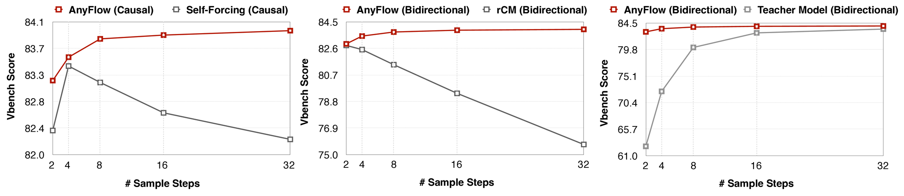
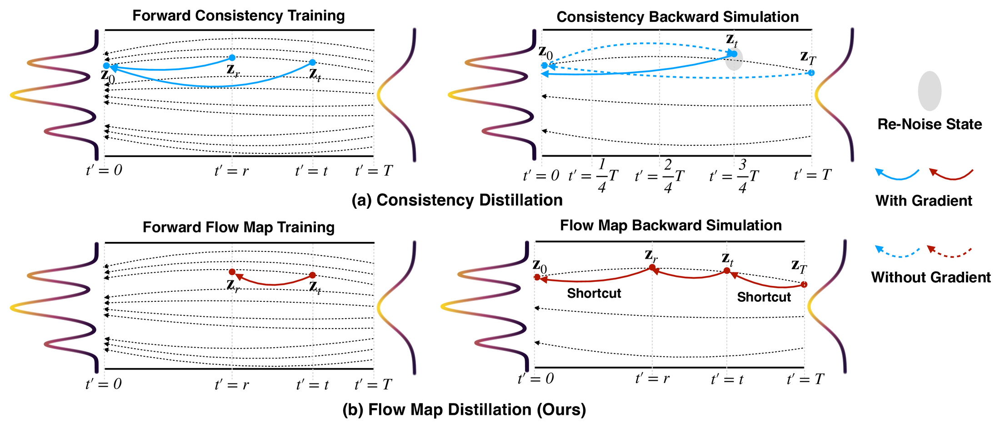
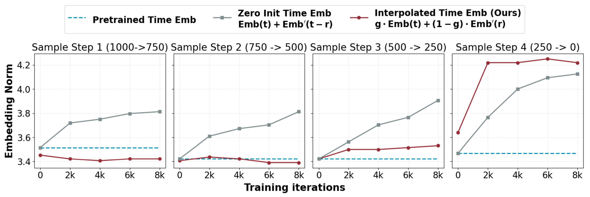
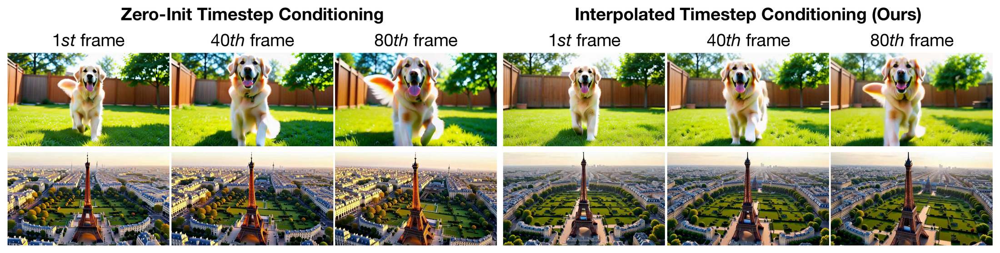
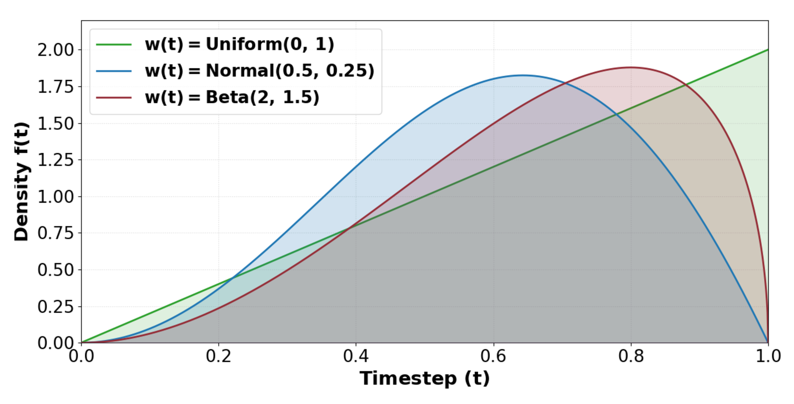
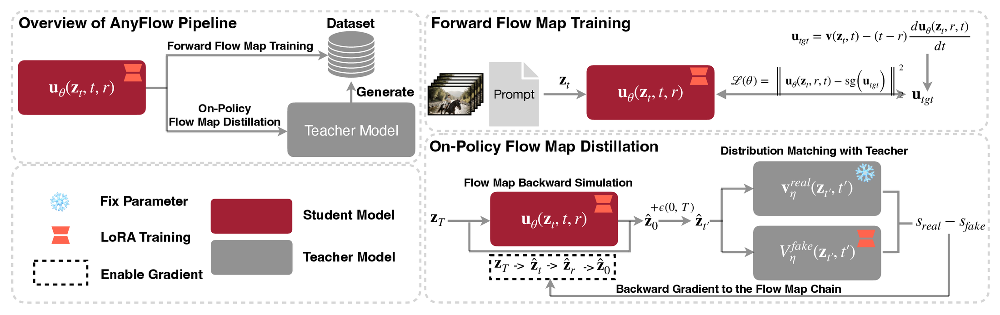
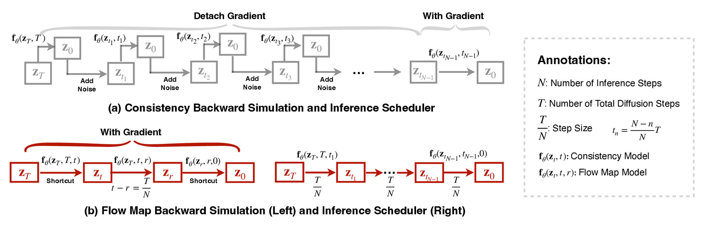
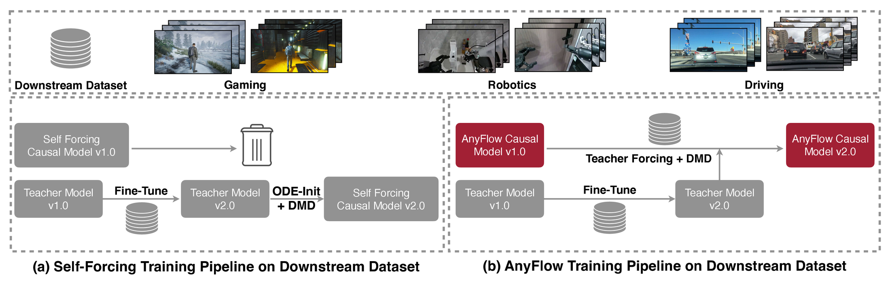
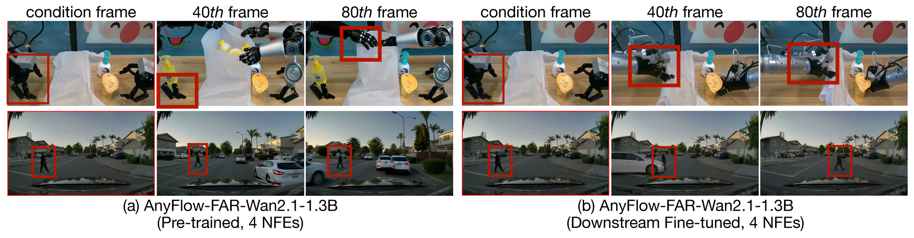

# AnyFlow：任意步视频扩散蒸馏

!!! info "论文信息"
    **论文题名：** AnyFlow: Any-Step Video Diffusion Model with On-Policy Flow Map Distillation。 
    **作者：** Yuchao Gu、Guian Fang、Yuxin Jiang、Weijia Mao、Song Han、Han Cai、Mike Zheng Shou。 
    **机构：** 未在公开元数据中稳定解析；以 arXiv/PDF 或官方页 affiliation block 为准。 
    **时间 / 主题：** 2026-05；扩散模型。 
    **arXiv / 官方报告：** arXiv：[2605.13724](https://arxiv.org/abs/2605.13724)；官方材料：[nvlabs.github.io/AnyFlow/](https://nvlabs.github.io/AnyFlow/)。 
    **GitHub / 项目：** GitHub：[github.com/NVlabs/AnyFlow](https://github.com/NVlabs/AnyFlow)；项目页：[nvlabs.github.io/AnyFlow/](https://nvlabs.github.io/AnyFlow/)。 
    **元数据来源与核验口径：** 来源：[arXiv](https://arxiv.org/abs/2605.13724)；[GitHub API / repo](https://github.com/NVlabs/AnyFlow)；[官方 / 项目材料](https://nvlabs.github.io/AnyFlow/)；Checked Date：2026-06-04；Repro Status：Paper / official materials reviewed, independent reproduction not claimed。

## 少步视频模型还应该能接受更多计算

AnyFlow 要解决的部署问题很具体。同一个视频模型，交互预览时可能只允许四次网络调用，最终出片时则愿意使用十六次或三十二次。理想情况下，只调整采样预算就能继续提高质量，不必为每一种步数维护不同 checkpoint。已有少步蒸馏方法擅长前一种工作，却不一定保留后一种能力。

论文观察到，基于 consistency 的代表模型在增加采样步数后，VBench 分数可能下降。其解释是，consistency model 学习从不同噪声状态直接预测干净终点。多步使用时，每轮先到终点，再重新加噪回中间状态；这条采样轨迹与预训练 flow model 的概率流 ODE 轨迹不同。更多调用可能增加这种轨迹偏移，而不只是把原本的大步积分变细。[原论文，第1—3页](https://arxiv.org/pdf/2605.13724v1#page=2)

先看原图的曲线方向。左图比较因果 AnyFlow 与 Self-Forcing，中图比较双向 AnyFlow 与 rCM，右图比较 AnyFlow 与未蒸馏教师。红线既要在低预算端足够高，又要在右移时保持改善；只证明四步好，或者只证明三十二步好，都没有完整回答问题。

{ width="920" }

*原论文 Figure 1(a)。横轴是采样步数，各面板纵轴范围不同。红线的提升幅度不能仅凭视觉斜率跨面板比较。*

AnyFlow 的回答包括两个相互依赖的改变。第一，把端点映射 $z_t\to z_0$ 改为两个时间之间的 flow map $z_t\to z_r$，让大跨度跳跃与小跨度推进成为同一种接口。第二，让学生在自己的生成状态上做分布匹配蒸馏，并用三段 shortcut 近似不同步数的完整轨迹，使训练成本不必随目标步数线性增加。

“Any-step”在这里描述同一权重支持改变采样预算。它不表示任何步数都达到相同质量，也不构成质量对步数严格单调的数学保证。主要证据来自1.3B和14B、双向和因果模型上的有限预算比较，尤其是四步与三十二步。理解这层范围，才能区分灵活的推理接口与特定评测中的收益。

## 从终点预测到区间运输，改变的是模型接口

### ODE、flow map 和平均速度分别是什么

设视频 latent 在扩散时间 $t$ 的状态为 $z_t$，其概率流 ODE 为

$$
\frac{\mathrm d z_t}{\mathrm dt}=v(z_t,t).
$$

$v$ 是瞬时速度场，告诉模型当前状态沿时间变化的局部方向。精确 flow map $\Phi_{r\leftarrow t}$ 则直接回答，从 $t$ 出发沿这条 ODE 走到 $r$，会到达哪里。它满足

$$
\Phi_{t\leftarrow t}(z)=z,
\qquad
\Phi_{q\leftarrow r}\circ\Phi_{r\leftarrow t}
=\Phi_{q\leftarrow t},\quad t\ge r\ge q.
$$

前一条是零长度区间不改变状态，后一条是走完整段与分两段走的结果相同。神经网络学习的是这一算子的近似

$$
f_\theta(z_t,t,r)\approx z_r.
$$

按照 MeanFlow 的参数化，网络内部预测区间平均速度 $u_\theta$，再由

$$
f_\theta(z_t,t,r)
=z_t-(t-r)u_\theta(z_t,r,t)
$$

转换成下一状态。这里必须分清 $u_\theta$ 与 $f_\theta$ 的输出。前者是速度，后者是状态；不能把网络给出的速度直接当成 $z_r$。论文公式中两者的时间参数顺序也有区别，上式沿用其数学定义。[原论文，第5页，式1—3](https://arxiv.org/pdf/2605.13724v1#page=5)

当 $r=0$，这个接口能够一次到终点，覆盖 consistency 类方法所关注的特殊情形。当 $r$ 接近 $t$，区间平均速度趋于局部瞬时速度，适合较小步长推进。严格在 $r=t$ 时，$f_\theta$ 的恒等边界由乘数 $t-r=0$ 保证，而 $u_\theta$ 仍应学习有意义的瞬时速度；后面的边界样本正是为了保住这一能力。

### 多步推理不必每次回到干净终点

下图将两种训练和模拟方式并排。上半部分中，蓝色映射不断指向 $z_0$，多步模拟通过重新加噪产生下一中间状态。下半部分中，红色映射直接在 $z_t,z_r$ 之间移动，长区间和短区间都属于同一个 flow map 的调用。

{ width="920" }

*原论文 Figure 2。右侧图例区分是否记录梯度；下半图的两端 shortcut 为后面的三段可微模拟提供接口。*

可以用一个解释性例子理解。预算为四步时，模型学习跨越较大的时间间隔；预算变为三十二步时，同一网络接收更相近的两个时间，执行更短的运输。两种设置都不要求每一步先预测整张干净视频再把它打回噪声状态。这样，多次调用才更接近“细化运输轨迹”的含义。

但神经 flow map 并不自动等于精确 ODE 解。恒等边界可以由参数化保证，任意区间的正确性与组合性质需要训练近似获得。AnyFlow 的第一阶段负责提供稳定的区间能力，第二阶段负责修正这些区间在学生实际 rollout 中组合时暴露的问题。

## 第一阶段如何把瞬时速度改造成平均速度

### MeanFlow 目标来自区间位移的一条恒等关系

沿精确轨迹，$z_t-z_r$ 可以写成时间区间上的速度积分。把它除以 $t-r$ 得到平均速度 $u$，便有

$$
(t-r)u(z_t,r,t)=\int_r^t v(z_\tau,\tau)\,\mathrm d\tau.
$$

固定区间终点 $r$，沿轨迹对 $t$ 求导，得到

$$
u+(t-r)\frac{\mathrm du}{\mathrm dt}=v(z_t,t),
\qquad
u=v-(t-r)\frac{\mathrm du}{\mathrm dt}.
$$

这段展开用于解释论文采用的 MeanFlow 关系。它表明平均速度与瞬时速度并非无关的两种预测，二者通过沿轨迹的导数联系起来。AnyFlow 因此训练

$$
\mathcal L_{\mathrm{flow}}(\theta)
=\mathbb E\left[
\left\|u_\theta(z_t,r,t)-\operatorname{sg}(u_{\mathrm{tgt}})\right\|_2^2
\right],
$$

$$
u_{\mathrm{tgt}}
=v(z_t,t)-(t-r)\frac{\mathrm d u_\theta(z_t,r,t)}{\mathrm dt}.
$$

$\operatorname{sg}$ 表示目标分支停止梯度。网络虽然参与构造目标，却不在这一步通过目标继续反传高阶依赖。边界 $t=r$ 时，导数修正项消失，目标直接回到瞬时速度，因而能够与已有 flow-matching 模型衔接。[原论文，第5—6页](https://arxiv.org/pdf/2605.13724v1#page=5)

训练视频由教师合成，记干净 latent 为 $x$，高斯噪声为 $\epsilon$，算法使用线性插值

$$
z_t=(1-t)x+t\epsilon,
\qquad v=\epsilon-x.
$$

这些样本提供 forward flow map training 的回归信号。这里的“forward training”是论文对数据驱动初始化阶段的命名，不应误读为部署时沿噪声增加方向生成视频；实际采样仍从噪声端向干净端推进。

### 有限差分要同时移动状态和时间

直接计算 $\mathrm du_\theta/\mathrm dt$ 涉及 Jacobian-vector product，在大型视频模型和 FSDP 下不便实现。作者沿用有限差分方案，用对称的两次邻近查询近似导数

$$
\frac{\mathrm d u_\theta(z_t,r,t)}{\mathrm dt}
\approx
\frac{u_\theta(z_{t+\delta},r,t+\delta)
-u_\theta(z_{t-\delta},r,t-\delta)}{2\delta}.
$$

由于这是沿轨迹的全导数，状态也要随时间移动。在算法的线性数据路径上，使用 $z_+=z_t+\delta v$、$z_-=z_t-\delta v$。只改时间 embedding 而让 $z_t$ 不动，得到的是不同的导数，不能替代论文的目标。

有限差分避免显式 JVP，却增加目标构造的前向计算。它需要两个邻近状态查询，并不意味着完整训练一共只有两次网络调用；当前预测、无条件预测和后续 DMD 分支另有开销。它也引入数值近似，不能被描述为完全无误差地复现原始 MeanFlow 导数。[原论文，第6、8页，式4与Algorithm 1](https://arxiv.org/pdf/2605.13724v1#page=8)

## 新增时间条件时，先保住预训练模型的输入尺度

预训练 Wan 模型主要根据当前时间 $t$ 调节去噪行为。flow map 还要知道目标时间 $r$，否则无法判断自己该走多远。最自然的改法是增加时间 embedding，例如 $\operatorname{emb}(t)+\operatorname{emb}'(t-r)$。一些方案将新增分支的输出投影零初始化，希望训练开始时不扰动原网络。

AnyFlow 发现，在自己的后训练设置中，这种零初始化并未稳定解决问题。新时间分支随后需要逐渐放大影响，embedding 范数持续增长，生成视频出现过饱和。作者改用插值

$$
\gamma\operatorname{emb}(t)
+(1-\gamma)\operatorname{emb}'(r),
\qquad \gamma=0.25,
$$

其中 $\operatorname{emb}'$ 从预训练 embedding 复制初始化。训练刚开始且 $t=r$ 时，两路相同，插值恰好回到原来的时间条件；而 $t\ne r$ 时，新条件从一开始就有合理尺度，不必完全从零分支长出来。这里用 $\gamma$ 表示插值系数，以避免与后文 CFG scale 混淆；论文在不同上下文复用了字母 $g$。[原论文，第7—8页](https://arxiv.org/pdf/2605.13724v1#page=8)

下面的范数曲线应按四个采样区间分别看。前三个区间中，插值版本的红线较早稳定，通常比灰色零初始化版本更接近蓝色预训练参照。但最后 $250\to0$ 的面板里，红线高于预训练水平，也高于灰线，不能把原图概括成“所有阶段范数都更小”或“全部恢复原始范数”。

{ width="820" }

*原论文 Figure 11(a)。横轴为训练迭代数，四个面板为不同采样区间。主要支持更稳定的条件适配，最后一个面板保留明显例外。*

对应样例中，零初始化版本的草地、狗毛和城市画面颜色更强烈，插值版本减轻了这种过饱和。它为时间条件影响视觉分布提供了定性证据；范数曲线和样例的对应关系也不能提升为适用于所有模型的充分因果证明。

{ width="920" }

*原论文 Figure 11(b)。每种设置展示第1、40、80帧；两行分别观察动物场景与城市场景。*

这种接口修改的工程意义很明确。后训练不只是给输入多拼一个标量，而要让新增条件与预训练网络已有的激活尺度相容。边界保持为复用旧能力提供起点，非边界区间再逐渐学习新的长距离运输。[原论文，第15页](https://arxiv.org/pdf/2605.13724v1#page=15)

## 两类权重分别控制噪声分配和长区间损失

### 排序两个均匀时间，不会得到均匀的起点

对非边界样本，作者先独立采样两个均匀时间，再把较大者作为 $t$、较小者作为 $r$。如果将时间归一化到 $[0,1]$，$t$ 是两个均匀变量的最大值，其累计分布为 $P(t\le a)=a^2$，密度因此为

$$
p(t)=2t.
$$

这一推导解释了为什么“两个时间均匀采样”不等于训练均匀关注所有起点。排序本身已让较大 $t$，也就是更高噪声区域，获得更多权重。论文进一步引入 $w(t)$ 重加权，图中的有效密度按 $p(t)w(t)$ 表示。

{ width="660" }

*原论文 Figure 10(a)。绿线对应均匀损失权重后的 $2t$，蓝线和红线在此基础上分别施加 Normal 与 Beta 权重。*

| $w(t)$ | Bidirectional, 4 NFEs | Bidirectional, 32 NFEs | Causal, 4 NFEs | Causal, 32 NFEs |
| --- | ---: | ---: | ---: | ---: |
| Uniform(0, 1) | 83.46 | 83.75 | 83.58 | 83.91 |
| Normal(0.5, 0.25) | 83.40 | 83.79 | 83.54 | 83.93 |
| Beta(2, 1.5) | 83.48 | 83.96 | 83.54 | 83.96 |

*原论文 Figure 10(b)，数值为 VBench Overall。*

Beta 在两种架构的32 NFE结果最好，双向从 uniform 的83.75提高到83.96。但四步因果结果中 uniform 的83.58略高于 Beta 的83.54。作者最后统一采用 Beta(2,1.5)，可理解为兼顾整个预算范围的选择，而不是每一列都显著最优。图中 Beta 也没有把全部质量放到极端 $t=1$，而是在较高噪声区保留较多训练压力。[原论文，第14—15页](https://arxiv.org/pdf/2605.13724v1#page=14)

### 一半边界样本给平均速度学习设定尺度

时间权重 $w(t)$ 之外，论文还用边界样本确定回归损失的尺度。每批训练样本中，50%取边界 $t=r$。这些样本不要求长跨度映射，主要维持预训练模型已经比较可靠的瞬时速度场。非边界样本则负责学习不同长度区间的平均速度。

设 $\Delta$ 为回归残差，以边界样本的平均平方损失

$$
\mu_{t=r}=\mathbb E_{t=r}[\lVert\Delta\rVert_2^2]
$$

作为参考，论文的自适应权重为

$$
w_{t,r}=\begin{cases}
1,&t=r,\\[2mm]
\displaystyle\frac{\mu_{t=r}}{\lVert\Delta\rVert_2^2+c},&t\ne r,
\end{cases}
$$

$c$ 是小常数。它与前面的 $w(t)$ 解决不同问题。$w(t)$ 决定不同噪声区域的训练关注，$w_{t,r}$ 则利用边界回归尺度约束非边界损失，避免长区间误差过大时主导更新，破坏已经可用的局部流场。

这也改变了对采样密度的理解。$p(t)=2t$ 描述独立采样再排序的非边界时间对；实际训练还显式混入一半 $t=r$ 样本，不能把整批训练都描述成只按这一二维排序分布采样。论文没有把边界样本仅作为少量额外正则，而是为它分配了相当大的批量份额。[原论文，第8—9页，式7](https://arxiv.org/pdf/2605.13724v1#page=9)

## CFG 融进预测后，四步才对应四次网络评估

标准 classifier-free guidance 通常需要条件与无条件两次预测。若蒸馏后仍每步运行两路，四个采样步便是 $4\times2$ 次网络求值。AnyFlow 在第一阶段把指导行为融入条件分支，部署时省去额外无条件调用。

令 $u_c$ 为带文本条件的预测，$u_\varnothing$ 为无条件预测，$g$ 为 CFG scale。论文将送入回归目标的预测改写为

$$
u=\frac1g\left[u_c-(1-g)\operatorname{sg}(u_\varnothing)\right].
$$

不同于把 guidance 融入目标速度，作者在预测侧进行这一变换，以对应预训练模型使用的 guidance 定义。无条件项停止梯度，当前优化推动条件输出包含所需的指导效果。

边界处 $u_{\mathrm{tgt}}=v$。若这个回归精确满足，则可以代数重排为

$$
u_c=g\,v+(1-g)u_\varnothing.
$$

这条解释式说明条件分支怎样学习经过 guidance 的输出；它不是另外新增的训练损失。部署时调用已训练的 $u_c$，不需要再现场做两分支组合。[原论文，第8页，式6](https://arxiv.org/pdf/2605.13724v1#page=8)

在 Algorithm 1 中，有限差分也包含相应的 $1/g$ 尺度。对两侧状态 $z_\pm=z_t\pm\delta v$，算法使用

$$
D_\theta=
\frac{u_c(z_+,r,t+\delta)-u_c(z_-,r,t-\delta)}{2\delta g},
\qquad
u_{\mathrm{tgt}}=v-(t-r)D_\theta.
$$

这里将算法的参数顺序统一为前文平均速度的 $(z,r,t)$ 记法。复用配方时不能只抄 CFG 的预测公式，却遗漏导数项中的尺度；也不能把此处 $g$ 当作时间 embedding 的固定0.25。一个控制条件指导，另一个控制两路时间 embedding 的混合，是两个独立参数。

## 为什么已有 flow map 还需要 on-policy 蒸馏

第一阶段在教师合成数据及其加噪状态上学习区间映射。推理时，输入却来自学生自己的前一步。即使单个区间回归已经较好，有限步长误差也会把下一状态送到训练路径之外。因果视频还会把自己生成的历史作为后续条件，局部错误可能沿视频时间继续积累。

论文把这两类问题分别称为少步离散误差与因果生成的 exposure bias。它们解释了为什么模型可以在数据上的速度回归正常，实际少步视频却仍有纹理或运动问题。第二阶段因此从学生当前权重产生的 rollout 出发，用教师评价这种真实会出现的输出，而不只继续拟合合成数据的前向路径。

整个流程图中，右上是数据上的 forward flow map training，右下是学生从噪声出发的模拟。第二阶段没有删除右上分支，而是联合优化两个目标，让局部速度知识与实际生成质量同时受到约束。

{ width="920" }

*原论文 Figure 4。冻结教师提供 real score，可训练 fake 分支估计学生分布；DMD 梯度从生成终点回到下方的 flow map 链。*

设学生生成的干净样本为 $\hat z_0=F_\theta(z)$。为避免将用于评估的噪声时间与三段模拟中的 $t,r$ 混淆，这里把 DMD 加噪时间记为 $a$，

$$
z_a=(1-a)\hat z_0+a\epsilon.
$$

论文采用的分布匹配梯度写作

$$
\nabla_\theta\mathcal L_{\mathrm{DMD}}
=-\mathbb E_{a,z}\left[
\left(s_{\mathrm{real}}(z_a,a)-s_{\mathrm{fake}}(z_a,a)\right)
\frac{\partial F_\theta(z)}{\partial\theta}
\right].
$$

$s_{\mathrm{real}}$ 来自强教师，$s_{\mathrm{fake}}$ 描述学生当前输出的分布。二者之差给生成器一个分布层面的修正方向。这里继续使用了 DMD 家族的核心信号，AnyFlow 的新意主要在于如何构造可训练、可改变步数的 $F_\theta$。[原论文，第6页，式5](https://arxiv.org/pdf/2605.13724v1#page=6)

还要区分两种“重新加噪”。AnyFlow 避免在实际 flow-map 采样中，每个中间步骤都执行端点预测再加噪；但 DMD 为查询不同噪声层的 real/fake score，仍会对最后的 $\hat z_0$ 加噪。前者是采样轨迹设计，后者是分布损失的评价方式，不能笼统写成整个训练与采样都不再加噪。

## 三段 shortcut 怎样让任意预算的模拟可训练

### 监督终点，但保留中间区间的梯度

DMD 通常需要一个干净终点才能评价分布。consistency 模型每次调用天然输出终点，因此容易挑其中一步记录梯度，其余模拟步截断梯度来节省成本。flow map 的一次调用却可能只从 $t$ 到 $r$，直接停在中间噪声状态，不能简单沿用同一套终点监督方式。

最直观的方案是，为目标预算 $N$ 完整执行 $N$ 次映射，再从 $z_0$ 回传。但训练需要覆盖许多 $N$，大步数模拟既耗时又扩大激活和反传链。AnyFlow 使用近似组合性质

$$
f_\theta(z_t,t,q)
\approx f_\theta\big(f_\theta(z_t,t,r),r,q\big)
$$

把完整路线拆成三段。用 $T$ 表示噪声端的时间端点，归一化时间下 $T=1$；选定预算 $N$ 后，在对应轨迹上取一个中间位置 $t$，使相邻目标点满足

$$
t-r=\frac{T}{N}.
$$

随后计算

$$
\hat z_t=f_\theta(z_T,T,t),\qquad
\hat z_r=f_\theta(\hat z_t,t,r),\qquad
\hat z_0=f_\theta(\hat z_r,r,0).
$$

两端 $T\to t$ 与 $r\to0$ 使用长跨度 shortcut，中间 $t\to r$ 保留目标推理预算对应的局部间隔。最终在 $\hat z_0$ 上计算 DMD 梯度，再通过这三次映射的整条计算链反传。改变 $N$ 主要改变中间间隔与所选位置，模拟链始终只有三段。[原论文，第9—10页，Figure 5与式8](https://arxiv.org/pdf/2605.13724v1#page=10)

{ width="820" }

*原论文 Figure 5。上方 consistency 链的大部分步骤 Detach Gradient；下方三段 flow map 链全部 With Gradient。右下是推理时正常的多步推进，不是部署时也固定只走三段。*

保留整条三段链的梯度有实际意义。终点分布的修正不仅作用于中间那一步，也可以改变前段怎样把初始噪声送到 $\hat z_t$，以及后段怎样把 $\hat z_r$ 送往终点。三次调用共享学生参数，因此参数更新同时涉及不同区间的行为。这里的“整条链”指图示的三段扩散模拟，不能自动理解成无限长自回归视频的所有历史状态都做完整反传。

### Shortcut 近似不等于逐步 rollout 的严格替代

精确 ODE flow map 满足组合恒等式，学习到的 $f_\theta$ 只是近似满足。因此，先一步跳到 $t$ 得到的状态，不一定与实际执行前面若干个小步所得状态完全相同。三段链利用模型自身的区间能力近似目标轨迹，以固定模拟成本覆盖多种局部步长；它没有在数学上消除全部训练—推理差异。

这也是第一阶段不可随意删除的原因。如果长跨度 flow map 尚不可靠，用它产生的 shortcut 起点和终点就不能有效代表所需的轨迹区间。论文先收敛一个稳定初始化，再同时保留 forward 目标和 DMD 精炼，是为了让近似组合与最终分布修正相互支撑。

推理时使用论文所称的 standard Euler scheduler。对均匀网格 $t_n=(N-n)T/N$，相邻两点通过 flow-map 更新

$$
z_{t_{n+1}}
=z_{t_n}-(t_n-t_{n+1})
 u_\theta(z_{t_n},t_{n+1},t_n).
$$

它在形式上是按时间网格逐步推进，使用的网络则已学习所给区间的平均速度。预算越大，网格越密；最后一步直接落到0，不需要中途不断重新投影至干净终点。论文中的伪代码混用速度预测与状态转移的简写，实现时应按 $f=z-(t-r)u$ 明确区分两者。

## 因果版本增加历史压缩，目标函数保持同一套

双向版本让视频内部位置互相使用上下文，直接应用前面的两阶段配方。因果版本采用 FAR 的训练框架，用非对称 patchify kernel 压缩视频历史，并在 rollout 与采样时缓存、复用 KV 状态。

具体设置保留三个 full-token chunks，使用标准大小为2的 patchify kernel；其余 chunks 用大小为4的 kernel 压缩。历史块压缩后占用的 token 和 KV cache 更少，减少 teacher-forcing 训练与自回归生成的负担。它改变的是上下文表示和计算规模，并没有把 DMD 换成另一种质量目标。

为同时支持 T2V 与 I2V，chunk 划分也不是均匀的。第一个 chunk 只有一个 latent frame，方便精确接收首图条件；后续 chunks 的长度为3，在时间建模与吞吐之间折中。这里的1和3是模型内部的 latent chunk 设定，不宜直接当作最终视频像素帧数来理解。[原论文，第10—11页](https://arxiv.org/pdf/2605.13724v1#page=11)

这些组件承担不同责任。flow map 控制扩散时间上的区间运输；FAR 压缩视频时间上的历史；KV cache 避免重复计算已经形成的上下文；on-policy 蒸馏让模型适应自己的生成状态。它们共同支持因果少步视频，却不等价于已经证明无限长度生成稳定。论文将有专门长视频训练的自回归扩展列为后续方向。

## 最关键的消融，把初始化和模拟方式分开

仅看最终 AnyFlow 与另一个模型比较，很难知道收益来自新时间接口、初始化数据还是 DMD 模拟。Table 2 将几种组合放在同一组实验里，分别比较只做 forward training，以及在其后加入不同 backward simulation。下面按架构拆开保留 Quality、Semantic 与 Overall，避免总分掩盖语义变化。

| Method | NFEs | Bidirectional Quality | Bidirectional Semantic | Bidirectional Overall |
| --- | ---: | ---: | ---: | ---: |
| Flow Matching Training | $4\times2$ | 77.82 | 61.91 | 74.64 |
| Flow Matching Training | $32\times2$ | 85.48 | 77.24 | 83.83 |
| Consistency ODE-Init | 4 | 83.01 | 70.13 | 80.44 |
| Consistency ODE-Init | 32 | 84.78 | 75.15 | 82.86 |
| Flow Map Training | 4 | 84.39 | 71.20 | 81.75 |
| Flow Map Training | 32 | 85.35 | 75.63 | 83.40 |
| Consistency ODE-Init + Consistency Backward Simulation | 4 | 84.77 | 75.71 | 82.96 |
| Consistency ODE-Init + Consistency Backward Simulation | 32 | 83.70 | 64.18 | 79.80 |
| Flow Map Training + Consistency Backward Simulation | 4 | 85.47 | 75.88 | 83.55 |
| Flow Map Training + Consistency Backward Simulation | 32 | 85.15 | 74.19 | 82.96 |
| Flow Map Training + Flow Map Backward Simulation | 4 | 85.24 | 76.41 | 83.48 |
| Flow Map Training + Flow Map Backward Simulation | 32 | 85.70 | 76.99 | 83.96 |

*原论文 Table 2 的双向部分。Flow Matching 行显式计入双分支 CFG，因此不能把 $4\times2$ 与4视作相同 NFE。*

只做 Flow Matching 时，少步74.64与多步83.83差距很大；Flow Map 初始化把四步提高到81.75，并在32 NFE保留83.40，说明它确实学到了更有效的长距离运输，同时维持可用的局部场。继续使用 consistency 模拟后，四步83.55很好，但32步退到82.96。改成 flow map 模拟，四步为83.48，32步达到83.96。

这里存在一个必须保留的反例。完整 AnyFlow 的四步总分83.48低于混合方案的83.55，Quality 也较低；优势主要是更好的 Semantic 与扩步表现，而非每个预算、每个分项都胜出。原文整体叙述若压成“全套方法所有设置最好”，会丢失这张表真正显示的取舍。[原论文，第5页，Table 2](https://arxiv.org/pdf/2605.13724v1#page=5)

| Method | NFEs | Causal Quality | Causal Semantic | Causal Overall |
| --- | ---: | ---: | ---: | ---: |
| Flow Matching Training | $4\times2$ | 79.05 | 67.79 | 76.80 |
| Flow Matching Training | $32\times2$ | 85.21 | 76.65 | 83.50 |
| Consistency ODE-Init | 4 | 76.99 | 61.88 | 73.97 |
| Consistency ODE-Init | 32 | 79.73 | 68.81 | 77.55 |
| Flow Map Training | 4 | 82.80 | 71.16 | 80.48 |
| Flow Map Training | 32 | 85.23 | 74.71 | 83.13 |
| Consistency ODE-Init + Consistency Backward Simulation | 4 | 84.37 | 74.97 | 82.49 |
| Consistency ODE-Init + Consistency Backward Simulation | 32 | 82.43 | 68.48 | 79.64 |
| Flow Map Training + Consistency Backward Simulation | 4 | 84.99 | 74.97 | 82.99 |
| Flow Map Training + Consistency Backward Simulation | 32 | 85.67 | 74.78 | 83.49 |
| Flow Map Training + Flow Map Backward Simulation | 4 | 85.60 | 75.30 | 83.54 |
| Flow Map Training + Flow Map Backward Simulation | 32 | 85.92 | 76.12 | 83.96 |

*原论文 Table 2 的因果部分。与双向使用相同的组合顺序，便于定位结构变化。*

因果设置中，只做 Consistency ODE-Init 的四步73.97明显低于 flow map 的80.48。两种 backward simulation 都能改善 flow-map 初始化，完整方案在四步达到83.54，比只做初始化提高3.06，在32步达到83.96。它支持 on-policy 修正对因果实际 rollout 有帮助。

同时，Flow Map Training + Consistency Backward Simulation 的因果分支从四步82.99升到32步83.49，并没有像其双向分支那样退步。因此证据是不同组合的扩步能力存在差异，完整配方在测试端点表现更强，而非任意使用 consistency 模拟的方案增加步数都会失败。

论文对 ODE-Init 的额外定性对照还说明，由于拿不到 Wan 原始训练数据，作者先在相同合成数据上微调教师，使比较更接近同一数据条件。Table 2 的消融组合也不应与主结果表中已发布 Self-Forcing 模型混成同一行，后者四步 Overall 为83.39，并非这里的82.49。[原论文，第15页](https://arxiv.org/pdf/2605.13724v1#page=15)

## 主结果显示可扩步，但收益规模取决于架构与底座

### 文生视频保留质量和语义两列

主评测采用 VBench 的16个细分维度，汇总成 Quality 和 Semantic。作者对 Wan 基础模型、rCM、Self-Forcing，以及若干14B因果社区模型，使用官方 augmented prompts 重新评价；原表用 $\dagger$ 标记这些行。其他模型的数字直接取自各自论文，不能当作同一运行环境下的严格对照。

下面优先保留重新评测、分辨率同为 $480\times832$ 的双向模型，避免把不同分辨率、提示设置和论文转载结果混成一个同预算排序。

| Model | #Params | NFEs | Quality ↑ | Semantic ↑ | Total ↑ |
| --- | --- | ---: | ---: | ---: | ---: |
| Wan2.1-T2V-1.3B | 1.3B | $50\times2$ | 84.99 | 76.23 | 83.24 |
| rCM-Wan2.1-T2V-1.3B | 1.3B | 4 | 84.71 | 73.74 | 82.51 |
| AnyFlow-Wan2.1-T2V-1.3B | 1.3B | 4 | 85.24 | 76.41 | 83.48 |
| AnyFlow-Wan2.1-T2V-1.3B | 1.3B | 32 | 85.70 | 76.99 | 83.96 |
| Wan2.1-T2V-14B | 14B | $50\times2$ | 85.77 | 75.58 | 83.74 |
| rCM-Wan2.1-T2V-14B | 14B | 4 | 85.47 | 76.72 | 83.73 |
| AnyFlow-Wan2.1-T2V-14B | 14B | 4 | 85.70 | 77.38 | 84.04 |
| AnyFlow-Wan2.1-T2V-14B | 14B | 32 | 85.76 | 77.44 | 84.10 |

*原论文 Table 3 的双向重评行，均使用官方 augmented prompts。*

在1.3B上，AnyFlow 四步比 rCM 提高0.97总分，语义从73.74到76.41是较明显的贡献；继续到32步，总分再提高0.48。在14B上，四步比 rCM 提高0.31，但4到32步仅从84.04到84.10，提高0.06。后者证明增加预算没有像某些 consistency 曲线那样退化，却没有显示很大的边际收益。

所以 AnyFlow 的扩步接口为系统提供选择空间，实际是否值得多做28次网络调用，还取决于目标场景对小幅质量变化的价值。不能把“可 test-time scaling”直接理解为调用次数增加八倍、质量也按比例增加。[原论文，第12、14页](https://arxiv.org/pdf/2605.13724v1#page=12)

| Model | #Params | NFEs | Quality ↑ | Semantic ↑ | Total ↑ |
| --- | --- | ---: | ---: | ---: | ---: |
| Self-Forcing | 1.3B | 4 | 85.23 | 76.01 | 83.39 |
| AnyFlow-FAR-Wan2.1-1.3B | 1.3B | 4 | 85.60 | 75.30 | 83.54 |
| AnyFlow-FAR-Wan2.1-1.3B | 1.3B | 32 | 85.92 | 76.12 | 83.96 |
| LightX2V-Wan2.1-14B-CausVid | 14B | 9 | 85.29 | 75.96 | 83.42 |
| FastVideo-CausalWan2.2-A14B-Preview | 14B | 8 | 84.28 | 78.49 | 83.12 |
| Krea-Realtime-Wan2.1-14B | 14B | 4 | 84.80 | 77.07 | 83.25 |
| AnyFlow-FAR-Wan2.1-14B | 14B | 4 | 85.82 | 76.97 | 84.05 |
| AnyFlow-FAR-Wan2.1-14B | 14B | 32 | 86.12 | 77.55 | 84.41 |

*原论文 Table 3 的因果重评行，均为 $480\times832$。模型底座、上下文机制和训练过程仍有区别，因此这不是只替换一个蒸馏目标的消融。*

14B因果 AnyFlow 从4 NFE的84.05提高到32 NFE的84.41，Quality 与 Semantic 都提高，扩步收益0.36比同规模双向设置更明显。与同为四步的 Krea-Realtime 相比，总分高0.80，主要来自 Quality 的85.82对84.80；其四步 Semantic 76.97其实略低于 Krea 的77.07。FastVideo 的 Semantic 78.49又高于两者，但 Quality 较低。

1.3B因果比较也有类似取舍。AnyFlow 四步总分83.54高于 Self-Forcing 的83.39，Quality 更高，Semantic 却从76.01降至75.30。保留分项能避免把“总分更好”说成文本遵循、运动与画质每一方面都更好。扩到32步后，AnyFlow 的 Semantic 才达到76.12。

### 图生视频的87.87是总分，不是I2V分项

因果模型通过第一块单 latent frame 接收首图，复用同一生成器完成 I2V。VBench-I2V 同时报告 Quality、I2V 与 Total，主比较如下。

| Model | #Params | Resolution | NFEs | Quality ↑ | I2V ↑ | Total ↑ |
| --- | --- | --- | ---: | ---: | ---: | ---: |
| Wan2.1-I2V-14B | 14B | $480\times832$ | $50\times2$ | 80.30 | 95.12 | 87.71 |
| FastVideo-CausalWan2.2-A14B-Preview | 14B | $480\times832$ | 8 | 78.82 | 94.81 | 86.82 |
| AnyFlow-FAR-Wan2.1-14B | 14B | $480\times832$ | 4 | 80.39 | 95.35 | 87.87 |

*原论文 Table 4 中标注重评的三行。I2V 衡量首图条件相关表现，87.87是汇总 Total。*

AnyFlow 四次调用的 Quality 为80.39、I2V为95.35，与使用 $50\times2$ 次调用的 Wan2.1-I2V-14B相近并略高。按表中的采样 NFE 计算，100到4是25倍减少；这不是论文测得的25倍端到端延迟提升。因果模型还需按顺序生成多个 chunk，NFE 不能当作整段视频合计只执行四次网络前向；编码、解码、缓存与硬件利用率也影响实际时间。

原表中更大或更高分辨率的其他模型还包括 Step-Video-TI2V 30B，总分88.36，以及 MAGI-1 24B，总分89.28。它们调用数、分辨率和评价来源不同，因此 AnyFlow 的结果应理解为四 NFE 下有竞争力的14B配置，而不是全表无条件最高质量。[原论文，第12页，Table 4](https://arxiv.org/pdf/2605.13724v1#page=12)

## 两阶段训练的资源，哪些地方真的节省了计算

实现建立在 Wan2.1 与 Diffusers 上。第一阶段使用 Wan2.1-T2V-14B生成的256K提示—视频对，每个样本最多81帧、分辨率 $480\times832$。这一合成数据集是学习 flow map 的重要基础，也意味着训练前已有教师生成数据的成本。

| Setting | Stage 1: Forward Flow Map Training | Stage 2: On-Policy Distillation |
| --- | --- | --- |
| Objective | Flow map regression | Forward flow map + DMD |
| Optimizer | AdamW | AdamW |
| Learning rate | $5\times10^{-5}$ | $2\times10^{-6}$ |
| Iterations, 1.3B | 6,000 | 800 |
| Iterations, 14B | 4,000 | 800 |
| Global batch, Stage 1 | 32 for 1.3B; 16 for 14B | — |
| Parameter adaptation | LoRA, rank 256 | LoRA, rank 256 |

*据原论文第12—13页的实现细节整理。第二阶段从收敛的一阶段 checkpoint 开始；表中没有将一阶段 batch 自动外推给未单列的配置。*

LoRA 限制需要更新的参数量，但学生前向、反向、教师与 fake score 查询仍需计算，不能把参数高效微调等同于训练成本很低。论文给出了更有用的分项耗时，测量条件为 Wan2.1-1.3B-T2V、batch 16、单节点8张 H100。下面数值是秒／迭代，不是 GPU-hours，也不是14B训练的总成本。

| Method | Causal, s/iter | Bidirectional, s/iter |
| --- | ---: | ---: |
| Standard Flow-Matching | 5.8 | 9.7 |
| + Guidance-Fused Training | 7.8 | 12.3 |
| + Guidance-Fused Training + Differential Derivation Equation | 10.4 | 16.8 |
| Consistency Backward Simulation (4 Steps) | 45.9 | 41.8 |
| Flow Map Backward Simulation (4 Steps) | 53.1 | 51.2 |
| Consistency Backward Simulation (16 Steps) | 93.8 | 96.6 |
| Flow Map Backward Simulation (16 Steps) | 53.1 | 51.2 |

*原论文 Table 5。On-policy 部分测量一次 generator 与一次论文所称 discriminator 更新构成的上界成本；这不是简单的纯生成器 rollout 时间。*

前向阶段从标准 flow matching 到完整 flow map，因果每步由5.8秒到10.4秒，双向由9.7秒到16.8秒，CFG 融合与有限差分都要付出额外成本。第二阶段在四步模拟时也没有更便宜：因果53.1对45.9秒，增加15.7%；双向51.2对41.8秒，增加22.5%。原因之一是三段链都保留梯度，而 consistency 模拟截断了较早部分。

收益在目标模拟步数增加时显现。十六步 consistency 模拟涨到因果93.8秒、双向96.6秒；flow map 仍是53.1与51.2秒，对应减少43.4%与47.0%。这组结果支持的是**覆盖较多推理步数时，固定三段模拟比完整逐步模拟更划算**。它没有证明 AnyFlow 在所有预算上都训练更快，也不能把这张1.3B表乘以主训练迭代数，直接当作14B整个项目的总费用。[原论文，第15—16页，Table 5](https://arxiv.org/pdf/2605.13724v1#page=16)

## 保留瞬时流场，还带来继续微调的接口

AnyFlow 的另一个应用是后续领域适配。如果蒸馏模型只擅长固定步数、固定终点的预测，沿用原来的数据训练方式继续更新可能比较困难。AnyFlow 保留了 $t=r$ 的瞬时速度能力，并在第二阶段继续训练 forward flow map，因此能从已经蒸馏的学生 checkpoint 接着训练。

下面流程图比较两种下游管线。左边是论文描述的 Self-Forcing 方案，先微调教师，再重新执行因果初始化与 DMD。右边则保留已有 AnyFlow 学生，从其 v1.0 继续更新到 v2.0。值得注意的是，右图仍然有教师从 v1.0 微调到 v2.0 的分支；省去的是学生从头重做整个蒸馏转换，而不是完全取消教师适配与 DMD。

{ width="820" }

*原论文 Figure 7。右侧学生沿 Teacher Forcing + DMD 继续训练，下方教师仍基于领域数据更新。*

这种能力在机器人与驾驶视频上有可见用途。原始 AnyFlow-FAR-Wan2.1-1.3B虽然已经能四步生成，仍可能改变机械臂类型，或让行人轨迹不符合场景要求。领域数据继续训练后，图中机械臂外观与行人路径更接近对应场景。

{ width="920" }

*原论文 Figure 8。左侧为预训练模型，右侧为领域微调后，均为四 NFE；每侧按条件帧、第40帧、第80帧查看红框内的身份与轨迹变化。*

这个实验支持视频生成的视觉域适应。它没有给出机器人真实执行成功率、自动驾驶闭环安全指标，也没有证明视频中的所有运动符合物理规律。论文将 Self-Forcing 的继续训练称为困难，是对其管线与该比较的描述，不应扩大成任何 consistency 蒸馏模型在理论上都不可能微调。[原论文，第11页](https://arxiv.org/pdf/2605.13724v1#page=11)

同时，合成数据仍可能改变基础模型的分布。作者明确承认拿不到原始 Wan 训练集，外部或合成数据会带来轻微分布偏移，例如纹理变得更平滑。flow map 可以保留局部速度接口，却不能保证换用另一批数据后完全保留原模型所有外观与运动偏好。[原论文，第17页](https://arxiv.org/pdf/2605.13724v1#page=17)

## 这项工作的价值落在可调整的训练与推理接口上

AnyFlow 把少步蒸馏从“学会迅速到达干净终点”扩展为“学会运输任意时间区间”。平均速度与瞬时速度的关系提供训练依据，边界样本和时间条件插值保护预训练接口，on-policy DMD 纠正学生自身轨迹上的误差，三段 shortcut 则控制覆盖多种步数时的模拟成本。这些组件分别回答数学目标、稳定适配、真实 rollout 与算力预算的问题。

对需要四步预览和多步最终生成的系统，它提供了使用同一权重调节预算的可行方案。对需要领域适配的视频模型，它保留从数据继续学习局部流场的入口。选择是否采用时，应同时看四步质量、扩到高预算后的实际增益，以及能够承担的合成数据与两阶段训练成本；14B双向仅0.06的扩步增益与14B因果0.36的增益，已经说明这些判断不会在所有设置里相同。

最值得继续检验的是 shortcut 与实际多步轨迹之间剩余的偏差，以及这种接口在更长视频上的表现。当前结果足以支持可变步数的短视频蒸馏与继续训练，但稳定的任意长视频生成仍需要相应的数据和训练。把时间区间显式纳入模型后，这些问题终于可以在同一套映射与采样接口中逐项研究。

读完 AnyFlow 后，可以回到[扩散模型基础](../../diffusion/foundations-and-core-intuition.md)把 score、flow 与采样状态放到同一条时间轴，再看[DPM-Solver++](dpm-solver-plus-plus.md)比较求解器误差和蒸馏误差。若关心测试时计算，接着看[扩散模型推理](../../diffusion/inference.md)，固定 NFE、分辨率和 guidance 后再谈速度。
