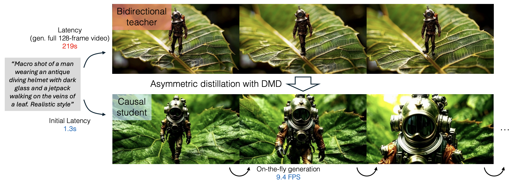
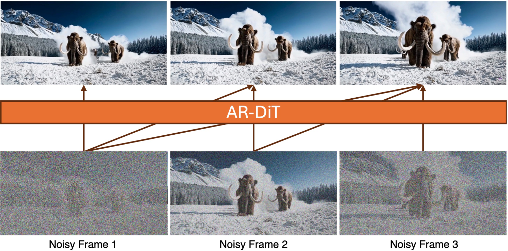
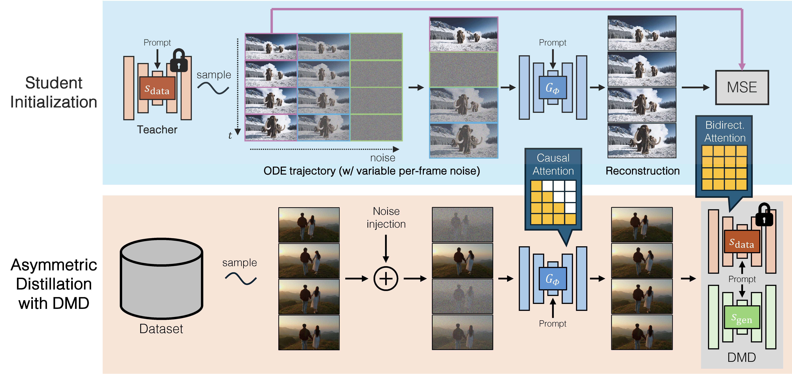
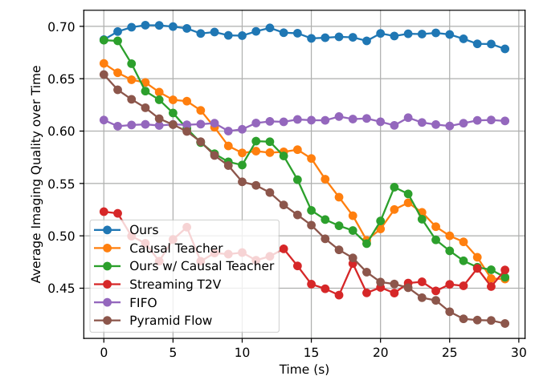
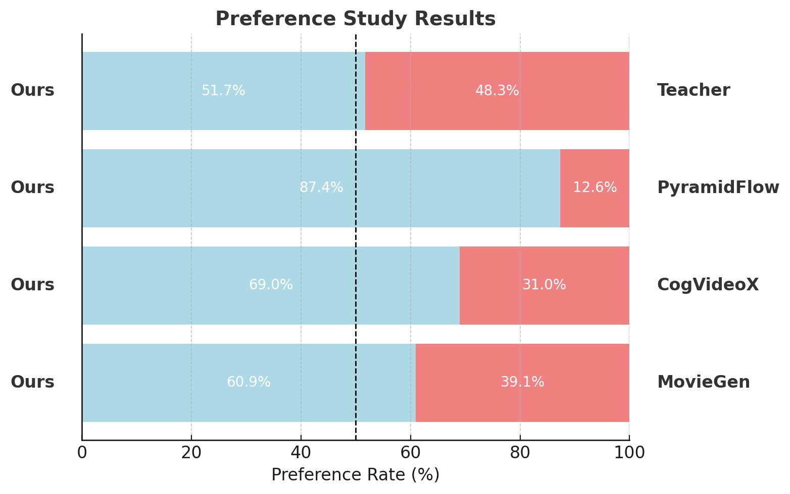
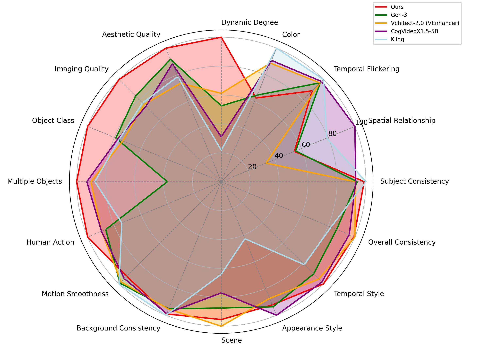
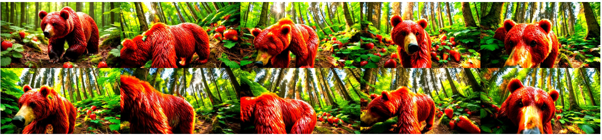

# CausVid：流式自回归视频扩散

!!! info "论文信息"
    **论文题名：** From Slow Bidirectional to Fast Autoregressive Video Diffusion Models。 
    **作者：** Tianwei Yin、Qiang Zhang、Richard Zhang、William T. Freeman、Fredo Durand、Eli Shechtman、Xun Huang。 
    **机构：** MIT 2、Adobe。 
    **时间 / 主题：** 2024-12；扩散模型。 
    **arXiv / 官方报告：** arXiv：[2412.07772](https://arxiv.org/abs/2412.07772)；官方材料：[causvid.github.io/](https://causvid.github.io/)。 
    **GitHub / 项目：** GitHub：[github.com/tianweiy/CausVid](https://github.com/tianweiy/CausVid)；项目页：[causvid.github.io/](https://causvid.github.io/)。 
    **元数据来源与核验口径：** 来源：[arXiv](https://arxiv.org/abs/2412.07772)；[GitHub API / repo](https://github.com/tianweiy/CausVid)；[官方 / 项目材料](https://causvid.github.io/)；Checked Date：2026-06-04；Repro Status：Paper / official materials reviewed, independent reproduction not claimed。

## 视频生成有两种等待，CausVid 要同时缩短它们

CausVid 把一个多步、双向的视频扩散模型转成四步、逐块输出的因果生成器。这个改动的价值首先体现在用户什么时候能看到画面，以及看到画面之后还能不能继续改变生成条件。原文在单张 H100 上报告，生成 640×352 视频的首块延迟为 1.3 秒，后续吞吐为 9.4 FPS；相应的双向教师要先完成整段计算，首个可见结果才能交付。因果学生在短视频质量上接近甚至超过教师的若干聚合指标，同时可以用有限上下文继续生成更长的视频。[↗](https://arxiv.org/pdf/2412.07772v4#page=1)

这里有两个独立的障碍。第一个是扩散采样需要反复执行去噪网络。同一段视频即便只包含数秒，几十次大模型前向也会让输出很慢。第二个是双向注意力让当前帧依赖未来帧。即使把去噪压到很少几步，只要模型仍然联合生成整段视频，用户就仍需等待整段完成；未来的交互输入尚未发生，模型也无法提前把它纳入当前视频。

只改因果注意力可以移除第二种等待，却未必带来足够好的画面。自回归模型把自己生成的历史当作下一段条件，历史中的错误会继续传播。CausVid 的关键判断是，学生必须满足因果部署约束，但提供训练信号的教师可以保留双向结构。这样既能继承强教师对完整视频的判断，又能让学生的每次前向只使用当前块和历史块。论文把这种教师与学生注意力结构不同的训练称为 **asymmetric distillation**。

下图先看两行的输出时机。上方教师把整段视频作为一个联合任务，下方学生完成第一块后即可交付，随后继续生成。图中的 219 秒对应 128 帧示例；后文速度表采用 120 帧统一设置，两处帧数应分别理解。

{ width="920" }

<small>原论文 Figure 1，沿用官方项目页原图。首块延迟决定第一次反馈出现的时刻，FPS 描述后续输出速率；1.3 秒不表示整段视频已生成完毕。</small>

理解后续方法时还要区分两条时间轴。视频时间表示第几个块、动作进行到哪个位置；扩散时间表示这个块还剩多少噪声。同一个视频里，过去块可以已经干净，当前块仍然在去噪，未来块尚未产生。CausVid 的训练会允许不同块拥有不同噪声时间，推理则把这种自由度用在“干净历史加待生成当前块”的顺序生成接口上。

## 因果性落在五个 latent frames 组成的块之间

CausVid 在视频 VAE 的 latent 空间中运行。它采用的 3D VAE 独立处理像素视频块，每 16 个像素帧编码成含五个 latent frames 的块；学生每次生成的基本单位也是这五个 latent frames。教师是架构类似 CogVideoX 的双向 DiT，学生保留核心网络结构及教师权重初始化，改变的是自注意力可以访问哪些时间位置。这里的“类似 CogVideoX”是架构描述，不能直接等同于拿公开 CogVideoX-5B 检查点做了一次蒸馏。[↗](https://arxiv.org/pdf/2412.07772v4#page=8)

在每个块内部，所有 latent frames 可以互相注意，用于协调局部运动与外观。块与块之间只能从现在看向过去。按从零开始的 latent frame 索引 $i,j$，块长为 $k$，原文的注意力掩码为

$$
M_{i,j}=\begin{cases}
1,&\left\lfloor j/k\right\rfloor\leq\left\lfloor i/k\right\rfloor,\\
0,&\text{otherwise}.
\end{cases}
$$

$M_{i,j}=1$ 表示位置 $i$ 的 query 可以读取位置 $j$ 的 key/value。取论文实际的 $k=5$，索引 5 到 9 属于第二块，第二块的任意一帧都能读取 0 到 9，却不能读取 10 及之后的位置。这个例子说明，“因果”应当按块来理解。第二块内部较早的 latent frame 可以看同块较晚的 latent frame，但不会读取下一块。[↗](https://arxiv.org/pdf/2412.07772v4#page=7)

这种设计与 VAE 的输出接口配套。当前解码器需要等五个 latent frames 都可用，才能输出对应像素块；即便把 DiT 改成完全逐 latent frame 因果，第一批像素仍需等这一块凑齐。因此，保留块内双向注意力能利用局部上下文，同时不额外增加这套 VAE 本来就要求的最小块等待。它也给延迟优化设下明确边界，继续减少去噪计算之后，VAE 的时间压缩方式会成为下一层瓶颈。

下图沿箭头读信息来源，当前位置接收本地与历史信息，未来没有通向当前的依赖。图按帧画了概念示意，实际模型以公式中的块作为因果边界。底部不同的噪声标记还提示，输入序列不必处在统一扩散时间。

{ width="880" }

<small>原论文 Figure 5。因果约束由 attention mask 决定；不同块的噪声时间是另外一个输入维度，两者共同决定学生能看到什么以及这些信息有多可靠。</small>

训练时可以把多个块一并送入网络，再用掩码保证依赖合法。一次前向会为所有块提供预测和监督，不需要为序列里每个块重新执行一次完整训练计算。推理时才按块顺序输出。并行训练与顺序推理能够共存，靠的是训练前向已经禁止未来块影响当前块，而非在部署时临时删除一部分学生曾依赖的信息。

## DMD 为什么允许双向教师教因果学生

常见的轨迹蒸馏要求学生用更少的步骤逼近教师在某条噪声轨迹上的更新或终点。对于同结构的模型，这种要求很自然；对于双向教师与因果学生，教师在预测前半段时能读取后半段信息，学生却没有相同的输入权限。逐点追随教师轨迹会同时承担去噪步数压缩与信息结构变化两项困难。

Distribution Matching Distillation（DMD）把监督放在生成分布上。它使用两个 score 估计器，比较“数据分布希望样本往哪里走”与“当前生成器分布希望样本往哪里走”，由两者的差给学生更新方向。学生不必对每一个随机种子复现教师同一条完整轨迹，只需使其输出分布更接近教师所代表的数据分布。这个接口给不同架构之间的蒸馏留出了空间。

先看 score 与通常的扩散去噪训练有什么关系。对干净视频 latent $x_0$，正向加噪为

$$
x_t=\alpha_t x_0+\sigma_t\epsilon,
\qquad \epsilon\sim\mathcal N(0,I).
$$

$\alpha_t$ 与 $\sigma_t$ 决定信号及噪声的比例。若去噪模型预测加入的噪声，训练目标是

$$
\mathcal L(\theta)
=\mathbb E_{t,x_0,\epsilon}
\left\|\epsilon_\theta(x_t,t)-\epsilon\right\|_2^2.
$$

由这个噪声预测器得到的 score 估计为

$$
s_\theta(x_t,t)
=-\frac{\epsilon_\theta(x_t,t)}{\sigma_t}.
$$

score 表示加噪分布对输入的对数密度梯度。用噪声预测来写只是为了说明接口，预测 $x_0$ 或采用 $v$-prediction 的预训练模型也可重参数化到相应的 score；CausVid 并不要求教师与相关网络都必须以同一种预测头形式输出。[↗](https://arxiv.org/pdf/2412.07772v4#page=6)

DMD 对随机扩散时间下的平滑分布优化 reverse KL。令 $G_\phi$ 为学生生成器，$\Psi(x,t)$ 表示给样本 $x$ 加上时间 $t$ 对应的噪声，$s_{\mathrm{data}}$ 为教师提供的数据 score，$s_{\mathrm{gen},\xi}$ 为当前学生输出分布的 score。把原文 Eq. 4 的噪声积分写为期望形式，可得到

$$
\nabla_\phi\mathcal L_{\mathrm{DMD}}
\approx-
\mathbb E\left[
\left(
 s_{\mathrm{data}}(\Psi(G_\phi(\epsilon),t),t)
 -s_{\mathrm{gen},\xi}(\Psi(G_\phi(\epsilon),t),t)
\right)
\frac{\mathrm dG_\phi(\epsilon)}{\mathrm d\phi}
\right].
$$

这里的 $G_\phi(\epsilon)$ 是背景公式对学生样本的简写，视频训练实际还接收分块噪声状态与提示词。两个 score 必须评价同一份加噪后的学生输出，差值才反映两种分布在该位置的不同趋势；随后通过学生输出对参数的导数，把这个方向传回生成器。它并非让学生把两张独立生成的视频相减。

两个 score 网络的更新职责也不同。数据 score 来自预训练教师，蒸馏时冻结；生成分布 score 从教师初始化，但会持续用学生当前输出及相应噪声标签做去噪训练。后者常被称为 fake score model，其作用是追踪学生分布，输出的仍然是去噪／score 信息，不是 GAN 中的真假分类概率。学生改变之后，如果 fake score 不及时跟上，score 差就可能反映过时的生成分布，论文因此采用 DMD2 的双时间尺度更新规则。

在 CausVid 中，教师和 fake score 可以双向查看学生输出的整段视频，判断其中的分布特征；学生产生这份输出的前向仍受因果掩码约束。监督者能观察完整答案，并不意味着被训练的模型在生成当前块时获得了未来输入。由此，强双向教师得以保留下来，而学生部署所需的信息边界也没有被破坏。

## 非对称训练的关键，是把两次加噪分清楚

论文 Algorithm 1 很容易被概括成“让学生生成视频，再让教师指导”，但这种概括会掩盖实际训练输入的来源。CausVid 的这一训练过程从数据集视频出发，先把它分为 $L$ 个块，然后分别为各块取噪声时间；它没有要求每条训练样本都由学生从空历史开始、完整自回归滚动生成。[↗](https://arxiv.org/pdf/2412.07772v4#page=7)

设少步推理使用的时间集合为 $\mathcal T=\{0,t_1,\ldots,t_Q\}$。每个块独立采样 $t_i\sim\mathrm{Uniform}(\mathcal T)$，得到

$$
x^i_{t_i}=\alpha_{t_i}x^i_0+\sigma_{t_i}\epsilon_i.
$$

$\{x^i_0\}$ 来自同一个数据视频，$t_i$ 可以因块而异。独立采样意味着训练不要求越靠后的块噪声越大，也不强制所有历史块干净。某个早期块可以比后续块更嘈杂，$t_i=0$ 的干净块也属于可采样情形。学生收到这些分块状态以及各自的噪声时间后，在因果掩码下同时预测整段干净视频

$$
\hat x_0=G_\phi\bigl(\{x^i_{t_i}\}_{i=1}^{L},\{t_i\}_{i=1}^{L}\bigr).
$$

这是第一层噪声，它决定学生面对什么输入条件。采用不同块噪声级别的训练，使同一个模型能够处理历史可靠程度不同的状态，并覆盖逐块生成所需要的局部接口；因果掩码则独立保证每个输出只依赖当前及过去的输入块。

接着才发生第二次加噪。算法另采一个对整段视频共享的 $t$，把学生预测统一变成

$$
\hat x_t=\alpha_t\hat x_0+\sigma_t\epsilon.
$$

双向教师与 fake score 在这一共同噪声级别上评价 $\hat x_t$，从而为学生提供 DMD 梯度。统一噪声时间使 score 模型面对的仍是通常扩散训练中的“整段视频处于同一噪声强度”问题。它们不必直接接管学生输入端那种各块噪声不同的序列。学生输入的 $t_i$ 与分布监督使用的 $t$ 因而有不同职责，不能合并成一个时间采样步骤。

完成学生更新后，算法再取新的高斯噪声 $\epsilon'$，给生成结果加噪，按标准去噪损失更新 fake score。新噪声用于生成分布的 score 学习，教师本身保持冻结。整个训练循环由三种计算组成，学生负责提出输出，冻结教师提供目标分布的方向，在线 fake score 则估计学生当前所在的分布。所有块都可贡献训练信号，而无需逐块串行构建整条训练轨迹。

这种安排仍留下训练与部署之间的差别。训练时，过去块的输入来自数据视频并可能带噪；推理时，过去块来自学生已经生成的干净输出。如果学生在推理早期生成了有缺陷的主体、动作或背景，这些结果会作为后续条件继续存在。DMD 可以通过输出分布监督改善质量，本文消融也确实观察到错误累积减弱，但算法本身不能据此被称为完全 on-policy 的自回归训练，也不能推出所有 exposure bias 已被消除。

下图把完整训练拆成上下两部分。上方先用教师的 ODE 轨迹给因果学生建立初始映射；下方才把学生输出送往双向 score 网络进行分布匹配。读下半部分时，应特别区分左侧数据视频加噪后进入学生的路径，以及学生预测再次加噪后进入 score 网络的路径。

{ width="920" }

<small>原论文 Figure 6，沿用官方项目页原图。Causal Attention 属于学生的信息约束，Bidirectional Attention 属于教师／分布评价网络；两阶段分别解决初始化稳定性和最终输出质量。</small>

## ODE 初始化提供一个能继续优化的起点

学生虽然能继承教师权重，但加上因果掩码后，原来依赖完整视频的信息流已经改变。再把几十步去噪压成四步，直接使用 DMD 训练会面临不稳定。论文先用少量教师 ODE 解对学生做回归，让它学会在新注意力结构下，从计划使用的噪声状态预测干净结果。

具体地，双向教师从整段高斯噪声出发，使用 ODE solver 得到一条从高噪声到干净视频的轨迹。对于每个块，从这条轨迹上选取与学生时间集合一致的状态；不同块可以选择不同的 $t_i$，组合成学生输入，目标则是同一条教师轨迹对应的干净视频。初始化损失为

$$
\mathcal L_{\mathrm{init}}
=\mathbb E_{x,\{t_i\}}
\left\|
G_\phi\bigl(\{x^i_{t_i}\},\{t_i\}\bigr)
-\{x^i_0\}
\right\|^2.
$$

这里的成对关系只承担热启动作用。训练目标要求学生对给定输入重建教师终点，随后切换到 DMD，才允许学生进一步以输出分布质量为目标调整。把 ODE 配对回归与最终分布匹配合并成一个“轨迹拟合”目标，会遗漏这项方法里最关键的职责划分。[↗](https://arxiv.org/pdf/2412.07772v4#page=8)

论文实现给出了这两段训练的实际规模。

| Stage / Setting | Reported configuration |
| --- | --- |
| Teacher architecture | Bidirectional DiT, similar to CogVideoX |
| Video latent chunk | 16 pixel frames → 5 latent frames |
| Training video | 10 seconds, 12 FPS, 352×640 |
| ODE initialization data | 1,000 ODE solution pairs |
| ODE initialization updates | 3,000 iterations, AdamW, learning rate $5\times10^{-6}$ |
| Asymmetric DMD updates | 6,000 iterations, AdamW, learning rate $2\times10^{-6}$ |
| Guidance scale | 3.5 |
| Two time-scale update ratio | 5, following DMD2 |
| Training hardware / time | Around 2 days on 64 H100 GPUs |

蒸馏数据混合图像与视频；视频部分约含 400K 条内部 single-shot 视频，作者说明拥有完整版权，并经过安全与审美筛选，统一缩放、裁剪到训练分辨率。这里的 1,000 对是初始化用的教师 ODE 解，不代表全部蒸馏只需要 1,000 条训练样本；约两天、64 张 H100 也是论文报告的训练过程开销，不能当成教师从头预训练的成本。[↗](https://arxiv.org/pdf/2412.07772v4#page=9)

这些设置揭示了方法的实际投入。CausVid 复用已有强教师，避免为流式生成从零建立全部视频先验；但转换过程依然包含教师轨迹生成、因果学生训练和在线 score 网络更新。推理变轻与训练只需少量资源是不同判断，论文支持前者，也明确展示了后者需要的多卡预算。

## 四步生成一个块，干净 KV 还要单独建立

完成训练后，生成过程沿视频时间逐块推进。对当前块，模型从高斯噪声出发，使用四个去噪时间 $[999,748,502,247]$，最终到达 $t_0=0$。之前完成的块则以干净历史的 KV cache 参与注意力计算。[↗](https://arxiv.org/pdf/2412.07772v4#page=9)

把 Algorithm 2 的预测写成干净样本记号，更容易看清每一步做了什么。设当前块为第 $i$ 块，历史缓存为 $C$，在时间 $t_j$ 有

$$
\hat x^i_0=G_\phi(x^i_{t_j},t_j;C).
$$

模型预测当前块的干净结果，然后按下一步的噪声水平重新加噪

$$
x^i_{t_{j-1}}
=\alpha_{t_{j-1}}\hat x^i_0
+\sigma_{t_{j-1}}\epsilon',
\qquad \epsilon'\sim\mathcal N(0,I).
$$

只要下一时间还大于零，新的状态就保留相应噪声，再由下一次学生调用继续处理；最后一步到达零噪声，得到当前块的干净输出。这个过程并非把前一次预测直接当作下一次同噪声输入，也不是照搬教师的全部细步 ODE 轨迹。

缓存更新还有一个容易漏掉的步骤。完成四次去噪之后，算法以干净当前块为输入，在 $t=0$ **额外执行一次** $G_\phi(x^i_0,0)$，获得其干净 KV，然后追加到 $C$。四步指去噪预算，这次为未来块建立缓存的前向另有用途。若把某次带噪中间状态的 KV 直接当成永久历史缓存，就改变了论文实际采用的条件接口。

这也解释了 KV cache 与扩散多次更新如何相容。当前块在四步内不断变化，因此当前块的表示需要重新计算；历史块已经定稿，其干净 KV 可以复用。下一块生成时读取这些历史表示，不必重新跑全部过去视频。缓存减少重复计算的前提正是历史状态固定，而非假设整个扩散过程中所有激活都保持不变。

训练需要显式的 blockwise causal mask，因为同一次前向内包含未来块；推理时送入注意力的只有当前块及已有历史缓存，未来块尚不存在。于是当前块对可用 key/value 使用快速的双向 attention 实现也不会违反因果性。这里“推理不再需要块因果 mask”描述的是输入集合已经满足因果约束，不能解读为部署又恢复了对未来视频的注意力。

对于长视频，论文用滑动窗口延续生成，取前一个十秒片段末尾的若干帧作为下一片段的上下文。它可以持续产出超过训练长度的视频，但有效记忆仍受窗口限制。KV caching 减少的是窗口内历史的重复前向计算，不能据此推断模型以恒定代价保存无限长、可精确检索的完整视频历史。

## 消融先回答，为什么不能只把教师也改成因果模型

完整方案包含因果架构、ODE 初始化和双向教师三个相互配合的设计。Table 4 把它们拆开，所有配置都生成十秒视频。表中的 `# Fwd Pass` 保留论文计数，教师为 100，少步学生为 4；这与摘要对教师“50-step diffusion”的描述属于不同采样计数口径，学生的缓存构建步骤则已在推理算法中单独说明。

| Configuration | Causal Generator? | # Fwd Pass | Temporal Quality ↑ | Frame Quality ↑ | Text Alignment ↑ |
| --- | --- | ---: | ---: | ---: | ---: |
| Bidirectional teacher | No | 100 | 94.6 | 62.7 | 29.6 |
| Many-step causal model | Yes | 100 | 92.4 | 60.1 | 28.5 |
| No ODE init + Bidirectional teacher | Yes | 4 | 93.4 | 60.6 | 29.4 |
| ODE init only, Teacher = None | Yes | 4 | 92.9 | 48.1 | 25.3 |
| ODE init + Causal teacher | Yes | 4 | 91.9 | 61.7 | 28.2 |
| ODE init + Bidirectional teacher | Yes | 4 | **94.7** | **64.4** | **30.1** |

先比较前两行，它们都保留多步生成。双向教师改为因果模型并微调后，Temporal Quality 从 94.6 降到 92.4，Frame Quality 从 62.7 降到 60.1，Text Alignment 从 29.6 降到 28.5。质量损失在压缩去噪步数之前就已经存在，因此不能把少步因果生成的难点全部归因于采样步数少。变化的信息边界以及自回归历史本身也会影响结果。[↗](https://arxiv.org/pdf/2412.07772v4#page=11)

再看两个都采用 ODE 初始化、但教师不同的学生。因果教师对应的三个分数为 91.9、61.7、28.2，双向教师为 94.7、64.4、30.1。强教师保留完整视频观察能力，提供的分布监督在这组受控比较中明显更有效。后面的时间曲线还显示，因果教师的质量退化会传到它教出来的学生身上。因此，非对称设计的意义超出“允许两个不同结构相连”，它具体避免了先把教师降成较弱因果模型，再将该局限蒸馏给学生。

初始化与最终目标的分工也能从表中读出。只做 ODE 回归时，Frame Quality 只有 48.1，Text Alignment 为 25.3，说明仅有配对回归还不足以获得高质量少步生成器。加入双向 DMD 后，两项提升到 64.4 与 30.1。反过来，跳过 ODE 初始化仍可通过双向 DMD 达到 60.6 与 29.4，但低于完整配置。初始化提供更好的优化起点，DMD 承担主要质量修正，两者的作用不能互换。

最后一行的三个聚合分数都略高于双向教师，其中 Temporal Quality 仅高 0.1。作者在正文明确指出，学生的 **temporal flickering 和输出多样性仍弱于教师**。这并不矛盾，聚合指标把多个维度合成一个数，局部维度可以退化而总分上升。本文有力的证据是因果学生以很少去噪调用保持了有竞争力的质量，不能进一步写成所有时间性质与所有分布性质都优于教师。[↗](https://arxiv.org/pdf/2412.07772v4#page=10)

## 主结果的比较条件，决定这些分数能说明什么

主实验使用 MovieGen 的前 128 条提示词，并按 VBench competition 的评测套件报告 Temporal Quality、Frame Quality 和 Text Alignment 三个方面。这个协议与后面附录的 946 条 VBench-Long 提示、16 个具体指标不同，两组分数不应直接拼成同一个排行榜。

短视频实验中，各方法使用最接近十秒的受支持长度。CogVideoX-5B 是六秒，OpenSORA 是八秒，其余表中方法是十秒。保留 `Length` 列有助于理解，模型不是在完全相同的输出时长上接受逐帧对齐的测试。

| Method | Length (s) | Temporal Quality ↑ | Frame Quality ↑ | Text Alignment ↑ |
| --- | ---: | ---: | ---: | ---: |
| CogVideoX-5B | 6 | 89.9 | 59.8 | 29.1 |
| OpenSORA | 8 | 88.4 | 52.0 | 28.4 |
| Pyramid Flow | 10 | 89.6 | 55.9 | 27.1 |
| MovieGen | 10 | 91.5 | 61.1 | 28.8 |
| CausVid | 10 | **94.7** | **64.4** | **30.1** |

在这组测试内，CausVid 的三个聚合指标均最高。它的 Frame Quality 比 MovieGen 高 3.3 分、Text Alignment 高 1.3 分；这些差值来自表值相减，说明少步因果化没有在这套提示与评测里造成整体竞争力损失。但该表同时改变了模型、数据与可支持时长，不像前面的架构消融那样能够把差异归因于单个模块。[↗](https://arxiv.org/pdf/2412.07772v4#page=10)

长视频实验把目标扩展到约三十秒，比较的难点由单个训练长度附近的片段质量，变成续接多段之后是否仍能维持画面与动作。CausVid 和 Pyramid Flow 使用滑动窗口策略；其他方法按论文的长视频设置评估。

| Method | Temporal Quality ↑ | Frame Quality ↑ | Text Alignment ↑ |
| --- | ---: | ---: | ---: |
| Gen-L-Video | 86.7 | 52.3 | 28.7 |
| FreeNoise | 86.2 | 54.8 | 28.7 |
| StreamingT2V | 89.2 | 46.1 | 27.2 |
| FIFO-Diffusion | 93.1 | 57.9 | **29.9** |
| Pyramid Flow | 89.0 | 48.3 | 24.4 |
| CausVid | **94.9** | **63.4** | 28.9 |

CausVid 在 Temporal Quality 和 Frame Quality 上领先，尤其后者比 FIFO-Diffusion 高 5.5 分；Text Alignment 则低于 FIFO 1.0 分。长视频结果支持较好的视觉保持能力，同时保留了文本跟随方面的取舍。把这张表缩写成“三项全面领先”，会丢失它最有意义的反例。

整段平均分仍可能掩盖后半段退化，因此 Figure 8 沿生成时间画出平均 Imaging Quality。先比较蓝色 CausVid 与紫色 FIFO，两者整体较平稳，蓝线大部分时间接近 0.69，紫线在 0.61 附近。再看橙色因果教师和绿色“由因果教师蒸馏的学生”，二者都出现明显下降，这与前面的教师选择消融相互支持。

{ width="780" }

<small>原论文 Figure 8。纵轴为 Average Imaging Quality over Time，横轴为三十秒视频中的位置。因果教师在约二十秒附近短暂回升，图注明确归因于滑动窗口切换。</small>

这条曲线回答的是退化是否随时间迅速加重，不能替代动作正确性、身份保持或叙事一致性的全部检验。橙线的局部反弹也不表示模型自行纠正了早期错误，窗口切换本身改变了上下文。蓝线在末段仍有轻微下行，因此更准确的判断是，非对称蒸馏在这组三十秒实验里显著缓解了影像质量下降，而非获得了对任意长度都成立的无误差累积保证。

## 首块延迟降低约一百六十倍，不等于总生成时间只有一秒多

速度表统一测试十秒、120 帧、640×352 视频，在一张 H100 上测量，计入文本编码器、扩散模型与 VAE 解码器。它比较的是用户等待第一个可见输出的 latency，以及后续的 throughput。

| Method | Latency (s) ↓ | Throughput (FPS) ↑ |
| --- | ---: | ---: |
| CogVideoX-5B | 208.6 | 0.6 |
| Pyramid Flow | 6.7 | 2.5 |
| Bidirectional Teacher | 219.2 | 0.6 |
| CausVid | **1.3** | **9.4** |

按表中显示的数值计算，相对 CogVideoX-5B，$208.6/1.3\approx160.5$，对应约 160 倍首块延迟改善；$9.4/0.6\approx15.7$，对应论文约 16 倍的吞吐改善。两个比例不同，因为双向模型首次输出必须等待整段，而因果模型第一块完成后就能显示。因果架构贡献了交付时机的变化，少步蒸馏与缓存贡献了计算量减少，二者共同作用于端到端等待。[↗](https://arxiv.org/pdf/2412.07772v4#page=10)

如果只用教师表中的 100 次前向除以学生的 4 次，得到的是表面调用预算比 25，并不能直接推出同样的墙钟速度比。教师与学生单次处理的时间范围不同，缓存复用、VAE 解码、文本编码和调度也都会影响速度，而且学生还需要干净 KV 的建立步骤。论文给出的端到端表比单独计算 NFE 更能回答用户实际会等多久。

9.4 FPS 也应和播放速率联系起来。训练视频采用 12 FPS，9.4 小于 12，因此这套报告配置并未自动保证连续生成始终赶得上原速播放。它已经大幅缩短初始反馈，并使动态输入能够影响后续视频；若产品要求无缓冲的 12 FPS 或更高帧率，仍需额外吞吐优化。作者在讨论中把模型编译、量化与并行化列为可能的后续工程方向，而没有把这些潜在优化后的速度计入本表。

同样，1.3 秒仍然对应一个块的计算与解码。当前 VAE 要等五个 latent frames，改变 VAE 为更细粒度的输出接口可能继续降低响应时间；那属于新的系统设计，不能直接视为现有 CausVid 已达到的逐帧首响应。

## 人类偏好支持画面竞争力，接近教师的结果需要按样本量理解

自动评测之外，论文请 Prolific 评审进行两两比较。它使用 MovieGenBench 的前 29 条提示词，每个模型对、每条提示由三位不同评审打分，因此每个模型对有 87 次选择。所有视频固定随机种子为零，展示位置左右随机化。问题要求评审综合考虑视觉质量与对提示词的忠实程度，选择更好的一个视频；它没有分别收集“视觉投票”和“文本投票”两套独立偏好。[↗](https://arxiv.org/pdf/2412.07772v4#page=9) [↗](https://arxiv.org/pdf/2412.07772v4#page=18)

下图的百分比应读为这一个综合问题中选择 CausVid 的比例。相对 Pyramid Flow 和 CogVideoX 的优势较大，相对双向教师则非常接近对半。

{ width="820" }

<small>原论文 Figure 7，沿用官方项目页原图。CausVid 对 Bidirectional Teacher、Pyramid Flow、CogVideoX、MovieGen 的偏好比例分别为 51.7%、87.4%、69.0%、60.9%。</small>

51.7% 对 48.3% 的教师比较适合支持“人类偏好相近”。在每对只有 87 次选择、且同一提示有重复评审的协议下，不能只因比例超过 50% 就宣称学生统计显著优于教师。固定种子使比较易于复现，却也意味着没有覆盖同一提示下大量随机样本的多样性。人类实验因而为少步因果模型保持视觉竞争力提供补充证据，但不消除作者对多样性下降的观察。

这组研究也和 DMD 中的 score 网络评估完全不同。这里的偏好确实来自真人选择；训练中没有把这 87 次投票当作 DMD 的实时奖励。分清训练监督、自动评测与真人偏好，才能理解三个证据来源各自支持什么。

## 946 条提示的细分评测，把总分里的取舍展开

附录另用 VBench-Long 的全部 946 条提示词，评估 16 个标准化维度。CausVid 的 Total Score 为 84.27，在论文列出的模型集合中最高；这一结果描述该论文的比较范围与评测版本，不表示之后任何时刻的实时榜单位置。[↗](https://arxiv.org/pdf/2412.07772v4#page=16)

| Method | Total Score ↑ | Quality Score ↑ | Semantic Score ↑ |
| --- | ---: | ---: | ---: |
| Vchitect | 82.24 | 83.54 | 77.06 |
| Jimeng | 81.97 | 83.29 | 76.69 |
| CogVideoX | 81.61 | 82.75 | 77.04 |
| Vidu | 81.89 | 83.85 | 74.04 |
| Kling | 81.85 | 83.39 | 75.68 |
| CogVideoX1.5-5B | 82.17 | 82.78 | **79.76** |
| Gen-3 | 82.32 | 84.11 | 75.17 |
| CausVid | **84.27** | **85.65** | 78.75 |

CausVid 的 Quality Score 优势比较明确，但 Semantic Score 低于 CogVideoX1.5-5B。这与长视频主实验里文本对齐并非最高的结果方向一致。两种协议并不相同，不能用数值直接相互换算，不过它们都提醒读者，高总体质量不等于每一种语义约束都更强。

下图适合看各模型的相对能力形状。CausVid 的红色轮廓在运动幅度、影像质量及若干对象相关维度上突出；各轴的可视化刻度应结合下面原表数值理解，不能把雷达图边缘的归一化刻度当作某项原始得分。

{ width="820" }

<small>原论文 Figure 10，沿用官方项目页原图。对应 Table 7 的 946 条提示评测；雷达图显示相对轮廓，原始数值见下表。</small>

为把优点和弱点放在相同口径下观察，下面从原表保留 CausVid 的全部 16 项，并列出 CogVideoX1.5-5B 与 Kling。三列均来自同一张附录表，数值越高表示相应指标越好。

| Metric ↑ | CausVid | CogVideoX1.5-5B | Kling |
| --- | ---: | ---: | ---: |
| Subject Consistency | 97.53 | 96.87 | 98.33 |
| Background Consistency | 97.19 | 97.35 | 97.60 |
| Temporal Flickering | 96.24 | 98.88 | 99.30 |
| Motion Smoothness | 98.05 | 98.31 | 99.40 |
| Dynamic Degree | 92.69 | 50.93 | 46.94 |
| Aesthetic Quality | 64.15 | 62.79 | 61.21 |
| Imaging Quality | 68.88 | 65.02 | 65.62 |
| Object Class | 92.99 | 87.47 | 87.24 |
| Multiple Objects | 72.15 | 69.65 | 68.05 |
| Human Action | 99.80 | 97.20 | 93.40 |
| Color | 80.17 | 87.55 | 89.90 |
| Spatial Relationship | 64.65 | 80.25 | 73.03 |
| Scene | 56.58 | 52.91 | 50.86 |
| Appearance Style | 24.27 | 24.89 | 19.62 |
| Temporal Style | 25.33 | 25.19 | 24.17 |
| Overall Consistency | 27.51 | 27.30 | 26.42 |

Dynamic Degree 92.69 与两个对照的 50.93、46.94 相差很大，说明 CausVid 的视频具有更明显的动态变化，同时 Imaging Quality、Object Class、Multiple Objects 等指标也较好。这个组合比只看“画面稳定”更有价值，过度静止的视频可能在某些一致性指标上看起来不错，却不能满足运动生成的需求。这里的动态分数仍是指标结果，不能单独证明复杂动作符合物理或因果关系。[↗](https://arxiv.org/pdf/2412.07772v4#page=17)

弱项同样具体。Temporal Flickering 为 96.24，低于 Kling 的 99.30；Color 为 80.17，低于 Kling 的 89.90；Spatial Relationship 为 64.65，低于 CogVideoX1.5-5B 的 80.25。即使 CausVid 的审美指标高于上表两列对照，原论文完整表中的 Jimeng 仍有更高的 Aesthetic Quality 68.80。由此可见，84.27 的总分汇集了强运动、较好影像和对象表现，同时容纳了闪烁、颜色及空间关系等不足。

对实际使用者，这种展开比单一排名更能帮助选择。需要持续运动的流式画面时，CausVid 的优势与部署方式相吻合；需要严格遵循颜色或对象空间位置的生成时，应直接查看相应指标与样例，不能由总分替代具体约束。对于研究者，细分结果也提示，进一步减少延迟时仍需单独监控闪烁和多样性，不能只追踪三项聚合分数。

## 同一个因果接口怎样支持视频编辑、图生视频和动态提示

逐块生成使历史条件成为一个明确接口。历史可以来自已经生成的画面，也可以由外部图像或输入视频构成。论文用这一点把同一模型扩展到多种任务，不需要为每种任务重新建立完整生成模型；但各任务的输入准备与去噪预算并不相同。

流式 video-to-video translation 采用 SDEdit 风格的操作。每个输入视频块先加噪到 $t_1$，然后在文本条件下执行**一步**去噪。这与纯文本生成当前块时从高斯噪声开始的四步采样不同。输入视频通过加噪前的状态提供结构与动态线索，文本条件引导外观变化，视频模型自身的时间先验帮助相邻结果保持连贯。

这项实验来自 StreamV2V 使用过的 67 组 video-prompt pairs，原始视频属于 DAVIS；CausVid 选择其中所有长度至少为 16 帧的 60 组，以满足块接口。两种方法均不进行 concept-specific fine-tuning，结果如下。[↗](https://arxiv.org/pdf/2412.07772v4#page=11)

| Method | Temporal Quality ↑ | Frame Quality ↑ | Text Alignment ↑ |
| --- | ---: | ---: | ---: |
| StreamV2V | 92.5 | 59.3 | 26.9 |
| CausVid | **93.2** | **61.7** | **27.7** |

CausVid 的三个分数都更高，其中 Frame Quality 提升 2.4 分，Temporal Quality 提升 0.7 分。论文将时间连贯性的改善与视频先验联系起来，合理之处在于模型本来就学习了多帧关系，而基于图像模型的编辑需要另外维持帧间协调。不过，这组评测没有提供“输入结构完全不变”的保证，也不能把结果直接推广到任意高运动幅度或任意编辑强度的流式视频。

Image-to-video 的做法更直接。给定一张初始图像，复制它形成第一段视频帧，再让模型在文本条件下自回归延伸后续内容。已有图像成为过去条件，不需要额外进行 I2V 训练。论文在 VBench-I2V 上比较，仍报告 Temporal Quality、Frame Quality、Text Alignment 三列。

| Method | Video length (s) | Temporal Quality ↑ | Frame Quality ↑ | Text Alignment ↑ |
| --- | ---: | ---: | ---: | ---: |
| CogVideoX-5B | 6 | 87.0 | 64.9 | **28.9** |
| Pyramid Flow | 10 | 88.4 | 60.3 | 27.6 |
| CausVid | 10 | **92.0** | **65.0** | **28.9** |

相对 CogVideoX，CausVid 的时间质量较高，帧质量仅高 0.1 分，文本对齐相同；输出时长分别为十秒与六秒。这支持简单初始化就能复用因果视频模型开展 I2V，同时也表明它并未在所有指标上拉开明显差距。作者提出小规模 I2V 指令微调可能进一步改善效果，那是后续方向，表中成绩来自无需额外训练的版本。

动态提示则利用尚未生成的未来保持开放这一性质。用户在视频播放过程中修改提示，后续块可以根据新文本继续生成，已经交付的块不需要回头重新生成。Figure 2 展示了动作与场景描述随时间变化的例子，说明这个交互接口可以运行；论文没有给出受控的动态指令成功率，也没有量化复杂叙事切换的完整一致性。它的直接贡献是让未来生成能接收新的条件，而非保证任意新指令都无缝满足。

## 十四分钟样例说明可持续生成，也显示长期退化仍然存在

CausVid 的训练片段约十秒，滑动窗口让生成过程可以继续超过这个长度。三十秒的表格和曲线提供了定量支持，论文还展示了一个十四分钟视频来说明更长时间的运行能力。下面原图中的红色熊、森林与草莓在多个时刻反复出现，样例保留了可辨认的主体和场景元素，同时整体色彩非常强烈。

{ width="1080" }

<small>原论文 Figure 9 的十四分钟视频抽帧。作者描述该样例有轻微过曝；它是超长生成的定性展示，不是十四分钟范围内的逐时刻定量稳定性曲线。</small>

论文在讨论中明确承认，极长视频仍会出现质量退化。一个持续生成的样例能够证明系统不会在训练长度处必须停下，却不足以证明长期主体身份、动作逻辑、画面质量或叙事记忆都不衰减。有限滑动窗口还意味着较早历史可能离开直接上下文，当前结果只能依赖留下的画面和模型先验继续发展。[↗](https://arxiv.org/pdf/2412.07772v4#page=11) [↗](https://arxiv.org/pdf/2412.07772v4#page=12)

输出多样性是另一个与速度不同的限制。作者将多样性降低与 reverse KL 分布匹配的性质联系起来，提出未来可探索其他目标。这里没有给出足以量化多样性损失幅度的完整统计表，因而不能把“偏好与教师接近”或“自动质量更高”当作分布覆盖也同样保留的证据。质量、随机样本差异和长时间稳定性需要分别评价。

CausVid 最值得复用的是这套明确的接口分工。VAE 与块大小决定最早可交付的像素单位；因果 mask 限制学生可访问的信息；少量 ODE 解帮助权重适应结构变化；双向 DMD 提供完整视频层面的质量监督；干净 KV cache 支持已生成历史的低成本复用。构建流式系统时，应先确定第一批画面何时必须到达，再检查持续吞吐与播放帧率是否匹配，最后在真实生成历史上检验长时间退化。论文证明了强双向视频先验可以被转移到这样的因果部署方式中，同时也把后续要解决的问题落到了可检查的缓存、VAE、训练历史分布和质量指标上。
