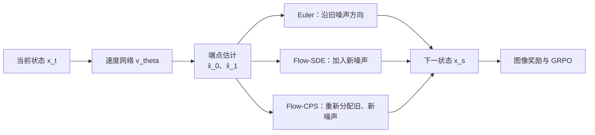
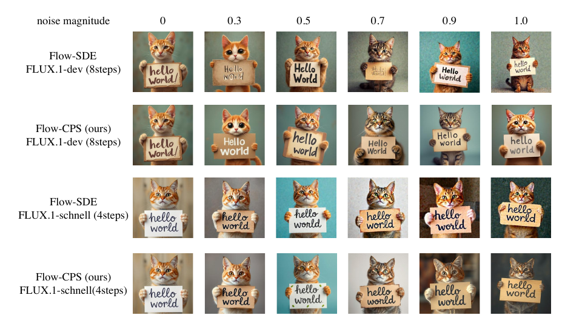
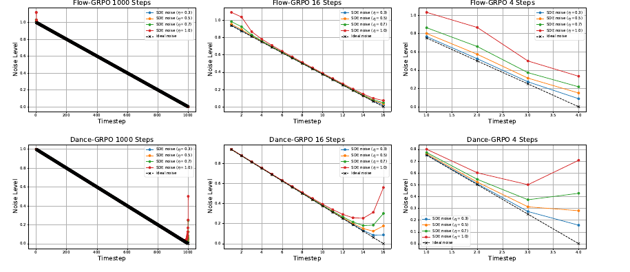
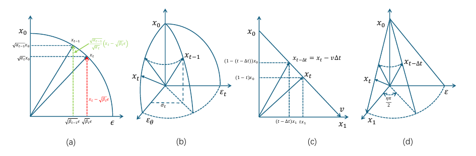
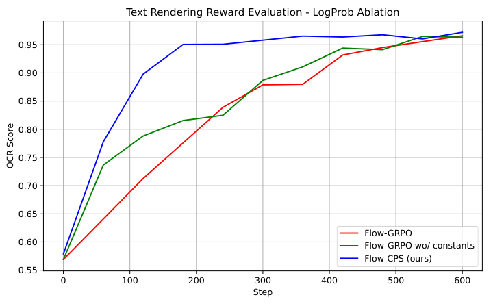
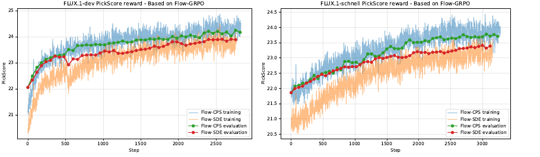
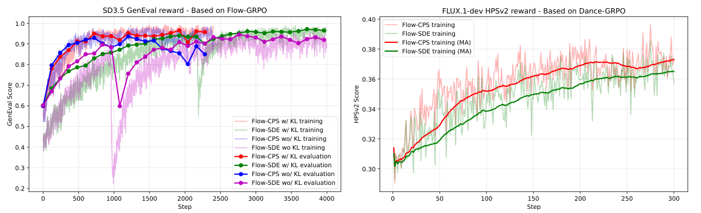
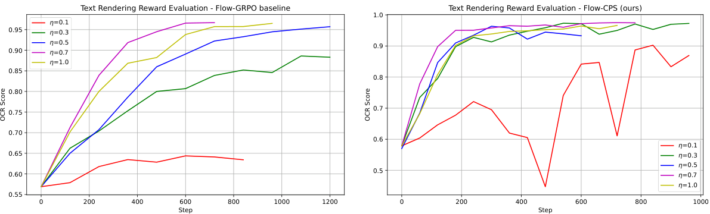
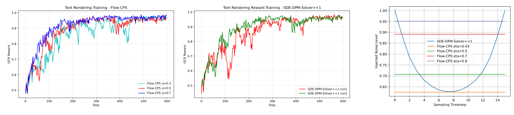
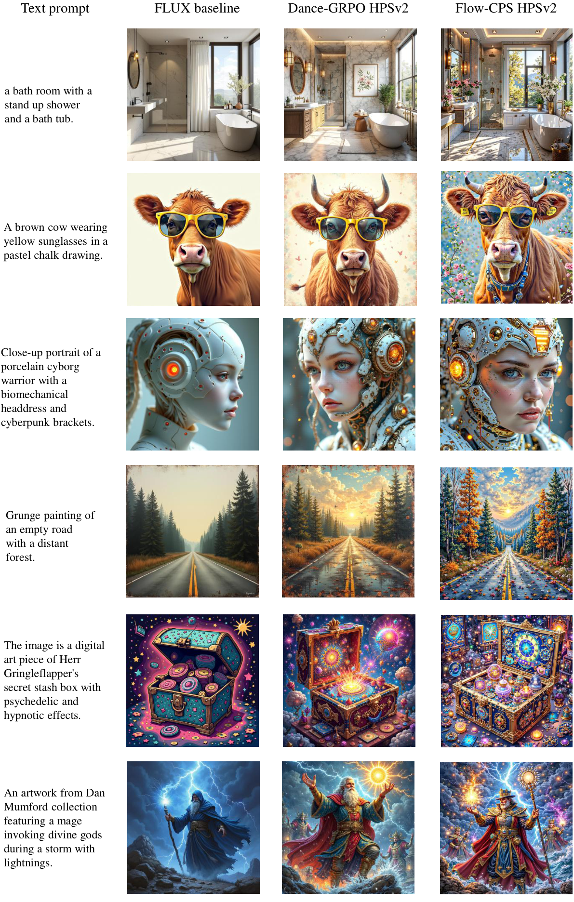

# CPS：给 Flow-RL 的随机采样留出噪声预算

!!! info "论文信息"
    **论文题名：** Coefficients-Preserving Sampling for Reinforcement Learning with Flow Matching。 
    **作者：** Feng Wang、Zihao Yu。 
    **机构：** CreateAI。 
    **时间 / 主题：** 2025-09；扩散模型 / Flow Matching / RL 采样。arXiv 当前版本为 v4，2025-12-08。 
    **适合读者：** 已了解 [Flow Matching 的基础采样与噪声日程](../../diffusion/noise-schedules-and-parameterization.md) 和 [PPO / GRPO](../../reinforcement-learning/policy-gradient-actor-critic-ppo-grpo.md) 基本概念，想理解随机 rollout 如何影响 reward 的读者。 
    **arXiv / 官方报告：** arXiv：[2509.05952](https://arxiv.org/abs/2509.05952)；PDF：[arxiv.org/pdf/2509.05952](https://arxiv.org/pdf/2509.05952)。 
    **GitHub / 项目：** GitHub：[github.com/IamCreateAI/FlowCPS](https://github.com/IamCreateAI/FlowCPS)。 
    **元数据来源与核验口径：** 来源：[arXiv](https://arxiv.org/abs/2509.05952)、[PDF](https://arxiv.org/pdf/2509.05952)、[官方代码仓库](https://github.com/IamCreateAI/FlowCPS)；Checked Date：2026-07-08；Repro Status：Paper + official code reviewed, independent reproduction not claimed。论文标注为 work in progress。

Flow Matching 的 RL rollout 需要随机性，随机性又可能把颗粒和伪影带进奖励模型。CPS 处理的是这个很具体的冲突：每一步可以换一部分噪声方向，但下一时刻的总噪声尺度不能凭空变大。读这篇论文时，先盯住采样器的方差，再看它如何改 log-prob 和 KL；奖励分数的变化放到实验部分单独判断。

三种分支都使用同一个速度预测，区别在下一状态如何分配噪声。CPS 先检查显式噪声的方差预算，再把这一步产生的图像交给奖励模型。

## 奖励函数看到的图像，先被采样器决定

CPS 研究的是 Flow Matching 的在线强化学习。它不增加新的奖励模型，也不改变预训练网络结构，而是追问一个容易被忽略的环节：模型为了探索而生成的训练图像，是否仍落在预训练时规定的噪声水平上？如果采样器额外留下了颗粒和伪影，奖励函数评估的便同时包含模型能力、探索效果和数值误差，后面的 GRPO 会据此更新参数。[↗](https://arxiv.org/pdf/2509.05952v4#page=1)

这里的“确定性”需要先限定范围。给定当前状态、提示和模型参数，ODE 的下一状态是确定的；不同初始高斯噪声仍可生成不同图像。Flow-GRPO、Dance-GRPO 引入逐步随机转移，是为了在去噪过程中探索，并构造可计算的条件概率和策略比率。问题因此不在于 ODE 完全没有多样性，而在于怎样增加**逐转移的随机性**，同时维持模型熟悉的信号与噪声尺度。

原论文 Figure 1 对比 FLUX.1-dev 的 8 步采样和 FLUX.1-schnell 的 4 步采样，列方向逐步提高随机强度。可以沿同一行观察探索增强后的噪声颗粒，再在相同模型的上下两行间比较两种采样。CPS 的直接视觉证据是，在这些样例中保留不同生成结果的同时，没有像所比较的 Flow-SDE 那样留下明显噪声。它尚不能单独证明奖励模型的分数更接近真实人类偏好。[↗](https://arxiv.org/pdf/2509.05952v4#page=2)

{ width="920" }

<small>图源：[原论文 v4，第 2 页，Figure 1](https://arxiv.org/pdf/2509.05952v4#page=2)。上两行为 dev 的 8 步生成，下两行为 schnell 的 4 步生成；后面的 dev PickScore 训练使用另一组步数设置。</small>

沿着一条 rollout 往下追，CPS 改了三个相邻接口。速度网络先给出信号端点和噪声端点，采样器据此检查这一小步留下多少方差；然后用闭式系数在旧噪声和新高斯之间重新分配；进入 GRPO 后，转移的 log-prob 和参考模型惩罚也必须使用同一条随机转移。这样才能把“图像更干净”和“策略更新更稳定”放在同一套概率定义下讨论。论文的实验支持这套组合在若干图像奖励任务上更快提升分数，采样质量、优化权重和奖励变化仍应分别核对。

## 一次 rollout 里同时有三笔账

设提示为 $c$，当前策略是速度网络 $v_\theta$。从初始高斯噪声出发，采样器反复调用网络，得到轨迹 $x_{t_0},x_{t_1},\ldots,x_{t_K}$，其中时间由接近 1 走向 0。最终状态解码成图像，奖励函数给出一个标量。同一提示的一组图像产生一组奖励 $r_1,\ldots,r_G$，GRPO 用组内均值和标准差构造优势

$$
A_i=\frac{r_i-\operatorname{mean}(r_1,\ldots,r_G)}
{\operatorname{std}(r_1,\ldots,r_G)}.
$$

同一条轨迹的各个转移使用这个终端奖励优势。更新时，用新、旧策略对**同一个已采样转移**的概率比率衡量策略变化，再施加 PPO 风格的 clipping；参考模型惩罚则限制策略偏离原模型。这里采样器既决定奖励函数看到什么图像，也决定每一步的概率形式，所以改 sampler 不是一个只影响可视化的末端操作。[↗](https://arxiv.org/pdf/2509.05952v4#page=4)

这个接口也解释了为什么本文关心少步采样。在线 RL 每轮都要重新生成图像，较少的网络调用有利于降低 rollout 成本；但步数减少意味着每一步跨越的时间更大，连续时间公式的离散误差可能不再小。把一个在上千小步时近似合理的随机更新直接用到 4、6 或 10 步，既可能改变奖励输入，也可能放大训练与确定性评估之间的差异。

CPS 沿用原有的提示、速度网络、奖励和组内比较框架，主要替换两处。一处是网络调用之后如何算 $x_s$；另一处是训练中怎样由转移均值计算 log-prob 和参考惩罚。理解全文时，要持续区分生成轨迹的规则与优化轨迹的权重。

## 先把速度预测改写成两个端点

论文采用的 Flow Matching 插值为

$$
x_t=(1-t)x_0+t x_1,
\qquad x_1\sim\mathcal N(0,I),\quad t\in[0,1].
$$

$x_0$ 是干净数据，$x_1$ 是标准高斯噪声；因此 $t=0$ 对应数据端，$t=1$ 对应噪声端。单条插值轨迹的目标速度是 $v=x_1-x_0$。网络输出 $\hat v=v_\theta(x_t,t,c)$ 后，可以用当前状态反推出两个端点估计

$$
\hat x_0=x_t-t\hat v,
\qquad
\hat x_1=x_t+(1-t)\hat v.
$$

这不是另外训练两张网络，而是对同一个速度预测作代数重写。$\hat x_0$ 表示当前预测的干净信号，$\hat x_1$ 表示当前预测的噪声端点。设下一时刻 $s=t-\Delta t$，则 Euler 更新可写为

$$
\begin{aligned}
x_s&=x_t-\Delta t\,\hat v\\
&=(1-s)\hat x_0+s\hat x_1.
\end{aligned}
$$

第二行让一次更新的结构直接可见。信号的系数是 $1-s$，噪声的系数是 $s$，恰好对应训练插值在下一时间的形式。CPS 就从这个等式出发，而不是把“新噪声有多强”视作一个脱离 scheduler 的自由参数。[↗](https://arxiv.org/pdf/2509.05952v4#page=5)

若随机更新另外引入独立高斯 $\epsilon$，形式变成

$$
x_s=a_0\hat x_0+a_1\hat x_1+b\epsilon,
$$

作者要求两个条件同时成立。第一，信号系数仍为 $a_0=1-s$。第二，把预测噪声近似看成零均值、单位方差，并让新噪声与之独立时，总噪声标准差应满足

$$
\sqrt{a_1^2+b^2}=s.
$$

这是 **Coefficients-Preserving Sampling（系数保持采样）** 的含义。两个噪声系数不能直接相加，因为独立噪声首先相加的是方差。也不能要求信号系数与噪声系数的平方和为 1；本文的线性 Flow 插值使用 $1-s$ 和 $s$，与常见 VP 扩散的平方根日程不是同一组系数。

这一定义的边界同样来自推导。新采样的 $\epsilon$ 可以按构造保证独立，但网络给出的 $\hat x_1$ 是条件预测，实际分布未必严格等于单位高斯；它还会受到模型误差和当前轨迹的影响。因此后面的“精确保持”只指**显式系数恒等式**，不能升级为每一步真实边缘分布或信号、噪声联合分布都精确正确。

## 所分析的 Flow-SDE 为什么会在有限步下加多噪声

论文重点分析 Flow-GRPO 与 Dance-GRPO 使用的随机更新。两者在噪声日程上不同，前者使用 $\sigma_t=\eta\sqrt{t/(1-t)}$，后者使用 $\sigma_t=\eta$。在端点分解下，所分析的离散更新统一写为

$$
x_s=(1-s)\hat x_0+
\left(s-\frac{\sigma_t^2\Delta t}{2t}\right)\hat x_1
+\sigma_t\sqrt{\Delta t}\,\epsilon.
$$

新增随机项的标准差是 $\sigma_t\sqrt{\Delta t}$，旧噪声项的系数也随之减小。问题不在于完全没有抵消，而在于这个抵消量只满足近似关系。按前面的方差口径计算

$$
\begin{aligned}
\sigma_{\mathrm{total}}^2
&=\left(s-\frac{\sigma_t^2\Delta t}{2t}\right)^2
+\sigma_t^2\Delta t\\
&=s^2+\frac{(\sigma_t\Delta t)^2}{t}
+\left(\frac{\sigma_t^2\Delta t}{2t}\right)^2.
\end{aligned}
$$

第二步用了 $t-s=\Delta t$。只要步长、随机强度都非零，且位于公式定义的内部时间区间，后面两项就使噪声方差大于目标 $s^2$。这也是少步时更严重的具体原因：有限步留下的是额外方差项，而不是一个只靠增加网络容量就能消去的常数偏差。[↗](https://arxiv.org/pdf/2509.05952v4#page=6)

可以作一个与论文实验分开的解释性计算。取 $t=0.5$、$\Delta t=0.25$，下一时间为 $s=0.25$，并采用 Dance-GRPO 形式的 $\sigma_t=0.7$。旧噪声系数变成 $0.1275$，新噪声标准差为 $0.35$，二者的方差平方根是

$$
\sqrt{0.1275^2+0.35^2}=0.3725,
$$

而目标只应为 $0.25$。新噪声本身已经超过目标，旧项即使减小仍无法补回这个预算。这里的 $0.3725-0.25$ 是标准差差值；它不等于“额外方差的平方根”，两者不能混称同一个误差量。

Figure 2 把这一检查扩展到完整日程。每一行从左向右对应 1000、16、4 步；不同 $\eta$ 下的实际总噪声与目标曲线偏离程度也不同。步数多时曲线更接近；减少到 16 或 4 步后，特定端点处的失配变得明显。

{ width="920" }

<small>图源：[原论文 v4，第 6 页，Figure 2](https://arxiv.org/pdf/2509.05952v4#page=6)。曲线按所分析公式计算；它呈现的是离散更新的系数失配。</small>

端点位置也解释了两种日程不同的数值问题。Flow-GRPO 的 $\sqrt{t/(1-t)}$ 在噪声端 $t\approx1$ 变大；Dance-GRPO 虽采用常数扩散强度，修正旧噪声时仍含 $1/t$，因而在数据端 $t\approx0$ 敏感。论文由此指出这些特定少步离散式的问题，不能据此否定所有连续时间 SDE，后面的 DPM-Solver++ 对照还会给出一个直接反例。

## CPS 的更新，只需让旧噪声让出恰好的方差

如果希望新噪声标准差为 $b$，满足目标预算的旧噪声系数就应为 $\sqrt{s^2-b^2}$。这里专门用 $b$ 表示实际注入的标准差，避免与前面 SDE 的扩散强度 $\sigma_t$ 混淆。CPS 的一次更新是

$$
x_s=(1-s)\hat x_0+\sqrt{s^2-b^2}\,\hat x_1+b\epsilon,
\qquad 0\le b\le s.
$$

新噪声不能超过下一时刻的总预算，否则根号无实数解。作者进一步用角度参数化消去这一约束检查

$$
b=s\sin\left(\frac{\eta\pi}{2}\right),
\qquad 0\le\eta\le1,
$$

从而得到实际使用的 Flow-CPS

$$
x_s=(1-s)\hat x_0
+s\cos\left(\frac{\eta\pi}{2}\right)\hat x_1
+s\sin\left(\frac{\eta\pi}{2}\right)\epsilon.
$$

平方和恒等式给出

$$
\left[s\cos\left(\frac{\eta\pi}{2}\right)\right]^2
+\left[s\sin\left(\frac{\eta\pi}{2}\right)\right]^2=s^2.
$$

于是随机强度改变的是旧噪声与新噪声的分配比例，而不再改变显式总噪声预算。$\eta=0$ 回到 Euler ODE；$\eta=1$ 完全去掉当前预测的噪声方向，使用新的高斯方向；中间值在两者之间分配。最后一步若 $s=0$，两个显式噪声项都消失，得到 $x_s=\hat x_0$，但网络的信号预测误差并不会因此自动消失。[↗](https://arxiv.org/pdf/2509.05952v4#page=6)

Figure 3 提供了几何解释。固定信号分量以后，旧噪声与新噪声构成一个平面。高维独立高斯向量近似正交，因此可以用圆上旋转直观表示固定总噪声尺度下的方向更新。这是高维直觉，不是说任意有限维的两次高斯采样都严格正交；系数的方差推导依靠独立性即可成立。

{ width="920" }

<small>图源：[原论文 v4，第 7 页，Figure 3](https://arxiv.org/pdf/2509.05952v4#page=7)。CPS 从 DDIM 借鉴的是新增随机性时同步减少已有噪声，而具体信号、噪声系数由 Flow Matching 的日程决定。</small>

这套参数化还留下两个使用层面的细节。CPS 的固定 $\eta$ 更新没有额外乘 $\sqrt{\Delta t}$，不能直接称它为某个 Wiener 过程的标准离散化；而同一个 $\eta$ 在 CPS、Flow-GRPO 和 Dance-GRPO 中对应不同的实际注入方差，所以“$\eta$ 相同”只是超参数标签相同，不等于各方法进行了方差完全匹配的探索实验。

## Taylor 展开说明了失配来自哪里，也限定了结论

为与连续时间随机过程联系，作者另定义 **Coefficients-Preserving Wiener Sampling（CPWS）**，让新增噪声带有 Wiener 增量的 $\sqrt{\Delta t}$ 因子

$$
x_s=(1-s)\hat x_0+
\sqrt{s^2-\sigma_t^2\Delta t}\,\hat x_1
+\sigma_t\sqrt{\Delta t}\,\epsilon.
$$

如果 $\sigma_t\sqrt{\Delta t}\ll s$，旧噪声系数可作一阶展开

$$
\begin{aligned}
\sqrt{s^2-\sigma_t^2\Delta t}
&=s\sqrt{1-\frac{\sigma_t^2\Delta t}{s^2}}\\
&\approx s-\frac{\sigma_t^2\Delta t}{2s}\\
&\approx s-\frac{\sigma_t^2\Delta t}{2t}.
\end{aligned}
$$

最后一步还用了 $s=t-\Delta t$ 与足够小的步长。这样便得到前面 Flow-SDE 的旧噪声系数。因此可以把所分析的更新理解为系数保持形式的一阶近似，丢掉的高阶项在少步时不能忽略。[↗](https://arxiv.org/pdf/2509.05952v4#page=7)

这里关键的是展开条件，不只是“步长趋于零”这句话。接近最后一步时 $s$ 本身也趋近零，即使 $\Delta t$ 看起来小，$\sigma_t^2\Delta t/s^2$ 仍可能很大，甚至使 CPWS 根号无实数解。只有在噪声幅度相对于目标剩余噪声足够小时，这个局部 Taylor 比较才成立。附录 A 对 VP-SDE 与 DDPM 的关系也使用连续极限和 Taylor 展开，作用是说明离散系数与连续近似之间的联系，不是证明随机微分方程框架本身失效。[↗](https://arxiv.org/pdf/2509.05952v4#page=13)

附录 C 还尝试一种更小的改动：从 CPWS 的第一步 Taylor 近似出发，保留分母 $s$，再令 $\sigma_t=\eta s$，让扩散强度随下一时刻剩余噪声下降。这里并非直接向分母为 $t$ 的原 Flow-SDE 式子代入新日程。此时旧噪声系数为 $s(1-\eta^2\Delta t/2)$，新噪声标准差为 $\eta s\sqrt{\Delta t}$，总标准差变成

$$
\sigma_{\mathrm{total}}
=s\sqrt{1+\left(\frac{\eta^2\Delta t}{2}\right)^2}.
$$

剩余误差比原日程小，但仍不严格等于 $s$。附录 Figure 8 显示，在其 $\eta\le1$、4 步及以上的设置中，这个修正的系数曲线已很接近目标，Figure 9 也给出较干净的样例。它说明通过重新设计扩散日程可以缓解失配；论文没有为这个变体提供与主方法同等完整的 RL 收益表，因而还不能只凭样例判定它在训练中与 CPS 等效。[↗](https://arxiv.org/pdf/2509.05952v4#page=15)

## 真正接入 GRPO 时，作者还改变了 log-prob 和参考惩罚

对一个非退化的 CPS 转移，给定 $x_t,t,c$ 后，网络决定均值

$$
\mu_\theta=(1-s)\hat x_0
+s\cos\left(\frac{\eta\pi}{2}\right)\hat x_1,
$$

新噪声的标准差则为 $b=s\sin(\eta\pi/2)$。只要 $b>0$，条件分布为 $\mathcal N(\mu_\theta,b^2I)$，其真实高斯 log-density 含有

$$
\log p_\theta(x_s\mid x_t,c)
=-\frac{\|x_s-\mu_\theta\|^2}{2b^2}
-\frac d2\log(2\pi b^2),
$$

其中 $d$ 是状态维度。对同一时间、同一固定方差的新旧策略作概率比率，归一化常数会抵消；但两个残差的差值仍除以 $2b^2$，这个分母不会自行消失。

作者实际采用的形式进一步删去分母

$$
\widetilde{\log p}_\theta(x_s\mid x_t,c)
=-\|x_s-\mu_\theta\|^2.
$$

这样处理有两层作用。接近数据端时，$b^2$ 很小，微小的均值偏移会被放大成极大的 log-prob 变化；去掉这项后，不同时间步的权重也会改变。原本低噪声后期的残差被 $1/b^2$ 放大，删除后会减弱这部分相对影响，使早期、更多影响生成多样性的步骤得到相对更大的权重。[↗](https://arxiv.org/pdf/2509.05952v4#page=7)

可以直接看新旧比率的变化。若记新、旧残差平方为 $E_\theta,E_{\mathrm{old}}$，真实高斯比率是 $\exp[-(E_\theta-E_{\mathrm{old}})/(2b^2)]$，替代形式则使用 $\exp[-(E_\theta-E_{\mathrm{old}})]$。二者一般不同，因此 clipping 实际约束的变化尺度也会不同。把后者解释为时间步重加权或温度发生变化的代理目标更准确，不能仍称它为原采样分布的精确似然比。

参考模型项作了相同处理。相同协方差的两个高斯分布，其 KL 与 $\|\mu_\theta-\mu_{\mathrm{ref}}\|^2/(2b^2)$ 对应；论文 Equation 16 使用去掉分母的

$$
\widetilde D_{\mathrm{ref}}
=\|\mu_\theta-\mu_{\mathrm{ref}}\|^2.
$$

因此 sampler、log-prob、ratio、reference penalty 和其系数 $\beta$ 共同决定新的优化过程。只替换生成公式而照搬原高斯分母，并不等于复现了论文实际使用的方法。

端点还有一个数学区别。当 $\eta=0$ 或 $s=0$ 时，$b=0$，真实转移退化为确定映射，普通连续高斯密度公式不再适用。去掉分母后的残差代理仍能计算，不代表它恢复了一个本不存在的非退化转移密度。这也是不能把数值稳定性与概率解释完全等同的原因。

## log-prob 消融支持组合改动，但没有分离出全部因果贡献

附录 D 的 Figure 10 专门回答：性能改善是否只是去掉方差分母带来的？读图时先比较红、绿两条基线。绿色仍使用原 Flow-GRPO 采样，但移除 log-prob 分母；它在训练前段更快，最终表现与红色接近。再看蓝色 CPS，它达到高分所需的优化步数明显更少。

{ width="920" }

<small>图源：[原论文 v4，第 16 页，Figure 10](https://arxiv.org/pdf/2509.05952v4#page=16)。绿色检验基线去分母，蓝色使用 CPS 配合修改后的 log-prob。</small>

这一结果支持“仅改基线 log-prob 不能完全重现 CPS 组合收益”。但作者同时写明，CPS 若保留原 log-prob 分母，实验不能收敛，因此没有画出那条曲线。完整的 $2\times2$ 比较应包括两种 sampler 与两种概率定义；这里有一个组合失败，不能把其余三条成功曲线解释成已经独立量化了采样公式与目标权重各自贡献多少。[↗](https://arxiv.org/pdf/2509.05952v4#page=16)

这个失败也很有实际价值。它说明 CPS 所产生的小方差转移与原目标的数值敏感性确实会相互作用，不能仅凭“更新公式只需几行”就假设训练接口无需调整。论文主表里的基线采用各自原 log-prob，CPS 采用删除分母的版本，主结果衡量的就是这套可训练组合。

## 四类奖励分别在测什么

实验在 8 张 NVIDIA A100 上完成，沿用 Flow-GRPO 与 Dance-GRPO 的实验设置，改变采样方法和 log-prob。四类任务涵盖可验证规则与学习得到的偏好分数，但它们的奖励来源和能够支持的判断不同。[↗](https://arxiv.org/pdf/2509.05952v4#page=8)

| Reward | Scoring rule or target | What the result measures |
| --- | --- | --- |
| GenEval | Counting、object co-occurrence、position、color 等组合属性 | 指定物体及其关系、属性的满足程度 |
| OCR | 识别生成图中文字，并与提示中的目标文本比较 | 被 OCR 系统识别出的文本准确度 |
| PickScore | 由人类偏好数据训练的评分模型 | 该偏好代理给出的分数 |
| HPSv2 | 由人类偏好数据训练的评分模型 | 另一种偏好代理给出的分数 |

GenEval 中，计数奖励写为 $1-|N_{\mathrm{gen}}-N_{\mathrm{ref}}|/N_{\mathrm{ref}}$；位置、颜色任务先检查数量，数量正确给部分奖励，再根据位置或颜色是否正确补上其余奖励。OCR 的奖励是

$$
r_{\mathrm{OCR}}=\max\left(1-\frac{N_e}{N_{\mathrm{ref}}},0\right),
$$

其中 $N_e$ 为识别文本与目标文本的最小编辑距离，$N_{\mathrm{ref}}$ 为提示引号中目标字符串的字符数。这个得分同时依赖生成文字与识别器，不能简单等同于所有人类读者的逐字判断。

PickScore 与 HPSv2 的“人类偏好”来自评分模型的训练来源，本文使用它们作为自动奖励，并未在这些曲线中进行新的真人盲测。因此分数上涨可以证明对应代理更满意，不能直接换算成人类胜率。

多数实验为训练速度省去了参考 KL 项，GenEval 是例外，作者发现其缺失会导致退化，并采用 $\beta=0.001$。后面的结果需结合这一点理解：更干净的 rollout 减少了一类噪声干扰，但不会取消过度优化奖励时的其他约束需求。[↗](https://arxiv.org/pdf/2509.05952v4#page=9)

## PickScore 的确定性评估要先固定

PickScore 实验使用两个 FLUX 模型。FLUX.1-dev 训练 rollout 为 6 步，评估为 28 步；FLUX.1-schnell 训练与评估均为 4 步。训练随机强度设置为 $\eta=0.9$，评估不额外注入随机性。下表保留原论文 Table 2 的数值。[↗](https://arxiv.org/pdf/2509.05952v4#page=8)

| Model | Base | Flow-GRPO | Flow-CPS |
| --- | ---: | ---: | ---: |
| FLUX.1-schnell | 21.86 | 23.39 | 23.78 |
| FLUX.1-dev | 22.06 | 23.90 | 24.25 |

相对于基线，CPS 在 schnell、dev 上分别提高 0.39 和 0.35 个 PickScore 分数，差值由表中数值相减得到。Figure 4 还把训练线与确定性评估线分开。训练起点就有差距，说明两种 sampler 送进奖励模型的图像不同；评估线从相同起点出发，之后才拉开，这部分更接近参数学习本身的差异。

{ width="920" }

<small>图源：[原论文 v4，第 9 页，Figure 4](https://arxiv.org/pdf/2509.05952v4#page=9)。左为 dev 的 6/28 步训练与评估，右为 schnell 的 4/4 步；横轴为优化 Step。</small>

这个设计避免了只用随机训练奖励证明最终模型改善的问题。与此同时，曲线支持的是较少优化步达到相应代理得分，以及表中最终评分更高；论文没有提供对应的完整墙钟时间与计算成本表，所以不能把曲线横向距离直接称为同样比例的训练时间加速。dev 的训练与评估使用不同采样步数，也应保留在复现和成本估计中。

## GenEval 总分打平，参考约束与分项变化更值得看

GenEval 使用 SD3.5-M，10 步训练、40 步评估，$\eta=0.7$。完整分项表能够防止只看 Overall 而误读所有能力都同时提升。[↗](https://arxiv.org/pdf/2509.05952v4#page=8)

| Model | Overall | Single Obj. | Two Obj. | Counting | Colors | Position | Attr. Binding |
| --- | ---: | ---: | ---: | ---: | ---: | ---: | ---: |
| SD3.5-M | 0.63 | 0.98 | 0.78 | 0.50 | 0.81 | 0.24 | 0.52 |
| Flow-GRPO w/o KL | 0.95 | 0.99 | 0.98 | 0.95 | 0.92 | 0.95 | 0.83 |
| Flow-CPS w/o KL | 0.94 | 0.99 | 0.95 | 0.95 | 0.89 | 0.93 | 0.83 |
| Flow-GRPO w/ KL | 0.97 | 1.00 | 1.00 | 0.97 | 0.94 | 0.98 | 0.90 |
| Flow-CPS w/ KL | 0.97 | 1.00 | 0.99 | 0.95 | 0.94 | 0.98 | 0.93 |

带参考约束时，两种 RL 方法的 Overall 都为 0.97。CPS 的 Attr. Binding 从 0.90 到 0.93，但 Two Obj. 与 Counting 分别略低于基线；单物体、颜色和位置则打平。因此主表支持高分区域中的能力权衡，而不是逐项全面胜出。去掉参考约束时，CPS 总分 0.94，基线为 0.95，也不能只从“采样更干净”推导最终指标一定更高。

原论文 Figure 5 左侧补上了表格看不到的时间维度。CPS 较早达到较高分数，但无 KL 的训练出现明显跌落、退化甚至崩溃。即便某个报告点的表格分数很高，也不能据此说整条训练过程稳定。

{ width="920" }

<small>图源：[原论文 v4，第 9 页，Figure 5](https://arxiv.org/pdf/2509.05952v4#page=9)。左侧比较 GenEval 是否使用参考约束；右侧 HPSv2 只有训练曲线及其滑动平均。</small>

这组实验检验的是两个独立问题。采样规则能否更快提供可用于学习的图像，曲线给出正面证据；奖励优化是否仍需约束偏离，带与不带 KL 的差异同样给出明确答案。CPS 解决噪声系数失配，并没有替代参考模型约束。

## HPSv2 的比较条件和论文内部标注应分别保留

原论文 Table 3 的模型标题为 **FLUX.1-schnell**，报告如下。

| Model | Base | Dance-GRPO | Flow-CPS |
| --- | ---: | ---: | ---: |
| FLUX.1-schnell | 0.304 | 0.364 | 0.377 |

CPS 比 Dance-GRPO 高 0.013，二者均高于基础模型。不过 Figure 5 右侧标题、图注，以及附录 Figure 12 的定性样例都写的是 **FLUX.1-dev**。这一模型标注不一致使表格与曲线无法无条件合并为同一个明确模型的完整实验记录；这里保留各自的局部标签，不猜测哪处应改。[↗](https://arxiv.org/pdf/2509.05952v4#page=8) [↗](https://arxiv.org/pdf/2509.05952v4#page=9)

曲线还有两点直接影响判断。第一，Dance-GRPO 代码没有提供在线评估，因此 Figure 5 画的是训练奖励和 moving average，不能将平滑后的训练分数称为独立评估。第二，CPS 使用 $\eta=0.7$，Dance-GRPO 使用其默认的 $\eta=0.3$，它不是相同超参数数值的对照，更不是相同实际注入方差的对照。

这不抹掉表格和曲线的观察，但限定了归因。可确认的是，论文所采用的两套完整设置中，CPS 的 HPSv2 报告分数更高、训练曲线更快抬升；仅凭它们不足以量化在同一探索预算下 sampler 本身的净收益。

## OCR 的探索消融说明，干净图像仍需要足够随机性

OCR 使用 SD3.5-M。Table 4 中基础模型为 0.579，Flow-GRPO 为 0.966，CPS 为 0.975。这个任务将奖励直接连接到文字编辑距离，比偏好分数更容易解释，但仍需区分最终分数与训练过程。[↗](https://arxiv.org/pdf/2509.05952v4#page=8)

| Model | Base | Flow-GRPO | Flow-CPS |
| --- | ---: | ---: | ---: |
| SD3.5-M | 0.579 | 0.966 | 0.975 |

Figure 6 分别在两种 sampler 下改变 $\eta\in\{0.1,0.3,0.5,0.7,1.0\}$。同一面板中低随机强度与中高强度的曲线差异，以及两幅图达到高分的大致优化步数，都需要一起看。两种方法都在 $\eta=0.7$ 获得最佳表现，而 $\eta=0.1$ 都不能良好收敛，CPS 的小 $\eta$ 曲线也有明显震荡。

{ width="920" }

<small>图源：[原论文 v4，第 10 页，Figure 6](https://arxiv.org/pdf/2509.05952v4#page=10)。左右横轴的展示范围不同，比较的是优化步数趋势，不能直接读成等墙钟预算。</small>

这一消融支持 CPS 的一个具体用途：在保留较强逐步探索时，减少显式噪声超预算的副作用。但它也排除了“只要系数正确，就可以把随机性降到极低并保持稳定”的推断。有效探索仍然是 RL 的必要设计变量；系数保持控制的是随机性如何加入，不是证明任何随机强度都适合任务。

## DPM-Solver++ 给出反例，SDE 名称本身不决定是否保持系数

附录 B 将同样的系数检查应用到 DPM-Solver 系列。这部分很关键，因为它防止把主文对两种 Flow-SDE 离散式的诊断扩大为对所有 SDE 求解器的否定。为避免附录与主文的时间符号方向混淆，这里用 current、next 表示相邻两个状态，并记对应日程为 $\alpha,\sigma$，半对数信噪比（$\log(\alpha/\sigma)$）的增量为

$$
h=\log\frac{\alpha_{\mathrm{next}}}{\sigma_{\mathrm{next}}}
-\log\frac{\alpha_{\mathrm{current}}}{\sigma_{\mathrm{current}}}.
$$

作者对一阶形式的推导显示，SDE-DPM-Solver1 的总噪声标准差是

$$
\sigma_{\mathrm{next}}
\sqrt{2(\exp(h)-1)^2+1},
$$

所以一般大于目标 $\sigma_{\mathrm{next}}$。但 **SDE-DPM-Solver++1** 可写成

$$
x_{\mathrm{next}}=
\alpha_{\mathrm{next}}\hat x_0
+\sigma_{\mathrm{next}}e^{-h}\hat x_1
+\sigma_{\mathrm{next}}\sqrt{1-e^{-2h}}\,\epsilon.
$$

它的旧、新噪声系数平方和恰好等于 $\sigma_{\mathrm{next}}^2$，因此符合 CPS 的判据。它与主方法的区别在于新噪声比例随 $h$ 变化，等效角度参数是

$$
\eta_{\mathrm{eff}}
=\frac{2}{\pi}\arcsin\sqrt{1-e^{-2h}}.
$$

附录给出的日程中，等效 $\eta$ 从 1 降到约 0.43，再回到 1。原 Figure 7 右侧纵轴实际画的是 **Injected Noise Level**，其最低点约 0.63，对应 $\sin(0.43\pi/2)$；不能把图上的纵轴数值直接称为 $\eta$。[↗](https://arxiv.org/pdf/2509.05952v4#page=14)

{ width="920" }

<small>图源：[原论文 v4，第 14 页，Figure 7](https://arxiv.org/pdf/2509.05952v4#page=14)。左侧为 CPS 的 OCR reward，中间为 SDE-DPM-Solver++1 的两次运行，右侧为随采样步骤变化的噪声注入比例。</small>

附录 Table 5 报告了两次 SDE-DPM-Solver++1 运行及不同固定 $\eta$ 的 CPS。原文将前两次运行的数值描述为各自达到的峰值奖励，不是均值与标准差。

| Method | Setting | OCR Reward |
| --- | --- | ---: |
| SDE-DPM-Solver++1 | Run 1 | 0.966 |
| SDE-DPM-Solver++1 | Run 2 | 0.970 |
| Flow-CPS | $\eta=0.3$ | 0.973 |
| Flow-CPS | $\eta=0.5$ | 0.963 |
| Flow-CPS | $\eta=0.7$ | 0.975 |

Figure 7 中间显示，SDE-DPM-Solver++1 两次运行仍有奖励骤降；左侧 CPS 在 $\eta\le0.5$ 时也出现类似问题。作者把这种现象与探索多样性不足联系起来，同时承认根因尚未解决。因而系数保持可以排除一类显式噪声预算错误，却不足以保证整个 RL 过程稳定；这个附录对主方法的结论提供了实质限制。推导与实验集中在这里列出的一阶形式，也不能自动推广为所有高阶 DPM solver 的统一性质。

## 更高偏好奖励可能伴随过量细节，噪声问题解决后仍有奖励投机

附录的定性结果揭示了另一个层次。PickScore 优化后的图像通常增加纹理，HPSv2 优化后则增加细节和光影。Figure 12 可以沿着同一行比较 Base、Dance-GRPO 与 CPS，尤其观察浴室、公路和机械人的附加装饰：浴室出现更多花饰，公路场景增加高饱和的彩色植被与落叶，机械人包含更多饰件。这些变化会提高特定偏好代理的分数，但不等于每位用户都更喜欢这些额外内容。

{ width="920" }

<small>图源：[原论文 v4，第 18 页，Figure 12](https://arxiv.org/pdf/2509.05952v4#page=18)。该图标注为 FLUX.1-dev；按行固定 prompt 比较三列，注意新增纹理、装饰和光影。</small>

作者在附录明确承认，过量细节可能属于 reward hacking。CPS 可以让 rollout 更少受残余噪声干扰，但更干净的输入仍可能被一个有偏的奖励模型鼓励产生过度装饰。前面“奖励计算更可靠”的动机，应理解为减少这一类噪声污染，不能理解为已经测得奖励与人类偏好之间的一致性必然提高。[↗](https://arxiv.org/pdf/2509.05952v4#page=16)

论文结尾另外保留了两个未解决问题。多步探索仍用终端奖励评价整条轨迹，如何分配各步贡献并未解决；从初始输入噪声产生的随机性，也不是当前 Flow Matching GRPO 过程能够直接优化的对象。本文定量实验集中在图像生成，虽然动机涉及图像与视频 RL，不能据此宣称已经验证了视频模型上的同等收益。[↗](https://arxiv.org/pdf/2509.05952v4#page=10)

## 可以复用的是一次采样与目标函数的联合检查

CPS 最适合被理解为对在线 Flow-RL 接口的修正。网络输出速度后，先还原 $\hat x_0,\hat x_1$，再依据下一时间的日程分配旧、新噪声；训练更新则使用与论文设置相配套的残差代理及参考约束。它不要求增加另一套生成网络，新增计算主要是端点重组与高斯采样，但整体 RL 成本仍由重复 rollout、奖励计算和参数更新决定。

实际采用时，第一项可复用工作是把已有 sampler 写成“信号系数、已有噪声系数、新噪声系数”三部分，直接检查下一时间的预算。第二项是明确目标究竟使用精确 Gaussian likelihood，还是经过时间步重加权的 surrogate；前者的概率解释和后者的稳定性动机不能混写。第三项是同时观察随机训练奖励、确定性评估、参考约束与低探索强度下的跌落，避免把一个较高峰值当成完整训练收益。

本文最有分量的认识是，生成模型的 RL 奖励学习会受到数值采样规则的直接影响。减少有限步误差可以让探索更可用，但“系数正确”“训练稳定”“奖励更高”和“用户更满意”仍需要各自的证据。CPS 给出了前两者之间一个可操作的接口，同时用消融和失败案例显示，这条链并不会因为采样式变干净而自动闭合。
