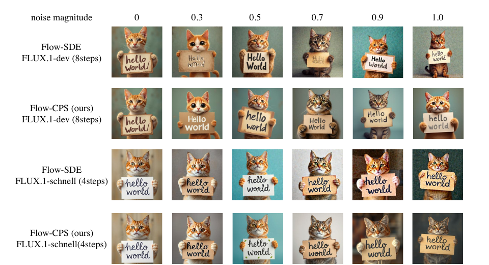
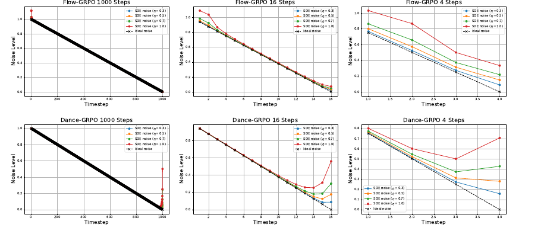
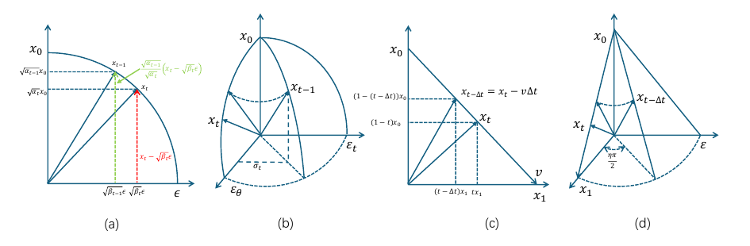
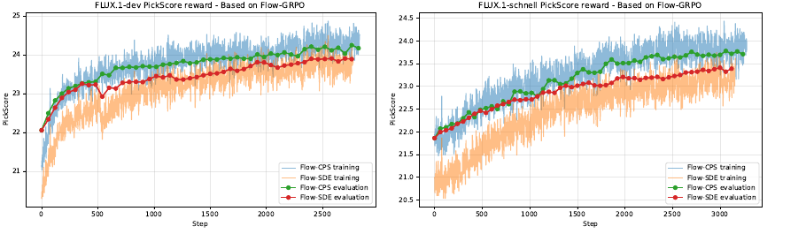
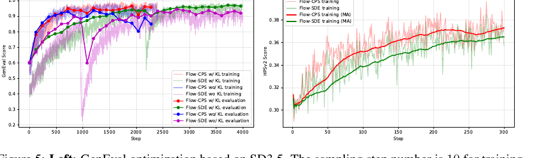
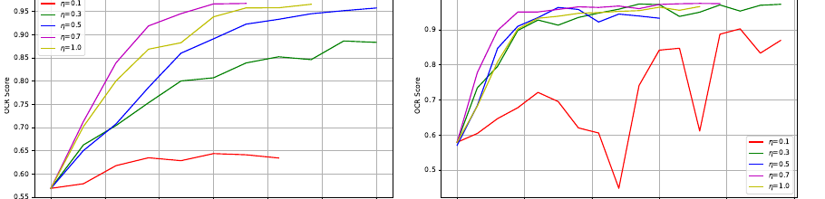

# CPS：Flow-RL 中的系数保持采样

!!! info "论文信息"
    **论文题名：** Coefficients-Preserving Sampling for Reinforcement Learning with Flow Matching。<br>
    **作者：** Feng Wang、Zihao Yu。<br>
    **机构：** CreateAI。<br>
    **时间 / 主题：** 2025-09；扩散模型 / Flow Matching / RL 采样。arXiv 当前版本为 v4，2025-12-08。<br>
    **适合读者：** 已了解 [Flow Matching 的基础采样与噪声日程](../../diffusion/noise-schedules-and-parameterization.md) 和 [PPO / GRPO](../../reinforcement-learning/policy-gradient-actor-critic-ppo-grpo.md) 基本概念，想理解随机 rollout 如何影响 reward 的读者。<br>
    **arXiv / 官方报告：** arXiv：[2509.05952](https://arxiv.org/abs/2509.05952)；PDF：[arxiv.org/pdf/2509.05952](https://arxiv.org/pdf/2509.05952)。<br>
    **GitHub / 项目：** GitHub：[github.com/IamCreateAI/FlowCPS](https://github.com/IamCreateAI/FlowCPS)。<br>
    **元数据来源与核验口径：** 来源：[arXiv](https://arxiv.org/abs/2509.05952)、[PDF](https://arxiv.org/pdf/2509.05952)、[官方代码仓库](https://github.com/IamCreateAI/FlowCPS)；Checked Date：2026-07-08；Repro Status：Paper + official code reviewed, independent reproduction not claimed。论文标注为 work in progress。

本文只追一个问题：Flow Matching 的 RL rollout 加入随机性后，怎样避免采样器把额外噪声带进 reward 输入？读完后，你应能检查少步 Flow-SDE 是否超出 scheduler 的噪声预算，判断更换 sampler 时是否必须同步调整 log-prob / KL，以及代理 reward 上升能否支持真实人评结论。

## 原论文故事线

### 研究背景

Flow Matching 和 diffusion 模型进入 RL 后训练时，采样器不再只是“生成最终图像”的工具，还变成了 policy rollout 的一部分。Flow-GRPO、Dance-GRPO 这类方法需要为同一个 prompt 生成一组多样样本，再由 reward model 或可验证规则给分，最后用 GRPO 风格目标更新生成模型。为了得到多样性，它们把原本确定性的 Flow-ODE 改写成带随机性的 Flow-SDE。

这个改写听起来合理：RL 需要探索，SDE 能注入随机性。但视觉生成和文本 token 采样不一样。文本里采到哪个 token 就是哪个离散动作；Flow Matching 的状态是连续 latent，一步里多加一点噪声会改变 scheduler 期望的样本 / 噪声系数。CPS 论文正是抓住了这个接口问题：**采样随机性本身可能污染 reward model 看到的图像。**

### 问题（Challenge）

论文要解决的问题是：怎样给 Flow Matching 的 RL rollout 注入随机性，同时不破坏原 scheduler 规定的噪声水平。Flow-SDE 会同时改动确定性轨迹的 score / velocity 项并加入 Wiener 噪声项；如果两部分没有共同满足目标时间步的总噪声水平，latent 会在每一步被过量加噪。最终训练样本可能带明显噪声伪影，而 reward model 对美学、人类偏好、文字渲染这类指标的打分会被伪影干扰。

### Finding

论文的关键发现是：**Flow-RL 的随机采样必须保持两个系数约束：样本系数由 scheduler 决定，总噪声水平也必须和 scheduler 对齐。** 原 Flow-SDE 只是在连续极限里近似合理；一旦现代生成模型常用 4、6、10、16 步采样，\(\Delta t\) 不再足够小，Taylor 近似误差就会变成可见噪声。

这改变了 Flow-RL 的问题 framing。此前大家容易把多样性看成“加噪声越强，探索越充分”；CPS 把问题改成“探索只能花 scheduler 允许的噪声预算”，在保留随机性的同时重新分配预算。

### 方法

CPS 借鉴 DDIM 的随机采样形式，用新噪声替换掉一部分预测噪声，使总噪声标准差仍等于当前时间步的目标噪声水平。论文把这个思路推广到 Flow Matching：先从当前 \(x_t\) 和 velocity 预测出 \(\hat{x}_0\) 与 \(\hat{x}_1\)，再在 \(\hat{x}_1\) 和新采样噪声 \(\epsilon\) 之间做一个受控旋转。这样既有随机性，又不让总噪声超过 \(t-\Delta t\)。

### 结论

论文在 GenEval、PickScore、HPSv2 和 OCR reward 上比较 Flow-SDE 与 Flow-CPS。最稳定的结论是：CPS 生成给 reward model 的训练样本更干净，因此在 PickScore、HPSv2、OCR 上收敛更快，最终 reward 更高；GenEval 接近饱和时最终分数与 baseline 持平，但 CPS 仍显示更快收敛。边界也很明确：这些是作者在图像生成基线上报告的结果，论文没有独立证明 CPS 已经解决视频 Flow-RL、reward hacking 或多步 credit assignment。

### 关键术语

- **Coefficients-Preserving Sampling（系数保持采样）**：采样时同时保持 scheduler 规定的样本系数与总噪声水平
- **Flow-CPS（Flow 系数保持采样）**：用预测噪声与新噪声的受控组合，在噪声预算内为 Flow Matching rollout 注入随机性
- **Flow-SDE（Flow 随机微分方程采样）**：在 Flow-ODE 轨迹中加入 Wiener 噪声，为 RL rollout 提供样本多样性
- **Total Noise Level（总噪声水平）**：多个独立噪声项的标准差按 RSS 合成后的总量，CPS 要求它与目标时间步一致
- **Reward Contamination（奖励污染）**：采样噪声伪影进入 reward model 输入，使 advantage 混入生成质量以外的采样器影响
- **Scheduler（噪声日程）**：规定每个时间步样本系数、噪声系数或等价噪声水平的调度器
- **GRPO（Group Relative Policy Optimization）**：对同一 prompt 的一组 rollout 按相对 reward 构造 advantage 的策略优化方法

## 它的效率贡献是什么

| 维度 | 贡献 |
| --- | --- |
| 节省的成本 | 减少 RL 后训练中由噪声伪影带来的错误 reward、慢收敛和 train-test mismatch；NFE 不变 |
| 核心机制 | 保持 scheduler 的样本系数与总噪声水平，把随机性从“额外叠加”改成“在噪声预算内重分配” |
| 对扩散 / Flow 主线的意义 | 给 Flow Matching 接 GRPO 时补上采样接口约束，连接 [噪声日程与参数化](../../diffusion/noise-schedules-and-parameterization.md)、[采样与推理加速](../../diffusion/inference.md) 和 RL 后训练 |
| 主要风险 | 实验主要是图像生成与 reward 曲线；不能直接推出视频后训练、真实人评、闭环世界模型或所有 reward model 都会同幅度受益 |
| 应接到本站哪里 | [视频与多模态扩散](../../diffusion/video-and-multimodal-diffusion.md)、[PPO / GRPO](../../reinforcement-learning/policy-gradient-actor-critic-ppo-grpo.md)、[DPM-Solver++](dpm-solver-plus-plus.md)、[DMD2](dmd2.md) |

## 证据等级与外推边界

| 论文结论 | 证据来源 | Evidence Type | Repro Status | 可外推到工程判断 | 不能直接外推 |
| --- | --- | --- | --- | --- | --- |
| Flow-SDE 会产生过量噪声并污染训练样本 | Figure 1、Equation 10/11、Figure 2 | Paper Result（qualitative） | Paper Only | Flow-RL rollout 不能只看随机性强度，还要看 scheduler 噪声守恒 | 不能说明所有 SDE sampler 都有同样问题 |
| CPS 保持样本系数和总噪声水平 | Definition 1、Equation 12/13、Figure 3 | Paper Result（theorem） | Paper Only | 采样器设计应检查系数与总噪声是否同时对齐 | 依赖 predicted noise 近似标准高斯且独立于新噪声的假设 |
| CPS 提升 reward 优化稳定性 | Table 1-4、Figure 4-6 | Paper Result（benchmark） | Paper Only | PickScore / HPSv2 / OCR 这类 reward 容易受图像伪影影响 | 不等于真实人类偏好一定提升，也不消除 reward hacking |
| 低步采样更容易暴露 Flow-SDE 误差 | Figure 2、Theorem 1 | Paper Result（theorem / qualitative） | Paper Only | 4-step / few-step Flow-RL 要特别警惕连续极限近似失效 | 不能替代每个 scheduler / solver 的单独验证 |

本页有官方仓库可供检查，因此页面整体的 Repro Status 可记为 Author Code / Official Repo；表中每条论文结果仍是作者报告，本站未标记 Independent Reproduced。

对本站主线来说，CPS 最值得吸收的是一个约束：**在 Flow Matching 上做 RL，不要把 sampler 当作无害的探索开关；sampler 直接决定 reward model 看到的状态分布。**

## 论文位置

Flow Matching 的基础路径通常写成：

\[
x_t=(1-t)x_0+tx_1,
\]

其中 \(x_0\) 是数据样本，\(x_1\) 是高斯噪声，\(t\in[0,1]\) 表示噪声水平。模型学习 velocity：

\[
v=x_1-x_0.
\]

确定性采样时，从 \(x_t\) 往 \(x_{t-\Delta t}\) 走一步：

\[
x_{t-\Delta t}=x_t-\hat{v}_\theta(x_t,t)\Delta t.
\]

RL rollout 需要同一个 prompt 下有多样样本，于是 Flow-GRPO / Dance-GRPO 用 Flow-SDE 注入随机性。随机性同时影响 diversity 和 reward 的输入质量：

```text
prompt
  -> stochastic Flow rollout
  -> generated image
  -> reward model / rule-based reward
  -> advantage
  -> GRPO update
```

如果 stochastic rollout 把图像推到过噪分布，后面的 reward ranking 就会被污染。CPS 因此不是一个普通加速 sampler，而是 Flow-RL 的 rollout 可靠性修正。

{ width="920" }

<small>图源：[原论文，Figure 1](https://arxiv.org/abs/2509.05952)。原论文图意：Flow-SDE 在较高噪声参数下会出现明显噪声伪影；Flow-CPS 在相同随机性设置下保持图像干净。论文强调这些样本会进入 reward model。</small>

**Figure 1 要按 reward 输入读。**
这张图展示的是训练链路里的观测污染，不能只按“CPS 图更好看”来读。Flow-SDE 的 noisy sample 会被拿去算 PickScore、HPSv2、OCR 或规则 reward；一旦 reward model 对噪声敏感，GRPO 看到的 advantage 就会同时混入采样器伪影、prompt alignment 和图像质量信号。

## 系数保持到底保持什么

论文先把 Flow-ODE 的一步采样改写成 \(\hat{x}_0\) 和 \(\hat{x}_1\) 的线性插值。根据 velocity 预测：

\[
\hat{x}_0=x_t-t\hat{v},\qquad
\hat{x}_1=x_t+(1-t)\hat{v}.
\]

于是确定性 ODE 一步可以写成：

\[
x_{t-\Delta t}
=(1-(t-\Delta t))\hat{x}_0+(t-\Delta t)\hat{x}_1.
\]

这里的含义很直接：

| 项 | 系数 | 解释 |
| --- | --- | --- |
| \(\hat{x}_0\) | \(1-(t-\Delta t)\) | scheduler 指定的样本系数 |
| \(\hat{x}_1\) | \(t-\Delta t\) | scheduler 指定的噪声系数 |

CPS 的定义要求两件事同时成立：

1. 样本系数必须严格由 scheduler 分配；
2. 总噪声水平必须和 scheduler 对齐。如果有多个独立噪声项，总噪声水平按标准差平方和开根号计算。

这个定义很像 DDIM 的随机版本。DDIM 让预测噪声和新噪声共同构成目标时间步的总噪声，因此随机性增加了，噪声预算没有超支。

## 为什么 Flow-SDE 不保系数

论文把 Flow-SDE 的一步写回 \(\hat{x}_0,\hat{x}_1,\epsilon\) 的形式，得到：

\[
x_{t-\Delta t}
=
(1-(t-\Delta t))\hat{x}_0
+
\left(t-\Delta t-\frac{\sigma_t^2\Delta t}{2t}\right)\hat{x}_1
+
\sigma_t\sqrt{\Delta t}\epsilon.
\]

注意这里有两个噪声来源：被缩减后的 \(\hat{x}_1\)，以及新注入的 \(\epsilon\)。总噪声水平变成：

\[
\sigma_{\text{total}}
=
\sqrt{
\left(t-\Delta t-\frac{\sigma_t^2\Delta t}{2t}\right)^2
+
\sigma_t^2\Delta t
}
\ge t-\Delta t.
\]

只有 \(\sigma_t=0\) 时等号成立，也就是完全没有随机性。换句话说，一旦 Flow-SDE 想要探索，它的总噪声通常就会超过 scheduler 目标。

{ width="920" }

<small>图源：[原论文，Figure 2](https://arxiv.org/abs/2509.05952)。原论文图意：Flow-GRPO 和 Dance-GRPO 的 SDE noise level 与 ideal noise level 对比；采样步数越少，偏离越明显，且在 \(t=0\) 或 \(t=1\) 附近有数值问题。</small>

**Figure 2 要看连续近似何时失效。**
1000 steps 时，曲线大体贴近 ideal noise，但在端点仍可能出问题；16 steps 已经能看到偏移；4 steps 时偏移很明显。现代图像 / 视频 Flow 模型常在少步区间训练或推理，因此不能把连续时间 SDE 的推导直接当成少步离散 sampler 的保证。

论文进一步指出，Flow-SDE 可以看成 Flow-CPWS 的一阶 Taylor 近似。近似成立需要 \(\sigma_t\sqrt{\Delta t}\ll t-\Delta t\) 且 \(\Delta t\to0\)。少步采样不满足这个条件，端点附近的 \(1/t\) 项还会放大数值不稳定。

## Flow-CPS 怎么改

CPS 的构造方式是：保留 scheduler 给出的样本系数，把噪声部分拆成预测噪声和新噪声的受控组合。

若新注入噪声标准差为 \(\sigma_t\)，为了让总噪声仍等于 \(t-\Delta t\)，预测噪声系数应为：

\[
\sqrt{(t-\Delta t)^2-\sigma_t^2}.
\]

其中，\(\sigma_t\) 表示新注入噪声的标准差，根号项表示留给预测噪声的系数；成立条件是 \(\sigma_t\le t-\Delta t\)。

因此：

\[
x_{t-\Delta t}
=
(1-(t-\Delta t))\hat{x}_0
+
\sqrt{(t-\Delta t)^2-\sigma_t^2}\hat{x}_1
+
\sigma_t\epsilon.
\]

为了避免根号内为负，论文把 \(\sigma_t\) 定义为下式，其中 \(\eta\in[0,1]\) 表示随机强度：

\[
\sigma_t=(t-\Delta t)\sin\left(\frac{\eta\pi}{2}\right),\qquad \eta\in[0,1].
\]

代回去得到 Flow-CPS：

\[
x_{t-\Delta t}
=
(1-(t-\Delta t))\hat{x}_0
+
(t-\Delta t)\cos\left(\frac{\eta\pi}{2}\right)\hat{x}_1
+
(t-\Delta t)\sin\left(\frac{\eta\pi}{2}\right)\epsilon.
\]

随着 \(\eta\) 增大，新噪声变多，预测噪声相应变少，总噪声水平仍守住 \(t-\Delta t\)。

{ width="920" }

<small>图源：[原论文，Figure 3](https://arxiv.org/abs/2509.05952)。原论文图意：DDIM 随机采样和 CPS 都在保持目标噪声半径的前提下，把一部分预测噪声替换为新噪声；图中 (d) 对应 Flow-CPS。</small>

**Figure 3 要看噪声预算的重分配。**
DDIM 的轨迹可以理解为圆弧上的系数组合，Flow-ODE 是直线插值，Flow-CPS 则在 Flow Matching 的直线坐标里加入类似 DDIM 的正交噪声替换。它不是把点推到更高噪声半径上，而是在同一个目标噪声半径内改变方向。

## Log-prob 为什么也要改

GRPO 需要每一步的概率比：

\[
r_t^i(\theta)=
\frac{p_\theta(x_{t-\Delta t}^i|x_t^i)}
{p_{\theta_{\text{old}}}(x_{t-\Delta t}^i|x_t^i)}.
\]

其中，\(p_\theta\) 和 \(p_{\theta_{\text{old}}}\) 分别表示当前策略与旧策略在给定 \(x_t^i\) 时产生下一状态的条件概率，\(i\) 是组内 rollout 样本索引。

原实现通常把转移写成高斯 log-prob，并带有 \(2\sigma_t^2\) 分母。CPS 论文把均值写成：

\[
\mu_\theta(x_t,t)
=
(1-(t-\Delta t))\hat{x}_0
+
(t-\Delta t)\cos\left(\frac{\eta\pi}{2}\right)\hat{x}_1.
\]

然后把 log-prob 简化为：

\[
\log p_\theta(x_{t-\Delta t}^i|x_t^i)
=
-\lVert x_{t-\Delta t}-\mu_\theta(x_t,t)\rVert^2.
\]

论文给出的理由是：最后几个 timestep 的 \(\sigma_t\) 很小，保留 \(2\sigma_t^2\) 分母会导致近零除法或过度强调后期低随机性的步骤；去掉分母可以把更多权重留给早期高多样性的探索步骤。对应的 KL 项也去掉分母：

\[
D_{\mathrm{KL}}(\pi_\theta||\pi_{\mathrm{ref}})
=
\lVert \mu_\theta(x_t)-\mu_{\mathrm{ref}}(x_t)\rVert^2.
\]

这部分是工程上最容易漏掉的点：如果只替换采样公式，不同步改 log-prob / KL，policy gradient 的权重结构仍可能不稳定。论文 Appendix D 的 log-prob 消融显示，Flow-GRPO 去掉随 timestep 改变权重的 \(2\sigma_t^2\) 分母后只改善早期收敛，最终结果接近原版；Flow-CPS 保留该分母时未收敛。现有消融提示 sampler 与 log-prob 需要配套调整，但尚不能完全拆分两者对最终结果的贡献。

## 实验设置与主结果

论文覆盖两类 reward：

| Reward 类型 | 任务 | 说明 |
| --- | --- | --- |
| RLVR | GenEval、OCR | 规则或工具可验证 reward，检查对象组合、计数、位置、颜色、文字渲染 |
| RLHF / preference | PickScore、HPSv2 | 基于人类偏好数据训练的 scoring model |

实验沿用 Flow-GRPO 与 Dance-GRPO 设置，只替换采样方法和 log-prob；论文报告所有实验在 8 张 NVIDIA A100 GPU 上完成。

论文 Table 1-4 的关键数字如下：

| Task | Baseline / Method | Reported result |
| --- | --- | ---: |
| GenEval Overall | SD3.5-M base | 0.63 |
| GenEval Overall | +Flow-GRPO w/ KL | 0.97 |
| GenEval Overall | +Flow-CPS w/ KL | 0.97 |
| PickScore | FLUX.1-schnell + Flow-GRPO | 23.39 |
| PickScore | FLUX.1-schnell + Flow-CPS | 23.78 |
| PickScore | FLUX.1-dev + Flow-GRPO | 23.90 |
| PickScore | FLUX.1-dev + Flow-CPS | 24.25 |
| HPSv2 | FLUX.1-schnell + Dance-GRPO | 0.364 |
| HPSv2 | FLUX.1-schnell + Flow-CPS | 0.377 |
| OCR | SD3.5-M + Flow-GRPO | 0.966 |
| OCR | SD3.5-M + Flow-CPS | 0.975 |

<small>表源：[原论文，Table 1–4](https://arxiv.org/abs/2509.05952)。GenEval 接近饱和，CPS 与 Flow-GRPO 最终分数持平；PickScore、HPSv2、OCR 上 CPS 报告更高最终 reward。</small>

{ width="920" }

<small>图源：[原论文，Figure 4](https://arxiv.org/abs/2509.05952)。原论文图意：在 FLUX.1-dev 和 FLUX.1-schnell 上，Flow-CPS 的 PickScore 训练 / 评估曲线整体高于 Flow-SDE；dev 设置训练 6 steps、评估 28 steps，schnell 设置训练和评估均为 4 steps。</small>

**PickScore 曲线要看 train-test gap。**
论文说明评估阶段不加随机性，因此两种采样方法一开始评估 reward 相同。训练中 Flow-SDE 的样本更噪，reward 估计更不准；CPS 的训练曲线和评估曲线更快进入较高区间。这支持的是“干净 rollout 帮助 reward 优化”，不是“PickScore 已经等同真实人评”。

{ width="920" }

<small>图源：[原论文，Figure 5](https://arxiv.org/abs/2509.05952)。原论文图意：左图展示 SD3.5 上 GenEval 优化；没有 KL 时两种方法都可能退化，加入 KL 后更稳。右图展示基于 Dance-GRPO 的 HPSv2 优化，CPS moving average 高于 SDE baseline。</small>

**Figure 5 要同时看 KL 和 reward 类型。**
GenEval 已经接近饱和，最终分数不容易拉开；但没有 KL 时两种方法都出现明显退化，说明 CPS 不是 reward hacking 的万能解。HPSv2 这种偏好模型对图像质量和伪影更敏感，CPS 的收益更明显。

{ width="920" }

<small>图源：[原论文，Figure 6](https://arxiv.org/abs/2509.05952)。原论文图意：Text Rendering Reward 中，Flow-CPS 相比 Flow-GRPO baseline 收敛更快；两者在 \(\eta=0.7\) 附近表现较好，\(\eta=0.1\) 难以收敛。</small>

OCR 结果很适合解释 CPS 的实际价值。文字渲染 reward 对局部结构和可读性敏感，噪声伪影会直接影响识别结果。CPS 没有让 reward 目标更聪明，只是让 reward model 看到更符合 scheduler 分布的样本。

## 和 DPM-Solver / DDIM 的关系

论文附录把 DPM-Solver 系列也放进 CPS 框架检查。结论很有用：

| Sampler | 是否满足 CPS | 论文解释 |
| --- | --- | --- |
| DDIM with stochasticity | 是 | 预测噪声和新噪声的 RSS 正好等于 scheduler 噪声水平 |
| Flow-SDE | 否 | 是 Flow-CPWS 的一阶 Taylor 近似，少步时误差不可忽略 |
| SDE-DPM-Solver-1 | 否 | 总噪声水平大于目标 \(\sigma_t\) |
| SDE-DPM-Solver++1 | 是 | 可重写成样本系数匹配、总噪声水平匹配的形式 |

这说明 CPS 不是反对所有随机 sampler，而是提供一个检查器：把采样公式写成 sample coefficient + predicted noise + fresh noise，再检查样本系数和总噪声是否匹配 scheduler。

## 主要贡献

1. 提出 coefficients-preserving sampling 的明确定义，把 Flow-RL 的随机性问题落到可检查的系数约束上。
2. 证明 Flow-SDE 在有随机性时通常不满足总噪声水平约束，且少步采样会放大误差。
3. 提出 Flow-CPS，用 DDIM 风格的噪声重分配替代直接 SDE 加噪。
4. 给出与 GRPO 目标配套的 log-prob / KL 简化形式。
5. 在 GenEval、PickScore、HPSv2、OCR 上报告更快或更高的 reward 优化结果。

## 局限与风险

CPS 的适用范围是 sampler 噪声错配，视觉 RL 后训练的其余问题仍需单独处理。论文结论需要按下面边界使用。

| 风险 | 具体边界 |
| --- | --- |
| Work in progress | arXiv 页面与 PDF 标注 work in progress，后续公式、实现或实验可能变化 |
| reward hacking 仍存在 | 论文 Appendix E 也指出更高 reward 不必然等于更好图像，优化样本可能堆过多细节 |
| 视频外推不足 | 摘要提到 image and video generation，但实验主要是图像基线；不能直接当作视频 Flow-RL 的已验证结论 |
| 假设依赖 | CPS 定义里把 predicted noise 近似为标准高斯，并假设它和新噪声独立；真实模型预测误差会带来偏差 |
| log-prob 设计需单独验证 | 去掉 \(2\sigma_t^2\) 分母是论文经验设计，适合当前实验，但不同 scheduler / reward / RL 算法还要单独验证 |
| 不能替代人评 | PickScore、HPSv2、OCR 和 GenEval 只是代理 reward；真实偏好和安全性仍需额外评估 |

## 项目启发

如果把 CPS 落到工程项目里，可以先加三个检查项：

1. **采样公式审计。** 把 sampler 写成 \(\hat{x}_0\)、预测噪声和新噪声的系数组合，检查样本系数和总噪声水平是否与 scheduler 一致。
2. **reward 输入审计。** RL 训练时同时保存 deterministic sample、stochastic training sample 和 reward model 输入，人工看噪声伪影是否改变排序。
3. **少步风险审计。** 4-step / 8-step 训练不要直接套连续时间 SDE 直觉，必须画出每步的 ideal noise level 和 actual noise level。

这对视频生成尤其重要。视频 Flow-RL 不只会受单帧噪声伪影影响，还会叠加时序一致性、运动幅度、文字/物体漂移和 reward 延迟反馈。CPS 给出的最低要求是：先保证 rollout 样本没有被 sampler 自己推到过噪分布，再讨论 reward 是否真的对齐目标。

## 阅读结论

CPS 是一篇适合放在“扩散采样”和“视觉生成 RL”交叉处读的论文。它的成熟度是前沿待复现：理论分析和官方代码已经给出，作者实验也覆盖了多个 reward，但论文仍标注 work in progress；截至 2026-07-08，本站未核实到独立复现。可复用机制很清楚：给 Flow Matching 注入随机性时，必须保持 scheduler 的样本系数和总噪声水平。不可外推项也要守住：CPS 不证明所有视觉 RL 都稳定，不解决 reward hacking，不直接证明视频后训练收益。下一步证据应是视频 Flow-RL、真实人评、不同 solver / scheduler 和独立复现实验。

## 自测题

1. 你把一个 16-step Flow-SDE rollout 压到 4-step 后，训练样本开始出现噪点。除了调低随机强度，还应怎样逐步核对 scheduler 的目标噪声、预测噪声与新噪声系数，才能判断问题来自噪声预算超支？
2. 一个项目只把 Flow-SDE sampler 换成 Flow-CPS，却保留原 log-prob 与 KL 的 \(2\sigma_t^2\) 分母。这个改动可能怎样重新加权不同 timestep 的 policy gradient，应该记录哪些量来确认训练是否仍稳定？
3. CPS 训练后的 PickScore 与 OCR reward 都提高了，但真实人评尚未进行。代理 reward 可能受哪些分布偏差或 reward hacking 影响，最小的人评与对照采样设计应怎样区分“样本更干净”和“偏好确实更好”？

## 外部精读

- 原论文：[Coefficients-Preserving Sampling for Reinforcement Learning with Flow Matching](https://arxiv.org/abs/2509.05952)。
- 官方实现：[IamCreateAI/FlowCPS](https://github.com/IamCreateAI/FlowCPS)。
- 中文讲法参考：[系数保持采样：Flow Matching 随机性注入的正确打开方式](https://zhuanlan.zhihu.com/p/1948388095151026330)。
- 站内下一步：[噪声日程与参数化](../../diffusion/noise-schedules-and-parameterization.md)。
- 站内下一步：[采样与推理加速](../../diffusion/inference.md)。
- 站内下一步：[PPO / GRPO](../../reinforcement-learning/policy-gradient-actor-critic-ppo-grpo.md)。
