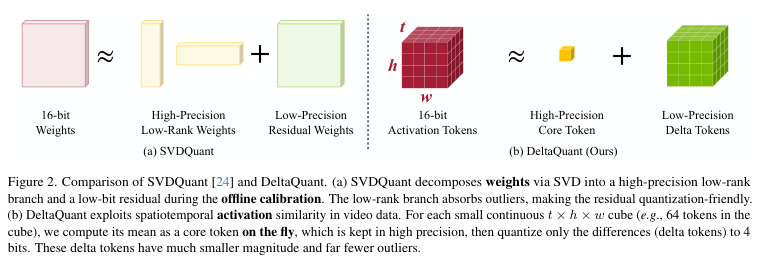
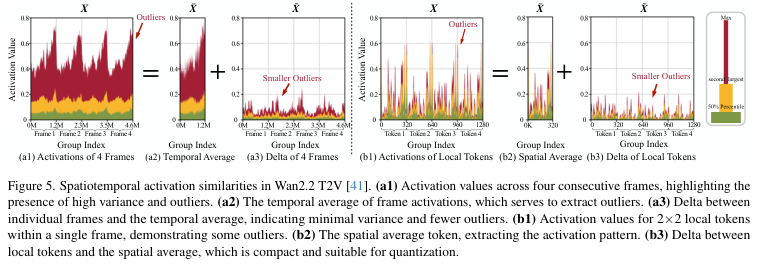
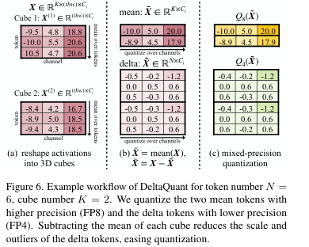
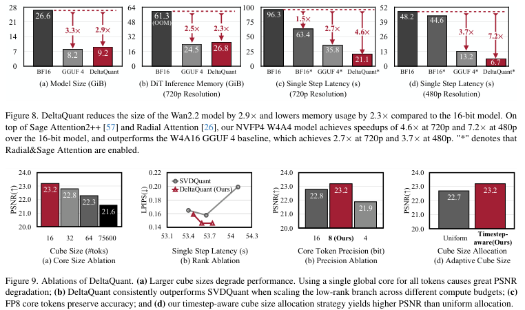

# DeltaQuant：视频扩散的 4-bit core-delta 量化

!!! info "论文信息"
    **论文题名：** DeltaQuant: 4-bit Video Diffusion Models with Spatiotemporal Delta Smoothing。 
    **作者：** Xingyang Li、Samuel Tesfai、Zhekai Zhang、Haocheng Xi、Shuo Yang、Lvmin Zhang、Yufei Sun、Kelly Peng、Maneesh Agrawala、Ion Stoica、Kurt Keutzer、Jun-Yan Zhu、Song Han、Yujun Lin、Muyang Li。 
    **机构：** MIT、Nunchaku AI、NVIDIA、UC Berkeley、Stanford、First Intelligence、CMU。 
    **时间 / 主题：** CVPR 2026；扩散模型、视频生成、低比特推理。 
    **CVF / 官方报告：** CVF Open Access：[paper HTML](https://openaccess.thecvf.com/content/CVPR2026/html/Li_DeltaQuant_4-bit_Video_Diffusion_Models_with_Spatiotemporal_Delta_Smoothing_CVPR_2026_paper.html)；PDF：[CVF PDF](https://openaccess.thecvf.com/content/CVPR2026/papers/Li_DeltaQuant_4-bit_Video_Diffusion_Models_with_Spatiotemporal_Delta_Smoothing_CVPR_2026_paper.pdf)。 
    **GitHub / 项目：** 本次未在 CVF 页面确认官方代码仓库；CVF 页面说明 code and models will be released upon publication，作者主页提供 Paper / Supp / Video 链接。 
    **元数据来源与核验口径：** 来源：CVF Open Access HTML、本地 PDF `Li_DeltaQuant_4-bit_Video_Diffusion_Models_with_Spatiotemporal_Delta_Smoothing_CVPR_2026_paper.pdf`、作者主页检索；Checked Date：2026-07-25；Repro Status：Paper / official metadata reviewed, independent reproduction not claimed。

## 原论文故事线

### 研究背景

视频扩散模型进入 Wan2.2、LTX-Video 这类大 DiT 阶段后，推理瓶颈不再只在 attention。稀疏 attention、Radial Attention、Sage Attention 等方法把 attention 成本压下去以后，linear layers 会成为主要计算与显存来源。对消费级 GPU 来说，问题同时来自两侧：模型权重太大，activation 在视频 token 和 denoising timestep 上又很难低比特化。

图像扩散里的 SVDQuant 已经证明，weight-activation 4-bit 量化可以通过 low-rank branch 吸收 weight outlier，再把 residual weights 低比特化。但视频扩散的 activation outlier 随去噪步剧烈变化，静态 smoothing 很难覆盖所有 timestep。DeltaQuant 进入的位置，就是视频 DiT 的 linear layer 低比特推理。

### 问题（Challenge）

论文要解决的问题是：怎样把视频扩散 linear layers 做到实际可用的 W4A4，同时不让画质和视频一致性明显崩掉。难点有三层。第一，activation outlier 在不同 denoising timestep 上变化，离线校准的 per-channel smoothing 会把某些 step 修好，却让另一些 step 更差。第二，视频 token 数远大于图像 token，activation 显存和 GEMM 成本都更敏感。第三，方法必须能落到 kernel 上，否则算法上看似减少 FLOPs，真实延迟不会降。

### Finding

DeltaQuant 的 finding 是：视频 diffusion activation 的难点不必只从 channel 维度处理，还可以从时空邻域处理。相邻帧、相邻空间 token 的 activation 往往共享一部分大尺度模式，真正需要低比特表达的是它们相对局部均值的差值。于是可以把每个局部 3D cube 分解成一个高精度 core token 和一组低精度 delta tokens：core 保存 outlier 和共享模式，delta 因为幅度更小、outlier 更少，就更适合 4-bit。

### 方法

方法分成 activation 和 weight 两条线。Activation 侧，先把 flattened video tokens 还原成 \(T \times H \times W \times C\)，再切成局部时空 cube。每个 cube 计算 mean token 作为 core，保留 FP8；每个 token 减去 core 得到 delta，量化到 FP4/NVFP4。Weight 侧，沿用 SVDQuant 的 low-rank decomposition，把低秩部分保持较高精度，把 residual weights 低比特化。工程侧，论文实现了 fused kernel：core generation 融进 activation quantization，core branch 用 W4A8 GEMM，delta branch 用 W4A4 GEMM，并把 partial sum accumulation 合并起来。

### 结论

实验覆盖 Wan2.2 I2V、Wan2.2 T2V 和 LTX-Video T2V。作者报告 DeltaQuant 在 W4A4 设置下通常优于 RTN、SmoothQuant、SVDQuant、S2Q-VDiT 和 Q-VDiT，并接近或匹配 GGUF W4A16 的质量，同时提供 linear layer 计算加速。效率上，Wan2.2 的 model size 降到约 2.9x smaller，inference memory 降到约 2.3x smaller；与 LightX2V、Radial Attention 和 Sage Attention 组合时，论文报告从原始 4818s 降到 43.1s，对应 111.8x end-to-end speedup。证据边界是这些数字依赖具体模型、分辨率、GPU、attention 加速和 kernel 实现，不能直接外推成所有视频扩散模型的通用收益。

### 关键术语

- **W4A4（4-bit Weight / 4-bit Activation，权重和激活 4 比特）**：linear layer 的权重和输入 activation 都以 4-bit 表示，用来同时降低显存与 GEMM 成本。
- **Spatiotemporal Activation Similarity（时空激活相似性）**：视频中相邻时间帧、相邻空间 token 的 activation 分布相近，局部均值能吸收共同模式。
- **Core Token（核心 token）**：每个局部 3D cube 的 mean activation token，保留 FP8，用来承载 outlier 和共享尺度。
- **Delta Token（差分 token）**：原 activation 减去 core token 后的残差，幅度更小，用 4-bit 量化。
- **SVDQuant（奇异值分解量化）**：用低秩分支吸收 weight outlier，再对 residual weights 做低比特量化的方法。
- **NVFP4（NVIDIA FP4 格式）**：NVIDIA Blackwell 生态里使用的 4-bit floating-point 格式，常与 block scaling 配合。

## 论文位置

DeltaQuant 应该放在“少步蒸馏、efficient attention、视频生成系统”之后读。前面的 AnyFlow、DMD2、CausVid 主要减少采样步数或改变生成接口；DeltaQuant 盯住的是 attention 已经被优化后的 linear layer 成本。

论文在 Wan2.2 的 72K-token 设置上给出一个重要观察：attention 优化前，attention 占主要计算；加上稀疏与低比特 attention 后，linear layers 变成更大比例的 workload。于是继续只优化 attention，收益会变窄；继续只做 weight-only compression，模型能放下，但 compute-bound 的 linear layers 仍然慢。

| Method family | What it reduces | What remains hard |
| --- | --- | --- |
| Efficient attention | attention FLOPs / attention memory | linear layer latency and activation memory |
| Few-step distillation | denoising step count | per-step model memory and linear GEMM |
| Weight-only quantization | model resident memory | activation memory and low-bit compute speed |
| DeltaQuant | weight + activation precision in linear layers | kernel implementation and quality under dynamic timesteps |

这篇论文的实用性来自组合性：它不要求替代 LightX2V、Radial Attention 或 Sage Attention，而是接在这些方法后面继续压 linear layer。

## 机制图：从 SVDQuant 到 DeltaQuant

{ width="860" }

<small>图源：`DeltaQuant: 4-bit Video Diffusion Models with Spatiotemporal Delta Smoothing`，Figure 2。原图对比 SVDQuant 的 weight low-rank / residual decomposition 与 DeltaQuant 的 activation core / delta decomposition。</small>

**这张图怎么读：先看处理对象的变化。**
SVDQuant 的核心动作发生在 weights 上：用高精度 low-rank branch 吸收 weight outlier，再量化 residual weights。DeltaQuant 把类似的“拆共享大项 + 量化小残差”搬到 activation 上，但共享大项不靠 SVD，而靠视频 token 的局部时空平均。

图右边的 \(t \times h \times w\) cube 是整篇论文的关键单位。每个 cube 里所有 token 共享一个 core token，core 用 FP8；每个 token 的差分 residual 用 FP4。这让低比特化面对的数值范围从原 activation 变成更小的 delta。

## 为什么差分 token 更好量化

{ width="860" }

<small>图源：`DeltaQuant: 4-bit Video Diffusion Models with Spatiotemporal Delta Smoothing`，Figure 5。原图展示 Wan2.2 T2V activation 在连续帧与局部空间 token 上的相似性，以及减去平均 token 后 outlier 和方差变小。</small>

这张图的重点是两种平均。Temporal average 把同一空间位置跨连续帧的共享模式提出来；spatial average 把同一帧里相邻 token 的共享模式提出来。减去这些局部平均后，delta 的峰值和 outlier 明显收缩。

这和视频编码很像：压缩 raw frame 很难，压缩相邻帧之间的 residual 更容易。DeltaQuant 的新意在于把这个直觉从像素空间搬到 video DiT activation 空间，而且是在推理时动态计算 core，不依赖某个 timestep 的静态 smoothing。

## 具体算法

设某个 linear layer 的输入 activation 为：

\[
X \in \mathbb{R}^{N \times C_i},
\qquad N = T \times H \times W.
\]

DeltaQuant 先恢复时空结构：

\[
X \rightarrow \mathbb{R}^{T \times H \times W \times C_i},
\]

再切成 \(K=N/(t h w)\) 个 cube。第 \(k\) 个 cube 为：

\[
X^{(k)} \in \mathbb{R}^{t h w \times C_i}.
\]

每个 cube 的 core 和 delta 写成：

\[
\bar X^{(k)} = \frac{1}{t h w}\sum_{n=1}^{t h w}X_n^{(k)},
\qquad
\tilde X^{(k)} = X^{(k)} - \bar X^{(k)}.
\]

{ width="620" }

<small>图源：`DeltaQuant: 4-bit Video Diffusion Models with Spatiotemporal Delta Smoothing`，Figure 6。原图用两个 cube 演示 mean core 与 delta token 的 mixed-precision quantization。</small>

线性层的乘法可以拆成两个分支：

\[
X^{(k)}W
=
(\bar X^{(k)}+\tilde X^{(k)})W
\approx
Q_8(\bar X^{(k)})Q_4(W)
+
Q_4(\tilde X^{(k)})Q_4(W).
\]

第一项是 FP8 core branch，相当于一个对 cube 内所有 token 共享的动态 bias；第二项是 FP4 delta branch，负责每个 token 的细节差分。由于每个 cube 只有一个 core，论文报告 cube size 64 时 core branch 的额外开销约 3.2%。

再接上 SVDQuant 的 weight decomposition：

\[
W \approx L_1L_2 + R,
\]

完整近似变成：

\[
X^{(k)}W
\approx
X^{(k)}L_1L_2
+
Q_8(\bar X^{(k)})Q_4(R)
+
Q_4(\tilde X^{(k)})Q_4(R).
\]

这条式子说明 DeltaQuant 不是单纯替换 SVDQuant，而是把 SVDQuant 的 weight residual 低比特化与 activation core-delta 低比特化叠在一起。

## 实现细节

论文的实现信息值得记住，因为它决定“量化方法”能不能变成真实加速：

| Component | Paper setting |
| --- | --- |
| Quantized layers | transformer blocks 中的 linear layers |
| Cross-attention K/V | text token projection overhead 小，论文使用 6-bit |
| Core token precision | per-group FP8, group size 64 |
| Delta token precision | NVFP4 / FP4 |
| Wan2.2 low-rank rank | 128 |
| LTX-Video low-rank rank | 64 |
| Cube size schedule | 前 25-30% denoising steps 用 tile size 16，后续用 tile size 64 |
| Kernel path | fused core generation, W4A8 core GEMM, W4A4 delta GEMM |

这个 timestep-aware cube schedule 有明确动机：高噪声早期 step 对视觉质量更敏感，使用更小 cube 能让 core 更局部，减少把不相似 token 混在一起的误差；后期 step 用更大 cube 换吞吐。

## 实验与结论

### 质量结果

论文在 Wan2.2 I2V、Wan2.2 T2V、LTX-Video T2V 上比较 BF16、RTN、SmoothQuant、SVDQuant、S2Q-VDiT、Q-VDiT、GGUF W4A16 和 DeltaQuant。下面只摘出关键行，表头保留论文的英文指标。

| Model | Precision | Method | LPIPS (↓) | PSNR (↑) | Vision Reward (↑) | VBench I.Q. |
| --- | --- | --- | ---: | ---: | ---: | ---: |
| Wan2.2 I2V-A14B | BF16 | Original | - | - | 0.145 | 0.711 |
| Wan2.2 I2V-A14B | NVFP W4A4 | SVDQuant | 0.165 | 21.9 | 0.146 | 0.710 |
| Wan2.2 I2V-A14B | GGUF W4A16 | GGUF 4 | 0.137 | 23.2 | 0.141 | 0.707 |
| Wan2.2 I2V-A14B | NVFP W4A4 | Ours | 0.128 | 23.2 | 0.143 | 0.716 |
| LTXVideo T2V-13B | NVFP W4A4 | SVDQuant | 0.193 | 20.1 | 0.130 | 0.707 |
| LTXVideo T2V-13B | GGUF W4A16 | GGUF 4 | 0.169 | 20.9 | 0.141 | 0.705 |
| LTXVideo T2V-13B | NVFP W4A4 | Ours | 0.159 | 21.6 | 0.135 | 0.712 |

这张表要谨慎读。DeltaQuant 在 similarity 指标上很强，特别是 LPIPS/PSNR；Vision Reward 在不同任务和样例上有波动，不能只拿单个标量宣称全面超越 BF16。更稳的结论是：在 aggressive W4A4 下，DeltaQuant 相比其他 W4A4 baseline 更接近 BF16，并能接近 weight-only GGUF 的质量，同时提供 activation 低比特计算收益。

### 系统效率

{ width="860" }

<small>图源：`DeltaQuant: 4-bit Video Diffusion Models with Spatiotemporal Delta Smoothing`，Figure 8 和 Figure 9。上半部分报告 Wan2.2 model size、inference memory 和 single-step latency；下半部分报告 cube size、low-rank rank、core precision 和 adaptive cube schedule 的消融。</small>

| Setting | Vision Reward (↑) | Latency(s) | Speedup |
| --- | ---: | ---: | ---: |
| Original | 0.145 | 4818 | 1.0x |
| +LightX2V | 0.144 | 196.8 | 24.5x |
| +Radial&Sage | 0.145 | 131.0 | 36.8x |
| +DeltaQuant | 0.148 | 43.1 | 111.8x |

这组数字说明 DeltaQuant 最适合放在已有 attention / few-step 加速之后。LightX2V 先把采样步数压下来，Radial&Sage 再把 attention 压下来，DeltaQuant 接着压 linear layer。论文报告最终在 Wan2.2-I2V-A14B 720p 任务上把 latency 降到 43.1s。

消融部分有四个可迁移判断：

1. Cube 太大时，局部相似性变弱，PSNR 下降；
2. 单纯增加 SVDQuant 的 low-rank rank，不如直接处理 activation delta；
3. Core token 用 FP8 合适，进一步压到 NVFP4 会损伤精度；
4. Timestep-aware cube size 优于统一 cube size，因为早期高噪声 step 更敏感。

## 和其他扩散加速路线的关系

| Nearby method | Main lever | DeltaQuant connection |
| --- | --- | --- |
| [DMD2](dmd2.md) | few-step distribution matching distillation | 降低 denoising steps，DeltaQuant 降低每步 linear layer 成本 |
| [AnyFlow](anyflow.md) | flexible-step video distillation | 改变采样步数预算，DeltaQuant 改变 per-step precision budget |
| [CausVid](causvid.md) | causal streaming video diffusion | CausVid 关心 streaming rollout，DeltaQuant 可作为低比特推理组件 |
| [Wan2.1](wan.md) | open video generation system | DeltaQuant 的主要实验之一基于 Wan2.2 系列，适合接在 Wan 系统路线后读 |
| [量化专题](../../quantization/index.md) | PTQ/QAT/runtime trade-off | DeltaQuant 是 video DiT 的 W4A4 activation-aware PTQ 案例 |

## 局限与风险

第一，DeltaQuant 的收益依赖硬件和 kernel。论文强调 fused kernel、W4A8/W4A4 GEMM 和 NVFP4 路径；没有对应 tensor core 或 kernel 时，理论压缩不一定转成延迟收益。

第二，它仍然保留一些高精度或更高 bit 的路径，例如 core token FP8、cross-attention K/V projection 6-bit、SVD low-rank branch。把它粗略说成“整个视频模型纯 4-bit”会误导。

第三，实验证据主要是作者报告的 benchmark、quality metrics 和 qualitative samples。Vision Reward、VBench、LPIPS、PSNR、SSIM 分别观察不同侧面，单个指标不能完整覆盖长时一致性、物理合理性、文字对齐和用户偏好。

第四，方法针对 video DiT 的 activation 时空冗余。对高度跳变的视频、强剪辑、多主体细粒度动作或非 DiT 架构，局部 core-delta 的误差需要重新校准。

第五，低成本视频生成会降低滥用门槛。论文 broader impact 也指出，部署门槛下降可能促进误导性视频内容生成。

## 关键术语

| English Name（中文翻译） | Explanation |
| --- | --- |
| **Post-Training Quantization（训练后量化）** | 在不重新完整训练模型的情况下，用校准和变换把权重/激活映射到低比特格式。 |
| **Activation Outlier（激活离群值）** | 某些 channel 或 token 的 activation magnitude 远高于常规范围，会拉大量化 scale，降低有效比特。 |
| **Static Smoothing（静态平滑）** | 用离线校准得到的固定变换平衡 weight 和 activation 难度；对动态 timestep 可能失效。 |
| **Core-Delta Decomposition（核心-差分分解）** | 用局部均值表示共享大项，用 residual 表示每个 token 的差异。 |
| **W4A8 GEMM（4-bit weight / 8-bit activation GEMM）** | core branch 的矩阵乘路径，权重低比特，core activation 保留 FP8。 |
| **W4A4 GEMM（4-bit weight / 4-bit activation GEMM）** | delta branch 的矩阵乘路径，权重和 delta activation 都低比特。 |

## 阅读结论

DeltaQuant 的核心贡献是把视频的局部时空冗余转成一个低比特 activation 表示：**core token 保存共享 outlier，delta token 承担可量化细节。** 这比静态 channel smoothing 更适合视频扩散，因为它每次推理都在当前 activation 上动态构造 core。

读这篇时不要只记“2.3x memory reduction”或“111.8x speedup”。更有迁移价值的是三条判断：attention 优化后要重新看 linear layer 是否成为瓶颈；W4A4 的 activation 误差往往比 weight-only 更难；视频模型可以利用时空邻域相似性设计量化单位，而不必只沿 channel 维度做 smoothing。

## 外部精读

1. Li et al. [DeltaQuant: 4-bit Video Diffusion Models with Spatiotemporal Delta Smoothing](https://openaccess.thecvf.com/content/CVPR2026/html/Li_DeltaQuant_4-bit_Video_Diffusion_Models_with_Spatiotemporal_Delta_Smoothing_CVPR_2026_paper.html). CVPR 2026.
2. CVF PDF：[Li_DeltaQuant_4-bit_Video_Diffusion_Models_with_Spatiotemporal_Delta_Smoothing_CVPR_2026_paper.pdf](https://openaccess.thecvf.com/content/CVPR2026/papers/Li_DeltaQuant_4-bit_Video_Diffusion_Models_with_Spatiotemporal_Delta_Smoothing_CVPR_2026_paper.pdf).
3. Supplemental material：[CVF supplemental PDF](https://openaccess.thecvf.com/content/CVPR2026/supplemental/Li_DeltaQuant_4-bit_Video_CVPR_2026_supplemental.pdf).
