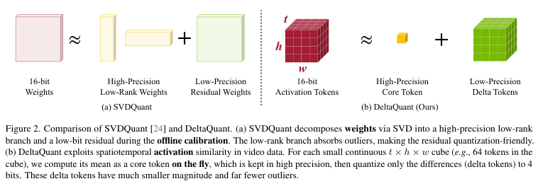
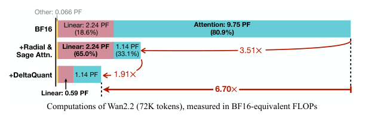
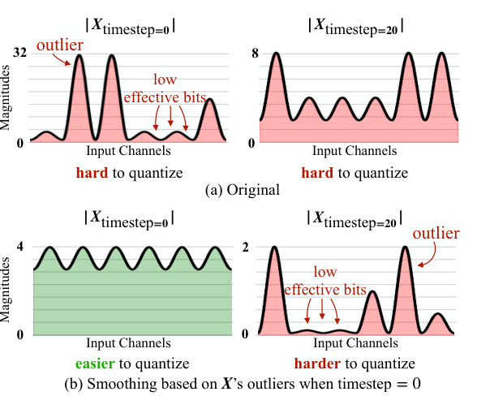
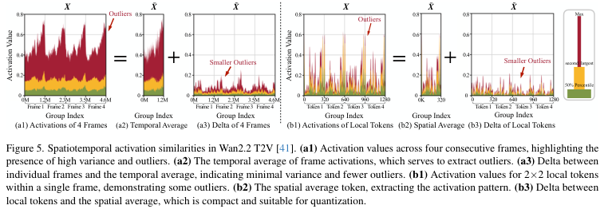
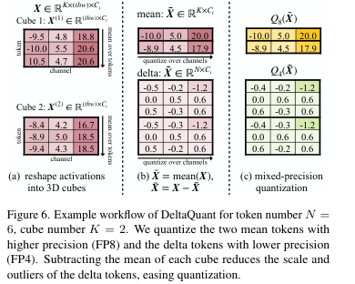
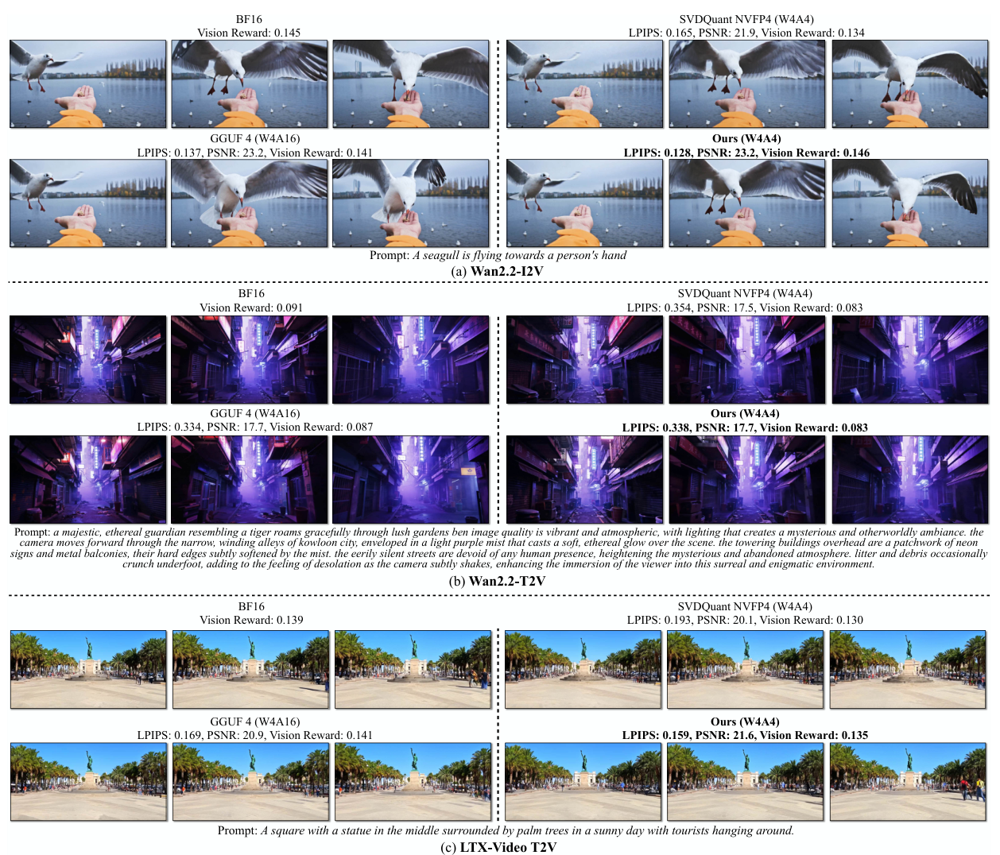
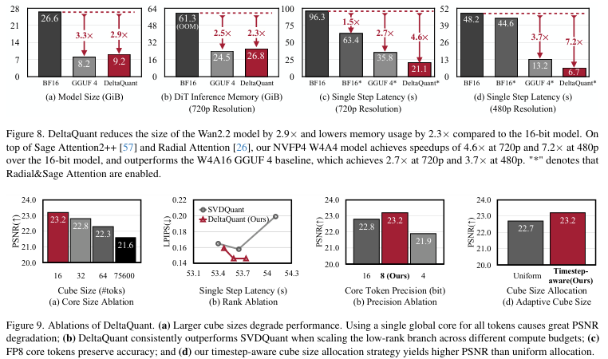

# DeltaQuant：视频扩散的 4-bit core-delta 量化

!!! info "论文信息"
    **论文题名：** DeltaQuant: 4-bit Video Diffusion Models with Spatiotemporal Delta Smoothing。 
    **作者：** Xingyang Li、Samuel Tesfai、Zhekai Zhang、Haocheng Xi、Shuo Yang、Lvmin Zhang、Yufei Sun、Kelly Peng、Maneesh Agrawala、Ion Stoica、Kurt Keutzer、Jun-Yan Zhu、Song Han、Yujun Lin、Muyang Li。 
    **机构：** MIT、Nunchaku AI、NVIDIA、UC Berkeley、Stanford、First Intelligence、CMU。 
    **时间 / 主题：** CVPR 2026；扩散模型、视频生成、低比特推理。 
    **CVF / 官方报告：** CVF Open Access：[paper HTML](https://openaccess.thecvf.com/content/CVPR2026/html/Li_DeltaQuant_4-bit_Video_Diffusion_Models_with_Spatiotemporal_Delta_Smoothing_CVPR_2026_paper.html)；PDF：[CVF PDF](https://openaccess.thecvf.com/content/CVPR2026/papers/Li_DeltaQuant_4-bit_Video_Diffusion_Models_with_Spatiotemporal_Delta_Smoothing_CVPR_2026_paper.pdf)。 
    **GitHub / 项目：** 本次未在 CVF 页面确认官方代码仓库；CVF 页面说明 code and models will be released upon publication，作者主页提供 Paper / Supp / Video 链接。 
    **元数据来源与核验口径：** 来源：CVF Open Access HTML、本地 PDF `Li_DeltaQuant_4-bit_Video_Diffusion_Models_with_Spatiotemporal_Delta_Smoothing_CVPR_2026_paper.pdf`、作者主页检索；Checked Date：2026-07-25；Repro Status：Paper / official metadata reviewed, independent reproduction not claimed。

## 视频量化的难处，正在从权重转向随输入变化的激活

DeltaQuant 的目标是让视频 DiT 的大部分线性层真正使用四比特权重与激活计算，同时保留接近原模型的生成结果。它的核心观察很具体：视频模型的异常激活会随去噪步骤移动，离线确定的通道缩放很难一直合适；但在同一次前向中，时空相邻 token 又常常共享大幅度的激活结构。把这个共享部分单独保存，剩余差分就更容易量化。[↗](https://openaccess.thecvf.com/content/CVPR2026/papers/Li_DeltaQuant_4-bit_Video_Diffusion_Models_with_Spatiotemporal_Delta_Smoothing_CVPR_2026_paper.pdf#page=2)

方法因此同时保留两种结构。权重侧沿用 SVDQuant 的高精度低秩分支；激活侧新增动态的 **core token（核心 token）** 与 **delta tokens（差分 token）** 分解。局部 token 的均值作为 core，用 FP8 处理；每个 token 相对均值的差分用 FP4 处理。core 随当前输入重新计算，不需要对激活在线做 SVD，也不是缓存上一个去噪步骤的结果。

原 Figure 2 可以从左右两个分解对象开始读。左侧拆的是固定权重，右侧拆的是当前激活；二者最后可以叠加在同一个线性层中。DeltaQuant 并未把 SVDQuant 整体丢掉，而是补上其静态激活平滑难以处理的输入变化。

{ width="860" }

<small>图源：[原论文，第 2 页，Figure 2](https://openaccess.thecvf.com/content/CVPR2026/papers/Li_DeltaQuant_4-bit_Video_Diffusion_Models_with_Spatiotemporal_Delta_Smoothing_CVPR_2026_paper.pdf#page=2)。左侧是权重低秩分解，右侧是局部激活的 core-delta 分解。</small>

论文最后将这套混合精度计算做成融合 CUDA 内核，并与少步蒸馏、稀疏注意力和量化注意力组合。在 Wan2.2 I2V 的链式实验中，整段 720p 视频的时间由 4818 秒降至 43.1 秒，其中 DeltaQuant 在前面优化已经完成的 131.0 秒基础上再缩短约三倍。理解这个结果，需要把数值误差、内核速度和整个 pipeline 的组合收益逐层拆开。

## 为什么 attention 已经更快，模型仍然跑不动

视频增加时间维度后，token 序列很长，原始 DiT 的注意力成本确实很大。但当 attention 被稀疏化和低比特化，线性层并不会同步消失。Figure 3 对 Wan2.2 的 72K-token 配置给出 **BF16-equivalent FLOPs**，即按 BF16 等效口径折算的计算量。

{ width="860" }

<small>图源：[原论文，第 3 页，Figure 3](https://openaccess.thecvf.com/content/CVPR2026/papers/Li_DeltaQuant_4-bit_Video_Diffusion_Models_with_Spatiotemporal_Delta_Smoothing_CVPR_2026_paper.pdf#page=3)。图中倍数是等效计算量之比，不是测得的墙钟加速。</small>

原始状态下，attention 为 9.75 PF，线性层为 2.24 PF，其他部分为 0.066 PF，attention 占约 80.9%。加上 Radial 与 Sage Attention 后，attention 降到 1.14 PF，而线性层仍为 2.24 PF，于是线性层占比上升到 65.0%。再使用 DeltaQuant，线性层的等效计算量降到 0.59 PF。

图中有三组容易混淆的比例。单看 attention，从 9.75 到 1.14 约为 8.6 倍下降；全模型计算量在第一阶段约下降 3.51 倍；加入 DeltaQuant 后再下降 1.91 倍，累计约 6.70 倍。它们的分母和范围不同，不能把图中的 3.51 倍直接称为 attention 单独的下降幅度，也不能将 6.70 倍直接当作整段生成时间的提升。

仅量化权重能够缩小模型存储，减少搬运与 offload 压力，但对这里大量 token 参与的计算密集矩阵乘，仍需要低比特激活才能充分利用相应 Tensor Cores。这也是 DeltaQuant 选择 W4A4，而不是只提供一个 W4A16 checkpoint 的原因。后面 GGUF 的实验同时展示了两者的取舍：权重量化已经能让模型更容易放入显存，权重与激活共同量化则进一步减少实际计算时间。

## 四比特为什么容易被少数异常通道拖累

论文把量化写成

$$
Q_b(X)=\operatorname{round}_b\left(\frac{X}{s_X}\right)s_X,
\qquad
s_X=\frac{\max(|X|)}{q_{\max}}.
$$

$s_X$ 决定一组数共用的尺度，$q_{\max}$ 是低比特格式能表示的最大值，文中以 FP4 的 $q_{\max}=6$ 为例。这里 $\operatorname{round}_b$ 表示舍入到对应低比特格式的可表示数，不是只取整。FP4 的可表示值并不等同于一个均匀整数网格。[↗](https://openaccess.thecvf.com/content/CVPR2026/papers/Li_DeltaQuant_4-bit_Video_Diffusion_Models_with_Spatiotemporal_Delta_Smoothing_CVPR_2026_paper.pdf#page=4)

如果某个组中只有少量值特别大，它们决定 $s_X$，其余较小值在缩放后的范围里挤在一起，能利用的有效数值分辨率降低。SmoothQuant 的思路是用等价的通道变换，将一部分激活量化难度转移到权重；SVDQuant 再让高精度低秩权重分支承接异常成分。这个策略的激活缩放通常在离线校准时确定。

视频的问题在于，不同去噪步骤的异常通道和幅度会变化。Figure 4 用示意分布说明这个冲突：按 step 0 的异常通道选择缩放，step 0 变得更均匀，但 step 20 中原本不突出的相对差异可能被放大。它要表达的是固定缩放的适配范围，不是给出所有层都具有相同异常形状的实测定律。

{ width="860" }

<small>图源：[原论文，第 3 页，Figure 4](https://openaccess.thecvf.com/content/CVPR2026/papers/Li_DeltaQuant_4-bit_Video_Diffusion_Models_with_Spatiotemporal_Delta_Smoothing_CVPR_2026_paper.pdf#page=3)。按列看 step 0 与 step 20，再比较同一列平滑前后的分布。</small>

直接对当前激活做在线 SVD 也能产生输入相关的分解，但其计算成本违背加速目的。DeltaQuant 选择更便宜的统计量：利用当前视频相邻 token 的平均值，动态提取共享的大幅度部分。它用局部结构缩小需要高精度处理的对象数量，不需要每次解一个低秩近似问题。

## 相邻 token 共享的部分，为什么值得单独保存

Figure 5 提供了从视频激活出发的证据。时间面板展示 Wan2.2 T2V 四个连续帧，空间面板展示同一帧内 $2\times2$ 邻域的 token。曲线呈现分组数值的最大值、次大值与中位数附近的水平；应比较原始激活、均值和减均值后的差分，而不是只看最高的单个尖峰。

{ width="860" }

<small>图源：[原论文，第 4 页，Figure 5](https://openaccess.thecvf.com/content/CVPR2026/papers/Li_DeltaQuant_4-bit_Video_Diffusion_Models_with_Spatiotemporal_Delta_Smoothing_CVPR_2026_paper.pdf#page=4)。左侧为连续帧，右侧为局部空间 token；减去共享均值后，图示差分的幅度与异常尖峰都更小。</small>

如果相邻 token 都包含某个较大的通道响应，这个共同部分会进入均值。每个 token 只需用 delta 描述自己偏离均值的细节。于是高精度分支不必为每个 token 重复处理近似相同的大数，低精度分支面对的动态范围也更小。

这与视频编码利用帧内、帧间冗余的思路相似，但此处没有运动估计、光流补偿或视频码流。算法处理的是 DiT 中间层的激活，且每次前向重新计算局部均值。运动、遮挡或物体边界可能降低局部相似性；论文提供的是这些模型中可利用的经验规律，并没有证明任何视频、任何层的残差都会很小。

“局部”因此是设计的一部分。如果把全视频所有 token 都平均，远处不同物体和不同位置的结构会互相混合，均值未必能代表任何一个局部。后面的 cube 消融会检验这个判断，而不只是把平均操作本身当作贡献。

## 从扁平序列还原时空邻域，再沿 token 求均值

设线性层输入为

$$
X\in\mathbb R^{N\times C_i},\qquad N=T\times H\times W,
$$

其中 $C_i$ 是输入通道数，$T,H,W$ 是视频 latent token 的时间和空间网格大小，省略 batch 维。它们不是原视频的像素分辨率；下文 cube 的 $t$ 也指时间方向包含多少个 token 位置，与去噪迭代的 timestep 是两回事。

视频模型往往把网格展平成一维序列。只按序列中的连续一段随意分组，可能跨过行边界，也可能漏掉时间相邻位置。DeltaQuant 先按模型原有顺序还原成 $T\times H\times W\times C_i$，再划分不重叠的 $t\times h\times w$ cubes。记一个 cube 有 $B=thw$ 个 token，总 cube 数为 $K=N/B$，第 $k$ 个输入为 $X^{(k)}\in\mathbb R^{B\times C_i}$。

沿 token 维求均值，得到

$$
\bar X^{(k)}=\frac1B\sum_{n=1}^{B}X_n^{(k)},
\qquad
\tilde X^{(k)}=X^{(k)}-\bar X^{(k)}.
$$

$\bar X^{(k)}\in\mathbb R^{1\times C_i}$ 是一整个通道向量；在相减时广播到 cube 的全部 token。$\tilde X^{(k)}\in\mathbb R^{B\times C_i}$ 保留每个 token 的差异。**均值沿 token 计算，量化分组沿通道进行**，两种分组不能混为一谈。[↗](https://openaccess.thecvf.com/content/CVPR2026/papers/Li_DeltaQuant_4-bit_Video_Diffusion_Models_with_Spatiotemporal_Delta_Smoothing_CVPR_2026_paper.pdf#page=5)

下面给一个仅用于解释 Equation 2 的算例。三个相邻 token 若分别为 $(99,2)$、$(100,3)$、$(101,4)$，core 为 $(100,3)$，delta 为 $(-1,-1)$、$(0,0)$、$(1,1)$。原始数值有百量级共享成分，差分只剩个位量级。高精度保留一份 $(100,3)$，并没有删掉它；最后仍要加回每个 token。

原 Figure 6 画的是相同信息流：左边按 cube 组织输入，中间分别存均值和差分，右边对二者采用不同精度。图中个别示意数值与所列均值、差分不完全自洽，具体计算应以 Equation 2 为准；上面的算例单独展示了均值和相减方向。

{ width="620" }

<small>图源：[原论文，第 5 页，Figure 6](https://openaccess.thecvf.com/content/CVPR2026/papers/Li_DeltaQuant_4-bit_Video_Diffusion_Models_with_Spatiotemporal_Delta_Smoothing_CVPR_2026_paper.pdf#page=5)。结构上每个 cube 只产生一份 FP8 core，全部 token 保留各自的 FP4 delta。</small>

在量化前，$X^{(k)}=\bar X^{(k)}+\tilde X^{(k)}$ 是精确恒等式；差分在 cube 内的和为零。数值近似来自随后对 core、delta 和权重的低比特表示，不能把分解本身说成丢弃了视频细节。量化之后，差分和也未必仍严格为零。

## 一份 core 的矩阵乘，为什么能服务整个 cube

对于输出通道数为 $C_o$ 的线性层，$W\in\mathbb R^{C_i\times C_o}$。忽略权重低秩分支时，可以把矩阵乘写成

$$
\begin{aligned}
X^{(k)}W
&=(\bar X^{(k)}+\tilde X^{(k)})W\\
&\approx Q_8(\bar X^{(k)})Q_4(W)
+Q_4(\tilde X^{(k)})Q_4(W).
\end{aligned}
$$

core 分支的输入只有 $1\times C_i$，输出也只有 $1\times C_o$，算完之后广播到同一 cube 的 $B$ 个输出 token。它类似一个输入相关的局部偏置，但不是训练时新增的固定 bias 参数。delta 分支则处理 $B\times C_i$ 的大矩阵，承担主要计算。[↗](https://openaccess.thecvf.com/content/CVPR2026/papers/Li_DeltaQuant_4-bit_Video_Diffusion_Models_with_Spatiotemporal_Delta_Smoothing_CVPR_2026_paper.pdf#page=5)

实际映射到硬件时，core 的 W4A8 计算使用 FP8 Tensor Cores，delta 的 W4A4 计算使用 FP4 Tensor Cores。因此“W4A4 方法”描述的是主要低比特路径，不能理解为所有激活和所有乘法都只有四比特。论文报告，在 cube 含 64 个 token 时，这种高精度共享分支相对于直接量化全部激活的计算开销约为 3.2%；这不是整段视频生成多花 3.2% 时间的测量结论。

还可以只按表示数据量作一个解释性估计。忽略 scale、对齐和临时缓冲，$B$ 个 token 的 delta 需要 $4B$ bit，同一通道的一份 core 需要 8 bit，平均每个数为 $4+8/B$ bit。$B=64$ 时为 4.125 bit，$B=16$ 时为 4.5 bit。这个计算说明大 cube 为什么更省共享分支开销，但不能用来直接推导最终 checkpoint 的压缩倍数，因为权重低秩分支、其他层和量化元数据还在。

core 不能随意继续降到 FP4。它承载了共享的大幅度部分，一旦这份 core 出错，误差会同时进入 cube 内多个 token。保持较高精度既避免重新制造 outlier 问题，又利用共享计算摊薄成本；后面的精度消融正是检验这部分取舍。

## 再接上权重低秩分支，完整线性层有三条路径

DeltaQuant 继续使用 SVDQuant 的权重分解

$$
W=L_1L_2+R,
$$

其中 $L_1\in\mathbb R^{C_i\times r}$、$L_2\in\mathbb R^{r\times C_o}$，$r$ 是低秩维度，$R$ 是残差权重。完整更新为

$$
X^{(k)}W\approx
\underbrace{X^{(k)}L_1L_2}_{\text{high-precision low-rank branch}}
+
\underbrace{Q_8(\bar X^{(k)})Q_4(R)}_{\text{shared core branch}}
+
\underbrace{Q_4(\tilde X^{(k)})Q_4(R)}_{\text{delta branch}}.
$$

第一项让每个原始 token 经过高精度低秩通路，吸收权重侧不适合直接四比特化的结构。第二项只对 cube 的共享 core 计算残差权重输出。第三项计算各 token 的差分。注意低秩项使用 $X^{(k)}$，后面两项才对同一个残差权重 $R$ 作 core-delta 分解；不能把三项重复乘到完整 $W$ 上。[↗](https://openaccess.thecvf.com/content/CVPR2026/papers/Li_DeltaQuant_4-bit_Video_Diffusion_Models_with_Spatiotemporal_Delta_Smoothing_CVPR_2026_paper.pdf#page=5)

两种分解处理的是不同误差来源。增大 $r$ 能让更多权重结构走高精度路径，但同时增加每个 token 的低秩计算；动态 core 则直接减轻当前激活差分的量化难度。它不需要预先知道这一步哪个通道成为 outlier，也不依赖某个固定校准 timestep 的缩放恰好适用。

这也说明 DeltaQuant 的新增部分不要求重新训练一个视频生成网络。方法属于后训练量化，沿用模型能力和权重侧校准流程，在推理时动态重组激活。论文比较的是相同校准时间约束下的方法，但没有列出完整校准样本数与绝对耗时；因此“离线成本相近”的比较条件不能进一步换算成一个可直接照抄的分钟数预算。

## 没有融合内核，代数省下的工作仍可能变成额外开销

如果按公式逐项调用通用算子，计算均值、保存 core、写出 delta、运行两种 GEMM、再广播相加，会引入中间张量读写和多个 kernel 启动。尤其 core 矩阵本身很小，额外调度成本可能抵消它共享计算的好处。

作者在 SVDQuant 的 Nunchaku Engine 上实现自定义 CUDA 内核，做了三处与公式直接对应的融合。首先，把 core 生成融合进 activation quantization kernel，量化前就拿到局部均值。其次，为 core 设计 W4A8 GEMM。最后，将 core 结果的部分和累加融合进 delta 的 W4A4 GEMM，完成重建时减少单独的广播、相加和中间写回。[↗](https://openaccess.thecvf.com/content/CVPR2026/papers/Li_DeltaQuant_4-bit_Video_Diffusion_Models_with_Spatiotemporal_Delta_Smoothing_CVPR_2026_paper.pdf#page=5)

因此可迁移的算法接口不只是“把 tensor 减去 mean”。实现还要知道原 token 的时空排列、cube 如何分组、core 与 delta 怎样共享残差权重，以及三条分支在哪里合并。不同模型若采用不同的 token 布局，直接按扁平序列每 64 个 token 分组，并不必然等价于论文的 $4\times2\times8$ 时空 cube。

硬件也是结果的一部分。文中主要速度证据来自 RTX 5090 的 FP4/FP8 Tensor Cores。分解公式可以迁移，但在没有相应低比特矩阵乘支持、或者未实现融合的设备上，不能直接期待同样的端到端倍数。

## 实际配置不是全层、全时间都使用同一种四比特路径

实验覆盖两个模型系列与三种任务。Wan2.2 按论文统计共有 27B 参数，包含服务不同去噪阶段的两个 transformer；LTX-Video 为 13B，论文报告其视频 VAE 压缩比为 $1:192$。生成配置如下。[↗](https://openaccess.thecvf.com/content/CVPR2026/papers/Li_DeltaQuant_4-bit_Video_Diffusion_Models_with_Spatiotemporal_Delta_Smoothing_CVPR_2026_paper.pdf#page=5)

| Model | Task | Resolution | Duration | Frames |
| --- | --- | --- | ---: | ---: |
| Wan2.2 I2V-A14B | Image-to-Video | 720p | 5 s | 81 |
| Wan2.2 T2V-A14B | Text-to-Video | 720p | 5 s | 77 |
| LTX-Video T2V-13B | Text-to-Video | 512p | 8 s | 121 |

关键量化设置分别服务于误差与成本。

| Component | Setting | Purpose |
| --- | --- | --- |
| Early denoising steps | 前 25–30% 步骤，cube 为 $4\times1\times4=16$ tokens | 在更敏感的早期阶段保留更局部的共享结构 |
| Remaining steps | cube 为 $4\times2\times8=64$ tokens | 降低后期 core 数量和计算开销 |
| Low-rank branch | Wan2.2 rank 128；LTX-Video rank 64 | 保留权重高精度通路 |
| Core tokens | FP8，per-group group size 64 | 表示共享异常成分 |
| Main transformer linear layers | NVFP4 | 将主要权重与激活计算映射到低比特路径 |
| Cross-attention K/V projections | 6-bit | 这些层仅处理文本 token，保留较高精度的额外成本较小 |

尤其要区分两个“64”。cube 的 64 是时空 token 数；FP8 group size 64 是量化通道分组大小。前者控制共享范围，后者控制共用 scale 的数值集合，改变它们会影响不同的误差与开销。文本 cross-attention K/V 也没有被强行套入视频局部 cube 的同一种四比特规则。[↗](https://openaccess.thecvf.com/content/CVPR2026/papers/Li_DeltaQuant_4-bit_Video_Diffusion_Models_with_Spatiotemporal_Delta_Smoothing_CVPR_2026_paper.pdf#page=6)

## 先看与 BF16 的相似性，再看生成质量

论文把评估分为两组。LPIPS、PSNR、SSIM 比较量化输出与 16-bit 参考输出，回答量化之后是否仍接近原模型；Vision Reward 与 VBench 的 Subject Consistency、Aesthetic Quality、Image Quality 则评价生成内容的质量。相似性更高不必然让奖励模型分数更高，质量分数略高也不证明量化误差更小。

以下按模型拆开原 Table 1，保留全部比较行。S.C.、A.Q.、I.Q. 分别对应上述三个 VBench 指标；低比特浮点行沿用论文的 NVFP 标记，GGUF 行为 W4A16。所有数值均来自主表。[↗](https://openaccess.thecvf.com/content/CVPR2026/papers/Li_DeltaQuant_4-bit_Video_Diffusion_Models_with_Spatiotemporal_Delta_Smoothing_CVPR_2026_paper.pdf#page=7)

Wan2.2 I2V-A14B，27B 参数。

| Method | Precision | LPIPS ↓ | PSNR ↑ | SSIM ↑ | Vision Reward ↑ | S.C. ↑ | A.Q. ↑ | I.Q. ↑ |
| --- | --- | ---: | ---: | ---: | ---: | ---: | ---: | ---: |
| Original | BF16 | — | — | — | 0.145 | 0.961 | 0.644 | 0.711 |
| RTN | NVFP W4A4 | 0.182 | 20.7 | 0.660 | 0.132 | 0.944 | 0.641 | 0.706 |
| SmoothQuant | NVFP W4A4 | 0.188 | 21.2 | 0.679 | 0.137 | 0.947 | 0.604 | 0.707 |
| SVDQuant | NVFP W4A4 | 0.165 | 21.9 | 0.686 | 0.146 | 0.953 | 0.639 | 0.710 |
| S2Q-VDiT | NVFP4 W4A4 | 0.366 | 15.6 | 0.455 | 0.137 | 0.960 | 0.634 | 0.716 |
| Q-VDiT | NVFP4 W4A6 | 0.575 | 14.3 | 0.489 | -0.0853 | 0.758 | 0.445 | 0.443 |
| GGUF 4 | GGUF W4A16 | 0.137 | 23.2 | 0.755 | 0.141 | 0.961 | 0.644 | 0.707 |
| Ours | NVFP W4A4 | 0.128 | 23.2 | 0.742 | 0.143 | 0.960 | 0.639 | 0.716 |

最有说服力的改善是，相比 SVDQuant，LPIPS 从 0.165 降到 0.128，PSNR 从 21.9 到 23.2，SSIM 从 0.686 到 0.742。三种参考相似性指标方向一致，支持动态 core-delta 减少了量化偏离。但 Vision Reward 为 0.143，略低于 SVDQuant 的 0.146；和 GGUF 相比，DeltaQuant 的 SSIM 0.742 低于 GGUF 的 0.755，PSNR 则打平。

S2Q-VDiT 与 Q-VDiT 的结果也保留在表中。它们分别涉及校准样本选择、量化估计与时间保持等机制，但此处只说明论文所采用的匹配校准时间设置下的表现。不能把某一配置的低分扩展为这些方法在所有预算和模型上的一般结论。

Wan2.2 T2V-A14B，27B 参数。

| Method | Precision | LPIPS ↓ | PSNR ↑ | SSIM ↑ | Vision Reward ↑ | S.C. ↑ | A.Q. ↑ | I.Q. ↑ |
| --- | --- | ---: | ---: | ---: | ---: | ---: | ---: | ---: |
| Original | BF16 | — | — | — | 0.091 | 0.967 | 0.631 | 0.686 |
| RTN | NVFP W4A4 | 0.386 | 16.7 | 0.594 | 0.093 | 0.969 | 0.632 | 0.677 |
| SmoothQuant | NVFP W4A4 | 0.368 | 17.1 | 0.605 | 0.088 | 0.970 | 0.628 | 0.678 |
| SVDQuant | NVFP W4A4 | 0.354 | 17.5 | 0.616 | 0.083 | 0.969 | 0.630 | 0.680 |
| GGUF 4 | GGUF W4A16 | 0.334 | 17.7 | 0.627 | 0.091 | 0.967 | 0.624 | 0.679 |
| Ours | NVFP W4A4 | 0.338 | 17.7 | 0.625 | 0.083 | 0.966 | 0.629 | 0.683 |

这里 DeltaQuant 相比 SVDQuant 的相似性改善仍存在，但幅度小于 I2V；Vision Reward 同为 0.083，低于 BF16 与 GGUF 的 0.091。GGUF 在 LPIPS、SSIM 上略好，DeltaQuant 的 I.Q. 更高。更有意思的是 RTN 的 Vision Reward 为 0.093，高于 BF16，却在参考相似性上更差，这直接说明两组指标不能互相替代。

LTX-Video T2V-13B，13B 参数。

| Method | Precision | LPIPS ↓ | PSNR ↑ | SSIM ↑ | Vision Reward ↑ | S.C. ↑ | A.Q. ↑ | I.Q. ↑ |
| --- | --- | ---: | ---: | ---: | ---: | ---: | ---: | ---: |
| Original | BF16 | — | — | — | 0.139 | 0.986 | 0.566 | 0.711 |
| RTN | NVFP W4A4 | 0.214 | 19.4 | 0.686 | 0.124 | 0.985 | 0.547 | 0.701 |
| SmoothQuant | NVFP W4A4 | 0.224 | 19.3 | 0.672 | 0.126 | 0.985 | 0.554 | 0.710 |
| SVDQuant | NVFP W4A4 | 0.193 | 20.1 | 0.714 | 0.130 | 0.985 | 0.553 | 0.707 |
| GGUF 4 | GGUF W4A16 | 0.169 | 20.9 | 0.735 | 0.141 | 0.985 | 0.556 | 0.705 |
| Ours | NVFP W4A4 | 0.159 | 21.6 | 0.751 | 0.135 | 0.986 | 0.548 | 0.712 |

LTX 上，DeltaQuant 的三项相似性指标优于这些量化对照，Vision Reward 也从 SVDQuant 的 0.130 增至 0.135；但 A.Q. 从 0.553 降至 0.548，仍低于 BF16 的 0.566。因此实验更稳妥的结论是，它改善了四比特路径对原输出的保持，并在多个质量指标上维持接近水平；“无损”不能理解成每个模型、每项指标都完全不下降。

## 原视频样例能显示误差形态，不能代替完整指标

Figure 7 将 Wan I2V、Wan T2V 和 LTX T2V 分别放在三个区域。I2V 可以先跟随海鸥靠近手的三帧，看身体和翅膀位置如何变化；T2V 的巷道样例可比较灯牌、建筑边缘和视角；LTX 的广场样例可观察同一阶段的行人、棕榈树和构图。它们展示量化后仍保持场景和主要内容，同时局部纹理与细节仍可能变化。

{ width="920" }

<small>图源：[原论文，第 6 页，Figure 7](https://openaccess.thecvf.com/content/CVPR2026/papers/Li_DeltaQuant_4-bit_Video_Diffusion_Models_with_Spatiotemporal_Delta_Smoothing_CVPR_2026_paper.pdf#page=6)。三个区域分别对应 Wan I2V、Wan T2V 与 LTX T2V；每种方法仅展示视频中的少数帧。</small>

图中部分 Vision Reward 标注与 Table 1 不一致，例如 I2V 的 SVDQuant 与 Ours 分别标为 0.134、0.146，而主表为 0.146、0.143。因此这些图上标注不能直接替代主表的定量结果。有限帧的视觉对照也不能直接证明整段视频没有闪烁或所有运动都保持一致。

## 显存、模型体积、单步时间要分别读取

Figure 8 和 Figure 9 共用下面这张原图。先看上排的存储、峰值显存和两个分辨率的单步时间；下排的四项消融随后用来解释，为什么需要局部 core、FP8 精度和按去噪步骤分配 cube。

{ width="860" }

<small>图源：[原论文，第 8 页，Figures 8–9](https://openaccess.thecvf.com/content/CVPR2026/papers/Li_DeltaQuant_4-bit_Video_Diffusion_Models_with_Spatiotemporal_Delta_Smoothing_CVPR_2026_paper.pdf#page=8)。上排带星号的配置启用 Radial 与 Sage Attention；存储和显存单位为 GiB，时间单位为秒。</small>

上排两个存储图报告如下。

| Method | Model Size (GiB) | DiT Inference Memory, 720p (GiB) |
| --- | ---: | ---: |
| BF16 | 26.6 | 61.3 |
| GGUF 4 | 8.2 | 24.5 |
| DeltaQuant | 9.2 | 26.8 |

按图中口径，DeltaQuant 的模型体积压缩约 $26.6/9.2\approx2.89$ 倍，峰值推理显存减少约 $61.3/26.8\approx2.29$ 倍。GGUF 的体积与显存更小；DeltaQuant 保留高精度低秩与 core 路径，以略多的存储开销换取主要矩阵乘的加速。

Figure 8 的 Model Size 与前面的 27B 双 transformer 总参数不是一个可以直接互换的统计量。论文没有进一步展开 26.6 GiB 对两个 transformer 的存储统计范围，因此不能把它称为完整 27B checkpoint 的 BF16 大小。实际部署容量更应看对应配置的峰值推理显存：图中 BF16 的 61.3 GiB 标为 OOM，DeltaQuant 的 26.8 GiB 能进入论文测试的 32 GB RTX 5090 使用范围。[↗](https://openaccess.thecvf.com/content/CVPR2026/papers/Li_DeltaQuant_4-bit_Video_Diffusion_Models_with_Spatiotemporal_Delta_Smoothing_CVPR_2026_paper.pdf#page=8)

单步时间则需保留星号代表的 attention 配置。

| Configuration | Single Step, 720p (s) | Single Step, 480p (s) |
| --- | ---: | ---: |
| BF16 | 96.3 | 48.2 |
| BF16 + Radial & Sage | 63.4 | 44.6 |
| GGUF 4 + Radial & Sage | 35.8 | 13.2 |
| DeltaQuant + Radial & Sage | 21.1 | 6.7 |

图中 4.6 倍来自 $96.3/21.1$，7.2 倍来自 $48.2/6.7$，都包含 attention 优化与 DeltaQuant 的组合。若要保持 attention 设置一致，DeltaQuant 相对 BF16 的比率应为 $63.4/21.1\approx3.00$ 和 $44.6/6.7\approx6.66$。相对相同 attention 配置的 GGUF，则为 $35.8/21.1\approx1.70$ 与 $13.2/6.7\approx1.97$；这些是由图上柱值直接计算的比率。

原文正文写出的部分 GGUF 相对倍数与这些柱值不一致，因此读图时应固定具体分辨率、配置和分母，而不把文字中的倍数混用。BF16 超出单卡原生显存时的具体 offload 与驻留安排也没有在图中展开，速度差不能全部归因于 FP4 矩乘峰值。内存可容纳性、数据搬运和 attention 成本共同影响最终时间。

## 43.1 秒与 111.8 倍，来自可叠加的整套方案

原 Table 2 以 Wan2.2 I2V-A14B 的整段视频生成时间展示组合收益。少步部分使用 4-step LightX2V LoRA，随后加入 Radial 与 Sage Attention，再加入 DeltaQuant。[↗](https://openaccess.thecvf.com/content/CVPR2026/papers/Li_DeltaQuant_4-bit_Video_Diffusion_Models_with_Spatiotemporal_Delta_Smoothing_CVPR_2026_paper.pdf#page=7)

| Method | Vision Reward ↑ | Latency (s) ↓ | Speedup |
| --- | ---: | ---: | ---: |
| Original | 0.145 | 4818 | 1.0× |
| + LightX2V | 0.144 | 196.8 | 24.5× |
| + Radial & Sage | 0.145 | 131.0 | 36.8× |
| + DeltaQuant | 0.148 | 43.1 | 111.8× |

第一阶段减少需要执行的去噪步骤，第二阶段减少每一步的注意力成本，第三阶段压缩并加速剩下的线性层。因此总加速约为 $4818/43.1\approx111.8$ 倍，但 DeltaQuant 在已优化 pipeline 上的增量是 $131.0/43.1\approx3.04$ 倍。没有理由把全部 111.8 倍都归给 core-delta 分解。

Vision Reward 从 0.145 到 0.148 表明这个链式配置没有在该代理分数上损失，但它不是“所有画质和所有提示都无损”的证据。43.1 秒也对应这组少步、attention 和量化设置，不能直接拿前一张图的单步时间乘四去重建，因为两张实验表并未给出完全相同的全部计时条件。

实际价值在于几项优化没有互相抵消。量化既能接在少步模型上，也能在注意力已经加速后继续获得收益；模型进入单卡显存还减少了依赖 CPU offload 的压力。这比只报告某一个 GEMM 的峰值吞吐更接近部署问题，但仍然要求使用相匹配的内核与模型配置。

## 四项消融分别检验共享范围、权重 rank、core 精度和时间分配

Figure 9 的第一个问题是，是否任意一种平均都能带来相同收益。cube 越大，需要计算的 core 越少，但局部 token 越难保持相似。图中结果如下。

| Cube Size (# tokens) | PSNR ↑ |
| ---: | ---: |
| 16 | 23.2 |
| 32 | 22.8 |
| 64 | 22.3 |
| 75,600, global core | 21.6 |

从 16 到 64，PSNR 下降 0.9；把全部 token 合为一个全局 core 后，相对 16-token cube 下降 1.6。这支持局部时空结构是有效分解的来源，而不只是减去某个全局常数。小 cube 更准确、大 cube 更便宜，也解释了为何主方法不把所有步骤都固定成同一范围。[↗](https://openaccess.thecvf.com/content/CVPR2026/papers/Li_DeltaQuant_4-bit_Video_Diffusion_Models_with_Spatiotemporal_Delta_Smoothing_CVPR_2026_paper.pdf#page=8)

第二个问题是，能否只给 SVDQuant 增大 rank，获得同样的误差改善。Figure 9 的 rank 面板比较 SVDQuant 的 128、160、192 与 DeltaQuant 的 96、128、160，以单步时间为横轴、LPIPS 为纵轴。在这些点形成的误差—延迟关系中，DeltaQuant 曲线更低。它支持对动态激活作分解，比单纯增加固定权重低秩容量更有效。

但这个比较还受到校准预算约束。作者指出，SVDQuant 的 rank 太大时，在给定校准时间内未必充分收敛，甚至会降低准确率。因此该图同时反映输入分解的效率和固定校准时间下的可训练性，不能解释成增加 SVD rank 在任意充足预算下都会失败。

第三个问题是，core 到底需要多高精度。

| Core Token Precision (bit) | PSNR ↑ |
| ---: | ---: |
| 16 | 22.8 |
| 8, Ours | 23.2 |
| 4 | 21.9 |

这组设置下 FP8 保持了质量，甚至比 16-bit core 的 PSNR 高 0.4；FP4 core 则相对 FP8 下降 1.3。它支持选择 FP8 作为足够准确且能使用更快 Tensor Cores 的折中，不能据此断言降低精度通常会提升生成质量。论文提到 RTX 5090 上 FP8 相对 BF16 的四倍硬件吞吐，这同样只针对相应计算能力，不是整个生成流程再加速四倍。

第四个问题是，把相同量级的 core 预算放在哪些去噪步骤更有效。

| Cube Allocation | PSNR ↑ |
| --- | ---: |
| Uniform, 32 tokens at every step | 22.7 |
| Timestep-aware, early 30% at 16 tokens and remaining 70% at 64 tokens | 23.2 |

这里不能用 cube 大小的算术平均来估计成本，因为 core 数量与 $1/B$ 成正比。若按相同 token 数的每步 core 工作量作解释性折算，上述动态策略的等效 cube 大小为

$$
B_{\mathrm{eff}}=
\left(\frac{0.3}{16}+\frac{0.7}{64}\right)^{-1}
\approx33.7.
$$

原文称摊销大小约 33，与 uniform 32 接近；它不是 $0.3\times16+0.7\times64=49.6$ 这个算术平均。相近 core 工作量下，优先在高噪声早期使用小 cube，使 PSNR 从 22.7 到 23.2，支持把较多精度预算放在更敏感的阶段。这个日程依据 timestep 预设，并不是在线判断每个 cube 的误差后再动态选择尺寸。

## 复用 DeltaQuant，需要同时保留数据布局和混合精度接口

DeltaQuant 提供了一种适合局部冗余数据的量化方法：将少量共享的大幅度结构保留在较高精度，让大量局部差分进入更低精度主路径。视频中的时空邻域使这种分解很便宜，均值可以随当前输入变化，避免每一步都重新求 SVD。

具体落地时，首先需要保留模型的 latent 时空排列，并让 cube 对应真实局部邻域；其次需要同时保留高精度权重低秩分支、FP8 core 与 FP4 delta，不能把主方法简化成所有层直接转 FP4；最后需要融合均值生成、量化与输出累加，才能将算术结构变成设备上的速度收益。

实验支持它在 Wan2.2 与 LTX-Video 上改善四比特量化的参考相似性，并在 RTX 5090 上取得可观的显存与时间收益。质量表中的反例和配置差异也说明，部署判断应同时看原模型相似性、目标任务质量、显存是否容纳以及真实 pipeline 时间。这里最可复用的认识是，低比特计算不一定要把所有元素都平等对待；只要共享结构能被低成本地识别，就可以让很少的高精度计算保护大量低精度计算。
