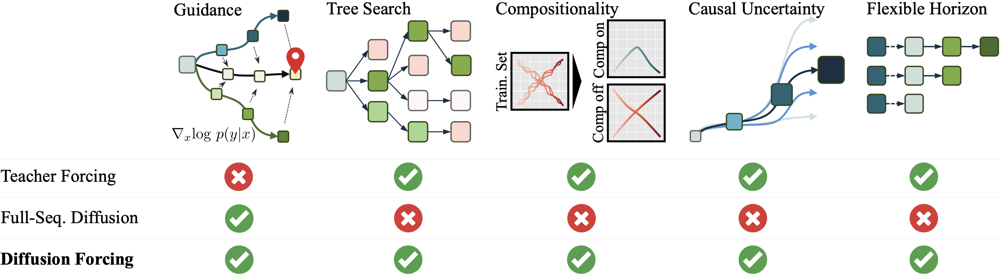
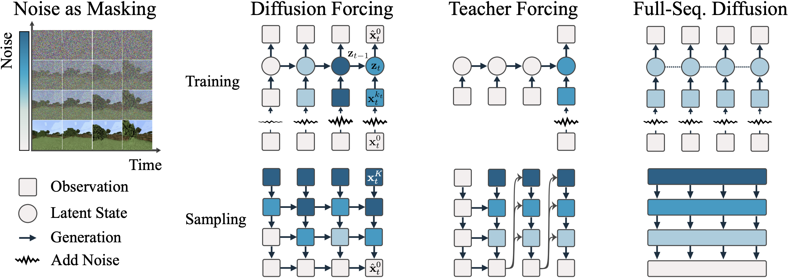
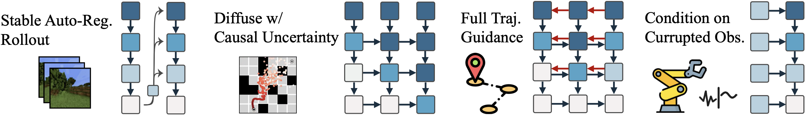
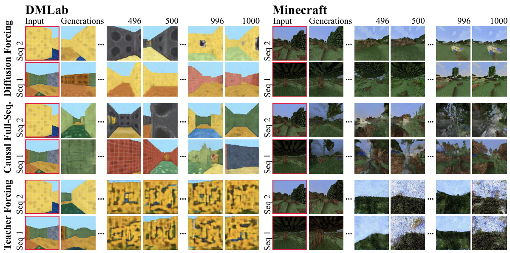
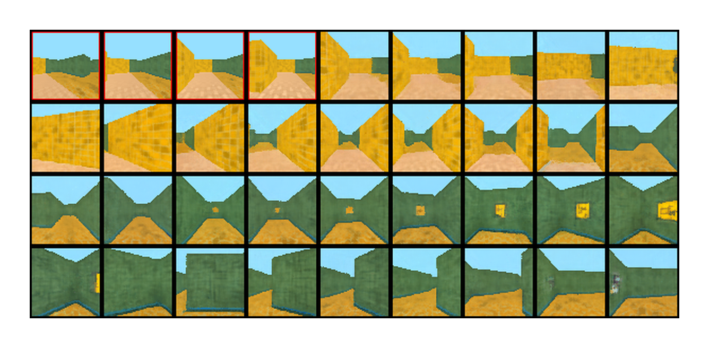
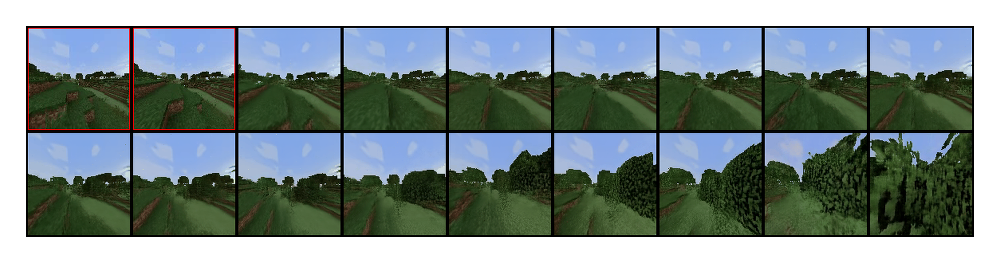
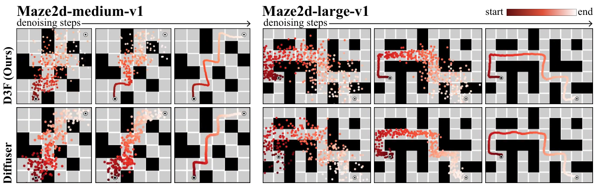
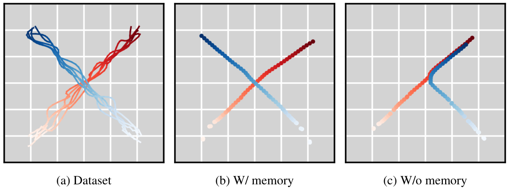
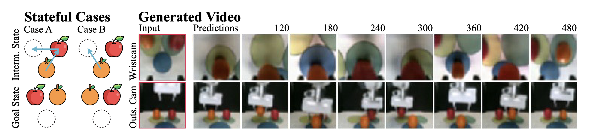
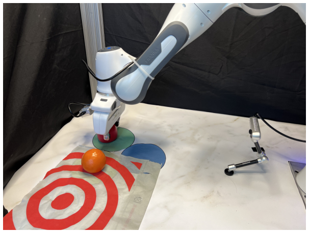

# Diffusion Forcing：next-token 与全序列扩散

!!! info "论文信息"
    **论文题名：** Diffusion Forcing: Next-token Prediction Meets Full-Sequence Diffusion。 
    **作者：** Boyuan Chen、Diego Marti Monso、Yilun Du、Max Simchowitz、Russ Tedrake、Vincent Sitzmann。 
    **机构：** 未在公开元数据中稳定解析；以 arXiv/PDF 或官方页 affiliation block 为准。 
    **时间 / 主题：** 2024-07；扩散模型。 
    **arXiv / 官方报告：** arXiv：[2407.01392](https://arxiv.org/abs/2407.01392)；官方材料：[www.boyuan.space/diffusion-forcing/](https://www.boyuan.space/diffusion-forcing/)。 
    **GitHub / 项目：** GitHub：[github.com/buoyancy99/diffusion-forcing](https://github.com/buoyancy99/diffusion-forcing)；项目页：[www.boyuan.space/diffusion-forcing/](https://www.boyuan.space/diffusion-forcing/)。 
    **元数据来源与核验口径：** 来源：[arXiv](https://arxiv.org/abs/2407.01392)；[GitHub API / repo](https://github.com/buoyancy99/diffusion-forcing)；[官方 / 项目材料](https://www.boyuan.space/diffusion-forcing/)；Checked Date：2026-06-04；Repro Status：Paper / official materials reviewed, independent reproduction not claimed。

## 把每个位置的确定程度，变成序列模型可以使用的输入

Diffusion Forcing（DF）提出了一种训练序列生成模型的方式，每个 token 都有独立的扩散噪声水平。一个位置可以完全已知，另一个位置可以只有模糊信息，再往后可以仍是纯噪声。模型学习在这些组合下恢复数据，推理时便能自行安排哪些位置先确定、哪些位置暂时保留不确定性。论文的主要实现是带因果依赖的循环网络，称为 Causal Diffusion Forcing（CDF）。[↗](https://arxiv.org/pdf/2407.01392v4#page=2)

这个问题来自两类序列模型各自的接口限制。普通 teacher forcing 使用真实历史预测下一 token，训练中历史通常被当作可靠条件；部署时一旦把自己的预测加入历史，误差就可能沿序列放大。逐 token 采样还往往先把当前 token 完全定稿，再生成后面内容，较远未来的目标很难反过来修正已经确定的较早选择。

全序列扩散把一段固定长度的序列放在一起去噪，能够对整条候选轨迹施加引导，例如要求终点靠近目标。但常规做法让所有位置共享同一噪声级别，近期行动和很远的未来一起变清楚。对于需要先执行一步、再收到反馈的控制问题，这会把远期预测过早当成确定事实；生成长度、历史条件与未来计划窗口也不如逐 token 模型灵活。

DF 让两种能力在一个训练接口中相遇。它仍按因果方向传递历史信息，却允许前后 token 处在不同的去噪阶段。一个近期动作尚未定稿时，模型已经可以从它展开多个未来，利用未来收益修正当前动作；实际执行后，又能用真实观测替换想象结果，再继续规划。长视频生成、可变时域规划和受损观测下的控制，都围绕这个接口展开。

下图的列分别对应引导、分支搜索、片段组合、因果不确定性和可变时域。它概括的是论文所比较的标准生成方式所拥有的直接能力，后面的实验才分别检验这些能力是否产生实际收益，不能把图中的勾号直接读成所有任务上的性能优势。

{ width="920" }

<small>原论文 Figure 1，沿用官方项目页原图。DF 将灵活的顺序生成接口与整段候选轨迹上的 guidance 联系起来；它并非少步蒸馏方法，推理仍包含多次扩散去噪。</small>

## 两条时间轴，分别表示顺序与信息量

用下标 $t$ 表示序列时间，上标 $k$ 表示扩散噪声级别，$x_t^k$ 就是第 $t$ 个 token 在噪声级别 $k$ 下的状态。这里的 token 可以是一帧图像、一组叠放的视频帧、一个状态与动作向量，或者某个时刻的多变量观测，不必是离散词元。

噪声沿扩散轴逐步增加。采用论文的 DDPM 记号，正向过程为

$$
q(x^k\mid x^{k-1})
=\mathcal N\!\left(
\sqrt{1-\beta_k}\,x^{k-1},\beta_k I
\right).
$$

令 $\alpha_k=1-\beta_k$，$\bar\alpha_k=\prod_{j=1}^{k}\alpha_j$，则可直接从原始 token 采样指定噪声状态

$$
x_t^{k_t}
=\sqrt{\bar\alpha_{k_t}}\,x_t^0
+\sqrt{1-\bar\alpha_{k_t}}\,\epsilon_t,
\qquad \epsilon_t\sim\mathcal N(0,I).
$$

$k_t=0$ 表示数据没有被遮蔽，$k_t=K$ 对应近似不含原始信息的高斯噪声，中间值表示部分信息仍然可见。这就是论文的 **noise as partial masking**。普通 mask 往往只有“看见”和“看不见”，扩散噪声则提供连续程度的遮蔽。[↗](https://arxiv.org/pdf/2407.01392v4#page=4)

DF 的训练从一条真实序列 $x_{1:T}$ 出发，独立抽取每个位置的 $k_t$，再分别加噪。独立采样很关键，它不要求后面的 token 一定更嘈杂，也不要求历史全部干净。训练样本可以是“清楚的过去、模糊的现在”，也可以是“部分缺失的历史、较清楚的当前观测”。于是模型学到的是如何使用不同可靠程度的信息，而非只适应一条预设的噪声斜坡。

这不等于假设各个 token 在数据中互相独立。视频帧、动作和观测之间仍然有很强的依赖，独立的是训练时给每个位置施加的噪声水平。模型必须利用因果历史解释当前 token，正是因为数据本身不是独立的。

下图先看训练部分。DF 的输入颜色沿序列变化，表示不同噪声水平；Teacher Forcing 的历史是干净条件；Full-Sequence Diffusion 则在同一次训练中使用一致噪声。再看下半部分，DF 可以一边推进序列时间，一边让各位置以不同速度变清楚。

{ width="920" }

<small>原论文 Figure 2，沿用官方项目页原图。圆形是历史 latent state，方形是观测或生成 token。独立噪声训练提供了多种可用状态，采样日程决定部署时实际走哪条路径。</small>

## 一个循环单元，同时接收过去与当前的带噪观测

CDF 的基本单元接收上一个隐藏状态 $z_{t-1}$、当前带噪 token $x_t^{k_t}$ 和噪声级别 $k_t$，更新历史表示

$$
z_t\sim p_\theta(z_t\mid z_{t-1},x_t^{k_t},k_t).
$$

论文用概率记号描述这个状态，但实际实现采用确定性更新。$z_t$ 是对历史信息及其可靠程度的压缩表示，研究者可以直接沿状态链反向传播梯度；它不是从一个显式后验分布中抽出的物理世界状态，也不自动具有精确校准的概率含义。

观察模型再从 $z_t$ 预测当前干净 token。将状态更新与观察模型合并，可以把整个循环单元写成一个条件噪声预测器 $\epsilon_\theta(z_{t-1},x_t^{k_t},k_t)$。主文 Eq. 3.1 的训练目标为

$$
\mathcal L_{\mathrm{DF}}(\theta)
=\mathbb E\left[
\sum_{t=1}^{T}
\left\|
\epsilon_t-
\epsilon_\theta(z_{t-1},x_t^{k_t},k_t)
\right\|_2^2
\right].
$$

期望包含真实序列、逐 token 的独立噪声级别及正向加噪随机性。预测第 $t$ 个 token 时，$z_{t-1}$ 已经由前面各个带噪输入递归形成，因此损失既训练当前去噪，也训练如何把过去的信息存进状态。整个训练循环沿序列更新 latent，累积每个位置的去噪损失，再对模型参数反向传播。[↗](https://arxiv.org/pdf/2407.01392v4#page=5)

这个形式与 Bayesian filtering 有一个有用的对应。当 $k_t=0$，当前观测可靠，状态更新类似吸收观测后的后验更新；当 $k_t=K$，输入近似纯噪声，无法提供实际观测信息，模型主要依靠历史做先验预测。介于两者之间的 $k_t$ 使同一个模型在“相信观测多少”这件事上具有可调接口。

这里需要把建模直觉与实现保证分开。输入一个噪声标签，可以让模型按照训练过的可靠性条件处理观测；它不等于系统已经知道真实摄像头何时被遮挡，也不等于模型一定能检测所有分布外损坏。机器人实验会主动把受损观测标为带噪，检验的是给出这一条件之后模型能否继续控制。

主文用噪声预测统一说明目标，实际不同任务采用了不同参数化。视频和时间序列使用 $v$-prediction，规划与模仿学习偏好 $x_0$-prediction。它们可通过扩散变量之间的仿射关系转换，但相应损失在不同噪声位置的权重并不相同，所以“都是去噪目标”不意味着训练效果和细节可以完全互换。

## “覆盖所有子序列”的理论结论，需要保留哪些条件

独立采样会产生大量噪声配置，论文希望说明训练一个模型为何能同时服务这些不同的条件任务。其理论从部分加噪序列的似然出发，把每一步的条件生成与历史 latent 连接起来，将去噪训练解释为一个经过重加权的变分下界代理。这里首先要求 latent 对过去构成充分的状态摘要，即给定 $z_{t-1}$ 后，生成当前 token 不再需要额外读取被省略的历史。[↗](https://arxiv.org/pdf/2407.01392v4#page=14)

当噪声水平在各位置均匀采样时，作者先得到对这些噪声配置平均的似然目标。推广到某个固定配置后，该配置所需的损失项可以从完整训练目标里选出，再施加相应权重。附录特别指出，普通训练目标本身不必就是每一个固定配置的数值下界；它提供的是包含相应条件任务的去噪项。

要进一步说“优化一个目标，就同时优化全部噪声配置”，还需要 latent 和函数逼近器足够有表达力，使这些条件任务的最优解能够同时达到。在这个理想条件下，各项最优解不因重新加权而发生冲突。有限容量的 RNN 共享同一组参数时，不同位置、不同噪声和不同历史之间仍可能争夺表达能力，训练权重就会影响收敛与实际性能。[↗](https://arxiv.org/pdf/2407.01392v4#page=15) [↗](https://arxiv.org/pdf/2407.01392v4#page=16)

令每个 $k_t$ 只取 0 或 $K$，就得到一个有意义的特例。一部分 token 保留，另一部分完全遮蔽，后者不再携带原数据的信息，保留部分就对应抽取出的子序列。因而“所有子序列”与“所有噪声配置”之间建立了联系；因果模型的前向仍不能直接读取未来观测来预测过去。这个结论解释独立噪声训练为何不局限于一个固定窗口的完整重建，却没有证明任意有限模型在未见过的无限时长上都能维持准确记忆。

附录的公式还存在一个具体符号问题。A.2 的展开把 $\mathbb E_q\log(p/q)$ 写成了正的 $D_{\mathrm{KL}}(q\|p)$；按 KL 的标准定义，关系应为

$$
\mathbb E_q\log\frac{p}{q}
=-D_{\mathrm{KL}}(q\|p).
$$

因此不能照抄该处正号，并据此把正的平方去噪误差当成需要最大化的似然下界。论文实际训练仍是最小化去噪误差；其理论解释应按“似然目标的重加权去噪代理”及上述表达力条件理解，具体下界展开需要保持这一符号一致性。[↗](https://arxiv.org/pdf/2407.01392v4#page=18)

## 推理不是选一个统一步数，而是安排整张去噪日程

DF 用一个二维矩阵 $\mathcal K$ 描述采样。列是序列位置，行是去噪轮次，矩阵元素给出这一轮每个 token 应处在什么噪声级别。开始时待生成部分为高斯噪声，结束时目标 token 都达到零噪声；每一轮按时间顺序经过循环单元，用当前可用历史完成指定的去噪更新。

如果每一列同步下降，就得到类似全序列扩散的日程。如果先把一个 token 完全去噪，再处理下一个，则得到自回归采样。如果让近处更快变清楚、远处继续保持高噪声，就得到论文重点使用的 zig-zag 或 pyramid schedule。训练接口相同，改变的是推理时如何分配确定性。[↗](https://arxiv.org/pdf/2407.01392v4#page=6)

以三个 token 为例，下面保留几个关键中间状态来说明这种次序，并非实际采样只调用模型三次。

$$
[x_1^K,x_2^K,x_3^K]
\longrightarrow
[x_1^0,x_2^{K/2},x_3^K]
\longrightarrow
[x_1^0,x_2^0,x_3^{K/2}]
\longrightarrow
[x_1^0,x_2^0,x_3^0].
$$

第一个 token 已经确定时，第二个只部分确定，第三个仍可代表很多未来。这尤其适合控制，下一步动作即将执行，值得尽早得到清楚的决策；几十步之后会收到新观测，未来轨迹无需现在就压成唯一答案。

论文附录中的 pyramid matrix 更细致地表达了这一安排，第一列先从 $K$ 降到 $K-1$，后面的列保持 $K$，随后去噪波前沿序列向前推进。这里的“远期更不确定”是一种采样选择，不是训练时强制每条样本都服从同一条单调噪声斜线。相关工作 AR-Diffusion 和 Rolling Diffusion 已采用按位置关联的噪声调度；DF 通过独立噪声训练把可使用的调度范围扩展开，使推理时更换方案不必总是对应一次重新训练。[↗](https://arxiv.org/pdf/2407.01392v4#page=23) [↗](https://arxiv.org/pdf/2407.01392v4#page=25)

下图的四个面板来自同一模型接口。稳定滚动保留略带噪声的历史状态，因果不确定性让远期保持较高噪声，整轨迹 guidance 把未来目标的梯度传回较早候选，受损观测则通过噪声条件减少当前输入的影响。

{ width="920" }

<small>原论文第 6 页的能力示意，沿用官方项目页原图。横向箭头是顺序依赖，纵向是去噪，红色反向箭头表示优化候选轨迹时的梯度传播。</small>

## 稳定长滚动，靠的是不要把自己的输出当作绝对可靠历史

普通 teacher-forced 模型训练时一直看到真实历史，推理时却只能接收自己的预测。一个小的纹理或状态偏差会变成下一步的确定条件，后续输出再把偏差固化。DF 已经在训练中见过带噪历史，因此可以在部署时用噪声水平表达“这份历史有一定误差”。

附录 B.4 描述的具体操作是，保留上一个 token 对应小噪声级别 $0<k_{\mathrm{small}}\ll K$ 的 latent，记为 $z_{t-1}^{k_{\mathrm{small}}}$，以它为条件把当前 token 从 $K$ 去噪到零。这个过程也得到一串不同噪声水平下的当前 latent。为下一步继续生成时，选择 $z_t^{k_{\mathrm{small}}}$，而不是只保留完全干净观测对应的状态。[↗](https://arxiv.org/pdf/2407.01392v4#page=20)

这里被保留的是模型处理略带噪声 token 时形成的状态。它不是随意给隐藏向量 $z_t$ 直接添加高斯噪声，也不要求把交付给用户的视频帧变得模糊。输出图像可以完成去噪，内部用于继续预测的历史状态则保持与训练时某个非零噪声条件相对应。

实际采样还利用了这个过程节省重复计算。每次去噪已经计算了 $z_t^{\mathrm{new}}$，Algorithm 2 直接沿用它，而不再用刚更新到更低噪声的 token 额外执行一次后验状态计算。附录 D.6 指出，这省去了该处第二次状态更新，同时使保留的 latent 对应略高于新输出的噪声水平，与稳定化的意图一致。这个局部计算节省不能直接换算成整个系统实测快两倍，但它说明采样状态如何更新会同时影响速度和后续条件的可靠性。

稳定化并不需要模型先把错误检测出来，再单独修复。它通过训练覆盖的带噪条件，让下一步不要过度相信上一帧的每个细节。其有效性仍取决于数据、噪声选择和模型容量，后面的长视频实验展示了收益，不能把这个接口本身当作不会累积错误的证明。

## 未来的梯度怎样修正当前，Monte Carlo Guidance 又增加了什么

因果网络的前向依赖从过去走向未来，但优化候选序列时，梯度可以沿同一条计算图反向传播。设尚未确定的当前 token 影响之后的 latent，之后的 latent 又影响远期预测；如果远期预测离目标太远，对这个目标函数求导就能把修正传回当前 token。这不需要读取现实世界尚未发生的未来，它用的是模型自己展开的候选未来。

扩散 guidance 在每次采样时修改去噪方向。论文以分类器引导为背景，也允许将未来累计奖励或终点距离作为引导信号。CDF 的特殊之处在于，它可以先展开未来，而保留较早 token 的部分噪声，使这些较早决策还可被梯度调整。普通逐 token 采样如果已经把早期 token 定稿并移出可更新状态，就失去了同样的长时域修正接口。[↗](https://arxiv.org/pdf/2407.01392v4#page=6)

不过，单条想象轨迹仍可能具有偶然性。某个早期动作可能只在后续恰好发生一连串有利结果时看起来很好，而在其他可能未来里失败。Monte Carlo Guidance（MCG）从同一个当前候选和历史状态出发，采样多个未来，分别计算未来收益对当前候选的梯度，再求平均。

用 $u$ 代表尚未确定的当前 token，$F^{(n)}(u)$ 代表第 $n$ 个条件未来，$R$ 代表未来收益，可以把这一操作示意为

$$
\widehat g(u)
=\frac{1}{N}\sum_{n=1}^{N}
\nabla_u R\bigl(u,F^{(n)}(u)\bigr).
$$

这是对论文操作的解释性记号。关键不是选出得分最高的一条路径直接照做，而是让当前候选接受多个条件未来共同提供的梯度。增加分支可以减少单条未来带来的偶然性，但需要更多采样与反向传播；论文没有把这一额外预算折算成统一的实时控制频率。

让远期 token 保持较高噪声，与 MCG 互相配合。当前状态相近时，较嘈杂的远期仍能展开不同后续结果，平均梯度才有机会反映一组未来而非几条几乎相同的已定稿路径。附录 D.5 还讨论了噪声水平暂时不变的情形，除直接复制外，可以先反向去噪再正向加噪回原级别，用这种重采样生成 MCG 的多个候选；已经为零的 token 则直接保留。[↗](https://arxiv.org/pdf/2407.01392v4#page=7) [↗](https://arxiv.org/pdf/2407.01392v4#page=24)

与全序列扩散的区别应限定在采样接口。常规同步去噪把全部 token 一起更新，在固定当前候选的同时重新抽取条件未来，并没有同样直接的分支入口。附录 B.5 也承认，额外设计非标准的条件替换方案可能模拟这种功能。因此，本文展示的是 DF 原生支持这一规划方式，不能把它扩大成所有全序列模型在数学上都不可能使用任何 Monte Carlo 引导。[↗](https://arxiv.org/pdf/2407.01392v4#page=21)

## 从候选轨迹回到环境，模型必须接收真实反馈

用于顺序决策时，论文把 token 定义为

$$
x_t=[a_t,r_t,o_{t+1}],
$$

即动作、回报以及动作之后的观测。已有历史由 $z_{t-1}$ 汇总，模型向前生成一段计划，包含预测动作 $\hat a_t$、预测回报 $\hat r_t$ 和预测观测 $\hat o_{t+1}$。接着只执行计划中的第一个动作，然后接收环境真正给出的 $r_t,o_{t+1}$。

状态更新使用的 token 因而是 $[\hat a_t,r_t,o_{t+1}]$，并以 $k=0$ 作为已知经历输入。想象中的 $\hat r_t,\hat o_{t+1}$ 不会直接变成真实历史。这个区分让 DF 可以在每次行动后重新校准，再从新的状态向前规划，形成 model predictive control 式的闭环。[↗](https://arxiv.org/pdf/2407.01392v4#page=7)

规划窗口较短时，模型接近快速给出下一动作的策略；窗口较长时，可以对远期目标施加引导。窗口也能随任务剩余时间缩短，而不要求修改网络结构或重新训练。可变时域的收益因此同时包含控制能力与计算选择，不过较长窗口仍需计算更多候选位置，MCG 还会进一步放大预算。

迷宫实验并未完整照搬这个一般定义中的奖励建模。为了与 Diffuser 比较，作者丢弃数据集给出的 reward，使用目标位置构造引导，并考虑未来多个位置与目标的距离，使策略无需人为指定唯一的到达时刻。通用框架能使用奖励 token，不等于论文每一项实验都学习了一个完整的世界模型奖励函数。

## 训练细节中，Fused SNR 解决的是历史也带有信号

扩散训练常根据当前输入的信噪比调整损失权重。对序列模型，当前 token 的噪声并不能单独说明预测难度。即使当前帧非常嘈杂，可靠的历史也可能已经给出足够信息；如果历史和当前都很嘈杂，则是另一种条件。直接套用只看当前帧的权重，会忽略这个区别。

附录 D.1 为此引入 Fused SNR reweighting。设 $S_t\in[0,1]$ 为归一化后的当前 token SNR 权重，例如先对 min-SNR 权重按上限归一化；用指数递推汇总历史信息

$$
\bar S_t
=\gamma\bar S_{t-1}+(1-\gamma)S_t,
\qquad 0<\gamma<1.
$$

再合并当前与历史贡献

$$
S'_t
=1-(1-S_t)(1-\bar S_{t-1}).
$$

这个公式的直觉是，两种信息来源都没有提供足够信号时，预测才最缺乏依据。如果当前 $S_t$ 很低，但历史 $\bar S_{t-1}$ 很高，融合权重依然可以较高；反之，可靠的当前观测也能弥补较差历史。[↗](https://arxiv.org/pdf/2407.01392v4#page=23)

作者把它解释为简化的独立事件组合模型，它不是对视频真实物理信噪比的精确推导，也没有把时间上相关的数据当作独立样本。其有效性来自训练经验，论文观察到它对视频收敛非常有用，但在非图像任务上未见明显增益，因此没有统一用于所有实验。这也说明，独立噪声增加了可处理的条件范围，具体任务仍需要匹配的参数化与损失权重。

网络本身采用相对直接的结构。视频输入和 latent 都是带空间维度的张量，U-Net 输出与旧 latent 送入 GRU 得到新状态，再由一层 ResNet 加卷积的观察头预测当前数据。非图像向量使用 residual MLP 与 GRU。主实验没有靠一个新的大型 transformer 结构证明方法，transformer 扩展在附录中讨论，互联网规模训练与扩展规律不属于本论文的实证结果。

| Setting | DMLab video | Minecraft video | Maze planning |
| --- | --- | --- | --- |
| Backbone | U-Net + GRU | U-Net + GRU | Residual MLP + GRU |
| Parameters | 24M | 36M | 4.33M |
| Latent channels | 16 | 32 | Vector latent |
| Frame stacking | 4 | 8 | 10 |
| Prediction parameterization | $v$ | $v$ | $x_0$ |
| Noise schedule | Sigmoid | Sigmoid | Linear |
| DDIM sampling steps | 100 | 100 | 50 |

Frame stacking 把多个相邻时刻合成一个 token，减少对几乎相同输入反复执行状态更新的开销；它也让低维序列具有更多局部相关结构，便于使用已有扩散超参数。于是 token 数、原始视频帧数、环境动作步数不是同一个量，不能把一百个 DDIM 步直接理解为整段长视频只运行一百次网络。[↗](https://arxiv.org/pdf/2407.01392v4#page=24) [↗](https://arxiv.org/pdf/2407.01392v4#page=25)

所有实验使用 fp16 混合精度。时间序列、迷宫、组合生成和视觉模仿可以在一张 11GB 的 2080 Ti 上训练，通常 50K–100K 步、约 4–8 小时；迷宫和组合任务 batch size 为 2,048，视觉模仿为 32。视频使用八张 A100，batch size 为 $8\times16$，训练设置为 50K 步，作者观察通常约 40K 步、12 小时收敛，时间含偶尔验证。扩散噪声训练级数为 $K=1000$，推理采用 DDIM 子采样，视频一百步、非视频五十步。[↗](https://arxiv.org/pdf/2407.01392v4#page=26)

## 视频实验检验长期稳定，比较的是同一 RNN 下的训练方式

视频任务使用 Minecraft 与 DMLab 的第一人称导航数据。Minecraft 是 128×128 的沼泽地形随机移动，训练子序列为 72 帧；DMLab 是 64×64 的三维迷宫导航。两套数据原本都带动作，作者在视频预测实验中丢弃动作，使未来移动更加随机，并因计算预算只使用约 10% 的数据序列。[↗](https://arxiv.org/pdf/2407.01392v4#page=31) [↗](https://arxiv.org/pdf/2407.01392v4#page=32)

比较中，next-frame diffusion with teacher forcing 与 causal full-sequence diffusion 都使用和 DF 完全相同的 RNN 架构。前者检验干净历史训练下的误差累积，后者检验只有因果结构、却仍让整段共享噪声是否足够。这样得到的差异主要针对训练条件和采样方式，而不是把更大主干带来的收益算给独立噪声。

下图从左侧红框条件帧向右看，再比较第 496、500、996、1000 帧。Teacher Forcing 的 DMLab 结果逐渐变成重复纹理，Minecraft 出现明显噪点与结构损坏。Causal Full-Sequence 的若干单帧仍有场景外观，但相邻位置之间的结构和视角不够连贯。DF 的两组结果在很远时刻仍保留可辨认的导航场景。

{ width="1080" }

<small>原论文 Figure 3。横向的省略号代表跨越了大量中间帧，不能把整行当成连续相邻帧；比较重点是长滚动后的结构是否崩坏。</small>

这是一组定性证据。论文没有给出相应的 FVD、PSNR 或长期身份一致性统计表，因此不能由几组样例宣布所有视频质量维度都改善。它支持的是，在这些导航数据和相同 RNN 对照下，独立噪声训练配合略带噪声历史显著改善了长滚动的可用性。[↗](https://arxiv.org/pdf/2407.01392v4#page=8)

下面两个项目原图提供更密集的时间观察。DMLab 中可以沿墙面与转角看视角如何移动；Minecraft 中可以沿地形、树木和地平线看局部场景如何延续。红框是用作条件的真实帧，后面的画面是模型生成，不能把它们当作对同一真实未来的逐帧准确复原。

{ width="760" }

<small>官方项目页 DMLab 原图。条件帧之后，模型继续生成三维迷宫中的第一人称视角；场景连续性与真实运动轨迹预测准确率是不同判断。</small>

{ width="920" }

<small>官方项目页 Minecraft 原图。模型在低分辨率随机导航场景中生成地形和视角变化，这一结果不直接构成高分辨率开放场景视频生成的证据。</small>

附录进一步展示了 180 帧的未挑选抽帧结果，并说明 RNN 可以连续运行而不重置初始状态，也不靠滑动窗口重新开始。对应长滚动实验的图注把训练长度写为 Minecraft 72 帧、DMLab 36 帧；数据设置 F.1 则另写 DMLab 使用 48 帧子序列。因此，对于那组 180 帧长滚动展示，应使用其 36 帧图注口径，不能把两个数字静默合并成一个统一设置。作者还报告尝试到 2,000 帧未观察到整体崩溃，但这仍是该实验范围内的观察，不是无限长度保证。[↗](https://arxiv.org/pdf/2407.01392v4#page=28)

数据也会塑造失败形式。Minecraft 随机移动代理遇到较高障碍时可能停住，画面被泥土或花岗岩纹理占满；这些片段大量进入数据后，生成模型也会出现类似状态。作者观察到某些生成在转向后可以恢复。长时间不出现整体画面崩坏，不等于模型一直产生有意义的新内容，更不等于长期记忆从不丢失。

## 迷宫规划的主收益，要结合动作接口和 MCG 消融来读

规划使用 D4RL 的三个二维迷宫，每个迷宫训练一个模型。观测是二维位置与二维速度，动作是二维加速度。离线数据由在各路口和拐点之间随机导航得到，轨迹通常避开墙壁，但不专门通向某个评测目标。Maze2D 使用固定目标、随机起点；Multi2D 进一步随机化目标。到达目标半径 0.5 的区域内获得奖励，否则为零。[↗](https://arxiv.org/pdf/2407.01392v4#page=32) [↗](https://arxiv.org/pdf/2407.01392v4#page=33)

先看规划中的去噪过程。图的颜色从较早位置到较晚位置逐渐变浅，上排 DF 在采样中间阶段，靠近起点的路径已经较清楚，远处仍然散开；下排 Diffuser 的整段候选更同步地收缩。这对应两种对未来不确定性的处理方式，最终路径外观接近并不能抹去中间规划过程的区别。

{ width="1080" }

<small>原论文 Table 1 上半部分。左侧为 Maze2D Medium，右侧为 Large；横向展示去噪阶段，上排图中 D3F 标签指本文方法。</small>

完整回报表还包含一个关键接口差异。`Diffuser*` 忽略模型生成的动作，把生成状态交给手工 PD 控制器执行；`Diffuser w/ diffused action` 则直接执行生成动作。DF 直接执行自己的动作预测。星号这一实现差异决定了高回报究竟来自生成器的哪部分输出，不能省略。

| Environment | MPPI | CQL | IQL | Diffuser* | Diffuser w/ diffused action | DF w/o MCG | DF |
| --- | ---: | ---: | ---: | ---: | ---: | ---: | ---: |
| Maze2D U-Maze | 33.2 | 5.7 | 47.4 | 113.9 ± 3.1 | 6.3 ± 2.1 | 110.1 ± 3.9 | **116.7 ± 2.0** |
| Maze2D Medium | 10.2 | 5.0 | 34.9 | 121.5 ± 2.7 | 13.5 ± 2.3 | 136.1 ± 10.2 | **149.4 ± 7.5** |
| Maze2D Large | 5.1 | 12.5 | 58.6 | 123.0 ± 6.4 | 6.3 ± 2.1 | 142.8 ± 5.6 | **159.0 ± 2.7** |
| Single-task Average | 16.2 | 7.7 | 47.0 | 119.5 | 8.7 | 129.67 | **141.7** |
| Multi2D U-Maze | 41.2 | — | 24.8 | **128.9 ± 1.8** | 32.8 ± 1.7 | 107.7 ± 4.9 | 119.1 ± 4.0 |
| Multi2D Medium | 15.4 | — | 12.1 | 127.2 ± 3.4 | 22.0 ± 2.7 | 145.6 ± 6.5 | **152.3 ± 9.9** |
| Multi2D Large | 8.0 | — | 13.9 | 132.1 ± 5.8 | 6.9 ± 1.7 | 129.8 ± 1.5 | **167.1 ± 2.7** |
| Multi-task Average | 21.5 | — | 16.9 | 129.4 | 20.6 | 127.7 | **146.2** |

表中是论文报告的回报分数，超过 100 不表示成功率超过百分之百。DF 的 single-task average 为 141.7，multi-task average 为 146.2，均高于列出的对照。Multi2D U-Maze 是明确反例，DF 的 119.1 低于 Diffuser* 的 128.9，故结果应表述为平均回报领先，不能沿用正文中“六个环境全部超过所有基线”的概括。[↗](https://arxiv.org/pdf/2407.01392v4#page=8)

对动作接口的比较尤其有解释力。Diffuser 直接执行生成动作时，三个 Maze2D 分数只有 6.3、13.5、6.3，明显低于使用 PD 控制器后的结果。论文据此指出，联合生成的状态轨迹看起来可行，不代表同时生成的动作一定会让真实系统走出那条轨迹。DF 的因果结构和闭环方式在这里得到支持，它直接输出的动作具有较好的可执行性，不需要同样的手工状态跟踪器补足接口。

MCG 消融则把未来分支的作用单独拿出来。加入 MCG 后，六个环境的平均回报都提升，例如 Maze2D Large 从 142.8 到 159.0，Multi2D Large 从 129.8 到 167.1。Multi2D U-Maze 也从 107.7 到 119.1，但仍未超过 Diffuser*。因此，MCG 对本模型有稳定的均值收益，与“最终模型处处最佳”是两种结论。

回报指标本身还有一层限制。环境在目标附近持续给分，但数据没有“到达后原地停留”的示范，代理到达目标后可能继续离开；较慢的计划反而可能在目标邻域停留更多步。附录 D.8 因而建议进一步衡量首次到达目标所需时间。现有表格没有报告这一指标，不能把高回报直接解释成路径最短、到达最快，或所有控制维度都优越。[↗](https://arxiv.org/pdf/2407.01392v4#page=25)

## 调节记忆，可以在保持原分布与拼接片段之间切换

独立噪声使模型能处理不同可见历史，论文用一个二维轨迹例子展示这一性质如何影响组合生成。训练轨迹从正方形某个角走向对角，整体形成交叉形状。保留完整记忆时，模型知道当前轨迹从哪里来，继续沿对应对角线前进，复现原来的交叉分布。

如果改用较短计划，并在 MPC 过程中不保留完整历史，交叉点附近的决策就不再被最初出发角约束。模型可以从一条训练轨迹的前半段接到另一条轨迹的后半段，形成训练整轨迹中没有的 V 形路径。下图先比较左、中两幅，确认完整记忆保留了原分布；再看右图的局部片段如何重新组合。

{ width="880" }

<small>原论文 Figure 7。左图为数据，中图保留记忆，右图不保留完整历史；变化来自采样条件和规划时域，而非为 V 形轨迹重新训练模型。</small>

这项实验说明模型能够在局部动态支持的范围内组合片段。它没有证明忘记历史总是好事，也没有表明模型创造了任意新的动力学规律。恰恰相反，保留记忆和主动缩短记忆对应不同的条件分布，使用者需要决定任务要求保持最初承诺，还是允许在中途重新组合。[↗](https://arxiv.org/pdf/2407.01392v4#page=27) [↗](https://arxiv.org/pdf/2407.01392v4#page=28)

## 机器人实验，把记忆和观测可信度分开检验

真实机器人任务使用 Franka 机械臂，把苹果和橙子在两个槽位之间交换，并借助第三个空槽暂存。初始摆放随机，苹果可能从 A 开始，也可能从 B 开始；目标是相对起点完成交换，所以某个中间画面相同，正确的下一动作却可能不同。单帧观测无法完整决定策略，模型必须保留初始布局的信息。

下图左侧的 Case A 与 Case B 正是这个区别。中间状态相同，下面目标状态不同；右侧则展示同一模型还可以由初始画面生成后续视频。视频外观生成说明模型具有相关时序表示，但不能仅由这一展示推断机器人已经用视频想象执行了通用长时域规划。

{ width="920" }

<small>原论文 Figure 4，沿用官方项目页原图。上、下视频行分别对应手腕相机与外部相机，左侧任务示意揭示了对起始状态的记忆需求。</small>

数据包含 150 条通过 VR 遥操作、阻抗控制收集的专家示范，两种初始槽位配置各占一半。每条示范有 500–600 帧及对应动作，记录手腕和正面两个相机视角，以及机械臂末端六自由度动作。训练将视频补齐并降采样到 40 帧，每个视觉时刻绑定 15 个动作。水果在槽位圆区内的位置也随机变化，避免模型只记住一个固定位置序列而完全忽略视觉反馈。[↗](https://arxiv.org/pdf/2407.01392v4#page=33)

正常观测下，DF 的任务成功率为 80%，论文报告无记忆的 Diffusion Policy 在这个任务上失败。这个对照支持 recurrent latent 对该部分可观测任务的帮助，但它不是“所有 Diffusion Policy 都不能处理长期任务”的结论，比较对象是否带历史记忆本身就是实验变量。

第二项实验检验观测受损时的处理方式。作者在执行中加入视觉干扰，甚至完全遮挡相机，并将相应观测用 $k>0$ 标成不可靠，让模型更多依靠历史与先验。DF 的成功率降到 76%，相对 80% 是下降 **4 个百分点**；必须把受损输入当作真实条件的 next-frame diffusion baseline 为 48%，与 DF 相差 28 个百分点。[↗](https://arxiv.org/pdf/2407.01392v4#page=10)

| Evaluation condition | Method | Success rate |
| --- | --- | ---: |
| Original observations | Diffusion Forcing | 80% |
| Corrupted / missing observations | Diffusion Forcing, with noisy-observation conditioning | 76% |
| Corrupted / missing observations | Next-frame diffusion baseline | 48% |

这里的干扰实验并不等于噪声标签由模型自动预测。系统获得“这份观测应谨慎使用”的条件后，才展示出相应鲁棒性。论文未给出足以从这几个比例计算置信区间的完整试验次数，因此应把它理解为这项机器人设置中的报告结果，不能自行补出显著性判断。

下面原图展示训练中没有出现过的 Target 购物袋被放到桌上。干扰显著改变相机外观，却不改变当前交换任务。附录描述的典型失败是机器人不再充分响应水果随机位置的视觉线索，说明过度依赖先验也会损害闭环控制，不能把所有坏观测都简单忽略到底。

{ width="600" }

<small>原论文 Figure 16。受损观测条件使模型能够降低对当前画面的信任；恢复可靠视觉反馈与继续使用历史同样重要。</small>

这项实验把序列生成中的噪声接口转化成了实际控制接口。记忆用于分辨相同画面背后的不同任务阶段，噪声级别用于调节当前观测相对历史的权重。两者共同解释了结果，不能只用“更强视频生成”概括机器人的成功。[↗](https://arxiv.org/pdf/2407.01392v4#page=30)

## 时间序列实验说明适用范围，也保留了明显落后项

论文还在六套多变量时间序列上测试 DF，目的在于检查新的训练目标能否作为通用序列建模方法，而不只适用于图像或控制。每个时刻的整个多变量向量作为观测，任务是在给定历史后预测未来联合分布。数据维度从 8 到 2,000，采样频率与预测长度差异较大。

| Dataset | Dimension | Frequency | Training steps in series | Prediction length |
| --- | ---: | --- | ---: | ---: |
| Exchange | 8 | Business day | 6,071 | 30 |
| Solar | 137 | Hour | 7,009 | 24 |
| Electricity | 370 | Hour | 5,833 | 24 |
| Traffic | 963 | Hour | 4,001 | 24 |
| Taxi | 1,214 | 30-min | 1,488 | 24 |
| Wikipedia | 2,000 | Day | 792 | 30 |

表中的 training steps 指训练时间序列长度，不是优化器更新次数。历史窗口与预测窗口等长；特征按训练集均值、标准差归一化，还加入滞后输入、日历特征及嵌入等 covariates。模型在所有数据集上使用相同架构与超参数，一层 MLP 加四层 GRU，batch size 为 32，每个 epoch 有 100 个 batch，验证指标连续六个 epoch 未改善时早停。DF 的结果报告五个训练种子的均值与标准差。[↗](https://arxiv.org/pdf/2407.01392v4#page=26) [↗](https://arxiv.org/pdf/2407.01392v4#page=27)

评测使用 $\mathrm{CRPS}_{\mathrm{sum}}$，越小越好。单变量 CRPS 比较预测累积分布与真实观测的位置

$$
\mathrm{CRPS}(F,x)
=\int_{\mathbb R}
\bigl(F(z)-\mathbf 1\{x\leq z\}\bigr)^2\,\mathrm dz.
$$

这里的 `sum` 表示先在每个预测时刻沿特征维求和，再比较这个总量的预测分布与真实总量，最后沿预测窗口取平均。它不是先计算每个特征的 CRPS 再简单相加。论文从 100 条采样轨迹估计 19 个分位点来近似相应 CDF，因此这一结果衡量的是总量概率预测，而非逐维均方误差或每个维度都准确的保证。[↗](https://arxiv.org/pdf/2407.01392v4#page=35)

下面保留主要扩散对照、Transformer-MAF，以及在 Electricity 上有强结果的 NKF。各列均来自原论文 Table 2，不能把其中一个数据集的优势推广成全部数据集的结论。

| Method | Exchange ↓ | Solar ↓ | Electricity ↓ | Traffic ↓ | Taxi ↓ | Wikipedia ↓ |
| --- | ---: | ---: | ---: | ---: | ---: | ---: |
| Transformer-MAF | 0.005 ± 0.003 | 0.301 ± 0.014 | 0.021 ± 0.000 | 0.056 ± 0.001 | 0.179 ± 0.002 | 0.063 ± 0.003 |
| TimeGrad | 0.006 ± 0.001 | 0.287 ± 0.020 | 0.021 ± 0.001 | 0.044 ± 0.006 | 0.114 ± 0.020 | 0.049 ± 0.002 |
| ScoreGrad sub-VP SDE | 0.006 ± 0.001 | **0.256 ± 0.015** | 0.019 ± 0.001 | 0.041 ± 0.004 | 0.101 ± 0.004 | **0.043 ± 0.002** |
| NKF | — | 0.320 ± 0.020 | **0.016 ± 0.001** | 0.100 ± 0.002 | — | 0.071 ± 0.002 |
| Diffusion Forcing | **0.003 ± 0.001** | 0.289 ± 0.002 | 0.023 ± 0.001 | **0.040 ± 0.004** | **0.075 ± 0.002** | 0.085 ± 0.007 |

DF 在 Exchange、Traffic、Taxi 的报告均值最低。Taxi 的 0.075 比 TimeGrad 的 0.114 低约 34%，这个比例由表值计算；TimeGrad 同样是 next-token diffusion，但采用 teacher forcing，是理解训练方式差异的直接对照。Traffic 上 DF 的 0.040 与 ScoreGrad 的 0.041 很接近，两者表中误差项均为 0.004，不宜由千分之一的均值差声称稳健胜出。

落后项也很清楚。Electricity 的 0.023 差于 TimeGrad 的 0.021，更差于 NKF 的 0.016；Wikipedia 的 0.085 则明显高于 ScoreGrad 的 0.043 和 TimeGrad 的 0.049。Solar 上 DF 也没有优于 ScoreGrad。数据支持 DF 可以跨领域工作，并在若干任务上表现较强，但不支持“新的训练目标没有任何性能取舍”或“除某一个对手外全部领先”的泛化表述。

## 这项方法真正留下的是一个可以调度不确定性的接口

DF 把历史是否可靠、未来是否已经确定、接下来要计划多远，放进同一个逐 token 噪声接口。训练时独立采样各位置噪声，让模型见过多种信息组合；推理时再用调度矩阵选择近期与远期的确定速度。因果状态既支持连续滚动，又保留从当前候选展开多个未来的入口，因此 guidance 能够用于规划，MCG 能够在多个未来之间平均修正方向。

采用这套方法时，首先应明确 token 的实际单位和历史表示。视频帧叠放、动作块和多变量观测对应不同计算成本，不能只比较去噪步数。随后要确定哪些输入是已发生的真实反馈，哪些只是模型想象；执行动作后的更新必须使用环境观测。对于受损历史，噪声标签提供调节信任的能力，但噪声检测、标签选择和恢复可靠观测仍是部署系统需要处理的具体问题。

论文的实证范围也很明确，低分辨率导航视频检验了长期滚动，迷宫检验了条件分支与动作执行，机器人交换任务检验了记忆和观测鲁棒性，时间序列展示了跨领域适用性及取舍。大型视频 transformer、互联网规模训练和任意长期记忆并未在这里得到验证。最可复用的认识是，把未来保持为可修改、可分支的随机变量，可以改变序列模型的使用方式；这种能力只有与明确的状态更新、计算预算和任务指标连接起来，才会成为可靠的生成或控制系统。

把 Diffusion Forcing 放回世界模型主线时，先读[世界模型基础](../../world-models/beginner-world-models-primer.md)区分观测、潜状态和 rollout，再看[模拟器、反事实与合成 rollout](../../world-models/simulators-counterfactuals-and-synthetic-rollouts.md)讨论生成未来能否用于训练。若要比较它与普通扩散序列模型的训练接口，可接[扩散模型训练](../../diffusion/training.md)。
