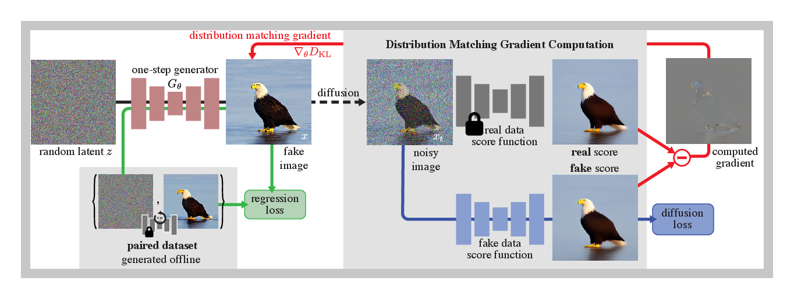
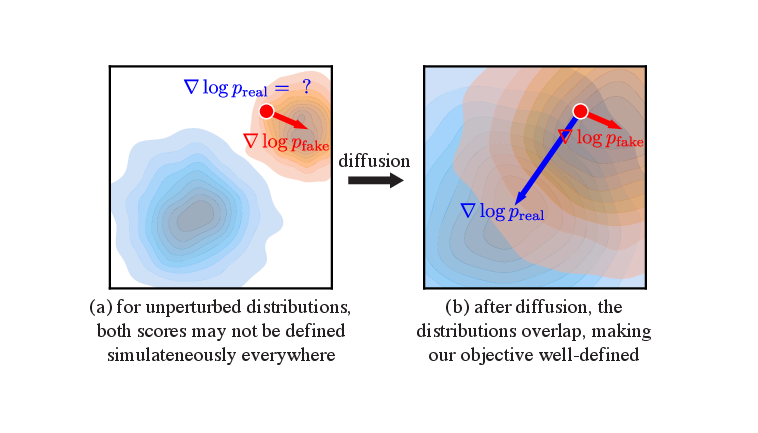
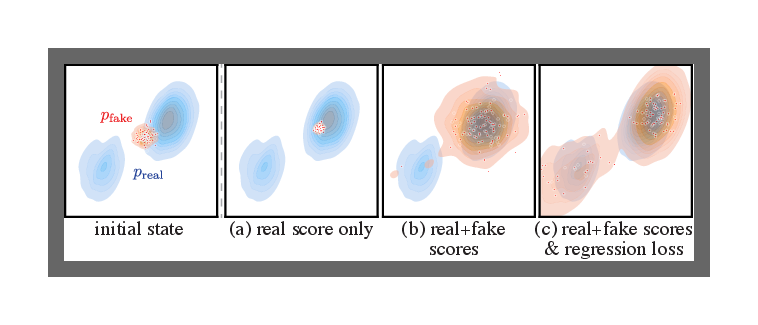
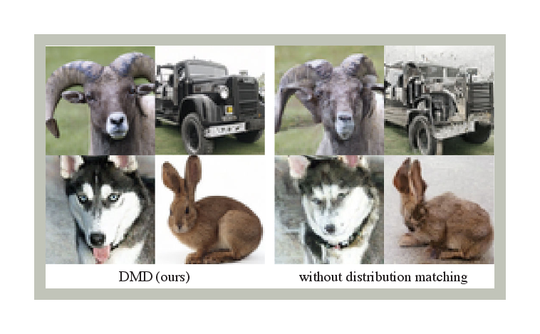
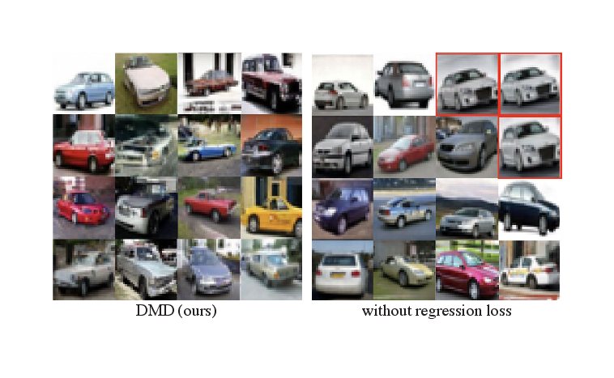
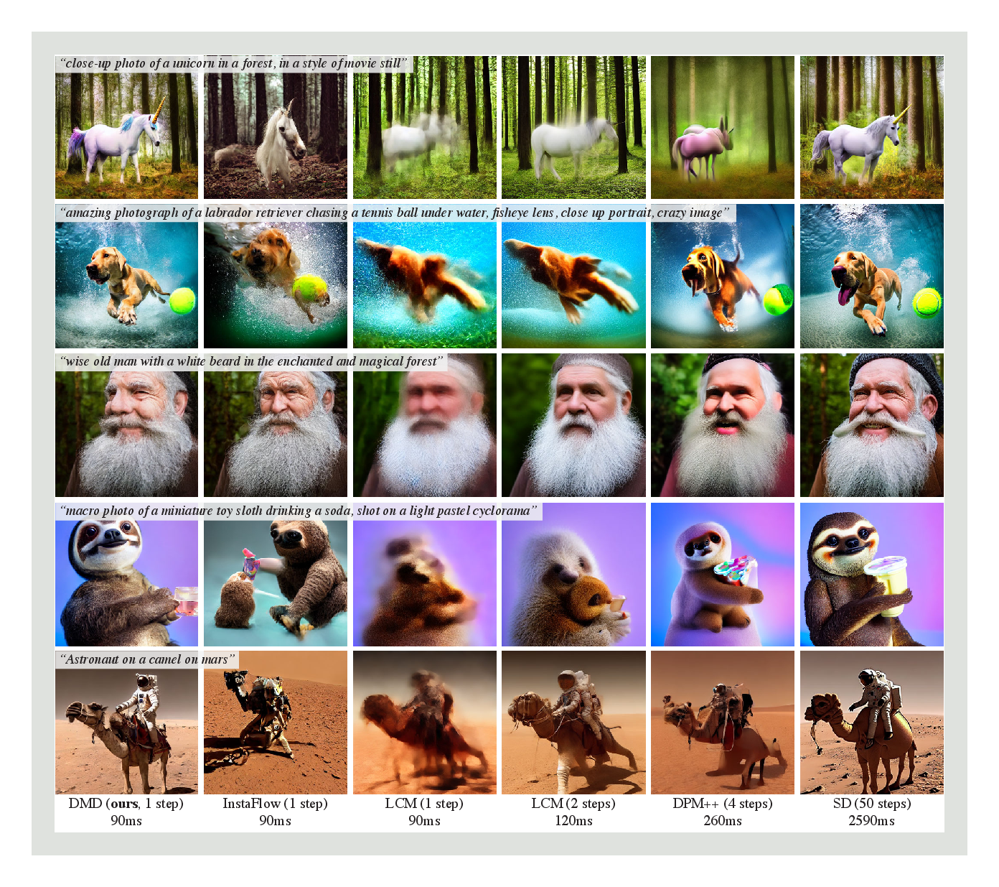

# DMD：一步扩散蒸馏

!!! info "论文信息"
    **论文题名：** One-step Diffusion with Distribution Matching Distillation。 
    **作者：** Tianwei Yin、Michaël Gharbi、Richard Zhang、Eli Shechtman、Fredo Durand、William T. Freeman、Taesung Park。 
    **机构：** 未在公开元数据中稳定解析；以 arXiv/PDF 或官方页 affiliation block 为准。 
    **时间 / 主题：** 2023-11；扩散模型。 
    **arXiv / 官方报告：** arXiv：[2311.18828](https://arxiv.org/abs/2311.18828)；官方材料：[tianweiy.github.io/dmd/](https://tianweiy.github.io/dmd/)。 
    **GitHub / 项目：** GitHub：未找到官方链接；项目页：[tianweiy.github.io/dmd/](https://tianweiy.github.io/dmd/)。 
    **元数据来源与核验口径：** 来源：[arXiv](https://arxiv.org/abs/2311.18828)；[官方 / 项目材料](https://tianweiy.github.io/dmd/)；Checked Date：2026-06-04；Repro Status：Paper / official materials reviewed, independent reproduction not claimed。

## 一步生成，究竟需要模仿教师的什么

DMD 要把多次调用的扩散模型蒸馏成一次前向的图像生成器。它的关键选择是让学生主要学习**教师所刻画的图像分布**，再用逐样本回归保住必要的结构对应。这样，学生无需把教师每一条去噪轨迹完整压进一次计算，教师也不必每次都先生成一张最终图像，才能给学生提供训练信号。[↗](https://arxiv.org/pdf/2311.18828v4#page=2)

这里有两个不同的问题。给定噪声种子 $z$，教师经过几十步得到一张狗的照片，学生可以尝试逐像素或逐特征拟合这张照片。但教师的噪声到图像映射复杂，同一个目标中的位置、纹理、光照都要由学生一次算出，单纯回归容易丢掉细节。另一种目标是允许学生从这个种子生成一张略有区别、但同样合理的狗图，只要求大量样本组成的分布接近目标分布。后者给一步模型更大的自由，却需要回答一个困难的问题：无法直接计算图像概率密度时，该怎样判断学生分布偏到了哪里？

DMD 用两个去噪网络来回答。冻结的教师描述真实图像分布的梯度，另一个持续更新的去噪网络描述学生当前生成分布的梯度。两者的差别构成学生的分布更新方向。这个方向能够改善真实性，但论文也发现，单独使用它会有不稳定和模式丢失，因此仍保留一批由教师离线生成的噪声—图像对作为回归正则。

这使 DMD 的贡献落在一种具体的训练组合上。它既不是只拟合教师输出，也没有彻底取消配对监督。ImageNet-64 的一步 FID 从纯回归的 9.21 改善到 2.62；而拿掉回归之后又退到 5.61。后文需要解释的，正是这两个信号为什么分别不可缺，以及在文本生成规模上为它们付出了什么成本。

## 一、沿方法图走完一次训练

先看 Figure 2 左侧的生成器。它接收随机噪声，直接输出一张图像；这张图随后分成几条训练路径。上方红色路径计算分布匹配梯度，下方绿色路径计算与离线教师样本的回归距离，右下蓝色路径则训练 fake score 网络。部署时，生成图像只需保留左侧的生成器。

{ width="920" }

<small>图源：`One-step Diffusion with Distribution Matching Distillation`，Figure 2，PDF 第 3 页。锁标记表示 real score 网络冻结；fake score 网络持续学习学生输出。</small>

图中的三个网络虽然都从预训练扩散模型出发，承担的任务并不相同。

| Component | Input | Output / supervision | Updated during distillation |
| --- | --- | --- | --- |
| One-step generator $G_\theta$ | Random noise $z$ and condition | Image or latent $x$; distribution gradient plus paired regression | Yes |
| Real score model $\mu_{\mathrm{base}}$ | Noised generated sample $x_t$, timestep $t$, condition | Denoised prediction used to estimate target score | No |
| Fake score model $\mu^\phi_{\mathrm{fake}}$ | Noised generated sample $x_t$, timestep $t$, condition | Denoised prediction fitted to the current generator output | Yes |
| Paired dataset $\mathcal D$ | Saved noise and condition | Corresponding deterministic teacher sample | Generated offline |

生成器沿用教师去噪网络的架构，由教师权重初始化。原文将初始映射写为 $G_\theta(z)=\mu_{\mathrm{base}}(z,T-1)$，其中 $T=1000$。学生不再像原采样器那样随时间步反复运行去噪网络，而是用一次固定输入接口完成噪声到图像的映射。真实分数网络是教师的冻结副本；fake 分数网络则是另一份可训练副本，其参数记为 $\phi$。[↗](https://arxiv.org/pdf/2311.18828v4#page=4)

Algorithm 1 的一轮训练可以按顺序展开。

1. 采样一批新噪声 $z$，同时从离线数据集中取出另一批 $(z_{\mathrm{ref}},y_{\mathrm{ref}})$，分别计算 $x=G_\theta(z)$ 和 $x_{\mathrm{ref}}=G_\theta(z_{\mathrm{ref}})$。
2. 将生成结果加上随机程度的噪声，交给 real 与 fake 两个去噪网络；用它们的输出之差构造分布匹配梯度。
3. 比较 $x_{\mathrm{ref}}$ 与对应教师图像 $y_{\mathrm{ref}}$ 的 LPIPS 距离，将两项信号合并，更新生成器。
4. 把这一批生成图像视为固定训练数据，再采样噪声时间，用普通去噪目标更新 fake score 网络。

最后一步的监督图像使用 `stopgrad`，因此这次更新只训练 $\mu^\phi_{\mathrm{fake}}$。否则，“让 fake 去噪器拟合生成分布”与“移动生成分布”会混在同一条反向传播中。LAION 训练还有一个实现细节：算法将新噪声和配对噪声产生的图像拼起来，用于分布匹配分支；两个损失并不意味着所有数据都必须使用完全隔离的图像批次。[↗](https://arxiv.org/pdf/2311.18828v4#page=6)

这套流程没有训练一个判断真假的二分类判别器。它借用了分布匹配与生成器训练的思路，但实际提供梯度的是两个去噪模型。原始图像数据的知识主要保存在预训练教师中；离线图像配对则来自教师采样。

## 二、为什么两个 score 的差能成为训练方向

设学生输出为 $x=G_\theta(z)$，其分布记为 $p_{\mathrm{fake}}$，目标图像分布记为 $p_{\mathrm{real}}$。论文先从反向 KL 出发：

$$
D_{\mathrm{KL}}(p_{\mathrm{fake}}\Vert p_{\mathrm{real}})
=
\mathbb E_{x\sim p_{\mathrm{fake}}}
\left[\log\frac{p_{\mathrm{fake}}(x)}{p_{\mathrm{real}}(x)}\right].
$$

这个式子描述分布差异，但不能直接当作普通监督损失来算。高维图像的真实密度和当前生成器的输出密度都没有现成的数值接口。DMD 转而求这个目标对生成器参数的梯度，原文式（2）写成

$$
\nabla_\theta D_{\mathrm{KL}}
=
\mathbb E_z\left[
\big(s_{\mathrm{fake}}(x)-s_{\mathrm{real}}(x)\big)
\frac{dG_\theta(z)}{d\theta}
\right],
$$

其中

$$
s_{\mathrm{real}}(x)=\nabla_x\log p_{\mathrm{real}}(x),
\qquad
s_{\mathrm{fake}}(x)=\nabla_x\log p_{\mathrm{fake}}(x).
$$

**Score（分数函数）**在这里是对数概率密度对图像的梯度，不是给图片打出的质量分。它描述图像空间中哪一个局部方向会提高某个分布的密度。梯度下降沿负梯度移动，因此学生输出受到的方向是 $s_{\mathrm{real}}-s_{\mathrm{fake}}$：前一项把样本拉向目标分布较高密度处，后一项抵消当前生成分布内部的聚集趋势。[↗](https://arxiv.org/pdf/2311.18828v4#page=4)

仅有 real score 时，不同种子可能都朝同一处高密度模式移动。加入 fake score，优化过程才能区分“这里在目标分布中合理”与“学生已经在这里堆了过多样本”。这种解释针对的是梯度的作用，不意味着反向 KL 或一个近似的 fake score 自然保证覆盖全部模式。后面的低维图和图像消融都会展示剩余问题。

还有一个更基础的困难。学生刚开始生成的图像可能远离真实图像所在区域，此时真实分布密度极低，分数估计很不可靠；两个分布甚至可能没有良好重叠。另一方面，扩散去噪网络本来估计的就是加噪分布的 score。DMD 因而先把生成图像变为

$$
x_t=\alpha_t x+\sigma_t\epsilon,
\qquad \epsilon\sim\mathcal N(0,I),
$$

其中 $\alpha_t$ 与 $\sigma_t$ 来自教师的噪声日程，分别决定信号和噪声的幅度。比较对象随之变为多个噪声尺度下的图像分布。

Figure 4 左侧把真实分布画成蓝色、生成分布画成橙色。红色样本点位于生成分布中，却不在蓝色分布的有效区域；右侧加噪后，两个分布被平滑，红点处同时存在两种 score。图要说明的是分布比较为何可以进行，并没有给出某个噪声尺度一定最优的结论。

{ width="630" .atlas-figure-compact }

<small>图源：`One-step Diffusion with Distribution Matching Distillation`，Figure 4，PDF 第 5 页。加噪让原本分离的分布获得重叠，为两个 score 的比较提供共同输入。</small>

## 三、从去噪预测到生成器梯度，中间发生了什么

论文用预测干净图像的形式表达去噪器。对于 real score，有

$$
s_{\mathrm{real}}(x_t,t)
=-\frac{x_t-\alpha_t\mu_{\mathrm{base}}(x_t,t)}{\sigma_t^2}.
$$

fake score 采用完全相同的转换，只将去噪预测替换为可训练网络：

$$
s_{\mathrm{fake}}(x_t,t)
=-\frac{x_t-\alpha_t\mu^\phi_{\mathrm{fake}}(x_t,t)}{\sigma_t^2}.
$$

这里两个网络看到的是**同一个**加噪样本和同一个时间步。因此，两个 score 相减时，共有的 $x_t$ 项抵消，差异来自它们对这张加噪图片应当怎样去噪的判断。教师倾向于解释成真实图像，fake 网络则按照学生现有输出分布去解释。Figure 2 中两张鹰图下方的残差信号正对应这种差异。[↗](https://arxiv.org/pdf/2311.18828v4#page=5)

将这些估计代入分布梯度后，得到原文式（7）：

$$
\nabla_\theta D_{\mathrm{KL}}
\simeq
\mathbb E_{z,t,\epsilon}\left[
 w_t\alpha_t
 \big(s_{\mathrm{fake}}(x_t,t)-s_{\mathrm{real}}(x_t,t)\big)
 \frac{dG_\theta(z)}{d\theta}
\right].
$$

其中 $\alpha_t$ 来自加噪操作的导数。沿计算链看，$\theta$ 先影响生成图像 $x$，$x$ 再影响 $x_t$；因为 $\partial x_t/\partial x=\alpha_t I$，链式法则带出这个因子。附录 F 专门展开了这一步，说明分数差必须通过真实的生成器输出接口回传，而不是直接当作参数空间的更新向量。[↗](https://arxiv.org/pdf/2311.18828v4#page=14)

时间权重 $w_t$ 负责控制不同噪声尺度对更新的贡献。原文式（8）给出

$$
w_t=
\frac{\sigma_t^2}{\alpha_t}
\frac{CS}{\|\mu_{\mathrm{base}}(x_t,t)-x\|_1},
$$

$C$ 是通道数，$S$ 是空间位置数。分母是教师去噪预测与学生当前输出的绝对误差之和，乘上 $CS$ 的倒数对应平均绝对误差。用这一误差归一化，是为了缓和不同噪声尺度下梯度幅度的差别。默认分布匹配时间范围为 $t\sim U(0.02T,0.98T)$，避开两个端点；后面高 guidance 文本模型的训练日志会进一步收窄上限。

### 真正实现的是指定梯度，而不是计算出 KL 数值

附录 Algorithm 2 把上述思路落实成了可用于自动微分的操作。它在关闭梯度的状态下得到两个去噪预测，然后构造

$$
g=
\frac{\mu^\phi_{\mathrm{fake}}(x_t,t)-\mu_{\mathrm{base}}(x_t,t)}
{\operatorname{mean}_{C,S}\left|x-\mu_{\mathrm{base}}(x_t,t)\right|}.
$$

算法注释明确说，这里的权重针对采用的 mean-prediction 实现做了调整。它接着使用一个代理损失

$$
\mathcal L_{\mathrm{proxy}}
=\frac12\operatorname{MSE}\left(x,\operatorname{stopgrad}(x-g)\right).
$$

理解这个式子时，可以先把 $\operatorname{stopgrad}(x-g)$ 看成已固定的目标。当前输出与该目标的差就是 $g$；对 $x$ 求导后，便获得沿 $g$ 的梯度，再由 $x=G_\theta(z)$ 回传至生成器。具体平均归约决定整体缩放，但不会让两个 score 网络重新进入这条反向传播。

这个代理损失的数值不等于实际算出的 KL。它是将预先构造的图像梯度接入自动微分的一种手段。复现时若删除 `stopgrad`，或者让梯度穿过构造目标的两个去噪器，得到的就不再是 Algorithm 2 所表达的更新。[↗](https://arxiv.org/pdf/2311.18828v4#page=12)

### fake score 为什么必须持续训练

教师所描述的分布在蒸馏中固定，学生的分布却每轮都改变。$\mu^\phi_{\mathrm{fake}}$ 因而不能只在一批早期生成图像上拟合一次。它要不断以当前学生输出为干净目标，对这些图像加噪后最小化去噪误差：

$$
\mathcal L^\phi_{\mathrm{denoise}}
=
\mathbb E\left[
\omega(t)\left\|
\mu^\phi_{\mathrm{fake}}(x_t,t)-\operatorname{stopgrad}(x)
\right\|_2^2
\right].
$$

这里 $\omega(t)$ 是去噪训练的权重，与分布梯度里的 $w_t$ 用途不同。Algorithm 3 沿用基础模型的策略，在 EDM 配置中为 $\mathrm{SNR}+1/0.5^2$，在 SD v1.5 配置中为 $\mathrm{SNR}$。一项训练的是分数估计器，另一项决定生成器如何接受分数差反馈，不能因为都随时间变化就合并成一个超参数。

论文用干净图像预测写公式，并不要求基础模型原本也这样输出。附录 H 给出噪声预测与图像预测的转换：

$$
\mu(x_t,t)=\frac{x_t-\sigma_t\epsilon(x_t,t)}{\alpha_t},
\qquad
\epsilon(x_t,t)=\frac{x_t-\alpha_t\mu(x_t,t)}{\sigma_t}.
$$

因此，EDM 与 SD v1.5 可以在各自参数化下接入同一分布匹配思路；实现时仍须使用与基础模型一致的噪声日程和转换。[↗](https://arxiv.org/pdf/2311.18828v4#page=14)

## 四、已经有 fake score，为什么仍要回归教师样本

理想化的分数差解释了分布更新方向，实际训练还面临近似误差。低噪声时，学生样本可能处于教师很少见到的区域，real score 估计不可靠；学生与 fake 网络又在交替变化，有限训练并不能保证后一网络始终准确。同时，局部 score 信息不足以直接告诉优化过程应为每个相隔很远的模式分配多少概率质量。

Figure 3 从相同初始状态出发，比较三种目标。最左边橙色样本点靠近右上蓝色模式；只用 real score 后，样本进一步聚到这个模式中。加入 fake score 后，橙色分布在右上区域展开，却仍遗漏左下模式。再加入回归项，才在这个示例中覆盖两个模式。

{ width="630" .atlas-figure-compact }

<small>图源：`One-step Diffusion with Distribution Matching Distillation`，Figure 3，PDF 第 4 页。中间面板说明“样本散开”和“找回未覆盖模式”是两个不同问题。</small>

回归项提供的是具体种子与教师输出之间的锚点。作者用确定性的教师采样器生成

$$
\mathcal D=\{(z_{\mathrm{ref}},y_{\mathrm{ref}})\},
$$

并定义

$$
\mathcal L_{\mathrm{reg}}
=
\mathbb E_{(z_{\mathrm{ref}},y_{\mathrm{ref}})\sim\mathcal D}
\operatorname{LPIPS}\left(G_\theta(z_{\mathrm{ref}}),y_{\mathrm{ref}}\right).
$$

**LPIPS（学习式感知图像距离）**在特征空间比较图像。它让学生保留同一噪声对应的较大尺度结构，同时留出纹理变化空间。总体生成器目标写成 $D_{\mathrm{KL}}+\lambda_{\mathrm{reg}}\mathcal L_{\mathrm{reg}}$，其中分布项通过前述代理梯度实现，回归项直接自动微分。默认 $\lambda_{\mathrm{reg}}=0.25$，但无条件 CIFAR-10 和高 guidance 文本训练的部分阶段使用了其他值。[↗](https://arxiv.org/pdf/2311.18828v4#page=5)

配对数据的确定性很关键。如果同一噪声对应的教师目标每次随机改变，回归所要保留的映射便不再固定。论文在 CIFAR-10 使用 18 步 Heun，在 ImageNet 使用 256 步 Heun，并关闭随机 churn；文本生成则使用 50 步 PNDM。它们都把多步采样成本提前支付，再反复使用生成好的配对数据。

这种锚定还带来一个应用方向：先用学生给出快速预览，再用教师获得更细的结果时，同一噪声的构图可以较为接近。但这种关联由损失鼓励，不能理解为每个种子都严格保持对象位置与像素内容。图中的实际样本比较支持相近结构，也能看到细节和姿态变化。

论文还在 CIFAR-10 将 LPIPS 换成标准 $L_2$ 回归，得到 FID 2.78，对照 LPIPS 的 2.66。差距说明感知距离有收益，同时也说明该机制并非只能依赖一种特征度量。更强的结论，例如任意回归损失都能稳定大规模文本蒸馏，并没有被这个单数据集实验建立。[↗](https://arxiv.org/pdf/2311.18828v4#page=14)

## 五、文本条件与 latent 图像怎样接入同一训练过程

文本生成使用 SD v1.5 作为教师，学生沿用其去噪网络。不同于直接输出低分辨率 RGB 图像，学生在 SD 的 latent 表示中工作；生成结果经过 VAE 解码才能成为最终图片。在训练中，这也意味着计算图像空间的 LPIPS 需要经过解码器，带来额外显存开销。

Classifier-Free Guidance（无分类器引导，CFG）改变教师给出的目标分布。DMD 对应做了两处处理：离线配对图像由带 guidance 的教师生成；在线计算 real score 时，也使用带 guidance 的教师预测。fake score 的公式保持原样，拟合学生当前实际产生的分布。将同样的 guidance 操作不加区分地施加到 fake 分支，并不是论文的训练方案。[↗](https://arxiv.org/pdf/2311.18828v4#page=6)

每个学生在训练时固定 guidance scale。论文分别训练了 scale 3 与 scale 8 的模型，前者面向较低的 COCO FID，后者面向更强的视觉表现和文本条件响应。这不是一个学生在推理时随意切换两种教师强度的实验。比较两组结果时必须连同数据、训练阶段与计算预算一起区分。

低 guidance 配置为了节省回归分支的显存，使用较小的 Tiny VAE 解码器；高 guidance 训练后期换回 SD v1.5 的标准 VAE。解码器没有取代去噪学生，却改变了回归损失看到的图像和训练能够容纳的 batch。这是从“数学上同一个 LPIPS 目标”走到可运行训练时的重要接口差异。

## 六、ImageNet 的一步结果接近教师到了什么程度

ImageNet-64 实验先检验一个清楚的问题：采用相同来源的扩散教师，一步生成能否显著缩小与多步采样的分布质量差距？Table 1 的主要比较如下。这里 `# Fwd Pass` 是网络前向调用数，FID 越低越好。

| Method | # Fwd Pass ↓ | FID ↓ |
| --- | ---: | ---: |
| BigGAN-deep | 1 | 4.06 |
| ADM | 250 | 2.07 |
| Progressive Distillation | 1 | 15.39 |
| DFNO | 1 | 7.83 |
| BOOT | 1 | 16.30 |
| TRACT | 1 | 7.43 |
| Meng et al. | 1 | 7.54 |
| Diff-Instruct | 1 | 5.57 |
| Consistency Model | 1 | 6.20 |
| DMD (Ours) | 1 | 2.62 |
| EDM† (Teacher) | 512 | 2.32 |

DMD 与 EDM 教师相差 0.30 FID，在这组一步蒸馏比较中明显缩小了差距。它也比表中的 BigGAN-deep 更低，但不能据此宣称超过所有图像生成模型；表内 ADM 的 2.07 仍低于 DMD，只是使用更多调用。论文用 50,000 张生成图像，按 EDM 的评测代码计算 ImageNet 与 CIFAR-10 的 FID。[↗](https://arxiv.org/pdf/2311.18828v4#page=6)

512 到 1 说明推理网络调用数大幅下降。它与整条生成流水线的墙钟加速不是同一个量，因为条件编码、数据处理、硬件执行效率等不一定按调用数线性缩放。论文这里最直接建立的是质量与调用预算的变化；文本实验随后提供了单张生成的延迟数据。

### CIFAR-10 提醒我们区分条件设置

附录 Table 6 同时列出类别条件和无条件生成。将两者分开，结论才不会被一个 2.66 FID 掩盖。

| Method | Class-conditioning | # Fwd Pass ↓ | FID ↓ |
| --- | --- | ---: | ---: |
| TRACT | No | 1 | 3.78 |
| Consistency Model | No | 1 | 3.55 |
| DMD (Ours) | No | 1 | 3.77 |
| Diff-Instruct | Yes | 1 | 4.19 |
| DMD-conditional (Ours) | Yes | 1 | 2.66 |
| StyleGAN2-ADA | Yes | 1 | 2.42 |
| StyleGAN-XL | Yes | 1 | 1.85 |
| EDM (Teacher) | Yes | 35 | 1.84 |

无条件 DMD 的 3.77 接近 TRACT，但高于 Consistency Model 的 3.55。带类别条件时，DMD 得到 2.66，却也没有低于表中的两个条件 GAN 或教师。DMD 在 ImageNet 和文本生成上的优势很突出，CIFAR-10 表则显示这种优势不应扩写为所有数据集、所有条件设定上的统一胜出。[↗](https://arxiv.org/pdf/2311.18828v4#page=14)

## 七、消融分别检验真实性、覆盖和梯度尺度

主结果只能说明组合有效，不能告诉我们哪个部件解决哪类失败。Table 2 先移除两项生成器训练信号中的一项。

| Training loss | CIFAR-10 FID ↓ | ImageNet-64 FID ↓ |
| --- | ---: | ---: |
| w/o Dist. Matching | 3.82 | 9.21 |
| w/o Regress. Loss | 5.58 | 5.61 |
| DMD (Ours) | 2.66 | 2.62 |

只保留回归时，学生仍知道每个配对种子应当接近哪张教师图像，但一步网络难以仅靠这一距离恢复自然的结构与纹理。Figure 5 上半部分按相同随机种子比较公羊、卡车、哈士奇和兔子。右侧没有分布匹配时，卡车轮廓更破碎，动物头部与毛发的局部形态也更不自然；左侧完整 DMD 对这些结构保留得更好。

{ width="630" .atlas-figure-compact }

<small>图源：`One-step Diffusion with Distribution Matching Distillation`，Figure 5(a)，PDF 第 7 页。相同种子使这组图能直接比较回归输出在加入分布信号后的变化。</small>

拿掉回归的失败则集中在覆盖与稳定性。Figure 5 下半部分只看汽车类：右侧反复出现相似的灰色轿车和近似前侧视角，作者用红框标出；左侧完整模型的颜色、车身类型与拍摄角度更有变化。这对应 FID 变差，却不能只用“图像变模糊”概括。

{ width="630" .atlas-figure-compact }

<small>图源：`One-step Diffusion with Distribution Matching Distillation`，Figure 5(b)，PDF 第 7 页。红框强调遗漏回归后出现的重复汽车模式。</small>

这项消融还有一个影响解释的条件。附录 C.2 为了避免无回归基线训练发散，将其学习率调整为 $10^{-5}$。因此，表格比较的是论文实际运行的两套配置，而非除损失开关外严格保持所有超参数相同。尽管做了这一稳定化调整，无回归版本仍明显落后，支持回归在该训练方案中的实际价值。[↗](https://arxiv.org/pdf/2311.18828v4#page=13)

Table 2 的另一部分固定总体方法，比较分布梯度的时间权重。

| Sample weighting | CIFAR-10 FID ↓ |
| --- | ---: |
| $\sigma_t/\alpha_t$ | 3.60 |
| $\sigma_t^3/\alpha_t$ | 3.71 |
| Eq. 8 (Ours) | 2.66 |

使用归一化权重比这两个替代项分别低 0.94 和 1.05 FID。这个实验说明，score difference 只定义了方向来源，实际训练还受不同噪声尺度的梯度幅度影响。复制 DMD 时仅写出“教师减 fake”而忽略权重，并不足以得到论文的训练行为。[↗](https://arxiv.org/pdf/2311.18828v4#page=7)

## 八、COCO 的低 guidance 结果，质量与延迟怎样一起看

文本生成使用 zero-shot COCO-30k。作者从 MS-COCO2014 验证集随机选提示词，生成 30,000 张 $512\times512$ 图像，再用 PIL Lanczos 缩小到 $256\times256$，与验证集的 40,504 张真实图像通过 clean-fid 计算 FID。文本一致性使用 OpenCLIP-G。因而这里的“512 分辨率”描述生成输出，不能直接解释为 FID 特征评测也在 512 分辨率进行。[↗](https://arxiv.org/pdf/2311.18828v4#page=14)

低 guidance 模型将 SD v1.5 在 scale 3 的设置下蒸馏，训练数据为 LAION-Aesthetics-6.25+。Table 3 中与少步生成直接相关的比较如下。

| Method | Resolution ↑ | Latency ↓ | FID ↓ |
| --- | ---: | ---: | ---: |
| StyleGAN-T | 512 | 0.10 s | 13.90 |
| GigaGAN | 512 | 0.13 s | 9.09 |
| DPM++ (4 step)† | 512 | 0.26 s | 22.36 |
| UniPC (4 step)† | 512 | 0.26 s | 19.57 |
| LCM-LoRA (4 step)† | 512 | 0.19 s | 23.62 |
| InstaFlow-0.9B | 512 | 0.09 s | 13.10 |
| UFOGen | 512 | 0.09 s | 12.78 |
| DMD (Ours) | 512 | 0.09 s | 11.49 |
| SDv1.5† (Teacher) | 512 | 2.59 s | 8.78 |

标记 † 的结果由作者使用公开模型评测。延迟按 batch size 1 报告；LCM-LoRA 的训练 guidance 为 7.5，其余对应方法使用 scale 3。表内跨模型家族的部分数字来自既有工作，适合作为质量与预算参照，不能视为所有模型在完全相同硬件和实现下的统一测速。

在相同表中，DMD 以 0.09 秒达到 11.49 FID，优于列出的少步扩散方法。教师的 8.78 仍更低，两者差 2.71。按报告延迟计算，$2.59/0.09\approx28.8$，对应文中约 30 倍的表述。GigaGAN 的 9.09 也低于 DMD，不过其生成器家族和训练过程不同；这再次限定了“优于少步扩散基线”可以延伸到的范围。[↗](https://arxiv.org/pdf/2311.18828v4#page=7)

论文另外报告，采用 FP16 推理时可达到 20 FPS。20 FPS 对应约 50 毫秒一张，而 Table 3 的 90 毫秒是另一项报告值；二者不应被当作同一精度配置的互相换算。对于实际系统，最可靠的采用方式是把一次去噪网络调用作为明确的接口变化，再在目标硬件上测包含条件编码和 VAE 解码的完整延迟。

## 九、高 guidance 模型展示了什么，又额外依赖了什么

高 guidance 模型使用 scale 8，在 LAION-Aesthetics-6+ 上训练。它对应 Table 4，而不是前节得到 11.49 FID 的同一个 checkpoint。相同 COCO-30k 协议下，作者同时给出 FID 和文本对齐。

| Method | Latency ↓ | FID ↓ | CLIP-Score ↑ |
| --- | ---: | ---: | ---: |
| DPM++ (4 step)† | 0.26 s | 22.44 | 0.309 |
| UniPC (4 step)† | 0.26 s | 23.30 | 0.308 |
| LCM-LoRA (1 step)† | 0.09 s | 77.90 | 0.238 |
| LCM-LoRA (2 step)† | 0.12 s | 24.28 | 0.294 |
| LCM-LoRA (4 step)† | 0.19 s | 23.62 | 0.297 |
| DMD (Ours) | 0.09 s | 14.93 | 0.320 |
| SDv1.5† (Teacher) | 2.59 s | 13.45 | 0.322 |

这里同样要保留 LCM-LoRA 训练 guidance 7.5 的条件，其余对应比较为 scale 8。DMD 与教师的 FID 差为 1.48，CLIP 差为 0.002；它用一次前向获得了接近教师的文本对齐，并明显优于表中的少步求解器和 LCM-LoRA。[↗](https://arxiv.org/pdf/2311.18828v4#page=8)

Figure 6 按提示词横向排列多个方法。先看森林中的独角兽和白胡子老人，DMD 的角、脸部、胡须和背景分界已经清晰，而一步 LCM 的主体明显模糊。再看水下追球的狗和火星上的骆驼宇航员，DMD 保留了多个对象之间的关系。学生和最右侧教师在部分行里有接近的构图，这与回归约束的设计相呼应；具体姿态、边界和材质仍有差别。

{ width="920" }

<small>图源：`One-step Diffusion with Distribution Matching Distillation`，Figure 6，PDF 第 8 页。图中延迟从一步模型的 90 ms 到教师的 2590 ms；应在同一提示词的行内比较主体、细节和布局。</small>

这些样本帮助解释定量结果对应的视觉差别，但不能从五条提示推断任意复杂场景的成功率。表中的 FID、CLIP 与定性样本共同支持的是这一模型在报告协议下的质量，而不保证一步学生完全恢复教师的长采样能力。

更值得追问的是，高 guidance 模型为何不是只把前节的 scale 3 改成 8 就结束。附录记录的训练规模和日程显示，作者采用了更多配对数据、更长训练，并在过程中改变回归强度、噪声范围与 VAE。这些变化决定了高 guidance 结果应如何复用。

## 十、基本训练配方里哪些量不能省略

CIFAR-10 与 ImageNet 都从 EDM 初始化，噪声范围采用 $\sigma_{\min}=0.002$、$\sigma_{\max}=80$，离散成 1000 个 bin。CIFAR-10 的类别条件与无条件版本分别使用对应的 EDM VP checkpoint，ImageNet 则使用条件 ADM 架构的 EDM checkpoint。

| Training setup | CIFAR-10 conditional | CIFAR-10 unconditional | ImageNet-64 conditional |
| --- | ---: | ---: | ---: |
| Paired samples | 100,000 | 500,000 | 25,000 |
| Teacher sampling | 18-step Heun | 18-step Heun | 256-step Heun |
| Learning rate | $5\times10^{-5}$ | $5\times10^{-5}$ | $2\times10^{-6}$ |
| GPUs | 7 | 7 | 7 |
| Distribution batch size | 392 | 392 | 336 |
| Regression batch size | 392 | 392 | 336 |
| Training iterations | 300,000 | 300,000 | 350,000 |
| $\lambda_{\mathrm{reg}}$ | 0.25 | 0.5 | 0.25 |

三者使用 AdamW，weight decay 0.01，$\beta=(0.9,0.999)$，500 步学习率 warmup，以及 $L_2$ norm 为 10 的梯度裁剪。LPIPS 使用 PIQ 中的 VGG backbone，计算前将低分辨率图片双线性放大到 $224\times224$。分布匹配项与 fake 去噪项的权重都设为 1；网络 dropout 关闭。ImageNet 明确使用混合精度训练。[↗](https://arxiv.org/pdf/2311.18828v4#page=12)

这张表也澄清了“小量配对数据”的具体含义。ImageNet 的 25,000 组锚点可以反复使用 350,000 次迭代，回归不要求为每次更新重新采样完整教师轨迹。CIFAR-10 无条件模型使用更多配对样本和更强回归，与条件模型有明显差别。不能把默认 0.25 和某一数据集的配对规模直接当作通用配置。

低 guidance 文本模型的配置如下。

| Setting | LAION-Aesthetics-6.25+ |
| --- | --- |
| Base model / guidance | SD v1.5 / 3 |
| Dataset scale | Approximately 3M images and associated prompts |
| Paired samples | 500,000, using the first 500,000 prompts |
| Teacher sampling | Deterministic 50-step PNDM |
| Learning rate | $10^{-5}$ |
| Total distribution batch size | 2304 |
| Total regression batch size | 1152 |
| Training iterations | 20,000 |
| $\lambda_{\mathrm{reg}}$ | 0.25 |
| LPIPS decoder | Tiny VAE |
| Hardware / duration | 72 A100 GPUs / approximately 36 hours |

文本模型沿用上述 AdamW 参数、500 步 warmup 和梯度裁剪，另使用 gradient checkpointing 与混合精度。回归 batch 比分布匹配 batch 小，正与 VAE 解码和感知损失的显存开销有关。[↗](https://arxiv.org/pdf/2311.18828v4#page=13)

按报告的硬件与时间换算，$72\times36/24=108$ A100 天。这是对该训练时段的计算尺度换算，不包含一切实验探索或自动等同于配对数据准备账单。一步推理节省的是反复部署后的采样成本，蒸馏本身仍需同时运行多个大网络。

## 十一、1200 万组配对数据和 12 阶段日志说明了什么

高 guidance 文本模型在约 1200 万规模的 LAION-Aesthetics-6+ 上训练，并最终生成 1200 万组教师配对数据。教师使用 50 步采样、guidance 8。作者报告这次训练持续约两周，使用约 80 张 A100，并说明日程受时间与计算资源限制，未必最有效或最优。[↗](https://arxiv.org/pdf/2311.18828v4#page=13)

Table 5 记录的是持续训练中的配置变更。`Cumulative Iter.` 是累计迭代数；`Max DM Step` 是计算分布匹配时允许的最大加噪时间；`Small` 和 `Large` 分别是 Tiny VAE 与 SD v1.5 的标准 VAE。`DM BS`、`Reg. BS` 保留原表报告数值，该表没有明确标注其为全局还是单卡 batch，不能直接与前节明确写出的全局 2304、1152 混用。

| Version | # Reg. Pair | Reg. Weight | Max DM Step | VAE-Type | DM BS | Reg. BS | Cumulative Iter. | FID |
| --- | ---: | ---: | ---: | --- | ---: | ---: | ---: | ---: |
| V1 | 2.5M | 0.1 | 980 | Small | 32 | 16 | 5,400 | 23.88 |
| V2 | 2.5M | 0.5 | 980 | Small | 32 | 16 | 8,600 | 18.21 |
| V3 | 2.5M | 1 | 980 | Small | 32 | 16 | 21,100 | 16.10 |
| V4 | 4M | 1 | 980 | Small | 32 | 16 | 56,300 | 16.86 |
| V5 | 6M | 1 | 980 | Small | 32 | 16 | 60,100 | 16.94 |
| V6 | 9M | 1 | 980 | Small | 32 | 16 | 68,000 | 16.76 |
| V7 | 12M | 1 | 980 | Small | 32 | 16 | 74,000 | 16.80 |
| V8 | 12M | 1 | 500 | Small | 32 | 16 | 80,000 | 15.61 |
| V9 | 12M | 1 | 500 | Large | 16 | 4 | 127,000 | 15.33 |
| V10 | 12M | 0.75 | 500 | Large | 16 | 4 | 149,500 | 15.51 |
| V11 | 12M | 0.5 | 500 | Large | 16 | 4 | 162,500 | 15.05 |
| V12 | 12M | 0.25 | 500 | Large | 16 | 4 | 165,000 | 14.93 |

这份日志值得沿三处变化来读。

先看 V1 到 V3。配对规模仍是 2.5M，回归权重从 0.1 增到 1，同时训练持续进行，FID 从 23.88 降到 16.10。这记录了早期增强配对约束时质量逐步改善的过程，但并不是隔离了训练时长的权重消融，不能把全部下降都归因于权重改变。

再看 V3 到 V7。配对规模从 2.5M 增到 12M，FID 却在约 16.1–16.9 之间变化，没有随配对数量单调改善。因此，不能将“多造教师图片”视为唯一瓶颈。V8 将最大分布匹配时间从 980 改成 500，报告 FID 15.61；这说明后期实际使用的监督噪声范围已经不同于默认的全区间设置。

最后看 V9 到 V12。作者换用标准 VAE，降低表中两个 batch，再逐步把回归权重从 1 调回 0.25，最终得到主表中的 14.93。由于网络已有此前训练积累，这份日志也不能推出“从头用 V12 配置训练即可在相同预算复现”。它更直接提供了一个可研究的调节顺序：先稳定映射与覆盖，再检查噪声范围、感知监督解码器和分布项相对强度。

按约 80 张 A100、14 天换算，这一训练时段约为 1120 A100 天。它远大于低 guidance 配置的 108 A100 天，二者也使用不同数据与优化历程。因此，不能把低 guidance 的 36 小时训练成本和高 guidance 的 0.320 CLIP 组合成同一个模型的成本—质量记录。

这也是读 DMD 时最容易被摘要遮住的代价。对 CIFAR-10，论文能举出配对生成耗费很少训练计算的例子；扩展到较强文本条件时，配对数据最终达到千万级。分布匹配减少了对逐点精确拟合的依赖，但在这篇论文的实现中，没有消除配对生成、数据存储和调参的成本。

## 十二、怎样把 DMD 的方法带到实际工作中

如果直接使用蒸馏后的 checkpoint，最明确的收益是去噪网络只需一次前向。它适合延迟敏感的图像预览和重复采样，但需要接受特定训练 guidance、学生自身的分布质量，以及与教师仍有差别的细节。原论文也明确保留了这个差距：相较于更细的多步采样，一步生成仍有轻微质量损失。[↗](https://arxiv.org/pdf/2311.18828v4#page=8)

如果要复现或迁移蒸馏方法，最值得保留的是三个接口。第一，生成器只需给出可微输出，分布监督可通过“输出加噪—两种去噪预测—归一化差值”接入。第二，fake 去噪器必须持续拟合当前学生，训练时对目标图像停止梯度。第三，回归提供的是具体映射锚点，既影响覆盖，也影响与教师的构图关系；它的规模、权重和解码器都应成为明确配置。

这三个接口也给出诊断顺序。若图像保持了大致布局却缺少真实结构，查看分布匹配分支；若少数图像很像样但不同种子重复，查看回归与 fake score 的跟踪；若不同时间尺度带来失衡，检查实际权重、参数化转换和噪声范围。对应诊断应复用组件消融和样本观察，不能只靠最终一项 FID 判断。

训练资源仍是采用门槛。学生和 fake score 都要更新，冻结教师仍要提供预测，文本回归还要解码并经过感知网络。论文把 LoRA 作为降低显存的潜在方向提出，并没有将它证明为主结果使用的轻量配方。DMD 最有价值的进展，是把预训练扩散模型从“昂贵的样本生产器”进一步变成可供生成器学习的分布梯度来源；它同时留下一个具体后续问题：怎样让在线分布估计足够稳定，从而减少维持训练所需的配对约束。后续 [DMD2](dmd2.md) 正是沿这一问题继续修改训练系统。
