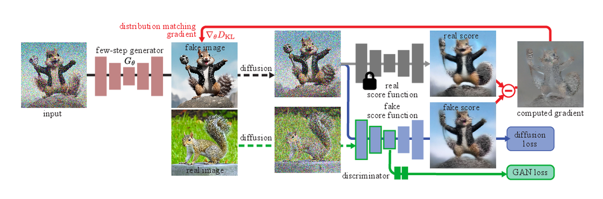
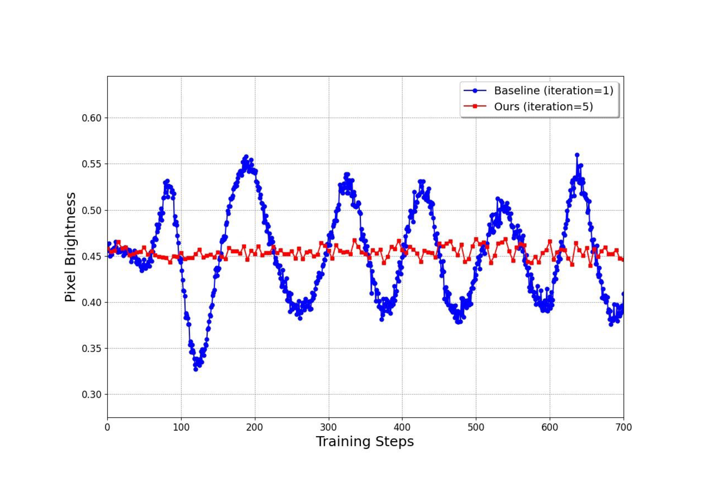
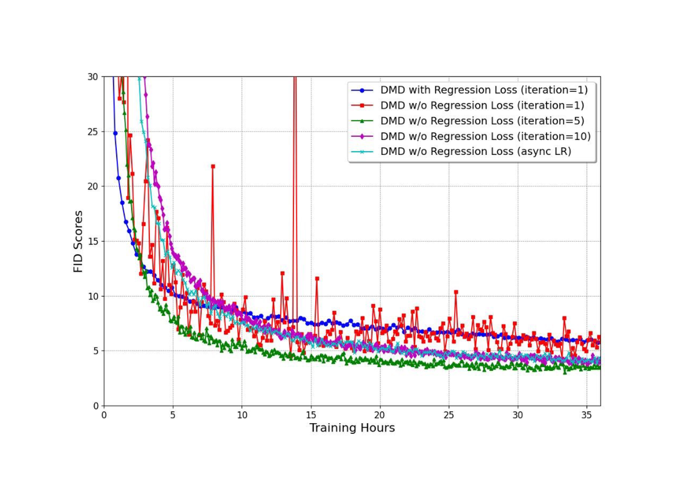
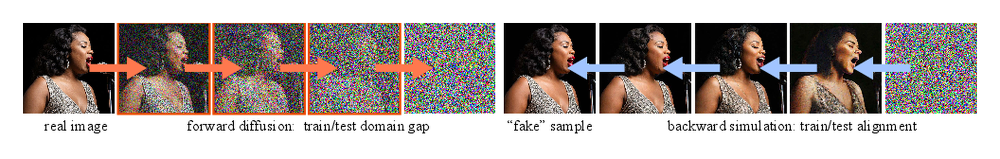
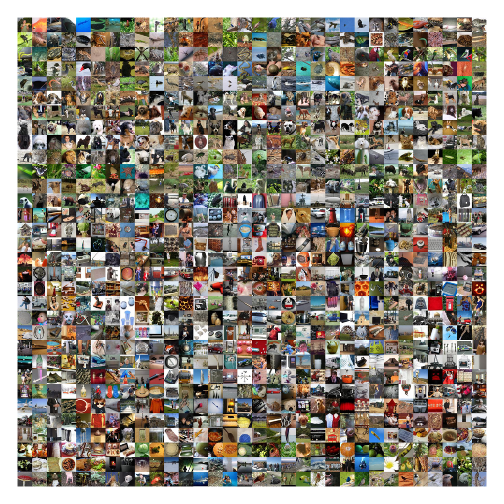
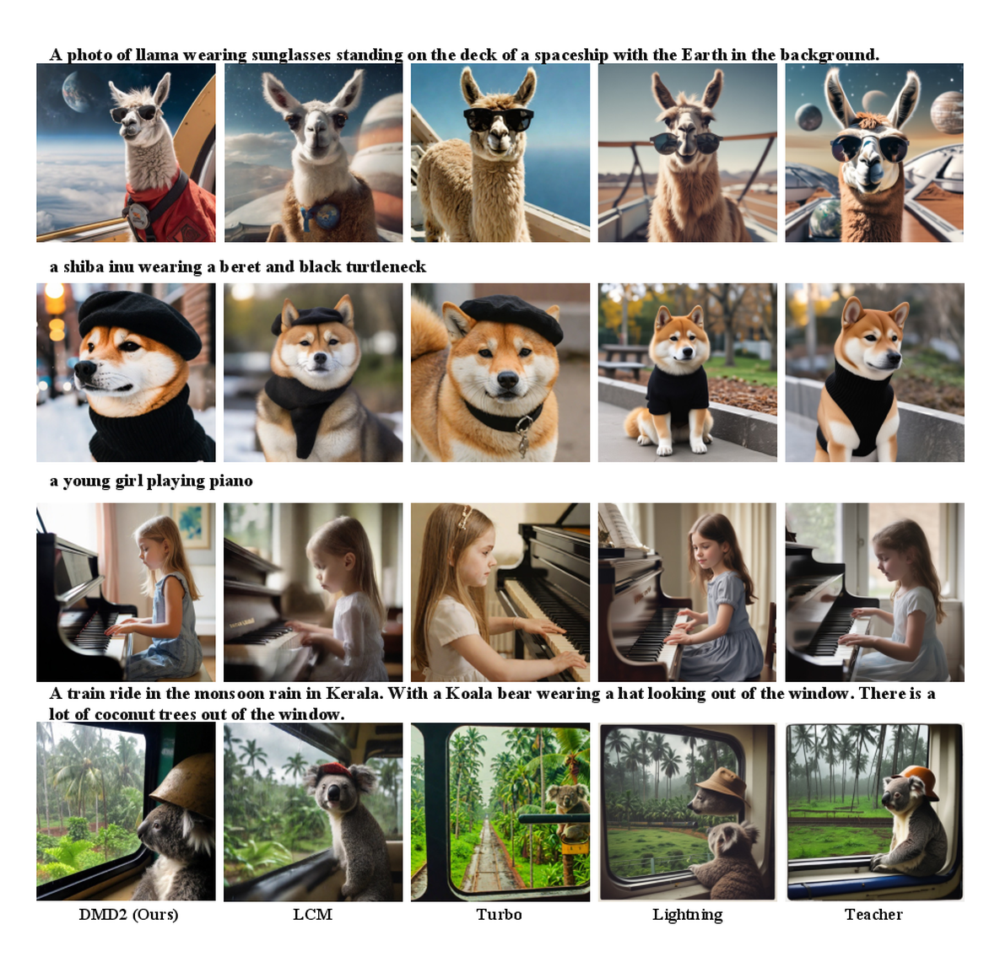
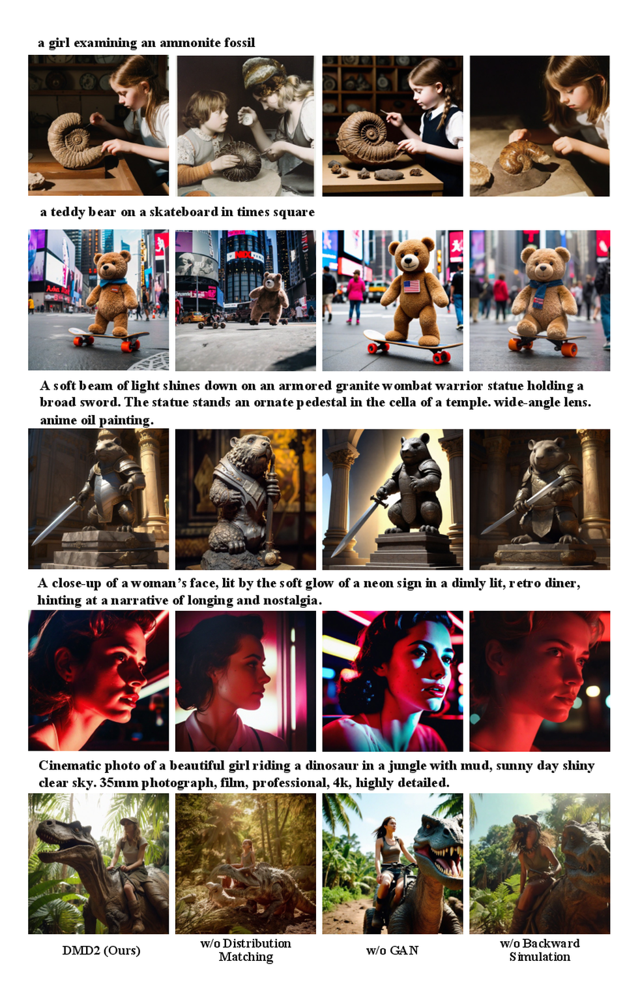
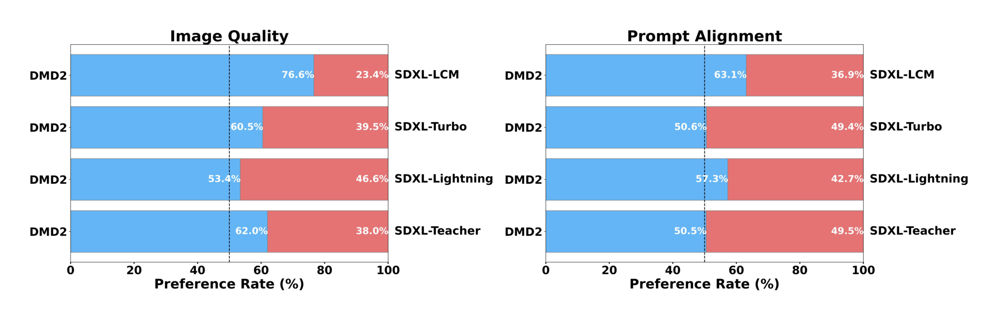

# DMD2：更稳的少步分布匹配蒸馏

!!! info "论文信息"
    **论文题名：** Improved Distribution Matching Distillation for Fast Image Synthesis。 
    **作者：** Tianwei Yin、Michaël Gharbi、Taesung Park、Richard Zhang、Eli Shechtman、Fredo Durand、William T. Freeman。 
    **机构：** 未在公开元数据中稳定解析；以 arXiv/PDF 或官方页 affiliation block 为准。 
    **时间 / 主题：** 2024-05；扩散模型。 
    **arXiv / 官方报告：** arXiv：[2405.14867](https://arxiv.org/abs/2405.14867)；官方材料：[tianweiy.github.io/dmd2/](https://tianweiy.github.io/dmd2/)。 
    **GitHub / 项目：** GitHub：[github.com/tianweiy/DMD2](https://github.com/tianweiy/DMD2)；项目页：[tianweiy.github.io/dmd2/](https://tianweiy.github.io/dmd2/)。 
    **元数据来源与核验口径：** 来源：[arXiv](https://arxiv.org/abs/2405.14867)；[GitHub API / repo](https://github.com/tianweiy/DMD2)；[官方 / 项目材料](https://tianweiy.github.io/dmd2/)；Checked Date：2026-06-04；Repro Status：Paper / official materials reviewed, independent reproduction not claimed。

## 目标是分布匹配，为什么还要逐张模仿教师

DMD2 的起点是 DMD 内部的一处矛盾。DMD 希望学生只在**输出分布**上接近教师，不必从同一个随机种子生成同一张图片；实际训练却仍需要教师预先生成的噪声—图像对，用回归损失稳定学生。于是，一个本来允许重新组织生成映射的方法，又被拉回了逐样本模仿。

这项约束同时带来计算成本和学习限制。对于 SDXL，原文估算每个噪声—图像对约需 5 秒；覆盖 DMD 所用的 1200 万条提示，大约需要 700 A100 天。学生还必须在很少的网络调用中复刻教师长轨迹的终点，即使另一种噪声到图像的映射能够产生同样好的分布，也会受到回归项惩罚。[↗](https://arxiv.org/pdf/2405.14867v2#page=5)

DMD2 没有把改进归结为删去一个损失项，而是分别处理删掉它之后暴露的三个问题。**生成分布变化太快，fake score 跟不上；教师的 real score 也有近似误差；多步学生在部署时接收到的输入，与训练时的输入不同。**对应的改变是增加 fake critic 的更新频率、加入真实图像上的对抗监督，以及用学生自己的采样过程构造训练输入。

最终结果显示，这套组合能把 ImageNet-64×64 生成压到一次前向，将 SDXL 压到四次前向，并在部分指标上超过教师的指定采样配置。理解这些结果需要同时看三件事：分布匹配梯度是怎样得到的，训练阶段究竟增加了哪些信息与计算，以及 FID、细节、文本对齐和多样性是否给出相同判断。

## 一、DMD 的两种分数，分别描述什么分布

### 从去噪输出得到 score

先把生成器与去噪器分开。学生生成器 $G_\theta$ 从随机噪声 $z\sim\mathcal N(0,I)$ 生成图像 $x=G_\theta(z)$；扩散去噪器 $\mu$ 接收一张已加噪的图像，预测其干净内容。类别或文本条件在下面的式子中省略，但实际条件生成始终使用它们。

正向加噪过程为

$$
x_t=F(x,t)=\alpha_t x+\sigma_t\epsilon,
\qquad \epsilon\sim\mathcal N(0,I),
$$

等价于条件分布 $q_t(x_t\mid x)=\mathcal N(\alpha_t x,\sigma_t^2I)$。这里，$t$ 指定噪声水平，$\alpha_t$ 控制保留多少图像信号，$\sigma_t$ 控制高斯噪声强度。将真实图像分布中的所有样本都经过这一过程，就得到噪声尺度 $t$ 上的分布 $p_{\mathrm{real},t}$。

论文式（1）把这个分布的 score 与去噪预测联系起来

$$
s_{\mathrm{real}}(x_t,t)
=\nabla_{x_t}\log p_{\mathrm{real},t}(x_t)
=-\frac{x_t-\alpha_t\mu_{\mathrm{real}}(x_t,t)}{\sigma_t^2}.
$$

$\mu_{\mathrm{real}}$ 是预训练教师给出的干净样本估计。右侧把“当前含噪样本”与“教师认为应保留的信号”作差，再按噪声方差缩放。在精确去噪估计的条件下，它给出真实分布的 score；实际训练使用神经网络近似。[↗](https://arxiv.org/pdf/2405.14867v2#page=5)

这里的 score 是与样本同形状的方向向量，不是“这张图得多少分”的标量。它描述在当前噪声尺度上，往哪个方向改变样本会提高对应分布的对数密度。后面出现的 GAN 判别器才输出真伪分类结果，两者承担不同任务。

### 为什么教师之外还需要一个 fake diffusion model

学生产生的图像也定义了一个分布 $p_{\mathrm{fake}}$，加噪后得到 $p_{\mathrm{fake},t}$。DMD 为它另训练一个去噪器 $\mu_{\mathrm{fake}}$，用相同关系估计 $s_{\mathrm{fake}}$。这个网络的训练样本来自当前学生，因此学生一变化，它要拟合的分布也随之变化。

DMD 优化的是噪声尺度上的近似反向 KL

$$
\mathcal L_{\mathrm{DMD}}
=\mathbb E_t\left[
D_{\mathrm{KL}}\big(p_{\mathrm{fake},t}\Vert p_{\mathrm{real},t}\big)
\right].
$$

不需要显式计算两个高维密度的值，便可以用两种 score 构造生成器梯度。沿用论文式（2）的记号

$$
\nabla_\theta\mathcal L_{\mathrm{DMD}}
=-\mathbb E_t\left[
\int
\left(
 s_{\mathrm{real}}(F(G_\theta(z),t),t)
-s_{\mathrm{fake}}(F(G_\theta(z),t),t)
\right)
\frac{dG_\theta(z)}{d\theta}\,dz
\right].
$$

积分表示对生成噪声的采样平均，$dG_\theta(z)/d\theta$ 将图像空间的调整传回生成器参数。实际理解时，先看括号里的差值：**同一张学生样本，在同一个加噪状态下，同时询问教师分布与学生分布的方向。**如果两种分布已匹配，理想情况下两种 score 相同，这部分更新就消失；如果 fake score 估计不准，差值也会偏离应有的方向。

因此，只保留教师分数并不等价于 DMD。教师告诉模型什么方向更符合目标，fake score 则让更新考虑当前学生分布已经在哪里。两者共同形成分布差异，而不是要求当前样本等于某张指定的教师图片。[↗](https://arxiv.org/pdf/2405.14867v2#page=5)

### 原来的回归项怎样改变这个目标

DMD 额外收集配对数据 $(z,y)$，其中 $y$ 由教师从同一个 $z$ 沿确定性采样轨迹生成，再优化

$$
\mathcal L_{\mathrm{reg}}
=\mathbb E_{(z,y)}\,d\big(G_\theta(z),y\big).
$$

$d$ 在 DMD 的实现中使用 LPIPS。分布项允许同一随机种子映射到另一张合理图像，回归项却会要求它回到 $y$ 附近。原文将回归项的作用归纳为保持模式覆盖与训练稳定；代价是需要生成配对数据，也限制了学生脱离教师原有映射的空间。

DMD2 希望让主训练真正依靠分布监督完成，但“取消大规模配对回归”有一个必须保留的配置例外：**SDXL 一步模型仍用了 1 万组配对样本做短暂回归初始化。**四步 SDXL 和其他 backbone 不需要这个处理。这个例外不改变 DMD2 主训练的分布目标，却意味着不能把每一种 DMD2 配置都称为从头到尾完全不用配对数据。[↗](https://arxiv.org/pdf/2405.14867v2#page=23)

## 二、先沿方法图走完一次训练

下图中先看左侧红色生成器，再沿同一张生成图像进入两种 score 的路径向右读。灰色教师带锁，蓝色 fake diffusion model 会训练；绿色分支接在后者的中间特征上，并额外读取真实图片。

{ width="830" }

<small>图源：`Improved Distribution Matching Distillation for Fast Image Synthesis`，Figure 3。</small>

图中的三种信号可以拆开理解。

| Component | Input | Training signal | Parameter status |
| --- | --- | --- | --- |
| Generator $G_\theta$ | 一步时为随机噪声；多步时还包括自身生成的中间状态与时间条件 | Distribution matching gradient + GAN gradient | 更新 |
| Real diffusion model $\mu_{\mathrm{real}}$ | 加噪后的学生输出与条件 | 提供目标分布 score | 冻结 |
| Fake diffusion model $\mu_{\mathrm{fake}}$ | 加噪后的学生输出与条件 | 以学生输出为干净目标的去噪学习 | 更新 |
| GAN classification head $D$ | 真实或生成样本加噪后得到的中间特征 | Real / fake classification | 与所连接的上游编码特征一起更新 |

先固定学生产生当前 fake samples，fake diffusion model 学会对这些样本去噪，同时分类分支区分真实图像与生成图像。随后更新学生：将生成样本加噪，由教师与 fake model 提供 score 差，并叠加判别器提供的对抗梯度。这个交替过程持续进行，fake model 更新得比学生更频繁。[↗](https://arxiv.org/pdf/2405.14867v2#page=6)

两种“监督图像”不要混淆。fake 去噪任务的干净目标就是学生自己生成的图像，因此它学习的是学生分布；GAN 的真实一侧来自外部真实数据，提供学生尚未掌握的分布信息。后者不要求与随机种子一一配对。

教师也不必为每个训练样本跑完几十步，再交出一张配对目标。它在学生生成的含噪样本上估计 score。这样取消的是昂贵的教师轨迹数据生产，而不是教师在训练中的作用。部署时保留学生的生成过程，real score、fake score 与 GAN 判别头都是训练组件，不进入逐张生成的推理循环。

## 三、取消回归后，为什么增加 critic 更新次数能救回训练

### 不稳定首先表现为整体统计量来回摆动

如果 fake model 能精确描述当前学生，DMD 梯度才有正确参照。但两个网络同时变化时，fake model 可能还在追上一轮分布，学生已经依据这个过时的估计继续移动。作者将取消回归后的不稳定归因于这种在线估计误差。[↗](https://arxiv.org/pdf/2405.14867v2#page=6)

亮度图给出了比一张失败样本更有用的诊断。先比较蓝线和红线在训练后段的振幅：蓝线是每次学生更新只训练一次 fake critic，红线是五次。纵轴是 Pixel Brightness，横轴是 Training Steps。

{ width="820" }

<small>图源：`Improved Distribution Matching Distillation for Fast Image Synthesis`，Figure 8。</small>

蓝线不断经历变亮、变暗、再变亮的周期，训练后段也没有稳定下来；红线集中在约 0.45 附近，波动明显缩小。这支持一个具体判断：失败不仅是某些纹理没学好，连整体分布的简单统计量都在被不准确的更新来回推动。

**Two Time-scale Update Rule，TTUR**在这里主要通过更新频率实现。在 ImageNet 的主要配置中，每更新生成器一次，先后执行五次 fake model 更新，让估计器在下一次学生变化前更充分地适应当前分布。它增加了每次学生更新配套的 critic 计算，但能减少无效振荡。

### 五次并非越多越好，也不等价于把学习率乘五

下一张图把代价纳入比较。横轴明确是 **Training Hours**，不是生成器更新次数；因此绿色曲线更低，意味着在这组实验实际消耗的训练时间内更有效。

{ width="820" }

<small>图源：`Improved Distribution Matching Distillation for Fast Image Synthesis`，Figure 9。</small>

红线取消回归但仅更新一次 fake model，FID 出现反复尖峰。绿色五次更新既稳定又下降较快；紫色十次更新同样稳定，却把更多时间花在 critic 上，降低了整体收敛速度。青色方案保持不同的学习率，让 fake model 的学习率达到生成器的五倍，表现仍不如执行五次实际更新。原始 DMD 的蓝线稳定，但在该图的墙钟比较中收敛更慢。[↗](https://arxiv.org/pdf/2405.14867v2#page=19)

这个实验区分了三个容易混用的调参方向：让 critic 多看几个优化步骤、让单步更新更大，以及让生成器更新得更少。它们对估计误差和计算分配的影响并不相同。作者给新数据与模型的建议，是选择**能稳定图像统计量的最小更新次数**，而不是无条件采用 5:1。附录的 SD v1.5 配置实际用了 10:1，说明该比例确实随任务变化。

## 四、fake score 跟上之后，为什么还需要真实图片

TTUR 解决了学生分布估计不准的问题，无法让冻结教师自动变得更准确。教师 $\mu_{\mathrm{real}}$ 本身只是数据 score 的近似。如果它在某些方向存在偏差，而学生只接收教师信号，那么学生没有额外信息去修正这些偏差。

作者据此提出，用真实数据上的 GAN 监督补充分布匹配。这个误差来源在原文中是解释假说；后面的消融证明加入该监督确实改善了结果，但没有单独测量并完全分解教师 score 的误差。[↗](https://arxiv.org/pdf/2405.14867v2#page=6)

### 对抗分支比较的仍然是分布

判别器接收两类输入

$$
F(x_{\mathrm{real}},t),
\qquad
F(G_\theta(z),t).
$$

两类样本都加噪，判别器在不同噪声尺度上学习区分真假。真实图片不需要对应某个 $z$ 的指定输出，因此这项监督不会重新引入原来逐种子回归的约束。

对于生成器，论文式（4）中的非饱和对抗项为

$$
\mathcal L_{G,\mathrm{GAN}}
=-\mathbb E_{z,t}
\log D\big(F(G_\theta(z),t)\big).
$$

$D$ 给出“真实”的分类概率。最小化这项损失会推动生成器输出更容易被判为真实的样本；与此同时，判别分支学习区分真实与生成样本。生成器还继续接收 DMD 的 score 差，两个目标共同作用，不能把完整 DMD2 等同于单独训练一个 GAN。[↗](https://arxiv.org/pdf/2405.14867v2#page=7)

### 为什么分类头接在 fake UNet 中间

DMD2 复用 fake diffusion model 的特征，而不是再从头建立一套独立的大判别网络。分类头接在 UNet middle block 输出上，由若干 $4\times4$、stride 2 卷积，GroupNorm 和 SiLU 组成，逐步将特征图缩小至 $4\times4$；再经 kernel size 与 stride 都为 4 的卷积聚合成向量，最后用线性投影输出分类结果。

分类分支及其上游编码特征接受 GAN 训练，fake 去噪任务仍保留。这种共享方式让一个已经学习噪声、语义和生成图像结构的表示承担分类任务，增加的主要是预测头和相应训练信号。[↗](https://arxiv.org/pdf/2405.14867v2#page=23)

这也解释了“学生超过教师”需要怎样理解。学生的主干来自教师，但训练时额外接触真实图像的分布监督，已经不只是压缩教师自身的输出。在指定指标上超过某个教师采样器，是增加信息后取得的结果；它不表示任意采样预算、任意质量维度都优于教师。

## 五、四步模型每一步究竟在做什么

对于 SDXL，单次前向要直接把纯噪声变成多样、细致的百万像素内容，模型容量与优化都更吃力。DMD2 因此将学生扩展为时间条件生成器，用数次“预测干净图像，再加回较少噪声”的操作逐步改善结果。

固定时间序列 $\{t_1,\ldots,t_N\}$ 后，先从高斯噪声开始。第 $i$ 步执行

$$
\hat x_{t_i}=G_\theta(x_{t_i},t_i),
$$

再构造下一步输入

$$
x_{t_{i+1}}
=\alpha_{t_{i+1}}\hat x_{t_i}
+\sigma_{t_{i+1}}\epsilon,
\qquad \epsilon\sim\mathcal N(0,I).
$$

$\hat x_{t_i}$ 的下标表示“在 $t_i$ 这一步预测的干净结果”，并不表示它还保留同样的噪声强度。下一步的噪声来自第二个式子；最后输出 $\hat x_{t_N}$，不再为其构造下一步输入。四步 SDXL 使用 $999,749,499,249$，训练与推理采用同一个预定日程。[↗](https://arxiv.org/pdf/2405.14867v2#page=7)

这种采样沿用 consistency model 的去噪—再加噪形式。虽然每一步都调用同一个时间条件学生，它也不是在四个时间点简单运行原教师的 ODE 求解器。网络已经被训练成能在这些位置直接预测干净结果。

还需要区分两类时间。$t_i$ 决定学生在生成链上的输入位置；DMD 或 GAN 监督使用的加噪时间 $t$，决定在哪个噪声尺度比较输出分布。前者组织推理过程，后者构造训练信号。把二者当成一个变量，会误以为学生只能在自身采样日程的四个位置接受分布监督。

## 六、Backward simulation 修复的是输入来源

### 真实图片加噪，与学生上一步输出加噪并不相同

一种直接的多步训练方式，是从真实图像采样 $x$，加噪到某个 $t_i$，然后让学生去噪。这样容易构造训练样本，但推理时第二步以后并没有真实图片可用。实际输入来自学生刚刚生成的 $\hat x_{t_{i-1}}$，其中包含当前模型自己的构图、细节与误差。

图中左边从真实图片向右加噪，右边从纯噪声向左运行学生。应重点比较中间状态，而不只是看两边最终是否都能形成一张人像。

{ width="830" }

<small>图源：`Improved Distribution Matching Distillation for Fast Image Synthesis`，Figure 4。</small>

DMD2 用右侧过程替代左侧输入生产方式。在训练中运行当前学生的少步采样，走到需要训练的位置，再让学生对这个中间输入去噪，并对输出施加 DMD 与 GAN 监督。因为学生只运行数步，模拟成本远低于为每个样本运行完整教师轨迹。

以四步日程的第三步为例，这个输入可以沿下面的过程构造。这是对论文流程的展开，而不是新增算法

1. 从随机噪声在 $t_1=999$ 运行学生，得到第一张干净预测。
2. 按 $t_2=749$ 的噪声强度重新加噪，再运行学生，得到第二张预测。
3. 按 $t_3=499$ 加噪，得到第三步真正会遇到的输入。
4. 让该步输出接受分布与对抗监督，学习怎样处理自身前面步骤留下的状态。

这里不需要寻找“该中间状态应对应哪张教师图片”。监督作用于输出分布，这正好允许训练输入来自学生自身，而不要求它停留在教师的确定性轨迹上。[↗](https://arxiv.org/pdf/2405.14867v2#page=7)

### 它与逐步追随教师的区别

论文也讨论了同期 Imagine Flash 的相近动机：训练时同样使用学生生成的中间结果，减轻学生输入的偏移。不过作者指出，如果后续监督仍依赖教师在这些合成输入上提供回归目标，教师自身也可能面临未见过这些状态的问题。DMD2 的分布目标不要求为每个学生输入指定一个教师终点，因此绕开了这层对应关系。

这是两种监督接口的区别，不是表格里完成了与 Imagine Flash 的同预算比较。对采用者最直接的启示，是在多步模型上先检查训练样本来自何处；单纯增加推理步数，并不会自动让模型学会纠正自己的中间错误。

## 七、ImageNet 先检验稳定性，再检验一步生成上限

### 组件消融把“恢复稳定”与“继续提高质量”分开

ImageNet-64×64 使用类别条件生成，FID 越低越好。Table 3 先从 DMD 出发，依次取消回归、改变更新频率、加入 GAN；最后两行再检查只用 GAN 的结果。

| Configuration | DMD Objective | No Regression | TTUR | GAN | FID ↓ |
| --- | --- | --- | --- | --- | ---: |
| DMD | ✓ | — | — | — | 2.62 |
| Remove regression only | ✓ | ✓ | — | — | 3.48 |
| Remove regression + TTUR | ✓ | ✓ | ✓ | — | 2.61 |
| DMD2 | ✓ | ✓ | ✓ | ✓ | 1.51 |
| GAN only | — | — | — | ✓ | 2.56 |
| GAN only + TTUR | — | — | ✓ | ✓ | 2.52 |

取消回归使 FID 从 2.62 退到 3.48，说明原来的稳定器不能直接删除。TTUR 将它恢复到 2.61，基本回到原 DMD 水平，且省去了大规模配对数据构造。加入 GAN 后进一步降至 1.51，改善 1.10 FID。

最后两行很关键。GAN-only 已经达到 2.56，但只给它增加 TTUR，结果为 2.52，变化很小；完整 DMD2 的 1.51 明显更低。这支持 DMD 与 GAN 提供互补信号，也说明 TTUR 在这里的关键作用与在线 fake score 估计有关，不能概括成“所有对抗训练多更新几次 critic 都会获得同样收益”。[↗](https://arxiv.org/pdf/2405.14867v2#page=9)

### 1.51 和 1.28 不是同一训练预算

主表的代表性结果如下。ImageNet FID 使用 50000 张生成图像和 EDM 的评测代码；前向次数统计的是每张图像的生成网络调用。

| Method | # Fwd Pass ↓ | FID ↓ |
| --- | ---: | ---: |
| Consistency Model | 1 | 6.20 |
| iCT-deep | 1 | 3.25 |
| DMD | 1 | 2.62 |
| CTM | 1 | 1.92 |
| StyleGAN-XL | 1 | 1.52 |
| DMD2 | 1 | 1.51 |
| DMD2 + longer training | 1 | 1.28 |
| EDM Teacher, ODE | 511 | 2.32 |
| EDM Teacher, SDE | 511 | 1.36 |
| RIN | 1000 | 1.23 |

标准 DMD2 已经优于表中的一步蒸馏方法；更长训练将 FID 提高到 1.28。它也低于 EDM 的 ODE 2.32 和 SDE 1.36，但原表仍有使用 1000 次前向的 RIN 达到 1.23。因此，这里的强项是极少调用下的质量，不宜写成所有图像生成方法的统一最高成绩。[↗](https://arxiv.org/pdf/2405.14867v2#page=8)

原文摘要的约 500 倍推理成本压缩，直接对应教师 511 次与学生 1 次前向的数量级；它不是同一硬件上完成了 500 倍端到端延迟测量。教师 ODE 和 SDE 也必须分别列出，因为仅更换采样方式，教师 FID 就会显著变化。

下面的样本来自 FID 1.28 的延长训练模型。先看不同动物与物体类别内部的颜色、姿态和背景变化，它展示了一步模型能够产生细粒度类别内容；定量质量判断仍由上述 50000 张样本的分布评估承担。

{ width="760" }

<small>图源：`Improved Distribution Matching Distillation for Fast Image Synthesis`，Figure 12。</small>

## 八、SD v1.5 的 8.35 FID，采用了哪一种 COCO 协议

文本生成使用 LAION-Aesthetics 提示训练，主文报告采样了约 300 万条；GAN 另使用 50 万张真实图像。COCO 用作 zero-shot 评测，并不是在这些评测提示上做配对蒸馏。

SD v1.5 的 Table 5 使用 COCO 2014 validation 中的 30000 条提示。生成结果先缩小到 $256\times256$，用 clean-FID 与同一 validation 集的 40504 张真实图像比较。这个协议与后面的 SDXL 主表不同，不能把 8.35 和 19.32 排在一起，当作同条件的不同模型质量。[↗](https://arxiv.org/pdf/2405.14867v2#page=24)

| Method | Resolution ↑ | Latency ↓ | FID ↓ |
| --- | ---: | ---: | ---: |
| DPM++ (4 step) | 512 | 0.26 s | 22.36 |
| UniPC (4 step) | 512 | 0.26 s | 19.57 |
| LCM-LoRA (4 step) | 512 | 0.19 s | 23.62 |
| InstaFlow-0.9B | 512 | 0.09 s | 13.10 |
| SwiftBrush | 512 | 0.09 s | 16.67 |
| UFOGen | 512 | 0.09 s | 12.78 |
| SLAM (4 step) | 512 | 0.19 s | 10.06 |
| DMD | 512 | 0.09 s | 11.49 |
| DMD2 | 512 | 0.09 s | 8.35 |
| SDv1.5 Teacher, 50 step, cfg=3, ODE | 512 | 2.59 s | 8.59 |
| SDv1.5 Teacher, 200 step, cfg=2, SDE | 512 | 10.25 s | 7.21 |

DMD2 相对 DMD 改善 3.14 FID，并低于 50 步 PNDM ODE 教师的 8.59。但教师用 200 步 SDE、CFG 2 时达到 7.21，仍优于学生。于是，“超过教师”在这里准确的含义是超过指定的较短 ODE 采样配置，而非超过教师所有可用采样结果。[↗](https://arxiv.org/pdf/2405.14867v2#page=18)

Latency 列保留原表数值，用于呈现论文报告的成本尺度。它没有为这份跨方法表提供足以统一所有硬件与实现差异的详细计时条件，因此实际部署时仍应测量自己的完整生成路径。对于论文的主张，更直接的结构性收益是学生只需一步，而不再运行教师的几十到几百步采样。

## 九、SDXL 的四步究竟改善了哪些质量

### 百万像素生成需要把整体构图与局部细节分开

SDXL 结果输出 $1024\times1024$ 图像。下图先观察女孩与菊石化石、老人面部、西瓜椅和滑板上的玩具熊：它们分别包含局部纹理、面部细节、材料与形状组合、主体与场景关系。这个展示说明四步模型的生成范围，是否优于对照仍需由后面的统一提示实验判断。

{ width="720" }

<small>图源：`Improved Distribution Matching Distillation for Fast Image Synthesis`，Figure 1。</small>

SDXL 主表使用 COCO 2014 的随机 10000 条提示，对应 10000 张真实参考图像；完整图像缩小到 $512\times512$ 后计算 FID。Patch FID 计算中心裁剪的 $299\times299$ 区域，专门检查高分辨率局部细节；CLIP Score 使用 OpenCLIP-G，衡量文本与图像的关联。[↗](https://arxiv.org/pdf/2405.14867v2#page=24)

| Method | # Fwd Pass ↓ | FID ↓ | Patch FID ↓ | CLIP ↑ |
| --- | ---: | ---: | ---: | ---: |
| LCM-SDXL | 1 | 81.62 | 154.40 | 0.275 |
| LCM-SDXL | 4 | 22.16 | 33.92 | 0.317 |
| SDXL-Turbo | 1 | 24.57 | 23.94 | 0.337 |
| SDXL-Turbo | 4 | 23.19 | 23.27 | 0.334 |
| SDXL-Lightning | 1 | 23.92 | 31.65 | 0.316 |
| SDXL-Lightning | 4 | 24.46 | 24.56 | 0.323 |
| DMD2 | 1 | 19.01 | 26.98 | 0.336 |
| DMD2 | 4 | 19.32 | 20.86 | 0.332 |
| SDXL Teacher, cfg=6 | 100 | 19.36 | 21.38 | 0.332 |
| SDXL Teacher, cfg=8 | 100 | 20.39 | 23.21 | 0.335 |

DMD2 一步的整体 FID 为 19.01，甚至略低于自身四步的 19.32；CLIP 也由 0.336 变为 0.332。四步的突出收益是 Patch FID 从 26.98 降到 20.86，且优于表中 CFG 6 教师的 21.38。增加调用改善了局部细节，并没有让每个指标都单调提高。[↗](https://arxiv.org/pdf/2405.14867v2#page=8)

其他方法也有类似的交叉趋势。Lightning 从一步到四步，Patch FID 与 CLIP 改善，整体 FID 却从 23.92 略升至 24.46。因而“多步是否值得”的问题不能只看一个全图 FID，尤其当应用看重原生分辨率下的纹理与结构时。

### 相同提示与噪声能看出哪些差异

下图各列从左到右是 DMD2、LCM、Turbo、Lightning 和教师。先看第一行的“戴墨镜的羊驼”，再看最后一行同时要求帽子、考拉、车窗与窗外椰树的场景。所有列使用相同提示与初始噪声；蒸馏模型四步，教师五十步并使用 CFG。

{ width="720" .atlas-figure-tall }

<small>图源：`Improved Distribution Matching Distillation for Fast Image Synthesis`，Figure 6。</small>

在第一行，LCM 的羊驼没有清楚呈现要求的墨镜，DMD2 的主体、眼镜与太空背景同时可见；在考拉场景中，不同列对主体、帽子和窗外环境的保留程度也有差别。这些样例帮助把“文本关联分数”还原为具体条件是否进入画面。它们是选定提示上的定性比较，更广泛的偏好比例由后面的用户研究给出。

## 十、SDXL 消融解释了为什么最低 FID 可能选错模型

### 删除三个组件，会产生三种不同退化

Table 4 固定 SDXL 四步生成，分别移除 GAN、distribution matching 或 backward simulation。先看三个指标的交叉变化，而不是只寻找每列最小值。

| Method | FID ↓ | Patch FID ↓ | CLIP ↑ |
| --- | ---: | ---: | ---: |
| w/o GAN | 26.90 | 27.66 | 0.328 |
| w/o Distribution Matching | 13.77 | 27.96 | 0.307 |
| w/o Backward Simulation | 20.66 | 24.21 | 0.332 |
| DMD2 | 19.32 | 20.86 | 0.332 |

**去掉 GAN**，全图与局部 FID 都明显恶化。它说明只修复 fake score 跟踪、保留教师分布监督，还不足以取得完整模型的质量；真实图像上的额外监督有实质作用。

**去掉 distribution matching**则得到全表最低的整体 FID 13.77，但 Patch FID 恶化为 27.96，CLIP 降到 0.307。作者将其解释为纯 GAN 更贴近未经 guidance 强化的真实图像分布，却缺少自然结合 classifier-free guidance 的方式，文本一致性和美学质量因此下降。这里的“更像参考数据集的总体特征统计”与“更符合某条提示、局部更好看”是不同目标。[↗](https://arxiv.org/pdf/2405.14867v2#page=9)

**去掉 backward simulation**，CLIP 仍为 0.332，但全图 FID 为 20.66、Patch FID 为 24.21，均差于完整模型。这个对照支持匹配训练与推理输入能改善生成质量，尤其是局部细节；它没有显示文本理解分数获得同样幅度的提升。

### 图像中的退化与指标是否相符

下面四列分别为完整模型、无分布匹配、无 GAN、无 backward simulation。第一行先看化石与人物关系，第四行看霓虹光下的脸部色彩和质感，而不是把“更鲜艳”直接当作更高质量。

{ width="560" .atlas-figure-tall }

<small>图源：`Improved Distribution Matching Distillation for Fast Image Synthesis`，Figure 7。</small>

无分布匹配的一列在化石场景中加入了另一名儿童，整体画面也更接近普通数据照片，却不如完整模型集中呈现提示指定的内容。无 GAN 的霓虹人像颜色更强烈、表面更平滑，与原文指出的过饱和、过平滑现象相符。无 backward simulation 的化石样例缺少完整模型中清晰的螺旋结构，也与局部 FID 较差的方向一致。

这些图像与消融表共同解释了组合的必要性：GAN 帮助真实质感，分布匹配保留教师提供的条件与 guidance 信号，backward simulation 让学生在自己会遇到的输入上学习。三个组件解决不同的问题，不能用“GAN 让图更真”一句话代替完整机制。

## 十一、人类偏好和多样性补上了自动指标的另一面

### 62% 的质量偏好，与 50.5% 的文本偏好应分开读

用户研究使用 LADD 所选的 128 条 PartiPrompts。每次对比由随机五名评价者判断，图像左右位置随机；两个问题分别询问哪张更有视觉吸引力，以及哪张更符合提示。蒸馏模型都用四步，教师用五十步；教师 CFG 的条件与无条件计算对应主表中的 100 次前向。[↗](https://arxiv.org/pdf/2405.14867v2#page=24)

下图左侧看 Image Quality，右侧看 Prompt Alignment。虚线是 50%，不要把两组问题合成一个总胜率。

{ width="920" }

<small>图源：`Improved Distribution Matching Distillation for Fast Image Synthesis`，Figure 5。</small>

| Comparison | DMD2 Preference: Image Quality | DMD2 Preference: Prompt Alignment |
| --- | ---: | ---: |
| vs. SDXL-LCM | 76.6% | 63.1% |
| vs. SDXL-Turbo | 60.5% | 50.6% |
| vs. SDXL-Lightning | 53.4% | 57.3% |
| vs. SDXL-Teacher | 62.0% | 50.5% |

与教师比较时，质量偏好为 DMD2 62.0%、教师 38.0%，净差是 **24 个百分点**。这对应原文“24%”表述的图中来源，不能读成 DMD2 只有 24% 胜率，也不能把它解释为图像质量这种物理量提升 24%。文本偏好为 50.5% 对 49.5%，支持的是接近持平，而非明显领先。[↗](https://arxiv.org/pdf/2405.14867v2#page=9)

对 Turbo 的结果也呈现相同区分：质量偏好 60.5%，文本偏好只有 50.6%。这补充了自动指标提供的信息——DMD2 的优势更多体现为视觉质量，而不是所有对照上的文本遵循都大幅提高。四次对一百次前向意味着调用数减少 25 倍；这个比值应与偏好结果一起理解，而不应直接替换成未经测量的端到端加速倍数。

### 同一提示下的变化仍略少于教师

论文还检查了一个与 FID 不完全相同的问题：同一个提示换不同随机采样，能得到多少变化。它为 PartiPrompts 子集的每条提示生成四张图，计算平均两两 LPIPS 距离，作为 Diversity Score。该指标越高，表示输出在感知特征上越不相似。

| Method | # Fwd Pass ↓ | CLIP ↑ | Diversity Score ↑ |
| --- | ---: | ---: | ---: |
| LCM-SDXL | 4 | 0.317 | 0.61 |
| SDXL-Turbo | 4 | 0.334 | 0.58 |
| SDXL-Lightning | 4 | 0.323 | 0.63 |
| DMD2 | 4 | 0.332 | 0.61 |
| SDXL-Teacher, cfg=6 | 100 | 0.332 | 0.64 |
| SDXL-Teacher, cfg=8 | 100 | 0.335 | 0.64 |

DMD2 比 Turbo 更有变化，但仍低于教师的 0.64；Lightning 的 0.63 更高，却有较低的文本对齐。作者认为，其中部分变化可能来自偏离提示的随机输出。这一解释提醒读者，多样性分数也要与条件一致性一起看，不能只追求图与图之间尽量不同。[↗](https://arxiv.org/pdf/2405.14867v2#page=18)

附录指出，提高 GAN 权重可以让模型更接近未加 guidance 的真实分布，并增加多样性，但没有给出一条证明某个权重在所有质量维度都最佳的曲线。DMD 与 GAN 的权重因此也是选择条件遵循、质感和变化范围的实际接口，而非简单把其中一个信号加得越强越好。

## 十二、训练配方决定了怎样复用这些结果

### 所有配置都从预训练扩散模型出发

DMD2 的收益主要来自减少采样调用，并非把大 UNet 压缩成小网络。训练时还要维护学生、冻结教师、fake diffusion model 及分类头。采用现成学生权重时，这些额外网络不进入生成循环；自行蒸馏时，它们及其激活、优化器状态仍占用资源。

ImageNet 使用 EDM 预训练模型，文本任务分别使用 SD v1.5 与 SDXL。后两者的训练提示来自 LAION-Aesthetic 6.25+，GAN 图像来自 5.5+，筛除小于 $1024\times1024$ 及含不安全内容的图像。这样，取消教师配对数据并不代表没有数据准备：仍要准备提示集和真实图像集，只是不需要为每个种子生产一个完整教师终点。[↗](https://arxiv.org/pdf/2405.14867v2#page=23)

### ImageNet 的标准训练与长训练

标准配置采用 AdamW，学习率 $2\times10^{-6}$，weight decay 0.01，$\beta=(0.9,0.999)$；batch size 280，fake model 与生成器更新比 5:1，GAN 权重 $3\times10^{-3}$。在 7 张 A100 上训练 200K iterations，约两天，得到主表的 1.51 FID。

1.28 FID 的延长训练并非原封不动再跑若干步。它先**关闭 GAN 训练 400K iterations**，按 FID 选择最佳 checkpoint，再启用权重 $3\times10^{-3}$ 的 GAN，将学习率降至 $5\times10^{-7}$，继续训练 150K iterations；总时间约五天。因此，这一行同时包含更长预算、阶段切换与更低学习率，不能将全部增益单独归因于“训练步数更多”。

### SD v1.5 采用 10:1 更新和分阶段 GAN

SD v1.5 第一阶段关闭 GAN，AdamW 学习率为 $10^{-5}$，weight decay 0.01，$\beta=(0.9,0.999)$。fake model 每更新十次，生成器更新一次；教师 guidance scale 为 1.75，batch size 2048，使用 64 张 A100 训练 40K iterations。

第二阶段启用权重 $10^{-3}$ 的 GAN，把学习率降至 $5\times10^{-7}$，继续 5K iterations；合计约 26 小时。这里的 1.75 是用于蒸馏监督的教师 CFG，不应与 Table 5 中评测教师 ODE 的 CFG 3、SDE 的 CFG 2 混写。它们分别影响训练目标与教师对照的采样结果。

### SDXL 一步有额外初始化，四步没有

SDXL 一步模型出现块状噪声伪影。作者采用 timestep shift，将送给模型的**条件时间步设为 399**，并在正式训练前用 10K 组配对样本做短暂回归预训练。这是纯噪声到图像映射的初始化与条件接口调整，不能与四步采样日程中的某一步混为一谈。

这两项处理不用于四步 SDXL 或其他 backbone。它也解释了为什么“一步和四步共用一套方法”不意味着两个 checkpoint 的训练细节完全一样。需要自己训练单步 SDXL 时，不能只从四步配置删除三个采样步骤，就认为复现了论文的一步结果。

主要 SDXL 优化采用 AdamW，学习率 $5\times10^{-7}$，weight decay 0.01，$\beta=(0.9,0.999)$；fake:G 为 5:1，教师 guidance scale 为 8，batch size 128，使用 64 张 A100。四步训练 20K iterations，一步训练 25K iterations，附录给出约 60 小时的训练时间。附录没有列出 SDXL 对应的具体 GAN 权重，不能把 SD v1.5 的 $10^{-3}$ 或 ImageNet 的 $3\times10^{-3}$ 直接当作它的已知配置。[↗](https://arxiv.org/pdf/2405.14867v2#page=23)

### 省下的配对成本，与仍需承担的训练成本

将论文报告的设备数与约略墙钟时间相乘，可以得到下面的计算尺度。A100-days 是据原文值换算，不是独立测得的完整研发账单。

| Training configuration | Hardware | Reported duration | Derived A100-days |
| --- | --- | ---: | ---: |
| ImageNet standard | 7 × A100 | ≈2 days | ≈14 |
| ImageNet longer training | 7 × A100 | ≈5 days | ≈35 |
| SD v1.5 | 64 × A100 | ≈26 hours | ≈69.3 |
| SDXL | 64 × A100 | ≈60 hours | ≈160 |

以 SDXL 的约 160 A100 天对照前述约 700 A100 天，单是原大规模配对数据生成就约为这里训练量的 4.4 倍。这解释了为什么删除配对要求有价值；同时，64 张 A100 训练数十小时仍是一笔显著投入。DMD2 将资源从反复生产教师轨迹，转移到在线 critic、真实数据监督和少步学生的优化，训练本身并没有变成低成本操作。

## 十三、哪些设计值得带走

如果目的是部署现成模型，首先应按目标决定一步还是四步。一步更少调用，四步 SDXL 的主要收益在局部细节；原图分辨率、文本对齐和同提示多样性需要一起检查。训练中固定的 guidance scale 也限制了推理时自由调整条件强度的空间，不能默认它保留原教师完整的 CFG 控制范围。[↗](https://arxiv.org/pdf/2405.14867v2#page=10)

如果目的是重新蒸馏另一种模型，最可复用的是这三个可以分别诊断的环节。取消配对回归后，先观察亮度等统计量与 FID 是否振荡，再调整 fake critic 的更新频率；教师分布监督仍留下质感问题时，用真实图像上的 GAN 分支补充；扩展多步时，让训练输入来自当前学生实际运行的轨迹。随后保留组件消融，检查改善来自哪条信号，而不是一开始把所有模块同时加入后只比较一个最终分数。

DMD2 由此给出了一个更完整的少步蒸馏思路：让学生自由选择生成映射，同时把支撑这种自由所需的分布估计、真实数据反馈和输入覆盖补齐。ImageNet 的稳定性阶梯、SDXL 中整体 FID 与局部质量的分歧，以及仍略低于教师的多样性，正好说明这些环节各自解决了什么，也说明结果应该怎样用于实际选型。
