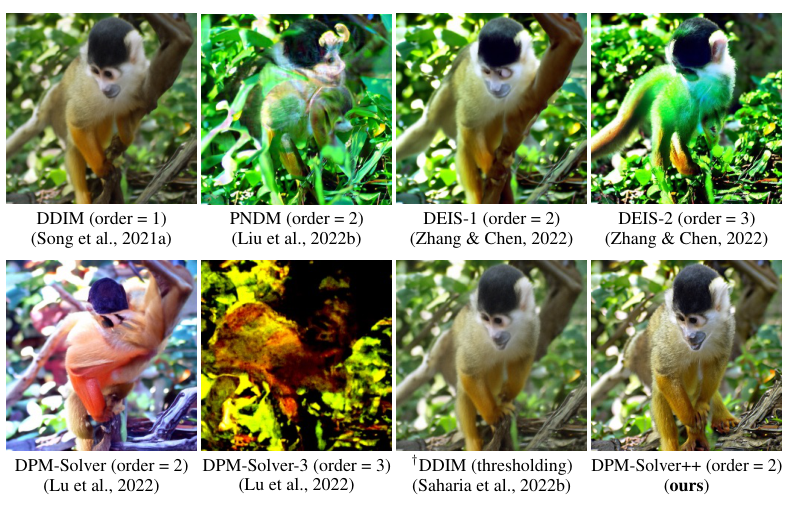
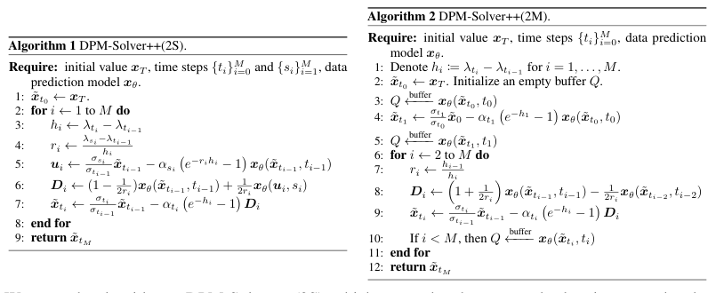
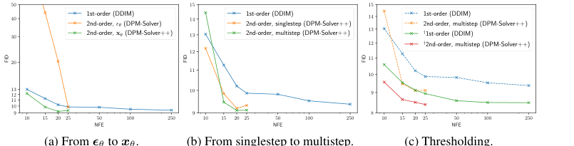
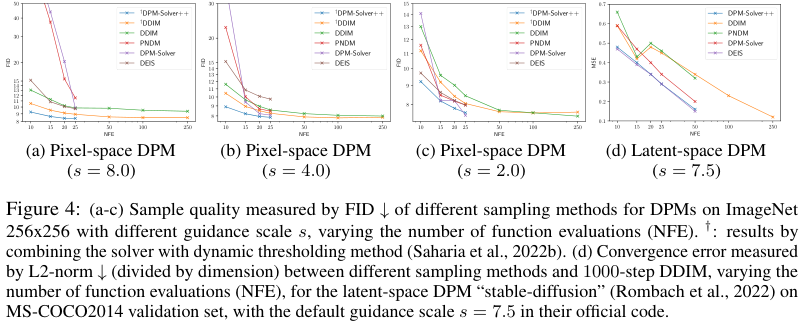
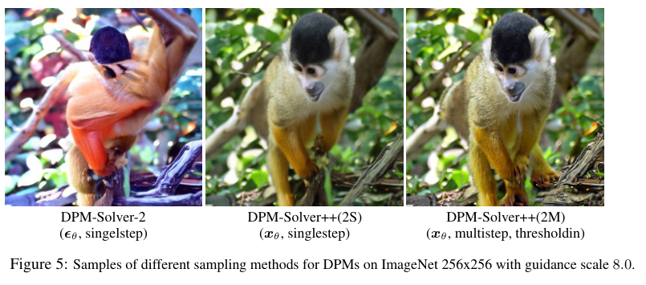
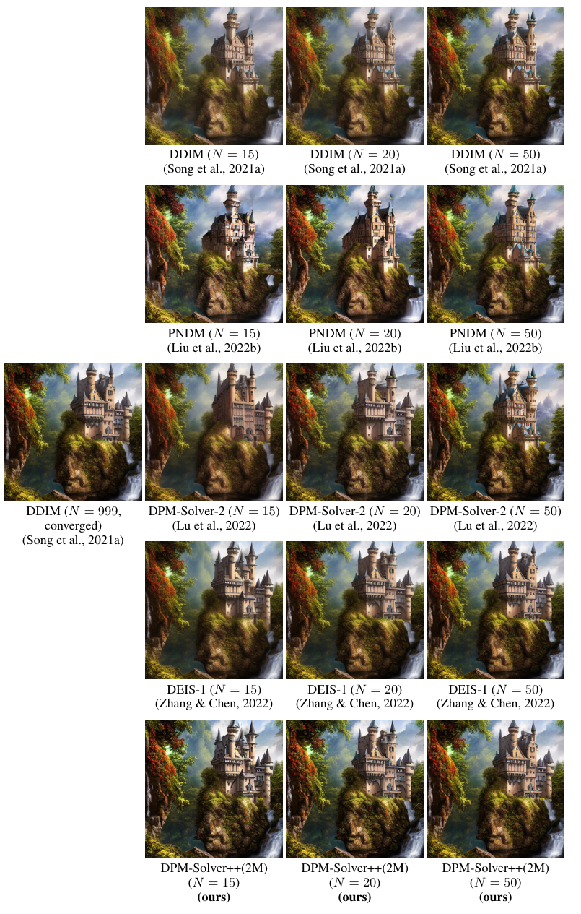
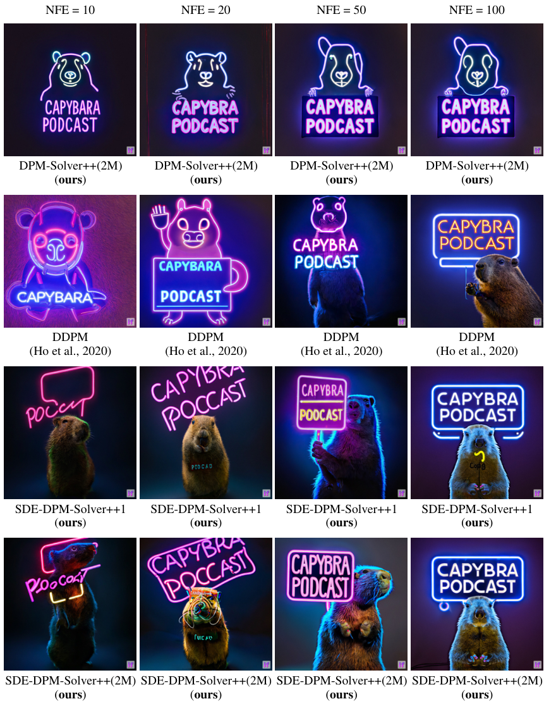
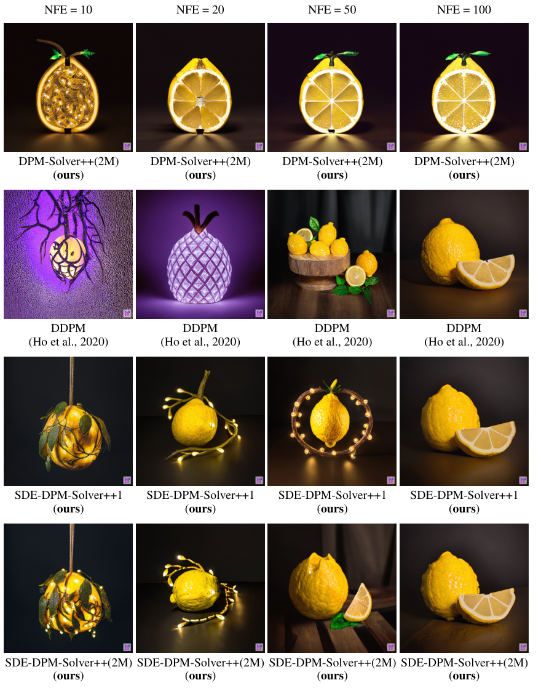

# DPM-Solver++：为 Guidance 场景设计的扩散 ODE 求解器

!!! info "论文信息"
    **论文题名：** DPM-Solver++: Fast Solver for Guided Sampling of Diffusion Probabilistic Models。 
    **作者：** Cheng Lu、Yuhao Zhou、Fan Bao、Jianfei Chen、Chongxuan Li、Jun Zhu。 
    **机构：** 未在公开元数据中稳定解析；以 arXiv/PDF 或官方页 affiliation block 为准。 
    **时间 / 主题：** 2022-11；扩散模型。 
    **arXiv / 官方报告：** arXiv：[2211.01095](https://arxiv.org/abs/2211.01095)。 
    **GitHub / 项目：** GitHub：[github.com/LuChengTHU/dpm-solver](https://github.com/LuChengTHU/dpm-solver)。 
    **元数据来源与核验口径：** 来源：[arXiv](https://arxiv.org/abs/2211.01095)；[GitHub API / repo](https://github.com/LuChengTHU/dpm-solver)；Checked Date：2026-06-04；Repro Status：Paper / official materials reviewed, independent reproduction not claimed。

## 强引导时，求解器的阶数不再足以预测少步质量

DPM-Solver++ 研究无需重新训练模型的采样加速。它面对的反常现象是，原本在无条件生成中很有效的高阶求解器，一旦把 classifier guidance 或 classifier-free guidance 调大，在十几次网络调用下反而可能比一阶 DDIM 更差。论文没有因此放弃高阶方法，而是重新选择网络输出的积分形式，并改变二阶更新所需变化信息的获取方式。[↗](https://arxiv.org/pdf/2211.01095v3#page=2)

Figure 1 固定 ImageNet $256\times256$、classifier guidance scale 8.0 和 15 次函数评估。先比较 DDIM 与 DPM-Solver-2、DPM-Solver-3，可以看到后两者明显的颜色和结构失真；再看带 dynamic thresholding 的 DDIM 与 DPM-Solver++，能发现高阶方法并非必然失败，关键在于这一预算下如何离散被强引导放大的向量场。

{ width="670" }

<small>图源：[原论文 v3，第 2 页，Figure 1](https://arxiv.org/pdf/2211.01095v3#page=2)。图中各方法使用同样的 15 NFE；阶数更高并不保证这个有限预算下的样例更好。</small>

作者把问题分成两层。第一层是数值误差：引导放大网络输出和导数后，原高阶公式可能需要更小步长才进入稳定、准确的区域。第二层是生成方程本身的问题：即使已经精确积分，强引导也可能让像素预测越出训练图像的取值范围，出现过饱和。因此“让算法更快接近原方程的解”和“让最终解更符合图像范围”不是同一个目标。

DPM-Solver++ 对前者使用数据预测参数化的指数积分器，并提供 2S 单步法与 2M 多步法；对后者接入已有的 thresholding 方法。后续版本还把相近的思路扩展到随机 SDE。它们共享部分代数结构，但改变的位置和证据各不相同。

## 引导如何进入采样方程，为什么会放大数值困难

正向扰动采用

$$
x_t=\alpha_t x_0+\sigma_t\epsilon,
\qquad \epsilon\sim\mathcal N(0,I).
$$

$\alpha_t$ 是信号幅度，$\sigma_t$ 是噪声标准差；两者平方之比才是通常意义上的 SNR。采样从高噪声的大时间向小时间进行。一个预训练噪声网络 $\epsilon_\theta(x_t,t)$ 给定当前状态与时间，预测噪声，再由求解器决定下一状态。

为避免与积分起点的时间符号 $s$ 混淆，这里把 guidance scale 记为 $w$。Classifier guidance 用额外分类器的梯度修改噪声预测

$$
\widetilde\epsilon_\theta(x_t,t,c)
=\epsilon_\theta(x_t,t)
-w\sigma_t\nabla_{x_t}\log p_\phi(c\mid x_t,t).
$$

Classifier-free guidance 使用同一网络的条件与无条件输出

$$
\widetilde\epsilon_\theta(x_t,t,c)
=w\epsilon_\theta(x_t,t,c)
+(1-w)\epsilon_\theta(x_t,t,\varnothing).
$$

当 $w>1$ 时，后一式是在条件、无条件预测之间做外推，并非普通凸平均。网络输出的差异及其对状态的变化都可能被放大。求解器随后使用的是这个引导后的函数，而不是单独的原始无条件网络。[↗](https://arxiv.org/pdf/2211.01095v3#page=4)

高阶方法用函数值近似沿轨迹的高阶变化。若变化很快，形式上的高阶误差项虽然仍随步长缩小而消失，其前面的系数却可能很大，十几次调用所对应的步长便未必足够小。论文将此作为强引导不稳定的解释，并用实验检验；它不是一个声称所有引导网络都会在同一阈值失稳的定理。

另一个后果是，从引导噪声反推出的干净图像可能超过归一化训练范围，例如 $[-1,1]$。这时增加采样步数只能更准确地追随被引导后的场，不能自动把这个场的收敛输出拉回有效像素范围。后面的 thresholding 正是针对这一层问题。

## 同一个模型可以预测噪声，也可以直接给出干净数据估计

定义数据预测函数

$$
x_\theta(x_t,t)
=\frac{x_t-\sigma_t\epsilon_\theta(x_t,t)}{\alpha_t}.
$$

这里的 $x_\theta$ 是给定当前带噪状态后，对干净数据的估计，不是积分轨迹在时刻 $t$ 的状态 $x_t$。有引导时，先把噪声预测换成 $\widetilde\epsilon_\theta$，再做同样的转换即可。DPM-Solver++ 不要求把已有网络重新训练成一个数据预测网络，转换只使用当前状态与已知噪声日程。

噪声形式的 diffusion ODE 为

$$
\frac{dx_t}{dt}=f(t)x_t+
\frac{g^2(t)}{2\sigma_t}\epsilon_\theta(x_t,t),
$$

其中 $f(t)=d\log\alpha_t/dt$，$g^2(t)=d\sigma_t^2/dt-2f(t)\sigma_t^2$。把噪声预测代换为数据预测，得到等价的

$$
\frac{dx_t}{dt}
=\left(f(t)+\frac{g^2(t)}{2\sigma_t^2}\right)x_t
-\frac{\alpha_tg^2(t)}{2\sigma_t^2}x_\theta(x_t,t).
$$

在没有额外裁剪、且转换精确的情况下，两式表示同一个连续向量场。**改变参数化本身不会改变精确 ODE 的解**。变化发生在数值方法怎样拆分、精确积分和近似这些项，thresholding 则会进一步改变预测函数本身。[↗](https://arxiv.org/pdf/2211.01095v3#page=4)

这个区别能消除一个常见误解。如果两个网络输出可以代数转换，并不意味着基于它们分别设计的高阶离散算法也逐步相同；只有某些特定阶数和公式恰好一致，本文的一阶情形就是 DDIM。

## 指数积分器把已知线性部分算准，只近似网络输出的积分

论文使用

$$
\lambda_t=\log\frac{\alpha_t}{\sigma_t}
$$

作为新的时间坐标。它是半对数信噪比，即 $\frac12\log(\alpha_t^2/\sigma_t^2)$；原文简称 log-SNR。原时间 $t$ 随采样下降，$\lambda$ 随采样上升。因此从较大时间 $s$ 走到较小时间 $t$ 时，$h=\lambda_t-\lambda_s>0$。

DPM-Solver 的噪声预测精确解形式为

$$
x_t=\frac{\alpha_t}{\alpha_s}x_s
-\alpha_t\int_{\lambda_s}^{\lambda_t}
 e^{-\lambda}\widehat\epsilon_\theta(\widehat x_\lambda,\lambda)\,d\lambda.
$$

DPM-Solver++ 使用 Proposition 4.1 给出的数据预测形式

$$
x_t=\frac{\sigma_t}{\sigma_s}x_s
+\sigma_t\int_{\lambda_s}^{\lambda_t}
 e^{\lambda}\widehat x_\theta(\widehat x_\lambda,\lambda)\,d\lambda.
$$

帽号只表示把时间坐标换成 $\lambda$。两式的精确解相同，但前者精确处理 $\alpha_t/\alpha_s$ 的线性传播、近似 $e^{-\lambda}\widehat\epsilon_\theta$ 的积分；后者精确处理 $\sigma_t/\sigma_s$ 的线性传播、近似 $e^\lambda\widehat x_\theta$ 的积分。它们分配给数值近似的函数不同，截断误差也就不同。[↗](https://arxiv.org/pdf/2211.01095v3#page=6)

若在一个区间内把数据预测冻结为 $m_s=x_\theta(x_s,s)$，指数部分可以直接积分

$$
\begin{aligned}
x_t
&\approx \frac{\sigma_t}{\sigma_s}x_s
+\sigma_t(e^{\lambda_t}-e^{\lambda_s})m_s\\
&=\frac{\sigma_t}{\sigma_s}x_s
+\alpha_t(1-e^{-h})m_s.
\end{aligned}
$$

把 $x_s=\alpha_s m_s+\sigma_s\epsilon_\theta(x_s,s)$ 代回，等价于

$$
x_t\approx\alpha_t m_s+\sigma_t\epsilon_\theta(x_s,s),
$$

即确定性 DDIM 更新。DPM-Solver、DEIS 与 DPM-Solver++ 的一阶情形可以相同，但它们对后续变化项使用的近似不同，所以高阶版本不再等价。[↗](https://arxiv.org/pdf/2211.01095v3#page=9)

二阶方法要进一步估计沿轨迹的变化。令 $m(\lambda)=\widehat x_\theta(\widehat x_\lambda,\lambda)$，则

$$
m(\lambda)\approx m(\lambda_s)
+(\lambda-\lambda_s)m'(\lambda_s).
$$

这里 $m'$ 是包含状态变化的全导数。代入积分后，常数项系数为 $\alpha_t(1-e^{-h})$，导数项系数为 $\alpha_t(h-1+e^{-h})$。指数与多项式的乘积仍可解析积分；真正需要估计的是 $m'$。算法用不同位置的网络预测作差，不需要显式计算整张网络的 Jacobian 或高阶自动微分。

## 2S 在一个大步内增加中间点，2M 复用上一步预测

记主时间点为 $t_0>t_1>\cdots>t_M$，$h_i=\lambda_{t_i}-\lambda_{t_{i-1}}$，数值状态为 $\tilde x_{t_i}$。为简化公式，用 $m_{i-1}=x_\theta(\tilde x_{t_{i-1}},t_{i-1})$ 表示当前数据预测。

二阶单步法 **DPM-Solver++(2S)** 在 $t_{i-1}$ 与 $t_i$ 之间插入 $s_i$，定义

$$
r_i=\frac{\lambda_{s_i}-\lambda_{t_{i-1}}}{h_i}.
$$

先使用一阶更新到中间状态

$$
u_i=\frac{\sigma_{s_i}}{\sigma_{t_{i-1}}}\tilde x_{t_{i-1}}
+\alpha_{s_i}(1-e^{-r_ih_i})m_{i-1},
$$

再调用网络得到 $m_{s_i}=x_\theta(u_i,s_i)$。两个预测的差值除以 $r_ih_i$，提供一阶导数估计。为得到 Algorithm 1 的简洁形式，导数项系数还作了保持二阶精度的替换：$h_i-1+e^{-h_i}=\tfrac{h_i}{2}(1-e^{-h_i})+O(h_i^3)$。两边都以 $h_i^2/2$ 起始，差别进入被略去的三阶局部项；它们不是有限步长下的精确恒等式。把这一近似与差分估计代入后，可将更新组合成

$$
D_i=\left(1-\frac1{2r_i}\right)m_{i-1}
+\frac1{2r_i}m_{s_i},
$$

最后更新

$$
\tilde x_{t_i}
=\frac{\sigma_{t_i}}{\sigma_{t_{i-1}}}\tilde x_{t_{i-1}}
+\alpha_{t_i}(1-e^{-h_i})D_i.
$$

若中点选在 $\lambda$ 的中间，$r_i=1/2$，$D_i$ 就等于中间点预测；但实验统一使用原时间 $t$ 的均匀网格，中间点也作相应转换，因此不能在所有配置中把 $r_i$ 固定写成 $1/2$。[↗](https://arxiv.org/pdf/2211.01095v3#page=6)

二阶多步法 **DPM-Solver++(2M)** 则不用本步中间点。它保留前两次数据预测，并定义历史步长比

$$
r_i=\frac{h_{i-1}}{h_i},
$$

由历史差分外推

$$
D_i=\left(1+\frac1{2r_i}\right)m_{i-1}
-\frac1{2r_i}m_{i-2}.
$$

最终状态更新与 2S 形式相同。若相邻 $\lambda$ 步长相等，$D_i=1.5m_{i-1}-0.5m_{i-2}$，可理解为沿最近的预测变化趋势外推半步；非均匀步长必须保留 $r_i$。

原算法图最值得比较的是 $D_i$ 的来源。左边用本步新算的 $u_i$，右边用缓存里的 $m_{i-2}$。2M 首步没有历史，先用一阶 DDIM 形式启动，随后每走一步只需新增一次预测；到最终状态后不必为了输出再无条件多调用一次网络。

{ width="670" }

<small>图源：[原论文 v3，第 6 页，Algorithms 1–2](https://arxiv.org/pdf/2211.01095v3#page=6)。multistep 指使用历史状态和预测，不是泛指生成过程包含多个去噪步骤。</small>

## 相同 NFE 下，历史复用为什么有利于强引导

**NFE（Number of Function Evaluations）** 统计求解器调用预测函数的次数。2S 的一个二阶大步通常需要两次网络评估；2M 启动后每步只新增一次。在理想化的 20 NFE 预算下，可以把两者分别理解为约 10 个二阶大区间与 20 个历史复用区间。后者的有效区间更短，可能更容易处于强引导场的稳定范围。[↗](https://arxiv.org/pdf/2211.01095v3#page=7)

这不是“历史越多越好”的证明。2M 依赖历史预测能够代表当前变化，2S 使用当前区间的中间状态，局部信息更新鲜；引导较弱时，2S 在本文部分实验里更好。历史缓存也属于同一模型和引导场的数值状态。若只改变下一步网格，需要按实际间隔重算步长比；若中途更换模型或 guidance 规则，旧预测就不再是同一个函数的历史样本。

NFE 也不是墙钟时间。CFG 一次有效的引导预测需要条件和无条件输出，具体实现可能合并成 batch；classifier guidance 还要计算分类器梯度。相同引导实现下 NFE 是有用的计算预算，但不同模型、batch、设备和引导方式之间，15 NFE 并不代表相同秒数。论文主要用 NFE 比较，而不是给出一个跨硬件通用的耗时表。

附录的收敛结论同样有条件。对 Algorithms 1–2，作者假设数据预测沿轨迹的前两阶导数连续且有界，预测函数对状态满足 Lipschitz 条件，最大 $\lambda$ 步长随步数缩小，并且步长比不接近零；在足够小步长下，全局误差为 $O(h_{\max}^2)$。这个二阶结论不保证任意强引导、任意十步网格都已进入渐近区域，也不等同于对随机 SDE 算法证明了强二阶收敛。[↗](https://arxiv.org/pdf/2211.01095v3#page=16)

## 数据预测形式具体改变了哪一项

附录 B 将 DPM-Solver++(2S) 再写回噪声预测形式，使它能与 DPM-Solver-2 直接比较。二者使用相同的一阶中间状态 $u_i$，主要区别集中在由两次噪声预测之差形成的修正项。

记

$$
\Delta\epsilon_i=
\epsilon_\theta(u_i,s_i)
-\epsilon_\theta(\tilde x_{t_{i-1}},t_{i-1}).
$$

DPM-Solver-2 的修正为

$$
-\frac{\sigma_{t_i}(e^{h_i}-1)}{2r_i}\Delta\epsilon_i,
$$

而 DPM-Solver++(2S) 的对应项为

$$
-\frac{\sigma_{t_i}(e^{h_i}-1)}{2r_i}
\underbrace{e^{-r_ih_i}}_{<1}\Delta\epsilon_i.
$$

因此 ++ 的这个高阶修正被一个小于 1 的因子缩小。强引导让两次预测差异较大时，这给出了一个具体的抑制机制；当步长很小时，$e^{-r_ih_i}=1-r_ih_i+O(h_i^2)$，两种算法仍保持相同的二阶精度，却具有不同的高阶误差项。[↗](https://arxiv.org/pdf/2211.01095v3#page=18)

差值与导数的关系应读成 $\Delta\epsilon_i/(r_ih_i)$ 近似沿轨迹导数。附录该处把差值直接写成导数时省略了步长因子，不能据此在实现中漏掉 $r_ih_i$。更小的修正系数也不自动证明每个模型、每个预算下的总误差都更小；总误差还依赖轨迹和其他高阶项，所以最终仍需下面的固定预算实验检验。

## Thresholding 改变的是预测函数，不能当作纯积分精度提升

对于归一化像素数据，$x_\theta$ 应当预测有界的干净图像。Thresholding 对越界的数据预测作裁剪或动态范围调整，再让求解器使用调整后的结果。数据预测参数化使这一操作直接作用在有意义的对象上；无需先对噪声预测值施加一个没有对应像素解释的固定阈值。[↗](https://arxiv.org/pdf/2211.01095v3#page=7)

论文沿用已有的 dynamic thresholding，并未把它作为新提出的裁剪算法。更关键的是，该操作每步改变 $x_\theta$，从而改变实际积分的向量场与收敛解。即便 DDIM 已经用很多步，带与不带 thresholding 的 FID 仍可能不同；这不能全部解释为新求解器减少了离散误差。[↗](https://arxiv.org/pdf/2211.01095v3#page=11)

适用边界来自数据表示。Stable Diffusion 的 latent 不具有与归一化像素相同的 $[-1,1]$ 边界，论文明确不对其使用 thresholding。把像素空间的设置直接复制进潜空间，会额外改变模型本来需要表达的 latent 分布。

严格的光滑性理论与裁剪之间也有区别。裁剪边界可能不可微，不能不检查条件就把附录对光滑预测函数的结论完整套到所有 thresholding 轨迹。本文更直接的证据是，在所测像素任务与引导强度下，裁剪和求解器组合改善了结果，而较弱引导时收益并非必然。

## 离散 checkpoint 怎样接入连续时间求解器

已有模型通常只在离散噪声等级上训练。求解器需要在中间时间读取 $\alpha_t,\sigma_t$ 和 $\lambda_t$，所以论文对离散节点的 $\log\alpha$ 作分段线性插值，再由 $\sigma_t=\sqrt{1-\alpha_t^2}$ 得到 VP 日程。[↗](https://arxiv.org/pdf/2211.01095v3#page=19)

实现时最容易出错的是把幅度与累计方差系数混用。若 DDPM 的离散方差参数为 $\beta_j$，通常先有累计系数 $\bar\alpha_n=\prod_{j=1}^n(1-\beta_j)$，对应本文 $x_t=\alpha_tx_0+\sigma_t\epsilon$ 的幅度应为

$$
\alpha_{t_n}=\sqrt{\bar\alpha_n},
\qquad \sigma_{t_n}=\sqrt{1-\bar\alpha_n}.
$$

原附录 Equation 47 将 $\alpha_n$ 写成乘积，且乘积内的下标未随求积变化，与正文幅度记号并不一致。接入 scheduler 时应按正向扰动的定义确认是幅度还是累计系数，不能照搬这处记号直接再计算 $\sqrt{1-\alpha_n^2}$。

实验使用 $T=1$、1000 个训练噪声等级，积分从 $t=1$ 到 $t=10^{-3}$。因此虽然理论叙述用 $t_M=0$ 表示数据端，实际实验没有直接在零噪声奇点计算无限的 $\lambda$。模型本身的离散时间标签也需与连续时间输入映射一致。

作者同时调整了采样时间点。除了均匀 $\lambda$，附录考察了

$$
t_i=\left[\frac{M-i}{M}t_0^{1/\kappa}
+\frac iM t_M^{1/\kappa}\right]^\kappa,
\qquad \kappa\in\{1,2,3\},
$$

其中 $\kappa=1$ 即均匀原时间 $t$。下表取原 Table 2 的四个 guidance 列，NFE 固定为 10，指标为 ImageNet FID。[↗](https://arxiv.org/pdf/2211.01095v3#page=20)

| Method | Guidance 8 | Guidance 4 | Guidance 2 | Guidance 0 |
| --- | ---: | ---: | ---: | ---: |
| DDIM | 13.04 | 11.62 | 13.01 | 29.33 |
| DEIS-2, $\kappa=1$ | 19.12 | 10.13 | 9.74 | 20.34 |
| DEIS-2, $\kappa=2$ | 33.37 | 11.16 | 10.88 | 26.26 |
| DEIS-2, $\kappa=3$ | 55.69 | 18.66 | 16.87 | 38.41 |
| DEIS-3, $\kappa=1$ | 66.81 | 15.84 | 10.18 | 18.70 |
| DEIS-3, $\kappa=2$ | 34.51 | 11.20 | 10.75 | 25.59 |
| DEIS-3, $\kappa=3$ | 56.49 | 18.72 | 16.79 | 38.02 |

这说明网格选择确实影响结果，尤其强引导时差距很大。论文最终统一使用均匀 $t$，也调整单步法中间点以匹配这一选择。但不能说每个固定阶数都在 $\kappa=1$ 下最好，例如 guidance 8 的 DEIS-3 在 $\kappa=2$ 时比 $\kappa=1$ 好；作者选的是整组比较中的统一设置，而不是证明了一个对所有模型成立的最优网格定律。

## ImageNet 主实验先固定强引导，拆开三个贡献

像素空间实验使用预训练 ImageNet $256\times256$ 模型、classifier guidance，并生成 10K 样本计算 FID。Figure 3 的三个面板分别比较预测参数化、2S 与 2M、是否加入 thresholding。应在相同 NFE 下比较每个面板的曲线，而不是把所有变化一并归到“++”这个名字。[↗](https://arxiv.org/pdf/2211.01095v3#page=10)

{ width="670" }

<small>图源：[原论文 v3，第 10 页，Figure 3](https://arxiv.org/pdf/2211.01095v3#page=10)。全部为 guidance 8；右侧带 dagger 的曲线加入 dynamic thresholding。</small>

guidance 8 的完整 10–25 NFE 结果如下。Table 3 中简写的 DPM-Solver++(S)/(M) 对应这里的二阶 2S/2M。[↗](https://arxiv.org/pdf/2211.01095v3#page=21)

| Sampling Method | Thresholding | NFE 10 | NFE 15 | NFE 20 | NFE 25 |
| --- | --- | ---: | ---: | ---: | ---: |
| DDIM | No | 13.04 | 11.27 | 10.21 | 9.87 |
| PNDM | No | 99.80 | 37.59 | 15.50 | 11.54 |
| DPM-Solver-2 | No | 114.62 | 44.05 | 20.33 | 9.84 |
| DPM-Solver-3 | No | 164.74 | 91.59 | 64.11 | 29.40 |
| DEIS-1 | No | 15.20 | 10.86 | 10.26 | 10.01 |
| DEIS-2 | No | 19.12 | 11.37 | 10.08 | 9.75 |
| DEIS-3 | No | 66.86 | 24.48 | 12.98 | 10.87 |
| DPM-Solver++(2S) | No | 12.20 | 9.85 | 9.19 | 9.32 |
| DPM-Solver++(2M) | No | 14.44 | 9.46 | 9.10 | 9.11 |
| DDIM | Yes | 10.58 | 9.53 | 9.12 | 8.94 |
| DPM-Solver++(2S) | Yes | 9.26 | 8.93 | 8.40 | 8.63 |
| DPM-Solver++(2M) | Yes | 9.56 | 8.64 | 8.50 | 8.39 |

参数化贡献最明显的对照是 15 NFE、不带 thresholding 的 DPM-Solver-2 与 ++2S，FID 从 44.05 到 9.85；二者都为二阶单步法，这比将 ++2M 与所有基线混比更直接。再比较 2S 与 2M，15 NFE 的 9.85 与 9.46 支持历史复用在这一设置中进一步获益。

不过极低预算下也有反例。10 NFE、不带 thresholding 的 2M 为 14.44，差于 DDIM 的 13.04 和 2S 的 12.20。带 thresholding 的 20 NFE 时，2S 的 8.40 又优于 2M 的 8.50。所以“多步法在强引导下通常有效”不能替换为“每个预算都优于单步法”。

Thresholding 的效果可在同一算法内观察。20 NFE 时，2M 从 9.10 到 8.50，DDIM 从 10.21 到 9.12。作为较大预算参照，带 thresholding 的 DDIM 在 50、100、250 NFE 分别为 8.58、8.49、8.48，++2M 在 20 NFE 已达到 8.50。这是约五倍函数调用预算差下达到接近 FID 的例子，不是测得的五倍墙钟加速。

FID 也并不随 NFE 严格单调。例如无 thresholding 的 2S 从 20 NFE 的 9.19 到 25 NFE 的 9.32 略升。FID 衡量生成分布与数据分布的差异，不等于某个样本到精确 ODE 解的数值距离；提高数值精度不保证这一有限样本统计量单调改善。

## 引导变小时，2S、2M 和 thresholding 的取舍会变化

Figure 4 的前三个面板分别给 guidance 8、4、2 的像素 FID，第四个面板换成 Stable Diffusion 的 latent 误差。它把任务变化放在一张图里，但不同面板的纵轴含义不能混用。

{ width="670" }

<small>图源：[原论文 v3，第 10 页，Figure 4](https://arxiv.org/pdf/2211.01095v3#page=10)。总比较曲线对基线选取其测试阶数中的较好结果，DPM-Solver++ 也在 2S 与 2M 中选较好结果，不能把整条曲线视为固定 2M 配置。</small>

下面保留 guidance 4 与 2 中能够直接检验方法取舍的行，数值仍为 10K 样本 FID。

| Guidance | Sampling Method | Thresholding | NFE 10 | NFE 15 | NFE 20 | NFE 25 |
| --- | --- | --- | ---: | ---: | ---: | ---: |
| 4.0 | DDIM | No | 11.62 | 9.67 | 8.96 | 8.58 |
| 4.0 | DPM-Solver-2 | No | 37.68 | 9.42 | 8.22 | 8.08 |
| 4.0 | DPM-Solver++(2S) | No | 9.08 | 8.51 | 8.00 | 8.07 |
| 4.0 | DPM-Solver++(2M) | No | 8.98 | 8.26 | 8.06 | 8.06 |
| 4.0 | DDIM | Yes | 10.45 | 8.95 | 8.51 | 8.25 |
| 4.0 | DPM-Solver++(2S) | Yes | 8.94 | 8.26 | 7.95 | 7.87 |
| 4.0 | DPM-Solver++(2M) | Yes | 8.91 | 8.21 | 7.99 | 7.96 |
| 2.0 | DDIM | No | 13.01 | 9.60 | 9.02 | 8.45 |
| 2.0 | DPM-Solver-2 | No | 14.12 | 8.20 | 8.59 | 7.48 |
| 2.0 | DPM-Solver++(2S) | No | 9.18 | 8.17 | 7.77 | 7.56 |
| 2.0 | DPM-Solver++(2M) | No | 9.19 | 8.47 | 8.17 | 8.07 |
| 2.0 | DDIM | Yes | 11.19 | 9.20 | 8.42 | 8.05 |
| 2.0 | DPM-Solver++(2S) | Yes | 9.23 | 8.18 | 7.81 | 7.60 |
| 2.0 | DPM-Solver++(2M) | Yes | 9.28 | 8.56 | 8.28 | 8.18 |

引导减弱后，原 DPM-Solver 的困难明显缓解。guidance 2、25 NFE 时，DPM-Solver-2 为 7.48，甚至略好于无 thresholding 的 ++2S 7.56；不能把 guidance 8 下的巨大差距推广到所有引导强度。

同样在 guidance 2，2S 在 15–25 NFE 都优于 2M，且 thresholding 使 25 NFE 的 2S 从 7.56 变为 7.60、2M 从 8.07 变为 8.18。这与其用途一致：若像素越界问题没有强到主导结果，裁剪本身也可能改变原本可用的预测。方法选型应当把 guidance、表示空间和 NFE 一起固定。[↗](https://arxiv.org/pdf/2211.01095v3#page=21)

Figure 5 把数据预测与最终像素表现连起来。左侧 DPM-Solver-2 的猴子颜色明显失真，中间 2S 恢复较自然的结构，右侧 2M 加 thresholding 又改善了可见效果。但右侧同时改变历史复用和阈值操作，因此这张三列样例不是隔离 2S/2M 差异的纯消融，应与前面的表格配合理解。

{ width="670" }

<small>图源：[原论文 v3，第 22 页，Figure 5](https://arxiv.org/pdf/2211.01095v3#page=22)。guidance 8；右侧标签明确包含 multistep 与 thresholding 两项变化。</small>

## 潜空间里，图像看起来不错不等于数值轨迹已经接近参考解

Stable Diffusion 实验使用 COCO2014 validation 中随机抽取的 10K caption-image pairs，每个 caption 生成一张图像，默认 CFG scale 为 7.5，不使用 thresholding。作者发现，多种求解器仅用 10 步就能得到约 15–16 的 FID，彼此很接近。他们认为强大的预训练 VAE decoder 可能把尚未充分收敛的 latent 也变成看起来合理的图像；这是对观察的解释，论文没有另做 decoder 消融来单独证明这一归因。[↗](https://arxiv.org/pdf/2211.01095v3#page=11)

为更直接比较积分误差，作者固定 10K 份初始高斯噪声，要求各求解器从相同初值生成 latent，再与高步数 DDIM 参考输出 $x_0^*$ 比较。正文定义的误差为

$$
E=\frac{\|x_0-x_0^*\|_2}{\sqrt D},
$$

其中 $D$ 为 latent 维度。这是按维度归一化的 L2 误差，也就是坐标误差的均方根；原表与图轴写成 MSE，但按该定义没有再平方，不能把表中 0.34 解释为平方误差。$x_0^*$ 也只是高步数数值参考，不是精确解析 ODE 解，更不是这张 caption 对应的真实图像 latent。

参考步数在正文与 Figure 6 写为 999-step DDIM，Figure 4 图注写为 1000-step；此处沿用正文的 999 步协议。两种标注都指高步数数值参考，不能视为精确真值。[↗](https://arxiv.org/pdf/2211.01095v3#page=10) [↗](https://arxiv.org/pdf/2211.01095v3#page=23)

Table 4 在 guidance 7.5 下的完整主要预算结果如下，所有方法均不使用 thresholding。

| Sampling Method | NFE 10 | NFE 15 | NFE 20 | NFE 25 | NFE 50 |
| --- | ---: | ---: | ---: | ---: | ---: |
| DDIM | 0.59 | 0.42 | 0.48 | 0.45 | 0.34 |
| PNDM | 0.66 | 0.43 | 0.50 | 0.46 | 0.32 |
| DPM-Solver-2 | 0.66 | 0.47 | 0.40 | 0.34 | 0.20 |
| DPM-Solver-3 | 0.59 | 0.48 | 0.43 | 0.37 | 0.23 |
| DEIS-1 | 0.47 | 0.39 | 0.34 | 0.29 | 0.16 |
| DEIS-2 | 0.48 | 0.40 | 0.34 | 0.29 | 0.15 |
| DEIS-3 | 0.57 | 0.45 | 0.38 | 0.34 | 0.19 |
| DPM-Solver++(2S) | 0.48 | 0.41 | 0.36 | 0.32 | 0.19 |
| DPM-Solver++(2M) | 0.49 | 0.40 | 0.34 | 0.29 | 0.16 |

2M 在 20 NFE 为 0.34，接近 PNDM 50 NFE 的 0.32；25 NFE 时降到 0.29。相对于原 Stable Diffusion 常用的 50 步 PNDM，这给出了减少调用次数的直接证据。但 DEIS-1 在这些预算的误差与 2M 非常接近，20、25、50 NFE 甚至相同；DEIS-2 的 50 NFE 还略低。因此潜空间结果支持 DPM-Solver++ 与 DEIS 都较有效，不能写成 ++ 全面胜过所有既有方法。[↗](https://arxiv.org/pdf/2211.01095v3#page=21)

更强的 guidance 15 对这种判断提供补充。

| Sampling Method | NFE 10 | NFE 15 | NFE 20 | NFE 25 |
| --- | ---: | ---: | ---: | ---: |
| DDIM | 0.83 | 0.78 | 0.71 | 0.67 |
| PNDM | 0.99 | 0.87 | 0.79 | 0.75 |
| DPM-Solver-2 | 1.13 | 1.08 | 0.96 | 0.86 |
| DEIS-1 | 0.84 | 0.72 | 0.64 | 0.58 |
| DEIS-2 | 0.87 | 0.76 | 0.68 | 0.63 |
| DEIS-3 | 1.06 | 0.88 | 0.78 | 0.73 |
| DPM-Solver++(2S) | 0.88 | 0.75 | 0.68 | 0.61 |
| DPM-Solver++(2M) | 0.84 | 0.72 | 0.64 | 0.58 |

2M 在 15、20、25 NFE 与 DEIS-1 分别同为 0.72、0.64、0.58；10 NFE 的 DDIM 0.83 还略低于二者 0.84。它再次说明预算极低时不能只按理论阶数排序，也说明数值误差的改进应明确其参照对象。

## 同一座城堡的样例，展示“合理图像”与“接近同一轨迹”的差别

Figure 6 使用城堡、瀑布与树林提示。左侧单独给出 999-step DDIM 参考，其余列为 15、20、50 NFE，各行对应不同方法。先固定一列看同预算下城堡塔楼、岩壁和瀑布位置，再沿一行看增加 NFE 后是否更接近参考布局，才能把这张图与 latent 误差实验联系起来。

{ width="670" }

<small>图源：[原论文 v3，第 23 页，Figure 6](https://arxiv.org/pdf/2211.01095v3#page=23)。CFG scale 7.5；列为 15、20、50 NFE，左侧为 999 步 DDIM 参考。</small>

多张图都能画出合理的城堡，但城堡形状、瀑布走向和局部构图并不相同。本文的数值实验关心，从同一初始噪声出发是否更快接近指定 ODE 的高步数输出；它不要求每一个偏离参考的构图在主观审美上都更差。这种区分对于编辑和其他需要保持同一种子语义结构的应用尤其重要。

## 随机版本精确处理噪声积分，再近似数据预测积分

v3 中的 SDE 扩展考虑反向随机过程。相对于 probability-flow ODE，噪声预测对应的漂移系数加倍，并引入 Wiener 随机增量。对 VP 日程，换到 $\lambda$ 后，作者仍把已知线性部分与随机积分解析处理，把需要网络估计的部分留给数值近似。[↗](https://arxiv.org/pdf/2211.01095v3#page=8)

从当前时间 $s$ 到目标时间 $t<s$，令 $h=\lambda_t-\lambda_s$。将数据预测在区间内冻结为 $m_s=x_\theta(x_s,s)$，得到 **SDE-DPM-Solver++1**

$$
x_t=\frac{\sigma_t}{\sigma_s}e^{-h}x_s
+\alpha_t(1-e^{-2h})m_s
+\sigma_t\sqrt{1-e^{-2h}}\,z,
\qquad z\sim\mathcal N(0,I).
$$

前两项构成条件均值，最后一项来自线性随机积分的高斯分布，不是任意在 ODE 更新后追加一个噪声强度。代入 $x_s=\alpha_s m_s+\sigma_s\epsilon_\theta(x_s,s)$，可进一步写成

$$
x_t=\alpha_t m_s
+\sigma_t e^{-h}\epsilon_\theta(x_s,s)
+\sigma_t\sqrt{1-e^{-2h}}\,z.
$$

旧噪声与新噪声的系数平方和为 $\sigma_t^2$，这也说明它为什么对应一个特定随机强度的 DDIM 更新。论文 Equation 21 用 $\eta$ 直接表示注入噪声的标准差，该等价值为 $\sigma_t\sqrt{1-e^{-2h}}$；它不应与其他实现里常见的无量纲 DDIM $\eta$ 控制参数混用。[↗](https://arxiv.org/pdf/2211.01095v3#page=9)

随机 2M 则继续利用历史数据预测。若上一段 $\lambda$ 步长为 $h_{\mathrm{prev}}$，令 $q=h_{\mathrm{prev}}/h>0$，将当前与历史预测组合为

$$
D=\left(1+\frac1{2q}\right)m_s
-\frac1{2q}m_{\mathrm{prev}},
$$

再在上面的一阶式中用 $D$ 替换数据预测项，得到论文相应的 SDE-DPM-Solver++(2M) 更新。第一步仍需没有历史的初始化。这里用正的历史步长比重写，避免把原文 SDE 段落中“previous time”的符号方向误用到实际缓存顺序。

附录展示了这一修正来自对数据预测作线性近似，并对指数积分系数作相应近似。它继承了“解析处理已知系数、用历史函数值估计变化”的设计，但随机轨迹与确定性 ODE 不同，不能把前面的 ODE 二阶全局误差定理直接解释成它的强二阶 SDE 保证。[↗](https://arxiv.org/pdf/2211.01095v3#page=16)

## DeepFloyd IF 样例说明随机过程会改变结果，证据仍是定性的

Figure 2 的每一列固定 NFE 为 10、20、50、100，各行依次是 ODE 2M、DDPM、SDE ++1、SDE ++2M。比较同一列才能保持调用预算一致。霓虹水豚与招牌在随机方法下产生不同结构，较低 NFE 时也仍有文字拼写和主体形状问题；它没有显示随机 2M 在每个少步配置都已经解决文字生成。

{ width="670" }

<small>图源：[原论文 v3，第 3 页，Figure 2](https://arxiv.org/pdf/2211.01095v3#page=3)。列是 NFE，行是采样算法；随机更新与确定性更新会改变轨迹和图像内容。</small>

Figure 7 的柠檬样例提供另一种观察。ODE 行较多出现发光切面，随机方法出现不同形状的果实、装饰和背景；增加 NFE 后，多数方法的结构更完整。但样例中不同结果的语义、构图也同时变化，不能只凭少数图像得出随机方法在整体质量上普遍占优的统计结论。

{ width="670" }

<small>图源：[原论文 v3，第 24 页，Figure 7](https://arxiv.org/pdf/2211.01095v3#page=24)。同样按列固定 10、20、50、100 NFE 比较；这是定性生成结果。</small>

这部分证明了随机扩展可以接入实际像素生成系统，并展示其可能带来的不同样本表现；它没有提供与 ImageNet、COCO 主实验同等完整的 FID 或人评表。随机与确定性方法也不以同一个终点轨迹为目标，不能沿用前面“与确定性 DDIM 参考越接近越好”的准则来统一排序。

## 实际采用时，需要一起固定的三个接口

DPM-Solver++ 的直接用途是已有预训练扩散模型的推理加速。首先确认模型输出怎样转换为干净数据预测，并确认 scheduler 的 $\alpha$ 是幅度而非累计方差；其次确定时间网格、实际 NFE 预算和历史缓存，选择 2S 或 2M；最后根据数据表示决定是否存在有意义的 thresholding 边界。对固定模型和 guidance，15–20 NFE 可以是本文实验支持的起点，但不是任意模型的无损保证。

与蒸馏相比，这条路线保留了原模型参数，节省额外训练代价；代价是每个样本仍需多次网络调用，而且强引导、时间网格和输出表示会改变最合适的配置。它所揭示的核心机制是，少步采样的稳定性同时由积分参数化、步长和预测复用方式决定。理论阶数提供的是小步长规律，实际可用的速度则来自把这几项与具体引导任务配合起来。
