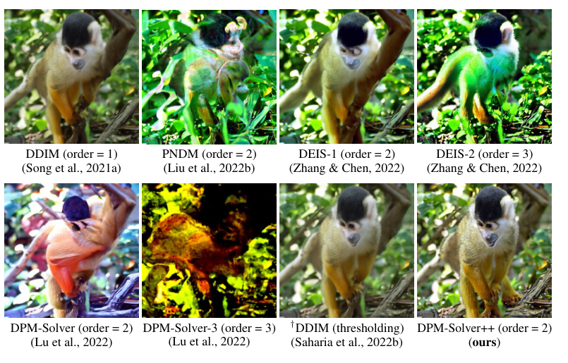
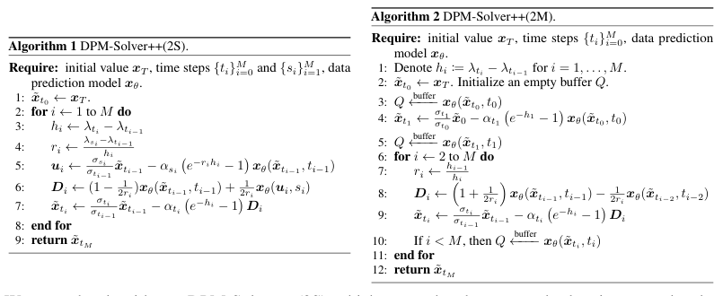
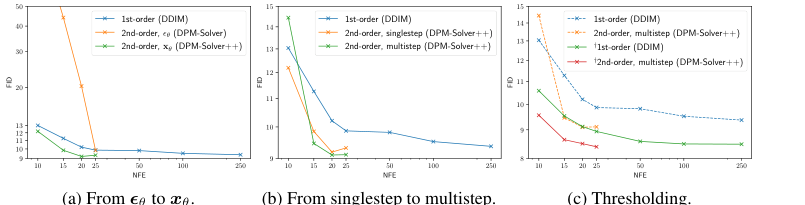
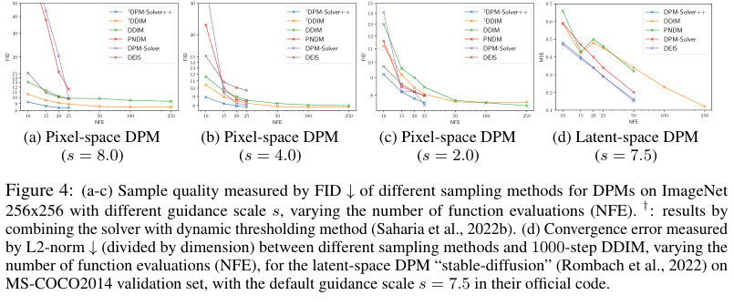
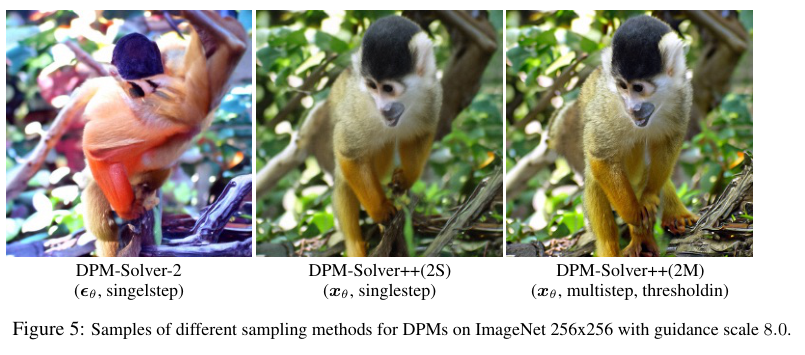
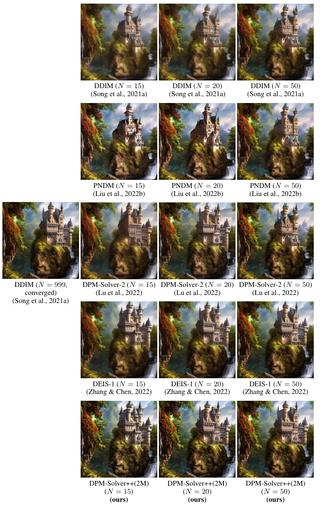
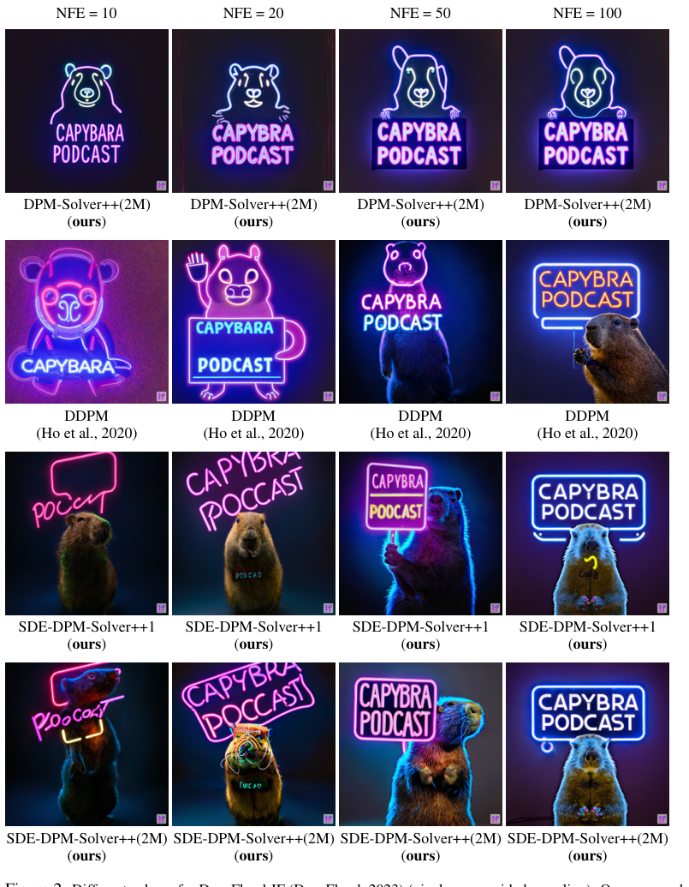
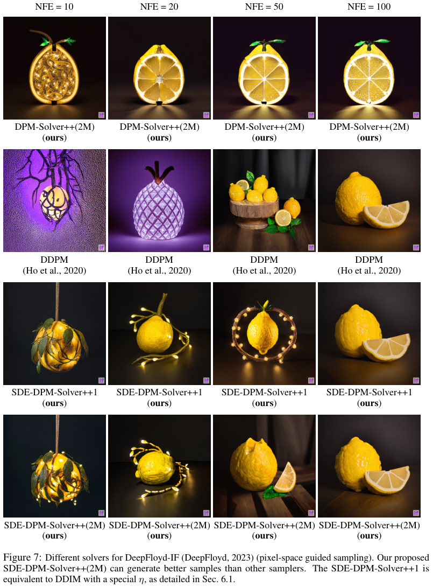

# DPM-Solver++：为 Guidance 场景设计的扩散 ODE 求解器

!!! info "论文信息"
    - 论文：`DPM-Solver++: Fast Solver for Guided Sampling of Diffusion Probabilistic Models`
    - 链接：[arXiv:2211.01095](https://arxiv.org/abs/2211.01095)
    - 代码：[LuChengTHU/dpm-solver](https://github.com/LuChengTHU/dpm-solver)
    - 期刊版本：`Machine Intelligence Research`，2025
    - 关键词：diffusion ODE、guided sampling、classifier-free guidance、data prediction、dynamic thresholding、multistep solver、training-free sampler


DPM-Solver++ 解决的是扩散模型推理里很实用的问题：**已经有一个训练好的扩散模型，不想再蒸馏或重训，只想在 classifier guidance / classifier-free guidance 下把采样步数从上百步压到 15 到 20 步，还不要因为 guidance scale 大而炸图。**

它不是 DPM-Solver 的简单改名，而是针对 guided sampling 改了三件事：

1. 从 `noise prediction` 视角转到 `data prediction` 视角求解扩散 ODE；
2. 用 thresholding 把预测的 \(x_0\) 拉回训练数据范围，缓解大 guidance scale 导致的 train-test mismatch；
3. 用 multistep 形式复用历史函数值，在相同 NFE 下缩小有效步长，提升少步稳定性。

## 它的效率贡献是什么

| Dimension | DPM-Solver++ |
| --- | --- |
| Saved cost | Sampling NFE / latency; no extra training or distillation |
| Main target | Guided sampling under classifier guidance or classifier-free guidance |
| Main idea | Solve diffusion ODE with data prediction model \(x_\theta\), then use thresholding and multistep updates |
| Typical result | High-quality guided samples in about `15-20` NFE |
| Training cost | No model training; uses pretrained DPMs directly |
| Main risk | Very few steps still depend on schedule, guidance scale, thresholding, and model parameterization |
| Connect to | [采样与推理加速](../../diffusion/inference.md)、[扩散方法对照表](../../diffusion/comparison-table.md)、[噪声日程与参数化](../../diffusion/noise-schedules-and-parameterization.md) |

## 论文位置

扩散加速大致有两条路线：

| Route | Need retraining? | What it changes | Examples |
| --- | --- | --- | --- |
| Fast sampler / solver | No | Sampling path or ODE/SDE discretization | DDIM, Euler, Heun, DPM-Solver, DPM-Solver++ |
| Distillation / consistency | Yes | Student model or generation mapping | Progressive Distillation, LCM, DMD, DMD2 |

DPM-Solver++ 属于第一类。它的工程价值是：如果你已经有 Stable Diffusion、Imagen/DeepFloyd 这类 pretrained diffusion model，它可以直接作为 scheduler / sampler 接上去，而不是重新训练一个少步学生。

论文的直接前作是 DPM-Solver。DPM-Solver 在无 guidance 或弱 guidance 采样里很强，但 DPM-Solver++ 指出：在大 guidance scale 下，原先的高阶求解器可能不但不快，反而比一阶 DDIM 更不稳定。

{ width="760" }

<small>图源：[DPM-Solver++](https://arxiv.org/abs/2211.01095)，Figure 1。原论文图意：在 ImageNet 256×256、classifier guidance scale 8.0、15 NFE 下，若直接使用此前高阶 solver，图像会明显失真；DPM-Solver++ 能生成更稳定的样本。</small>

!!! note "这张图怎么读"
    **输入输出**：输入是 guided diffusion ODE/SDE 的 noisy state 和少量时间步，输出是更稳定的采样轨迹。  
    **效率机制**：改进 solver 以减少采样步数，尤其面向 guidance 场景的数值稳定。  
    **对主线意义**：它服务视频/rollout 预览成本，但属于采样器证据。  
    **不能证明什么**：少步采样质量不能证明动作因果、世界模型规划或真实闭环收益。

!!! note "这张图支撑什么判断"
    这张图的判断不是“高阶 solver 总是更好”，而是相反：guidance 会放大模型输出和导数，大步长高阶展开可能超出收敛半径。DPM-Solver++ 的目标，就是让少步高阶求解器在大 guidance scale 下仍然稳定。

## 数学主线一：扩散采样为什么能写成 ODE 求解

连续时间扩散模型的前向加噪可以写成：

\[
q_{t0}(x_t\mid x_0)
=
\mathcal N(x_t;\alpha_t x_0,\sigma_t^2 I),
\]

也就是：

\[
x_t=\alpha_t x_0+\sigma_t\epsilon,\qquad \epsilon\sim\mathcal N(0,I).
\]

这里 \(\alpha_t/\sigma_t\) 控制 signal-to-noise ratio。论文把 logSNR 定义为：

\[
\lambda_t=\log(\alpha_t/\sigma_t).
\]

扩散模型常见的 noise prediction 模型是：

\[
\epsilon_\theta(x_t,t)\approx \epsilon.
\]

同一个模型也能换成 data prediction：

\[
x_\theta(x_t,t)
:=
\frac{x_t-\sigma_t\epsilon_\theta(x_t,t)}{\alpha_t}.
\]

这条式子很关键：它说明 `noise prediction` 和 `data prediction` 表达的是同一个去噪信息，但求解器看到的变量不同。DPM-Solver++ 的核心转向就是：**不要再围绕 \(\epsilon_\theta\) 的 ODE 设计高阶积分，而是围绕 \(x_\theta\) 的 ODE 设计。**

## 数学主线二：Guidance 为什么会让高阶求解器不稳

classifier guidance 写成：

\[
\tilde\epsilon_\theta(x_t,t,c)
=
\epsilon_\theta(x_t,t)
-s\sigma_t\nabla_{x_t}\log p_\phi(c\mid x_t,t),
\]

classifier-free guidance 写成：

\[
\tilde\epsilon_\theta(x_t,t,c)
=
s\epsilon_\theta(x_t,t,c)
+(1-s)\epsilon_\theta(x_t,t,\varnothing).
\]

当 guidance scale \(s\) 变大时，两个问题会一起出现：

1. \(\tilde\epsilon_\theta\) 的幅值变大，ODE 更新容易过冲；
2. \(\tilde\epsilon_\theta\) 对 \(x_t\) 和 \(t\) 的高阶导数也被放大，高阶 Taylor 近似的有效收敛半径变小。

所以“高阶方法在少步下更准”这个判断有前提：方向场要足够平滑，步长要落在收敛半径内。大 guidance scale 会破坏这个前提。

还有一个 train-test mismatch。训练数据通常被归一化到有界区间，例如图像像素在 \([-1,1]\)。但大 guidance scale 可能把最终 \(x_0\) 推出这个范围，产生过饱和、不自然的图像。论文因此把 data prediction 和 thresholding 放在一起：既然 \(x_\theta\) 直接预测干净样本，就可以对它做 clipping / dynamic thresholding，把结果拉回训练数据支持范围。

## 数学主线三：DPM-Solver 和 DPM-Solver++ 的 exact solution 差在哪里

DPM-Solver 从 noise prediction 形式出发。给定 \(x_s\)，它把 diffusion ODE 的解写成：

\[
x_t
=
\frac{\alpha_t}{\alpha_s}x_s
-\alpha_t
\int_{\lambda_s}^{\lambda_t}
e^{-\lambda}\hat\epsilon_\theta(\hat x_\lambda,\lambda)d\lambda.
\]

这个式子把线性项 \(\frac{\alpha_t}{\alpha_s}x_s\) 精确算掉，剩下只需要近似一个关于 \(\epsilon_\theta\) 的指数加权积分。

DPM-Solver++ 换成 data prediction 形式，得到另一条等价但不同的 exact solution：

\[
x_t
=
\frac{\sigma_t}{\sigma_s}x_s
+\sigma_t
\int_{\lambda_s}^{\lambda_t}
e^{\lambda}\hat x_\theta(\hat x_\lambda,\lambda)d\lambda.
\]

注意这两个式子虽然描述同一个 diffusion ODE，但作为数值求解器的起点不同：

| Solver family | Exact linear term | Approximate integral |
| --- | --- | --- |
| DPM-Solver | \(\frac{\alpha_t}{\alpha_s}x_s\) | \(\int e^{-\lambda}\epsilon_\theta d\lambda\) |
| DPM-Solver++ | \(\frac{\sigma_t}{\sigma_s}x_s\) | \(\int e^{\lambda}x_\theta d\lambda\) |

这就是 `++` 的数学核心。它不是只把模型输出从 \(\epsilon\) 换算到 \(x_0\)，而是重新围绕 \(x_\theta\) 写 exact solution，再对新的积分项做 Taylor 近似。

## 数学主线四：Taylor 展开怎么变成算法

从 \(t_{i-1}\) 走到 \(t_i\)，设：

\[
h_i=\lambda_{t_i}-\lambda_{t_{i-1}}.
\]

对 \(x_\theta\) 在 \(\lambda_{t_{i-1}}\) 附近做 \((k-1)\) 阶 Taylor 展开：

\[
\hat x_\theta(\lambda)
\approx
\sum_{n=0}^{k-1}
x_\theta^{(n)}(\lambda_{t_{i-1}})
\frac{(\lambda-\lambda_{t_{i-1}})^n}{n!}.
\]

代回 exact solution：

\[
\tilde x_{t_i}
=
\frac{\sigma_{t_i}}{\sigma_{t_{i-1}}}\tilde x_{t_{i-1}}
+\sigma_{t_i}
\sum_{n=0}^{k-1}
x_\theta^{(n)}(\lambda_{t_{i-1}})
\int_{\lambda_{t_{i-1}}}^{\lambda_{t_i}}
e^\lambda
\frac{(\lambda-\lambda_{t_{i-1}})^n}{n!}d\lambda
+O(h_i^{k+1}).
\]

右侧的积分可以解析计算；难点变成估计 \(x_\theta\) 对 \(\lambda\) 的导数。论文主要使用二阶版本 \(k=2\)，因为更高阶在大 guidance scale 下更容易不稳。

一阶特例就是 DDIM。二阶可以有两种做法：

1. **Singlestep 2S**：在 \(t_{i-1}\) 和 \(t_i\) 中间额外取一个 \(s_i\)，用 \(x_\theta(t_{i-1})\) 和 \(x_\theta(s_i)\) 估计导数；
2. **Multistep 2M**：复用前两步的 \(x_\theta(t_{i-1})\)、\(x_\theta(t_{i-2})\)，不额外插中间点。

{ width="860" }

<small>图源：[DPM-Solver++](https://arxiv.org/abs/2211.01095)，Algorithm 1/2。原论文图意：DPM-Solver++(2S) 使用 singlestep 中间点；DPM-Solver++(2M) 使用 multistep buffer 复用历史 \(x_\theta\) 预测。</small>

!!! note "这张算法图支撑什么判断"
    2M 的优势不是“阶数更高”，而是在固定 NFE 下能走更多外层时间步。二阶 singlestep 每个大步需要额外中间模型调用；multistep 则复用历史函数值，所以有效步长更小，少步采样时通常更稳。

## 和其它 exponential integrator solver 的关系

论文 Table 1 把 DPM-Solver++ 放到 DEIS、DPM-Solver 的谱系里。下面按原英文列名重绘。

|  | DEIS | DPM-Solver | DPM-Solver++ | SDE-DPM-Solver++ |
| --- | --- | --- | --- | --- |
| First-Order | DDIM \((\eta=0)\) | DDIM \((\eta=0)\) | DDIM \((\eta=0)\) | DDIM \((\eta=\sigma_t\sqrt{1-e^{-2h}})\) |
| Model Type | \(\epsilon_\theta\) | \(\epsilon_\theta\) | \(x_\theta\) | \(x_\theta\) |
| Taylor Expansion | \(\epsilon_\theta\) for \(t\) | \(\hat\epsilon_\theta\) for \(\lambda\) | \(\hat x_\theta\) for \(\lambda\) | \(\hat x_\theta\) for \(\lambda\) |
| Solver Type (High-Order) | Multistep | Singlestep | Singlestep + Multistep | Multistep |

<small>表源：[DPM-Solver++](https://arxiv.org/abs/2211.01095)，Table 1。这里保留原始英文行列名。</small>

## 算一遍：为什么 15 到 20 NFE 很有用

在 Stable Diffusion 这类 classifier-free guidance 采样里，一个 NFE 往往意味着一次 denoiser 前向；如果没有 guidance batching，CFG 还要跑 conditional 和 unconditional 两次。粗略看：

| Sampler | NFE | Denoiser calls with CFG |
| --- | ---: | ---: |
| DDIM old setting | `100` | `~200` |
| DDIM old high quality | `250` | `~500` |
| DPM-Solver++ few-step | `20` | `~40` |
| DPM-Solver++ aggressive | `15` | `~30` |

从 `100` NFE 到 `20` NFE，理论上 denoiser 调用数降低约 `5x`；从 `250` NFE 到 `20` NFE，降低约 `12.5x`。真实系统里还会受到 VAE、text encoder、scheduler overhead、batching 和 kernel 吞吐影响，但瓶颈通常仍在 denoiser，因此少步 solver 的收益非常直接。

这也解释了 DPM-Solver++ 为什么被大量 scheduler 采用：它不用额外训练，不改变模型权重，却能立刻降低交互式生成、批量生成和多候选 rerank 的推理成本。

## 实验设置

论文的训练相关结论很简单：**DPM-Solver++ 不训练模型。**它用已有 pretrained diffusion model 做采样器评测。

| Item | Setting |
| --- | --- |
| Pixel-space DPM | ImageNet 256×256 pretrained DPMs from [ADM / Diffusion Models Beat GANs (Dhariwal & Nichol, 2021)](https://arxiv.org/abs/2105.05233) |
| Guidance | Classifier guidance; guidance scale \(s=8.0,4.0,2.0\) |
| Metric | FID, lower is better |
| Samples for FID | 10K samples |
| Latent-space DPM | Stable Diffusion on MS-COCO2014 validation |
| Latent metric | L2 / MSE to 1000-step DDIM reference, lower is better |
| DeepFloyd-IF | Qualitative pixel-space guided sampling |
| Training | No training, no fine-tuning, no distillation |

这里最重要的是最后一行。DPM-Solver++ 是 inference-side method。它改善的是采样路径和数值稳定性，不会让 denoiser 本身学到新分布；如果 pretrained model 本身不会某类结构，solver 只能减少采样误差，不能补能力。

## 消融结果：为什么必须三件事一起做

Figure 3 的三个子图分别对应本文三步改造：从 \(\epsilon_\theta\) 到 \(x_\theta\)、从 singlestep 到 multistep、加不加 thresholding。

{ width="860" }

<small>图源：[DPM-Solver++](https://arxiv.org/abs/2211.01095)，Figure 3。原论文图意：在 ImageNet 256×256、guidance scale 8.0 下，比较 DPM-Solver++ 的参数化、singlestep/multistep 和 thresholding 消融。</small>

!!! note "这张图支撑什么判断"
    左图说明换成 \(x_\theta\) 参数化后，二阶 solver 不再像原 DPM-Solver 那样在大 guidance 下崩坏；中图说明 multistep 在少 NFE 下更快接近低 FID；右图说明 thresholding 对大 guidance 的有界图像数据很关键。DPM-Solver++ 的稳定性来自三者组合，而不是单个 trick。

Figure 4 展示更完整的步数和 guidance scale 变化。

{ width="860" }

<small>图源：[DPM-Solver++](https://arxiv.org/abs/2211.01095)，Figure 4。原论文图意：在 pixel-space DPM 和 latent-space DPM 中比较不同 sampler 随 NFE 变化的 FID/MSE。</small>

## 表格结果：保留原英文格式看关键数字

下面重绘 Table 3 中最能说明 guided sampling 的关键行：ImageNet 256×256、guidance scale 8.0。列名保留原始英文。

| Guidance Scale | Thresholding | Sampling Method \ NFE | 10 | 15 | 20 | 25 | 50 | 100 | 250 |
| ---: | --- | --- | ---: | ---: | ---: | ---: | ---: | ---: | ---: |
| 8.0 | No | DDIM | 13.04 | 11.27 | 10.21 | 9.87 | 9.82 | 9.52 | 9.37 |
| 8.0 | No | DPM-Solver-2 | 114.62 | 44.05 | 20.33 | 9.84 | \ | \ | \ |
| 8.0 | No | DPM-Solver-3 | 164.74 | 91.59 | 64.11 | 29.40 | \ | \ | \ |
| 8.0 | No | DPM-Solver++(S) (ours) | **12.20** | 9.85 | 9.19 | 9.32 | \ | \ | \ |
| 8.0 | No | DPM-Solver++(M) (ours) | 14.44 | **9.46** | **9.10** | **9.11** | \ | \ | \ |
| 8.0 | Yes | DDIM | 10.58 | 9.53 | 9.12 | 8.94 | 8.58 | 8.49 | 8.48 |
| 8.0 | Yes | DPM-Solver++(S) (ours) | **9.26** | 8.93 | **8.40** | 8.63 | \ | \ | \ |
| 8.0 | Yes | DPM-Solver++(M) (ours) | 9.56 | **8.64** | 8.50 | **8.39** | \ | \ | \ |

<small>表源：[DPM-Solver++](https://arxiv.org/abs/2211.01095)，Table 3。此处只重绘 guidance scale 8.0 的关键行，保留原表英文列名和 NFE 口径。</small>

这张表最值得看的不是某一个最小值，而是三个趋势：

1. 原 DPM-Solver 在 `10/15/20` NFE 且大 guidance 下 FID 可能极高，说明高阶 \(\epsilon_\theta\) solver 不稳；
2. DPM-Solver++ 在 `15-25` NFE 已接近 DDIM `50-250` NFE；
3. thresholding 让大 guidance 下的低 NFE 结果明显更稳。

latent-space Stable Diffusion 里，论文用 MSE 到 1000-step DDIM 参考结果衡量收敛。Table 4 的核心行如下：

| Guidance Scale | Thresholding | Sampling Method \ NFE | 10 | 15 | 20 | 25 | 50 | 100 | 250 |
| ---: | --- | --- | ---: | ---: | ---: | ---: | ---: | ---: | ---: |
| 7.5 | No | DDIM | 0.59 | 0.42 | 0.48 | 0.45 | 0.34 | 0.23 | 0.12 |
| 7.5 | No | DPM-Solver++(S) (ours) | 0.48 | 0.41 | 0.36 | 0.32 | 0.19 | \ | \ |
| 7.5 | No | DPM-Solver++(M) (ours) | 0.49 | 0.40 | **0.34** | **0.29** | 0.16 | \ | \ |
| 15.0 | No | DDIM | **0.83** | 0.78 | 0.71 | 0.67 | \ | \ | \ |
| 15.0 | No | DPM-Solver++(S) (ours) | 0.88 | 0.75 | 0.68 | 0.61 | \ | \ | \ |
| 15.0 | No | DPM-Solver++(M) (ours) | 0.84 | **0.72** | **0.64** | **0.58** | \ | \ | \ |

<small>表源：[DPM-Solver++](https://arxiv.org/abs/2211.01095)，Table 4。原表在 COCO2014 validation 上评估 Stable Diffusion latent-space DPM。</small>

## 图像样例：ImageNet、Stable Diffusion、DeepFloyd

{ width="760" }

<small>图源：[DPM-Solver++](https://arxiv.org/abs/2211.01095)，Figure 5。原论文图意：ImageNet 256×256、guidance scale 8.0 下，不同 sampler 的图像质量对比。</small>

{ width="760" }

<small>图源：[DPM-Solver++](https://arxiv.org/abs/2211.01095)，Figure 6。原论文图意：Stable Diffusion 在 classifier-free guidance scale 7.5 下，不同 sampler 和 NFE 的样例对比。</small>

{ width="760" }

<small>图源：[DPM-Solver++](https://arxiv.org/abs/2211.01095)，Figure 2。原论文图意：DeepFloyd-IF 的 pixel-space guided sampling 示例，展示 DPM-Solver++(2M) 随 NFE 增加的收敛，以及与 DDPM、SDE-DPM-Solver++ 的对比。</small>

{ width="760" }

<small>图源：[DPM-Solver++](https://arxiv.org/abs/2211.01095)，Figure 7。原论文图意：DeepFloyd-IF 的 pixel-space guided sampling 示例，比较 DPM-Solver++、DDPM、SDE-DPM-Solver++ 等不同 solver。</small>

## 工程上怎么用

如果把 DPM-Solver++ 接到扩散生成系统，建议先按下面这条问题链看：

```text
症状：DDIM 100/250 步太慢，普通高阶 solver 在 CFG 大 scale 下出饱和、破碎或颜色异常
指标：NFE、wall-clock latency、FID/CLIP score、人工偏好、过饱和率、失败 prompt bucket
机制：guidance 放大 εθ 和导数；高阶 εθ solver 收敛半径变小；xθ + thresholding 更适合有界图像
修复：使用 DPM-Solver++(2M)，常从 15/20/25 NFE 和 solver_order=2 起步；pixel-space 可试 thresholding
反例：极低 NFE、极高 CFG、复杂细节 prompt 仍可能需要更多步数或蒸馏模型
边界：它不训练新能力，只减少采样误差和推理成本
```

现代 diffusers / Stable Diffusion 生态里，常见经验是：

1. guided sampling 优先用二阶 DPM-Solver++，不要盲目上三阶；
2. pixel-space 有界图像可以考虑 dynamic thresholding；
3. latent-space 通常不直接 threshold，因为 latent 不像像素那样有明确 \([-1,1]\) 边界；
4. 低步数先比较 `15/20/25` NFE，不要只看 `10` NFE；
5. prompt 评测要分桶：文字、细小结构、人脸、空间关系、风格化、强 CFG 都可能表现不同。

## 和世界模型高效训练主线的关系

DPM-Solver++ 不降低训练成本，它降低的是**推理成本、评测成本和 rollout 成本**。

对世界模型或视频扩散底座来说，solver 的意义在于：

1. 离线批量生成伪数据或视频候选时，少 NFE 能显著降低生成成本；
2. 交互式世界模拟器需要低延迟 rollout，采样步数是第一瓶颈之一；
3. 评测同一个模型时，solver 变化会影响质量，不能把采样器当无关实现细节；
4. 若后续做 DMD / consistency / rectified distillation，DPM-Solver++ 常可作为 teacher sampler 或 baseline。

但要注意：少步 solver 和少步蒸馏是两种成本转移方式。DPM-Solver++ 把收益放在推理侧，不增加训练；DMD/LCM 则把推理成本转移到离线训练学生。项目取舍应看：你是只想快速服务已有模型，还是愿意投入额外训练换更低步数。

## 局限与边界

第一，DPM-Solver++ 仍然依赖 pretrained denoiser 的质量。模型没学会的语义、结构和细节，solver 不能凭空补出来。

第二，它主要解决 guided sampling 的数值稳定和效率，不等于解决所有 CFG 问题。CFG scale 过高仍可能带来多样性下降、颜色过饱和、纹理硬化和 prompt overfitting。

第三，thresholding 对 pixel-space 图像直观有效，但 latent-space 没有同样清楚的像素边界，不能简单照搬。

第四，FID/MSE/样例图不能覆盖所有生成任务。产品里还要看 prompt 分桶、人审偏好、文字渲染、失败率和 tail latency。

## 一句话总结

DPM-Solver++ 最值得记住的是：**guided diffusion 的少步采样不能只追求高阶；大 guidance scale 会放大方向场和导数，使原本高阶的 \(\epsilon_\theta\) solver 不稳。DPM-Solver++ 改用 \(x_\theta\) 的 exact solution、结合 thresholding 和 multistep 更新，在无需训练的前提下把 guided sampling 推到约 15 到 20 NFE。**

## 参考

1. [DPM-Solver++: Fast Solver for Guided Sampling of Diffusion Probabilistic Models](https://arxiv.org/abs/2211.01095)
2. [LuChengTHU/dpm-solver](https://github.com/LuChengTHU/dpm-solver)
