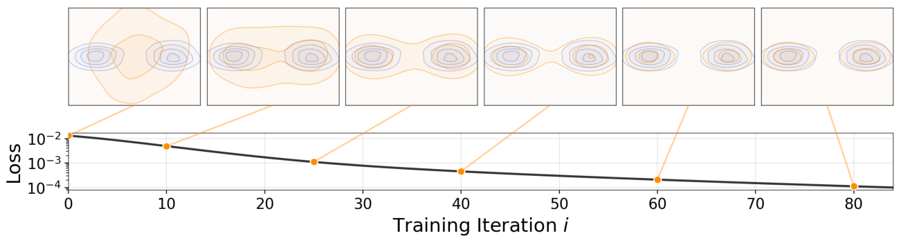
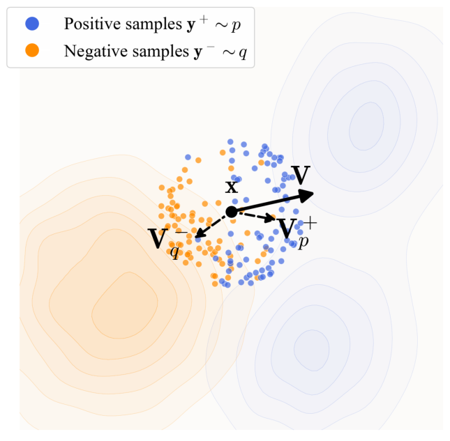
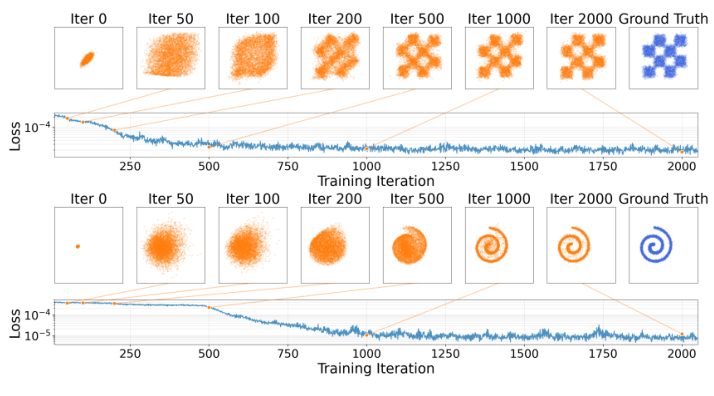
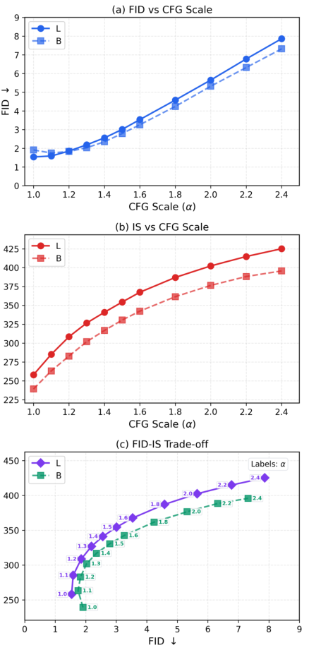
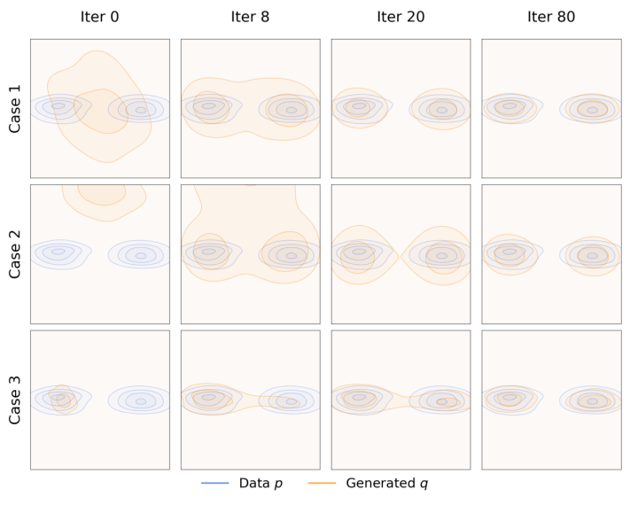
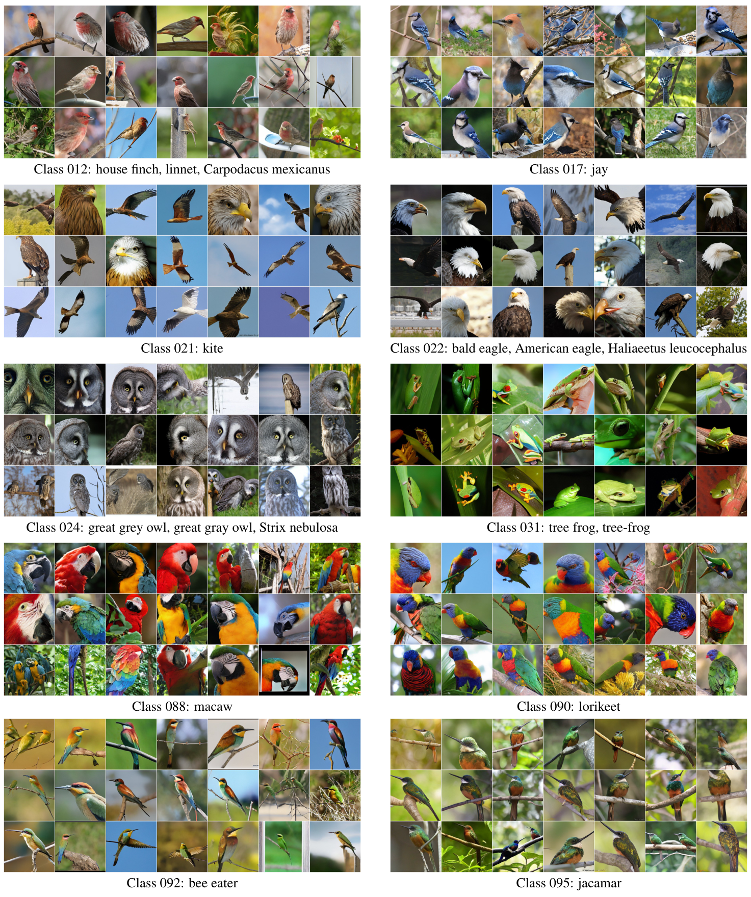
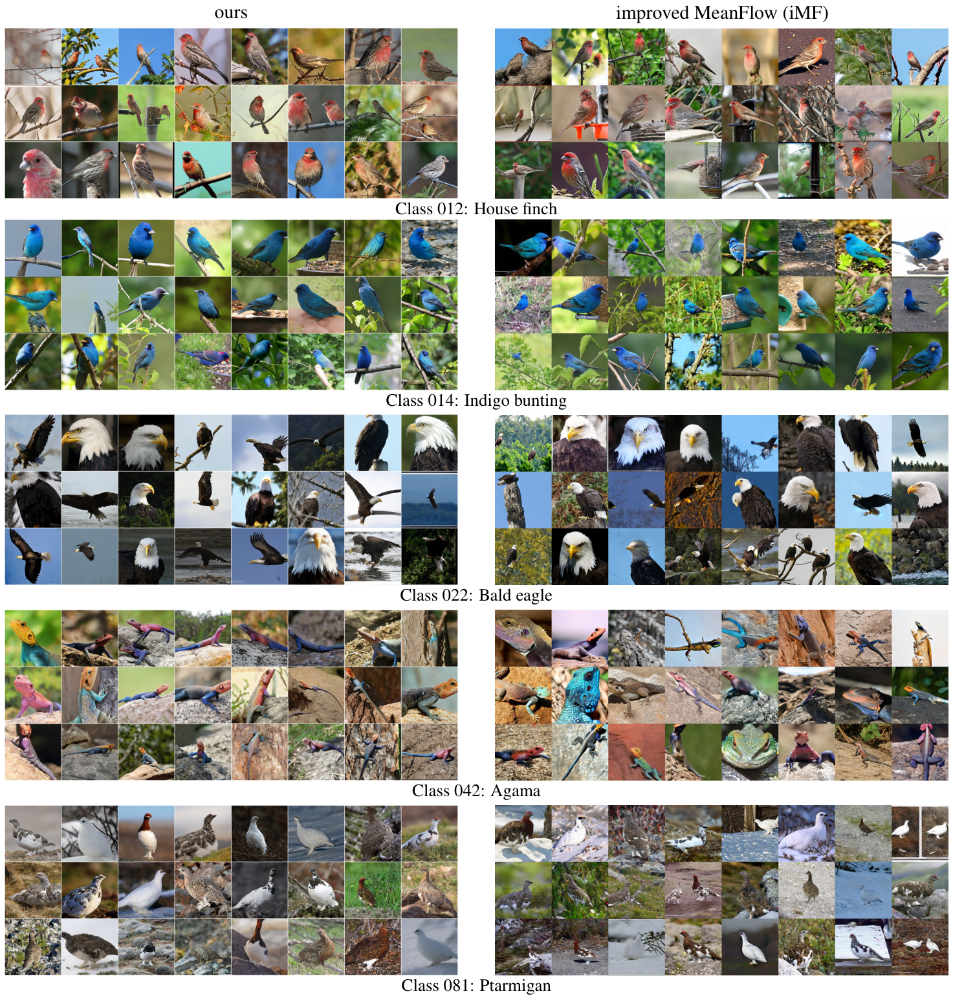
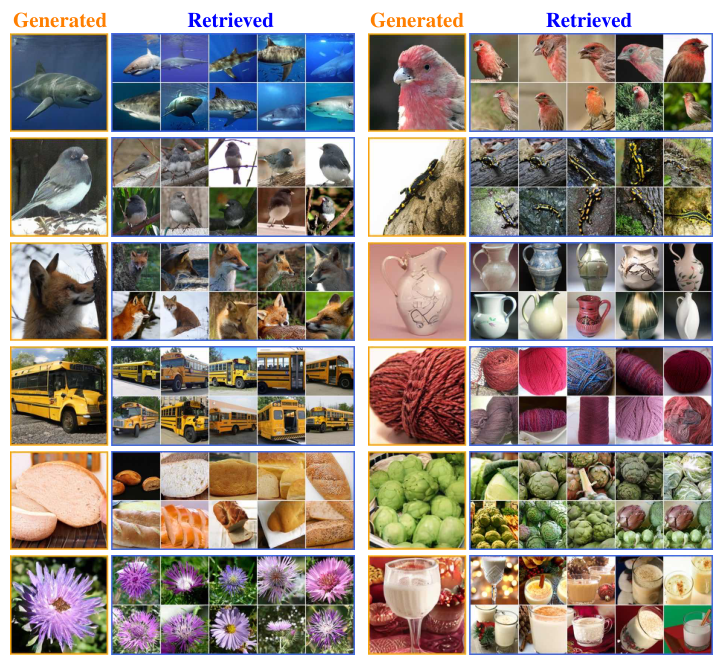

# Drifting：把生成分布的迭代搬到训练阶段

!!! info "论文信息"
    **论文题名：** Generative Modeling via Drifting。 
    **作者：** Mingyang Deng、He Li、Tianhong Li、Yilun Du、Kaiming He。 
    **机构：** MIT、Harvard University。 
    **时间 / 主题：** 2026-02，v2；扩散模型与一步生成。 
    **arXiv / 项目页：** [2602.04770](https://arxiv.org/abs/2602.04770)；[Generative Modeling via Drifting](https://lambertae.github.io/projects/drifting/)。 
    **代码：** 项目页提供 JAX 代码、预训练权重与 toy demo。 
    **元数据与核验口径：** 来源为 arXiv HTML、项目页；Checked Date：2026-09-07；Repro Status：Paper / official project materials reviewed, independent reproduction not claimed。

## 一步生成的难点，在于训练时怎样知道样本该往哪里走

Drifting 给出了一种从头训练一步生成器的方法。推理时只把随机噪声送进网络一次，就得到图像或控制输出；训练时则反复比较当前生成分布与真实分布，为生成样本构造移动方向。论文在 ImageNet-256 上报告 latent 空间 1.54 FID、pixel 空间 1.61 FID，二者都只需一次生成器求值。支撑这些结果的关键，是正负样本共同决定的漂移场、停止梯度的回归目标，以及高维图像所需的多层特征监督。[原论文，第1—2页](https://arxiv.org/pdf/2602.04770v2#page=1)

扩散与 Flow Matching 把噪声到数据的映射分解成多个推理步骤。一步蒸馏通常从预训练教师获得监督，另一些从头训练的一步方法将轨迹或跨时间映射纳入目标。Drifting 选择直接规定当前生成样本应该怎样移动，再让网络学习这种移动。它没有扩散时间输入，不拟合去噪轨迹，也不需要先训练多步生成教师。采用 DiT 风格骨干，只说明网络结构相近，并不意味着其损失仍是扩散损失。

令输入噪声为 $\epsilon\sim p_\epsilon$，生成器为 $f_\theta$，真实分布为 $p$。生成分布写成

$$
x=f_\theta(\epsilon),\qquad q_\theta=(f_\theta)_\#p_\epsilon.
$$

下标 $\#$ 表示 **Pushforward Distribution（推前分布）**，即随机输入经过映射后得到的输出分布。训练参数从 $\theta_i$ 更新到 $\theta_{i+1}$，同一个噪声的输出也从 $f_{\theta_i}(\epsilon)$ 变成 $f_{\theta_{i+1}}(\epsilon)$，于是整个 $q_\theta$ 随训练变化。这里的 $i$ 是训练迭代数，不能当成生成一张图时的去噪步数。

Figure 1 把这个区别画得很清楚。蓝色目标分布保持不变，橙色生成分布随横轴上的训练迭代逐渐靠近它。每幅橙色分布都来自当时那个网络的一次前向，并不要求推理时走过图中各个状态。

*原论文 Figure 1，第1页。下方是漂移损失的对数坐标，上方对应训练过程中的分布；这是低维示例，不是 ImageNet 的训练曲线。*

一轮训练中的信息流由以下操作组成。先选条件并生成一批样本，再抽取相同条件的真实样本，将两批样本放进同一空间度量相似性，计算吸引与排斥产生的漂移，把“当前位置加漂移”冻结为目标，最后更新生成器。训练结束后，只保留生成器及必要的 VAE 解码器，参考样本、核矩阵和特征编码器都退出推理路径。一步推理的代价因此被明确限定在部署端，不能顺带推断训练也只需很少计算。[原论文，第3—5页](https://arxiv.org/pdf/2602.04770v2#page=3)

## 吸引与排斥怎样合成一个有正确平衡点的场

单独把生成样本拉向附近真实样本，容易把许多噪声都推向相同的高密度区域。要知道一个地方是否已经“生成得太多”，训练还必须观察当前生成分布。Drifting 将真实样本称为正样本 $y^+\sim p$，将生成样本称为负样本 $y^-\sim q$，对当前位置 $x$ 分别计算两个均值偏移向量

$$
V_p^+(x)=\frac{\mathbb E_{y^+\sim p}[k(x,y^+)(y^+-x)]}{Z_p(x)},
\qquad
V_q^-(x)=\frac{\mathbb E_{y^-\sim q}[k(x,y^-)(y^--x)]}{Z_q(x)},
$$

$$
Z_p(x)=\mathbb E_{y^+\sim p}k(x,y^+),\qquad
Z_q(x)=\mathbb E_{y^-\sim q}k(x,y^-),\qquad
V_{p,q}(x)=V_p^+(x)-V_q^-(x).
$$

$V_p^+$ 指向附近真实样本的加权均值，$V_q^-$ 指向附近生成样本的加权均值。最终场减去第二项，才产生排斥。Figure 2 中标为 $V_q^-$ 的虚线箭头本身朝向橙色样本密集区，黑色合成箭头则朝它的反方向偏转。把图中的 $V_q^-$ 直接称为“向外的排斥箭头”，会把减号的作用看反。[原论文，第3—4页，式8—10](https://arxiv.org/pdf/2602.04770v2#page=3)

*原论文 Figure 2，第4页。黑点是当前生成样本，蓝点和橙点分别来自真实与生成分布；实线黑箭头为两种均值偏移之差。*

归一化使每一侧的总权重为一，因此两项中的 $-x$ 正好抵消。把差写成双重期望，可得到论文式11

$$
V_{p,q}(x)=\frac{1}{Z_p(x)Z_q(x)}
\mathbb E_{y^+\sim p,\,y^-\sim q}
\left[k(x,y^+)k(x,y^-)(y^+-y^-)\right].
$$

这个写法揭示了训练接口的特点。每个生成点不需要一个指定的真实配对，它从许多真实与生成样本之间的相对位置获得方向；$x$ 决定哪些配对值得关注。正负分布互换后，核乘积不变，$y^+-y^-$ 变号，因此

$$
V_{p,q}(x)=-V_{q,p}(x),\qquad p=q\Longrightarrow V_{p,q}(x)=0.
$$

这就是 **Anti-symmetry（反对称性）**。它保证真实分布与生成分布相等时，吸引与排斥在分布期望上抵消。独立有限批次仍有采样误差，不能要求每轮估计出的每个向量都精确为零。

论文采用的相似度核为

$$
k(x,y)=\exp\left(-\frac{\|x-y\|_2}{\tau}\right).
$$

距离没有平方。温度 $\tau$ 控制关注范围，较小值将权重集中到更近的邻居，较大值让更远的参考样本参与。高维下若所有距离都很大或近似相等，核就难以区分哪些样本具有语义相关性；后面的特征编码器和归一化正是为解决这个问题。不能只把这里替换成常见的高斯平方距离核，再默认得到同一个算法。[原论文，第4页，式11—12](https://arxiv.org/pdf/2602.04770v2#page=4)

## 停止梯度把“移动方向”变成网络可以学习的目标

知道理想粒子应当执行 $x\leftarrow x+V(x)$，还不等于知道怎样更新共享网络参数。Drifting 使用一个冻结目标回归

$$
\mathcal L(\theta)=\mathbb E_\epsilon
\left\|f_\theta(\epsilon)-\operatorname{sg}\left[f_\theta(\epsilon)+V_{p,q_\theta}(f_\theta(\epsilon))\right]\right\|_2^2.
$$

$\operatorname{sg}$ 是 **Stop-gradient（停止梯度）**。目标由当前输出和当前漂移构造，随后整体冻结；网络只通过左侧 prediction 接收梯度。这一轮的漂移规定了监督方向，下一轮重新生成样本后再重新估计场。[原论文，第3页，式5—6](https://arxiv.org/pdf/2602.04770v2#page=3)

对单个输出 $x$，未按维度取均值的平方损失给出

$$
\frac{\partial\mathcal L(x)}{\partial x}=-2V(x),
\qquad
\nabla_\theta\mathcal L=-2\mathbb E_\epsilon
\left[J_{f_\theta}(\epsilon)^\top V(f_\theta(\epsilon))\right].
$$

因此参数梯度下降会沿着使输出追随漂移的方向调整网络。第二式是把论文的链式法则用 Jacobian 写开，$J_{f_\theta}$ 表示输出对参数的导数。它也说明了理想粒子更新与实际训练之间的距离。不同噪声共享参数，一个参数更新会同时影响许多输出，不能保证每个样本恰好移动一个完整的 $V$；网络容量、优化器和学习率都在影响实现效果。[原论文，第18—19页，式34—36](https://arxiv.org/pdf/2602.04770v2#page=18)

损失的数值虽然等于当前 $\mathbb E\|V\|^2$，计算图却不同于直接写 $\|V_{p,q_\theta}(f_\theta(\epsilon))\|^2$ 再完整求导。后一种操作会把漂移场以及用于构造负分布的生成样本对参数的依赖都纳入梯度，已经改变了训练规则。实现时只 detach 漂移、仍让 target 中的 $x$ 保留梯度，同样会破坏这个接口。

Figure 4 给出两个用小型 MLP 训练的低维例子。上面一行的输出从团状分布发展为格点结构，下面一行从近乎单点发展为螺旋；损失随训练下降，但瞬时曲线有明显波动。它支持“按漂移回归可以组织分布演化”这一可行性判断，不是任意网络、任意数据和任意归一化设置下的单调收敛证明。

*原论文 Figure 4，第6页。最后一列为目标样本；横轴是训练迭代，损失纵轴为对数坐标。*

## 从分布公式到实际批量计算，还要处理哪些细节

正文的期望式把算法讲清了一半。附录 Algorithm 2 才给出有限批量里的具体权重。令 $x$ 的形状为 $N\times D$，正样本为 $N_+\times D$，负样本为 $N_-\times D$，默认负样本复用同一批生成结果，因此 $N_-=N$。先计算两组距离，按参考样本维拼成 $N\times(N_++N_-)$ 的矩阵；当负样本就是 $x$ 时，将自身对应的距离加上 $10^6$，使自身权重近乎为零。否则 $k(x_i,x_i)=1$ 会让每个点最优先“看见自己”。[原论文，第12页，Algorithm 2](https://arxiv.org/pdf/2602.04770v2#page=12)

设拼接后的 logits 为 $L=-\mathrm{dist}/T$，实现计算

$$
A^{\mathrm{row}}=\operatorname{softmax}_{y}(L),\qquad
A^{\mathrm{col}}=\operatorname{softmax}_{x}(L),\qquad
A=\sqrt{A^{\mathrm{row}}\odot A^{\mathrm{col}}}.
$$

行 softmax 描述一个生成点如何分配对参考样本的注意力，列 softmax 描述一个参考样本在不同生成点间如何分配权重。两者的几何均值同时考虑这两种关系。这里是对同一个 logits 矩阵沿两个轴分别做 softmax，再相乘开方，没有交替迭代求双随机矩阵的步骤。

将 $A$ 拆成 $A^+,A^-$，记每行的两组权重和为 $s_i^+=\sum_jA^+_{ij}$、$s_i^-=\sum_kA^-_{ik}$，则漂移可以展开为

$$
V_i=s_i^-\sum_j A^+_{ij}y_j^+
-s_i^+\sum_k A^-_{ik}y_k^-.
$$

每侧都乘上另一侧的总权重，等价于把 $A^+_{ij}A^-_{ik}(y_j^+-y_k^-)$ 对所有正负配对求和。这样既保留成对交互结构，又可用两次矩阵乘法完成，不必显式建立三维配对张量。它是论文对理论场的批量实现，不能简化成“拼在一起做一个 softmax，然后对所有样本取一次均值”。附录以依赖批次统计的归一化核解释这种构造，保留分布匹配时的抵消关系。

这项设计的收益也有量化边界。Table 11 在同一 B/2、100 epochs 设置下报告双轴 softmax 为 8.46 FID，只在 $y$ 轴归一化为 8.92，不做核归一化为 10.54。双轴归一化有帮助，但它不是 8.46 与完全失效之间的唯一分界；保留正确正负结构后，其他版本也能工作。[原论文，第17页，Table 11](https://arxiv.org/pdf/2602.04770v2#page=17)

## 特征空间使高维样本之间的距离真正有用

图像实验不能只在像素或 VAE latent 中套用上述公式。作者明确报告，在 ImageNet 上去掉特征编码器后没有得到有效结果，即使生成器已经工作在 VAE latent 空间也是如此。VAE 压缩了表示，并不自动保证欧氏邻近关系适合构造生成分布之间的吸引与排斥。[原论文，第7页](https://arxiv.org/pdf/2602.04770v2#page=7)

对冻结编码器 $\phi$，网络输出先变成 $\phi(x)$，正负参考也变成 $\phi(y^+),\phi(y^-)$，再在这个空间独立计算核和漂移

$$
\mathcal L_\phi=\mathbb E_\epsilon
\left\|\phi(f_\theta(\epsilon))-
\operatorname{sg}\left[\phi(f_\theta(\epsilon))+V(\phi(f_\theta(\epsilon)))\right]\right\|_2^2.
$$

这与感知重建损失有共同的特征度量工具，但监督接口不同。重建通常需要配对目标 $x_{\mathrm{target}}$，回归 $\phi(x_{\mathrm{target}})$；这里的目标是当前位置经过分布交互后的 $\phi(x)+V$，不要求把某个噪声与某张真实图绑定。其直接比较的是特征推前分布 $\phi_\#q$ 与 $\phi_\#p$。若特征遗漏了某类图像差异，仅匹配这些特征也不能保证原图分布完全相同，多尺度和多位置监督用来减少这种信息损失。[原论文，第4—5页](https://arxiv.org/pdf/2602.04770v2#page=4)

“冻结编码器”只冻结参数，不切断它对输入的导数。预测侧必须经过 $\phi$ 的 Jacobian 把梯度传回生成器。latent 生成器若使用 MoCo 或 SimCLR 这样的 RGB 编码器，训练链路还要经过 VAE decoder，并对 decoder 的输入反传；采用直接处理 latent 的 MAE 编码器，就能省去训练中的这次解码。推理时两者都无需特征编码器，但 latent 生成器仍需 VAE decoder 将结果变成可见图像。

### 多层、多位置和统计特征分别提供监督

论文自定义的 MAE 使用卷积 ResNet 编码器，能自然提供多尺度特征。每个 stage 每隔两个 residual blocks 取一次特征，并保留 stage 的最后输出。对形状 $H_i\times W_i\times C_i$ 的特征图，作者分别计算每个位置的 $C_i$ 维向量、全局均值与标准差、每个 $2\times2$ 局部块的均值与标准差，以及每个 $4\times4$ 块的均值与标准差。还加入编码器输入各通道的平方均值，以及不经过编码器的原始空间 drifting loss。[原论文，第14页，A.5](https://arxiv.org/pdf/2602.04770v2#page=14)

这些向量并未简单拼成一个巨大表示后共用一个核。每种层级、位置或统计特征各自形成一个分布比较，独立计算核、场和回归，再合并损失。位置特征保留局部结构，局部和全局统计增加纹理与整体分布信息。默认消融中，只用逐位置与全局统计为 9.58 FID，加入 $2\times2$ 统计为 9.10，再加入 $4\times4$ 统计为 8.46。这个实验表明，最终质量的一部分来自监督覆盖范围，而非只来自一个场的公式。

### 特征归一化控制邻域，漂移归一化控制监督幅度

不同层的维度与幅度差异很大。如果都直接使用相同 $\tau$，某一层可能只关注最近邻，另一层却几乎平均对待所有样本。对一个 $C_j$ 维特征，附录先定义

$$
S_j=\frac{\mathbb E_{x,y}\|\phi_j(x)-\phi_j(y)\|_2}{\sqrt{C_j}},\qquad
\widetilde\phi_j=\phi_j/S_j,
$$

再使用温度 $\widetilde\tau_j=\tau\sqrt{C_j}$ 计算核。$S_j$ 由批量距离估计，并停止梯度。归一化后平均距离约为 $\sqrt{C_j}$，温度也按同样的维度尺度增长，使基础温度 $\tau$ 不必随层宽或特征幅度重新调节。它是在给核建立可比较的尺度，不能理解为把每个向量单独做单位长度归一化。[原论文，第15页，式18—22](https://arxiv.org/pdf/2602.04770v2#page=15)

在归一化特征空间中得到漂移后，再计算

$$
\lambda_j=\sqrt{\mathbb E\left[\frac{\|V_j\|_2^2}{C_j}\right]},\qquad
\widetilde V_j=V_j/\lambda_j.
$$

这使归一化漂移的平均每维平方幅度约为一，防止某些特征单靠数值大小支配梯度。实际计算将同一特征图的空间位置合并来估计归一化尺度，避免每个位置维护一组独立统计。特征归一化改变的是相似度的尺度，漂移归一化改变的是回归目标的移动幅度，两者承担不同职责。

默认采用 $\tau\in\{0.02,0.05,0.2\}$。A.6 的具体写法是先独立求每个温度的归一化漂移，再将它们相加形成目标；消融 FID 分别为单温度 10.62、8.67、8.96，三温度合用为 8.46。收益存在，但相对最佳单温度的幅度较小。

原文 Table 8 将多温度描述为“每个温度一个 loss 再求和”，A.6 则写成先求和漂移再做一次回归。在共享预测、冻结目标的前提下，两种写法对预测的梯度都正比于负的漂移之和，但损失标量因交叉项而不同。阅读训练曲线时还需区分这里的归一化目标与前面 toy 图的原始 $\|V\|^2$。单温度漂移已经被规范到近似单位均方幅度，不能再用其回归损失数值直接测量原始漂移离零有多近。

## CFG 改变训练中的负样本组成，保留推理一次求值

条件生成时，同类真实样本组成正分布 $p_{\mathrm{data}}(\cdot\mid c)$。如果希望加强类别特征，Drifting 将一部分负参考替换成无条件真实数据

$$
\widetilde q(\cdot\mid c)=(1-\gamma)q_\theta(\cdot\mid c)+
\gamma p_{\mathrm{data}}(\cdot\mid\varnothing),\qquad 0\le\gamma<1.
$$

直观上，生成结果既要接近本类真实分布，也要受到一般图像分布的排斥。若形式上令 $\widetilde q=p_{\mathrm{data}}(\cdot\mid c)$，可整理成

$$
q_\theta(\cdot\mid c)=\alpha p_{\mathrm{data}}(\cdot\mid c)
-(\alpha-1)p_{\mathrm{data}}(\cdot\mid\varnothing),\qquad
\alpha=\frac{1}{1-\gamma}.
$$

这个关系解释了条件强化方向，但右侧带负系数，未必处处为非负密度，不能无条件将其视为可精确达到的目标分布。论文也说明，理想的无条件负参考应排除当前类别，实际为简化而直接使用无条件数据。它与标准扩散 CFG 具有类似目的，公式上却没有把两次网络的 score 或 velocity 做线性外推。[原论文，第5页，式15—16及脚注](https://arxiv.org/pdf/2602.04770v2#page=5)

附录给出了从引导强度到样本权重的实际换算。排除生成样本自身后，普通负参考有 $N_{\mathrm{neg}}-1$ 个；额外抽取 $N_{\mathrm{unc}}$ 个无条件真实样本，每个赋予相对权重 $w$，则

$$
\gamma=\frac{N_{\mathrm{unc}}w}{N_{\mathrm{neg}}-1+N_{\mathrm{unc}}w},\qquad
w=\frac{(\alpha-1)(N_{\mathrm{neg}}-1)}{N_{\mathrm{unc}}}.
$$

这个权重用于核计算，也用于全局距离归一化，不能只调负样本数量却忽略统计尺度。训练时随机采样 $\alpha$，将它和类别 $c$ 一起作为生成器条件；推理时指定 $\alpha$，计算 $f_\theta(\epsilon,c,\alpha)$ 一次即可。$\alpha=1$ 时无条件参考的权重为零，不过模型本身仍接受过随机引导强度训练。[原论文，第15—16页，A.7](https://arxiv.org/pdf/2602.04770v2#page=15)

Figure 5 将引导的实际后果分开呈现。先看第一幅 FID 曲线，L/2 在 $\alpha=1$ 最好，B/2 在约 $1.1$ 最好；继续增加强度会让 FID 变差。再看第二幅，IS 持续提高，所以更高 IS 与更好 FID 并非同一个选择。第三幅把这条权衡合在一张图中。FID 和 IS 都是基于模型特征的指标，不能直接分别等同于完整多样性和人类视觉质量。

*原论文 Figure 5，第17页。实线圆点为 L/2，虚线方点为 B/2；最优 FID 所需的引导很弱，推理阶段各点始终都是 1 NFE。*

## 零漂移能说明什么，不能说明什么

反对称性给出 $p=q\Rightarrow V=0$，单靠这一条还不能排除错误分布也恰好零漂移。v2 的 Appendix C.1 对逆命题补充了条件论证。它先假设 $p,q$ 具有全支撑，再将它们限制在线性无关基 $\{\varphi_i\}_{i=1}^m$ 张成的有限维模型类

$$
p(y)=\sum_{i=1}^m a_i\varphi_i(y),\qquad
q(y)=\sum_{i=1}^m b_i\varphi_i(y).
$$

对一组探测位置 $X=\{x_k\}$，把两个基函数经交互核积分得到的场记为 $U_{ij}$。它汇集各探测位置上的向量，反对称性使 $U_{ij}=-U_{ji}$。于是所有探测点的场可以写成

$$
V_X=\sum_{i<j}(a_i b_j-a_j b_i)U_{ij}.
$$

关键假设是所有 $i<j$ 对应的 $U_{ij}$ 在探测空间中线性无关。若 $V_X=0$，各系数必须为零，即 $a_i b_j-a_j b_i=0$；这意味着向量 $a,b$ 平行。两者又都是积分为一的概率密度，比例因子只能为一，于是 $p=q$。[原论文，第18页，C.1，式28—33](https://arxiv.org/pdf/2602.04770v2#page=18)

对于论文的均值偏移场，只要归一化分母有限且非零，零场等价于未归一化分子为零，对应的交互核就是 $k(x,y^+)k(x,y^-)(y^+-y^-)$，可以放进上述双线性框架。因此，将这篇论文概括成“只证明正向，逆向完全没有讨论”会漏掉 v2 的理论补充。

但这段论证也有明确边界。$U_{ij}$ 线性无关是对核、基与探测点的实质条件，并非只把探测点数量加大就自动成立。作者进一步以足够丰富的基逼近一般分布，给出近似匹配的启发式解释；正文也称之为 identifiability heuristic。文中没有给出从有限批量小漂移到全空间分布误差的定量稳定性界，没有证明实际特征编码器满足可辨识条件，也没有证明 SGD 一定达到该平衡点。全支撑假设不能单独把样本平均误差小升级成各处误差都小。

Figure 3 则提供经验层面的补充。三行分别从两个模式之间、远离两个模式、已塌缩到单个模式的位置开始；尤其看第三行，训练后另一模式也逐渐被覆盖。真实分布里仍未被生成的区域持续提供吸引，所以单模式初始化不必成为不可逃离的状态。

*原论文 Figure 3，第6页。蓝色为目标、橙色为生成分布，列为训练迭代；它验证三组低维初始化的行为，不能据此保证高维模型永不发生模式塌缩。*

### 与 MMD 的联系在“样本运动”层面

Drifting 与核矩匹配并非毫无关系。对标量核 $\xi$，平方 MMD 可写成

$$
\mathcal L_{\mathrm{MMD}^2}=\mathbb E_{x,x'\sim q}\xi(x,x')
-2\mathbb E_{y\sim p,x\sim q}\xi(y,x)+\mathrm{const}.
$$

将输出梯度看作移动方向，其对应的场是

$$
V_{\mathrm{MMD}}(x)=\mathbb E_{y^+\sim p}\nabla_x\xi(x,y^+)
-\mathbb E_{y^-\sim q}\nabla_x\xi(x,y^-).
$$

若 $\xi$ 是平方距离 $R=\|x-y\|_2^2$ 的函数，$\nabla_x\xi=2\xi'(R)(x-y)$，便能识别出有效权重 $\widetilde k_{\mathrm{MMD}}=-2\xi'(R)$。所以吸引与排斥也会从 MMD 梯度里出现。[原论文，第18—19页，C.2](https://arxiv.org/pdf/2602.04770v2#page=18)

差别在于 Drifting 直接设计 $V$，允许使用依赖分布的归一化核、重新规范漂移幅度，并通过负分布构造 guidance；它无需先找到一个固定的标量分布差异，再完全按照其梯度运动。普通未归一化 MMD 场不能直接套用依赖单位权重和的均值偏移推导。作者报告其 MMD 尝试未得到合理结果，但没有在这里给出完整数值对照，因此该讨论主要说明方法联系与接口自由度，不能读成一项严格控制预算的 MMD 性能排名。

## 消融先验证场，再验证参考样本与表示

ImageNet 消融的共同起点是 SD-VAE latent 空间的 B/2 生成器、100 epochs，FID 用 50K 生成图像计算。下列实验逐一改变场、每类参考分配和编码器，回答的并不是同一个问题，因此应分别读取其控制变量。[原论文，第6—7页](https://arxiv.org/pdf/2602.04770v2#page=6)

### 把吸引或排斥单独放大，会失去所需的平衡

Table 1 有意破坏默认结构。它不只是对比“有无负样本”，还检查当两个方向都存在、但强度不再匹配时会怎样。

| case | drifting field V | FID ↓ |
| --- | --- | ---: |
| anti-symmetry (default) | $V^+-V^-$ | 8.46 |
| 1.5× attraction | $1.5V^+-V^-$ | 41.05 |
| 1.5× repulsion | $V^+-1.5V^-$ | 46.28 |
| 2.0× attraction | $2V^+-V^-$ | 86.16 |
| 2.0× repulsion | $V^+-2V^-$ | 112.84 |
| attraction-only | $V^+$ | 177.14 |

*原论文 Table 1，第6页，B/2，100 epochs。*

即使只放大到 1.5 倍，FID 也已经大幅恶化。原因与平衡点推导相连，$p=q$ 时原本相同的均值偏移不再抵消，模型即使到达匹配状态也还会被继续推动。这个实验支持默认构造中相对权重的重要性；它没有证明所有非反对称生成训练规则都不可能成功。

### 固定总生成批量，也要考虑每个条件能看到多少参考

Drifting 的一个 batch 包含 $N_c$ 个类别，每类生成 $N_{\mathrm{neg}}$ 个样本，实际生成批量为 $B=N_cN_{\mathrm{neg}}$。Table 2 左半表固定 $N_c=64$、$N_{\mathrm{neg}}=64$，只增加每类真实正样本；右半表保持 $B=4096$，减少类别数并增加每类正负样本。

| Allocation | Nc | Npos | Nneg | B | FID ↓ |
| --- | ---: | ---: | ---: | ---: | ---: |
| Positive samples | 64 | 1 | 64 | 4096 | 20.43 |
| Positive samples | 64 | 16 | 64 | 4096 | 10.39 |
| Positive samples | 64 | 32 | 64 | 4096 | 8.97 |
| Positive samples | 64 | 64 | 64 | 4096 | 8.46 |
| Samples per class | 512 | 8 | 8 | 4096 | 11.82 |
| Samples per class | 256 | 16 | 16 | 4096 | 10.16 |
| Samples per class | 128 | 32 | 32 | 4096 | 9.32 |
| Samples per class | 64 | 64 | 64 | 4096 | 8.46 |

*按原论文 Table 2 的两个子表合并，第7页；均为 B/2、100 epochs。Allocation 列用于区分两个子实验。*

左半表最直接说明，单个同类真实样本对局部分布的估计很弱，增加到 16 个后 FID 已从 20.43 降到 10.39，之后仍有改善。右半表则说明，相同数量的生成样本更集中地覆盖每个条件，有利于得到更好的场估计。不过右表同时改变正负样本数及类别数，不能将全部收益归因于负样本一个因素。

原表图注将 $B$ 写成了 $N_cN_{\mathrm{pos}}$，这与左表数值不一致；这里采用正文第5页及 Table 8 的生成批量定义 $N_cN_{\mathrm{neg}}$。固定该批量和 epochs 固定了生成器处理的样本总数，但增加正样本还会改变真实特征与核计算的负担，不能据此断言完整训练 FLOPs 完全不变。这项结果也直接影响任务迁移，ImageNet 每类有许多真实样本；文本或细粒度条件如果每个条件只有一条配对数据，就需要重新考虑正分布的组织方式。[原论文，第5页、第7页](https://arxiv.org/pdf/2602.04770v2#page=7)

### 强表示的收益不能全部归给漂移公式

Table 3 固定生成器设置，改变冻结特征编码器。MoCo 和 SimCLR 在 RGB 中工作，定制 latent-MAE 直接处理 latent。

| SSL method | arch | block | width | SSL ep. | FID ↓ |
| --- | --- | --- | ---: | ---: | ---: |
| SimCLR | ResNet | bottleneck | 256 | 800 | 11.05 |
| MoCo-v2 | ResNet | bottleneck | 256 | 800 | 8.41 |
| latent-MAE (default) | ResNet | basic | 256 | 192 | 8.46 |
| latent-MAE | ResNet | basic | 384 | 192 | 7.26 |
| latent-MAE | ResNet | basic | 512 | 192 | 6.49 |
| latent-MAE | ResNet | basic | 640 | 192 | 6.30 |
| latent-MAE | ResNet | basic | 640 | 1280 | 4.28 |
| latent-MAE + cls ft | ResNet | basic | 640 | 1280 | 3.36 |

*原论文 Table 3，第7页。SSL ep. 是表示预训练 epochs，生成器在所有行均训练100 epochs。*

默认 latent-MAE 的 8.46 与 MoCo-v2 的 8.41 接近，说明方法可以利用现有自监督表示，定制 latent 表示并非一开始就大幅领先。真正拉开差距的是扩大宽度、延长表示预训练、再加入分类微调。最后一步从 4.28 改善到 3.36，也意味着最佳表示包含标签监督，不能将最优系统描述为完全只依赖无标签自监督特征。

latent 的最终配置在此基础上继续扩大生成器训练预算。Table 4 的 B/2 从 100 epochs 的 3.36 到 320 epochs 的 2.51，1280 epochs 并调整超参数后到 1.75；L/2、1280 epochs 为 1.54。100 到 320 的比较主要考察延长训练，最终两步还涉及超参数和规模变化，不能把四行当成一条只改变训练时长的 scaling curve。[原论文，第7页，Tables 3—4](https://arxiv.org/pdf/2602.04770v2#page=7)

pixel 空间对表示更敏感。附录 Table 9 使用100 epochs 的 B/16 生成器，与 latent B/2 对照

| feature encoder φ | latent (B/2) FID ↓ | pixel (B/16) FID ↓ |
| --- | ---: | ---: |
| MAE (width 256, epoch 192) | 8.46 | 32.11 |
| MAE (width 640, epoch 1280) + cls ft. | 3.36 | 9.35 |
| + MAE w/ ConvNeXt-V2 | — | 3.70 |

*原论文 Table 9，第16页，生成器训练均为100 epochs。最后一行在强 ResNet-MAE 之外增加 ConvNeXt-V2 编码器。*

同一思路直接迁入 pixel 空间，弱表示下 FID 为 32.11，并没有自然获得 latent 版本的效果；两个强编码器共同监督后才到 3.70。随后 Table 10 将 B/16 延长并调参到 320 epochs，得到 2.19；640 epochs 为 1.76，再扩大成 L/16 得到 1.61。这条证据链说明，“不用 VAE”确实可行，但训练端仍依赖较重的表示系统。附录所说延长 pixel 训练可能继续改善只是作者预期，文中实际报告的是640 epochs。[原论文，第16页，Tables 9—10](https://arxiv.org/pdf/2602.04770v2#page=16)

## 最终系统怎样训练，部署时又留下什么

生成器输入是随机变量、类别和引导强度，接口为 $f_\theta(\epsilon,c,\alpha)\mapsto x$。latent 模型处理 $32\times32\times4$ 的高斯噪声，patch size 为 $2\times2$；pixel 模型处理 $256\times256\times3$ 噪声，patch size 为 $16\times16$。两者都形成 $16\times16=256$ 个图像 token。B 模型 hidden dimension 为768、深度12，L 为1024、深度24。[原论文，第12—13页，A.2、Table 8](https://arxiv.org/pdf/2602.04770v2#page=12)

骨干采用 DiT 风格的条件调制，并结合 SwiGLU、RoPE、RMSNorm 和 QK-Norm；类别及 $\alpha$ 通过 adaLN 和16个前置 conditioning tokens 输入。另有32个随机 style indices，各自索引64个可学习嵌入组成的码本，取出的向量相加后加入 conditioning vector。它们增加随机性的来源，却不再增加32个序列 token。对应消融中，无 style embedding 为8.86 FID，使用后为8.46。一般框架不要求噪声与输出维度相同，也不要求随机变量只能是高斯；本实验中的图像噪声形状相同只是具体架构选择。

强 latent 特征编码器是 base width 640 的 ResNet-style MAE，四个 stage 的 block 数为 $[3,4,6,3]$，输出空间分辨率为 $32^2,16^2,8^2,4^2$，通道数为 $C,2C,4C,8C$。A.3 明确采用两个 $3\times3$ 卷积组成的 basic block，用 GroupNorm 替换 BatchNorm。pixel 版本先以 $8\times8$ patch 将 RGB 输入转换成 $32\times32\times192$，再用相应编码器处理。[原论文，第13—14页，A.3](https://arxiv.org/pdf/2602.04770v2#page=13)

MAE 的训练任务是对 $32\times32$ 表示中的 $2\times2$ patch 独立按50%概率置零，用带 skip connections 的解码器重建被遮盖区域，采用 masked $\ell_2$ 损失。优化器为 AdamW，学习率 $4\times10^{-3}$、batch 8192、EMA decay 0.9995；输入使用 random resized crop，latent 方案先增强 RGB，再做 VAE 编码。最佳表示经过1280 epochs 预训练，还将全部 MAE 参数与分类头共同微调3000步，目标为 $\lambda\mathcal L_{\mathrm{cls}}+(1-\lambda)\mathcal L_{\mathrm{recon}}$，前1000步把 $\lambda$ 从0增加到0.1，此后保持不变。生成器训练时才冻结该表示网络。

原文 Table 8 有两处与具体实现说明冲突的单元格，pixel 生成器 input size 沿写为 $32\times32\times4$，ResNet block type 写为 bottleneck。此处输入形状按 A.2 的明确接口，block 按 A.3 及 Table 3 的 basic 描述理解；不能将冲突项静默合并成一个架构。其余决定训练预算的配置如下。

| Configuration | ablation default | B/2, latent | L/2, latent | B/16, pixel | L/16, pixel |
| --- | ---: | ---: | ---: | ---: | ---: |
| learning rate | 2e-4 | 4e-4 | 4e-4 | 2e-4 | 4e-4 |
| weight decay | 0.01 | 0.0 | 0.01 | 0.01 | 0.01 |
| warmup steps | 5k | 10k | 10k | 10k | 10k |
| training steps | 30k | 200k | 200k | 100k | 100k |
| training epochs | 100 | 1280 | 1280 | 640 | 640 |
| class labels Nc | 64 | 128 | 128 | 128 | 128 |
| positive samples Npos | 64 | 128 | 64 | 128 | 128 |
| generated samples Nneg | 64 | 64 | 64 | 64 | 64 |
| uncond samples Nuncond | 16 | 32 | 32 | 32 | 32 |
| effective batch B | 4096 | 8192 | 8192 | 8192 | 8192 |

*摘取原论文 Table 8，第13页的生成器优化与采样配置。各列使用 AdamW，$\beta_1=0.9,\beta_2=0.95$，gradient clip 为2.0。*

默认 EMA decay 为0.999，最终配置考察 $\{0.999,0.9995,0.9998,0.9999\}$。训练引导范围均为 $[1,4]$，默认按 $p(\alpha)\propto\alpha^{-3}$ 采样；latent B 和两个 pixel 模型使用 $\alpha^{-5}$，latent L 则一半取 $\alpha=1$、一半按 $\alpha^{-3}$。推理搜索范围为 $[1.0,3.5]$。这些分布都偏向较低引导强度，latent L 还显式增加无引导训练比例，不能把不同模型的结果归因于大小变化一个因素。

这里的 epoch 根据生成样本数定义，一步生成 $B$ 个样本，一个 epoch 对应 $N_{\mathrm{data}}/B$ 次更新；它并不代表每个真实样本恰好被遍历一次。真实参考通过队列抽取，每类队列容量128，无条件全局队列容量1000，每步将最新64个真实样本按标签放入相应队列并移出最旧样本，从所需队列无放回采样。作者也说明，可用专门的数据加载器实现相似目标，队列是一种工程选择。[原论文，第5页、第16页，A.8—A.9](https://arxiv.org/pdf/2602.04770v2#page=16)

部署路径因此十分短。采样高斯噪声与 style indices，指定类别和 $\alpha$，跑一次生成器；若选择 latent 模型，再运行 SD-VAE decoder。训练时使用的特征编码器、多尺度距离、参考队列、归一化统计都不参与推理。论文本身没有给出统一训练墙钟时间或完整预训练 FLOPs 对照，优势应表述为一步生成接口及所报质量，不能扩展成总研发或训练成本更低。

## 系统结果需要同时看 FID、IS、表示空间与求值数

### latent 空间的一步优势很明确，多步最优 FID 仍更低

Table 5 按50K图像 FID比较从头训练的生成器，适用时使用 CFG；参数列明确为“generator + decoder”。保留完整表中的主要类别，可以看到 Drifting 改善的是哪一段质量与求值预算的关系。

| method | space | params | NFE | FID ↓ | IS ↑ |
| --- | --- | --- | ---: | ---: | ---: |
| DiT-XL/2 | SD-VAE | 675M+49M | 250×2 | 2.27 | 278.2 |
| SiT-XL/2 | SD-VAE | 675M+49M | 250×2 | 2.06 | 270.3 |
| SiT-XL/2+REPA | SD-VAE | 675M+49M | 250×2 | 1.42 | 305.7 |
| LightningDiT-XL/2 | VA-VAE | 675M+70M | 250×2 | 1.35 | 295.3 |
| RAE+DiTDH-XL/2 | RAE | 839M+415M | 50×2 | 1.13 | 262.6 |
| iCT-XL/2 | SD-VAE | 675M+49M | 1 | 34.24 | — |
| Shortcut-XL/2 | SD-VAE | 675M+49M | 1 | 10.60 | — |
| MeanFlow-XL/2 | SD-VAE | 676M+49M | 1 | 3.43 | — |
| AdvFlow-XL/2 | SD-VAE | 673M+49M | 1 | 2.38 | 284.2 |
| iMeanFlow-XL/2 | SD-VAE | 610M+49M | 1 | 1.72 | 282.0 |
| Drifting Model, B/2 | SD-VAE | 133M+49M | 1 | 1.75 | 263.2 |
| Drifting Model, L/2 | SD-VAE | 463M+49M | 1 | 1.54 | 258.9 |

*原论文 Table 5，第7页。前五行为多步 diffusion/flow，接下来五行为既有一步 diffusion/flow，最后两行为本文方法。*

Drifting L/2 的1.54优于表中所有其他1-NFE结果，且生成器参数少于若干 XL 对照；B/2 的1.75已接近 iMeanFlow 的1.72，但仍略差，不能写成更小模型也全面超过对照。IS 的排序又不同，Drifting L/2 的258.9低于 iMeanFlow 的282.0和 AdvFlow 的284.2，这与前面的 CFG 权衡有关。

多步方法中，REPA、LightningDiT 和 RAE 系统分别达到1.42、1.35、1.13，FID仍低于1.54。RAE与VA-VAE还使用不同表示及解码器，不能把所有差值解释成采样步数的单独影响。各方法的表示预训练和训练总预算没有配平，这是一张系统级能力对照表。[原论文，第7页，Table 5](https://arxiv.org/pdf/2602.04770v2#page=7)

Figure 7 给出 latent L/2、$\alpha=1$ 的未筛选样本。相同类别中能看到不同姿态、构图和背景，尤其鸟类的飞行与站立状态、树蛙的近景与枝叶场景并存。这为分布覆盖提供可观察的实例，同时部分小图细节仍显得模糊或不自然。它展示的是1.54 FID对应模型的实际外观，不能单靠这批样例判断所有类别或证明无失败。

*原论文 Figure 7，第20页，latent L/2，CFG=1.0，FID=1.54、IS=258.9。该页展示10个 ImageNet 类别，后续 Figures 8—10 继续展示其他类别。*

### pixel 版本去掉解码器，保留质量与算力优势的具体口径

| method | space | params | NFE | FID ↓ | IS ↑ |
| --- | --- | --- | ---: | ---: | ---: |
| ADM-G | pix | 554M | 250×2 | 4.59 | 186.7 |
| SiD, UViT/2 | pix | 2.5B | 1000×2 | 2.44 | 256.3 |
| VDM++, UViT/2 | pix | 2.5B | 256×2 | 2.12 | 267.7 |
| SiD2, UViT/2 | pix | — | 512×2 | 1.73 | — |
| SiD2, UViT/1 | pix | — | 512×2 | 1.38 | — |
| JiT-G/16 | pix | 2B | 100×2 | 1.82 | 292.6 |
| PixelDiT/16 | pix | 797M | 200×2 | 1.61 | 292.7 |
| EPG-L/16 | pix | 540M | 1 | 8.82 | — |
| BigGAN | pix | 112M | 1 | 6.95 | 152.8 |
| GigaGAN | pix | 569M | 1 | 3.45 | 225.5 |
| StyleGAN-XL | pix | 166M | 1 | 2.30 | 265.1 |
| Drifting Model, B/16 | pix | 134M | 1 | 1.76 | 299.7 |
| Drifting Model, L/16 | pix | 464M | 1 | 1.61 | 307.5 |

*原论文 Table 6，第8页，ImageNet 256×256、50K FID；参数只统计生成器。前七行为多步模型，EPG 为一步 diffusion/flow，接下来的三行为 GAN。*

pixel L/16 用一次求值取得与 PixelDiT/16 相同的1.61 FID，IS为307.5，对照为292.7。它优于表中三个 GAN 的 FID，但仍不能声称所有 pixel 多步模型都被超过，SiD2、UViT/1 的1.38更低。

论文还报告 pixel Drifting 的87G FLOPs与 StyleGAN-XL 的1574G FLOPs，对应计算量比值约为 $1574/87\approx18.1$。这是根据所报 FLOPs 计算的比值，不能当作测得的18.1倍终端加速。两者参数量也并非同向，Drifting L/16 为464M，StyleGAN-XL为166M；参数更少不必然意味着每次生成 FLOPs 更少。latent 结果的1 NFE还不包括将latent还原为RGB所需的独立decoder步骤，因此跨空间比较延迟时应把它加回来。[原论文，第8页](https://arxiv.org/pdf/2602.04770v2#page=8)

### 与 iMeanFlow 的样例比较采用了另一组 guidance

Figures 11—15 选择 iMeanFlow 论文展示过的类别，左右并列未筛选样本。Figure 11 可先沿同一行比较姿态、背景、前景轮廓和细节的变化，不应将它误读为同一个噪声得到的一一配对输出。

*原论文 Figure 11，第24页。左为 Drifting L/2，右为 improved MeanFlow XL/2，二者均为1 NFE；这里为匹配相近 IS 而选用各自的引导设置。*

这组图的数字与主表不同。iMeanFlow 使用 $\omega=6.0$、引导区间 $[0.2,0.8]$，对应 FID 3.92、IS 348.2；Drifting 使用 $\alpha=1.5$，对应 FID 3.01、IS 354.4。它比较的是相近 IS 下的样例及分布指标，不能把右边图像标成主表1.72 FID的最优配置，再把左边标成1.54。匹配 IS 也没有配平网络规模、训练预算或所有质量维度。[原论文，第24页，Figure 11 图注](https://arxiv.org/pdf/2602.04770v2#page=24)

最后，Figure 6 检查生成结果是否只是训练图的直接复制。每个橙框生成图旁列出使用 CLIP cosine similarity 从 ImageNet 训练集检索到的10个最近邻，可以观察到同类主体的构图、姿态和细节差异。

*原论文 Figure 6，第17页。橙框为生成结果，蓝框为检索到的训练图；所展示的例子与最近邻在视觉上有所区别。*

这些例子反对“所有输出只是复制某张训练图”的简单解释，但有限展示与单一特征空间检索不能排除整个模型中的记忆或近似复制。它与 FID、模式演化实验分别回答不同问题，不能互相替代。

## 机器人控制验证了原始表示上的一步生成，也暴露出任务差异

图像结果依赖强编码器，因此另一个关键问题是，漂移规则是否只在强视觉特征空间中有用。论文沿用 Diffusion Policy 的任务与评测协议，将其多步生成器替换成一步 Drifting Policy，直接在控制的原始表示上计算漂移，不额外使用特征空间。这说明对这类控制输出，漂移监督有机会在原始表示中直接成立。[原论文，第8页，§5.3](https://arxiv.org/pdf/2602.04770v2#page=8)

| Task | Setting | Diffusion Policy, NFE: 100 | Drifting Policy, NFE: 1 |
| --- | --- | ---: | ---: |
| Lift | State | 0.98 | 1.00 |
| Lift | Visual | 1.00 | 1.00 |
| Can | State | 0.96 | 0.98 |
| Can | Visual | 0.97 | 0.99 |
| ToolHang | State | 0.30 | 0.38 |
| ToolHang | Visual | 0.73 | 0.67 |
| PushT | State | 0.91 | 0.86 |
| PushT | Visual | 0.84 | 0.86 |
| BlockPush | Phase 1 | 0.36 | 0.56 |
| BlockPush | Phase 2 | 0.11 | 0.16 |
| Kitchen | Phase 1 | 1.00 | 1.00 |
| Kitchen | Phase 2 | 1.00 | 1.00 |
| Kitchen | Phase 3 | 1.00 | 0.99 |
| Kitchen | Phase 4 | 0.99 | 0.96 |

*原论文 Table 7，第8页。数值为最后10个 checkpoints 的平均成功率；前四类为单阶段任务，BlockPush 与 Kitchen 是基于 state observation 的多阶段任务。*

BlockPush 的两个阶段从0.36、0.11提升到0.56、0.16；ToolHang 的 State 设置也从0.30到0.38。但 ToolHang 的 Visual 设置从0.73降到0.67，PushT 的 State 从0.91到0.86，Kitchen最后阶段从0.99到0.96。证据因此支持“用1 NFE取得多项接近或更高的成功率”，并不支持所有任务全面更好。

这里的100到1是生成网络求值次数的减少。视觉观测处理、执行控制和其他系统开销没有同时被量化，不能据此换算为机器人控制频率提高100倍。论文附录主要展开图像设置，也未在这张表旁提供完整的控制网络超参数和端到端延迟，复用时需要继续结合原有 Diffusion Policy 协议落地。

## 真正可复用的是分布监督接口

Drifting 提供了一条构造一步生成器的具体路径。先用当前生成样本与真实样本确定运动方向，再将方向转成冻结回归目标，让共享网络在训练中逐渐改变推前分布。它把教师轨迹和多步求解器从生成训练接口中移开，同时把对参考分布估计、表示质量与归一化的要求明确地摆到训练端。

采用这套方法时，最值得优先保留的是完整的依赖关系。正负场需要相互配平，目标中的当前位置和漂移需要一起停止梯度，预测特征需要保留到生成器的导数，同条件样本数量需要足以估计分布，多层特征及其尺度需要分别处理。仅把模型改成“一次输出图像”，再套一个未经这些处理的距离损失，很难复现论文中的行为。

它最有说服力的结果，是在给定 ImageNet 表示与训练预算下，一步生成达到了接近强多步系统的质量，同时能够扩展到 pixel 输出和若干控制任务。下一步研究真正需要回答的是，哪些表示与核能让这种分布比较在新任务中持续有意义，以及怎样在减少强表示预训练和同条件参考需求后仍保留质量。这个问题直接来自其成功条件与消融结果，比笼统地追求更大的生成器更能解释这条路线的潜力与代价。
