# LongLive-2.0：NVFP4 长视频生成基础设施

!!! info "论文信息"
    **论文题名：** LongLive-2.0: An NVFP4 Parallel Infrastructure for Long Video Generation。 
    **作者：** Yukang Chen、Luozhou Wang、Wei Huang、Shuai Yang、Bohan Zhang、Yicheng Xiao、Ruihang Chu、Weian Mao、Qixin Hu、Shaoteng Liu、Yuyang Zhao、Huizi Mao、Ying-Cong Chen、Enze Xie、Xiaojuan Qi、Song Han。 
    **机构：** NVIDIA。 
    **时间 / 主题：** 2026-05；长视频生成、视频扩散系统、NVFP4 训练与推理。 
    **arXiv / 官方报告：** arXiv：[2605.18739](https://arxiv.org/abs/2605.18739)；PDF：[arxiv.org/pdf/2605.18739](https://arxiv.org/pdf/2605.18739)。 
    **GitHub / 项目：** GitHub：[github.com/NVlabs/LongLive](https://github.com/NVlabs/LongLive)。 
    **元数据来源与核验口径：** 来源：arXiv v2、论文 PDF、官方 GitHub README；Checked Date：2026-07-25；Repro Status：Paper / official GitHub reviewed, independent reproduction not claimed。

## 长视频的成本如何贯穿训练与交付

LongLive-2.0 是一篇**算法—系统协同设计论文**。它解决的不是“怎样单独把视频模型量化到 FP4”，而是：长视频的数据准备、并行训练、少步蒸馏、历史缓存和视频解码，怎样配合起来，真正降低训练与交付成本。

论文中最有代表性的两项结果分别是：

- **训练**：64 秒输入的端到端迭代时间，从 BF16+SP 的 1372.9 秒降至 NVFP4+Balanced SP 的 639.5 秒，约为 **2.15 倍加速**。
- **推理**：GB200 上的两步、720p 模型达到 **45.7 model FPS**；再使用额外一张 GPU 异步执行 VAE 解码，生成 64 秒视频的端到端时间为 **36.3 秒**。

这两个数字都来自组合配置，不能分别理解为“纯 FP4 训练收益”和“单卡端到端生成速度”。理解本文的关键，正是把每一项优化对应的瓶颈、收益与代价拆开。[↗](https://arxiv.org/pdf/2605.18739v2#page=6) [↗](https://arxiv.org/pdf/2605.18739v2#page=7)

## 1. 整体思路：拆开训练依赖，接通部署流水线

长视频生成至少存在三类不同瓶颈：

1. **训练序列长**：时空 token 多，激活昂贵；即使 DiT 已分片，前面的 VAE 编码也可能仍在各卡重复执行。
2. **自回归生成重复计算**：每个新 chunk 都要执行多步去噪，并访问历史 KV cache。
3. **模型输出不等于视频交付**：DiT 生成 latent 后，还需要 VAE 解码。模型 FPS 高，并不保证端到端等待时间短。

图 2 可以沿两条训练支路和右侧部署路径阅读：一条支路直接对基础扩散模型进行长视频 AR training；另一条支路独立训练 DMD LoRA，最后将少步能力注入 AR 模型。部署再组合 W4A4、量化 KV cache 和异步解码。

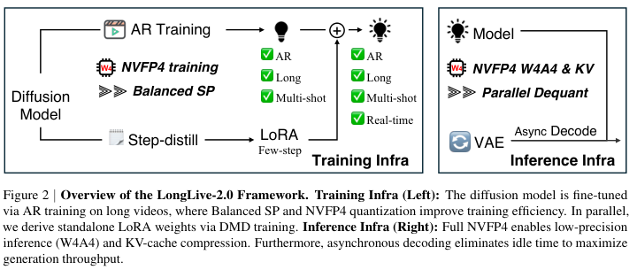{ width="860" }

这套设计把两种能力分开处理：**长视频 AR 训练负责长时、多镜头和交互能力；独立 DMD LoRA 负责减少去噪步数**。两者不再必须串行训练。[↗](https://arxiv.org/pdf/2605.18739v2#page=6) [↗](https://arxiv.org/pdf/2605.18739v2#page=19)

图 4 进一步说明这种变化。应比较的是训练阶段之间的依赖，而不是模型大小：作者所画的 Self-Forcing 路线包含 ODE initialization 和后续 DMD，LongLive 还包含 long tuning；本文直接从基础模型进行长视频 AR 训练，再注入可独立训练的 LoRA。

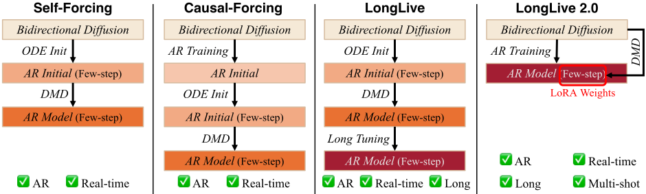{ width="920" }

因此，本文**没有取消蒸馏**。它取消或绕开的是部分串行初始化与渐进长视频调优环节，把 DMD 变成可并行、可复用的模块。[↗](https://arxiv.org/pdf/2605.18739v2#page=2) [↗](https://arxiv.org/pdf/2605.18739v2#page=20)

同期的 [Causal Forcing++](https://arxiv.org/html/2605.15141v1) 从另一方向简化少步训练：用在线单步 teacher ODE 监督的 causal consistency distillation 替代预计算完整 ODE 轨迹，重点在逐帧 1–2 步交互生成。它仍需要额外训练与后续蒸馏，其约 4 倍成本下降仅针对 Stage 2，不能直接与本文整体训练预算比较。两者的共同问题是减少少步 AR 模型的训练负担，但本文更突出的贡献在于长视频训练与低精度部署基础设施的共同设计。

## 2. Balanced SP：让数据准备、上下文和监督属于同一张卡

### 为什么普通 SP 还不够

训练先将视频编码为 VAE latents，再构造 clean/noisy 配对流。每个 noisy chunk 可以关注此前的 clean chunks 和自身 noisy tokens，但不能读取自身对应的 clean chunk，否则会直接看到答案。这样可以在一次前向中同时监督多个目标 chunks。[↗](https://arxiv.org/pdf/2605.18739v2#page=3)

问题在于，如果直接把

$$
[\text{all clean};\text{all noisy}]
$$

当作普通长序列做 SP 切分，一些 rank 会偏向持有 clean context，另一些偏向持有承担 loss 的 noisy targets。与此同时，DiT 的序列虽然被分片，VAE 仍可能在每张卡上重复编码完整视频。

Balanced SP 改变的是**时间块的所有权**：同一 rank 负责某段时间的视频准备、clean latent、noisy latent、注意力和 loss。式 (1) 为：

$$
\mathbf{z}^{(p)}
=
[\mathbf{z}_{clean}^{(p)};\mathbf{z}_{noisy}^{(p)}]
\in
\mathbb{R}^{\frac{L}{P}\times H\times d}.
$$

其中，$L$ 是 clean 与 noisy 合计的 token 数，$P$ 是 SP group size，$H$ 是注意力头数，$d$ 是每个头的维度；$\mathbf z$ 是 patch embedding 后的 DiT 序列。每张卡都拥有本地上下文和相应的监督目标，而不是按两条流分离。[↗](https://arxiv.org/pdf/2605.18739v2#page=3)

图 3 应先比较左、中部分每张 GPU 持有的内容，再看 VAE 输入箭头。中间布局不仅配对 clean/noisy tokens，还把原始视频准备一起分片。右侧 NVFP4 则是互补的 GEMM 优化，不是 Balanced SP 本身。

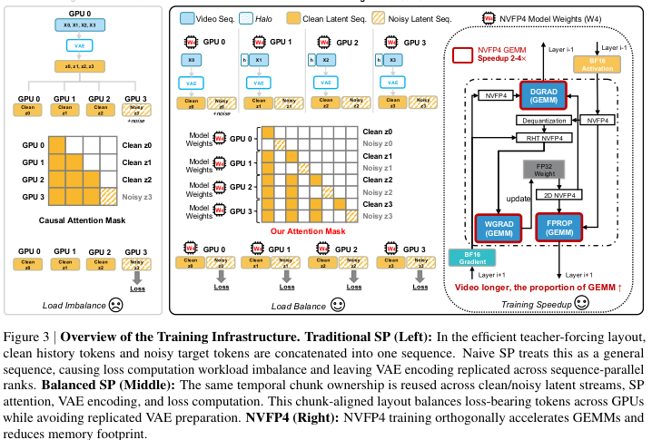{ width="860" }

### VAE 分片为什么需要 halo

视频 VAE 存在时间依赖，不能简单把视频切开后独立编码。本文让每个 rank 编码本地视频块 $X^{(p)}$，再附加覆盖编码器左侧时间感受野的 **halo**；编码完成后丢弃 halo 对应的 latents，只保留本地 $Z^{(p)}$。

只要 halo 覆盖所需左侧依赖，本地编码就能与完整视频编码对齐。每 rank 的成本由 $O(F)$ 变为：

$$
O(F/P+h),
$$

其中 $F$ 为 latent 帧数，$h$ 为 halo 大小。它减少了完整视频的重复准备，但仍有边界冗余，不能称为无开销的 $P$ 倍加速。[↗](https://arxiv.org/pdf/2605.18739v2#page=3) [↗](https://arxiv.org/pdf/2605.18739v2#page=15)

第三方技术博客 [Scaling Video Training with Sequence Parallelism](https://jianyuh.github.io/parallelism/video/2026/06/14/Scaling-Video-Training-SP.html) 也将关键点归纳为“每卡同时持有 context/target，并将 VAE 连同左 halo 一起分片”。这一解释对移植实现很有用：**只给 DiT 接上通用 SP，而不改变 latent preparation，并不能获得整套收益**。该博客的性能数字沿用论文，不构成额外的性能复现。

### 不搬张量，改写 mask 的索引解释

Balanced SP 还要适配 Ulysses attention 的通信接口。式 (7) 将“局部序列、全部 heads”变成“完整序列、部分 heads”：

$$
\mathbf{z}^{(p)}
\in\mathbb{R}^{\frac{L}{P}\times H\times d}
\xrightarrow{\text{All-to-All}}
\tilde{\mathbf{z}}^{(p)}
\in\mathbb{R}^{L\times\frac{H}{P}\times d}.
$$

每张卡计算其 $H/P$ 个 heads 的完整序列 attention，再通过第二次 All-to-All 恢复序列分片，供 FFN 使用。[↗](https://arxiv.org/pdf/2605.18739v2#page=15)

但通信后的原生顺序是式 (8)：

$$
[
\mathbf{z}_{clean}^{(0)},\mathbf{z}_{noisy}^{(0)},
\ldots,
\mathbf{z}_{clean}^{(P-1)},\mathbf{z}_{noisy}^{(P-1)}
].
$$

如果每层都重排回“所有 clean 在前、所有 noisy 在后”，会增加张量搬运。本文选择保留物理顺序，只恢复索引的逻辑身份。令 $L_{\mathrm{loc}}=L/(2P)$，式 (9) 为：

$$
p(i)=\left\lfloor\frac{i}{2L_{\mathrm{loc}}}\right\rfloor,
\qquad
r(i)=i\bmod 2L_{\mathrm{loc}},
\qquad
t(i)=p(i)L_{\mathrm{loc}}+(r(i)\bmod L_{\mathrm{loc}}).
$$

$p(i)$ 标识 rank block，$r(i)$ 是块内偏移，$t(i)$ 恢复原始时间位置；$r(i)<L_{\mathrm{loc}}$ 表示 clean，否则为 noisy。由这一身份恢复映射 $\pi$，原有 teacher-forcing mask 被写成：

$$
M_{\mathrm{nat}}(i,j)
=
M_{\mathrm{TF}}(\pi(i),\pi(j)).
$$

$\pi$ 不实际重排 Q/K/V，而由 block-sparse mask predicate 根据索引计算，再由 `flex_attention` 编译进融合 kernel。**改变的是物理布局的解释，不是因果可见性。**RoPE、监督 mask 和 loss mask 都使用全局坐标，loss 按全局有效 token 数归一化。[↗](https://arxiv.org/pdf/2605.18739v2#page=15)

### Error recycling 也必须服从同一分区

干净历史上的 teacher forcing 仍有 exposure bias：训练时的历史通常来自真值，推理时则来自模型。作者沿用 error recycling，保存过去 latent prediction errors，并随机扰动 clean stream。

本文在系统层面的要求是：error buffer 也按相同时间分区分片。其二维 bucket 以本地 block position 和 diffusion timestep 索引，每 rank 保存 $N_{\mathrm{blk}}/P$ 个位置及全局 offset；context corruption 匹配位置并对 timestep 边缘化，latent/noise corruption 同时匹配位置和 timestep。warm-up 只在相同 SP rank 的 DP ranks 间汇集，checkpoint 也按 SP rank 保存，防止将误差重放到错误的时间位置。[↗](https://arxiv.org/pdf/2605.18739v2#page=16)

这说明 Balanced SP 不是单个 attention kernel 技巧，而是一套贯穿数据准备、坐标、监督和训练状态的所有权约定。

## 3. NVFP4：压缩 GEMM 操作数，而非把所有状态都变成 FP4

NVFP4 使用 E2M1 FP4 数值和两级缩放。式 (2) 为：

$$
\hat{X}
=
\hat{X}^{\mathrm{FP4}}
\cdot\alpha^{\mathrm{FP8}}
\cdot\alpha^{\mathrm{FP32}},
\qquad
\hat{X}^{\mathrm{FP4}}\in\mathbb{F}_{\mathrm{E2M1}}.
$$

每 16 个元素共享 FP8 E4M3 块尺度，整个张量再使用 FP32 全局尺度。E2M1 的数值集合为：

$$
\{0,\pm0.5,\pm1,\pm1.5,\pm2,\pm3,\pm4,\pm6\}.
$$

码值间距并不均匀，尺度选择因此直接影响局部数据落在哪些粗糙间隔上。[↗](https://arxiv.org/pdf/2605.18739v2#page=4)

AR 训练沿用既有 NVFP4 实践：

- 权重使用 2D block scaling，激活和梯度使用 1D block scaling。
- 前向、反向和权重梯度 GEMM 的操作数低精度化。
- 归约、归一化统计量和优化器状态保留高精度。
- 权重梯度 GEMM 的敏感操作数在量化前执行 Random Hadamard Transform。
- 实现依赖专用 NVFP4 GEMM CUDA kernels、自定义量化/反量化，以及 RHT 分支的 Triton kernels。[↗](https://arxiv.org/pdf/2605.18739v2#page=4) [↗](https://arxiv.org/pdf/2605.18739v2#page=17)

### 为什么同时搜索“最大值映射到 6”和“映射到 4”

少步蒸馏和缓存量化采用沿用自 Four Over Six 的尺度搜索。直觉是：若最大值映射到 6，约为块最大值 75% 的值会落在较粗的区间；若最大值映射到 4，则码值 3 可以准确对应这一比例。两种尺度各有适合的数据分布，不必预先统一选择一种。

令归一化块为：

$$
\bar{\mathbf U}_{B_i}
=
\mathbf U_{B_i}/\alpha_{\mathrm{FP32}},
$$

式 (12) 构造两个候选：

$$
\alpha_{i(6)}^{\mathrm{FP8}}
=
\operatorname{cast}_{\mathrm{E4M3}}
\left(\frac{\max|\bar{\mathbf U}_{B_i}|}{6}\right),
\qquad
\alpha_{i(4)}^{\mathrm{FP8}}
=
\operatorname{cast}_{\mathrm{E4M3}}
\left(\frac{\max|\bar{\mathbf U}_{B_i}|}{4}\right).
$$

各自量化并反量化后，式 (13) 选择重建误差更小者：

$$
\alpha_i^\star
=
\underset{\alpha\in
\{\alpha_{i(6)}^{\mathrm{FP8}},\alpha_{i(4)}^{\mathrm{FP8}}\}}
{\arg\min}
\left\|
\mathbf U_{B_i}-\hat{\mathbf U}_{B_i}(\alpha)
\right\|_2^2.
$$

$B_i$ 是 16 值块，$\hat{\mathbf U}_{B_i}(\alpha)$ 是候选尺度下的反量化结果。它是逐块二选一，不是把所有块的最大码值统一从 6 改成 4。[↗](https://arxiv.org/pdf/2605.18739v2#page=18)

原生低精度计算收益依赖 Blackwell Tensor Cores。图中标注的 GEMM 2–4 倍组件加速，不能直接当成训练或整段视频生成的端到端加速。

## 4. 独立 DMD LoRA：把少步能力做成可复用模块

默认 DMD 路线中，student、teacher 和 critic 都从原始 Wan2.2-TI2V-5B 初始化，teacher 使用 AR mask。real-score 是冻结的 W4A4 模型；generator 和 fake-score 使用冻结量化 backbone，加可训练 BF16 LoRA。DMD 目标本身不变。[↗](https://arxiv.org/pdf/2605.18739v2#page=4) [↗](https://arxiv.org/pdf/2605.18739v2#page=19)

式 (4) 表示为：

$$
\mathbf W
\simeq
\operatorname{Dequant}(Q_{\mathrm{search}}(\mathbf W_0))
+\Delta\mathbf W,
\qquad
\Delta\mathbf W
=
\frac{\alpha_{\mathrm{LoRA}}}{r}\mathbf B\mathbf A.
$$

其中，$\mathbf W_0$ 为预训练 backbone，$Q_{\mathrm{search}}$ 为尺度搜索 NVFP4 量化，$\mathbf A,\mathbf B$ 为秩 $r$ 的可训练低秩矩阵，$\alpha_{\mathrm{LoRA}}$ 控制更新尺度。[↗](https://arxiv.org/pdf/2605.18739v2#page=4)

图 12 比较两种初始化方式，而不是“有无 LoRA”。直接从 AR 模型做 DMD 的对照也使用相同 LoRA 配置。阅读时应先区分上下两排初始化策略，再比较示例的风格。

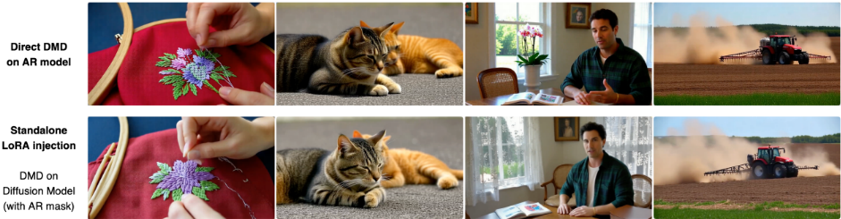{ width="920" }

作者观察，直接对 AR 模型做 DMD 更容易出现高对比度、合成感，独立 LoRA 注入则更自然；作者也承认这种偏好有主观性。更明确的流程价值是：DMD 不必等待 AR checkpoint，可以与 AR 训练并行；所得 LoRA 可注入同一基础模型体系中、使用不同视频数据训练的 AR 模型。它不意味着任意模型之间都能通用迁移。[↗](https://arxiv.org/pdf/2605.18739v2#page=20)

### 数据和预算也是训练配方的一部分

长视频训练集包含 **120K 条视频**，16–32 秒、32–64 秒、超过 64 秒各占三分之一。处理流程先分镜并标注视觉、场景、角色、动作和摄影信息，再合并修订跨镜头描述；清洗去除过短镜头、水印文字、严重抖动、异常速度、曝光问题、模糊和冻结低运动内容，并按采样帧 MANIQA 平均分保留高排名视频。[↗](https://arxiv.org/pdf/2605.18739v2#page=14)

主要训练配置如下：

|阶段|资源与批量|训练设置|报告预算|
|---|---|---|---:|
|长视频 AR|32 张 GB200；SP=4；hybrid-full FSDP；每 SP group local batch=1；累积 2 次；global batch=16|600 iterations；学习率 $10^{-5}$；AdamW betas=(0.0, 0.999)；EMA 从 step 100 开始，decay=0.99|1920 GB200 GPU-hours|
|独立 DMD LoRA|16 张 GB200；local batch=2；global batch=32|5000 iterations；generator/critic 学习率分别为 $10^{-5}/2\times10^{-6}$；critic 每步更新，generator 每五步更新|60 GB200 GPU-hours|

LoRA rank=128、alpha=128、dropout=0，作用于 causal Wan attention blocks 内的 Linear layers。文本编码器与 VAE 全程冻结；通用设置包括 gradient checkpointing 和 AdamW weight decay=0.01。两阶段报告预算相加为 **1980 GPU-hours**，不含基础模型预训练与数据构建。[↗](https://arxiv.org/pdf/2605.18739v2#page=19) [↗](https://arxiv.org/pdf/2605.18739v2#page=20)

## 5. 训练实验：收益来自布局、精度，还是更长上下文？

### 固定精度看布局，再固定布局看量化

表 1 报告端到端秒/iteration。先在 BF16 下比较普通 SP 和 Balanced SP，再比较同为 Balanced SP 的 BF16 与 NVFP4，才能分清两项设计的贡献。

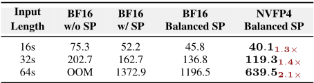{ width="920" }

|输入视频长度|BF16 无 SP|BF16+SP|BF16+Balanced SP|NVFP4+Balanced SP|
|---|---:|---:|---:|---:|
|16 s|75.3 s|52.2 s|45.8 s|40.1 s|
|32 s|202.7 s|162.7 s|136.8 s|119.3 s|
|64 s|OOM|1372.9 s|1196.5 s|639.5 s|

普通 SP 首先让 64 秒训练不再 OOM；Balanced SP 在 BF16 下进一步降低三种长度的耗时，说明收益并非完全来自低精度。

固定 Balanced SP 后，由 BF16 时间除以 NVFP4 时间计算，16/32/64 秒分别约为 **1.14/1.15/1.87 倍加速**。最终 64 秒配置相对 BF16+SP 的 $1372.9/639.5\approx2.15$ 倍，则同时包含布局和精度变化。长序列上的更大收益与作者关于 GEMM 占比增加的解释一致，但该表没有直接测量 GEMM 占比。[↗](https://arxiv.org/pdf/2605.18739v2#page=6) [↗](https://arxiv.org/pdf/2605.18739v2#page=7)

这里应使用表 1 和正文的“秒/iteration”口径；首页图 1 将同组数字标成 ms，与该口径不一致。[↗](https://arxiv.org/pdf/2605.18739v2#page=1) [↗](https://arxiv.org/pdf/2605.18739v2#page=6)

### DMD 的低精度价值首先体现为三模型共置显存

表 2 沿 Generator/Real/Fake 三列看各分支如何逐步量化，指标是**单 GPU 峰值显存**。

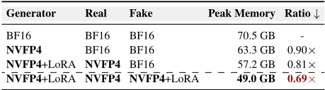{ width="920" }

|Generator|Real-score|Fake-score|峰值显存|
|---|---|---|---:|
|BF16|BF16|BF16|70.5 GB|
|NVFP4|BF16|BF16|63.3 GB|
|NVFP4+LoRA|NVFP4|BF16|57.2 GB|
|NVFP4+LoRA|NVFP4|NVFP4+LoRA|49.0 GB|

最终降低 21.5 GB，按 $21.5/70.5$ 计算约为 **30.5%**。这些行同时改变分支精度与 adapter 配置，因此不能将总显存收益单独归因于 LoRA。[↗](https://arxiv.org/pdf/2605.18739v2#page=6)

### 为什么选择 SP，而不是所有长度都用最省显存的方法？

图 8 在 4 张 GB200 上比较 SP、TP 和 DP。应先看显存曲线随上下文增长是否交叉，而不是只看最短序列。

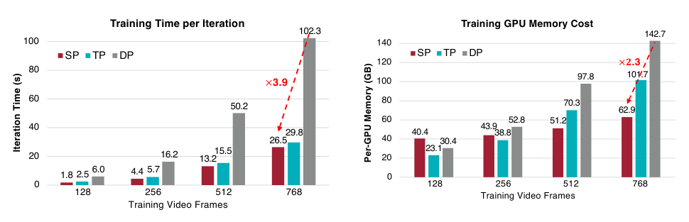{ width="920" }

在 128/256/512/768 个训练视频帧下：

- SP：40.4/43.9/51.2/62.9 GB；
- TP：23.1/38.8/70.3/101.7 GB；
- DP：30.4/52.8/97.8/142.7 GB。

短上下文时 TP 更省显存，到了 512 和 768 帧，SP 才体现出显存优势。正文另报告 SP 相对 TP 加速 1.12–1.41 倍，相对 DP 加速 3.40–3.86 倍。这里支持的判断是 **SP 更适合长上下文扩展**，而不是“SP 在所有长度上都最省显存”。[↗](https://arxiv.org/pdf/2605.18739v2#page=16)

## 6. 流式交互：保留全局身份，也锚定当前镜头

交互的单位是 latent chunk $Z_i$，每个 chunk 绑定独立提示 $T_i$，交叉注意力按 $\operatorname{CrossAttn}(Z_i,T_i)$ 分解。用户可以在 chunk 边界修改提示，控制尚未生成的未来，而不重做已生成历史。[↗](https://arxiv.org/pdf/2605.18739v2#page=6)

有限滑动窗口带来另一个问题：早期内容离开窗口后，模型可能逐渐忘记主体身份和当前镜头布局。只保留最初帧不足以锚定后续镜头；只移动到当前镜头开头又可能丢失全局身份。本文因此使用双层 attention sink：

- 全局 $\mathcal A_g$：视频最初 $S_g$ 帧，始终固定；
- 镜头级 $\mathcal A_s$：当前镜头最初 $S_s$ 帧，切镜头时重绑定。

有效历史集合为：

$$
\mathcal K_{\mathrm{eff}}(t)
=
\mathcal A_g
\cup
\mathcal A_s
\cup
\mathrm{KV}[t-W,t),
$$

重叠 token 去重，$W$ 是以 chunk 计的窗口长度。作者将窗口计算规模写为 $O(W\cdot L_c)$，其中 $L_c$ 是每 chunk token 数。[↗](https://arxiv.org/pdf/2605.18739v2#page=6)

图 7 应区分贯穿所有镜头的全局锚点，以及每次切镜头后重建的局部锚点，而不是把图中历史理解为全部稠密缓存。

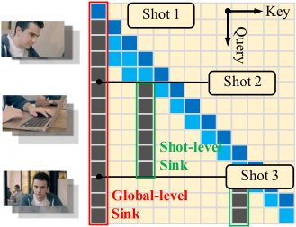{ width="920" }

局部 sink 通过 START、LEN 指针跟踪；窗口越过后，将其虚拟前置，避免复制已有缓存。所谓零额外开销针对这一复用实现，不意味着锚点无需驻留。prompt 切换时更新局部 sink、重新初始化后续 cross-attention cache，同时保持全局 sink 和过去历史不变。[↗](https://arxiv.org/pdf/2605.18739v2#page=6) [↗](https://arxiv.org/pdf/2605.18739v2#page=17)

图 10 的关键比较是第二镜头开始与结束的变化。作者展示，没有双层 sink 时，早期帧离开窗口后主体外观和场景布局发生漂移；加入后续写更稳定。

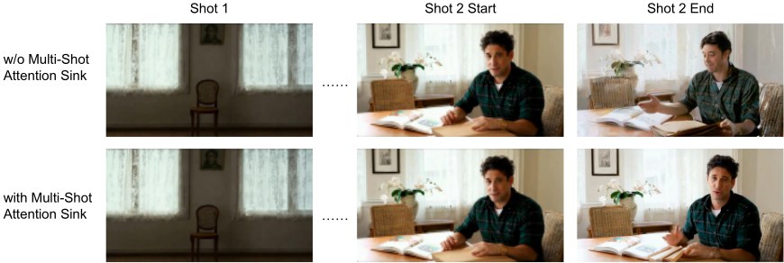{ width="920" }

这给出了明确失败模式与修复示例，但没有量化分离 global sink 和 shot-level sink 各自的贡献。[↗](https://arxiv.org/pdf/2605.18739v2#page=18)

## 7. 推理优化必须分成三件事：计算、存储与等待

### KV 量化主要解决容量问题

缓存按 frame-chunk 管理，每 chunk $F_c=8$ 帧，$T_c=F_cL_f$ 个 latent tokens，$L_f$ 为每帧 token 数。式 (5) 为：

$$
\mathbf K_{\ell,c},\mathbf V_{\ell,c}
\in\mathbb R^{T_c\times H\times d}.
$$

第 $\ell$ 层、第 $c$ 个 chunk 的 K/V 被 reshape 为 $(T_cH)\times d$，独立量化。K 先沿末维去均值，式 (6) 为：

$$
\bar{\mathbf K}_{\ell,c}[t,h,:]
=
\mathbf K_{\ell,c}[t,h,:]
-
\frac1d\sum_{u=1}^{d}\mathbf K_{\ell,c}[t,h,u].
$$

随后采用自适应尺度搜索。忽略张量尺度摊销和 padding，成对 K/V 的存储从 $4T_cHd$ bytes 降为 $(9/8)T_cHd$ bytes，约为 **3.6 倍压缩**。定制 CUDA kernel 并行重建活跃窗口。[↗](https://arxiv.org/pdf/2605.18739v2#page=5)

作者报告量化/反量化开销低于 2%，但是否让完整推理更快，仍要看实际消融，不能由压缩率直接推导。

### 异步 VAE 解决的是等待，不是 model FPS

图 6 沿两张 GPU 的时间线阅读：DiT 生成 chunk $c+1$ 时，专门的 VAE GPU 解码 chunk $c$，不再等待全部 latent 生成完毕。

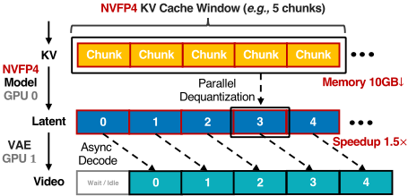{ width="920" }

逐 chunk 解码并立即 CPU offload，使 VAE 侧 GPU 显存由 $O(C\cdot T_c)$ 变为 $O(T_c)$，其中 $C$ 是累计 chunk 数；这不是整个系统总显存的复杂度。若每 chunk 的去噪延迟 $t_{\mathrm{DiT}}\ge t_{\mathrm{VAE}}$，总延迟近似从：

$$
C(t_{\mathrm{DiT}}+t_{\mathrm{VAE}})
$$

降至：

$$
C\cdot t_{\mathrm{DiT}}+t_{\mathrm{VAE}}.
$$

它隐藏大部分解码等待，但仍有启动、收尾成本，而且额外占用一张 GPU。[↗](https://arxiv.org/pdf/2605.18739v2#page=5)

官方 [README](https://github.com/NVlabs/LongLive/blob/main/LongLive2.0/README.md) 明确 FPS 仅统计 diffusion 时间、排除 VAE 解码，因此部署时需要同时看 model FPS 和 E2E latency。仓库还记录了 2026-05-25 的融合算子、缓存同步和 LoRA 先于量化的初始化更新，并宣称吞吐再提高 18.6%。这是作者后续实现版本的结果；复现论文配置时应固定 commit，避免把后续代码收益混入论文数字。

### GB200 消融：45.7 FPS 是怎样组合出来的？

表 3 使用 GB200 180GB；启用 Async Decoding 时额外使用一张 GPU。先固定 4 步看模型和缓存量化，再看异步解码与减步数。

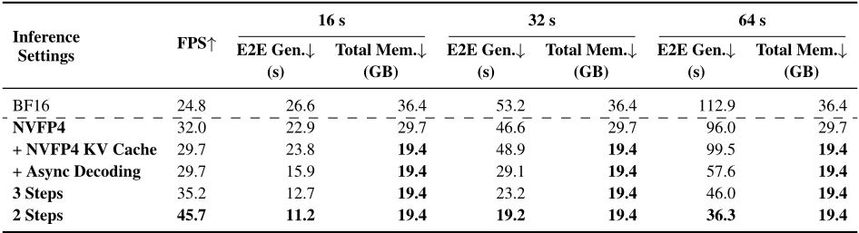{ width="920" }

|渐进配置|Model FPS|16 s 视频 E2E|32 s 视频 E2E|64 s 视频 E2E|所列显存|
|---|---:|---:|---:|---:|---:|
|BF16|24.8|26.6 s|53.2 s|112.9 s|36.4 GB|
|NVFP4|32.0|22.9 s|46.6 s|96.0 s|29.7 GB|
|再加 NVFP4 KV cache|29.7|23.8 s|48.9 s|99.5 s|19.4 GB|
|再加 Async Decoding|29.7|15.9 s|29.1 s|57.6 s|19.4 GB|
|再减至 3 steps|35.2|12.7 s|23.2 s|46.0 s|19.4 GB|
|再减至 2 steps|45.7|11.2 s|19.2 s|36.3 s|19.4 GB|

这张表清楚地区分了三个结论：

1. **模型 NVFP4 同时改善计算与显存**：FPS 从 24.8 增至 32.0，显存从 36.4 降至 29.7 GB。
2. **KV 量化用速度换容量**：显存进一步降至 19.4 GB，但 FPS 从 32.0 降至 29.7，64 秒 E2E 从 96.0 增至 99.5 秒。
3. **异步解码用额外硬件换交付时间**：model FPS 不变，64 秒 E2E 从 99.5 降至 57.6 秒，按两数相除约为 1.73 倍加速。表中 19.4 GB 未明确合并额外 VAE 卡显存，不能解释为所有 GPU 的总显存。[↗](https://arxiv.org/pdf/2605.18739v2#page=7)

最终 $45.7/24.8\approx1.84$ 倍 model FPS 同时包含精度与去噪步数变化；36.3 秒的端到端结果还包含异步 VAE 资源。首页图 1 的 35.4 GB 与表 3 的 36.4 GB 也不宜混作同一基线。[↗](https://arxiv.org/pdf/2605.18739v2#page=1) [↗](https://arxiv.org/pdf/2605.18739v2#page=7) [↗](https://arxiv.org/pdf/2605.18739v2#page=8)

## 8. 质量证据：长程身份保留，不代表语义和动态完全不变

### 同规格比较揭示速度—质量取舍

短视频评测使用官方 VBench prompts 加作者的 prompt augmentation。表 4 中跨模型行的参数量、分辨率和去噪步数并不一致，应先比较本文同为 5B、1280×720 的配置。

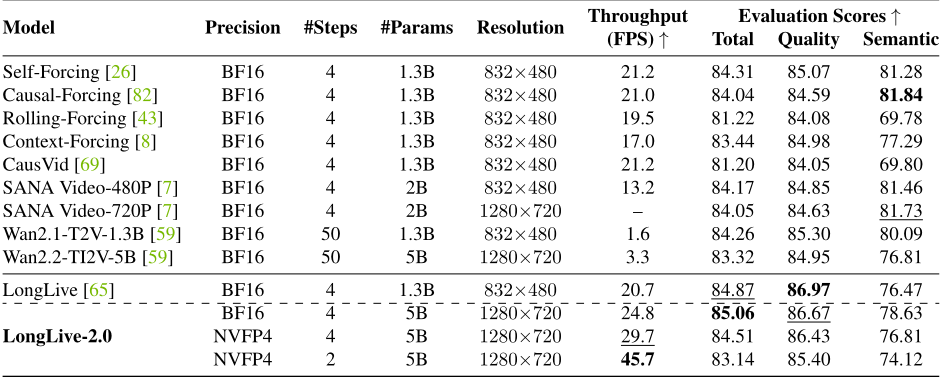{ width="920" }

|本文配置|FPS|Total|Quality|Semantic|
|---|---:|---:|---:|---:|
|BF16，4 步|24.8|85.06|86.67|78.63|
|NVFP4，4 步|29.7|84.51|86.43|76.81|
|NVFP4，2 步|45.7|83.14|85.40|74.12|

最快配置不是最高质量配置。相对 BF16 四步，NVFP4 两步的 Total 低 1.92 分，Semantic 低 4.51 分；这里的差值由表内分数直接相减得到。实时性要求高时，这可能是合理交换，但不能表述为无损加速。[↗](https://arxiv.org/pdf/2605.18739v2#page=7)

跨方法比较也要保留规格：Self-Forcing、Causal-Forcing 和 LongLive 的相近基线都是 BF16、4 步、1.3B、832×480，分别为 21.2/21.0/20.7 FPS，Total 为 84.31/84.04/84.87；Wan2.2-TI2V-5B 则是 50 步、720p，3.3 FPS、Total 83.32。本文展示了更大、更高分辨率 AR 模型仍能保持较高吞吐，但这些跨规格差距不能全部归因于某一个系统组件。[↗](https://arxiv.org/pdf/2605.18739v2#page=7)

### 低精度训练能否比直接 PTQ 更好？

表 7 固定 4 步、5B、720p，比较 BF16、直接 PTQ 和预先 NVFP4 训练。它回答的是训练—部署精度对齐的问题，不是尺度搜索相对固定尺度的独立消融。

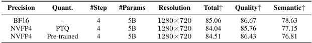{ width="920" }

|精度设置|Total|Quality|Semantic|
|---|---:|---:|---:|
|BF16|85.06|86.67|78.63|
|NVFP4 PTQ|84.04|85.76|77.15|
|Pre-trained NVFP4|84.51|86.43|76.81|

预先低精度训练改善了 Total 和 Quality，但 Semantic 比 PTQ 略低，不能写成所有维度都恢复。[↗](https://arxiv.org/pdf/2605.18739v2#page=18)

图 11 提供局部视觉补充：应关注后续镜头的眼部细节，而不是只看初始帧。作者展示 PTQ 出现模糊，而 pre-trained NVFP4 保留较清楚的面部细节。

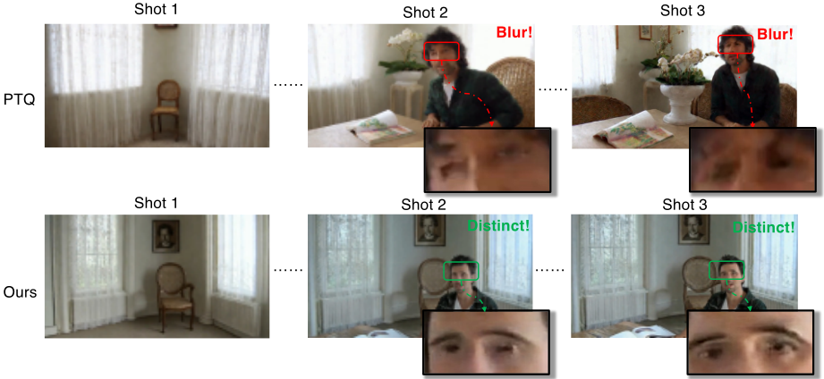{ width="920" }

这一例子支持精度对齐对局部细节的帮助，但不替代定量评测，也不证明所有视频都会出现相同差异。[↗](https://arxiv.org/pdf/2605.18739v2#page=19)

### 60 秒长视频：一致性领先，动态程度存在明显代价

长视频实验使用 MovieGenBench prompts，以 4 步生成 60 秒视频。表 5 按六项百分比分数计算平均排名，分数越高越好，Avg. Rank 越低越好。

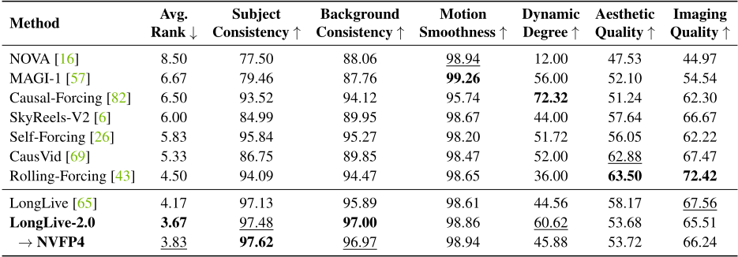{ width="920" }

|配置|Subject|Background|Motion Smoothness|Dynamic Degree|Aesthetic|Imaging|Avg. Rank|
|---|---:|---:|---:|---:|---:|---:|---:|
|LongLive|97.13|95.89|98.61|44.56|58.17|67.56|4.17|
|LongLive-2.0|97.48|97.00|98.86|60.62|53.68|65.51|3.67|
|LongLive-2.0 NVFP4|97.62|96.97|98.94|45.88|53.72|66.24|3.83|

本文两种精度配置占平均排名前两位，优势主要在主体与背景一致性，而非所有指标全面领先。其他方法中，MAGI-1 的平滑度为 99.26，Causal-Forcing 的动态程度为 72.32，Rolling-Forcing 的美学/成像为 63.50/72.42。[↗](https://arxiv.org/pdf/2605.18739v2#page=8)

最影响采用判断的反例是：NVFP4 的 Dynamic Degree 从 60.62 降至 45.88，而主体一致性几乎不变甚至略升。**稳定地保留主体，不等于完整保留动作丰富性。**若应用更重视运动和事件展开，不能只按平均排名或主体一致性选择低精度配置。

## 9. 非 Blackwell 部署：低比特首先节省通信，而非提供原生 FP4 算力

A100/H100 不具备本文优化 NVFP4 kernels 所需的原生硬件支持。替代路径是 Ulysses SP：通过序列分片降低每设备显存，同时压缩 attention 前 All-to-All 交换的 Q/K/V。

本文复用已压缩历史 K/V，并在通信前将运行时 Q 转为 NVFP4。式 (11) 为：

$$
\mathbf M^{(p)}
\in\mathbb R_{(\mathrm{NVFP4})}^{\frac LP\times H\times d}
\xrightarrow{\mathrm{All\text{-}to\text{-}All}}
\widetilde{\mathbf M}^{(p)}
\in\mathbb R_{(\mathrm{NVFP4})}^{L\times\frac HP\times d},
\qquad M\in\{Q,K,V\}.
$$

这里 $L$ 是推理 token 序列长度，$P$ 为 SP 组大小。含 micro-block scales 后，通信载荷从每值 16 bits 降至约 4.5 bits，即约 3.6 倍通信量压缩；这不是端到端 3.6 倍加速。[↗](https://arxiv.org/pdf/2605.18739v2#page=16)

图 9 沿 Linear→All-to-All→Attention→All-to-All 阅读，重点是压缩表示在哪里进入 collective，而不是把计算 kernel 与通信优化混为一谈。

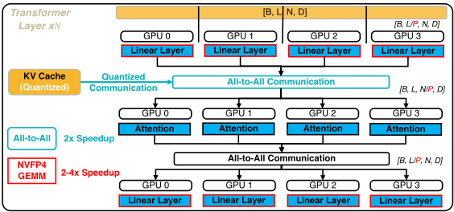{ width="920" }

H100 的表 6 显示，低比特配置在相同 SP 大小下改善 E2E 和通信时间，但增加 GPU 数不一定更快。以实测的 16/32 秒视频为例：

|SP 大小与配置|16 s E2E|16 s 通信|32 s E2E|32 s 通信|
|---|---:|---:|---:|---:|
|SP=2，BF16|19.3 s|1.8 s|38.1 s|3.2 s|
|SP=2，4-bit KV|18.3 s|1.1 s|36.0 s|2.3 s|
|SP=4，BF16|26.2 s|12.8 s|38.6 s|12.2 s|
|SP=4，4-bit KV|21.1 s|7.8 s|32.3 s|9.7 s|

16 秒时，SP=4 的低比特配置仍慢于 SP=2；32 秒时，SP=4 才更快。单卡 BF16 对应 E2E 为 31.0/50.2 秒。表中 64 秒结果则由较短运行估计，SP=2 的低比特配置为 53.3 秒，SP=4 为 54.8 秒，不能当作直接测量的长视频运行。[↗](https://arxiv.org/pdf/2605.18739v2#page=17)

因此，SP degree 必须按序列长度和互连成本选择，不能由“更多卡能运行”推导“更多卡总是更快”，也不能把非 Blackwell 路线理解为同卡数、同成本替代。

相关的 [Causal-RoPE SP 工作](https://arxiv.org/abs/2603.06664) 使用全局时间索引、算子融合和 RoPE 预计算，在 8 张 A800、BF16、5 秒 480p 上报告 1.58 倍推理加速。它同样说明 SP 的实用性依赖坐标正确性和通信工程，但其硬件、长度和分辨率与本文不同，不能拿该倍数与 GB200 720p 的结果做效率排名。本文更具体的增量，是把缓存压缩接入 collective 的实际表示路径。

## 10. 怎样采用这套方案

对于训练者，最值得复用的不是一个孤立 kernel，而是**以时间块为共同所有权单位**：

- VAE 本地块与 halo；
- clean/noisy 配对；
- 全局 RoPE 与 attention mask；
- loss 归一化；
- error-recycling buffer。

这些接口必须一致，才能既保持逻辑正确性，又避免重复准备和不必要重排。对维护多个同基础 AR checkpoint 的团队，独立少步 LoRA 还可以减少训练调度的串行依赖，但仍需计入明确的 DMD 预算。[↗](https://arxiv.org/pdf/2605.18739v2#page=15) [↗](https://arxiv.org/pdf/2605.18739v2#page=16) [↗](https://arxiv.org/pdf/2605.18739v2#page=20)

对于部署者，应先确定自己在优化什么：

|主要约束|优先考虑|必须接受或检查的代价|
|---|---|---|
|Blackwell 上的模型计算时间|W4A4 NVFP4|质量指标并非完全不变|
|显存容量|NVFP4 KV cache|单卡 model FPS 可能下降|
|端到端视频交付时间|异步 VAE 解码|额外一张 GPU及流水线收尾成本|
|最高实时吞吐|两步 DMD LoRA|语义和部分质量下降|
|动作丰富性、语义保留|重点比较四步、BF16及低精度配置|不能只看平均排名|
|H100 等非 Blackwell 环境|SP 与低比特通信|多卡预算、互连和 SP degree 的选择|

LongLive-2.0 最实用的启示是：**长视频系统的性能取决于数据和状态如何穿过各个模块，而不仅取决于模型本身有多快。**将时间分区、精度、缓存和解码接口对齐，可以把基础视频模型变成可按 chunk 改提示、保留历史并继续生成的系统；真正落地时，则应分别测量模型吞吐、总显存、端到端延迟和长程质量，而不是让一个最高 FPS 数字替代全部选择。[↗](https://arxiv.org/pdf/2605.18739v2#page=7) [↗](https://arxiv.org/pdf/2605.18739v2#page=8)
