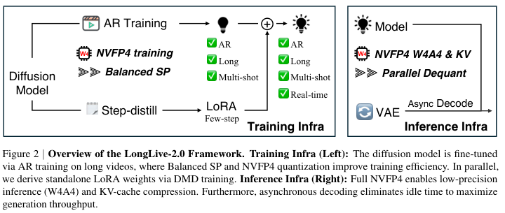
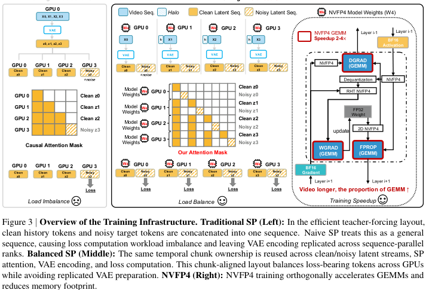

# LongLive-2.0：NVFP4 长视频生成基础设施

!!! info "论文信息"
    **论文题名：** LongLive-2.0: An NVFP4 Parallel Infrastructure for Long Video Generation。 
    **作者：** Yukang Chen、Luozhou Wang、Wei Huang、Shuai Yang、Bohan Zhang、Yicheng Xiao、Ruihang Chu、Weian Mao、Qixin Hu、Shaoteng Liu、Yuyang Zhao、Huizi Mao、Ying-Cong Chen、Enze Xie、Xiaojuan Qi、Song Han。 
    **机构：** NVIDIA。 
    **时间 / 主题：** 2026-05；长视频生成、视频扩散系统、NVFP4 训练与推理。 
    **arXiv / 官方报告：** arXiv：[2605.18739](https://arxiv.org/abs/2605.18739)；PDF：[arxiv.org/pdf/2605.18739](https://arxiv.org/pdf/2605.18739)。 
    **GitHub / 项目：** GitHub：[github.com/NVlabs/LongLive](https://github.com/NVlabs/LongLive)。 
    **元数据来源与核验口径：** 来源：arXiv v2、论文 PDF、官方 GitHub README；Checked Date：2026-07-25；Repro Status：Paper / official GitHub reviewed, independent reproduction not claimed。

## 原论文故事线

### 研究背景

长视频生成把视频扩散的两个瓶颈同时放大：训练时序列更长，VAE latent 准备、DiT GEMM、activation 显存都会上升；推理时历史 KV cache 随生成长度增长，VAE decoding 也会变成端到端延迟的一部分。已有长视频方法常从算法侧解决，比如把双向 diffusion 改成 AR diffusion、做 ODE initialization、DMD 蒸馏、long tuning 或 streaming 调整。LongLive-2.0 的立场更系统：长视频要真正实用，训练 layout、低精度格式、KV cache、VAE decode 都要一起设计。

### 问题（Challenge）

论文要解决的问题是：怎样把一个长视频 AR diffusion pipeline 做到训练可扩展、推理低延迟、显存可控，并且支持 long、multi-shot、interactive 和 real-time。挑战有四层。第一，AR teacher-forcing 的 clean-history 和 noisy-target token 混在一起，naive sequence parallel 会造成 loss workload 不均衡。第二，视频 VAE 编码如果每个 SP rank 都重复做，长视频训练仍然浪费。第三，FP4 训练和推理必须对齐，否则 PTQ 会带来质量损失。第四，推理时 KV cache 和 VAE decoding 都会进入端到端瓶颈，不能只报告 diffusion model FPS。

### Finding

LongLive-2.0 的 finding 是：长视频生成的算法简化来自基础设施能力，而不只是新的 loss。只要 AR training 能直接吃长视频、NVFP4 能贯穿 AR training / DMD / inference、KV cache 和 VAE decode 能被系统化处理，就可以绕开部分复杂多阶段流程。论文把“先 ODE initialization，再 DMD，再 long tuning”的路线压成：直接把 bidirectional diffusion fine-tune 成 long multi-shot AR model，再用 standalone LoRA 赋予 few-step 能力。

### 方法

方法分训练与推理两侧。训练侧，LongLive-2.0 提出 sequence-parallel AR training 的 Balanced SP 实例：每个 rank 同时拥有同一时间 chunk 的 clean latent 和 noisy latent，让 VAE 编码、attention mask、loss-bearing tokens 和 SP shard 对齐。它再把 AR training 和 DMD distillation 放到 NVFP4 路径中，用 BF16 保存敏感操作、用 RHT 稳定 weight-gradient GEMM、用 LoRA 限制 DMD 更新范围。推理侧，模型执行 W4A4 NVFP4，KV cache 按 chunk 做 NVFP4 quantization，窗口内重建用 parallel dequantization，并用异步 streaming VAE decode 把解码隐藏在下一 chunk denoising 后面。multi-shot attention sink 负责在滑动窗口生成中同时保留全局身份和当前 shot 的局部一致性。

### 结论

作者报告 LongLive-2.0 在 64s AR training 上相对 BF16+SP 达到 2.1x speedup；DMD training 中逐步 NVFP4 化 generator、real-score、fake-score 后，peak per-GPU memory 从 70.5 GB 降到 49.0 GB；推理上 2-step LongLive-2.0-5B 达到 45.7 FPS，并在 64s 视频设置中把 E2E latency 降到 36.3s、memory 保持 19.4 GB。边界也很明确：NVFP4 推理的加速强依赖 Blackwell GPU 和相应 kernel，VBench/VBench-Long 只能证明 benchmark 质量，不能替代真实交互应用的稳定性评估。

### 关键术语

- **Balanced SP（均衡序列并行）**：让每个 sequence-parallel rank 拥有同一时间 chunk 的 clean/noisy latent，从而平衡 loss、attention 和 VAE 准备成本。
- **NVFP4（NVIDIA FP4）**：4-bit floating-point 格式，配合 FP8 block scale 和 FP32 global scale，在 Blackwell GPU 上有硬件支持。
- **AR Diffusion（自回归扩散）**：按 chunk 生成视频，当前 noisy chunk 依赖已经生成的 clean history。
- **DMD（Distribution Matching Distillation，分布匹配蒸馏）**：用 real score 与 fake score 的差分把多步扩散蒸馏成少步生成器。
- **KV Cache Quantization（KV 缓存量化）**：把长视频自回归 attention 的历史 key/value 低比特存储，减少显存和通信。
- **Asynchronous Streaming Decoding（异步流式解码）**：VAE 解码当前 chunk 的同时，DiT 继续 denoise 下一 chunk。

## 论文位置

LongLive-2.0 要接在 [CausVid](causvid.md)、[Diffusion Forcing](diffusion-forcing.md)、[DMD2](dmd2.md) 和视频世界模型效率路线后读。CausVid 证明双向视频 diffusion 可以转成 causal streaming student；Self-Forcing 系列强调训练/推理分布对齐；LongLive-2.0 则把问题推向基础设施：长视频系统能不能训练得动、推理得快、显存放得下。

| Method line | Main concern | LongLive-2.0 response |
| --- | --- | --- |
| CausVid / Self-Forcing | causal few-step streaming video diffusion | 继续支持 AR 和 few-step，但简化训练 pipeline |
| DMD / DMD2 |少步生成的分布匹配 | 用 standalone LoRA 做 few-step capability，不全量更新 backbone |
| Efficient attention |降低 attention compute | 同时压低 GEMM、KV cache、VAE decode 和 SP communication |
| Model quantization |低精推理 | 把 NVFP4 扩展到 AR training、DMD training 和 inference |

论文最值得读的地方是系统接口，而不是单个 benchmark 分数。它反复强调 end-to-end generation speed，因为长视频生成的等待时间包括 text/latent preparation、DiT denoising、KV access、VAE decode 和数据搬运。

## 总体框架

{ width="860" }

<small>图源：`LongLive-2.0: An NVFP4 Parallel Infrastructure for Long Video Generation`，Figure 2。原图左侧是 AR training、Balanced SP、NVFP4 training 与 standalone LoRA step-distill；右侧是 W4A4 NVFP4 inference、KV-cache compression、parallel dequantization 和 async VAE decode。</small>

**这张图怎么读：把训练和推理当成同一套系统。**
左边不是单纯训练一个 AR 模型。它同时包含 direct AR long-video fine-tuning 和 standalone LoRA few-step distillation，前者给模型 long / multi-shot / interactive 能力，后者给 real-time few-step 能力。右边也不是只把模型权重转成 FP4，而是把 model、KV cache、dequantization 和 VAE decode 放在同一条推理流水线里。

这张图还解释了论文为什么批评“只做 PTQ”的路线。对于长视频扩散，低精度推理如果没有训练阶段对齐，很容易变成部署时才压精度，质量和稳定性都要额外买单。

## Balanced SP：让 AR teacher forcing 可扩展

{ width="860" }

<small>图源：`LongLive-2.0: An NVFP4 Parallel Infrastructure for Long Video Generation`，Figure 3。原图比较 naive SP 与 Balanced SP，并展示 NVFP4 training 对 GEMM 和显存的作用。</small>

AR training 的目标是让当前 noisy chunk 在 clean history 条件下去噪。对 \(N\)-chunk raw video window，模型会构造 clean latent stream 和 noisy latent stream。高效 teacher-forcing layout 允许一次 forward 监督多个 noisy chunks，但 naive SP 会把序列简单切片，导致某些 rank clean-heavy，某些 rank noisy-heavy，loss-bearing workload 不平衡。

Balanced SP 的设计是让 rank \(p\) 拥有同一 temporal range 的 clean/noisy pair：

\[
z^{(p)} =
\left[
z_{\text{clean}}^{(p)}, z_{\text{noisy}}^{(p)}
\right]
\in
\mathbb{R}^{L/P \times H \times d}.
\]

这样每个 rank 都有 context 和 target tokens，loss 负载更均匀。VAE 编码也跟着同一 temporal partition 走：rank 只编码自己的 raw-video chunk 加上左侧 halo，然后丢弃 halo latent。论文把 per-rank VAE cost 从复制式的 \(O(F)\) 降成：

\[
O(F/P + h),
\]

其中 \(F\) 是 latent frame 数，\(P\) 是 SP group size，\(h\) 是 VAE temporal receptive field 所需 halo。

这个设计的迁移价值是：长视频训练里的并行策略不能只看 DiT sequence，VAE latent preparation、attention mask、loss token 分布和 communication-native token order 也要一起设计。

## NVFP4 训练与 DMD 蒸馏

NVFP4 用 E2M1 FP4 value、FP8 block scale 和 FP32 tensor scale 表示数值。论文写成：

\[
\hat X = \hat X_{\text{FP4}}\cdot \alpha_{\text{FP8}}\cdot \alpha_{\text{FP32}},
\qquad
\hat X_{\text{FP4}}\in \mathcal{F}_{\text{E2M1}}.
\]

LongLive-2.0 把 NVFP4 用在两个训练阶段：

| Stage | Low-precision path | High-precision guardrails |
| --- | --- | --- |
| Multi-shot AR training | linear layer weights、activations、gradients 的 NVFP4 GEMM | reductions、normalization statistics、optimizer states 保持更高精度 |
| Few-step DMD training | generator、real-score、fake-score 低精路径 | backbone 冻结，只训练 LoRA adapters |

论文特别强调 weight-gradient GEMM 的敏感性，因此在该路径使用 Random Hadamard Transform（RHT）帮助稳定量化。DMD 阶段采用 scale search：除了标准 target magnitude 6，也评估 4，并为每个 block 选误差更低的编码。

LoRA 的作用也很具体。DMD 要同时跑 generator、real-score model 和 fake-score model，如果全量更新量化 backbone，数值和显存都更难控。LongLive-2.0 固定 quantized backbone，只训练：

\[
\Delta W = \frac{\alpha_{\text{LoRA}}}{r}BA.
\]

这使 few-step LoRA 可以插入 AR model，让生成从 4 steps 进一步到 2 steps，同时不等待 AR training 完成后再做复杂 long tuning。

## 推理基础设施

推理侧由三件事组成。

第一，W4A4 NVFP4 inference。模型权重和 activation 走 FP4 GEMM，LoRA 可以作为独立分支或合并到 W4A4+LoRA 模型里。论文强调它是 NVFP4-aware training 后的推理，而不是单独 PTQ。

第二，chunk-wise NVFP4 KV cache。AR 长视频生成里，KV cache 随历史长度线性增长。LongLive-2.0 按 frame chunk 存 KV，并用 NVFP4 micro-block scaling 量化。论文估算存储从 \(4T_cHd\) bytes 降到 \(\frac{9}{8}T_cHd\) bytes，实践中接近 3.6x KV-cache compression。窗口内 reconstruct 由 customized parallel CUDA dequantization 完成，论文报告 overhead 低于 2%。

第三，asynchronous streaming VAE decoding。传统做法会等 latent chunks 全部积累后再顺序 decode，VAE 侧显存和等待时间都会增长。LongLive-2.0 把 VAE 改成 chunk-by-chunk streaming decode，并让一个 GPU 异步负责 VAE。当 DiT denoise chunk \(c+1\) 时，VAE decode chunk \(c\)。如果 \(t_{\text{DiT}}\ge t_{\text{VAE}}\)，总延迟从：

\[
C(t_{\text{DiT}}+t_{\text{VAE}})
\]

近似降到：

\[
C\cdot t_{\text{DiT}} + t_{\text{VAE}}.
\]

## Multi-shot Attention Sink

长视频推理通常用 sliding-window attention 控制计算量，但窗口外历史被丢弃会带来 appearance drift。普通 attention sink 固定视频开头几帧，适合单场景；multi-shot 视频里，单一全局 sink 保不住每个 shot 的局部一致性，移动的 shot sink 又可能丢全局身份。

LongLive-2.0 引入两个 anchor set：

| Anchor set | Role |
| --- | --- |
| Global Sink \(\mathcal{A}_g\) | 固定视频开头若干帧，保全局身份和主体 |
| Shot-Level Sink \(\mathcal{A}_s\) | 每个 shot 的开头若干帧，在 scene cut 后重新绑定，保局部一致性 |

每一步的有效 KV 集合是：

\[
\mathcal{K}_{\text{eff}}(t)
=
\mathcal{A}_g
\cup
\mathcal{A}_s
\cup
KV[t-W,t).
\]

这和 chunk-wise prompting 配合：prompt switch 定义 scene cut，shot-level sink 在新 chunk 重新绑定，global sink 和之前历史不需要重算。

## 实验与结论

### 训练效率

| Input Length | BF16 w/o SP | BF16 w/ SP | BF16 Balanced SP | NVFP4 Balanced SP |
| --- | ---: | ---: | ---: | ---: |
| 16s | 75.3 | 52.2 | 45.8 | 40.1 |
| 32s | 202.7 | 162.7 | 136.8 | 119.3 |
| 64s | OOM | 1372.9 | 1196.5 | 639.5 |

表格来自论文 Table 1。读数重点是 64s：plain BF16 OOM，SP 让训练可行，Balanced SP 减少浪费，NVFP4 再把 iteration time 从 1196.5s 降到 639.5s。收益随视频变长更明显，因为 GEMM 和 latent preparation 占比上升。

DMD training 的显存表也说明了为什么要 co-locate 低精度 score models：

| Generator | Real | Fake | Peak Memory | Ratio ↓ |
| --- | --- | --- | ---: | ---: |
| BF16 | BF16 | BF16 | 70.5 GB | - |
| NVFP4 | BF16 | BF16 | 63.3 GB | 0.90x |
| NVFP4+LoRA | NVFP4 | BF16 | 57.2 GB | 0.81x |
| NVFP4+LoRA | NVFP4 | NVFP4+LoRA | 49.0 GB | 0.69x |

### 推理效率

| Inference Settings | FPS ↑ | 16s E2E Gen.↓ | 32s E2E Gen.↓ | 64s E2E Gen.↓ | Total Mem.↓ |
| --- | ---: | ---: | ---: | ---: | ---: |
| BF16 | 24.8 | 26.6s | 53.2s | 112.9s | 36.4 GB |
| NVFP4 | 32.0 | 22.9s | 46.6s | 96.0s | 29.7 GB |
| + NVFP4 KV Cache | 29.7 | 23.8s | 48.9s | 99.5s | 19.4 GB |
| + Async Decoding | 29.7 | 15.9s | 29.1s | 57.6s | 19.4 GB |
| 3 Steps | 35.2 | 12.7s | 23.2s | 46.0s | 19.4 GB |
| 2 Steps | 45.7 | 11.2s | 19.2s | 36.3s | 19.4 GB |

表格来自论文 Table 3，实验使用 GB200 180GB GPU，并为 async decoding 使用另一块 GPU。这里有一个看似反直觉的点：加入 KV cache quantization 后 FPS 从 32.0 降到 29.7，但显存从 29.7 GB 降到 19.4 GB。也就是说，KV cache 量化买的是长上下文显存空间，少量 dequant overhead 是代价。

### Benchmark 质量

短视频 VBench 上，论文报告：

| Model | Precision | #Steps | #Params | Resolution | Throughput (FPS) ↑ | Total ↑ | Quality ↑ | Semantic ↑ |
| --- | --- | ---: | ---: | --- | ---: | ---: | ---: | ---: |
| Self-Forcing | BF16 | 4 | 1.3B | 832x480 | 21.2 | 84.31 | 85.07 | 81.28 |
| CausVid | BF16 | 4 | 1.3B | 832x480 | 21.2 | 81.20 | 84.05 | 69.80 |
| LongLive | BF16 | 4 | 1.3B | 832x480 | 20.7 | 84.87 | 86.97 | 76.47 |
| LongLive-2.0 | BF16 | 4 | 5B | 1280x720 | 24.8 | 85.06 | 86.67 | 78.63 |
| LongLive-2.0 | NVFP4 | 4 | 5B | 1280x720 | 29.7 | 84.51 | 86.43 | 76.81 |
| LongLive-2.0 | NVFP4 | 2 | 5B | 1280x720 | 45.7 | 83.14 | 85.40 | 74.12 |

这张表说明了速度和质量的 trade-off：4-step NVFP4 相比 BF16 略降但吞吐提高；2-step 进一步提速到 45.7 FPS，但 Total / Semantic 分数下降。论文没有把 2-step 描述成无损替代，合理读法是“可实时化，但存在质量预算”。

长视频 VBench-Long 上，论文报告 LongLive-2.0 在 60s generation 上平均 rank 最好或接近最好：

| Method | Avg. Rank ↓ | Subject Consistency ↑ | Background Consistency ↑ | Motion Smoothness ↑ | Dynamic Degree ↑ |
| --- | ---: | ---: | ---: | ---: | ---: |
| LongLive | 4.17 | 97.13 | 95.89 | 98.61 | 44.56 |
| LongLive-2.0 | 3.67 | 97.48 | 97.00 | 98.86 | 60.62 |
| LongLive-2.0 → NVFP4 | 3.83 | 97.62 | 96.97 | 98.94 | 45.88 |

NVFP4 版本在 subject consistency 上最高，但 dynamic degree 降低。这再次说明低比特和少步并非免费，需要看目标应用更重视主体稳定、运动幅度还是端到端延迟。

## 和 CausVid / Diffusion Forcing 的关系

| Dimension | CausVid | Diffusion Forcing | LongLive-2.0 |
| --- | --- | --- | --- |
| Main goal | fast causal streaming video diffusion | sequence diffusion training paradigm | long-video training and inference infrastructure |
| Training route | bidirectional teacher to causal student with asymmetric DMD | per-token independent noise levels | direct long AR training plus standalone LoRA DMD |
| Runtime focus | few-step causal rollout and KV cache | flexible sequence generation | NVFP4 model, NVFP4 KV, SP inference, async VAE |
| Evidence focus | latency, VBench, streaming video quality | sequence modeling tasks and robot imitation | training speed, memory, VBench, VBench-Long |

可以把 LongLive-2.0 看成更工程化的系统层补全。它承认 causal AR video diffusion 的方向，但把主要精力放在：怎么训练长视频，怎么让 DMD 不爆显存，怎么让 KV cache 长期可控，怎么把 VAE decode 纳入端到端延迟。

## 局限与风险

第一，硬件依赖很强。论文明确写到 NVFP4 inference 的主要加速来自 Blackwell GPU，例如 GB200。A100、H100 这类非 Blackwell GPU 缺少对应 Tensor Core / kernel 支持，需要用 SP inference 弥补，收益结构不同。

第二，LongLive-2.0 是 algorithm-infrastructure co-design。缺少同等数据、kernel、并行框架和硬件条件时，单独拿 Balanced SP 或 NVFP4 量化不一定复现论文数字。

第三，benchmark 有评估协议边界。论文也提醒 VBench 会 resize 和 sample frames，高分辨率模型不一定在指标上占优；VBench-Long 也不能完整代表用户交互、多轮 prompt edit 或真实制作工作流。

第四，2-step real-time 是速度预算下的版本。表格显示 2-step 的 VBench Total 和 Semantic 低于 4-step BF16/NVFP4，部署时需要按场景选择 latency 与质量。

第五，长视频生成的社会风险来自生成模型本身：成本下降会扩大内容生成能力，也会降低误导性视频制作门槛。

## 关键术语

| English Name（中文翻译） | Explanation |
| --- | --- |
| **Sequence Parallelism（序列并行）** | 沿 token sequence 维度切分计算与显存，适合超长视频 token 序列。 |
| **Teacher Forcing（教师强制）** | 训练时用真实或干净历史作为条件，让模型学习预测当前目标。 |
| **Clean History / Noisy Target（干净历史 / 加噪目标）** | AR diffusion 训练中的两类 token，历史是 clean context，当前 chunk 是需要去噪的 noisy target。 |
| **Random Hadamard Transform（随机 Hadamard 变换）** | 量化前对张量做随机正交变换，缓解梯度路径上的极端值和量化误差。 |
| **Scale Search（尺度搜索）** | 对 NVFP4 block 选择不同 target magnitude，寻找更低误差的 block scale。 |
| **Attention Sink（注意力锚点）** | 在滑动窗口 attention 中长期保留少量关键历史 token，减少身份或背景漂移。 |

## 阅读结论

LongLive-2.0 的核心贡献不是某一个新 loss，而是证明长视频扩散需要训练和推理一起设计。Balanced SP 解决 AR teacher-forcing 的并行布局，NVFP4 让训练、DMD 和推理精度对齐，KV cache 量化与异步 VAE decoding 把显存和端到端延迟拉回可部署区间。

读这篇时先问三件事：你的瓶颈在训练 iteration、KV cache memory、VAE decode，还是 denoising steps；你的硬件是否真正支持 NVFP4 kernel；你的应用能否接受 2-step 带来的质量下降。答案不同，LongLive-2.0 里可迁移的模块也不同。

## 外部精读

1. Chen et al. [LongLive-2.0: An NVFP4 Parallel Infrastructure for Long Video Generation](https://arxiv.org/abs/2605.18739). arXiv:2605.18739v2.
2. Official GitHub：[NVlabs/LongLive](https://github.com/NVlabs/LongLive).
3. PDF：[arxiv.org/pdf/2605.18739](https://arxiv.org/pdf/2605.18739).
