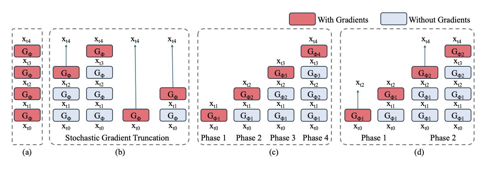
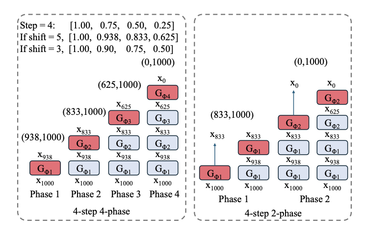

# Phased DMD：分阶段少步蒸馏

!!! info "论文信息"
    **论文题名：** Phased DMD: Few-step Distribution Matching Distillation via Score Matching within Subintervals。 
    **作者：** Xiangyu Fan、Zesong Qiu、Zhuguanyu Wu、Fanzhou Wang、Zhiqian Lin、Tianxiang Ren、Dahua Lin、Ruihao Gong、Lei Yang。 
    **机构：** SenseTime Research, 2 Beihang University。 
    **时间 / 主题：** 2025-10；扩散模型。 
    **arXiv / 官方报告：** arXiv：[2510.27684](https://arxiv.org/abs/2510.27684)；官方材料：[x-niper.github.io/projects/Phased-DMD/](https://x-niper.github.io/projects/Phased-DMD/)。 
    **GitHub / 项目：** GitHub：[github.com/ModelTC/LightX2V-Wan2.2-Lightning](https://github.com/ModelTC/LightX2V-Wan2.2-Lightning)；项目页：[x-niper.github.io/projects/Phased-DMD/](https://x-niper.github.io/projects/Phased-DMD/)。 
    **元数据来源与核验口径：** 来源：[arXiv](https://arxiv.org/abs/2510.27684)；[GitHub API / repo](https://github.com/ModelTC/LightX2V-Wan2.2-Lightning)；[官方 / 项目材料](https://x-niper.github.io/projects/Phased-DMD/)；Checked Date：2026-06-04；Repro Status：Paper / official materials reviewed, independent reproduction not claimed。

## 四步生成，为什么会受到一步任务的限制

Phased DMD 要解决的不是简单的“采样步数还不够少”，而是少步蒸馏中一个容易被忽略的矛盾。我们希望四步模型逐步组织画面、运动和细节，但为了节省训练显存，实际训练可能不断要求其中某一步直接生成干净图像。这样得到的模型即使推理时运行四次，训练目标仍在迫使它具备一步完成全部生成的能力，早期阶段应有的自由和容量可能因此受限。

论文在 Wan 视频模型上观察到具体后果：DMD2 风格的四步学生生成的运动变慢，镜头变化减少；图像生成则更容易在不同种子下收敛到相似近景。Phased DMD 保留训练中的中间噪声终点，让前面的专家先把纯噪声推进到一个中间分布，再让后面的专家继续完善。与这个变化配套，作者重新推导了中间分布上的 fake score 训练目标，保证它还能与教师 score 正确相减。[↗](https://arxiv.org/pdf/2510.27684v3#page=2)

这篇论文的两个贡献必须一起理解。只拆分采样区间，没有修正 score 目标，分布梯度会带偏；只写出正确的子区间公式，却仍让每次截断都跳到干净端点，也没有消除作者要解决的一步退化。它的主要价值是把阶段终点、专家分工和分布监督重新对齐，实验重点因此落在构图多样性、视频运动及镜头遵循，而不只是单张图像是否清晰。

## 一、先分清四种少步训练过程

Figure 1 用红色表示保留梯度的网络调用，蓝色表示不保留梯度的调用。读图时，除了数红色块，更要看每条路径最终到达哪个时间点。

{ width="820" }

<small>图源：`Phased DMD`，Figure 1，PDF 第 2 页。从左到右为完整少步反传、SGTS、逐阶段蒸馏，以及阶段内结合 SGTS 的两阶段版本。</small>

**Vanilla few-step DMD** 在图（a）中执行完整的四步生成，再对最终干净样本施加分布匹配。四次调用都在计算图里，梯度可以沿整个链传播。缺点是激活保存和计算图深度随步数增加，对于 14B、20B 级模型和多帧视频尤其昂贵；中间状态也没有单独的分布终点约束。

**Stochastic Gradient Truncation Strategy（随机梯度截断策略，SGTS）** 对应图（b）。设原日程为 $1=t_0>t_1>\cdots>t_N=0$，训练随机选 $j\in\{1,\ldots,N\}$，执行到第 $j$ 次调用，并把该次调用的目标终点改为 0；前面调用不保留梯度，只有最后一次调用负责反向传播。随机截断能降低显存需求，也让不同位置得到监督。但当 $j=1$，这轮训练就变成从纯噪声直接生成干净图像。

Phased DMD 的图（c）保留不同的阶段终点。第一阶段只需把 $x_{t_0}$ 送到 $x_{t_1}$；第二阶段固定第一个专家，训练第二个专家将它的输出推进到 $x_{t_2}$；直到最后阶段才要求输出 $x_0$。每阶段仍只有一个保留梯度的生成步骤，却不再让最早的专家承担全部去噪任务。

图（d）进一步减少阶段数。四个采样步骤分成两个阶段，每阶段内部可以采用 SGTS：第一阶段的截断终点是中间时间 $t_2$，第二阶段的终点才是 0。因此，第一阶段偶尔只调用一次，也只是学习“纯噪声到中间状态”，没有退化成全程的一步生成。[↗](https://arxiv.org/pdf/2510.27684v3#page=5)

这里的 **phase（阶段）** 指训练推进到的目标分布，**step（步骤）** 指推理中的网络调用。四步两阶段与四步四阶段有相同的总采样步数，却拥有不同的专家数量、训练分工与阶段内部截断方式。

## 二、中间状态不能再次被当作干净图像

普通 DMD 先生成 $x_0$，再按教师的正向过程加噪。若正向扩散写成

$$
p(x_t\mid x_0)=\mathcal N(\alpha_t x_0,\sigma_t^2I),
$$

则 $\alpha_t$ 控制信号，$\sigma_t$ 控制噪声；论文要求信噪比 $\mathrm{SNR}(t)=\alpha_t^2/\sigma_t^2$ 随 $t$ 严格递减。$t$ 越大，图像越接近噪声。

Phased DMD 的前几个阶段只产生 $x_s$，其中 $s>0$。这个样本自身已经包含噪声。若直接写成 $\alpha_t x_s+\sigma_t\epsilon$，就等于错误地把它当作干净数据，所得分布与教师在时间 $t$ 的分布不再对应。

正确的操作由高斯扩散的 Markov 转移给出。对于 $s<t$，

$$
p(x_t\mid x_s)
=\mathcal N(\alpha_{t\mid s}x_s,\sigma_{t\mid s}^2I),
$$

其中

$$
\alpha_{t\mid s}=\frac{\alpha_t}{\alpha_s},
\qquad
\sigma_{t\mid s}^2
=\sigma_t^2-\frac{\alpha_t^2}{\alpha_s^2}\sigma_s^2.
$$

后一项的减法非常重要。原有 $x_s$ 中的噪声经过信号缩放后，已贡献了部分目标方差；这里只补上从 $s$ 到 $t$ 还缺少的噪声。信噪比单调递减保证这个条件方差非负。教师的边缘分布于是既可以由干净数据加噪获得，也可以由正确的中间分布继续加噪获得：

$$
p(x_t)=\int p(x_t\mid x_0)p(x_0)\,dx_0
=\int p(x_t\mid x_s)p(x_s)\,dx_s.
$$

这条等价关系让“在中间终点做分布匹配”有了明确接口。第 $k$ 阶段先运行当前生成流水线，得到 $x_s$，令 $s=t_k$；随后采样更高的噪声时间 $t>s$，构造

$$
x_t=\alpha_{t\mid s}x_s+\sigma_{t\mid s}\epsilon,
\qquad \epsilon\sim\mathcal N(0,I).
$$

两个 score 模型看到的仍是同一时间 $t$ 的样本，但它来自当前阶段的中间输出。生成器不需要为了获得监督而先走完整条轨迹到 $x_0$。[↗](https://arxiv.org/pdf/2510.27684v3#page=3)

## 三、两个网络都叫 score estimator，为什么还不能直接相减

DMD 的训练里有三个角色：生成器 $G_\phi$、可训练的 fake score estimator $F_\theta$，以及冻结的教师 $T_{\hat\theta}$。学生输出分布是 $p_{\mathrm{fake}}$，教师提供真实数据分布 $p_{\mathrm{real}}$ 的近似分数。理想反向 KL 梯度包含

$$
\nabla_x\log p_{\mathrm{fake}}(x)
-
\nabla_x\log p_{\mathrm{real}}(x).
$$

但网络经常输出 velocity、噪声或干净图像预测，并不直接输出这个 score。只有两个预测能转换到同一尺度，输出差才对应分布差。

论文把所需条件分为 A1 和 A2。A1 要求 fake 网络足够接近当前学生分布的 score；实践中每更新一次生成器，先后安排更多次 fake 更新来近似满足。A2 则要求 real 与 fake 的参数化相容。假设

$$
T_{\hat\theta}(x_t,t)
\approx a_t\nabla_{x_t}\log p_{\mathrm{real}}(x_t)+b_tx_t,
$$

$$
F_\theta(x_t,t)
\approx c_t\nabla_{x_t}\log p_{\mathrm{fake}}(x_t)+d_tx_t,
$$

则需要 $a_t=c_t$ 且 $b_t=d_t$。否则，两个输出相减后除了真实的分数差，还残留错误的尺度或额外的 $x_t$ 项。增加 fake 网络更新次数可以改善 A1，却无法让一个定义错了的训练目标自动满足 A2。[↗](https://arxiv.org/pdf/2510.27684v3#page=4)

以论文采用的 flow prediction 为例，完整区间的网络 $\psi$ 回归 $\epsilon-x_0$。由去噪分数匹配与显式分数匹配的关系，最优预测可表达为

$$
\psi(x_t,t)
\approx
-\frac{x_t}{\alpha_t}
-\left(\sigma_t+\frac{\sigma_t^2}{\alpha_t}\right)
\nabla_{x_t}\log p(x_t).
$$

这个式子规定了教师输出与 score 之间的尺度和偏置。fake 网络在子区间训练后也必须保留同样的关系，才能参与 DMD。这里的等价用于最优预测和参数优化，不需要把两种损失逐个样本的数值理解成完全相等。

在这种 velocity 参数化下，论文把中间阶段的生成器梯度写成

$$
\nabla_{\phi_k}D_{\mathrm{KL}}
\simeq
\mathbb E\left[
 w_{t\mid s}
 \big(T_{\hat\theta}(x_t,t)-F_{\theta_k}(x_t,t)\big)
 \frac{dG}{d\phi_k}
\right],
$$

$$
w_{t\mid s}
=\frac{\alpha_t\alpha_{t\mid s}}
{\alpha_t\sigma_t+\sigma_t^2},
\qquad s=t_k.
$$

$\alpha_{t\mid s}$ 来自中间状态加噪操作的导数，其余系数对应 velocity 到 score 的转换。式中顺序是 teacher 减 fake；若从另一篇使用干净图像预测的实现中直接搬来相反的输出差，而没有同步处理参数化，更新方向就可能错误。

第 $k$ 阶段只更新当前生成专家，前面的生成专家固定。fake 模型在每阶段开始时重新由教师初始化，不沿用上一阶段的 fake 权重，因为它所要描述的学生输出分布和训练区间都已经变化。对于教师本身包含多个噪声专家的情况，后面还要区分“当前生成专家”和“本阶段参与估计的多个 fake 专家”。[↗](https://arxiv.org/pdf/2510.27684v3#page=5)

## 四、子区间目标里的修正项从哪里来

前面的公式说明 fake 网络必须保留教师的 score 表示。困难在于，子区间训练只有 $x_s$ 和新加入的噪声 $\epsilon$，没有干净的 $x_0$，因此不能继续构造 $\epsilon-x_0$。

推导从条件高斯分布开始。对于

$$
x_t=\alpha_{t\mid s}x_s+\sigma_{t\mid s}\epsilon,
$$

其条件 score 是

$$
\nabla_{x_t}\log p(x_t\mid x_s)
=-\frac{\epsilon}{\sigma_{t\mid s}}.
$$

保持上一节的网络输出参数化，用这个可计算的条件 score 构造去噪监督，可以得到目标

$$
y_v
=-\frac{x_t}{\alpha_t}
+\left(\sigma_t+\frac{\sigma_t^2}{\alpha_t}\right)
\frac{\epsilon}{\sigma_{t\mid s}}.
$$

将 $x_t=\alpha_{t\mid s}x_s+\sigma_{t\mid s}\epsilon$ 代入，再利用条件方差关系整理，就得到原文式（11）的目标：

$$
y_v
=
\frac{\alpha_s^2\sigma_t+\alpha_t\sigma_s^2}
{\alpha_s^2\sigma_{t\mid s}}\epsilon
-\frac{x_s}{\alpha_s},
$$

$$
\mathcal L_{\mathrm{sub},v}
=\mathbb E_{x_s,t,\epsilon}
\left\|\psi(x_t,t)-y_v\right\|^2,
\qquad t\in(s,1).
$$

这两个修正系数补偿了 $x_s$ 原本就带有的信号缩放与噪声。它不是简单把“干净端点”改名成“阶段端点”。当 $s=0$、$\alpha_s=1$、$\sigma_s=0$ 时，条件噪声标准差恢复为 $\sigma_t$，目标才退化为熟悉的 $\epsilon-x_0$。[↗](https://arxiv.org/pdf/2510.27684v3#page=15)

可以用一个解释性的代入看出差别。若采用 $\alpha_u=1-u$、$\sigma_u=u$，取 $s=0.5$、$t=0.75$，则 $\alpha_{t\mid s}=0.5$，$\sigma_{t\mid s}^2=0.5$。按上式计算，正确目标为 $\sqrt2\epsilon-2x_s$，并不是 $\epsilon-x_s$。这只是对论文公式的数值展开，却能直观说明错误目标怎样同时改变信号与噪声的比例。

### x-prediction 也需要修正

若基础模型预测的是干净样本，子区间目标则是原文式（12）：

$$
y_x=
\frac{x_s}{\alpha_s}
-\frac{\alpha_t\sigma_s^2}
{\alpha_s^2\sigma_{t\mid s}}\epsilon,
$$

$$
\mathcal L_{\mathrm{sub},x}
=\mathbb E\left\|\mu(x_t,t)-y_x\right\|^2.
$$

后一项说明，即使模型名称叫 sample prediction，也不能简单要求它还原当前给出的 $x_s$。训练目标需要使输出保有完整区间教师的 score 解释。论文给出这一形式，使方法不局限于 velocity 网络；真正选择哪一式，取决于接入模型的参数化。[↗](https://arxiv.org/pdf/2510.27684v3#page=16)

### 边界附近还存在数值问题

当 $t\to s$，新加入的条件噪声趋于零，$\sigma_{t\mid s}\to0$。直接计算 $y_v$ 中的倒数会放大数值误差。作者把该标准差乘入残差，再对外侧权重截断，实际采用式（13）：

$$
\mathcal L_{\mathrm{stable}}
=
\operatorname{clamp}_{[0,10]}
\left(\frac1{\sigma_{t\mid s}^2}\right)
\left\|
\sigma_{t\mid s}\psi(x_t,t)
-
\left(
\frac{\alpha_s^2\sigma_t+\alpha_t\sigma_s^2}{\alpha_s^2}\epsilon
-
\frac{\sigma_{t\mid s}}{\alpha_s}x_s
\right)
\right\|^2.
$$

这样残差内部不再显式除以一个趋近于零的数，外部权重也不会无限增大。截断会改变接近区间边界时的时间权重，因此它属于实际优化设计；不能因为符号上可以乘除同一个量，就忽略有限精度训练中的差别。[↗](https://arxiv.org/pdf/2510.27684v3#page=6)

## 五、一维实验先检查公式，不急着看大模型样例

为了把参数化问题与网络容量、视频质量分开，作者先构造一维数据分布，干净值只取 $\{-1,0,1,2\}$。模型是四层、隐藏宽度 512 的 MLP，分别从头训练三个版本：完整区间目标、正确子区间目标，以及错误的 $\epsilon-x_s$ 目标。子区间为 $(0.5,1]$，采样使用 100 步 Euler，Figure 2 画出 200 条轨迹。

下面应主要比较 $t>0.5$ 的共同区间。中图绿色轨迹与完整模型的蓝色轨迹接近；右图绿色轨迹的弯曲和分布明显不同。红色竖线标出子区间边界。

<table>
  <tr>
    <th>Full interval objective</th>
    <th>Correct subinterval objective</th>
    <th>Incorrect subinterval target</th>
  </tr>
  <tr>
    <td></td>
    <td></td>
    <td></td>
  </tr>
</table>

<small>图源：`Phased DMD`，Figure 2，PDF 第 6 页。子区间模型只训练在右半区间，图中左半部分的四个干净模式来自完整模型的参考轨迹。</small>

这个实验支持的是 A2：修正后的目标可以在指定区间中恢复与完整模型相容的预测，错误目标则产生系统偏差。它并未单独证明复杂视频的全部收益都由这个公式带来；大模型还同时使用阶段训练和专家结构，需要后面的实验继续检验。

## 六、四步两阶段，实际在哪些时间点交接

主实验采用四步、两阶段。Wan 模型的生成时间点为 $1000,938,833,625$，最后到 0；Qwen-Image 为 $1000,900,750,500$，最后到 0。它们由四步基础日程配合 timestep shift 得到，Wan 使用 shift 5，Qwen 使用 shift 3。

在 Wan 的两阶段配置中，第一个专家负责 $1000\to833$，推理通常分为 $1000\to938\to833$ 两次调用；第二个专家负责 $833\to0$，通常分为 $833\to625\to0$。阶段内部的 SGTS 可以缩短当前阶段的训练路径，但仍以该阶段的固定终点为监督对象。

Figure 9 左侧列出四步四阶段，右侧列出四步两阶段。每组括号标的是**重新加噪时用于 score 比较的区间**，不等同于生成器负责的相邻去噪区间。

{ width="570" }

<small>图源：`Phased DMD`，Figure 9，PDF 第 16 页。四阶段的重新加噪区间依次向低噪声扩展，但上界始终覆盖最高噪声端。</small>

一般地，第 $k$ 阶段输出 $x_{t_k}$ 后，重加噪时间从 $(t_k,1)$ 采样。这种 **Reverse Nested Intervals（反向嵌套区间）** 随训练阶段推进不断扩大，保留高噪声区域；它不同于只在 $(t_k,t_{k-1})$ 中采样的互不重叠区间。

附录还有一个容易改变实现结果的细节：均匀采样发生在 timestep shift **之前**。例如四步两阶段的第一阶段，先在未偏移的 $(0.5,1)$ 中采样，再应用 shift 5；不能直接假设偏移后的 $(0.833,1)$ 仍是均匀分布。时间变换不仅改变端点，也改变监督样本在不同噪声水平上的分布。[↗](https://arxiv.org/pdf/2510.27684v3#page=16)

### Wan2.2 的教师专家边界还需要额外处理

Wan2.2 原本就有高噪声与低噪声两个专家。第一阶段只使用高噪声模型，并将重新加噪时间用 `torch.clamp` 限制在 T2V 的 $(0.875,1)$、I2V 的 $(0.9,1)$ 范围，以对齐教师高噪声专家的适用边界。

第二阶段的可训练组件有三个：低噪声生成专家、高噪声 fake 专家、低噪声 fake 专家。前一阶段的高噪声**生成**专家固定，但与它对应的 fake 专家仍需要更新，因为第二阶段的重加噪范围覆盖高、低噪声区间，两个 fake 分支都要拟合当前阶段产生的分布。教师和 fake 选用哪个专家，由重新加噪的时间决定。[↗](https://arxiv.org/pdf/2510.27684v3#page=17)

因此，“一阶段只训练一个专家”准确指的是生成器一侧，不能扩写为整个训练系统只有一个可训练网络。附录对多专家基础模型的讨论也明确区分了当前一个生成专家与可能参与的多个 fake 专家。

## 七、实验规模和比较条件决定了收益怎样归因

主要实验覆盖 Wan2.1、Wan2.2 和 Qwen-Image。下表保留各任务的生成接口；部分任务混合分辨率训练，表内只列一个代表分辨率。

| Base Model | Task | Vanilla DMD | DMD2 | Phased DMD | Timesteps | Frame, Height, Width |
| --- | --- | --- | --- | --- | --- | --- |
| Wan2.1-T2V-14B | T2I | Yes | Yes | Yes | 1000, 938, 833, 625 | 1, 720, 1280 |
| Wan2.2-T2V-A14B | T2I | No | Yes | Yes | 1000, 938, 833, 625 | 1, 720, 1280 |
| Wan2.2-T2V-A14B | T2V | No | Yes | Yes | 1000, 938, 833, 625 | 81, 720, 1280 |
| Wan2.2-I2V-A14B | I2V | No | Yes | Yes | 1000, 938, 833, 625 | 81, 720, 1280 |
| Qwen-Image-20B | T2I | No | Yes | Yes | 1000, 900, 750, 500 | 1, 1382, 1382 |

Vanilla DMD 的完整多步反传只在最小的 Wan2.1 T2I 设置中运行，原因是计算开销。因此，不能声称论文在全部大模型视频任务上完成了三者的直接全量比较。

Wan2.2 的比较更有助于区分机制与参数增加。它本来就有两个专家，DMD2 与 Phased DMD 都蒸馏成两个专家，参数预算得以对齐。对于原本单专家的 Wan2.1 或 Qwen，Phased DMD 也会产生两个阶段专家，收益同时伴随结构变化，不能把所有改善都归给某一个损失项。[↗](https://arxiv.org/pdf/2510.27684v3#page=7)

所有主要实验使用下列训练设置。

| Setting | Value |
| --- | --- |
| GPUs / batch size | 64 / 64 |
| Fake score update | Full-parameter training |
| Fake score learning rate | $4\times10^{-7}$ |
| Generator update | LoRA, rank 64, $\alpha=8$ |
| Generator learning rate | $5\times10^{-5}$ |
| Optimizer | AdamW, $\beta_1=0$, $\beta_2=0.999$ |
| Fake : generator updates | 5 : 1 |
| Memory / parallelism | FSDP and gradient checkpointing; context parallelism for video |
| Backward simulation solver | Euler |
| Main configuration | 4 steps, 2 phases, 2 generator experts |

生成器使用 LoRA，并不意味着整个训练都只有少量适配器参数，因为 fake score 仍做全参数更新。一次生成器更新还伴随五次 fake 更新。论文没有给出足以计算整套训练 GPU 天数的总墙钟与完整阶段迭代预算，所以这里能明确复用的是并行方式、更新比例和优化配置，而不是一个已验证的低成本蒸馏承诺。

视频训练混合四种 `(Frame, Height, Width)`：$(81,720,1280)$、$(81,1280,720)$、$(81,480,832)$、$(81,832,480)$，概率依次为 0.1、0.1、0.4、0.4。Wan 的 T2I 固定为 $(1,720,1280)$。Qwen 则均匀采样七种形状：$(1,1382,1382)$、$(1,1664,928)$、$(1,928,1664)$、$(1,1472,1104)$、$(1,1104,1472)$、$(1,1584,1056)$、$(1,1056,1584)$。这些设置影响序列长度和显存，也说明主表中的单一分辨率不是全部训练数据的形状。[↗](https://arxiv.org/pdf/2510.27684v3#page=16)

## 八、视频实验先问运动是否被保留下来

视频评测包含 220 条 T2V 提示和 220 组 I2V 图片—提示对，每条固定 seed 42，只生成一个视频。教师使用 40 步、CFG 4；两个蒸馏模型使用四步、CFG 1。光流 OF 由 UniMatch 计算平均绝对值，DD 是 VBench 的 dynamic degree。

FID 与 FVD 的参考分布需要特别区分：这里比较的是学生视频与**教师生成视频**，并非与真实视频数据比较。因此，教师一行的 FID、FVD 为 0，表示它作为参照，不代表教师生成与现实分布完全一致。

| Method | T2V OF ↑ | T2V DD ↑ | T2V FID ↓ | T2V FVD ↓ | I2V OF ↑ | I2V DD ↑ | I2V FID ↓ | I2V FVD ↓ |
| --- | ---: | ---: | ---: | ---: | ---: | ---: | ---: | ---: |
| Base model | 10.26 | 79.55% | 0.0 | 0.0 | 9.32 | 82.27% | 0.0 | 0.0 |
| DMD2 | 3.23 | 65.45% | 55.70 | 763.1 | 7.87 | 80.00% | 18.45 | 370.0 |
| Phased DMD (Ours) | 9.30 | 82.27% | 47.24 | 700.9 | 9.84 | 83.64% | 17.47 | 334.7 |

T2V 中，DMD2 的平均光流只有 3.23，Phased DMD 恢复到 9.30，较接近教师的 10.26；DD 从 65.45% 到 82.27%。同时，FID 从 55.70 降到 47.24，FVD 从 763.1 降到 700.9。联合来看，运动增大伴随对教师分布更接近，因而比只看光流更有说服力。单独追求高光流可能奖励抖动，单独追求平滑则可能奖励静止，二者都不足以代表好的视频。[↗](https://arxiv.org/pdf/2510.27684v3#page=9)

I2V 中变化相对温和。光流由 7.87 到 9.84，DD 由 80.00% 到 83.64%，FID/FVD 也下降；Phased DMD 的光流甚至高于教师。但“比教师动得更多”并不自动意味着优于教师，仍需结合输入图像、提示要求与视觉质量判断。两种任务之间的差别提示，已有图像条件与纯文本从噪声起步面对的结构生成困难并不完全相同。

### 跑酷与跟拍样例怎样对应这些统计

Figure 4 从每段 81 帧视频中取出索引 $0,10,\ldots,80$，拼成九帧预览。每列由上往下读。提示要求人物沿砖墙快速奔跑、蹬墙并完成翻转。教师与 Phased DMD 的序列中，起跳、翻转、落地和继续跑动有明显阶段变化；DMD2 也有翻转动作，但在固定走廊构图中完成得更集中，变化节奏不同。

<table>
  <tr><th>Base</th><th>DMD2</th><th>Phased DMD</th></tr>
  <tr>
    <td></td>
    <td></td>
    <td></td>
  </tr>
</table>

<small>图源：`Phased DMD`，Figure 4，PDF 第 8 页。同间隔取帧可以比较动作推进，单张画面的清晰度不足以说明运动是否保留。</small>

Figure 5 的提示要求镜头先关注轮滑鞋，再向上展示身体。三种输出都从腿部附近开始，但 DMD2 的后半段反复保持接近正面的蹲姿和相似背景；Phased DMD 中，视角随着滑行与身体姿态继续变化。这组图要考察的是镜头指令和运动构图，不能只把“主体始终位于画面中间”当成成功。

<table>
  <tr><th>Base</th><th>DMD2</th><th>Phased DMD</th></tr>
  <tr>
    <td></td>
    <td></td>
    <td></td>
  </tr>
</table>

<small>图源：`Phased DMD`，Figure 5，PDF 第 8 页。九帧预览展示空间与姿态变化，但帧间闪烁等连续时间问题仍需由完整视频评估。</small>

## 九、为什么部分 VBench 指标反而更喜欢 DMD2

附录没有隐藏与主叙事不同的指标。T2V 的额外 VBench 结果如下，数值均为百分比。

| Method | Aesthetic quality | Background consistency | Motion smoothness | Subject consistency | Temporal flickering |
| --- | ---: | ---: | ---: | ---: | ---: |
| Base model | 63.62 | 94.03 | 97.67 | 90.06 | 95.70 |
| DMD2 | 67.02 | 95.29 | 98.57 | 92.93 | 97.08 |
| Phased DMD | 65.73 | 94.40 | 97.74 | 91.15 | 95.26 |

DMD2 在这五项上都高于 Phased DMD，也高于教师。例如 motion smoothness 为 98.57%，教师为 97.67%。但主表中的 OF 显示 DMD2 运动幅度更小，这提醒我们平滑度和运动强度并不等价。背景与主体变化更少，也可能让一致性指标更容易得到高分。

I2V 同样出现类似排序。

| Method | Aesthetic quality | Background consistency | Motion smoothness | Subject consistency | Temporal flickering |
| --- | ---: | ---: | ---: | ---: | ---: |
| Base model | 62.71 | 93.75 | 97.74 | 90.39 | 95.52 |
| DMD2 | 64.14 | 94.44 | 97.85 | 91.84 | 95.73 |
| Phased DMD | 63.91 | 94.16 | 97.66 | 91.40 | 95.17 |

作者认为这些排序与其人工观看比较的判断不一致，并提供 220 条 T2V 对比视频。他们倾向于教师质量最高、Phased DMD 更好地保留教师表现。不过文中没有给出足以还原正式偏好实验的评审人数、打分协议和胜率，因而这里应把它视为作者的人工比较判断，不能补写成有明确百分比的用户偏好胜出。[↗](https://arxiv.org/pdf/2510.27684v3#page=17)

这组结果更实际的启示是，蒸馏评测需要同时回答“与教师的分布有多近”“动作是否满足提示”“视觉是否稳定”。某个一致性指标上更高，不足以单独证明保留了教师能力；接近教师指标也不意味着指标绝对最优。Phased DMD 的证据强项在于运动、分布距离与定性镜头表现能够彼此补充，而不是所有自动指标同向提高。

## 十、图像多样性改善在哪里，反例又在哪里

图像评估使用 21 条简短提示，每条生成八张图像，seed 为 0 到 7。简短提示不限定太多构图细节，给模型留下变化空间；每条提示内部再比较不同种子。教师仍为 40 步、CFG 4，学生为四步、CFG 1。

两个指标分别观察不同特征中的变化。DINOv3 特征的平均两两余弦相似度越低，表示图像在该表征中越不相似；LPIPS 平均两两距离越高，表示感知特征差异越大。它们测量的是多样性代理量，不能单独保证变化都符合提示。

| Method | Wan2.1 DINOv3 ↓ | Wan2.1 LPIPS ↑ | Wan2.2 DINOv3 ↓ | Wan2.2 LPIPS ↑ | Qwen DINOv3 ↓ | Qwen LPIPS ↑ |
| --- | ---: | ---: | ---: | ---: | ---: | ---: |
| Base model | 0.708 | 0.607 | 0.732 | 0.531 | 0.907 | 0.483 |
| Vanilla DMD | 0.825 | 0.522 | — | — | — | — |
| DMD2 | 0.826 | 0.521 | 0.828 | 0.447 | 0.941 | 0.309 |
| Phased DMD (Ours) | 0.782 | 0.544 | 0.768 | 0.481 | 0.958 | 0.322 |

Wan2.1 与 Wan2.2 的两项指标一致支持 Phased DMD 更接近教师多样性。例如 Wan2.2 的 DINOv3 相似度从 0.828 降到 0.768，LPIPS 从 0.447 升到 0.481，不过与教师的 0.732、0.531 仍有距离。Wan2.1 中 Vanilla DMD 和 DMD2 的多样性指标接近，而分阶段训练进一步改善，说明仅提高样本清晰度并不能自动恢复构图变化。[↗](https://arxiv.org/pdf/2510.27684v3#page=10)

Qwen 的结果必须单独读。LPIPS 从 0.309 小幅升到 0.322，但 DINOv3 相似度从 0.941 升到 0.958，按该指标方向反而更差。作者认为 Qwen 教师本身的输出多样性较有限，可能限制改善空间；这是一种解释，并没有通过独立控制实验消除两种指标的分歧。这里能支持的结论是 Wan 上多样性恢复较清楚，Qwen 上改善有限且不一致。

### 文字渲染保留属于另一项能力

作者使用 Qwen-Image 官方示例提示，展示少步模型的文字和复杂画面生成。下面四张图分别包含黑板上的英文长句、人物手中的多行诗句、带多个字号的海报，以及棚拍人像。前三张能看到可辨认的多行字形，海报还同时组织了标题、副标题、演职信息和底部日期。

<table>
  <tr>
    <td></td>
    <td></td>
    <td></td>
    <td></td>
  </tr>
</table>

<small>图源：`Phased DMD`，Figure 7，PDF 第 10 页。这些是文字与视觉能力保留的示例，没有对应的 OCR 准确率或提示成功率表。</small>

这组图说明四步学生仍可产生这些复杂内容，却不回答同一提示的八个种子是否足够多样。把能力展示和多样性表分开，才能避免用“字写得清楚”替代“模式覆盖没有减少”的论证。

## 十一、专家分工带来什么，四阶段又付出什么

这里的 **Mixture-of-Experts（专家混合，MoE）** 主要是按噪声区间切换整套稠密去噪网络，不是语言模型里常见的逐 token FFN 路由。低 SNR、高噪声阶段负责更大尺度的构图和运动；高 SNR、低噪声阶段则细化纹理与局部结构。专家随生成过程顺序调用，因此每一步仍只运行相应专家，但总权重、管理与调度成本并不会凭空消失。

Figure 12 将 Wan2.2 的前两步与完整四步输出放在一起。只使用低 SNR 专家时，猛犸象前进的顺序、雪地场景与主体关系已经存在，但表面偏平滑；加入高 SNR 专家后，毛发、象鼻、雪地枝条和山体纹理更明确。部分色调、形态也会变化，因此阶段分工是经验上的主导作用，不能写成后续专家严格不动任何结构。

<table>
  <tr><th>low-SNR only</th><th>low-SNR + high-SNR</th></tr>
  <tr>
    <td></td>
    <td></td>
  </tr>
</table>

<small>图源：`Phased DMD`，Figure 12，PDF 第 20 页。左侧对应前两步，右侧对应高、低噪声专家组成的完整四步流水线。</small>

论文另在 Figure 8 固定低 SNR 专家，比较高 SNR 专家训练 100 与 400 次迭代的结果。相同提示和种子下，整体布局较接近，光照与纹理继续改变。这给出一种实用的训练控制方式：在前期已建立的构图和运动分布上继续改善细节，降低长时间联合训练把结构变化一并压缩掉的风险。[↗](https://arxiv.org/pdf/2510.27684v3#page=10)

主结果采用两阶段，阶段内部仍有 SGTS。附录进一步测试四步四阶段，完全移除阶段内部的随机截断。

| Method | OF ↑ | DD ↑ | FID ↓ | FVD ↓ |
| --- | ---: | ---: | ---: | ---: |
| Base model | 10.26 | 79.55% | 0.0 | 0.0 |
| DMD2 | 3.23 | 65.45% | 55.70 | 763.1 |
| Ours (4-step 2-phase) | 9.30 | 82.27% | 47.24 | 700.9 |
| Ours (4-step 4-phase) | 9.43 | 83.18% | 45.40 | 578.2 |

四阶段的 OF 与 DD 小幅增加，FVD 从 700.9 降到 578.2，FID 也降低。这说明更细的分阶段方案还有收益，但它同时取消 SGTS、增加专家与可训练参数，并提高系统复杂度。因此，这张表不能单独隔离“移除 SGTS”贡献了多少，也不是两个模型在相同参数预算下的比较。[↗](https://arxiv.org/pdf/2510.27684v3#page=18)

## 十二、为什么每个阶段的监督仍要覆盖高噪声

阶段交接确定了生成任务，并没有自动决定最稳定的 score 监督范围。若第二阶段负责 $t_1\to t_2$，一种直觉是只在相邻区间 $(t_2,t_1)$ 加噪并训练。但这可能让后期阶段只能使用较低噪声的样本，而新阶段初始生成结果还不够真实，教师恰好在这些样本上最不可靠。

Reverse Nested Intervals 让每阶段的加噪上界都延伸到 1。高噪声会抹去一部分尚未正确生成的细节，使学生分布与教师加噪后的分布有更充分重叠，从而给出较可靠的比较。这个解释针对分数估计与有限训练的稳定性，不改变阶段终点本身。

Figure 10 在 Wan2.2 T2V 中比较这两种范围。互不重叠区间的画面色调发灰、人物脸部形态受损；反向嵌套区间中，面部轮廓和暖色光照更自然。

<table>
  <tr><th>Disjoint Intervals</th><th>Reverse Nested Intervals</th></tr>
  <tr>
    <td></td>
    <td></td>
  </tr>
</table>

<small>图源：`Phased DMD`，Figure 10，PDF 第 18 页。比较对象是同一分阶段框架中的重新加噪范围。</small>

作者还用更直接的固定时间实验检验这一解释。在 Wan2.1 T2I 的 Vanilla DMD 中，一组始终使用 $t=0.357$，另一组使用 $t=0.882$。前者只留下模糊的树林、光斑与长椅，人物结构没有正确形成；后者能生成完整的坐姿人物和场景。

<table>
  <tr><th>t = 0.357</th><th>t = 0.882</th></tr>
  <tr>
    <td></td>
    <td></td>
  </tr>
</table>

<small>图源：`Phased DMD`，Figure 11，PDF 第 19 页。在这一设置中，单独使用较低噪声没有正确收敛，较高噪声则得到正常结果。</small>

论文指出，在理想分布条件下，某个中间噪声尺度上的精确分布相等可以对应干净分布相等；但实际模型只有近似的教师与 fake score，优化也有限。固定时间实验恰好区分了“理论上可以识别目标分布”和“现实训练中能得到可靠梯度”。它支持保留高噪声监督，却不足以推出所有任务都应丢弃低噪声信号。[↗](https://arxiv.org/pdf/2510.27684v3#page=18)

## 十三、实际可复用的是一套相互配合的接口

Phased DMD 最适合关注的场景，是希望保留视频运动、镜头变化或构图多样性的少步蒸馏。它提供了三个需要一起采用的改动：让每阶段停在明确的中间分布；使用正确的条件加噪核与子区间 fake 目标；让后续阶段仍有高噪声监督，并按教师噪声专家边界路由。

它不需要 GAN loss 或对教师轨迹的回归配对，论文据此强调 data-free 蒸馏。这个说法针对额外的真实样本分布监督和预生成配对轨迹，不代表生成任务没有条件输入；文本提示和 I2V 的输入图像仍是任务接口的一部分。与原始 DMD 相比，它减少的是这类离线配对依赖，同时引入阶段训练和专家管理。

推理调用预算是明确的。视频教师 40 步且使用 CFG，对应附录报告的 80 次网络评估；四步、CFG 1 的学生为四次，调用数相差 20 倍。但论文没有将这一比例证明为统一硬件上的 20 倍端到端延迟，部署时还要考虑专家权重驻留、切换、并行和解码。

更广泛的认识是，少步模型的能力不仅取决于“最后生成得像不像”，也取决于训练过程中允许每一步负责多大范围的任务。Phased DMD 把全程一步生成的压力拆开，并为拆开的中间目标补齐正确分数估计。Wan 的运动与多样性结果说明这种拆分有实际收益；Qwen 的指标分歧、VBench 的不同排序以及四阶段的额外参数，又共同限定了它在哪些方面已得到支持，哪些方面仍需要按具体模型评估。
