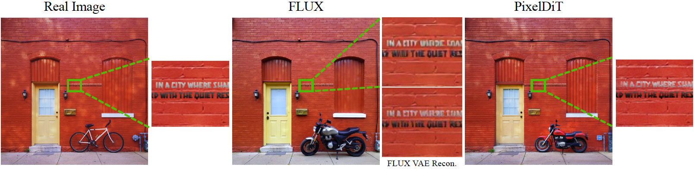
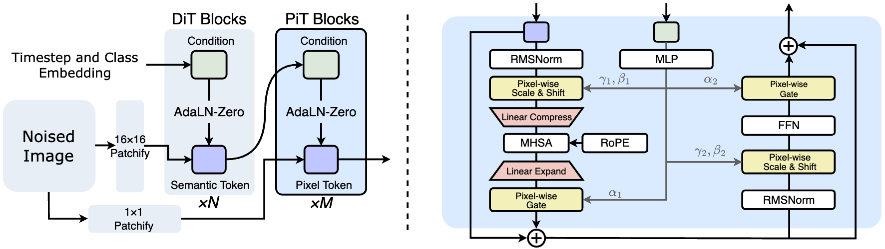
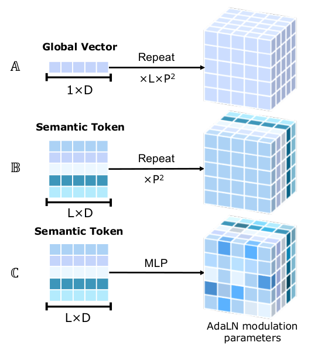
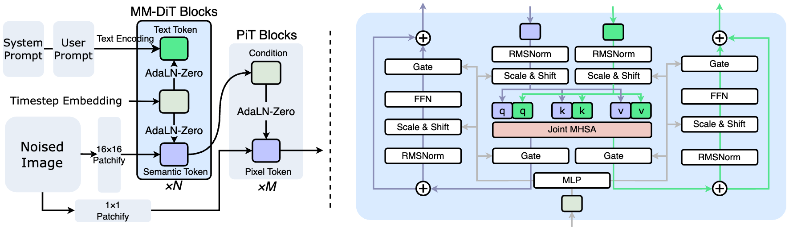
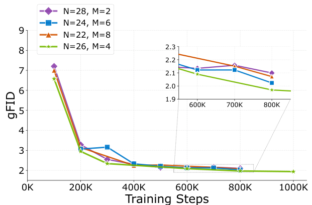
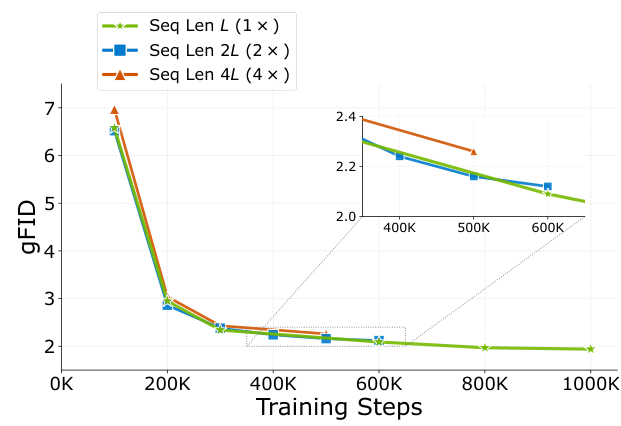
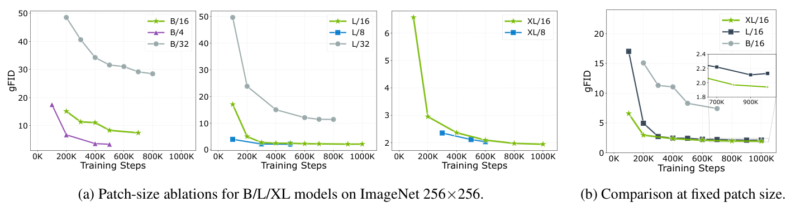
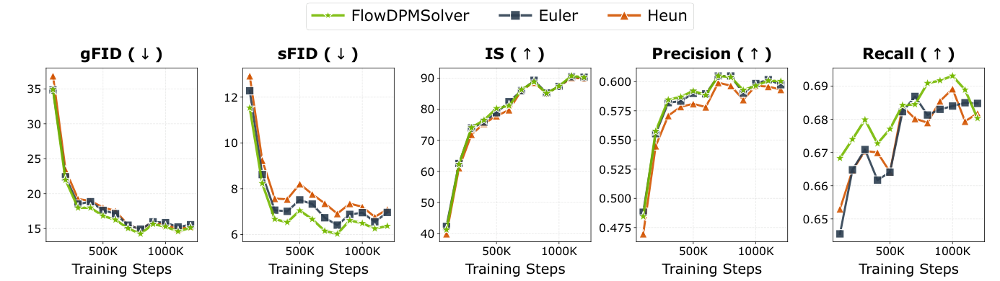
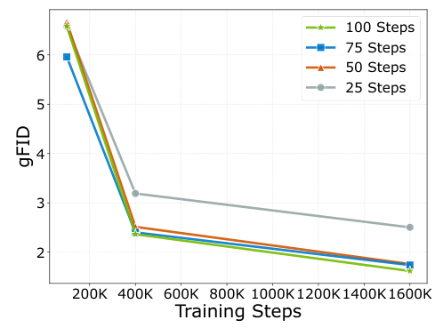

# PixelDiT：无 VAE 的像素空间 DiT

!!! info "论文信息"
    **论文题名：** PixelDiT: Pixel Diffusion Transformers for Image Generation。 
    **作者：** Yongsheng Yu、Wei Xiong、Weili Nie、Yichen Sheng、Shiqiu Liu、Jiebo Luo。 
    **机构：** NVIDIA、University of Rochester。 
    **时间 / 主题：** arXiv v1：2025-11-25；arXiv v2：2026-04-16；CVPR 2026 Oral，GitHub README 标注为 CVPR 2026 Best Paper Finalist。主题是像素空间扩散、Diffusion Transformer、无 VAE 图像生成。 
    **arXiv / 项目：** arXiv：[2511.20645](https://arxiv.org/abs/2511.20645)；项目页：[pixeldit.github.io](https://pixeldit.github.io/)；PDF：[arxiv.org/pdf/2511.20645](https://arxiv.org/pdf/2511.20645)。 
    **GitHub / 模型：** GitHub：[github.com/NVlabs/PixelDiT](https://github.com/NVlabs/PixelDiT)；Hugging Face ImageNet models：[nvidia/PixelDiT-ImageNet](https://huggingface.co/nvidia/PixelDiT-ImageNet)；T2I model：[nvidia/PixelDiT-1300M-1024px](https://huggingface.co/nvidia/PixelDiT-1300M-1024px)。 
    **元数据来源与核验口径：** 来源：arXiv 页面、论文 PDF、项目页、官方 GitHub README；Checked Date：2026-07-31；Repro Status：Paper / official project / official code and models reviewed, independent reproduction not claimed。

## 真正需要解决的是像素建模的成本，而不只是删掉 VAE

PixelDiT 直接在 RGB 像素空间训练与采样，通过一条宽而短的 patch 路径处理全局语义，再用一条窄而密的 pixel 路径更新局部细节。它在 ImageNet-256 的320 epochs配置下取得1.61 gFID，在 ImageNet-512 上取得1.81；文本版本还能直接生成百万像素图像。方法的核心是怎样保留逐像素更新能力，同时控制全局注意力的序列长度。[原论文，第1—3页](https://arxiv.org/pdf/2511.20645v2#page=1)

latent diffusion 先用单独训练的自编码器压缩图像，再训练生成模型。它显著节省计算，却把生成与编辑的细节能力限制在编码表示所保留的信息内。PixelDiT 用一个具体编辑任务说明问题。下图要求把自行车改为摩托车，墙上的小字属于应当保持的背景。先比较真实图与 FLUX VAE reconstruction，小字在扩散编辑之前的编码、解码往返里就发生了损坏；再比较最终编辑结果，就能看到这类误差如何进入下游输出。

{ width="900" }

*项目展示图，与原论文 Figure 1(b)、第1页的 FlowEdit 对比对应。当前图包含 Real Image、FLUX、PixelDiT，FLUX栏额外展示 VAE reconstruction；论文完整面板还包含 SD3。所有模型采用 $n_{\min}=0$ 的 FlowEdit 设置，以尽量保留结构。*

这项观察提出了有意义的目标，但没有自动给出可训练方案。$256\times256$ 图像已有65,536个像素，$1024\times1024$ 则有1,048,576个。直接让所有像素 token 做全局注意力，矩阵规模随像素数平方增长。反过来，若只把 $16\times16$ 像素展平为一个大 token，然后在粗粒度上完成所有计算，细节更新又缺少专门的逐像素机制。PixelDiT 要解决的就是这两个方向之间的分工。

其双层设计是同一个去噪网络内部的信息流。每次求解器调用时，patch 与 pixel 两条路径都会处理当前带噪图像；pixel 路径并不是采样结束后另接的超分辨率器。它省掉了独立 VAE 生成空间，仍然是需要多步求解的 Rectified Flow 模型。[原论文，第3—5页、第7页](https://arxiv.org/pdf/2511.20645v2#page=3)

## 同一张带噪图像怎样经过两种粒度的路径

设输入 $x_t\in\mathbb R^{B\times C\times H\times W}$，RGB 的 $C=3$。patch 路径先切成不重叠的 $p\times p$ 小块，将每个小块展平为 $p^2C$ 维向量，再映射到宽度 $D$

$$
L=\frac Hp\frac Wp,\qquad
x_{\mathrm{patch}}\in\mathbb R^{B\times L\times p^2C},\qquad
s_0=W_{\mathrm{patch}}x_{\mathrm{patch}}\in\mathbb R^{B\times L\times D}.
$$

时间与类别嵌入形成条件向量 $c=\operatorname{SiLU}(W_t t+W_y y+b)$，通过 AdaLN 调制 patch blocks。作者在 DiT 基础上使用 RMSNorm 与2D RoPE。此时条件调制仍是全局的，同一组 scale、shift、gate 广播给所有 patch tokens，空间差异主要由各自输入及相互注意力形成。经过 $N$ 个 blocks 后得到 $s_N$，再与时间嵌入相加，形成传给 pixel 路径的 $s_{\mathrm{cond}}=s_N+t$。[原论文，第3—4页，式1—5](https://arxiv.org/pdf/2511.20645v2#page=3)

另一条路径对每个 RGB 像素做线性嵌入，得到 $H\times W$ 个宽度仅为 $D_{\mathrm{pix}}$ 的 tokens。默认 $D_{\mathrm{pix}}=16$，远小于语义路径的768、1024或1152。为了与 patch 条件对齐，可把张量重排成 $(B L)\times p^2\times D_{\mathrm{pix}}$。这只是在组织像素组，并未把每个 patch 的所有像素提前合成一个表示。

Figure 2 应先沿左边的两条分支读。上面经过 $N$ 层的 semantic tokens 进入 PiT 的 conditioning 接口；下面的 $1\times1$ patchify 保留逐像素表示，经过 $M$ 层 PiT 后预测像素空间的更新。右边则把一个 PiT block 拆开，显示条件调制、临时压缩、全局注意力、展开和残差连接的具体位置。

{ width="900" }

*原论文 Figure 2，第3页，对应项目架构原图。注意右侧 attention 分支在 Linear Compress 与 Linear Expand 之间，像素 residual 路径绕过这两步。*

| Config | N | M | D | Dpix | Heads | Params (M) |
| --- | ---: | ---: | ---: | ---: | ---: | ---: |
| PixelDiT-B | 12 | 2 | 768 | 16 | 12 | 184 |
| PixelDiT-L | 22 | 4 | 1024 | 16 | 16 | 569 |
| PixelDiT-XL | 26 | 4 | 1152 | 16 | 16 | 797 |
| PixelDiT-T2I | 14 | 2 | 1536 | 16 | 24 | 1311 |

*前三行来自原论文 Table 3，第6页；T2I 来自 Table 8，第12页。$N,M$ 分别为 patch 与 pixel 路径深度，默认 patch size 均为16。*

以256分辨率、$p=16$ 的 XL 为例，宽1152的语义路径只处理256个 tokens，窄16的像素路径处理65,536个。1024分辨率下，同样的 $p$ 会让语义序列增长到4096，像素序列增长到约一百万。双层设计减少了大宽度计算需要处理的 token 数，但它并没有让高分辨率的成本变成常数。

## Pixel-wise AdaLN 为同一 patch 内的不同像素生成不同条件

如果只把一个全局向量广播给全部像素，所有位置会收到相同的调制；改成每个 patch 一个语义条件，仍会让 patch 内的 $p^2$ 个像素共享调制。PixelDiT 的第三种方案将一个语义 token 映射成 $p^2$ 套独立的条件参数

$$
\Phi:\mathbb R^D\longrightarrow\mathbb R^{p^2\cdot6D_{\mathrm{pix}}},\qquad
\Theta=\Phi(s_{\mathrm{cond}})
\in\mathbb R^{(BL)\times p^2\times6D_{\mathrm{pix}}}.
$$

最后一维分成六组，$\beta_1,\gamma_1,\alpha_1$ 对应 attention 分支的 shift、scale、gate，$\beta_2,\gamma_2,\alpha_2$ 对应 FFN 分支。每组都具有 $(BL)\times p^2\times D_{\mathrm{pix}}$ 的形状，使同一语义区域内不同像素可以获得不同幅度、偏移与更新门控。[原论文，第4页，式6—7](https://arxiv.org/pdf/2511.20645v2#page=4)

Figure 3 中 A 的所有立方格取相同条件，B 在不同 patch 之间变化、patch 内重复，C 则允许 patch 内各像素也不同。这里的“独立”指输出的调制值可以按像素区分，并不意味着为每个像素单独训练一套网络；各 patch 使用共享的投影函数，从不同 semantic tokens 产生条件。

{ width="520" }

*原论文 Figure 3，第4页。A、B、C 分别对应全局广播、patch 内广播和逐像素调制；图中颜色变化表示调制粒度。*

这种设计让窄的 pixel 表示也能读取高容量语义路径的结果。每个像素的更新不必重新从头解决“场景里应该有什么”，而可在已有全局上下文下处理纹理和边界。与此同时，调制映射输出维度随 $p^2D_{\mathrm{pix}}$ 增长，大 patch 与更宽 pixel hidden size 并非没有参数和显存代价，附录的失败尝试也再次指出了这一点。

## Token compaction 临时压缩注意力输入，像素残差仍然保留

pixel 路径虽然很窄，直接对 $HW$ 个 tokens 做全局注意力仍然过重。作者在每个 PiT attention 分支内引入 **Pixel Token Compaction（像素 token 压缩）**。它将一个 patch 的空间与通道一起展平，通过学习到的线性映射压成一个宽度为 $D$ 的 token

$$
\mathcal C:\mathbb R^{p^2D_{\mathrm{pix}}}\to\mathbb R^D,
\qquad
\mathcal E:\mathbb R^D\to\mathbb R^{p^2D_{\mathrm{pix}}}.
$$

全局注意力在 $L=HW/p^2$ 个压缩 tokens 之间执行，之后用 $\mathcal E$ 展回逐像素表示，再通过 gate 加到原来的像素 residual 上。因此这里的跨 patch attention 可以在较宽的 $D$ 维空间计算，$D_{\mathrm{pix}}=16$ 描述的是密集像素表示的宽度，不能理解成整个 attention 都只有16维。[原论文，第5页](https://arxiv.org/pdf/2511.20645v2#page=5)

将 Figure 2 的运算顺序写开，一个 PiT block 可用下列解释性记号表示，省略批次与 patch 重排

$$
U=X+\alpha_1\odot\mathcal E\!\left(
\operatorname{Attn}\!\left(\mathcal C(\gamma_1\odot\operatorname{RMSNorm}(X)+\beta_1);\operatorname{RoPE}\right)\right),
$$

$$
X_{\mathrm{next}}=U+\alpha_2\odot\operatorname{FFN}
\left(\gamma_2\odot\operatorname{RMSNorm}(U)+\beta_2\right).
$$

这些式子重述原图的数据流，显示了两个细节。第一，逐像素调制在压缩之前已经进入 attention 分支，展开后的结果又被逐像素门控；第二，FFN 和残差仍在逐像素表示上更新。压缩分支负责交换跨 patch 信息，密集路径负责保留和修改局部状态。

对 $p=16$，注意力序列长度缩为原来的 $1/256$。若固定 attention 宽度，只看 token 两两交互项，其规模缩为 $1/p^4=1/65,536$。这是理论注意力矩阵项的比例，并非整个网络 FLOPs 或端到端延迟的比例，因为 patch DiT、投影、调制、FFN和其他计算仍存在。

也不能把 compaction 称为数学意义的无损编码。一般线性映射 $p^2D_{\mathrm{pix}}\to D$ 没有可逆保证，learned expansion 不会凭空恢复被丢弃的所有信息。它与 VAE 生成空间的关键差别，是压缩发生在网络内部的一个更新分支，未压缩的像素 residual 可以绕过瓶颈；整个图像并不需要先通过一个固定压缩表示才能进入生成过程。细节保留是这种结构提供的能力，再由实验检验其效果。

## 训练目标保留速度匹配，语义路径还需要 REPA

PixelDiT 在像素空间采用 Rectified Flow 的 velocity matching

$$
\mathcal L_{\mathrm{diff}}=
\mathbb E_{t,x,\epsilon}\left\|f_\theta(x_t,t,y)-v_t\right\|_2^2,
\qquad
\mathcal L=\mathcal L_{\mathrm{diff}}+\lambda_{\mathrm{repa}}\mathcal L_{\mathrm{repa}}.
$$

$x_t$ 是由图像和噪声构成的中间状态，$v_t$ 是对应流训练的目标速度，$y$ 为类别或文本条件。网络每次预测像素空间速度，推理时由求解器多次调用网络更新当前图像。论文的主要创新在网络内部如何分配计算，损失的主项沿用速度回归。[原论文，第5—6页，式8](https://arxiv.org/pdf/2511.20645v2#page=5)

REPA 将中间层 patch tokens 对齐冻结 DINOv2 的语义表示，使短而宽的路径更快形成有用语义。ImageNet 在第8个 patch block 对齐，$\lambda_{\mathrm{repa}}=0.5$。去掉 VAE 所省去的是独立图像压缩、重建接口，并未省去所有预训练知识。DINOv2 只提供训练监督，生成时不需要它。

| Configuration | 80 epochs FID ↓ | 80 epochs IS ↑ | 160 epochs FID ↓ | 160 epochs IS ↑ |
| --- | ---: | ---: | ---: | ---: |
| PixelDiT-XL w/ REPA | 2.36 | 282.3 | 1.97 | 299.4 |
| PixelDiT-XL w/o REPA | 6.58 | 165.9 | 4.33 | 242.4 |

*原论文 Table 11，第14页，ImageNet-256。*

这个消融的幅度比许多推理参数调整更大。即使没有 REPA 的模型延长到160 epochs，4.33 FID仍明显差于带 REPA 的80 epochs结果2.36。所以不能将主表的快速收敛全部归因于 token compaction。附录 G.3 还报告，一些去掉表示对齐的探索会不稳定并最终发散；这属于未完全控制设置的经验观察，不能用来否定 Table 11 中确实训练到80、160 epochs且具有有限指标的结果。[原论文，第14页、第18页](https://arxiv.org/pdf/2511.20645v2#page=18)

### 文本只在 patch 路径融合，像素路径通过语义条件接收它

文本版将 patch DiT 替换为 MM-DiT。冻结 Gemma-2 编码器读取 system prompt 与 user prompt，产生文本 tokens，再投影到网络宽度。每个 MM-DiT block 中，图像与文本保留各自的 QKV 投影，在 joint attention 中交换信息。融合后的 image semantic tokens 再进入原来的 PiT 调制接口。[原论文，第5页、第13页](https://arxiv.org/pdf/2511.20645v2#page=13)

{ width="900" }

*原论文 Figure 7，第13页，对应项目架构原图。右图绿色与紫色流分别表示文本和图像表示；文本没有直接进入下面的 pixel tokens，而通过 semantic tokens 影响逐像素调制。*

因此，T2I 改变的是全局语义学习的条件接口，pixel 路径的结构可以沿用。1.3B模型使用14层 patch blocks和2层 PiT，hidden size1536、24 heads。这个参数量是生成模型配置，不能将冻结 Gemma-2 等整个部署系统的所有参数都默认为已经包含在内。

### 分辨率升级同时改变优化设置

ImageNet 训练使用 AdamW，$\beta_1=0.9,\beta_2=0.999$，weight decay为0，batch为256，BF16混合精度，EMA decay为0.9999，class drop概率0.1，并使用 logit-normal 时间采样。XL的320 epochs约为1.6M次训练迭代，前160 epochs学习率 $10^{-4}$、gradient clip 1.0，之后降为 $10^{-5}$ 和0.5。B、L的对应配置为800K、1M迭代，保持 $10^{-4}$ 学习率及1.0裁剪阈值。[原论文，第6页、第12页，Table 7](https://arxiv.org/pdf/2511.20645v2#page=12)

512分辨率模型从320 epochs的256 checkpoint继续微调530 epochs，学习率 $10^{-5}$、裁剪0.5。因此它的1.81 FID包含前一阶段的训练投入，不能写成仅训练530 epochs的从头512模型。

文本版使用约26M图文对，收集的数据约为百万像素且包含不同长宽比。具体阶段如下。

| Setting | 512×512 pre-training | approximately 1024×1024 fine-tuning |
| --- | ---: | ---: |
| Training iterations | 400K | 100K |
| Batch size | 1024 | 768 |
| Learning rate | 1e-4 | 2e-5 |
| Gradient clipping | 0.5 | 0.1 |
| Timestep shift α | 3.0 | 4.0 |
| REPA alignment depth | 6-th layer | — |
| REPA loss weight | 0.5 | 0.0 (disabled) |
| Text drop probability | 0.1 | 0.1 |

*原论文第6—7页及 Table 8、第12页。$\alpha$ 在这张表中是时间采样的 shift 参数，与 CFG scale 是不同超参数。*

512阶段从头训练生成器，百万像素阶段继续微调，并关闭 REPA。因而“文本模型同样采用 REPA”需要加上阶段限定，不能声称1024阶段仍在第6层做0.5权重的对齐。按 batch 与 iterations 相乘，这两阶段分别处理约4.096亿和7680万对训练样本；这是样本呈现次数的计算，数据会重复，不代表新增了这么多独立图像。论文没有完整展开26M数据的筛选、caption生成与来源组成，这限制了仅凭网络和超参数精确复现文本结果的程度。

## 组件消融把训练可行性与生成质量分开检验

主文 Table 5 从30层、$16\times16$ patch的 vanilla DiT出发，直接在像素空间预测，没有专门pixel路径。随后逐项加入设计，默认在80 epochs比较。

| Model Components | Epoch | gFID ↓ |
| --- | ---: | ---: |
| A: Vanilla DiT/16 | 80 | 9.84 |
| A: + RoPE, RMSNorm | 80 | 8.53 |
| B: + Dual-level, patch-wise AdaLN (no compaction) | 80 | OOM |
| B: + Pixel Token Compaction | 80 | 3.50 |
| C: + Pixel-wise AdaLN | 80 | 2.36 |
| C: Full PixelDiT | 320 | 1.61 |

*原论文 Table 5，第8页。A、B、C 对应 Figure 3 的条件粒度；OOM 指作者训练规模下显存不足。*

这张表首先证明，仅增加像素路径仍不可训练，必须控制其全局注意力成本。compaction让训练可运行后，patch-wise版本达到3.50；改成pixel-wise调制，FID进一步到2.36。最后的1.61还增加了训练时长，不能将其全部解释成AdaLN的贡献。vanilla与dual-level的参数布局也不同，这不是每一步参数量完全相等的纯算子替换实验。[原论文，第8—9页](https://arxiv.org/pdf/2511.20645v2#page=8)

是否能进一步删掉pixel路径里的attention，只靠语义条件和逐像素MLP？Table 6专门检验了这一点。

| Configuration | GFLOPs | 80 epochs FID ↓ | 80 epochs IS ↑ | 160 epochs FID ↓ | 160 epochs IS ↑ |
| --- | ---: | ---: | ---: | ---: | ---: |
| PixelDiT-XL | 311 | 2.36 | 282.3 | 1.97 | 299.4 |
| No Pixel Token Compaction | 82247 | OOM | OOM | OOM | OOM |
| No Pixel-Pathway Attention | 279 | 2.56 | 256.9 | 2.22 | 281.7 |

*原论文 Table 6，第9页。GFLOPs为单次前向的计算估计；OOM行未取得对应训练指标。*

完全删除pixel attention只省去32 GFLOPs，却在两个checkpoint上都损失FID与IS。它表明，经过语义路径之后，pixel更新仍能从跨patch的信息交换中获益。默认模型比无pixel attention版本多约 $32/279\approx11.5\%$ 计算，这一增量换来了160 epochs下2.22到1.97的FID改善。

不做compaction的82,247 GFLOPs与311相比约为264倍，这是表中整网计算估计的比值；它与前面的 $p^4$ 理论attention项比值完全不是同一个统计口径。表中也没有给出足以把OOM阈值推广到所有硬件、batch与实现的内存配置。

### pixel层数与压缩率并非越大越好

Figure 10在总层数约为30的条件下重新分配 $N,M$。先看绿色的26+4，再看紫色的28+2和橙色的22+8，后者给pixel路径更多层，却没有带来更快收敛。默认26+4在300K迭代约为2.34 gFID，1M约为1.94，兼顾早期收敛和最终质量。

*原论文 Figure 10，第15页。绿色星标为默认 $N=26,M=4$；各模型使用CFG 3.25、区间 $[0.10,1.00]$。固定总层数并不等于固定参数或FLOPs，因为两类blocks成本不同。*

另一个疑问是，每个patch只压成一个token会不会过于激进。Figure 11让每个patch输出1、2或4个compact tokens，对应总长度 $L,2L,4L$。在300K迭代，三者约为2.34、2.38、2.43 gFID，更多tokens未带来改善。

*原论文 Figure 11，第16页。放大图用于观察很小的差距，绿色 $L$ 为默认方案；图中 $2L$ 与 $4L$ 的轨迹分别只显示到约600K、500K，不能把它们都当作完成1M迭代的对照。*

这个结果支持在当前训练设置下使用更紧凑的attention表示。$2L,4L$会让token交互项约增至4倍、16倍，却没有自动提升质量。作者推测冗余序列增加优化难度，但也承认更长序列可能需要不同训练设置。因此实验给出的是本配方下的效率选择，并没有证明每patch一个token对所有任务和规模都最优。

## patch大小、分辨率与模型规模共同决定计算应该放在哪里

减小patch能增加语义路径的空间粒度，也会增长两条路径中全局attention的序列。Figure 5展示了这种收益如何随模型规模变化。B模型在200K迭代时，$p=32,16,4$分别为48.5、15.1、6.7 gFID，细patch显著帮助小模型；B/4在500K达到约3.4。L模型在300K时，$p=8$相对$p=16$从2.72改善到2.15。到了XL，$p=8$与16的差距基本消失，都接近2.0。[原论文，第8—9页](https://arxiv.org/pdf/2511.20645v2#page=9)

*原论文 Figure 5，第8页。前三幅分别比较B、L、XL内部的patch设置，最右固定 $p=16$ 比较模型规模；各曲线使用相同CFG设置，横轴为迭代数。*

固定$p=16$时，200K的B、L、XL分别为15.1、4.95、2.95，扩大语义建模容量明显改善同迭代数下的质量。默认XL选择$p=16$，是因为更细patch的边际收益变小，同时计算更贵。横轴是训练步数而非GPU时间或训练FLOPs，同步数更低FID不能直接改写成同计算预算更有效率。

到512分辨率，简单将patch扩大为32来保持短序列，会付出可测的质量代价。

| Patch | 80 epochs FID ↓ | 80 epochs IS ↑ | 120 epochs FID ↓ | 120 epochs IS ↑ |
| --- | ---: | ---: | ---: | ---: |
| p=16 | 2.97 | 270.29 | 2.23 | 287.62 |
| p=32 | 4.66 | 235.52 | 3.78 | 256.06 |

*原论文 Table 13，第16页，ImageNet-512的patch消融；这些是80、120 epochs的阶段性结果，并非最终530 epochs微调结果。*

因此不能把256下“XL对更小patch不敏感”泛化成高分辨率下可以无限增大patch。为了理解质量收益换来了多少计算，Table 16给出同一个PixelDiT-XL架构的单次前向成本。

| Patch Size | 256² GFLOPs | 512² GFLOPs | 1024² GFLOPs |
| --- | ---: | ---: | ---: |
| 8×8 | 1115.69 | 6200.99 | 52634.10 |
| 16×16 | 311.19 | 1352.24 | 7147.17 |
| 32×32 | 135.54 | 547.74 | 2298.42 |

*原论文 Table 16，第17页，multiply-add计为2 FLOPs。此表估计的是XL结构，不是1311M文本模型的独立测速。*

1024下从$p=8$改为16，计算约下降7.4倍，继续到32再下降约3.1倍。另一方面，固定$p=16$从256到512再到1024，FLOPs约增长4.35倍和5.29倍。不能用一句“随边长平方增长”准确概括所有这些成本。token数为 $HW/p^2$，attention交互项为 $O((HW/p^2)^2D)$；正方形图像边长翻倍时，这个项理论上增长16倍，而线性投影、FFN和密集像素部分具有不同增长规律。表中整网数值是这些项共同作用的结果。

## ImageNet主结果说明质量已经接近强latent系统，但没有统一胜出

ImageNet评测按ADM协议使用50K样本，同时报告gFID、sFID、IS和Precision/Recall。gFID衡量整图特征分布差异，sFID关注空间特征统计，Precision/Recall分别反映生成分布与数据分布在特征空间的贴近及覆盖；这些指标互有取舍，不能只保留一个最漂亮的数字。

### 256分辨率的完整主表

| Method | Training Epochs | #params | gFID ↓ | sFID ↓ | IS ↑ | Precision ↑ | Recall ↑ |
| --- | ---: | --- | ---: | ---: | ---: | ---: | ---: |
| LDM-4-G | 170 | 400M | 3.60 | — | 247.6 | 0.87 | 0.48 |
| DiT-XL | 1400 | 675M | 2.27 | 4.60 | 278.2 | 0.83 | 0.57 |
| SiT-XL | 1400 | 675M | 2.06 | 4.50 | 270.3 | 0.82 | 0.59 |
| MaskDiT | 1600 | 675M | 2.28 | 5.67 | 276.5 | 0.80 | 0.61 |
| REPA | 800 | 675M | 1.42 | 4.70 | 305.7 | 0.80 | 0.65 |
| LightningDiT | 800 | 675M | 1.35 | 4.15 | 295.3 | 0.79 | 0.65 |
| SVG-XL | 1400 | 675M | 1.92 | — | 264.9 | — | — |
| DDT-XL | 400 | 675M | 1.26 | — | 310.6 | 0.79 | 0.65 |
| RAE-XL | 800 | 839M | 1.13 | — | 262.6 | 0.78 | 0.67 |
| StyleGAN-XL | — | — | 2.30 | 4.02 | 265.1 | 0.78 | 0.53 |
| ADM-U | 400 | 554M | 4.59 | 5.25 | 186.7 | 0.82 | 0.52 |
| CDM | 2160 | — | 4.88 | — | 158.7 | — | — |
| RIN | 480 | 410M | 3.42 | — | 182.0 | — | — |
| VDM++ | — | — | 2.12 | — | 267.7 | — | — |
| JetFormer | — | 2.8B | 6.64 | — | — | 0.69 | 0.56 |
| Simple Diffusion | — | 2.0B | 2.44 | — | 256.3 | — | — |
| FractalMAR-H | 600 | 844M | 6.15 | — | 348.9 | 0.81 | 0.46 |
| FARMER | 320 | 1.9B | 3.60 | — | 269.2 | 0.81 | 0.51 |
| EPG-XXL/16 | 600 | 789M | 1.81 | — | 294.6 | 0.80 | 0.61 |
| PixelFlow-XL | 320 | 677M | 1.98 | 5.83 | 282.1 | 0.81 | 0.60 |
| PixNerd-XL | 320 | 700M | 1.93 | — | 298.0 | 0.80 | 0.60 |
| JiT-G | 600 | 2B | 1.82 | — | 292.6 | 0.79 | 0.62 |
| PixelDiT-XL | 80 | 797M | 2.36 | 5.11 | 282.3 | 0.80 | 0.57 |
| PixelDiT-XL | 320 | 797M | 1.61 | 4.68 | 292.7 | 0.78 | 0.64 |

*原论文 Table 1，第5页。前9行为Latent Generative Models，其余为Pixel Generative Models；“—”表示原表未提供。*

最直接的同分辨率对照是PixelFlow、PixNerd与PixelDiT，三者都报告320 epochs，但参数量和网络不同。PixelDiT的1.61低于1.98和1.93，Recall为0.64也高于二者0.60；同时Precision为0.78，低于0.81、0.80，IS也没有超过PixNerd的298.0。它改善了综合质量与覆盖，不能说每个指标都更高。[原论文，第5页、第7页](https://arxiv.org/pdf/2511.20645v2#page=7)

latent系统中REPA、LightningDiT、DDT、RAE的gFID仍低于1.61。论文还在正文明确补充，SiD2报告过256分辨率的1.38 gFID，但因其模型规模、训练epochs及其他指标信息不完整而未列入Table 1；附录计算对照又列出了这个结果。因此“超过这张主表里的pixel对照”有数据支持，“超过所有已知pixel生成器”则超出了证据。不同系统的表示预训练、训练量与求解配置也没有完全配平。

### 512分辨率的覆盖优势与指标取舍

| Method | gFID ↓ | sFID ↓ | IS ↑ | Precision ↑ | Recall ↑ |
| --- | ---: | ---: | ---: | ---: | ---: |
| DiT-XL | 3.04 | 5.02 | 240.8 | 0.84 | 0.54 |
| SiT-XL | 2.62 | 4.18 | 252.2 | 0.84 | 0.57 |
| MaskDiT | 2.50 | 5.10 | 256.2 | 0.83 | 0.56 |
| U-ViT-H | 4.05 | — | 263.8 | 0.84 | 0.48 |
| REPA | 2.08 | 4.19 | 274.6 | 0.83 | 0.58 |
| RAE-XL | 1.13 | — | 259.6 | 0.80 | 0.63 |
| ADM | 3.85 | 5.86 | 221.7 | 0.84 | 0.53 |
| RIN | 3.95 | — | 216.0 | — | — |
| VDM++ | 2.65 | — | 278.1 | — | — |
| PixNerd-XL | 2.84 | 5.95 | 245.6 | 0.80 | 0.59 |
| EPG-L/32 | 2.35 | — | 295.4 | 0.82 | 0.57 |
| JiT-H | 1.94 | — | 309.1 | — | — |
| PixelDiT | 1.81 | 5.61 | 278.6 | 0.78 | 0.67 |

*原论文 Table 2，第6页，Generation@512；前6行为latent模型，其余为pixel模型。*

PixelDiT的1.81 gFID优于表中REPA的2.08和各pixel对照，Recall 0.67也最高；但sFID 5.61比REPA的4.19更高，Precision低于多个latent对照，IS低于JiT-H。RAE的gFID仍为1.13。更高分辨率的主结果说明像素路线具有竞争力，未消除所有指标上的差距。

延长训练的收益在附录被单独量化。

| Resolution / training | gFID ↓ | sFID ↓ | IS ↑ | Precision ↑ | Recall ↑ |
| --- | ---: | ---: | ---: | ---: | ---: |
| 256², 80 epochs | 2.36 | 5.11 | 282.3 | 0.80 | 0.57 |
| 256², 320 epochs | 1.61 | 4.68 | 292.7 | 0.78 | 0.64 |
| 256², 800 epochs | 1.54 | 4.49 | 297.0 | 0.78 | 0.65 |
| 512², 320 + 40 epochs | 2.21 | 5.84 | 271.1 | 0.78 | 0.65 |
| 512², 320 + 530 epochs | 1.81 | 5.61 | 278.6 | 0.78 | 0.67 |

*合并原论文 Tables 17—18，第17页。“320 + N”表示从256分辨率训练320 epochs的checkpoint继续做512微调，不能与256单阶段训练横向当成相同预算。*

256继续从320到800 epochs，gFID只再下降0.07，较早期改善明显变小；512将微调从40延长到530 epochs，则从2.21到1.81。v2中的1.54属于更长训练配置，不能替换主表320 epochs的1.61而继续沿用原来的预算标签。

### 单次前向计算已经接近部分latent模型，仍须乘上采样过程

附录Table 15统一采用multiply-add为2 FLOPs的口径。下面保留最能说明效率位置的对照。

| Method | Params | GFLOPs per forward | FID ↓ |
| --- | --- | ---: | ---: |
| DiT-XL/2 | 675M+49M | 238 | 2.27 |
| REPA, SiT-XL/2 | 675M+49M | 238 | 1.42 |
| LightningDiT-XL/2 | 675M+49M | 238 | 1.35 |
| DDT-XL/2 | 675M+49M | 238 | 1.26 |
| RAE, DiTDH-XL/2 | 839M+415M | 292 | 1.13 |
| SiD2, UViT/2 | N/A | 274 | 1.73 |
| SiD2, UViT/1 | N/A | 1306 | 1.38 |
| PixelFlow-XL/4 | 677M | 5818 | 1.98 |
| PixNerd-XL/16 | 700M | 268 | 2.15 |
| JiT-G/16 | 2B | 766 | 1.82 |
| PixelDiT-XL | 797M | 311 | 1.61 |

*摘录原论文 Table 15，第17页，256²输入、单次前向。latent参数列列出生成器与decoder，表中FLOPs不能据此直接理解成完整采样加解码成本。*

311 GFLOPs与latent的238或292处于相近数量级，远低于表中PixelFlow的5818；但比PixNerd的268与SiD2/2的274更高。这里的PixNerd FID是2.15，主表为1.93，原文两处引用配置的数字并不一致，不能把主表最低FID与附录FLOPs任意拼成一个新实验。311也只描述一次前向，每个去噪步骤都会执行两条路径，实际生成还包括求解步数、CFG的条件求值和硬件效率。

## 求解器、步数和CFG决定最终分数使用什么预算

论文默认采用FlowDPMSolver，它将DPM-Solver++改写到Rectified Flow形式。ImageNet使用100 steps，文本任务使用25 steps；常规采样为BF16，后面报告的吞吐测速另采用FP16。这里的steps不能不加说明就与所有方法的NFE等同，尤其Heun与Euler每一步可能需要不同的函数求值数。[原论文，第7页](https://arxiv.org/pdf/2511.20645v2#page=7)

Figure 8在不使用CFG、均为100 steps的条件下比较三个求解器。先看左侧gFID和sFID，FlowDPMSolver在多数checkpoint更低或相近；IS、Precision的差距较小，Recall也并非每个点都最高。这支持默认求解器选择，但图中无CFG的gFID仍在十几以上，不能直接与主表有引导的1.61放在同一曲线上解释。

*原论文 Figure 8，第13页。三个方法各运行100 steps；这是相同名义步数的比较，未报告严格相同网络调用数或墙钟时间。*

再看Figure 9，增加采样预算对训练充分的模型更有意义。400K checkpoint从25到50 steps，gFID约由3.19降到2.51，100 steps约为2.36；1.6M checkpoint在25 steps约为2.50，50—75 steps约为1.76—1.74，100 steps进一步进入约1.6—1.7。训练很早的100K checkpoint则仍在6—7附近，更多steps不保证每一点单调更优。

*原论文 Figure 9，第15页。训练成熟后25与50 steps之间差距明显，50以上收益变小。Table 7将此图标为固定CFG 3.25、区间 $[0.10,1.00]$，与主表最优checkpoint的CFG设置不同。*

B.2文字将最终100-step点约写为1.61，但其固定CFG标注与主表精确最优设置并不一致。因此可用图判断步数趋势，精确的1.61及其条件以Table 9为准，不应将近似曲线值与主表配置混合。文本选择25 steps，是对延迟的另一种预算分配，而不是证明它与ImageNet100-step结果在相同任务上等质量。

| Epochs | CFG | Interval | gFID ↓ | sFID ↓ | IS ↑ | Prec. ↑ | Rec. ↑ |
| --- | ---: | --- | ---: | ---: | ---: | ---: | ---: |
| 80 | 3.25 | [0.10, 1.00] | 2.36 | 5.11 | 282.3 | 0.80 | 0.57 |
| 80 | 3.50 | [0.10, 1.00] | 2.60 | 5.07 | 305.2 | 0.82 | 0.57 |
| 80 | 3.00 | [0.10, 1.00] | 2.60 | 5.06 | 277.6 | 0.80 | 0.58 |
| 80 | 2.75 | [0.10, 1.00] | 2.76 | 5.17 | 259.2 | 0.79 | 0.59 |
| 80 | 3.25 | [0.10, 0.95] | 2.73 | 5.24 | 285.8 | 0.80 | 0.58 |
| 80 | 3.25 | [0.10, 0.90] | 2.75 | 5.32 | 285.4 | 0.80 | 0.58 |
| 320 | 2.75 | [0.10, 0.90] | 1.61 | 4.68 | 292.7 | 0.78 | 0.64 |
| 320 | 2.75 | [0.10, 0.95] | 1.65 | 4.64 | 293.8 | 0.77 | 0.64 |
| 320 | 2.75 | [0.10, 1.00] | 1.66 | 4.60 | 294.2 | 0.78 | 0.64 |
| 320 | 2.50 | [0.10, 0.95] | 1.69 | 4.68 | 276.9 | 0.77 | 0.65 |
| 320 | 2.50 | [0.10, 0.90] | 1.71 | 4.60 | 275.2 | 0.77 | 0.65 |
| 320 | 2.50 | [0.10, 1.00] | 1.71 | 4.62 | 277.9 | 0.77 | 0.65 |

*原论文 Table 9，第14页，PixelDiT-XL、ImageNet-256；80与320 epochs分别对应400K与1600K训练steps。*

80 epochs最好采用较强CFG3.25和较宽区间，320 epochs最佳gFID转为2.75、$[0.10,0.90]$。较弱2.50可把Recall从0.64略提高到0.65，却降低IS并使gFID变差。即使只调区间，也会出现gFID与sFID排序不同的情况。512主结果使用CFG3.5、区间 $[0.10,1.00]$，展示用ImageNet样例则使用CFG4.0；精读结果时应区分评价配置与展示配置。

## 文本生成达到百万像素后，质量与吞吐各自改善了什么

文本评测使用GenEval的533条prompts和DPG-Bench的1065条prompts，PixelDiT固定CFG4.5，time shift与相应分辨率的训练设置一致。Table 4同时列出参数规模、两个对齐指标及单A100上的FP16吞吐。

| Resolution | Methods | Params (B) | GenEval ↑ | DPG ↑ | Throughput (samples/s) ↑ |
| --- | --- | ---: | ---: | ---: | ---: |
| 512×512 | PixArt-α | 0.6 | 0.48 | 71.6 | 1.50 |
| 512×512 | PixArt-Σ | 0.6 | 0.52 | 79.5 | 1.50 |
| 512×512 | PixelFlow† | 0.9 | 0.60 | 77.9 | 0.05 |
| 512×512 | PixNerd† | 1.2 | 0.73 | 80.9 | 1.04 |
| 512×512 | PixelDiT-T2I† | 1.3 | 0.78 | 83.7 | 1.07 |
| 1024×1024 | PixArt-Σ | 0.6 | 0.54 | 80.5 | 0.40 |
| 1024×1024 | LUMINA-Next | 2.0 | 0.46 | 74.6 | 0.12 |
| 1024×1024 | SDXL | 2.6 | 0.55 | 74.7 | 0.15 |
| 1024×1024 | Playground v2.5 | 2.6 | 0.56 | 75.5 | 0.21 |
| 1024×1024 | Hunyuan-DiT | 1.5 | 0.63 | 78.9 | 0.05 |
| 1024×1024 | DALLE 3 | — | 0.67 | 83.5 | — |
| 1024×1024 | FLUX-dev | 12.0 | 0.67 | 84.0 | 0.04 |
| 1024×1024 | FLUX-schnell | 12.0 | 0.71 | 84.8 | 0.50 |
| 1024×1024 | PixelDiT-T2I† | 1.3 | 0.74 | 83.5 | 0.33 |

*原论文 Table 4，第7页。†表示pixel-space模型；1024表组对应百万像素生成，训练数据也支持不同长宽比。*

512下PixelDiT相对PixNerd将GenEval从0.73提高到0.78、DPG从80.9到83.7，而吞吐从1.04到1.07，速度只是接近，不应夸大成大幅超越。相对PixelFlow的0.05 samples/s则有很大差距。1024下PixelDiT的GenEval高于表中其他条目，DPG83.5与DALLE3相同，低于FLUX-dev的84.0和schnell的84.8；吞吐0.33高于FLUX-dev，却低于schnell的0.50及PixArt-Σ的0.40。[原论文，第7页](https://arxiv.org/pdf/2511.20645v2#page=7)

这张表展示的是系统质量与速度的共同位置，各系统的训练数据、文本编码器、采样步数并未统一。吞吐也不能简单取倒数当作单请求端到端延迟，因为表中没有完整展开batch、文本编码缓存及其他计时边界。

### GenEval总分的优势并不覆盖所有子能力

附录Table 10将指标分成六类，Overall为这些类别的未加权平均。下面保留所有原表行，能够看到512到1024后的变化来自哪里。

| Resolution | Model | Overall ↑ | Single Object | Two Objects | Counting | Colors | Position | Color Attribution |
| --- | --- | ---: | ---: | ---: | ---: | ---: | ---: | ---: |
| 512 | PixArt-α | 0.48 | 0.98 | 0.50 | 0.44 | 0.80 | 0.08 | 0.07 |
| 512 | PixArt-Σ | 0.52 | 0.98 | 0.59 | 0.50 | 0.80 | 0.10 | 0.15 |
| 512 | PixelFlow | 0.60 | — | — | — | — | — | — |
| 512 | PixNerd | 0.73 | 0.97 | 0.86 | 0.44 | 0.83 | 0.71 | 0.53 |
| 512 | PixelDiT-T2I | 0.78 | 1.00 | 0.94 | 0.70 | 0.90 | 0.53 | 0.65 |
| 1024 | LUMINA-Next | 0.46 | 0.92 | 0.46 | 0.48 | 0.70 | 0.09 | 0.13 |
| 1024 | SDXL | 0.55 | 0.98 | 0.74 | 0.39 | 0.85 | 0.15 | 0.23 |
| 1024 | PlayGroundv2.5 | 0.56 | 0.98 | 0.77 | 0.52 | 0.84 | 0.11 | 0.17 |
| 1024 | Hunyuan-DiT | 0.63 | 0.97 | 0.77 | 0.71 | 0.88 | 0.13 | 0.30 |
| 1024 | DALLE3 | 0.67 | 0.96 | 0.87 | 0.47 | 0.83 | 0.43 | 0.45 |
| 1024 | FLUX-dev | 0.67 | 0.99 | 0.81 | 0.79 | 0.74 | 0.20 | 0.47 |
| 1024 | PixelDiT-T2I | 0.74 | 1.00 | 0.95 | 0.55 | 0.88 | 0.41 | 0.68 |

*原论文 Table 10，第14页。各分项均为越高越好，公开显示值经过舍入。*

512时PixelDiT的Counting显著高于PixNerd，0.70对0.44，Color Attribution也从0.53到0.65；但Position的0.53低于PixNerd的0.71。升至1024后，PixelDiT的Two Objects与Color Attribution略升，Counting却从0.70降到0.55，Position从0.53降到0.41，Overall因此从0.78降到0.74。FLUX-dev在Counting上为0.79，也高于PixelDiT。增加输出细节与像素数量，并不自动提高数量和空间关系理解。

### DPG检查另一组语义关系，不能从类别分数自行重算Overall

| Resolution | Model | Overall ↑ | Global | Entity | Attribute | Relation | Other |
| --- | --- | ---: | ---: | ---: | ---: | ---: | ---: |
| 512 | PixArt-α | 71.6 | 81.7 | 80.1 | 80.4 | 81.7 | 76.5 |
| 512 | PixArt-Σ | 79.5 | 87.5 | 87.1 | 86.5 | 84.0 | 86.1 |
| 512 | PixelFlow | 77.9 | — | — | — | — | — |
| 512 | PixNerd | 80.9 | 80.5 | 87.9 | 87.2 | 91.3 | 72.8 |
| 512 | PixelDiT-T2I | 83.7 | 88.0 | 90.9 | 87.6 | 89.8 | 88.5 |
| 1024 | LUMINA-Next | 74.6 | 82.8 | 88.7 | 86.4 | 80.5 | 81.8 |
| 1024 | SDXL | 74.7 | 83.3 | 82.4 | 80.9 | 86.8 | 80.4 |
| 1024 | PlayGroundv2.5 | 75.5 | 83.1 | 82.6 | 81.2 | 84.1 | 83.5 |
| 1024 | Hunyuan-DiT | 78.9 | 84.6 | 80.6 | 88.0 | 74.4 | 86.4 |
| 1024 | PixArt-Σ | 80.5 | 86.9 | 82.9 | 88.9 | 86.6 | 87.7 |
| 1024 | DALLE3 | 83.5 | 91.0 | 89.6 | 88.4 | 90.6 | 89.8 |
| 1024 | FLUX-dev | 84.0 | 82.1 | 89.5 | 88.7 | 91.1 | 89.4 |
| 1024 | PixelDiT-T2I | 83.5 | 83.0 | 88.6 | 87.8 | 91.2 | 89.6 |

*原论文 Table 12，第15页。这里的Overall是DPG-Bench报告值，与GenEval的六类平均定义不同，并不等于后面五列的简单算术平均。*

512时PixelDiT的Global、Entity和Other相对PixNerd更强，Relation则是89.8对91.3。1024时与DALLE3总分同为83.5，内部构成不同，Global为83.0对91.0，Relation为91.2对90.6。它说明总分接近可以对应不同能力分布，不宜据一项总体指标推断复杂prompt中的每种关系都更可靠。

Figure 14给出带原始prompt的高分辨率样例，可以观察皮肤、织物、毛绒、光影等细节，同时检查语义要求是否真的满足。例如中间的猫与睡着男子确实出现在同一场景，但prompt要求猫横跨眼睛遮住脸，图中猫更接近脸旁与胸前，男子眼部没有被猫遮住。这个差别说明精细外观与严格条件满足需要分开评价。

*原论文 Figure 14，第22页，图下保留各自英文prompt。样例展示细节与风格的可行性，同时可直接检查组合关系，不能替代整体benchmark。*

## 编辑背景保真已有量化证据，但不是所有编辑能力的总评

开篇的墙面文字只是一例。附录D.2在281个FlowEdit源图—目标编辑对上做进一步评测，用SAM3得到编辑bounding box，再只计算框外背景区域的MSE与SSIM。

| Method | Background MSE ↓ | Background SSIM ↑ |
| --- | ---: | ---: |
| FLUX | 0.009105 | 0.8254 |
| SD3 | 0.004349 | 0.8400 |
| PixelDiT | 0.001522 | 0.8628 |

*原论文 Table 14，第16页。指标只统计编辑框外的背景区域，共281个样本。*

相对FLUX，MSE比值为 $0.009105/0.001522\approx5.98$，即PixelDiT的背景误差约为其六分之一，SSIM也从0.8254提高到0.8628。相对SD3，MSE约为其 $1/2.86$。这组数字支持在该FlowEdit设置下更好地保留非编辑区域，与VAE重建示例形成了机制和结果的对应关系。[原论文，第16页，D.2](https://arxiv.org/pdf/2511.20645v2#page=16)

但框外MSE与SSIM没有衡量框内是否正确完成编辑、文字是否逐字正确或所有对象是否结构合理，也依赖SAM3框定哪些区域算背景。不同基础模型的架构、训练数据与编辑行为不相同，不能将全部差值严格归因于一个VAE开关。最可复用的结论是，像素空间接口消除了固定编解码往返带来的那一类损失，并在这组编辑协议中得到更好的背景保真；它没有保证任何编辑都保持所有未指定内容不变。

## 失败尝试说明哪些成本不能继续省掉

附录G把未采用的方向整理成经验记录，并明确说明这些尝试并非全部在严格控制条件下进行。因此它们适合指导复现实验的优先级，不能当作每个替代方案都已被最终否定的定量结论。[原论文，第17—19页，G](https://arxiv.org/pdf/2511.20645v2#page=17)

一种尝试是用低频DCT基生成调制，先输出少量系数，再合成逐像素参数，以降低完整$p^2$套AdaLN的开销。它没有达到完整pixel-wise AdaLN的质量，作者认为低频基限制了调制的空间分辨率。另一种是可逆Haar wavelet预变换，将像素分成低频和三个高频子带，并尝试降低高频loss权重，也未在该设置下超过直接pixel建模。前者限制调制信号，后者改变表示与损失，二者失败的含义并不相同。

条件融合方面，pixel对patch的cross-attention、将两类tokens拼接做self-attention都比AdaLN差；加性条件没有明显破坏性能，只是略差，同时可省去逐像素调制的那部分大投影，更便于增加PiT深度。它是一个存在质量—成本取舍的替代接口，不能被归入“完全无效”。在patch序列加可学习prefix tokens没有改善ImageNet类条件生成，但这不排除其在更复杂文本条件中的潜力。

架构方面，作者尝试在patch Transformer外包一层分层encoder—decoder，虽能降低计算，对skip connections的选择却很敏感。pixel hidden dimension从4到128的探索则显示，太窄影响质量，太宽显著增加compaction与expansion投影成本，却没有相称收益，最终选16。跨所有blocks共享AdaLN网络在浅层尚可，在深层会限制不同层的调制模式。像素tokens的固定正弦与可学习位置嵌入效果相近，最终选择固定形式；这与attention中使用RoPE属于不同的位置处理环节。

训练稳定性还没有完全解决。作者尝试直接预测干净图像 $\widehat x$，再用

$$
\widehat v=\frac{\widehat x-x_t}{\max(\sigma(t),\epsilon)},\qquad\epsilon=0.05
$$

转成速度计算损失。它能缓解loss spikes，但在该配方下没有超过直接velocity prediction，而且要重新调分母阈值和logit-normal时间分布参数。由此不能推断两种预测目标只是在同一训练配方中随意互换的等价实现。论文最终保留velocity目标，并承认深模型与长训练仍容易出现loss spikes。[原论文，第18—19页，G.3、I](https://arxiv.org/pdf/2511.20645v2#page=18)

作者还报告文本模型在手部和复杂建筑这类几何与纹理同时复杂的对象上仍有困难。双层架构改善了计算分配，并未自动解决数据、容量与组合泛化问题；前面GenEval的Counting和Position变化也说明，更多像素不能替代更可靠的语义建模。

PixelDiT最值得迁移的设计，是将全局交互与逐像素状态分开安排，再用细粒度调制和短暂压缩连接。它让不用VAE的生成与编辑进入了可比较的质量、计算范围，也清楚展示了所需条件，包括REPA预训练监督、像素路径的跨patch交流、分辨率相关的优化设置和多步采样预算。采用时应先确定任务是否真正受固定重建损失限制，再选择patch大小和像素路径深度；仅以“省掉一个VAE”判断质量或速度，无法覆盖这套系统的实际代价。
