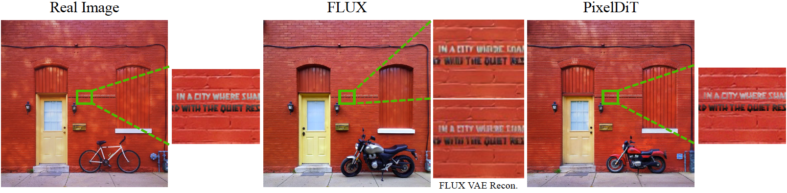
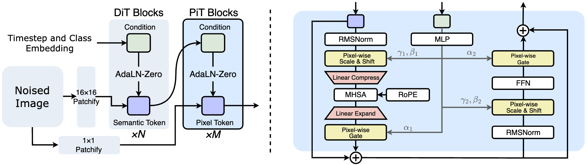
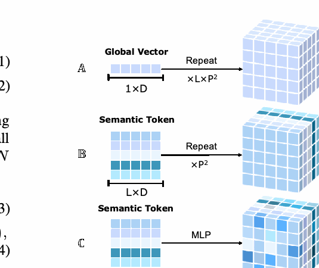
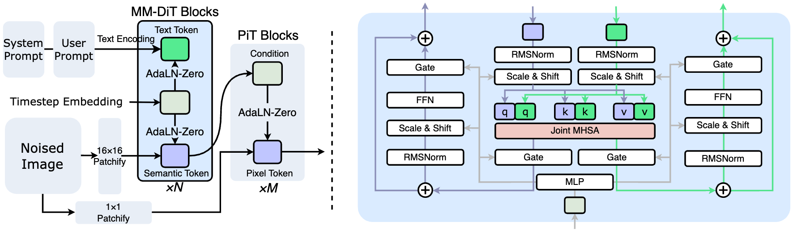

# PixelDiT：无 VAE 的像素空间 DiT

!!! info "论文信息"
    **论文题名：** PixelDiT: Pixel Diffusion Transformers for Image Generation。<br>
    **作者：** Yongsheng Yu、Wei Xiong、Weili Nie、Yichen Sheng、Shiqiu Liu、Jiebo Luo。<br>
    **机构：** NVIDIA、University of Rochester。<br>
    **时间 / 主题：** arXiv v1：2025-11-25；arXiv v2：2026-04-16；CVPR 2026 Oral，GitHub README 标注为 CVPR 2026 Best Paper Finalist。主题是像素空间扩散、Diffusion Transformer、无 VAE 图像生成。<br>
    **arXiv / 项目：** arXiv：[2511.20645](https://arxiv.org/abs/2511.20645)；项目页：[pixeldit.github.io](https://pixeldit.github.io/)；PDF：[arxiv.org/pdf/2511.20645](https://arxiv.org/pdf/2511.20645)。<br>
    **GitHub / 模型：** GitHub：[github.com/NVlabs/PixelDiT](https://github.com/NVlabs/PixelDiT)；Hugging Face ImageNet models：[nvidia/PixelDiT-ImageNet](https://huggingface.co/nvidia/PixelDiT-ImageNet)；T2I model：[nvidia/PixelDiT-1300M-1024px](https://huggingface.co/nvidia/PixelDiT-1300M-1024px)。<br>
    **元数据来源与核验口径：** 来源：arXiv 页面、论文 PDF、项目页、官方 GitHub README；Checked Date：2026-07-31；Repro Status：Paper / official project / official code and models reviewed, independent reproduction not claimed。

## 原论文故事线

### 研究背景

DiT 系列图像生成模型大多在 latent space 里去噪。这个路线的工程优势很直接：VAE 先把图像压成更短、更低维的 latent token，DiT 的 attention、MLP 和显存压力都会下降。Stable Diffusion、PixArt、FLUX、SD3 等系统都建立在类似的两阶段结构上：先训练或复用 autoencoder，再训练 diffusion / flow model。

PixelDiT 要重新打开一个老问题：如果 VAE 的压缩本身会丢掉细纹理、文字、小物体边界，并且 VAE 的重建目标和生成目标并不完全一致，那能不能直接在 pixel space 里训练 DiT？这不是简单地“不要 VAE”就结束了。像素空间 token 太多，直接全局 attention 会爆炸；大 patch 又会把每个 \(16\times16\) patch 当作一个粗 token，细节建模不足。论文要找的是一种既保留像素细节、又不把计算成本炸开的像素建模方式。

### 问题（Challenge）

核心挑战是高效 pixel modeling。像素空间扩散同时需要两种能力：全局语义结构，比如物体布局、类别、文字提示对齐；局部像素细节，比如纹理、锐利边界、墙面文字和编辑时不该变化的背景。只用粗 patch token，模型容易学到语义但丢细节；把每个像素都放进全局 attention，又会带来 \(O((HW)^2)\) 的计算和显存成本。

这个挑战也解释了为什么过去 latent diffusion 成为主流。VAE 不是没有代价，而是帮 DiT 逃过了像素空间的序列长度问题。PixelDiT 的任务是证明：只要架构把“语义建模”和“像素细化”分开，像素空间 DiT 可以不靠 VAE 也达到强质量和可训练性。

### Finding

PixelDiT 的 finding 是：像素空间扩散的关键不是盲目恢复 per-pixel attention，而是把像素建模拆成两个层级。粗粒度 patch-level DiT 负责全局语义，细粒度 pixel-level PiT 负责每个 patch 内的像素更新；两者通过 pixel-wise AdaLN 连接，让每个像素都能被对应的语义 token 调制。

更重要的是，论文把 pixel token compaction 设计成 attention 内部的临时计算手段，而不是 VAE 式的图像压缩瓶颈。模型先把每个 patch 内的 \(p^2\) 个 pixel tokens 压成一个 compact token 做全局 attention，再展开回像素 token；高频信息仍通过 residual 和展开路径保留。也就是说，PixelDiT 不是“用另一个 VAE 代替 VAE”，而是把压缩限制在 transformer block 的计算路径里。

### 方法

PixelDiT 采用 dual-level DiT。输入 noisy image 同时走两条路径：一条用 \(16\times16\) patchify 得到 semantic tokens，送入 patch-level DiT；另一条用 \(1\times1\) patchify 得到 pixel tokens，送入 pixel-level Transformer blocks（PiT blocks）。Patch-level pathway 用 DiT / MM-DiT 建模全局语义，pixel-level pathway 用较小的 \(D_{\text{pix}}\) 做 dense refinement。

PiT block 有两个关键部件。Pixel-wise AdaLN 把每个 semantic token 通过 MLP 展开成 \(p^2\) 组 scale、shift、gate，让同一个 patch 内不同像素拿到不同调制参数。Pixel Token Compaction 先把 patch 内像素 token 线性压成 compact token，让全局 attention 在 patch 序列上发生，再线性展开回像素 token。训练目标采用 Rectified Flow 的 velocity matching，并加入 REPA 风格的 DINOv2 representation alignment 来稳定 patch-level 表征。

### 结论

论文报告 PixelDiT-XL 在 ImageNet 256×256 上达到 1.61 gFID，在 ImageNet 512×512 上达到 1.81 gFID，超过论文表中已有 pixel-space 生成模型，并接近部分 latent DiT baseline。T2I 版本 PixelDiT-T2I 在 512×512 上达到 0.78 GenEval / 83.7 DPG-Bench，在 1024×1024 上达到 0.74 GenEval / 83.5 DPG-Bench。消融显示，Vanilla DiT/16 在 80 epochs 只有 9.84 gFID；加入 RoPE/RMSNorm 后为 8.53；dual-level 但不做 compaction 会 OOM；加入 compaction 后到 3.50；再加 pixel-wise AdaLN 后到 2.36，并在 320 epochs 到 1.61。

边界也清楚：PixelDiT 不是说所有 latent model 都该被替代。表中 RAE 等 latent/representation-autoencoder 路线仍有更强 ImageNet FID；T2I 数据约 26M 对且未完整公开；论文局限部分也说明 1.3B T2I 模型在复杂手部和建筑场景上仍会失败，像素空间 velocity prediction 训练还容易出现 loss spikes。

### 关键术语

- **Pixel-Space Diffusion（像素空间扩散）**：直接在 RGB pixel space 中建模去噪过程，不通过 VAE latent。
- **Latent Diffusion Model（潜空间扩散模型）**：先用 autoencoder 把图像压缩到 latent，再在 latent 中训练扩散模型。
- **Dual-Level DiT（双层级 DiT）**：PixelDiT 的架构，将 patch-level semantic modeling 和 pixel-level detail refinement 分开。
- **PiT Block（Pixel Transformer Block，像素 Transformer 块）**：Pixel-level pathway 使用的 block，包含 pixel-wise AdaLN、pixel token compaction、attention 和 FFN。
- **Pixel-wise AdaLN（逐像素自适应 LayerNorm）**：为同一 patch 内的每个像素生成不同的 AdaLN scale、shift 和 gate。
- **Pixel Token Compaction（像素 token 压缩）**：把 patch 内 \(p^2\) 个 pixel tokens 临时压成 compact token 做 attention，再展开回像素 token。
- **REPA（Representation Alignment for Generation）**：用冻结视觉编码器特征约束中间表示，帮助生成模型保持语义表征。
- **FlowDPMSolver（Flow 形式 DPM-Solver）**：论文默认采样器，用于 Rectified Flow 形式的图像生成。

## 论文位置

PixelDiT 应该放在 latent diffusion 与 pixel-space diffusion 的分叉处读。它不是少步蒸馏论文，也不是视频生成系统论文；它问的是扩散生成的底层表征空间：图像生成为什么一定要经过 VAE latent？

| Nearby line | Main question | PixelDiT response |
| --- | --- | --- |
| Latent DiT / LDM | 如何降低图像 token 计算量 | 用 VAE 压缩，但承受重建误差与目标错配 |
| REPA / RAE | 如何让 latent 更适合生成 | 继续优化表示空间或 autoencoder |
| PixelFlow / PixNerd / JiT | 如何重新做 pixel-space generation | PixelDiT 给出 fully transformer-based dual-level 方案 |
| [DPM-Solver++](dpm-solver-plus-plus.md) | 如何高效求解采样轨迹 | PixelDiT 使用 FlowDPMSolver 作为默认采样器 |
| [DeltaQuant](deltaquant.md) / [LongLive-2.0](longlive2.md) | 如何压低每步推理成本 | PixelDiT 改变建模空间，效率问题仍要靠 compaction 和系统实现 |

对扩散专题来说，这篇的价值在于提醒我们：VAE latent 不是自然法则，而是效率折中。只要架构能把 dense pixel modeling 做得足够便宜，直接像素建模可以重新变成可行路线。

## 为什么要绕开 VAE

{ width="900" }

<small>图源：`PixelDiT: Pixel Diffusion Transformers for Image Generation` 项目页 / Figure 1(b) 对应 FlowEdit 对比。图中比较真实图像、FLUX 和 PixelDiT 的局部编辑结果，重点看红砖墙上的小字。</small>

**这张图怎么读：不是看摩托车换得像不像，而是看背景有没有被 VAE 先破坏。**
FlowEdit 要把 “bicycle” 改成 “motorcycle”，但墙上的小字属于不应编辑的背景细节。FLUX 的 VAE reconstruction 已经把文字糊掉，后续 diffusion 再强也只能在被破坏的 latent 上继续编辑。PixelDiT 直接在 pixel space 去噪，没有 VAE encode/decode 这一层，所以更容易保留不编辑区域的小细节。

这并不等于“所有 VAE 都不好”。VAE 的好处是把计算量降下来，而且强 latent diffusion 在许多指标上仍然领先。PixelDiT 证明的是另一件事：如果任务对小字、纹理、编辑背景一致性很敏感，VAE reconstruction bottleneck 会成为上限；绕开 VAE 后，模型把代价转移给 pixel modeling 架构。

## 总体方案

{ width="900" }

<small>图源：`PixelDiT: Pixel Diffusion Transformers for Image Generation` 项目页 / Figure 2。左侧是 dual-level PixelDiT，右侧是 PiT block 内部结构。</small>

**这张图怎么读：左边看两条 token 流，右边看 compaction 发生在哪里。**
输入 noisy image 不是只被切成粗 patch。它同时被 \(16\times16\) patchify 成 semantic tokens，也被 \(1\times1\) patchify 成 pixel tokens。Semantic tokens 经过 patch-level DiT，负责布局、类别和条件语义；pixel tokens 进入 PiT blocks，负责细节。

右侧 PiT block 里，最关键的是 Linear Compress / MHSA / Linear Expand。Compress 把一个 patch 内的 \(p^2\) 个 pixel tokens 合成 compact token，attention 在较短的 patch 序列上做，再 expand 回 pixel tokens。由于这个压缩只发生在 block 内部，且有 residual 路径和 pixel-wise modulation，它不是把图像永久编码成一个低维 latent。

可以把主干写成：

```text
noisy image
  -> 16x16 patchify -> patch-level DiT -> semantic tokens
  -> 1x1 patchify   -> pixel-level PiT -> pixel updates
semantic tokens -> pixel-wise AdaLN -> condition every pixel update
```

## Pixel-wise AdaLN：每个像素如何吃到语义

{ width="520" }

<small>图源：`PixelDiT: Pixel Diffusion Transformers for Image Generation`，Figure 3 裁剪。原图比较 naive global AdaLN、patch-wise AdaLN 和 pixel-wise AdaLN。</small>

普通 AdaLN 把一个全局条件向量广播给所有 token。Patch-wise AdaLN 稍进一步：每个 patch 有自己的 semantic token，但同一 patch 内的 \(p^2\) 个像素仍共享调制。PixelDiT 认为这对像素空间生成还不够，因为同一 patch 内的文字边缘、纹理和颜色过渡可能完全不同。

Pixel-wise AdaLN 的做法是：对每个 semantic token \(s_{\text{cond}}\) 用线性投影生成：

\[
\Theta=\Phi(s_{\text{cond}})
\in
\mathbb{R}^{(B\cdot L)\times p^2\times 6D_{\text{pix}}}.
\]

最后一维拆成两组 scale、shift、gate：

\[
(\beta_1,\gamma_1,\alpha_1,\beta_2,\gamma_2,\alpha_2).
\]

于是每个 patch 内的每个像素都有独立调制参数。这个机制解决的是“语义 token 太粗”的问题：全局语义仍由 patch-level DiT 学，但像素更新不是粗暴广播，而是 dense、per-pixel 的条件更新。

## Pixel Token Compaction：只在 attention 内部压缩

设图像尺寸为 \(H\times W\)，patch size 为 \(p\)。如果 pixel-level pathway 对所有 \(H W\) pixel tokens 做全局 attention，attention 成本是 \(O((HW)^2)\)。PixelDiT 先把每个 patch 内的 \(p^2\) 个 pixel tokens 组织成：

\[
X\in \mathbb{R}^{(B\cdot L)\times p^2\times D_{\text{pix}}},
\qquad
L=\frac{H}{p}\frac{W}{p}.
\]

Compaction 用 learned flattening：

\[
\mathcal{C}: \mathbb{R}^{p^2\times D_{\text{pix}}}\rightarrow\mathbb{R}^D
\]

把每个 patch 内的 pixel tokens 压成 compact token。全局 attention 只处理 \(L\) 个 compact tokens，再通过：

\[
\mathcal{E}: \mathbb{R}^{D}\rightarrow\mathbb{R}^{p^2\times D_{\text{pix}}}
\]

展开回像素 token。

这个设计带来两个读数：

| Item | Meaning |
| --- | --- |
| Sequence reduction | attention 序列长度从 \(HW\) 降到 \(L=(H/p)(W/p)\) |
| Attention cost reduction | 相对 pixel-token full attention 约为 \(p^4\) 级别降低 |
| Default setting | ImageNet XL 使用 \(p=16\)，\(D_{\text{pix}}=16\) |
| Difference from VAE | compaction 是 block 内临时计算，不是训练前固定的图像瓶颈 |

论文 Table 6 很直接：No Pixel Token Compaction 的 GFLOPs 被估到 82,247 并 OOM；完整 PixelDiT-XL 是 311 GFLOPs。这是整篇论文最硬的工程支点：像素空间 DiT 能不能训练，首先取决于 attention 序列是否被控制住。

## Text-to-Image 扩展

{ width="900" }

<small>图源：`PixelDiT: Pixel Diffusion Transformers for Image Generation` 项目页 / Figure 7。T2I 版本在 patch-level pathway 加入 MM-DiT blocks，pixel-level pathway 保持 dense per-pixel modeling。</small>

T2I 版本没有把 text tokens 直接塞进 pixel stream。论文使用冻结 Gemma-2 text encoder 产生 text embeddings，并在 patch-level pathway 使用 MM-DiT blocks 做 image/text joint attention。Pixel-level pathway 的接口保持不变：它只通过 semantic tokens 和 timestep 得到条件，再做像素级更新。

这有一个很重要的工程含义：文本对齐这种全局语义任务交给 patch-level MM-DiT，像素级路径不直接背负长 text sequence 的 cross-attention 成本。Pixel-level pathway 仍然专注于局部纹理、边界和像素细节。

## 训练配方

### ImageNet class-conditioned

| Component | PixelDiT-XL setting |
| --- | --- |
| Input | 256×256×3 for main ImageNet-256 training |
| Patch-level depth \(N\) | 26 |
| Pixel-level depth \(M\) | 4 |
| Hidden size \(D\) | 1152 |
| Pixel hidden size \(D_{\text{pix}}\) | 16 |
| Patch size \(p\) | 16 |
| Heads | 16 |
| Params | 797M |
| Objective | Rectified Flow velocity matching + REPA |
| REPA encoder | Frozen DINOv2 |
| REPA depth / weight | patch-level 8-th layer, \(\lambda_{\text{repa}}=0.5\) |
| Optimizer | AdamW, \(\beta_1=0.9,\beta_2=0.999\) |
| Batch size | 256 |
| Precision | bfloat16 mixed precision |
| EMA | 0.9999 |
| Sampling | FlowDPMSolver, 100 steps |

ImageNet 256×256 训练先用 \(1\times10^{-4}\) constant learning rate 到 160 epochs，再降到 \(1\times10^{-5}\)。ImageNet 512×512 是从 320-epoch ImageNet-256 checkpoint 继续 fine-tune，论文主表使用 530 epochs 的 fine-tuning 结果。

### Text-to-Image

| Component | PixelDiT-T2I setting |
| --- | --- |
| Params | 1.311B |
| Patch-level depth \(N\) | 14 |
| Pixel-level depth \(M\) | 2 |
| Hidden size \(D\) | 1536 |
| Pixel hidden size \(D_{\text{pix}}\) | 16 |
| Patch size \(p\) | 16 |
| Text encoder | Frozen Gemma-2 |
| Data | about 26M image-text pairs at 1024² with various aspect ratios |
| Stage 1 | 512×512 from scratch, 400K iterations, batch size 1024, lr \(1\times10^{-4}\) |
| Stage 2 | 1024×1024 fine-tuning, 100K iterations, batch size 768, lr \(2\times10^{-5}\) |
| Sampling | FlowDPMSolver, 25 steps |
| CFG scale | 4.5 |

这里的证据边界要记住：T2I 数据是作者收集的约 26M 图文对，论文没有把完整数据配方公开到可独立复现级别。因此 T2I 结果证明的是这个架构路线能 scale 到 1K pixel-space T2I，不等于给出一个完全可复现的开放训练 recipe。

## 实验与结论

### ImageNet 256×256

| Method | Space | #params | Training Epochs | gFID↓ | sFID↓ | IS↑ | Precision↑ | Recall↑ |
| --- | --- | ---: | ---: | ---: | ---: | ---: | ---: | ---: |
| DiT-XL | Latent | 675M | 1400 | 2.27 | 4.60 | 278.2 | 0.83 | 0.57 |
| SiT-XL | Latent | 675M | 1400 | 2.06 | 4.50 | 270.3 | 0.82 | 0.59 |
| REPA | Latent | 675M | 800 | 1.42 | 4.70 | 305.7 | 0.80 | 0.65 |
| RAE-XL | Latent | 839M | 800 | 1.13 | - | 262.6 | 0.78 | 0.67 |
| EPG-XXL/16 | Pixel | 789M | 600 | 1.81 | - | 294.6 | 0.80 | 0.61 |
| PixelFlow-XL | Pixel | 677M | 320 | 1.98 | 5.83 | 282.1 | 0.81 | 0.60 |
| PixNerd-XL | Pixel | 700M | 320 | 1.93 | - | 298.0 | 0.80 | 0.60 |
| JiT-G | Pixel | 2B | 600 | 1.82 | - | 292.6 | 0.79 | 0.62 |
| PixelDiT-XL | Pixel | 797M | 80 | 2.36 | 5.11 | 282.3 | 0.80 | 0.57 |
| PixelDiT-XL | Pixel | 797M | 320 | 1.61 | 4.68 | 292.7 | 0.78 | 0.64 |

<small>表源：论文 Table 1，保留原英文指标。这里的 Space 是为阅读补充的归类。</small>

**表格怎么读：PixelDiT 主要赢在 pixel-space family，不是全面压过所有 latent family。**
RAE-XL 和 DDT/LightningDiT 等 latent/representation-autoencoder 路线仍有更低 gFID。PixelDiT 的强结论是：在不使用 pretrained autoencoder 的 pixel-space 模型里，dual-level transformer 能把质量和计算推进到接近 latent DiT 的区域。

### ImageNet 512×512

| Method | Space | gFID↓ | sFID↓ | IS↑ | Precision↑ | Recall↑ |
| --- | --- | ---: | ---: | ---: | ---: | ---: |
| DiT-XL | Latent | 3.04 | 5.02 | 240.8 | 0.84 | 0.54 |
| SiT-XL | Latent | 2.62 | 4.18 | 252.2 | 0.84 | 0.57 |
| REPA | Latent | 2.08 | 4.19 | 274.6 | 0.83 | 0.58 |
| RAE-XL | Latent | 1.13 | - | 259.6 | 0.80 | 0.63 |
| ADM | Pixel | 3.85 | 5.86 | 221.7 | 0.84 | 0.53 |
| PixNerd-XL | Pixel | 2.84 | 5.95 | 245.6 | 0.80 | 0.59 |
| EPG-L/32 | Pixel | 2.35 | - | 295.4 | 0.82 | 0.57 |
| JiT-H | Pixel | 1.94 | - | 309.1 | - | - |
| PixelDiT | Pixel | 1.81 | 5.61 | 278.6 | 0.78 | 0.67 |

<small>表源：论文 Table 2。</small>

512×512 结果说明两个点。第一，PixelDiT 在更高分辨率下仍然保持 pixel-space family 的竞争力。第二，recall 达到 0.67，说明它不是只优化单一 fidelity 指标；但 precision 低于部分 latent baseline，不能把它读成所有指标全面胜出。

### Text-to-Image

| Method | Space | Params (B) | Resolution | GenEval↑ | DPG↑ | Throughput (samples/s)↑ |
| --- | --- | ---: | --- | ---: | ---: | ---: |
| PixArt-α | Latent | 0.6 | 512×512 | 0.48 | 71.6 | 1.5 |
| PixArt-Σ | Latent | 0.6 | 512×512 | 0.52 | 79.5 | 1.5 |
| PixelFlow† | Pixel | 0.9 | 512×512 | 0.60 | 77.9 | 0.05 |
| PixNerd† | Pixel | 1.2 | 512×512 | 0.73 | 80.9 | 1.04 |
| PixelDiT-T2I† | Pixel | 1.3 | 512×512 | 0.78 | 83.7 | 1.07 |
| SDXL | Latent | 2.6 | 1024×1024 | 0.55 | 74.7 | 0.15 |
| DALLE 3 | Latent | - | 1024×1024 | 0.67 | 83.5 | - |
| FLUX-dev | Latent | 12.0 | 1024×1024 | 0.67 | 84.0 | 0.04 |
| PixelDiT-T2I† | Pixel | 1.3 | 1024×1024 | 0.74 | 83.5 | 0.33 |

<small>表源：论文 Table 4。† 表示 pixel-space diffusion models。</small>

T2I 的读法要更谨慎。PixelDiT-T2I 的 GenEval 很强，1024×1024 下 0.74 超过表中多个 latent baselines；DPG-Bench 则与 DALLE 3 同为 83.5，略低于 FLUX-dev 的 84.0。它证明像素空间模型可以做 1K 文生图，并不是证明 1.3B PixelDiT 已经整体超过最强商业/闭源或更大 latent 系统。

### 组件消融

| Model Components | Epoch | gFID↓ |
| --- | ---: | ---: |
| A: Vanilla DiT/16 | 80 | 9.84 |
| A: + RoPE, RMSNorm | 80 | 8.53 |
| B: + Dual-level, patch-wise AdaLN (no compaction) | 80 | OOM |
| B: + Pixel Token Compaction | 80 | 3.50 |
| C: + Pixel-wise AdaLN | 80 | 2.36 |
| C: + Pixel-wise AdaLN | 320 | 1.61 |

<small>表源：论文 Table 5。</small>

这个消融表是论文的核心证据。它说明 PixelDiT 的提升不是来自“把 DiT 放到 pixel space”这件事本身：Vanilla DiT/16 只有 9.84。真正起作用的是双层级结构、compaction 解决可训练性、pixel-wise AdaLN 解决 per-pixel conditioning。

| Configuration | GFLOPs | Epoch 80 FID↓ | Epoch 80 IS↑ | Epoch 160 FID↓ | Epoch 160 IS↑ |
| --- | ---: | ---: | ---: | ---: | ---: |
| PixelDiT-XL | 311 | 2.36 | 282.3 | 1.97 | 299.4 |
| No Pixel Token Compaction | 82247 | OOM | OOM | OOM | OOM |
| No Pixel-Pathway Attention | 279 | 2.56 | 256.9 | 2.22 | 281.7 |

<small>表源：论文 Table 6。</small>

No Pixel-Pathway Attention 的 GFLOPs 更低，但质量更差，说明 PiT block 里 compact 后的 attention 不是可有可无的装饰；它让局部像素更新和全局上下文重新对齐。

### 编辑背景保持

| Method | MSE↓ | SSIM↑ |
| --- | ---: | ---: |
| FLUX | 0.009105 | 0.8254 |
| SD3 | 0.004349 | 0.8400 |
| PixelDiT | 0.001522 | 0.8628 |

<small>表源：论文 Table 14。评测使用 FlowEdit dataset 的 281 个 source-target editing pairs，在编辑 bounding box 外计算 background consistency。</small>

这个表支撑 Figure 1 的直觉：在不该被编辑的背景区域，PixelDiT 的 MSE 更低、SSIM 更高。证据边界是它只覆盖 FlowEdit 风格的局部编辑设置，不能直接外推到所有图像编辑任务或所有 latent diffusion 模型。

## 和扩散生成路线的关系

| Route | Main lever | Relation to PixelDiT |
| --- | --- | --- |
| Latent diffusion | VAE latent 降低 token 和计算成本 | PixelDiT 放弃 VAE，换成 dual-level pixel modeling |
| Representation autoencoder | 改善 latent 表征质量 | PixelDiT 认为可以直接绕开 autoencoder bottleneck |
| [DMD](dmd.md) / [DMD2](dmd2.md) / [AnyFlow](anyflow.md) | 降低采样步数 | PixelDiT 默认仍用 100-step ImageNet / 25-step T2I，少步不是本文重点 |
| [DeltaQuant](deltaquant.md) | 低比特 linear layer 推理 | PixelDiT 的像素空间计算仍可能需要量化/系统优化继续压成本 |
| [Wan2.1](wan.md) | 开源视频生成系统路线 | Wan 仍是 latent video diffusion；PixelDiT 是 image pixel-space DiT，不能直接等同于视频生成 |

PixelDiT 对后续工作的启发是：如果 VAE 对任务有副作用，可以把压缩从“固定表示瓶颈”改成“block 内可学习计算手段”。这个思想对图像编辑、医学图像、纹理生成、OCR 友好生成都可能有意义；但在视频或 3D 生成中，像素/体素 token 数更大，是否可行还需要新的系统设计。

## 主要贡献

1. 提出 single-stage、end-to-end 的 pixel-space diffusion transformer，完全去掉 pretrained autoencoder。
2. 提出 dual-level architecture，把 global semantic modeling 和 dense pixel refinement 分离。
3. 用 pixel-wise AdaLN 让 semantic tokens 生成逐像素调制参数，而不是对 patch 内所有像素广播同一条件。
4. 用 pixel token compaction 把 pixel-level attention 的全局交互成本压回 patch-level 序列，避免直接 per-pixel global attention 的 OOM。
5. 在 ImageNet class-conditioned 和 text-to-image 两类设置中证明 pixel-space DiT 可以接近 latent DiT 的质量，并在局部编辑背景保持上展示无 VAE 的优势。

## 局限与风险

- **不是全面替代 latent diffusion。** 论文表格里 RAE、DDT、LightningDiT 等 latent/representation-autoencoder 路线仍有更低 ImageNet FID；PixelDiT 的强 claim 是推进 pixel-space DiT，而不是宣布 latent 路线失败。
- **T2I 数据不可完全复现。** 论文使用约 26M image-text pairs，数据质量和筛选细节没有开放到完整 recipe 级别。
- **训练稳定性仍未解决。** 论文局限部分明确说 pixel-space diffusion 的 velocity prediction 容易出现 loss spikes，尤其是更深架构和长训练。
- **复杂结构生成仍有失败。** 作者报告 1.3B T2I 模型在复杂手部、复杂建筑等几何和纹理都复杂的对象上仍会挣扎。
- **编辑证据是特定设置。** FlowEdit 背景一致性结果说明无 VAE 对局部编辑有优势，但不覆盖所有 editing pipeline、mask 质量和真实用户场景。
- **视频外推需要谨慎。** PixelDiT 是图像生成论文。视频扩散的时间维 token、motion consistency 和跨帧 attention 会放大像素空间成本，不能直接把 ImageNet/T2I 结论外推到视频模型。

## 关键术语

- **Autoencoder Bottleneck（自编码器瓶颈）**：图像先被 VAE 压缩再重建，细节和生成目标可能在这个瓶颈中丢失或错配。
- **Patch-Level Pathway（patch 层路径）**：用较粗 patch token 建模全局语义和长程结构。
- **Pixel-Level Pathway（像素层路径）**：在每个 patch 内处理 dense pixel tokens，负责纹理和局部细节。
- **Semantic Token（语义 token）**：patch-level DiT 输出的全局/局部语义表示，用来调制 pixel-level 更新。
- **Compact Token（压缩 token）**：由 patch 内 pixel tokens 临时压缩得到的 attention token。
- **Rectified Flow（校直流）**：把生成过程训练为从噪声到数据的速度场匹配，PixelDiT 的扩散目标基于此。
- **CFG Interval（classifier-free guidance 作用区间）**：只在 denoising trajectory 的部分时间区间使用 CFG，论文对 ImageNet 结果调了 scale 和 interval。

## 阅读结论

PixelDiT 最值得记住的不是“去掉 VAE”这个口号，而是它给出了一条让去 VAE 可训练的结构路径：**patch-level DiT 管语义，pixel-level PiT 管细节，pixel-wise AdaLN 做语义到像素的条件注入，pixel token compaction 把 dense attention 成本压住。**

这篇论文把 latent diffusion 的一个默认假设重新问题化：VAE latent 之所以流行，是因为它让扩散模型便宜，而不是因为生成必须发生在 latent 里。PixelDiT 证明当架构能高效处理像素 token 时，pixel-space diffusion 可以在 ImageNet 和 T2I 上进入强模型区间，并在细节保持上有自然优势。它的现实边界同样明确：训练成本、数据质量、loss spikes 和高分辨率/视频扩展仍然是下一步要解决的问题。

## 外部精读

- arXiv：[PixelDiT: Pixel Diffusion Transformers for Image Generation](https://arxiv.org/abs/2511.20645)
- PDF：[arxiv.org/pdf/2511.20645](https://arxiv.org/pdf/2511.20645)
- 项目页：[PixelDiT](https://pixeldit.github.io/)
- GitHub：[NVlabs/PixelDiT](https://github.com/NVlabs/PixelDiT)
- Hugging Face ImageNet models：[nvidia/PixelDiT-ImageNet](https://huggingface.co/nvidia/PixelDiT-ImageNet)
- Hugging Face T2I model：[nvidia/PixelDiT-1300M-1024px](https://huggingface.co/nvidia/PixelDiT-1300M-1024px)
