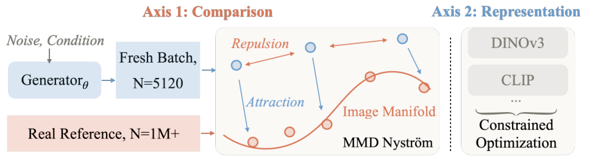
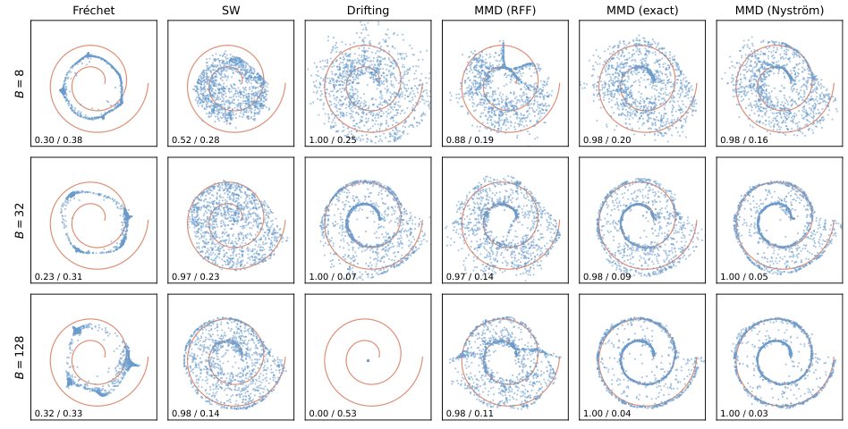
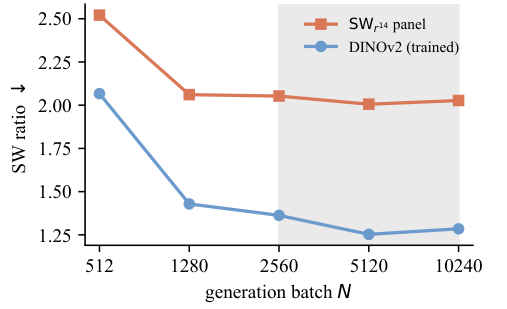
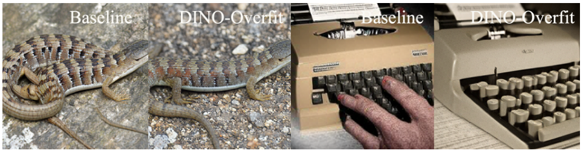
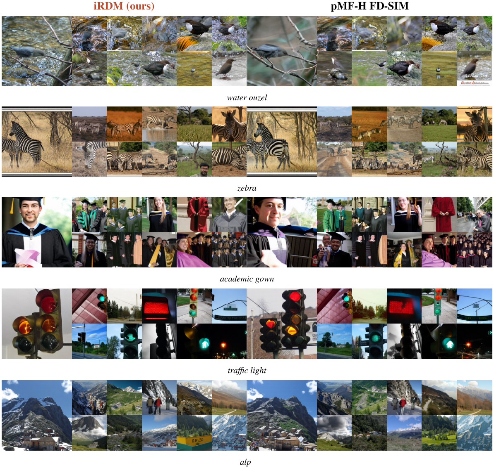
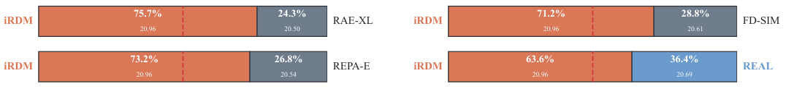
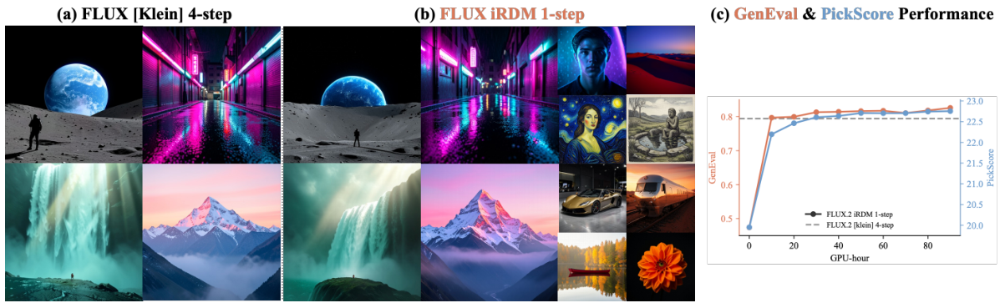

# RDM：用表征分布匹配训练一步视觉生成器

!!! info "论文信息"
    **论文题名：** Representation Distribution Matching for One-Step Visual Generation。 
    **作者：** Lan Feng、Wuyang Li、Éloi Zablocki、Matthieu Cord、Alexandre Alahi。 
    **机构：** EPFL、Valeo.ai、Sorbonne Université。 
    **时间 / 主题：** 2026-07；扩散模型与一步视觉生成。 
    **arXiv / 项目页：** [2607.02375](https://arxiv.org/abs/2607.02375)；[alan-lanfeng.github.io/rdm](https://alan-lanfeng.github.io/rdm/)。 
    **代码：** 论文项目页提供 GitHub 链接。 
    **元数据与核验口径：** 来源为 arXiv HTML、论文项目页；Checked Date：2026-09-07；Repro Status：Paper / project page reviewed, independent reproduction not claimed。

## 一步生成的问题，为什么会落到分布估计上

RDM 讨论的是一条很直接的生成路线。让网络从噪声一次输出图像，用冻结的视觉编码器提取特征，再把生成特征的分布拉向参考图像的特征分布。推理时只需生成器，训练时也不必在线查询一个去噪教师或维护对抗判别器。真正难的部分在于，训练损失变小可能只说明模型满足了某种有限样本统计量，或者找到了某个编码器的盲区；图像结构、样本多样性和提示遵循仍可能有问题。

论文将困难分成两条轴。第一条是**怎样比较分布**，包括距离、估计器、参考样本、生成批量以及条件信息。第二条是**在哪些表征中比较**，包括编码器集合及其权重。RDM 是这个问题框架，iRDM 则是作者在两条轴上选择具体方案后的组合。它没有发明一个新的基础生成架构，主要实验是在已有生成器上继续训练。[原论文，第3—4页](https://arxiv.org/pdf/2607.02375v1#page=3)

这一定位决定了结果应当怎样读。ImageNet 实验从已发布的 pMF-H FD-SIM checkpoint 出发；文生图实验从四步 FLUX.2 [klein] 4B 出发。前者用真实图像建立参考，后者用教师提前生成并筛选的图文对建立参考。“没有在线教师”是本轮后训练的计算图性质，不代表基础模型或离线数据没有教师成本。

下面的原图先给出完整信息流。左上是每轮重新生成的样本，左下是一次计算后冻结的真实参考；中间蓝色箭头将生成样本吸向参考分布，红色箭头让生成样本彼此分开；右侧将同一操作放到多个编码器中，并按约束满足程度分配训练压力。

*原论文 Figure 2。图中的 $N=5120$ 和百万级参考对应 ImageNet 设置。吸引与排斥使用不同的估计方式，是后面方法推导的关键。*

这套设计回答了三个连续的问题。怎样保留比均值、协方差更丰富的分布信息；怎样在不反复读取完整训练集的情况下得到稳定参考；怎样防止生成器只满足一种视觉表征。后面的螺旋实验、大批量实验和单编码器反例分别检验这三个环节，最终的图像实验再检验组合是否有效。

## MMD 的两种力，为什么不能一概近似

### 从图像分布到特征分布

设一步生成器为 $g_\theta$，噪声为 $z\sim p_z$，输出图像的分布为 $p_\theta$。冻结编码器 $\phi$ 将图像映射到特征，$\phi_*p$ 表示图像分布经过这一映射后形成的特征分布。框架的目标是

$$
\mathcal L(\theta)=\mathcal D(\phi_*p_\theta,\phi_*p_{\mathrm{data}}).
$$

这里监督的是**一组输出的分布**，没有要求某个噪声一定对应某张特定真实图片，也没有要求生成器复现某条多步去噪轨迹。生成器的一次前向输出就是被评价的对象，因此能够直接服务于一步推理。冻结 $\phi$ 只表示不更新它的参数；为了训练生成器，损失对图像的梯度仍要经过编码器传回 $g_\theta$。

iRDM 选用高斯核的平方最大均值差异。对两组特征分布 $P,Q$，

$$
\operatorname{MMD}^2(P,Q)
=\mathbb E_{u,u'\sim P}k(u,u')
-2\mathbb E_{u\sim P,v\sim Q}k(u,v)
+\mathbb E_{v,v'\sim Q}k(v,v'),
$$

$$
k(u,v)=\exp\left(-\frac{\lVert u-v\rVert_2^2}{2\sigma_\phi^2}\right).
$$

主 ImageNet 配方使用编码器的原始特征，不做特征归一化。每个编码器按 median heuristic 设定自己的带宽 $\sigma_\phi$，随后固定为单一尺度。不同表征的数值尺度不同，因此并非所有编码器共用一个核带宽。[原论文，第4页，式1—3](https://arxiv.org/pdf/2607.02375v1#page=4)

高斯核的 characteristic 性质意味着，在总体分布和精确核的理想条件下，MMD 为零能够识别**特征分布**相等。这一点比只匹配均值与协方差强，但仍有两道距离。实践中优化的是有限样本、有限秩估计；而编码器可能把不同图像映射到相同或相近特征。特征空间中的识别性不能直接升级为完整像素分布的识别性。

### 真实侧吸引，生成侧排斥

把 $P$ 看作生成分布，$Q$ 看作真实分布，三项就有了明确的训练含义。最后的真实—真实项不依赖 $\theta$，可以从生成器的损失中去掉。中间的生成—真实项带负号，最小化损失会提高生成与参考的核相似度，将生成样本拉向真实数据所在区域。第一项带正号，最小化它会降低生成样本之间过高的相似度，抵抗全部样本挤在少数高密度区域的倾向。

这个分解说明为什么不能只保留“靠近真实”的一半。假如所有噪声都生成同一种很像真的图像，吸引项可能很满意，生成分布却已丢失多样性。排斥项不是一个可有可无的附加正则，它是 MMD 比较整体分布时同时考虑生成侧覆盖的部分。

设当前批量有 $B$ 个生成特征 $g_i=\phi(g_\theta(z_i))$。论文在生成侧保留精确的 $B\times B$ 核矩阵，在真实侧使用压缩后的固定参考，得到

$$
\widehat{\mathcal L}_\phi
=\underbrace{\frac{1}{B^2}\sum_{i,j}k(g_i,g_j)}_{\text{exact repulsion}}
-\underbrace{\frac{2}{B}\sum_i\psi(g_i)^\top\bar\mu_\phi}_{\text{Nyström attraction}}.
$$

原式包含 $i=j$ 的对角项，采用的是相应的有偏批量形式。对于高斯核，对角值为常数；保留原式有助于明确实现与论文一致。更重要的是，两项的统计对象并不对称。生成分布随参数更新而改变，当前批量内的关系需要准确；真实训练集基本固定，可以先花计算建立较完整的参考，再在整个后训练过程中复用。

如果每步只抽取与生成批量同样少的真实样本，吸引方向除了受生成样本随机性影响，还会受当次真实子集影响。核带宽较小时，“这一轮恰好抽到哪些近邻”会更明显地改变梯度。iRDM 将这部分参考采样噪声从每步优化中移走，同时保留生成侧自身的随机性和真实参考近似的误差。

## Nyström 压缩的是完整参考，不是生成批量的关系

### 一次预计算怎样变成每轮吸引

ImageNet 的参考是约128万张训练图像。直接让每轮生成样本与全部参考两两计算核，成本很高。作者先在每个编码器的真实特征上用 k-means 选出 $m=4096$ 个 landmarks，记作 $\ell_1,\ldots,\ell_m$，并计算这些点之间的核矩阵 $K_{mm}$。

Nyström 特征映射和真实参考均值写作

$$
\psi(u)=K_{mm}^{-1/2}
\begin{bmatrix}
 k(u,\ell_1)\\ \vdots\\ k(u,\ell_m)
\end{bmatrix},
\qquad
\bar\mu_\phi=\frac{1}{n}\sum_{t=1}^{n}\psi(r_t),
$$

其中 $r_t$ 为真实图像的编码特征，$n=1.28\mathrm M$。$\psi(u)^\top\psi(v)$ 近似原始核 $k(u,v)$。将这一近似代入一个生成点对完整真实集的平均相似度，便得到

$$
\frac1n\sum_{t=1}^{n}k(g_i,r_t)
\;\approx\;
\frac1n\sum_t\psi(g_i)^\top\psi(r_t)
=\psi(g_i)^\top\bar\mu_\phi.
$$

最后一步只是利用内积的线性性，却说明了离线计算的接口。训练开始前把所有真实图像对核均值的贡献累积进 $\bar\mu_\phi$；训练时只需计算当前生成特征与 landmarks 的关系，再与这份均值做内积。生成器面对的仍是整个训练集的压缩参考，不是每轮新抽出的几千张真实图像。

吸引项的每轮成本为 $O(Bm)$，生成—生成精确排斥为 $O(B^2)$。此外还有生成器和多个视觉编码器的计算。因而 $O(Bm)$ 描述的是跨分布吸引部分，不能被当成全流程的总复杂度。论文认为在其配置中，编码器前向占据更主要的计算开销。[原论文，第4页](https://arxiv.org/pdf/2607.02375v1#page=4)

### 为什么不用随机特征近似全部核

Random Fourier Features 同样能把核计算变成有限维特征内积，但基函数独立于数据分布。Nyström 的基由真实数据决定，能够把有限的表示能力集中到真实特征经常出现的区域。图像特征虽然处在高维空间，实际数据可能集中在较薄的流形附近；在这种情况下，用真实点放置 landmarks 有理由比把能力均匀分配到整个环境空间更合算。

这是一种预算分配，而非无损压缩。4096个 landmarks 会留下有限秩误差，landmarks 的位置和带宽也影响近似质量。所谓冻结参考“零方差”，具体是指不再每轮重采真实参考所带来的那部分方差；不能据此说训练梯度没有噪声，或压缩后的核与精确核完全相同。

这也解释了它与近似整个 drifting 更新的路线有何差别。iRDM 只压缩不随训练变化的真实侧，把生成侧的批内核关系保留为精确计算。它优先解决的是参考噪声和参考规模问题，而不只是把一切成对运算都变成低秩形式。[原论文，第17页，Appendix A](https://arxiv.org/pdf/2607.02375v1#page=17)

## 螺旋实验把“损失已经小”与“学到正确流形”分开

图像很难直接展示一个分布偏离了哪里，于是作者构造了一个几何上可见的诊断。二维双圈螺旋经过固定正交映射嵌入64维空间，各方法使用同一个 MLP 生成器和匹配的训练预算，批量分别为8、32、128。评价同时看 anchor recall 和到真实曲线的 median distance，前者关注覆盖，后者关注样本是否贴近流形。真实数据的 median distance 约为0.033。

原图先横向比较同一批量下的六种距离，再纵向观察批量增长后的变化。橙色曲线是真实流形，蓝点是生成样本；每格左下角依次是 recall 与 median distance。

*原论文 Figure 3。各方法的失效方式不同，不能只从“是否覆盖两圈”判断是否学到了分布。*

| Batch $B$ | Fréchet | SW | Drifting | MMD (RFF) | MMD (exact) | MMD (Nyström) |
| --- | --- | --- | --- | --- | --- | --- |
| 8 | 0.30 / 0.38 | 0.52 / 0.28 | 1.00 / 0.25 | 0.88 / 0.19 | 0.98 / 0.20 | 0.98 / 0.16 |
| 32 | 0.23 / 0.31 | 0.97 / 0.23 | 1.00 / 0.07 | 0.97 / 0.14 | 0.98 / 0.09 | 1.00 / 0.05 |
| 128 | 0.32 / 0.33 | 0.98 / 0.14 | 0.00 / 0.53 | 0.98 / 0.11 | 1.00 / 0.04 | 1.00 / 0.03 |

*数值格式为 Anchor recall / medDist，对应原图标注。recall 越高、medDist 越低越好。*

Fréchet 使用冻结的全局均值与协方差，但这些矩不足以确定双圈结构。即使增大 batch，它仍没有沿着螺旋分布。这里的问题首先是统计量的表达能力，不能简单靠更稳定地估计同样的两阶矩解决。

SW 使用1000个重新采样的投影。最小 batch 下，生成点明显挤在局部；到128时覆盖提高，但分布仍比真实曲线宽。Drifting 在32时表现很好，在128的这个诊断配置却坍缩成一小团。其实现使用 coupled field，并对128大小的 reference bank 做了尽力调优。这个反例说明距离名称本身不足以预测优化行为，参考、归一化和批量会一起改变更新场。

三个 MMD 版本尤其值得对照。这里使用的是**多尺度核，每个尺度512维随机特征或512个 landmarks**，与主 ImageNet 的单尺度4096 landmarks 配方不同。RFF 与 Nyström 都使用冻结的全局真实均值；exact 版本虽然对所见样本精确，每轮只看到 $B$ 个真实参考。因此“exact”不等于每轮使用完整总体参考。[原论文，第5页](https://arxiv.org/pdf/2607.02375v1#page=5)

在128批量下，exact 与 Nyström 的 recall 都为1.00，medDist 分别为0.04与0.03；RFF 虽有0.98的 recall，medDist 仍为0.11，蓝点明显较散。到8批量时，Nyström 的 medDist 为0.16，优于 exact 的0.20。这组差异支持两个具体选择：真实侧采用冻结完整参考，有限近似能力优先放在真实流形附近。它并不证明 Nyström 在任意生成器、数据分布和预算下都优于所有方法。

## 大 batch 的作用是让当前生成分布看得更准

冻结真实参考后，仍然变化的是生成分布。把过去生成的特征放进长期队列，能够增加名义样本数，但这些点来自旧参数。模型已经更新时，队列可能让损失继续针对过时分布计算吸引与排斥，形成 off-policy 偏差。iRDM 因而要求每轮使用新鲜生成批量。

这与“真实参考可以冻结”并不矛盾。真实训练集本身没有随着优化器移动，生成器却每次都会变化。前者可以预计算，后者需要当轮重采。批量越大，当前分布估计通常越稳定；但在固定时间里，一轮越贵，能够进行的参数更新就越少。论文因此比较固定 wall-clock 预算，而非只画一个增加算力后的质量曲线。

具体扫描只训练一个 DINOv2 Nyström-MMD 分支，每组约6000秒，学习率随 $\sqrt N$ 缩放。图中蓝线是直接训练的 DINOv2 空间，橙线是14编码器汇总。两条线变化幅度不同，已经提示在一种表征中明显改善，不等于所有表征同步改善。

*原论文 Figure 4。阴影区域是较宽的较优批量范围；10240并未继续优于5120。*

| Generation batch $N$ | Learning rate | DINOv2 SW ratio ↓ | SWr14 ↓ |
| --- | ---: | ---: | ---: |
| Untrained | — | 1.927 | 2.085 |
| 512 | $5.1\times10^{-7}$ | 2.067 | 2.521 |
| 1280 | $8.0\times10^{-7}$ | 1.429 | 2.061 |
| 2560 | $1.1\times10^{-6}$ | 1.363 | 2.053 |
| 5120 | $1.6\times10^{-6}$ | 1.253 | 2.006 |
| 10240 | $2.3\times10^{-6}$ | 1.285 | 2.027 |

*原论文 Appendix C，Table 6。这里是单编码器消融，不是最终十编码器 iRDM 的主结果。*

最小批量512虽然允许更多更新，却比起点退步，DINOv2 ratio 从1.927升至2.067，整体从2.085升至2.521。批量5120最佳，10240略差。可迁移的判断是，分布目标需要足够多的**当前样本**，但最合适的 batch 必须与更新次数、学习率和预算一起选择，不能只取显存能容纳的最大值。[原论文，第6、18页](https://arxiv.org/pdf/2607.02375v1#page=18)

实现上，gradient caching 让大批量梯度分块计算，激活内存成本接近一个分块，同时保留完整批量对应的梯度。这里不能把它理解成对若干小批量各算 MMD 再平均。MMD 的精确排斥包含跨样本对；若不同分块之间的关系被丢弃，优化的就是另一个目标。真正需要保留的是完整批量特征的相互关系，而不必让全部样本的网络激活同时驻留显存。

主 ImageNet 选择5120，文生图选择10240。大批量和多个编码器并没有增加一步推理的网络调用数，代价发生在后训练与参考预计算阶段。

## 单编码器反例说明，多一种表征为何仍不够

即使估计器稳定，分布在特征空间里足够接近，也未必解决视觉错误。作者选 DINOv2 做一个刻意的压力测试。从相同生成器起点，只对这一编码器优化1000 steps，batch 为5120，其 SW ratio 从1.81降至1.01，几乎达到真实验证参考的1.00。

下面原图中，蜥蜴样例的纹理和外观明显改善；右侧打字机却仍有不合理的按键排列与结构。两类图像都被同一个几乎饱和的分布分数评价，因此仅凭这个数字不能判断细节已经可信。

*原论文 Figure 5。Baseline 与 DINO-Overfit 成对展示。右侧结构反例是增加表征多样性的直接动机。*

这个实验并没有否定 DINOv2 的语义能力。它说明，表征保留哪些信息，与人判断真实感需要哪些信息并不完全一致。优化器只会消除损失看得见的差异，损失看不见的错误可以持续存在。换一个更强的单编码器能够改变盲区，却不能自动消除“只有一种视角”的问题。[原论文，第6—7页](https://arxiv.org/pdf/2607.02375v1#page=7)

iRDM 最终采用十个冻结编码器训练，并用十四个编码器评价。它们覆盖不同架构、训练监督和特征汇聚方式，目的是让结构、语义、感知与重建相关信息相互补充。下面保留附录中会影响复用的输入与输出接口。

| Encoder | Input | Pool | D | Role |
| --- | ---: | --- | ---: | --- |
| Inception v3 | 299 | avg | 2048 | Train + evaluation |
| ConvNeXtV2-B | 224 | avg | 1024 | Train + evaluation |
| MAE ViT-L/16 | 224 | avg | 1024 | Train + evaluation |
| CLIP ViT-L/14 | 256 | cls | 1024 | Train + evaluation |
| DINOv3-L | 224 | cls | 1024 | Train + evaluation |
| PE-Core-L | 224 | attn | 1024 | Train + evaluation |
| SigLIP2-So400m | 224 | attn | 1152 | Train + evaluation |
| AIMv2-H | 224 | avg | 1536 | Train + evaluation |
| WebSSL DINO-1B | 224 | cls | 1536 | Train + evaluation |
| DreamSim ensemble | 224 | cls | 1792 | Train + evaluation |
| DINOv2-L | 256 | cls | 1024 | Held-out evaluation |
| SigLIP v1 | 384 | attn | 1152 | Held-out evaluation |
| C-RADIOv3-L | 256 | summary | 3072 | Held-out evaluation |
| FLUX.1 VAE | 256 | patchmean | 1024 | Held-out evaluation |

*据原论文 Appendix B，Table 5 整理。Input 为输入边长，D 为汇聚后的特征维数；FLUX.1 VAE 使用 $4\times4$ patch means。全部使用已发布的冻结权重与原始汇聚特征，不做 feature normalization。*

DINOv2 在前面的失效诊断中直接参与训练，在最终十编码器方案中则留出评价。这是两个不同实验，不能把“DINOv2 留出”泛化到整篇论文每一次优化。类似地，CLIP 这一行应按论文实际输入256理解，而不是仅凭 checkpoint 名称推定分辨率。[原论文，第18页](https://arxiv.org/pdf/2607.02375v1#page=18)

多个编码器也没有自动给出无条件的像素分布保证。即使各自的特征核有良好识别性，图像到特征的映射仍可能丢失信息。要由特征约束推出完整图像分布相等，还需要相应的信息保留与可辨识条件。论文最有力的证据是多个经验视角能减少某一种表征独占训练目标的偏差，而非十个冻结网络就构成绝对可靠的真实感判据。

## 权重控制让训练追赶尚未满足的表征

把十个损失简单相加还有一个问题。优化器可能先把某几个容易改善的表征推到极低，从而降低平均损失，困难表征却长期落后。尤其当一个表征的数值已低于真实验证参考，继续向下优化未必还对应更多视觉收益。

作者为编码器 $\phi$ 设定真实验证基准 $b_\phi$，以当前分数 $s_\phi$ 与基准的差

$$
e_\phi=s_\phi-b_\phi
$$

表示约束超额。如果 $e_\phi\le0$，这一编码器的权重被 gate 置零；尚未满足约束的编码器分享固定总预算，权重与

$$
\lambda_\phi\propto
\exp\left(\frac{e_\phi}{\tau\bar e}\right)
$$

成正比。这里 $\tau$ 控制 softmax 的集中程度，$\bar e$ 是超额的归一化尺度；主实验的有效权重总和为10。论文将其放在 proportional Lagrangian controller 的思路下理解。它不需要训练一个新的图像判别网络，而是用约束违反程度调整已有损失的作用强度。

假设几个编码器已达到真实参考，另一个还明显偏离，控制器就把训练压力集中到未满足者。若所有约束都满足，权重归零，目标本身不再鼓励无限向下刷新这些代理分数。这个性质不等于论文报告了某个实际运行中必定触发的提前停止策略，也不能据此补出未披露的温度数值或控制器细节。

Table 3 使用100步短程消融，比较 gated 与 uniform weighting。其局部起点口径下，SWr14 为2.09、最差编码器 ratio 为4.83；这组起点数值不应强行替换成主结果表里的2.05。

| Weighting | SWr14 ↓ | Worst encoder ratio ↓ |
| --- | ---: | ---: |
| Starting checkpoint | 2.09 | 4.83 |
| Uniform | 1.90 | 4.06 |
| Gated proportional | 1.88 | 3.49 |

*原论文 Table 3。该消融中最差空间为 PE-Core。*

整体平均只改善了0.02，但最差表征的 ratio 相对等权降低了0.57，符合“优先解决最薄弱约束”的设计。这个实验直接支持的是表征间平衡改善，还不足以独立证明人类偏好增加；视觉质量需要结合后面的主结果和代理偏好实验判断。[原论文，第9页](https://arxiv.org/pdf/2607.02375v1#page=9)

## SWr14 怎样评价，真实参考的1又意味着什么

训练使用 MMD，如果评价也只看同一核损失，很容易把目标优化成功误作全面质量提升。作者在同一个多编码器面板上改用 sliced-Wasserstein 距离，并保留四个未参与主训练的编码器。对每个编码器，生成集到真实训练集的距离，除以真实验证集到训练集的距离，再求平均

$$
\mathrm{SWr}_k=\frac1k\sum_{e=1}^k r_e,
\qquad
r_e=
\frac{\mathrm{SW}(\phi_{e*}p_\theta,\phi_{e*}p_{\mathrm{train}})}
{\mathrm{SW}(\phi_{e*}p_{\mathrm{val}},\phi_{e*}p_{\mathrm{train}})}.
$$

这个归一化的用意，是让不同编码器的原始尺度可以汇总。分母是该编码器中一批新真实图像与训练图像之间的基准距离。真实验证参考因此按定义记为1，数值接近1表示达到这份有限样本参考的水平。[原论文，第7—8页，式5](https://arxiv.org/pdf/2607.02375v1#page=7)

但1不是不可能突破的数学下界。表中多个生成模型在某些表征上低于1，说明样本组成、估计器与表征本身会影响这个比率。分数低于真实参考不能直译为“比真实图像更真实”，更不能把不同空间里低于1的部分无限补偿另一些空间里的严重偏离。

主要评测每组使用16384个样本、1024个随机投影。SWr14 汇总全部十四个编码器；Held-out SWr4 只汇总 DINOv2、SigLIP v1、RADIO 和 FLUX VAE。它在距离形式和部分表征上与训练分离，降低直接适配训练估计器的风险。不过十四个编码器中仍有十个与训练共享，同样的视觉盲区也可能存在，所以它是更充分的交叉检查，不是对任何指标优化行为的免疫证明。

## ImageNet 后训练改善的是多个空间的共同表现

主实验在 ImageNet-256 上训练4000 steps，batch 为5120，学习率 $1.6\times10^{-6}$。每轮使用十个编码器，真实参考来自完整约128万张训练图像，每个编码器以4096 landmarks 压缩。生成器由 pMF-H FD-SIM 初始化，所以最直接的比较是从这一强起点继续优化后，整体和留出表征究竟改善多少。

| Model | SWr14 ↓ | Held-out SWr4 ↓ |
| --- | ---: | ---: |
| Drifting-L | 5.93 | 4.91 |
| iMF-XL | 5.02 | 4.08 |
| SiT-XL/2 | 4.27 | 3.63 |
| pMF-H (base) | 4.09 | 3.63 |
| DiT-XL/2 | 3.98 | 3.39 |
| MAR-H | 3.87 | 3.18 |
| SiT-XL/2 + REPA | 3.61 | 2.99 |
| LightningDiT-XL | 3.10 | 2.69 |
| RAE-XL | 2.43 | 2.18 |
| REPA-E SiT-XL/1 | 2.40 | 2.14 |
| pMF-H (FD-SIM) | 2.05 | 1.98 |
| iRDM | 1.30 | 1.54 |
| Validation baseline | 1.00 | 1.00 |

*原论文 Table 1 的代表行。该表重评多个已发布生成器，包含不同训练路线与采样机制，不是同训练成本下的统一方法消融。*

iRDM 的 SWr14 从2.05降到1.30，留出四编码器从1.98降到1.54。后一个结果尤其重要，因为它说明改善不完全局限于直接参加优化的表征。与此同时，留出整体仍未达到1，最终模型没有在所有视角上都匹配真实参考。[原论文，第8页](https://arxiv.org/pdf/2607.02375v1#page=8)

为了看清这0.75的整体变化由哪里贡献，可以将起点与最终模型逐编码器展开。

| Encoder | pMF-H (FD-SIM) | iRDM | Role |
| --- | ---: | ---: | --- |
| Inception | 0.67 | 1.27 | Train |
| ConvNeXt | 0.67 | 0.98 | Train |
| DINOv2 | 1.81 | 1.35 | Held-out |
| MAE | 0.60 | 0.83 | Train |
| SigLIP2 | 1.86 | 1.30 | Train |
| CLIP | 2.69 | 1.02 | Train |
| DINOv3 | 2.33 | 1.11 | Train |
| SigLIP v1 | 2.63 | 1.90 | Held-out |
| PE-Core | 4.76 | 1.22 | Train |
| RADIO | 2.14 | 1.56 | Held-out |
| WebSSL | 2.31 | 1.55 | Train |
| AIMv2 | 3.68 | 1.44 | Train |
| DreamSim | 1.24 | 1.32 | Train |
| FLUX | 1.35 | 1.36 | Held-out |

*均为原论文 Table 1 的 SW ratio，越低代表在对应特征距离下越接近训练集。*

PE-Core 从4.76到1.22、CLIP 从2.69到1.02、AIMv2 从3.68到1.44，是明显贡献。Inception、ConvNeXt、MAE、DreamSim 与 FLUX 的数值却没有优于起点。最终结果不是十四个指标全部单调下降，而是在九个空间改善后得到更均衡的总体表现。完整参照场中，FLUX 空间的 MAR-H ratio 还可达到0.48，低于 iRDM 的1.36；这进一步说明不应把平均最优讲成每一表征最优。

附录又用 RFF-MMD 做与训练形式较接近的交叉检查。MMDr14 从 FD-SIM 的10.3降到 iRDM 的2.69；RAE-XL 为13.0，REPA-E 为14.0。总体顺序与 SWr14 大致一致，但中间模型有重排。由于它仍是核 MMD，这个证据比 SW 与留出编码器更接近训练目标，应理解为结果对另一种距离实现的支持，而非完全独立的评价。[原论文，第19页，Table 7](https://arxiv.org/pdf/2607.02375v1#page=19)

### 为什么单张样例未必展示出这么大的分数差距

附录的比较刻意展示未经挑选的类别样本。每一行是一类，左边 iRDM、右边 FD-SIM；每种方法都有一个放大样本和十个较小样本。五类包括鸟、斑马、学位服、交通灯与山地，覆盖动物纹理、可变形服装、刚性物体及自然景观。

*原论文 Figure 8。作者说明采用最先得到的未挑选样本。两种方法单张图都能清晰且符合类别，不能把汇总距离差直接想象成每张图都有显著视觉落差。*

这张图的价值恰恰是限制过强解读。SWr14 的1.30与2.05比较的是大规模样本在多种表征中的统计关系，单个类别、少量图像可能很难看出差别。它支持继续使用分布评价，但也提醒读者，指标的大幅相对改善与每个用户在每张图上感知到的改善并非同一量。[原论文，第21、23页](https://arxiv.org/pdf/2607.02375v1#page=23)

## PickScore 提供偏好代理，但四根柱子的协议并不相同

作者还希望知道，多表征距离改善是否与另一种视觉偏好信号一致。ImageNet 后训练目标没有直接使用 PickScore，因此它可作为一个与该目标分离的学习型偏好代理。这里的“偏好”由模型评分给出，不能理解成人类评审员逐对投票。

对于最重要的起点比较，作者使用相同类别、相同噪声的4000对 latent，分别交给 FD-SIM 与 iRDM。iRDM 的平均 PickScore 为20.96，FD-SIM 为20.61，成对胜率为71.2%。共享噪声和类别能够减少内容选择差异，使比较更接近“同一生成条件下，后训练带来了什么”。

*原论文 Figure 6。橙色为 iRDM。FD-SIM 一栏使用匹配噪声的成对样本，其余比较使用 per-class means，不能视作四组完全相同协议的样本级胜率。*

与 RAE-XL、REPA-E、真实照片的比较，作者统计的是按类别平均后的结果。iRDM 分别在75.7%、73.2%和63.6%的类别比较中获胜；对方的平均分分别为20.50、20.54和20.69。它们支持 PickScore 排序与主要分布评价大体同向，但不能把“63.6%”写成多数人认为生成图像比真实照片更真实。[原论文，第8页](https://arxiv.org/pdf/2607.02375v1#page=8)

还要区分两个任务。ImageNet 优化不使用 PickScore；后面的文生图参考集却用 PickScore 筛选教师候选。因而“偏好模型从未参与训练目标”的限定可以用于这里的 ImageNet 直接损失，不能扩大为整个文生图数据与训练流程完全不受偏好模型影响。

## 同一起点的距离消融，检验优势是否只来自换了评价指标

前面的螺旋提供几何诊断，主实验则把多个设计一起用上。要进一步定位 MMD 估计器的作用，Table 4 从同一 pMF-H checkpoint 出发，只用 DINOv2 cls 特征做短程后训练，比较不同距离。主要各分支使用 AdamW、学习率 $1.6\times10^{-6}$、batch 5120和100次优化更新，RBF 带宽为65。

几个名称对应的实际操作如下。`mmdx` 保留精确生成排斥，跨真实侧用4096-landmark Nyström；`mmd_rff` 用4096维冻结 RFF 参考均值；`mmd_exact` 对其使用的生成—真实样本对精确求均值。`fd` 匹配矩，`sw` 在训练中使用128个投影。不能仅凭 `mmd_exact` 的名称，推断它每轮对全部128万真实图像做精确成对计算。

Drifting 是这个比较中的预算例外。作者按时间匹配，约运行60步，batch 为8192，半径为0.2、0.05、0.02，并将学习率调至 $10^{-6}$；原始较大的 $4\times10^{-4}$ 学习率会使这个 warm start 退步。因此这张表是控制初始化、主要表征与时间的实用对照，不是每一行都严格相同更新次数与 batch。

| Evaluation ratio ↓ | Base | mmdx | mmd_rff | mmd_exact | fd | sw | drifting |
| --- | ---: | ---: | ---: | ---: | ---: | ---: | ---: |
| SW | 1.927 | 1.420 | 1.466 | 1.492 | 1.547 | 1.583 | 1.746 |
| RFF-MMD | 10.393 | 4.495 | 4.839 | 5.438 | 5.798 | 6.413 | 8.258 |

*原论文 Table 4。SW 评价使用16384样本与1024投影；RFF-MMD 使用50000样本与4096维随机特征。*

两种评价都把 `mmdx` 排在最前。SW 距离下1.420优于直接训练 SW 的1.583；RFF-MMD 下4.495也优于直接采用 RFF 近似训练的4.839。因而效果不能简单解释为“训练哪个距离，就在那个距离的榜上获胜”。估计器对参考噪声和有限维近似的处理，影响了实际优化得到的生成分布。

与此同时，这一证据发生在特定强起点、单编码器与短预算下。它支持本文的非对称核估计配方，不替代从零训练、其他编码器、其他 batch 或长预算的系统比较。[原论文，第10页，Table 4](https://arxiv.org/pdf/2607.02375v1#page=10)

## 文生图必须匹配图像和条件的共同分布

到文生图任务，只把图像边缘分布做对还不够。可以设想一个解释性例子：模型对“红色杯子”和“蓝色杯子”的提示总是生成相反颜色，但两种提示出现得一样多。总体图像集合依然有相同比例的红杯与蓝杯，单看图像分布未必能识别错误；错的是图像与提示之间的对应关系。

论文引入冻结文本编码器 $\tau$，把图像和对应文本拼接成联合特征

$$
\Phi(x,c)=\phi(x)\oplus\tau(c),
\qquad
\mathcal L_{\mathrm{joint}}(\theta)
=\mathcal D(\Phi_*p_\theta,\Phi_*p_{\mathrm{data}}).
$$

参考图像必须保留生成它的 caption，当前生成图像也与实际输入 prompt 配对。landmarks 和参考均值都在这个联合空间构建，原来的 MMD 估计器不需要换成另一种损失。[原论文，第6页，式4](https://arxiv.org/pdf/2607.02375v1#page=6)

从公式上理解，拼接后两个样本的平方距离，是图像距离与文本距离之和。对同一高斯尺度，这使联合核能够写成图像核与文本核的乘积。这是解释核作用的代数展开：即使两张图在视觉上相似，如果提示差异很大，它们的联合相似度也会降低。生成样本主要被与自己条件相近的参考吸引，从而对“什么图应该对应什么条件”施加约束。

这里还有一个容易忽略的接口。联合分布同时包含条件的边缘分布，如果生成端大量使用某类提示，而参考端该类提示极少，优化器面对的目标就先在文本组成上不匹配。作者因此让训练 prompt pool 的组成与参考集相适应，而不是任意拼一组文本后直接复用图像侧参考。

文生图采用 SigLIP2 文本特征，文本分量权重为1，高斯带宽为 median heuristic 的0.25倍，每个编码器使用8192个 Nyström landmarks。它并非逐项照搬 ImageNet 的4096 landmarks、单倍 median 带宽。参考的语义分组和匹配局部性发生变化时，核参数也相应改变。[原论文，第20页，Appendix E.1](https://arxiv.org/pdf/2607.02375v1#page=20)

## 三十万参考对是筛选结果，离线构建决定了目标是什么

文生图参考由四步 FLUX.2 [klein] 教师预先生成，分成感知质量与组合正确性两部分。后训练不再查询教师，但它学习的是**筛选后的教师输出分布**，并非教师无条件随机生成的平均分布。这个区别既解释一步模型为什么可能在某些评价上超过四步起点，也决定结果的适用边界。

### 感知部分先过采样，再选高分候选

作者从 COCO train2014 的82783张图像各取一个 caption，对每个 caption 让教师生成24个候选，再按 PickScore 保留前三个。最终得到248349对图文样本。

按这些数值计算，只有这一分支就先产生了 $82783\times24=1986792$ 个教师候选，再保留其中八分之一。约198.7万是由论文给出的候选数相乘得到的离线生成量，不是论文声称最终参考集有这么大。它说明“约30万参考图”不能直接当作整个数据生成成本。

PickScore 在此没有作为后训练阶段每一步的可微 reward，却通过筛选改变了模型要匹配的目标分布。高分候选被系统性保留，因而偏好信息已进入参考。论文中“无 reward model”的训练图描述，需要与这种离线数据选择作用区别理解。[原论文，第19页，Appendix E.1](https://arxiv.org/pdf/2607.02375v1#page=19)

### 组合部分直接面向 GenEval 提示筛选正确答案

组合参考使用553条 GenEval 提示。教师最初每条生成150个种子，如果正确样本不足100个则继续补充。标准 GenEval Mask2Former 检测器检查对象是否齐全、数量、颜色与空间关系是否满足；只有全部通过的图像才进入参考，每条提示最多保留100张。

最终得到53800张经过验证的图像，覆盖551条提示。另有两条位置提示，即使各尝试到1000个种子仍没有正确样本。教师在这一候选池的逐种子正确率，从单对象提示约98%，降到属性绑定约40%、位置关系约33%。过滤因此对困难组合类别的目标分布改变得尤其大。

| Reference block | Prompt source | Selection | Retained pairs |
| --- | --- | --- | ---: |
| Perception | 82,783 COCO train2014 captions | Top 3 of 24 teacher candidates by PickScore | 248,349 |
| Composition | 553 GenEval prompts | Detector-verified; up to 100 correct per prompt | 53,800 |
| Combined | COCO + covered GenEval prompts | Frozen paired reference | 302,149 |

*前两行数量来自 Appendix E.1；302149为两部分相加。组合部分覆盖551/553条提示。*

参考中 GenEval 图像占比约18%，生成端的 prompt pool 也通过重复相应提示匹配这一比例。于是最终 GenEval 分数反映的是**包含该基准提示的定向后训练**。即便评价使用新的随机种子，提示本身已经出现在参考构建与条件训练中，不能把这项提升当成对完全未见组合提示的零样本泛化证据。[原论文，第19—20页](https://arxiv.org/pdf/2607.02375v1#page=20)

这并不让实验失去意义。它仍然回答了一个具体问题：能否把教师多次采样中较好、且经验证正确的输出压缩进一个一步生成器，让一次前向更常得到这样的结果。只是在解释“超过教师”时，真正比较的是筛选参考后的一步模型与四步基础模型，而不是同样原始目标分布、同样数据暴露条件下单纯减少步数的效果。

## FLUX 一步结果，哪些能力恢复，哪些仍然落后

文生图后训练使用 $512\times512$ 分辨率，180 steps，batch 10240，学习率 $2.83\times10^{-6}$，约90 H200 GPU-hours。评价包含 GenEval 的对象、数量、颜色、位置和属性组合，PickScore 则使用500条 COCO validation prompts。

先看原图的左右两部分。左边比较四步基础模型与一步后训练样例，右边以 GPU-hour 为横轴给出 GenEval 和 PickScore 的变化。初始一步模型与四步模型有很大差距，随后较快恢复，再继续缓慢改善。曲线对应上述离线筛选参考与后训练设置，90 GPU-hours 不包含基础模型预训练，也不代表所有离线教师候选生成和筛选成本。

*原论文 Figure 1。灰色虚线为四步基础模型参照；两条曲线分别使用 GenEval 与 PickScore 的纵轴。*

| Method | Steps | Single Obj. | Two Obj. | Counting | Colors | Position | Color Attr. | Overall | PickScore |
| --- | ---: | ---: | ---: | ---: | ---: | ---: | ---: | ---: | ---: |
| FLUX.2 [klein] | 4 | 0.994 | 0.904 | 0.791 | 0.880 | 0.575 | 0.623 | 0.794 | 22.58 |
| One-step initialization | 1 | 0.894 | 0.323 | 0.603 | 0.673 | 0.225 | 0.128 | 0.474 | 19.95 |
| DMD2 | 1 | 0.997 | 0.894 | 0.806 | 0.864 | 0.603 | 0.660 | 0.804 | 22.36 |
| iRDM (marginal) | 1 | 0.991 | 0.899 | 0.763 | 0.910 | 0.638 | 0.608 | 0.801 | 22.70 |
| iRDM (joint) | 1 | 0.994 | 0.924 | 0.756 | 0.923 | 0.650 | 0.708 | 0.826 | 22.76 |

*原论文 Table 2。GenEval 各项与 PickScore 均为越高越好；GenEval 提示参与参考构建和训练条件，结果需按这一暴露条件理解。*

一步初始化的 Overall 只有0.474，尤其 Two Obj. 为0.323、Color Attr. 为0.128，说明直接压成一次生成显著破坏复杂条件。图像边缘目标已把 Overall 恢复到0.801，PickScore 为22.70，表明通过高质量图像参考可以恢复大量生成能力。

联合目标进一步把 Overall 从0.801提高到0.826。变化最明显的是 Color Attr. 从0.608到0.708，Two Obj. 从0.899到0.924，Position 从0.638到0.650。这些变化方向符合联合匹配解决条件错配的动机；它让颜色、对象与提示的配对关系真正进入距离，而不只要求整体图像集合看起来正确。

但改善没有覆盖全部能力。Counting 从 marginal 的0.763降到0.756，低于四步基础模型0.791，也低于 DMD2 的0.806。Single Obj. 与基础模型同为0.994，DMD2 还达到0.997。因此0.826的最高总体分数不能写成一步模型在每个能力上都超过四步教师。[原论文，第9页，Table 2](https://arxiv.org/pdf/2607.02375v1#page=9)

附录的额外样例展示一步输出能够覆盖霓虹街景、山地、人物、微距植物与动物等视觉类型，每张图为512平方分辨率、一次网络求值。这组图可帮助观察质感与内容范围，但没有附带对这些提示的受控成功率，不能替代前表的组合能力评价。

*原论文 Figure 7。每张为后训练 FLUX.2 [klein] 的一次网络求值输出。人物皮肤、羽毛、花瓣和反射展示视觉细节；复杂数量与关系仍应以相应测试判断。*

## DMD2 对照经过调优，但没有与 iRDM 使用相同算力预算

Table 2 中的 DMD2 不是直接搬用 Stable Diffusion 版本的现成 checkpoint。作者为 FLUX.2 [klein] 的 flow-matching 参数化重新实现了方法，保留三个网络：待训练的一步生成器、估计学生分布的可训练 critic，以及冻结教师。critic 每步更新，生成器每五步更新；学生先通过教师采样 ODE 的回归初始化成一步模型，再进入分布匹配蒸馏。

训练使用全局 batch 128、512平方分辨率、4张 H200、AdamW，不使用 EMA。这里存在一个与教师接口有关的实际问题。klein 已做 guidance distillation，其速度预测在高噪声和原生四个采样节点附近更可靠；直接均匀采样蒸馏时间会进入低噪声区域，教师在那里趋向模式平均的后验均值，反而把生成器拉坏。

作者将均匀采样的时间经过 klein 的信噪比 shift 变换，经验参数 $\mu\approx2.03$ 对齐原生节点间距，配合 $5\times10^{-7}$ 学习率和短 warmup，才把发散趋势转为有效蒸馏。这说明在更换教师参数化后，分布匹配目标需要有效的 score 或速度场查询接口；方法名称相同，不代表任意时间输入都提供可靠监督。[原论文，第20页，Appendix E.2](https://arxiv.org/pdf/2607.02375v1#page=20)

提示分布也影响对照。比起仅用 COCO，较广的 LAION caption pool 在各 checkpoint 上提升了 GenEval，并缓解后期下降。作者报告的是调过设置后的最佳 LAION 运行，在500步时达到峰值。增加真实 latent 上的 GAN 项没有改善指标，作者解释为判别器过快区分真伪，使对抗梯度相对分布匹配梯度变弱；该变体没有成为主表结果。

| Step | GenEval | PickScore |
| --- | ---: | ---: |
| Teacher (4-step) | 0.794 | 22.58 |
| 250 | 0.778 | 22.17 |
| 500 (reported) | 0.804 | 22.36 |
| 750 | 0.792 | 22.36 |
| 1000 | 0.793 | 22.27 |

*原论文 Table 8，best LAION-prompt configuration。论文使用500步峰值作主表 DMD2 对照。*

所以不宜把0.804简单归因为“基线没有认真调参”。另一方面，其峰值约需10 H200 GPU-hours，iRDM 后训练约为90 H200 GPU-hours，名义上相差约九倍；iRDM 还有离线参考构建。二者使用的监督接口与参考筛选也不同。主表支持的是作者这两套实际配置下，iRDM joint 获得更高总体 GenEval 和 PickScore，不能进一步推出同总算力预算下的效率优势。

这组对照留下一个很具体的后续问题。在固定离线数据成本、统一训练 GPU-hours、统一提示暴露与参考筛选条件后，两条路线各自能达到什么质量；当前表格没有完成这种归因。保留这一条件，比把一组最高分写成无条件方法排序更有助于决定工程上采用哪种后训练方案。

## 把配方迁移到自己的生成器，需要保留哪些接口

iRDM 可复用的部分是一套训练信号组织方式。先确定能代表目标输出的参考集，保留任务要求的条件配对；在冻结编码器中预计算真实侧的核均值；每轮生成足够大的新鲜批量，精确计算批内排斥，并用压缩参考提供吸引；最后让多个表征通过约束权重共同决定更新。模型训练完后，这些参考、landmarks、视觉编码器和控制器都不需要随生成器参与一步推理。

这种训练和推理的分离适合已有强生成器、能离线处理较大参考集、能够承担多编码器后训练的场景。真正的便利不是“任何模型套上 MMD 就行”，而是在线教师查询、逐样本轨迹监督和可训练对抗判别器不再是本轮优化的必需组件。相应代价转移到了参考构建、冻结表征的计算，以及几千至上万新鲜样本的每轮分布估计。

三类选择尤其不能随意删减。小 batch 加许多更新未必代替大批量，单编码器分数饱和未必意味着结构错误消失，图像边缘匹配也不能代替条件关系匹配。它们分别有批量扫描、打字机反例和 marginal/joint 对照的直接证据。相比之下，landmark 数、核带宽与编码器组合属于需要围绕新任务重新检查的具体预算与表示选择。

这篇论文最值得保留的认识，是把“生成质量目标”拆成可以分别检查的对象。参考数据决定希望生成什么，估计器决定每轮实际看见什么，表征决定哪些错误能被看见，条件配对决定输出与请求是否对应。iRDM 的结果来自这些接口共同成立；在文生图中，筛选教师候选与暴露基准提示也属于这个因果链。理解这些条件，才能把它用作一种可调整的后训练方案，而不只是重复一个更低分布距离或更高 GenEval 数字。

## 继续阅读

RDM 的表征分布目标可以和[REPA](repa.md)对照，观察显式表征监督与分布匹配的差别；工程化少步生成再接[扩散蒸馏](../../diffusion/distillation.md)。
