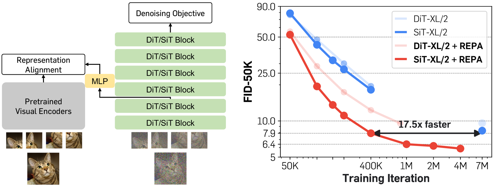
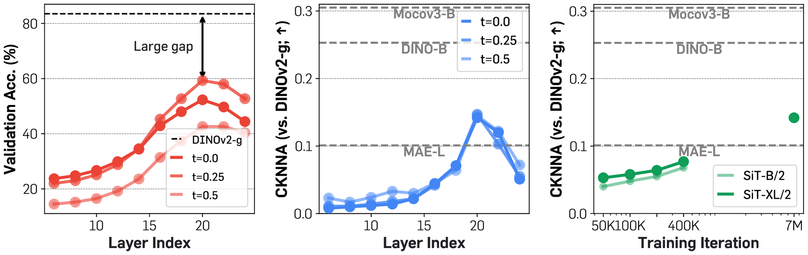
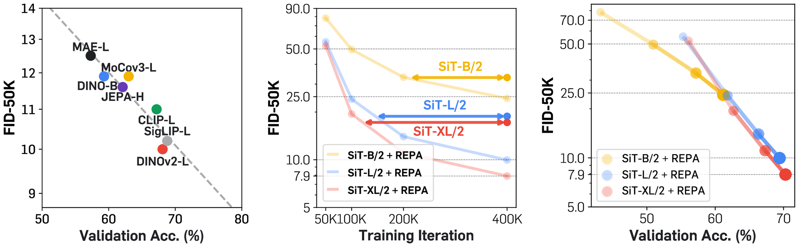
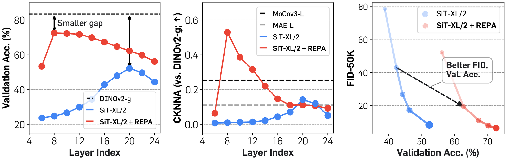
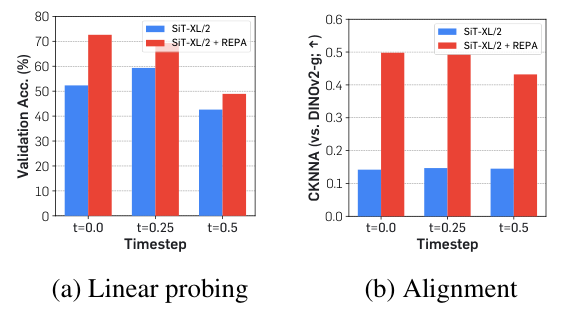
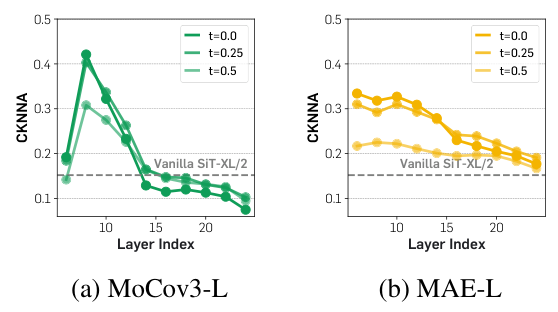
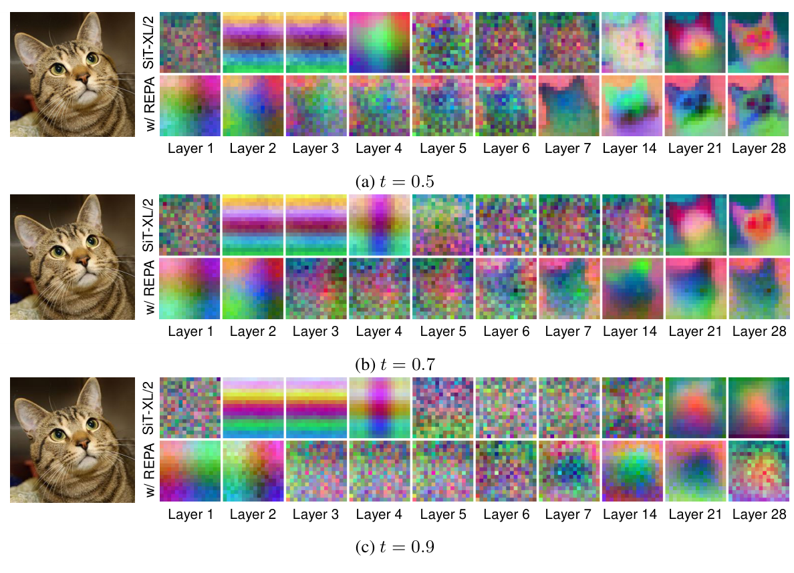
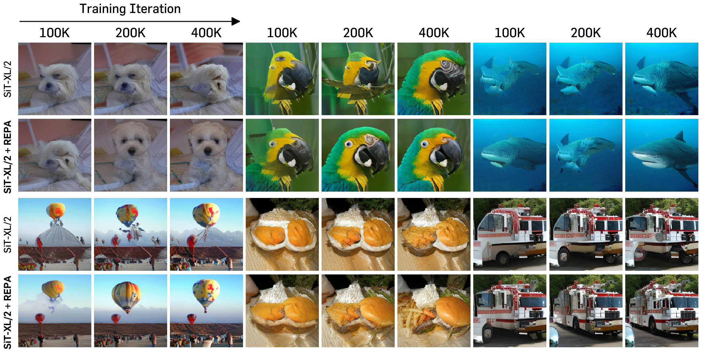
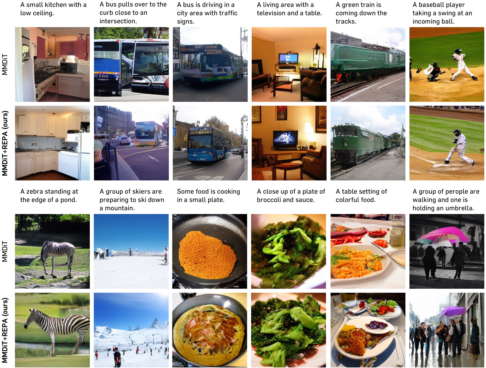

# REPA：把扩散模型隐式学习表征的负担变成显式监督

!!! info "论文信息"
    **论文题名：** Representation Alignment for Generation: Training Diffusion Transformers Is Easier Than You Think。 
    **作者：** Sihyun Yu、Sangkyung Kwak、Huiwon Jang、Jongheon Jeong、Jonathan Huang、Jinwoo Shin、Saining Xie。 
    **机构：** KAIST、Korea University、Scaled Foundations、New York University。 
    **时间 / 会议：** arXiv v1 提交于 2024-10-09；当前核验版本为 v4（2025-06-18）；ICLR 2025 Oral。 
    **论文 / 项目页：** arXiv：[2410.06940](https://arxiv.org/abs/2410.06940)；[PDF v4](https://arxiv.org/pdf/2410.06940v4)；[项目页](https://sihyun.me/REPA/)。 
    **代码 / 权重：** [github.com/sihyun-yu/REPA](https://github.com/sihyun-yu/REPA)。官方仓库提供 ImageNet、512 分辨率与 MS-COCO 训练脚本，并提供最终 SiT-XL/2 checkpoint。 
    **元数据来源与核验口径：** 来源为 arXiv v4、ICLR 论文、项目页与官方代码仓库；Checked Date：2026-08-25；Repro Status：Paper / official code / official checkpoint reviewed，未声明本站已独立复现。官方仓库同时提示，代码清理过程可能导致结果不能精确复现论文数字。

## 原论文故事线

REPA 把扩散 Transformer 的一项隐性学习任务变成了显式监督。生成模型为了逐步恢复图像，会在内部形成关于物体和场景的表示；但只用去噪目标训练，这些表示形成得很慢，语义质量也明显落后于专门学习视觉表示的模型。作者于是保留 DiT、SiT 的生成主干，在早期隐藏层接一个训练期投影头，让带噪输入的特征靠近预训练视觉编码器提取的干净图像特征。

这个改动没有把 DINOv2 接到采样器上，也没有先训练一个网络生成 DINOv2 特征、再让另一个网络生成图片。额外知识通过辅助损失进入去噪网络，训练完成后，仍由原来的 DiT/SiT 从噪声生成 VAE latent，再解码成图像。它解决的是生成模型怎样学得更快，而非减少一次生成的去噪步数。[↗](https://arxiv.org/pdf/2410.06940v4#page=6)

最醒目的结果来自 ImageNet 256×256、无 classifier-free guidance 的比较。原版 SiT-XL/2 训练 7M iterations 得到 FID 8.3；加入 REPA 后，400K iterations 达到 7.9。两者 batch 都是 256，迭代数之比为 17.5。这个数字体现了已有视觉知识对训练收敛的帮助，但不代表每个训练 step 或推理调用变快 17.5 倍。[↗](https://arxiv.org/pdf/2410.06940v4#page=9)

方法图左侧有两路输入。干净 RGB 图像送入预训练编码器，带噪 latent 送入 DiT/SiT；MLP 从主干中间取出特征，与干净表示对齐。右侧红色与蓝色曲线则把这个局部训练改动连接到了最终生成质量。

{ width="900" }

<small>图源：论文 Figure 1，PDF 第 1 页。左为训练中的表示监督分支，右为 ImageNet 256×256 的无 CFG 收敛曲线。17.5× 箭头比较的是约 400K 与 7M training iterations。</small>

论文最值得细读的地方，是这个看似直接的“特征蒸馏”为什么不能无限加强。作者发现，对齐到更深的层能够继续提高线性分类准确率，却使生成 FID 变差。REPA 的有效配置因此包含一种分工：早期层得到明确的语义学习信号，后续层继续服务于生成目标。实验支持这种设计；“后层负责高频细节”则是作者对现象的解释，尚不是经过逐频率干预验证的结论。

## 表示差距究竟怎样测量

### 线性分类与特征几何回答不同问题

作者先研究已经训练 7M iterations 的 SiT-XL/2，而不是直接把 REPA 的好结果当作动机。对于固定时间步 $t$，取 Transformer 各层隐藏状态，先在空间上做 global pooling，再训练一个线性分类器预测 ImageNet 类别。主干保持冻结，因此 linear probing 测的是已有特征是否方便用一个线性边界分开类别，而非给生成模型额外微调后能达到的分类性能。

附录采用 parameter-free batch normalization 和一个线性层，训练 90 epochs，batch size 16,384，Adam 初始学习率 0.001，使用 cosine decay。这个下游探针与生成主干的 AdamW 训练是两套过程。[↗](https://arxiv.org/pdf/2410.06940v4#page=21)

第二个问题是，两个模型是否以相似方式组织图像。它们的特征维度和坐标基底可以不同，因此作者使用 Centered Kernel Nearest-Neighbor Alignment，简称 CKNNA，比较样本之间的相似关系，而非逐坐标做均方误差。

设 $\phi_i$ 和 $\psi_i$ 是同一张图像在两个网络中的特征，$K_{ij}=\langle\phi_i,\phi_j\rangle$、$L_{ij}=\langle\psi_i,\psi_j\rangle$。附录先定义 centered kernel alignment，再把其中遍历所有样本对的相关性项替换为只考虑共享近邻的项。其筛选条件是

$$
\alpha(i,j;k)=\mathbf{1}\left[i\ne j,\;\phi_j\in\operatorname{knn}(\phi_i;k),\;\psi_j\in\operatorname{knn}(\psi_i;k)\right].
$$

也就是说，对于样本 $i$，只有当样本 $j$ 同时位于两种表示的 $k$ 个近邻中，才计入这个样本对的几何一致性。原文 Eq. (23) 写为

$$
\operatorname{Align}(K,L)=\frac{1}{(n-1)^2}
\sum_i\sum_j\alpha(i,j;k)
\left(K_{ij}-\mathbb{E}_{\ell}K_{i\ell}\right)
\left(L_{ij}-\mathbb{E}_{\ell}L_{i\ell}\right).
$$

将这一近邻限制的对齐项代入原来的归一化形式，就得到 CKNNA，用各自表示的自身对齐值控制尺度。这里 $n$ 是参加评估的图像数，别与后面逐 patch 损失中的 $N$ 混淆。论文使用随机抽取的 10,000 张 ImageNet validation 图像，$k=10$。CKNNA 是一个表示评估指标；REPA 训练实际使用的损失是后文的逐 patch 相似度，不需要在训练时计算这套 10K 图像近邻关系。[↗](https://arxiv.org/pdf/2410.06940v4#page=20)

### 原版 SiT 已经学到语义，但峰值出现得晚

下面左图先沿 layer index 看曲线。原版 SiT 在约第 20 层才达到较高的 linear probing accuracy，随后又下降。在 $t=0.25$ 的曲线上，峰值约为 60%，与 DINOv2-g 约 84% 的水平仍有明显距离；这里的数值是读图近似。$t=0$ 的干净输入也没有自动给出最佳分类表现，这提示生成网络内部的表示与专门训练的判别特征并不等价。

{ width="900" }

<small>图源：论文 Figure 2，PDF 第 2 页。左为 SiT-XL/2 的逐层线性分类结果，中为与 DINOv2-g 的 CKNNA，右为不同规模和训练时长下的对齐进展。虚线是其他视觉编码器相对 DINOv2-g 的参照。</small>

中图的结论比“生成模型完全没有语义”细得多。SiT 的部分深层特征与 DINOv2-g 已有可测的对齐，峰值甚至高于 MAE-L 的参照线，但仍低于 DINO-B、MoCov3-B 的参照。右图又表明，更大模型和更久训练能提高对齐程度，只是进展缓慢。附录对 DiT-XL/2 做了类似分析，在离散 DDPM 训练下也观察到语义差距与较弱的表示对齐。[↗](https://arxiv.org/pdf/2410.06940v4#page=21)

这些观察共同支持一个可检验假设：生成训练已经在做表示学习，而高质量的外部表示或许能缩短这段学习过程。它们本身没有证明表示质量是唯一瓶颈；真正的干预证据来自把对齐损失加进去之后，生成和表示指标是否同时变化。

## 完整信息流：把干净 RGB 的知识送到带噪 latent 的早期层

### 两种编码器不能混为一谈

REPA 中同时出现了 VAE encoder 和 pretrained visual encoder，但两者承担不同工作。VAE encoder $\mathcal E$ 把图像变成生成模型需要建模的压缩变量；视觉编码器 $f$ 提供辅助学习目标。

以 ImageNet 256×256 为例，一张图像 $x_*$ 经 Stable Diffusion VAE 编码后得到

$$
z=\mathcal E(x_*)\in\mathbb R^{32\times32\times4}.
$$

DiT/SiT 使用 latent patch size 2，因此把这个 latent 转成 $16\times16=256$ 个空间 token。这里的 `/2` 指 latent 上的 patch 大小，不能直接理解为 RGB 图像上的 2×2 像素块。模型再结合时间步与类别条件处理这些 token。[↗](https://arxiv.org/pdf/2410.06940v4#page=6)

与此同时，冻结的视觉编码器处理干净 RGB 图像，输出

$$
y_*=f(x_*)\in\mathbb R^{N\times D},
$$

其中 $N$ 为 patch 数，$D$ 为教师的特征维度。作者通过调整视觉编码器的位置嵌入来适配 token 网格。对齐必须保持对应的空间位置，同一 patch 索引两侧应描述同一图像区域；仅让两个序列长度相同，并不足以保证正确监督。

直接把视觉编码器替换为生成主干会遇到两个问题。首先，教师看的是干净 RGB，去噪网络看的是不同噪声强度下的 VAE latent。其次，适合分类或自监督识别的特征会忽略部分像素细节，未必适合直接作为精确重建的最终表示。REPA 因而只约束主干的中间特征投影，保留原生成路径及其输出任务。

### 原来的生成目标继续负责“生成什么”

SiT 的训练使用随机插值过程。把论文在图像变量上写的 Eq. (1) 应用到这里的 latent，得到

$$
z_t=\alpha_tz+\sigma_t\epsilon,
\qquad \epsilon\sim\mathcal N(0,I),
\qquad \alpha_t=1-t,\quad\sigma_t=t.
$$

这篇论文的时间方向是 $t=0$ 为数据，$t=1$ 为噪声。沿这条直线路径的速度为 $\epsilon-z$，所以 velocity prediction 的训练目标为

$$
\mathcal L_{\mathrm{velocity}}
=\mathbb E_{z,\epsilon,t}
\left[\left\|v_\theta(z_t,t)-\dot\alpha_tz-\dot\sigma_t\epsilon\right\|^2\right]
=\mathbb E_{z,\epsilon,t}
\left[\left\|v_\theta(z_t,t)-(\epsilon-z)\right\|^2\right].
$$

后一项是代入线性插值后的展开。在 MSE 下，同一 $(z_t,t)$ 可能对应多个干净样本和噪声配对，最优预测因而是条件平均速度。REPA 不替换这一目标。对 DiT，作者也保留 improved DDPM 的噪声预测等原训练设置，只增加表示辅助项；因此相同对齐接口能够作用于两种生成训练框架。[↗](https://arxiv.org/pdf/2410.06940v4#page=4)

### 投影头怎样把表示监督传回主干

把去噪网络按一个选定的深度拆成前后两段，可以写成 $v_\theta=g_\theta\circ f_\theta$。前段从带噪 latent 计算隐藏状态

$$
h_t=f_\theta(z_t,t),
$$

后段继续把 $h_t$ 变成 velocity。这里的 $f_\theta$ 是可训练的生成网络前段，与冻结视觉教师 $f$ 不是同一个模块。条件变量在记号中省略，实际 class-conditional 模型仍接收类别信息。

作者再接一个可训练的三层 MLP $h_\phi$，使用 SiLU activation，将主干 token 映射到教师特征维度。论文 Eq. (8) 的对齐损失为

$$
\mathcal L_{\mathrm{REPA}}(\theta,\phi)
=-\mathbb E_{x_*,\epsilon,t}
\left[
\frac1N\sum_{n=1}^{N}
\operatorname{sim}\left(y_*^{[n]},h_\phi(h_t^{[n]})\right)
\right].
$$

$n$ 表示对应的空间 patch。教师目标来自干净图像，学生输入则随 $t$ 和 $\epsilon$ 改变，因此这项损失鼓励学生在噪声扰动下预测较稳定的干净语义。它不要求学生每个隐藏维度与教师一一相同，也不要求隐藏状态丢掉所有细节；投影头可以提取其中适合对齐的部分。

最终常用的相似度是 cosine similarity。为说明其运算，可把这一选择展开为

$$
\operatorname{sim}(a,b)=\frac{a^\top b}{\|a\|_2\|b\|_2}.
$$

负号把最大化方向相似度变成最小化损失。归一化意味着这项监督主要约束特征方向，不能靠单纯放大向量范数改善相似度。总目标是原文 Eq. (9)

$$
\mathcal L=\mathcal L_{\mathrm{velocity}}+\lambda\mathcal L_{\mathrm{REPA}}.
$$

一次训练 step 因而有两个梯度来源。生成损失训练整个去噪主干；对齐损失训练投影头，并通过选定隐藏状态反传到前面的主干层。教师固定，后续层没有直接接到这条辅助分支，但会接收经过改善的前段特征，并继续由生成损失训练。[↗](https://arxiv.org/pdf/2410.06940v4#page=6)

“对齐前 8 层”在这里应理解为把损失挂在第 8 层输出，让梯度经过前 8 层。原文 Figure 3 明确使用一个在 layer 8 对齐的网络，再分别评估它的不同层，并非给前 8 个 block 各装一套独立的教师损失。

### 采样时保留什么

推理时无需干净目标图像，无需视觉教师，也无需投影头。给定随机噪声 latent，去噪主干按原来的采样过程产生图像 latent，最后用 VAE decoder 解码。

对于 SiT，论文既可从 velocity 构造 ODE，也可转换成 score 使用 SDE。Eq. (7) 给出

$$
s(z_t,t)=\frac1{\sigma_t}
\frac{\alpha_tv(z_t,t)-\dot\alpha_tz_t}
{\dot\alpha_t\sigma_t-\alpha_t\dot\sigma_t}.
$$

在线性插值下，它变成 $s(z_t,t)=-[(1-t)v(z_t,t)+z_t]/t$，适用于 $t>0$。这解释了为什么只训练 velocity network 也可以使用 score 参与的 SDE sampler，不必另训一个 score 网络。默认评估用 Euler–Maruyama，扩散系数 $w_t=\sigma_t$，250 NFE；附录还指定最后一步大小为 0.04。REPA 没有引入新的采样状态或额外教师调用。[↗](https://arxiv.org/pdf/2410.06940v4#page=23)

## 实验设置：先固定主干与预算，再看对齐带来什么

主实验使用 ImageNet 256×256。下表合并原文 Table 1 的结构和 Table 3 的参数量，参数量指生成主干；训练时视觉编码器和投影头仍有自己的计算、存储开销。

| Config | #Layers | Hidden dim | #Heads | #Params |
| --- | ---: | ---: | ---: | ---: |
| B/2 | 12 | 768 | 12 | 130M |
| L/2 | 24 | 1024 | 16 | 458M |
| XL/2 | 28 | 1152 | 16 | 675M |

生成指标使用 50,000 个样本。FID 衡量真实与生成图像的 Inception 特征分布距离；sFID 使用中间空间特征；IS 反映预测类别的确定性与总体类别分布；precision 和 recall 分别观察样本质量与覆盖程度。这些指标并不保证一起改善，所以后面同时保留它们，避免把最低 FID 等同于所有质量维度都最好。

训练使用 batch 256，AdamW、恒定学习率 $10^{-4}$、$(\beta_1,\beta_2)=(0.9,0.999)$、weight decay 0，FP16 mixed precision 和 gradient clipping。作者预计算 VAE latent，因此这套训练不再做数据增强；解码使用 `stabilityai/sd-vae-ft-ema`。论文没有在这一实现说明中给出梯度裁剪阈值和 MLP 各隐藏层宽度，采用时不能从“三层 MLP”自行补出唯一配方。[↗](https://arxiv.org/pdf/2410.06940v4#page=23)

大部分后续实验选择 $\lambda=0.5$、cosine loss 和 DINOv2-B。B/2 在第 4 层对齐，L/2 与 XL/2 常用第 8 层。但各表并非完全共用一个配置：Table 2 的主消融常用 DINOv2-L 与 NT-Xent；Table 7 对 Table 3 的 SiT-L 配方也列为 DINOv2-L、NT-Xent，而附录 G 的规模曲线明确改用 DINOv2-B、cosine。下面会按对应表格解释，不能把它们当成同一次实验的不同精度记录。

## 选教师：外部知识有用，但更大的教师不一定更好

### 不同表征目标是否都能改善生成

Table 2 首先固定 SiT-L/2、400K iterations、$\lambda=0.5$、第 8 层对齐和 NT-Xent，只更换目标表示。生成评估统一为无 CFG、Euler–Maruyama、250 NFE。Acc. 是生成网络中被对齐特征的 linear probing accuracy，不能读成教师本身的分类准确率。

| Target Repr. | FID ↓ | sFID ↓ | IS ↑ | Pre. ↑ | Rec. ↑ | Acc. ↑ |
| --- | ---: | ---: | ---: | ---: | ---: | ---: |
| Vanilla SiT-L/2 | 18.8 | 5.29 | 72.0 | 0.64 | 0.64 | N/A |
| MAE-L | 12.5 | 4.89 | 90.7 | 0.68 | 0.63 | 57.3 |
| DINO-B | 11.9 | 5.00 | 92.9 | 0.68 | 0.63 | 59.3 |
| MoCov3-L | 11.9 | 5.06 | 92.2 | 0.68 | 0.64 | 63.0 |
| I-JEPA-H | 11.6 | 5.21 | 98.0 | 0.68 | 0.64 | 62.1 |
| CLIP-L | 11.0 | 5.25 | 100.4 | 0.67 | 0.66 | 67.2 |
| SigLIP-L | 10.2 | 5.15 | 107.0 | 0.69 | 0.64 | 68.8 |
| DINOv2-L | 10.0 | 5.09 | 106.6 | 0.68 | 0.65 | 68.1 |

相对 18.8 的 vanilla FID，所有列出的教师都有明显收益。连以重建为基础的 MAE-L 也降到 12.5，说明方法不只适用于 DINOv2。跨教师看，较好的语义表示大体伴随较低 FID，但并非严格单调。例如 SigLIP-L 对齐后的 Acc. 68.8 高于 DINOv2-L 的 68.1，FID 却是 10.2 对 10.0；MAE 的 sFID 4.89 还低于 DINOv2-L 的 5.09。不同指标和不同表示之间仍有取舍。[↗](https://arxiv.org/pdf/2410.06940v4#page=7)

下图左侧把表中教师选择画成 Acc.–FID 散点；中间和右侧再改变生成主干规模。应分别看这三个控制变量：左图固定生成主干，右图固定教师，不能把它们合并解释成“教师和生成模型同时越大越好”。

{ width="900" }

<small>图源：论文 Figure 5，PDF 第 8 页。左为不同目标编码器，中为 SiT-B/L/XL 的收敛，右为固定 DINOv2-B 时表示与生成质量的共同变化；曲线点对应 50K、100K、200K、400K iterations。本站保留原始子图的组合。</small>

### 同一教师家族内，参数量不是可靠排序依据

仍然固定上述训练条件，DINOv2 的三个规模得到以下结果。

| Target Repr. | Depth | Objective | FID ↓ | sFID ↓ | IS ↑ | Acc. ↑ |
| --- | ---: | --- | ---: | ---: | ---: | ---: |
| DINOv2-B | 8 | NT-Xent | 9.7 | 5.13 | 107.5 | 65.7 |
| DINOv2-L | 8 | NT-Xent | 10.0 | 5.09 | 106.6 | 68.1 |
| DINOv2-g | 8 | NT-Xent | 9.8 | 5.22 | 108.9 | 65.7 |

DINOv2-B 已经给出三者中最低的 FID，最大模型没有带来单调收益。作者把差异较小与 DINOv2 家族的表示相似性联系起来，并据此选择计算更省的 B 作为常用教师。这里最实用的结论是先测试目标表示的适配程度，不必默认把辅助教师升级到最大。

### 教师数据也是方法的一部分

Table 6 追溯了教师训练数据，防止把收益全部归因于“损失多加一项”。

| Method | Dataset | w/ ImageNet-1K | Text sup. | FID ↓ |
| --- | --- | --- | --- | ---: |
| MAE | ImageNet-1K | O | X | 12.5 |
| DINO | ImageNet-1K | O | X | 11.9 |
| MoCov3 | ImageNet-1K | O | X | 11.9 |
| I-JEPA | ImageNet-1K | O | X | 11.6 |
| CLIP | WIT-400M | X | O | 11.0 |
| SigLIP | WebLi-4B | X | O | 10.2 |
| DINOv2 | LVD-142M | O | X | 10.0 |

这里 O/X 保留原表含义。CLIP、SigLIP 未再用 ImageNet 微调也能帮助生成，支持收益不依赖教师先在 ImageNet 上训练这一特定步骤。但网页数据的组成不是由这张表独立审计的，X 不应扩大解释为绝无任何图像重叠。更直接的成本判断是，REPA 借用了预训练表示的外部数据与计算；它节省的是已有教师可用时的生成训练成本。[↗](https://arxiv.org/pdf/2410.06940v4#page=22)

## 选层与选损失：为什么语义更强未必生成更好

### 单个网络的层间变化，与重新选对齐层是两种实验

先看 Figure 3。它使用一个在 layer 8 施加 REPA 的 SiT-XL/2，然后评估多个层。左图红线在第 8 层已经达到约 73% 的 linear probing accuracy；中图对齐程度也在早期显著提高，之后随深度下降。相比原版网络很晚才形成较强语义，REPA 把可用语义提前了。

{ width="900" }

<small>图源：论文 Figure 3，PDF 第 3 页。红线来自同一个 layer-8 对齐模型，不是每个点各自训练一个模型。右图比较训练进度中的生成 FID 与 linear probing accuracy。</small>

后层 CKNNA 下降并不意味着训练失败。生成网络的最终目标是输出正确的去噪方向，它没有义务让最后一层继续最大限度接近 DINOv2。这个现象启发作者把辅助约束限制在较早位置，让后面层重新组合信息以满足生成目标。

真正检验“挂在哪一层”的是 Table 2 的 depth 消融。固定 DINOv2-L、NT-Xent、SiT-L/2 和 400K iterations，分别训练不同对齐位置的模型。

| Depth | FID ↓ | sFID ↓ | IS ↑ | Pre. ↑ | Rec. ↑ | Acc. ↑ |
| --- | ---: | ---: | ---: | ---: | ---: | ---: |
| 6 | 10.3 | 5.23 | 106.5 | 0.69 | 0.65 | 66.2 |
| 8 | 10.0 | 5.09 | 106.6 | 0.68 | 0.65 | 68.1 |
| 10 | 10.5 | 5.50 | 105.0 | 0.68 | 0.65 | 68.6 |
| 12 | 11.2 | 5.14 | 100.2 | 0.68 | 0.64 | 69.4 |
| 14 | 11.6 | 5.61 | 99.5 | 0.67 | 0.65 | 70.0 |
| 16 | 12.1 | 5.34 | 96.1 | 0.67 | 0.64 | 71.1 |

从第 8 层移到第 16 层，Acc. 上升 3.0 个百分点，FID 却从 10.0 变为 12.1。这是论文中判断“生成所需表示”不能简单等同于“最好分类表示”的直接证据。第 6 层也较好，但稍逊第 8 层，说明这里仍需平衡语义形成能力与后段生成自由度，而非越浅越好。[↗](https://arxiv.org/pdf/2410.06940v4#page=7)

### 更复杂的对比损失没有持续优势

在同一 SiT-L/2、DINOv2-L、第 8 层的 400K 实验中，作者比较 NT-Xent 与 cosine。

| Objective | FID ↓ | sFID ↓ | IS ↑ | Pre. ↑ | Rec. ↑ | Acc. ↑ |
| --- | ---: | ---: | ---: | ---: | ---: | ---: |
| NT-Xent | 10.0 | 5.09 | 106.6 | 0.68 | 0.65 | 68.1 |
| Cos. sim. | 9.9 | 5.34 | 111.9 | 0.68 | 0.65 | 68.2 |

NT-Xent 是带温度的归一化对比目标，会利用对比关系区分匹配与非匹配表示。作者报告它在 50K–100K 的早期训练有优势，但训练延长后差距缩小，于是后续常用更简单的 cosine。400K 表中 cosine 的 FID、IS 略好，sFID 却略差，不能说它在每个指标上完全支配 NT-Xent。论文也未给出 NT-Xent 的完整负样本池和温度配方，复现这一路径需要对应实现，不能从损失名称推导出唯一版本。

权重 $\lambda$ 的实验改用 SiT-XL/2，训练 400K iterations。它检验辅助任务是否需要很精细地调权。

| λ | 0.25 | 0.5 | 0.75 | 1.0 |
| --- | ---: | ---: | ---: | ---: |
| FID ↓ | 8.6 | 7.9 | 7.8 | 7.8 |
| IS ↑ | 118.6 | 122.6 | 124.4 | 124.8 |

从 0.25 增到 0.5 有较明显收益，再继续加权则趋于饱和。这为默认 0.5 提供了依据，但没有证明任意更大的权重都安全，也没有测试所有噪声区间分别使用不同权重的方案。[↗](https://arxiv.org/pdf/2410.06940v4#page=10)

### 对齐并非只对干净输入起作用

REPA 的目标来自干净图像，因此必须检验带噪输入是否也受益。Figure 7 比较 $t=0,0.25,0.5$ 的分类和最大 CKNNA，三种设置下红柱都高于蓝柱。REPA 的分类准确率随噪声增强而下降，但在这三种设置下仍维持优势。

{ width="900" }

<small>图源：论文 Figure 7，PDF 第 10 页。左为 linear probing，右为相对 DINOv2-g 的最大 CKNNA。图中定量比较的噪声时间步为 0、0.25、0.5。</small>

这个实验支持中低噪声区域的表示改善，不应延伸成模型能从纯噪声恢复某张指定干净图像。高噪声下样本身份的信息逐渐消失，教师目标本身也会变得难以预测。

Figure 8 则更换教师为 MoCov3-L 和 MAE-L，再相对对应教师计算 CKNNA。不同教师都能让前段形成更强对齐，说明机制不是某个 DINOv2 专属特征的偶然兼容。两个面板的参照表示不同，CKNNA 的绝对高低不宜直接当作教师性能排名。

{ width="900" }

<small>图源：论文 Figure 8，PDF 第 10 页。绿色为 MoCov3-L 目标，黄色为 MAE-L 目标；虚线是原版 SiT-XL/2 参照。MoCov3 的高对齐集中在较早层，后面层可以低于虚线，因而图意是存在明显改善的内部表示，不是所有层均全面提高。</small>

附录还展示 PCA 特征图。在同一张猫图的 $t=0.5,0.7,0.9$ 输入下，原版早期若干层呈现较规则的色带或杂乱纹理；REPA 的部分层更早出现连续的空间区域。随着深度增加，REPA 行中可以看到更贴近主体结构的分区。这是对前述层间分工的定性补充，颜色是 PCA 投影结果，不是重建出的 RGB 或可直接解释的语义标签。

{ width="900" }

<small>图源：论文 Figure 38，PDF 第 42 页。每组上行为 SiT-XL/2，下行为 w/ REPA，列为 Layer 1–7、14、21、28。三个时间步分别为 0.5、0.7、0.9。</small>

## 训练到底快了多少

### 相同主干和相同质量门槛的比较

Table 3 不使用 CFG，因此减少了 guidance strength 对质量曲线的影响。下表保留各模型与预算，`+ REPA` 均指紧邻的同规模生成主干。

| Model | #Params | Iter. | FID ↓ |
| --- | ---: | ---: | ---: |
| DiT-L/2 | 458M | 400K | 23.3 |
| + REPA | 458M | 400K | 15.6 |
| DiT-XL/2 | 675M | 400K | 19.5 |
| + REPA | 675M | 400K | 12.3 |
| DiT-XL/2 | 675M | 7M | 9.6 |
| + REPA | 675M | 850K | 9.6 |
| SiT-B/2 | 130M | 400K | 33.0 |
| + REPA | 130M | 400K | 24.4 |
| SiT-L/2 | 458M | 400K | 18.8 |
| + REPA | 458M | 400K | 9.7 |
| + REPA | 458M | 700K | 8.4 |
| SiT-XL/2 | 675M | 400K | 17.2 |
| + REPA | 675M | 150K | 13.6 |
| SiT-XL/2 | 675M | 7M | 8.3 |
| + REPA | 675M | 400K | 7.9 |
| + REPA | 675M | 1M | 6.4 |
| + REPA | 675M | 4M | 5.9 |

对 DiT-XL/2，相同 FID 9.6 从 7M 降至 850K iterations，按表中训练次数计算约为 $7\mathrm M/850\mathrm K\approx8.24$ 倍。SiT-XL/2 的 400K、FID 7.9 已优于原版 7M、FID 8.3，因此论文用 17.5 倍描述到达相近质量的训练进展。更长训练仍能从 7.9 改善至 6.4、5.9，收益没有在早期加速后消失。[↗](https://arxiv.org/pdf/2410.06940v4#page=9)

这一实验说明 REPA 可以与 DiT 的 DDPM 目标、SiT 的 stochastic interpolants 共用，并在两者上改善收敛。它不支持把两个加速倍数的差异单独归因于某一个数学目标，因为整个训练与采样设置也不同。

### 更大主干为何显示出更明显收益

附录 Table 8 固定 DINOv2-B、cosine 和 $\lambda=0.5$，给出不同规模的训练轨迹。下表保留生成与表示两个核心指标，以及 sFID，以便看出它们并非完全同步。

| Model | Iter. | FID ↓ | sFID ↓ | IS ↑ | Acc. ↑ |
| --- | ---: | ---: | ---: | ---: | ---: |
| SiT-B/2 + REPA | 50K | 78.2 | 11.71 | 17.1 | 43.2 |
| SiT-B/2 + REPA | 100K | 49.5 | 7.00 | 27.5 | 50.9 |
| SiT-B/2 + REPA | 200K | 33.2 | 6.68 | 43.7 | 50.9 |
| SiT-B/2 + REPA | 400K | 24.4 | 6.40 | 59.9 | 61.2 |
| SiT-L/2 + REPA | 50K | 55.4 | 24.00 | 23.0 | 55.3 |
| SiT-L/2 + REPA | 100K | 24.1 | 6.25 | 55.7 | 61.8 |
| SiT-L/2 + REPA | 200K | 14.0 | 5.18 | 86.5 | 66.3 |
| SiT-L/2 + REPA | 400K | 10.0 | 5.20 | 109.2 | 69.4 |
| SiT-XL/2 + REPA | 50K | 52.3 | 31.24 | 24.3 | 56.1 |
| SiT-XL/2 + REPA | 100K | 19.4 | 6.06 | 67.4 | 62.9 |
| SiT-XL/2 + REPA | 200K | 11.1 | 5.05 | 100.4 | 67.3 |
| SiT-XL/2 + REPA | 400K | 7.9 | 5.06 | 122.6 | 70.3 |
| SiT-XL/2 + REPA | 4M | 5.9 | 5.73 | 157.8 | 74.6 |

B/2 约在 200K 达到原版 400K 的 FID 33 附近；XL/2 则在远少于 400K 时跨过原版同预算的 FID 17.2。这个尺度差异对应 Figure 5 中更明显的相对加速。但横轴是迭代数，每一步大模型仍比小模型昂贵，因此曲线不能直接用于比较单位 GPU-hour 的性价比。

Table 8 的 SiT-L/2 400K 为 FID 10.0，而 Table 3 为 9.7；Table 7 与附录 G 对 L 模型使用的教师、损失说明也不同。这里保留各表原值，不能把 9.7 的 FID 与上表 69.4 的 Acc. 合并成一个不存在的完整配置。

另一处值得注意的是，SiT-XL/2 从 400K 训练到 4M，FID 7.9→5.9、Acc. 70.3→74.6，但 sFID 5.06→5.73。更久训练和更强语义并不意味着所有生成分布指标同时改善。[↗](https://arxiv.org/pdf/2410.06940v4#page=25)

### 相同噪声下，图像结构怎样更早成形

下图固定初始噪声、sampler 和 sampling steps，比较 100K、200K、400K 的样本，两种模型都不使用 CFG。先看热气球一组，原版图像中悬空结构与背景连接较混乱，REPA 更早呈现独立气球与较清楚的地面；再看鹦鹉和消防车，形体组织也更早稳定下来。

{ width="900" }

<small>图源：论文 Figure 4，PDF 第 5 页。每组三列对应 100K、200K、400K iterations，上行为 vanilla SiT-XL/2，下行为 + REPA；两种方法共用初始噪声与采样设置。</small>

这些配对示例帮助理解“更快收敛”在视觉上的含义，但并非每张图都随迭代单调改善，也不能替代 50K 样本的分布评估。图中食物、动物和车辆仍存在局部不自然之处，论文的收益是训练轨迹整体改善，未声称生成缺陷已被消除。

### 迭代加速与实际成本的关系

作者报告使用 8 张 NVIDIA H100 80GB，batch 256 时速度约 5.4 step/s。按这一速度直接计算，400K steps 约需 20.6 小时，4M steps 约需 8.6 天；这只是稳态吞吐的算术估算，不包括评估、保存、数据准备和中断，也不是论文给出的配对端到端计时。

训练期还要计算教师前向及投影头，17.5 倍的迭代比不能直接作为 wall-clock 倍数。作者提出可以进一步预计算教师特征提高吞吐，说明这一计算仍可被工程优化。若缓存目标表示，必须与实际送入 VAE 的图像内容和空间处理一致；任意引入随机裁剪后继续使用旧缓存，会破坏逐 patch 对应关系。预训练教师自身的训练成本也不包含在这些生成训练步数中。[↗](https://arxiv.org/pdf/2410.06940v4#page=23)

## 最终质量：区分 REPA、CFG 强度与 guidance interval

### 系统级结果有三种预算与采样口径

Table 4 在 ImageNet 256×256 上比较完整系统。星号沿用原表，表示额外 CFG scheduling；REPA 对应 guidance interval。不同方法的主干、训练 epochs 和外部预训练不相同，因此这是系统结果对比，不是对 REPA 单一变量的消融。

| Model | Epochs | FID ↓ | sFID ↓ | IS ↑ | Pre. ↑ | Rec. ↑ |
| --- | ---: | ---: | ---: | ---: | ---: | ---: |
| **Pixel diffusion** | | | | | | |
| ADM-U | 400 | 3.94 | 6.14 | 186.7 | 0.82 | 0.52 |
| VDM++ | 560 | 2.40 | — | 225.3 | — | — |
| Simple diffusion | 800 | 2.77 | — | 211.8 | — | — |
| CDM | 2160 | 4.88 | — | 158.7 | — | — |
| **Latent diffusion, U-Net** | | | | | | |
| LDM-4 | 200 | 3.60 | — | 247.7 | 0.87 | 0.48 |
| **Latent diffusion, Transformer + U-Net hybrid** | | | | | | |
| U-ViT-H/2 | 240 | 2.29 | 5.68 | 263.9 | 0.82 | 0.57 |
| DiffiT* | — | 1.73 | — | 276.5 | 0.80 | 0.62 |
| MDTv2-XL/2* | 1080 | 1.58 | 4.52 | 314.7 | 0.79 | 0.65 |
| **Latent diffusion, Transformer** | | | | | | |
| MaskDiT | 1600 | 2.28 | 5.67 | 276.6 | 0.80 | 0.61 |
| SD-DiT | 480 | 3.23 | — | — | — | — |
| DiT-XL/2 | 1400 | 2.27 | 4.60 | 278.2 | 0.83 | 0.57 |
| SiT-XL/2 | 1400 | 2.06 | 4.50 | 270.3 | 0.82 | 0.59 |
| + REPA | 200 | 1.96 | 4.49 | 264.0 | 0.82 | 0.60 |
| + REPA | 800 | 1.80 | 4.50 | 284.0 | 0.81 | 0.61 |
| + REPA* | 800 | 1.42 | 4.70 | 305.7 | 0.80 | 0.65 |

200 epochs 的 REPA 已达到 FID 1.96，优于原版 SiT 1400 epochs 的 2.06，训练 epoch 比为 7。800 epochs 的标准 CFG 结果为 1.80，叠加 guidance interval 后才得到 1.42。最后一步同时伴随 sFID 4.50→4.70、precision 0.81→0.80，说明 FID 的改善包含了质量与覆盖之间的重新平衡。[↗](https://arxiv.org/pdf/2410.06940v4#page=9)

### 固定 checkpoint 调 CFG，指标也会变化

附录 Table 9 固定 SiT-XL/2 + REPA 的 4M-iteration checkpoint，只调整 CFG scale $w$。

| w | FID ↓ | sFID ↓ | IS ↑ | Prec. ↑ | Rec. ↑ |
| --- | ---: | ---: | ---: | ---: | ---: |
| 1.300 | 1.80 | 4.55 | 268.6 | 0.80 | 0.63 |
| 1.325 | 1.79 | 4.51 | 276.8 | 0.81 | 0.62 |
| 1.350 | 1.80 | 4.50 | 284.0 | 0.81 | 0.61 |
| 1.375 | 1.84 | 4.48 | 291.7 | 0.82 | 0.61 |
| 1.400 | 1.90 | 4.48 | 297.5 | 0.82 | 0.60 |

提高 guidance 后 IS 上升、recall 总体下降，FID 在中间达到较低值。主表采用 $w=1.35$ 的 1.80；附录 $w=1.325$ 得到 1.79，因此 1.80 不应被说成整张表绝对最低 FID。

guidance interval 再把 CFG 限定在部分时间段。按本文 $t=1$ 为噪声、$t=0$ 为数据的方向，$[0,0.7]$ 表示最高噪声阶段不施加强 guidance，进入较低噪声阶段后才使用它。下表保持同一个 checkpoint，展示区间和强度如何共同改变结果。

| Interval | w | FID ↓ | sFID ↓ | IS ↑ | Prec. ↑ | Rec. ↑ |
| --- | ---: | ---: | ---: | ---: | ---: | ---: |
| [0, 0.8] | 2.00 | 2.23 | 4.40 | 360.9 | 0.84 | 0.60 |
| [0, 0.75] | 2.00 | 1.78 | 4.50 | 346.2 | 0.82 | 0.62 |
| [0, 0.7] | 2.00 | 1.48 | 4.67 | 324.0 | 0.82 | 0.62 |
| [0, 0.65] | 2.00 | 1.44 | 4.88 | 308.8 | 0.79 | 0.65 |
| [0, 0.6] | 2.00 | 1.56 | 5.11 | 290.7 | 0.78 | 0.66 |
| [0, 0.7] | 1.90 | 1.45 | 4.68 | 317.6 | 0.80 | 0.64 |
| [0, 0.7] | 1.80 | 1.42 | 4.70 | 305.7 | 0.80 | 0.64 |

固定 $w=2$，区间从 $[0,0.8]$ 缩至 $[0,0.65]$，FID 从 2.23 降到 1.44，再缩到 $[0,0.6]$ 又回升到 1.56。最低 1.42 来自 $w=1.8$、$[0,0.7]$。这个变化足以说明采样配置本身有很大影响，不能把 1.42 与无 CFG 的 7.9 连接为一条只反映训练时长的曲线。

最后一行的 recall 在附录 Table 10 为 0.64，在主表 Table 4 为 0.65；两表其余对应指标一致。上面分别保留原表值，这一小差异不影响 FID 结论，但不能据此声称精确到百分位的 recall 改善量。[↗](https://arxiv.org/pdf/2410.06940v4#page=25)

## 分辨率和文本条件改变后，收益是否仍在

### ImageNet 512×512：输入与教师网格一起调整

高分辨率实验把 RGB 输入改成 512×512，VAE latent 因而为 64×64×4；latent patch size 仍为 2，token 网格变成 32×32。DINOv2 输入图像 resize 到 448×448，并插值位置嵌入以适配所需空间表示。主干训练设置沿用 256 分辨率方案。[↗](https://arxiv.org/pdf/2410.06940v4#page=40)

| Model | Epochs | FID ↓ | sFID ↓ | IS ↑ | Pre. ↑ | Rec. ↑ |
| --- | ---: | ---: | ---: | ---: | ---: | ---: |
| VDM++ | — | 2.65 | — | 278.1 | — | — |
| ADM-G, ADM-U | 400 | 2.85 | 5.86 | 221.7 | 0.84 | 0.53 |
| Simple diffusion (U-Net) | 800 | 4.28 | — | 171.0 | — | — |
| Simple diffusion (U-ViT, L) | 800 | 4.53 | — | 205.3 | — | — |
| MaskDiT | 800 | 2.50 | 5.10 | 256.3 | 0.83 | 0.56 |
| DiT-XL/2 | 600 | 3.04 | 5.02 | 240.8 | 0.84 | 0.54 |
| SiT-XL/2 | 600 | 2.62 | 4.18 | 252.2 | 0.84 | 0.57 |
| + REPA | 80 | 2.44 | 4.21 | 247.3 | 0.84 | 0.56 |
| + REPA | 100 | 2.32 | 4.16 | 255.7 | 0.84 | 0.56 |
| + REPA | 200 | 2.08 | 4.19 | 274.6 | 0.83 | 0.58 |

Table 11 的 REPA 使用 $w=1.35$。80 epochs 时 FID 2.44 已优于原版 600 epochs 的 2.62，按训练 epoch 比计算为 7.5；100 epochs 时 FID、sFID 和 IS 都改善，precision 按表中精度持平，recall 略低。200 epochs 得到更低 FID 2.08 和更高 IS、recall，但 sFID 4.19 略高于 4.18，precision 0.83 低于 0.84。

因此，这组实验的明确结论是高分辨率下也能以更少训练获得更好的 FID。附录文字概括为“四个指标改善”过强，表格并不支持同一个 REPA checkpoint 在这四项上全部严格更优。推理步数也未因使用 REPA 减少。

### MS-COCO：文本条件不能替代视觉表示监督

文本生成实验把主干改为 MMDiT，使 image patches 与 text embeddings 在 attention 中共同交互。作者使用 CLIP text encoder，将 caption 编成文本条件，MMDiT hidden dimension 为 768、depth 为 24，在 MS-COCO train split 从头训练 150K iterations，batch 256，用 validation split 评估。

这一设定检验的是，当文本已经提供语义信息时，视觉教师是否仍有额外价值。文本描述通常只包含部分物体、动作或关系，不能直接给出整张图像各位置的视觉特征；逐 patch 视觉目标因而仍可能帮助训练。Table 12 的配对结果支持这个判断。[↗](https://arxiv.org/pdf/2410.06940v4#page=41)

| Method | Type | FID ↓ |
| --- | --- | ---: |
| AttnGAN | GAN | 35.49 |
| DM-GAN | GAN | 32.64 |
| VQ-Diffusion | Discrete Diffusion | 19.75 |
| DF-GAN | GAN | 19.32 |
| XMC-GAN | GAN | 9.33 |
| Frido | Diffusion | 8.97 |
| LAFITE | GAN | 8.12 |
| U-Net | Diffusion | 7.32 |
| U-ViT-S/2 | Diffusion | 5.95 |
| U-ViT-S/2 (Deep) | Diffusion | 5.48 |
| MMDiT (ODE; NFE=50) | Diffusion | 6.05 |
| MMDiT+REPA (ODE; NFE=50) | Diffusion | 4.73 |
| MMDiT (SDE; NFE=250) | Diffusion | 5.30 |
| MMDiT+REPA (SDE; NFE=250) | Diffusion | 4.14 |

量化结果使用 CFG scale 2.0。应先在相同 sampler、相同 NFE 内比较有无 REPA：ODE 50 NFE 从 6.05 降到 4.73，SDE 250 NFE 从 5.30 降到 4.14。两者 FID 的相对下降都约 22%，这是根据表中数字计算的。若直接比较 6.05 与 4.14，就把 REPA 和 sampler、NFE 的变化混在一起了。[↗](https://arxiv.org/pdf/2410.06940v4#page=42)

原图可以进一步观察结构改善。绿色火车一列，REPA 样本中的车头和车身分节更清楚；斑马一列更直接出现了池塘边的布局；餐桌、街景和厨房则展示多物体组织。但这些是选出的示例，图中“有交通标志”“准备滑雪”等细粒度描述没有对应的独立正确率，不能用 FID 改善替代文本遵循能力测量。

{ width="900" }

<small>图源：论文 Figure 37，PDF 第 41 页。每个 prompt 上方为 MMDiT，下方为 MMDiT+REPA。定性展示使用 CFG scale 4.0，Table 12 的量化 FID 使用 2.0，二者采样设置不同。</small>

这组 COCO 实验说明视觉对齐可以扩展到文本条件生成，却没有检验现代大规模、多数据源 text-to-image 系统的全部训练问题。论文将更大规模 T2I 训练列为后续方向，不能从 150K-step COCO 实验直接推出任意大模型都能保持同样加速倍数。[↗](https://arxiv.org/pdf/2410.06940v4#page=43)

## 这项方法在已有路线中改变了哪个接口

REPA 与几类相关方法都利用“生成和表示之间的联系”，但引入外部知识的位置不同。下面依照论文对相关工作的讨论概括机制，不把各路线当作统一预算下的性能排名。

| Route | Where representation enters | Consequence for the generation system |
| --- | --- | --- |
| DiT / SiT | 通过原始去噪或 velocity 目标隐式形成 | 主干自行同时学习语义与生成所需细节 |
| Würstchen / RCG | 一个生成模型产生表示，另一个模型以该表示为条件生成图像 | 表示分布本身成为额外建模任务，采样涉及相应阶段 |
| MaskDiT | 增加 masked reconstruction 等辅助训练任务 | 通过内部自监督目标改变学习过程 |
| SD-DiT | 增加判别式自监督目标与 momentum encoder | 辅助目标来自训练中的表示学习机制 |
| REPA | 冻结教师的干净表示监督早期隐藏状态投影 | 增加训练分支，原主干继续承担生成，教师不进入采样 |

REPA 的特点是无需另训表示生成器，也无需规定最后输出必须落在教师特征空间。它把已有视觉知识放在一个较窄的训练接口上，因而既能用于 DiT，也能用于 SiT 和 MMDiT。相应代价是引入外部预训练依赖，还要为选教师、选对齐层和对齐空间网格承担实现工作。[↗](https://arxiv.org/pdf/2410.06940v4#page=39)

## 可以直接复用的做法与尚未解释的问题

采用 REPA 时，最有依据的起点是保留已验证的生成训练路径，在一个较早层接三层 MLP，使用冻结视觉编码器的对应 patch 表示，并把 $\lambda=0.5$ 的 cosine loss 加到原目标上。对本文 B/2、L/2、XL/2，可分别从第 4、8、8 层开始；网络深度、token 网格或输入域变化后，这些层号需要重新测试，不能当成架构无关的常数。

验证时至少同时看三件事。首先是固定 sampler、guidance 和生成样本数后的 FID 轨迹；其次是与基线相比的实际吞吐和峰值显存，判断少训练的收益能否覆盖教师分支成本；最后是逐层表示与生成质量是否出现冲突。Table 2 的 depth 实验已经说明，仅按 linear probing accuracy 选 checkpoint 或选层，会选到生成表现较差的配置。

仍然没有被解释清楚的是，为什么某个早期层最合适，以及教师表示中哪些信息真正帮助生成。分类能力、CKNNA 和 FID 的相关变化提供了线索，但“语义监督减轻训练负担”还不是一条完整的收敛理论。不同噪声区间能保留多少图像身份信息也不同；原文使用固定 $\lambda$，把按时间变化的 REPA 权重列为未来工作。像素域、视频域以及更大规模 T2I 的适配同样超出了这篇论文的主要验证范围。

**Representation Alignment（表征对齐）**：训练学生中间特征的投影，使其靠近教师提供的目标表示；本文按空间 patch 对应。

**Linear Probing（线性探测）**：冻结特征提取网络，只训练线性分类器，用于衡量已有表示中的类别可分性。

**CKNNA（中心化核近邻对齐）**：比较两种表示在共享近邻样本对上的几何关系，是评估指标，不是 REPA 的训练损失。

**Alignment Depth（对齐深度）**：提取学生隐藏状态并挂接辅助损失的位置；会决定哪些前段层直接接收对齐梯度。

**Guidance Interval（引导区间）**：只在指定噪声时间段施加 CFG 的采样策略；它与训练期 REPA 是不同的改动。

REPA 给生成训练提供了一个具体可复用的判断：如果主干还在缓慢形成语义结构，可以让已有视觉表示为早期层提供目标，同时继续用生成损失约束最终输出。真正需要保留的自由度在后续生成路径里；仅为了提高分类能力而不断把对齐位置移向更深层，实验上并不是更好的选择。
