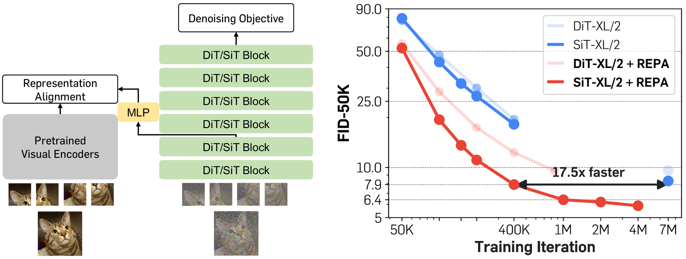
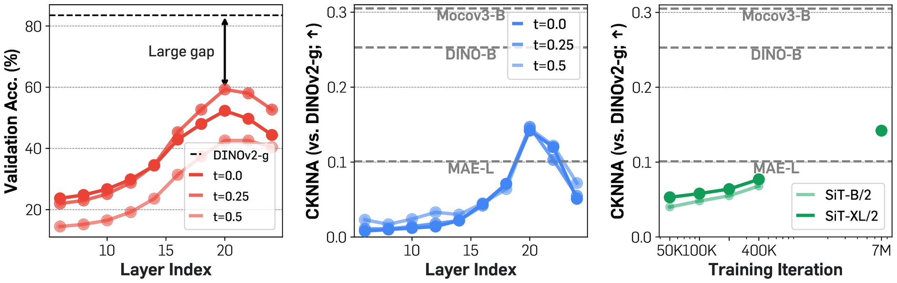
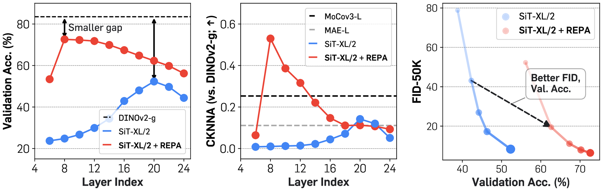
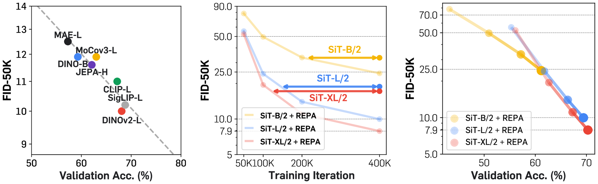
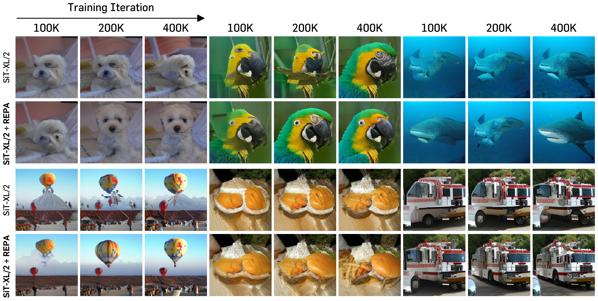
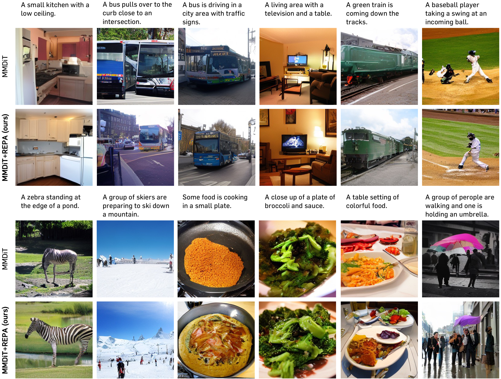

# REPA：把扩散模型隐式学习表征的负担变成显式监督

!!! info "论文信息"
    **论文题名：** Representation Alignment for Generation: Training Diffusion Transformers Is Easier Than You Think。<br>
    **作者：** Sihyun Yu、Sangkyung Kwak、Huiwon Jang、Jongheon Jeong、Jonathan Huang、Jinwoo Shin、Saining Xie。<br>
    **机构：** KAIST、Korea University、Scaled Foundations、New York University。<br>
    **时间 / 会议：** arXiv v1 提交于 2024-10-09；当前核验版本为 v4（2025-06-18）；ICLR 2025 Oral。<br>
    **论文 / 项目页：** arXiv：[2410.06940](https://arxiv.org/abs/2410.06940)；[PDF v4](https://arxiv.org/pdf/2410.06940v4)；[项目页](https://sihyun.me/REPA/)。<br>
    **代码 / 权重：** [github.com/sihyun-yu/REPA](https://github.com/sihyun-yu/REPA)。官方仓库提供 ImageNet、512 分辨率与 MS-COCO 训练脚本，并提供最终 SiT-XL/2 checkpoint。<br>
    **元数据来源与核验口径：** 来源为 arXiv v4、ICLR 论文、项目页与官方代码仓库；Checked Date：2026-08-25；Repro Status：Paper / official code / official checkpoint reviewed，未声明本站已独立复现。官方仓库同时提示，代码清理过程可能导致结果不能精确复现论文数字。

## 原论文故事线

### 研究背景

DiT 与 SiT 把图像 patch 当作 token，用纯 Transformer 学习去噪或速度场。常见解释是：模型只要把 denoising objective 优化好，足够大的网络和足够长的训练自然会获得生成所需的内部特征。但已有分析发现，扩散模型的中间层确实包含可用于分类的语义表征，而且生成更强的模型往往也有更强的线性探测性能。于是一个更直接的问题出现了：扩散模型训练慢，会不会不只是因为要拟合复杂的噪声到图像映射，还因为它必须从去噪任务里顺带学出一套视觉表征？

### 问题（Challenge）

论文把难点拆成两层。第一，denoising 同时要求模型理解物体语义和恢复高频细节，而重建目标不会主动丢掉与语义无关的细节，因此不是最高效的表征学习任务。第二，现成的 DINOv2、CLIP 或 SigLIP 接收干净 RGB 图像，扩散 Transformer 接收的却是带噪 VAE latent；两边输入空间、噪声水平、token 网格和任务目标都不同，不能简单把视觉编码器接到生成模型前面。

### Finding

REPA 的关键 finding 不是“DINOv2 可以帮助生成”，而是：**扩散模型内部原本就在缓慢形成与强视觉编码器相似的表征；把这个缓慢过程改成早期层的显式对齐，可以让后续层更早开始完成生成任务。** 更微妙的一点是，对齐越深并不越好。浅层得到语义骨架后，后半段 Transformer 仍需保留自由度来恢复纹理和高频细节。

### 方法

训练时，同一张干净图像走两条路径。教师路径把 RGB 图像送入冻结的预训练视觉编码器，得到 patch-wise clean representation；生成路径先用 VAE 编码图像，对 latent 加噪，再把带噪 latent 送入 DiT 或 SiT。REPA 从某个较早的 Transformer block 取 hidden states，经三层 MLP 投影后，与教师 patch 表征计算 cosine similarity 或 NT-Xent loss。总目标只是原 diffusion / flow loss 加一项加权正则：

\[
\mathcal{L}
=
\mathcal{L}_{\text{denoise}}
+
\lambda\mathcal{L}_{\text{REPA}}.
\]

视觉教师、投影头和 REPA loss 都只存在于训练阶段，采样时仍是原来的 DiT / SiT，因此不会增加推理网络深度或 NFE。

### 结论

在 ImageNet 256x256、无 CFG 的同口径比较中，SiT-XL/2 训练 7M iterations 的 FID 为 8.3，而 REPA 在 400K iterations 达到 7.9，论文据此报告超过 17.5x 的 iteration-to-quality 收敛加速。使用 CFG 时，SiT-XL/2 的 FID 从 2.06 改善到 1.80；再叠加 guidance interval 后得到 1.42。512x512 和小规模 MS-COCO 文生图实验也有改善，但论文主体仍是 ImageNet latent diffusion，不足以证明大规模文生图、像素扩散或视频生成中会保持同样收益。

### 关键术语

- **REPresentation Alignment（表征对齐）**：把冻结视觉编码器的干净图像 patch 表征蒸馏到扩散 Transformer 的带噪 hidden states
- **Linear Probing（线性探测）**：冻结特征后只训练线性分类器，用分类准确率估计特征包含多少可线性读取的语义
- **CKNNA（Centered Kernel Nearest Neighbor Alignment，中心化核近邻对齐）**：基于互为近邻关系比较两套表征几何结构的指标
- **Patch-wise Alignment（逐 patch 对齐）**：不是只匹配全局 pooled vector，而是让对应空间位置的 token 表征相似
- **Training-only Distillation（仅训练时蒸馏）**：教师和投影头只用于产生辅助监督，部署时删除
- **Guidance Interval（引导区间）**：只在部分采样时间区间应用 CFG；论文最终 FID 1.42 同时用了这一额外采样策略

## 论文位置：REPA 改的是训练表征，不是扩散路径

REPA 容易和三类方法混淆。它不是新 noise schedule，不改变 DDPM 或 stochastic interpolant 的概率路径；它不是新 DiT block，主干参数量与原模型相同；它也不是采样加速器，推理仍使用原来的 ODE / SDE solver 和 NFE。它改的是**训练时进入主干早期层的学习信号**。

| Method family | What is changed | Extra module at inference? | Main purpose |
| --- | --- | --- | --- |
| DiT / SiT objective design | noise / velocity target and probability path | No | learn the denoising vector field |
| MaskDiT / auxiliary reconstruction | masking or reconstruction task | usually No | improve token learning and training efficiency |
| External semantic latent generation | generate an extra semantic code or stage | often Yes | decompose semantics and image synthesis |
| **REPA** | early hidden states receive clean visual representation supervision | **No** | reduce the representation-learning burden inside denoising |

{ width="900" }

<small>图源：`Representation Alignment for Generation`，Figure 1。左图是训练期表征对齐分支，右图是 DiT / SiT 的 FID-50K 收敛曲线；本站由论文原始子图按原布局组合。</small>

**这张图要分开读。** 左边说明 REPA 只在训练时把视觉教师接到中间层；右边的 17.5x 是达到相近 FID 所需 iteration 的比值，不是测得的端到端 GPU 小时加速。因为 REPA 训练还要运行冻结视觉编码器，单步计算量高于 vanilla model。论文报告 8 张 H100 80GB、batch size 256 时约 5.4 step/s，但没有给出同环境 vanilla SiT 的 step/s，因此不能把 17.5x 直接写成 17.5x wall-clock 或 17.5x 省算力。

## 核心诊断：去噪网络内部有语义，但形成得慢

论文先分析训练 7M iterations 的 SiT-XL/2，而不是先提出 loss。对每个 Transformer layer，它从不同 timestep 的 hidden states 做 global pooling，再训练 linear probe；同时用 CKNNA 比较 SiT 与 DINOv2-g 的表征几何。

{ width="900" }

<small>图源：论文 Figure 2。左：SiT 各层 linear probing；中：SiT 与 DINOv2-g 的 CKNNA；右：模型规模和训练时长对 alignment 的影响。本站由论文原始子图按原布局组合。</small>

三个观察组成了 REPA 的因果故事：

1. **语义先增强、后下降。** SiT 的 linear probing accuracy 在约第 20 层达到峰值，说明中间层确实形成了可区分语义；随后准确率下降，作者解释为后层开始转向生成所需的高频细节。
2. **弱对齐已经自然出现。** SiT 与 DINOv2-g 的 CKNNA 在中后层升高，但仍低于 DINOv2 与其他自监督编码器之间的 alignment。
3. **更大模型和更长训练会继续提高对齐。** 这说明外部表征并非强行加入一个完全无关的目标，而是在加速 vanilla diffusion 本来会发生的过程。

但这里的证据边界很重要。Linear probing 只测“语义能否被线性读出”，CKNNA 只测两套表示的邻域结构；它们不是生成质量本身。论文通过后续 intervention 实验说明加入 alignment loss 会同时改善表征指标和 FID，但“表征学习是大规模扩散训练的主要瓶颈”仍是得到强实验支持的机制假设，不是被理论证明的唯一原因。

## REPA 的训练目标

设干净图像为 \(\mathbf{x}_*\)，冻结视觉编码器为 \(f\)，其 patch 表征为：

\[
\mathbf{y}_*=f(\mathbf{x}_*)\in\mathbb{R}^{N\times D}.
\]

另一条路径先用 VAE 得到 latent \(\mathbf{z}\)，再采样 timestep 和噪声形成 \(\mathbf{z}_t\)。扩散 Transformer 在第 \(d\) 个 block 产生 hidden states \(\mathbf{h}_t^{(d)}\)，三层 MLP \(h_\phi\) 把它投影到教师维度：

\[
h_\phi\!\left(\mathbf{h}_t^{(d)}\right)
\in\mathbb{R}^{N\times D}.
\]

逐 patch 对齐损失为：

\[
\mathcal{L}_{\text{REPA}}(\theta,\phi)
=
-\mathbb{E}_{\mathbf{x}_*,\epsilon,t}
\left[
\frac{1}{N}\sum_{n=1}^{N}
\operatorname{sim}
\left(
\mathbf{y}_*^{[n]},
h_\phi(\mathbf{h}_t^{(d),[n]})
\right)
\right].
\]

在 SiT 的 velocity objective 上，总损失写成：

\[
\mathcal{L}
=
\mathcal{L}_{\text{velocity}}
+
\lambda\mathcal{L}_{\text{REPA}}.
\]

这套设计有四个关键点：

| Design | Paper choice | Why it matters |
| --- | --- | --- |
| Teacher input | clean RGB image | target representation 对噪声不敏感，提供稳定语义锚点 |
| Student input | noisy VAE latent | 主干仍学习真实扩散训练分布，不把视觉编码器当生成前端 |
| Alignment granularity | patch-wise | 保留空间对应关系，比单一全局向量提供更细的布局监督 |
| Attachment point | early block, usually depth 8 | 先建立语义，再给后层恢复纹理的自由度 |

论文通过插值视觉编码器 positional embeddings 处理两边 patch 数不同的问题。投影头使用三层 MLP 和 SiLU。视觉教师被冻结；反向传播更新的是投影头和扩散主干。推理时，输入仍从 Gaussian noise 开始，不需要先生成 DINO feature，也不需要运行 DINOv2。

## 为什么只对齐前几层

{ width="900" }

<small>图源：论文 Figure 3。左：REPA 提高早期层 linear probing；中：第 8 层附近与 DINOv2-g 的 alignment 显著增强；右：同一模型中更好的表征与更低 FID 同步出现。本站由论文原始子图按原布局组合。</small>

最有价值的消融不是“加 REPA 有效”，而是 alignment depth 的反直觉结果。以 SiT-L/2、400K iterations、DINOv2-L、NT-Xent 为例：

| Alignment Depth | FID ↓ | Linear Probe Acc. ↑ |
| ---: | ---: | ---: |
| 6 | 10.3 | 66.2 |
| **8** | **10.0** | 68.1 |
| 10 | 10.5 | 68.6 |
| 12 | 11.2 | 69.4 |
| 14 | 11.6 | 70.0 |
| 16 | 12.1 | **71.1** |

对齐更深时，分类表征继续变强，生成 FID 却持续变差。这直接限制了“表征越强，生成一定越好”的简单叙述。更准确的解释是：生成模型需要分工。

```text
early blocks: recover noise-invariant objects and layout
        -> middle / late blocks: turn semantics into texture and high-frequency details
        -> denoising head: predict noise / velocity
```

REPA 不是把 DiT 训练成 DINOv2，而是在较早的计算阶段提供一个语义坐标系。若把后层也紧紧约束在 discriminative representation 上，模型可能保留更多分类信息，却损失生成细节所需的自由度。论文把这作为解释性假设；为什么最佳层是 8、它如何随网络深度和数据变化，论文没有理论答案。

## 教师表征：质量重要，尺寸不是单调决定因素

论文在相同的 SiT-L/2、400K iterations 和 \(\lambda=0.5\) 下替换视觉教师。下面保留 Table 2 的关键行：

| Target Repr. | Objective | FID ↓ | IS ↑ | Acc. ↑ |
| --- | --- | ---: | ---: | ---: |
| Vanilla SiT-L/2 | - | 18.8 | 72.0 | N/A |
| MAE-L | NT-Xent | 12.5 | 90.7 | 57.3 |
| MoCov3-L | NT-Xent | 11.9 | 92.2 | 63.0 |
| CLIP-L | NT-Xent | 11.0 | 100.4 | 67.2 |
| SigLIP-L | NT-Xent | 10.2 | 107.0 | **68.8** |
| DINOv2-L | NT-Xent | 10.0 | 106.6 | 68.1 |
| **DINOv2-B** | NT-Xent | **9.7** | 107.5 | 65.7 |
| DINOv2-g | NT-Xent | 9.8 | **108.9** | 65.7 |

总体趋势是更强的教师表征对应更低 FID，但并非参数越大越好。DINOv2-B、L、g 的 FID 只在 9.7 到 10.0 之间波动，B 反而略优。作者推测这与 DINOv2 系列共享 distillation lineage、表示相似有关。工程上因此不应默认选择最大的视觉教师：冻结教师仍占训练显存和算力，而小教师已经可能提供足够的表征方向。

{ width="900" }

<small>图源：论文 Figure 5。左：不同视觉教师的 linear probing 与 FID；中：REPA 对更大 SiT 的相对收敛收益更明显；右：固定 DINOv2-B 时，模型训练沿着更强表征与更低 FID 的方向共同移动。本站由论文原始子图按原布局组合。</small>

### Cosine similarity 还是 NT-Xent

在 400K iteration 的最终结果上，两者接近：DINOv2-L、depth 8 时，NT-Xent 的 FID 为 10.0，negative cosine similarity 为 9.9。论文观察 NT-Xent 在 50K 到 100K 的早期更有优势，但差距随训练缩小，后续主实验选择更简单的 cosine similarity。

### \(\lambda\) 是否敏感

SiT-XL/2 训练 400K iterations 时，\(\lambda\in\{0.25,0.5,0.75,1.0\}\) 的 FID 分别为 8.6、7.9、7.8、7.8。结果表明在该设置中 \(\lambda\ge 0.5\) 后基本饱和，但这不是跨模型的通用最优值。论文没有探索随 timestep 改变的 \(\lambda(t)\)，并把 time-varying REPA 列为未来方向。

## 完整训练配方

| Component | ImageNet main setting | Explanation |
| --- | --- | --- |
| Data | ImageNet, 256x256 | class-conditional generation；按 ADM protocol 预处理 |
| Latent representation | Stable Diffusion VAE, 32x32x4 | 预计算 latent；解码使用 `stabilityai/sd-vae-ft-ema` |
| Backbone | DiT / SiT B/2, L/2, XL/2 | patch size 2；主干结构不因 REPA 改变 |
| Main SiT target | v-prediction | linear interpolant：\(\alpha_t=1-t,\sigma_t=t\) |
| REPA teacher | usually DINOv2-B | 冻结 clean-image encoder |
| REPA head | 3-layer MLP with SiLU | 只在训练期存在 |
| Alignment depth | B/2: 4；L/2 and XL/2: 8 | 随主干深度选择较早层 |
| \(\lambda\) | 0.5 | 主实验默认值 |
| Optimizer | AdamW, no weight decay | constant LR \(10^{-4}\)，\((\beta_1,\beta_2)=(0.9,0.999)\) |
| Precision | fp16 mixed precision | 使用 gradient clipping；论文未给 clipping threshold |
| Batch / hardware | batch 256；8 x H100 80GB | 官方报告约 5.4 step/s |
| Augmentation | none | 由于使用预计算 VAE latent；教师 feature 仍可进一步预计算 |
| Default evaluation sampler | Euler-Maruyama SDE, NFE 250 | \(w_t=\sigma_t\)，最后一步设为 0.04 |
| Evaluation | 50K samples | FID、sFID、IS、precision、recall；另做 linear probe 与 CKNNA |

论文对主要超参数披露较完整，但 gradient clipping threshold、不同实验的精确随机种子统计和训练 wall-clock 对照没有完整给出。官方代码命令默认 `fp16`、DINOv2-B、\(\lambda=0.5\)、depth 8，并明确提醒清理后的 release 代码可能不能精确复现论文数字。

## 实验一：17.5x 到底证明了什么

无 CFG 的同主干比较最能隔离 REPA 本身：

| Model | #Params | Iter. | FID ↓ |
| --- | ---: | ---: | ---: |
| DiT-XL/2 | 675M | 400K | 19.5 |
| DiT-XL/2 + REPA | 675M | 400K | 12.3 |
| DiT-XL/2 | 675M | 7M | 9.6 |
| DiT-XL/2 + REPA | 675M | 850K | 9.6 |
| SiT-XL/2 | 675M | 400K | 17.2 |
| SiT-XL/2 | 675M | 7M | 8.3 |
| **SiT-XL/2 + REPA** | 675M | **400K** | **7.9** |
| SiT-XL/2 + REPA | 675M | 1M | 6.4 |
| SiT-XL/2 + REPA | 675M | 4M | **5.9** |

17.5x 来自 \(7\text{M}/400\text{K}=17.5\)，而且 REPA 的 FID 7.9 已略好于 vanilla 的 8.3。这个比较支持“达到该 FID 阈值所需的 optimizer steps 显著减少”。它没有单独测量以下量：

- 教师 encoder forward 带来的每 step 额外 FLOPs 与显存；
- 预计算 DINO features 后的存储和数据读取成本；
- 达到目标 FID 的总 H100-hours、能耗或美元成本；
- 多个随机种子下 iteration-to-threshold 的方差。

因此对工程决策最稳妥的表述是：**REPA 显著提高 sample / update efficiency，wall-clock 和总算力收益需要按教师成本重新测量。**

{ width="900" }

<small>图源：论文 Figure 4。每组三列为 100K、200K、400K iterations；上下分别为 vanilla SiT-XL/2 与 SiT-XL/2 + REPA。两者使用相同 initial noise、sampler、sampling steps，且均未使用 CFG。</small>

定性图补充了 FID 曲线看不到的内容：同样 100K 到 400K 训练预算下，REPA 更早形成完整物体轮廓、颜色和局部结构。不过这些是选定样例，主要证明“可视化趋势与指标一致”，不能替代 50K samples 的分布指标，更不能用于断言所有类别都同等改善。

## 实验二：CFG 与 guidance interval 要拆开算

ImageNet 256x256 的 system-level table 报告：

| Model | Epochs | FID ↓ | sFID ↓ | IS ↑ | Precision ↑ | Recall ↑ |
| --- | ---: | ---: | ---: | ---: | ---: | ---: |
| SiT-XL/2 | 1400 | 2.06 | 4.50 | 270.3 | 0.82 | 0.59 |
| SiT-XL/2 + REPA | 200 | 1.96 | **4.49** | 264.0 | 0.82 | 0.60 |
| SiT-XL/2 + REPA | 800 | 1.80 | 4.50 | 284.0 | 0.81 | 0.61 |
| **SiT-XL/2 + REPA + guidance interval** | 800 | **1.42** | 4.70 | **305.7** | 0.80 | **0.65** |

这里至少有两个变量。1.80 相对 2.06 主要体现 REPA 加更高效训练；1.42 还叠加了 guidance interval。后者提升 FID、IS 和 recall，但 sFID 与 precision 没有同步变好。因此“REPA 达到 FID 1.42”在论文结果层面是事实，但不能把 1.42 全部归因于 representation alignment。

## 实验三：512 分辨率与文生图外推

### ImageNet 512x512

512 实验把 VAE latent 改为 64x64x4，并把 DINOv2 输入 resize 到 448x448。SiT-XL/2 + REPA 在 80、100、200 epochs 的 FID 分别为 2.44、2.32、2.08；vanilla SiT-XL/2 在 600 epochs 为 2.62。它支持 REPA 不只在 256 分辨率有效，但数据域仍是 ImageNet class-conditional generation。

### MS-COCO text-to-image

论文附录在 MS-COCO train split 上从头训练 24 层、hidden dimension 768 的 MMDiT，batch size 256，共 150K iterations；文本条件来自 CLIP。使用 CFG scale 2.0 评估时：

| Model | Sampler | NFE | FID ↓ |
| --- | --- | ---: | ---: |
| MMDiT | ODE | 50 | 6.05 |
| **MMDiT + REPA** | ODE | 50 | **4.73** |
| MMDiT | SDE | 250 | 5.30 |
| **MMDiT + REPA** | SDE | 250 | **4.14** |

{ width="900" }

<small>图源：论文 Figure 37。每个 prompt 上方为 MMDiT，下方为 MMDiT + REPA；定性图使用 CFG scale 4.0，Table 12 的 FID 使用 CFG scale 2.0，二者口径不同。</small>

这些结果说明：即使 MMDiT 已有文本表示，额外的视觉表征监督仍可能帮助图像 token 学习。但它是 MS-COCO 小规模训练，不等于在数十亿 image-text pairs、超大 DiT 或长文本 prompt 上验证过。论文自己也把“大规模 T2I 使用 REPA”写成未来方向。

## 主要贡献

1. 把扩散 Transformer 的训练效率问题重新表述为内部 representation learning 问题，而不只归因于 denoising target、网络结构或 sampler。
2. 提出一个训练期辅助 loss，在 clean RGB teacher 与 noisy latent student 之间做 patch-wise alignment，且不改变部署图。
3. 用 alignment depth 消融揭示生成模型的层级分工：早层语义对齐有利，过深对齐会提高 linear probe 却损害 FID。
4. 在 DiT、SiT、256/512 分辨率和 MMDiT 文生图上给出较一致的收敛改善，并公开代码与 checkpoint。

## 局限与风险

- **主结论集中在 ImageNet latent diffusion。** Pixel-space diffusion、视频和更大规模文生图都未在主体实验中验证。
- **17.5x 是 iteration speed-up。** 论文没有给同环境 vanilla / REPA 的总 GPU-hours 对比，冻结教师的 forward 不是免费的。
- **机制是经验假设。** Linear probing、CKNNA 和 FID 的共同改善支持 representation bottleneck，但没有证明它是唯一瓶颈，也没有理论解释最佳 alignment depth。
- **教师会带入表征偏好。** DINOv2 强调的语义不一定覆盖文字渲染、精细几何、审美风格或视频运动；论文没有系统分析教师 bias 如何进入生成模型。
- **最终 FID 混入采样技巧。** 1.42 使用 guidance interval，不能当作纯训练正则的独立增益。
- **时间权重仍是常数。** 不同噪声水平的信息量不同，但主方法使用固定 \(\lambda\)，time-varying REPA 尚未探索。
- **复现状态有限。** 官方代码和权重公开，但仓库主动提示 release 代码可能与论文结果有偏差；本站未进行独立训练复现。

## 工程判断：什么时候值得用 REPA

| Situation | Recommendation | Reason |
| --- | --- | --- |
| 从头训练中大型 DiT / SiT，早期语义成形慢 | 值得优先试 | 论文中模型越大，相对收敛收益越明显 |
| 已有干净图像与固定 crop，能离线提 teacher feature | 很适合 | 可降低在线视觉教师开销，且不影响部署 |
| 强数据增强、随机 crop 或多尺度训练 | 需要重做数据管线 | teacher patch 与 noisy latent 必须保持空间对应 |
| 目标是少步采样或降低 NFE | 不能替代蒸馏 / solver | REPA 改训练收敛，不直接减少采样步数 |
| Pixel diffusion 或 video diffusion | 先做小规模验证 | 原论文明确未覆盖这两类输入 |
| 生成任务依赖 OCR、几何或运动 | 不要只用 DINOv2 指标选教师 | linear probe 强不等于目标生成属性最匹配 |

最小可迁移 recipe 是：保持原 denoising / flow objective 不变；选择一个较小但强的冻结视觉教师；在约三分之一网络深度处接三层 MLP；以 \(\lambda=0.5\) 和 cosine similarity 起步；同时记录 FID、linear probe、每 step 时间和峰值显存。若只记录 optimizer iterations，就无法判断真实训练成本是否下降。

## 阅读结论

REPA 最值得记住的不是 FID 1.42，而是一条训练诊断：**生成模型不只是学习“从噪声往哪里走”，还在隐式学习“图像里什么东西值得保留”。** 只用 denoising supervision 时，这套表征形成得慢；用强视觉教师把它提前交给浅层，后层就能更早把容量用于生成细节。

但 REPA 也给出了反例式提醒：最强的分类表征不一定对应最好的生成。对齐到第 16 层时 linear probe 更高，FID 却更差。生成系统真正需要的是语义与细节的分工，不是把整条网络都变成判别编码器。

## 外部精读

- [arXiv v4](https://arxiv.org/abs/2410.06940)
- [REPA project page](https://sihyun.me/REPA/)
- [Official implementation and checkpoint](https://github.com/sihyun-yu/REPA)
- 站内关联：[网络架构与 Stable Diffusion](../../diffusion/architecture-and-stable-diffusion.md)、[Flow Matching 与 Rectified Flow](../../diffusion/flow-matching-and-rectified-flow.md)、[扩散训练配方与排障](../../diffusion/practical-training-recipes-and-failure-analysis.md)
