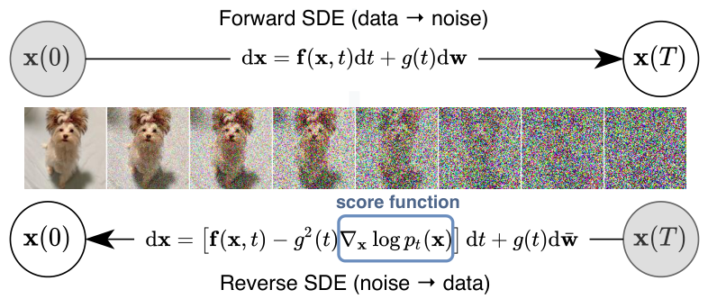
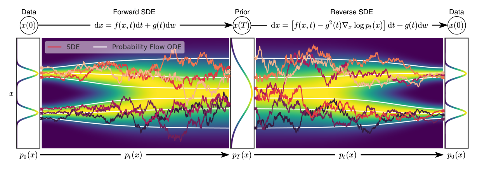
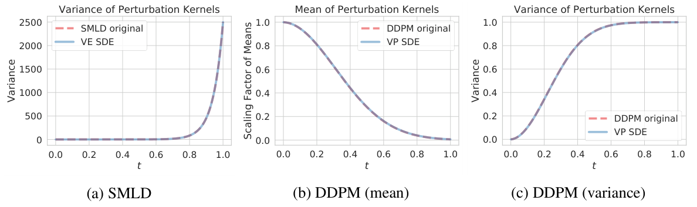
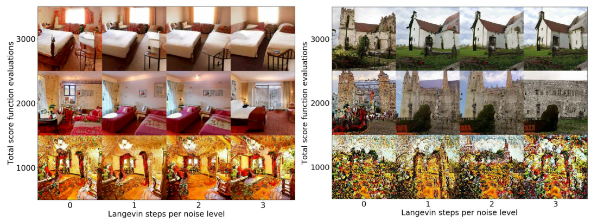
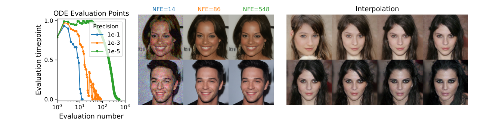
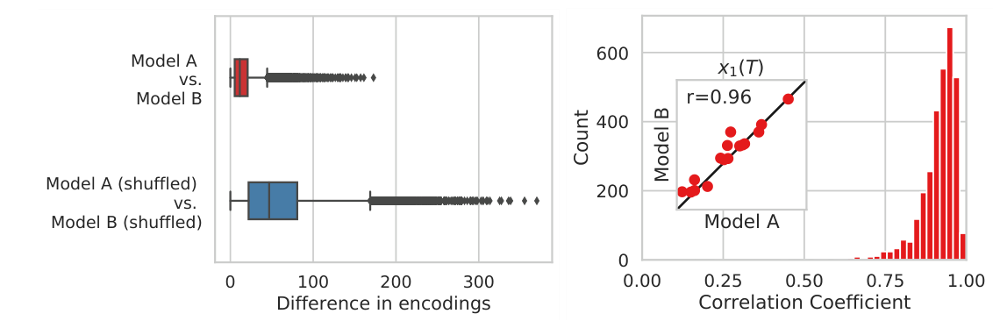
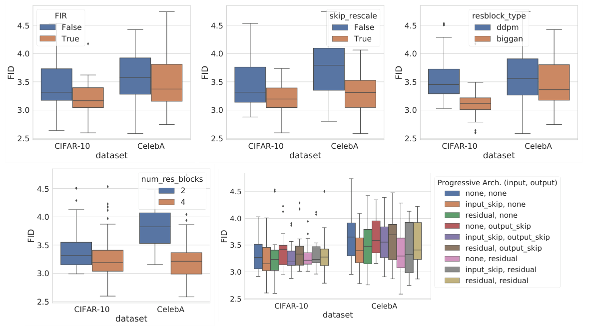
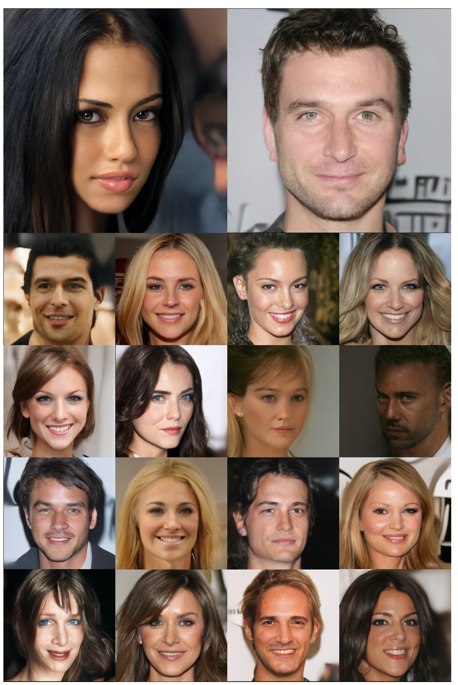
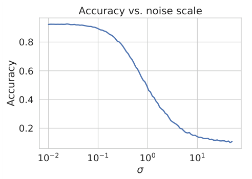
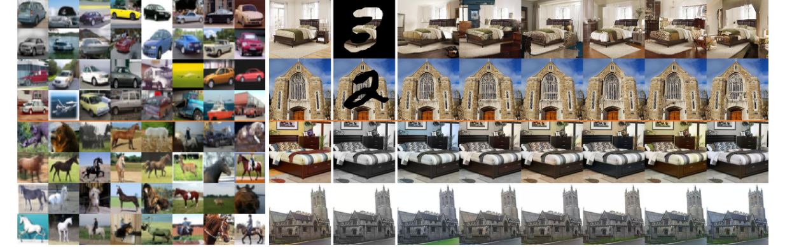

# Score SDE：把扩散模型写成连续时间生成过程

!!! info "论文信息"
    **论文题名：** Score-Based Generative Modeling through Stochastic Differential Equations。 
    **作者：** Yang Song、Jascha Sohl-Dickstein、Diederik P. Kingma、Abhishek Kumar、Stefano Ermon、Ben Poole。 
    **机构：** 未在公开元数据中稳定解析；以 arXiv/PDF 或官方页 affiliation block 为准。 
    **时间 / 主题：** 2020-11；扩散模型。 
    **arXiv / 官方报告：** arXiv：[2011.13456](https://arxiv.org/abs/2011.13456)。 
    **GitHub / 项目：** GitHub：[github.com/yang-song/score_sde](https://github.com/yang-song/score_sde)。 
    **元数据来源与核验口径：** 来源：[arXiv](https://arxiv.org/abs/2011.13456)；[GitHub API / repo](https://github.com/yang-song/score_sde)；Checked Date：2026-06-15；Repro Status：Paper / official materials reviewed, independent reproduction not claimed。

## 原论文故事线

Score SDE 把两条当时看起来不同的生成路线放进了同一套数学接口。SMLD 在不同噪声尺度上学习 score，再运行退火 Langevin dynamics；DDPM 学习一系列反向高斯转移，再按反向 Markov chain 逐步采样。作者指出，两者实际上都在估计加噪后数据分布的 score，只是使用不同扰动过程和离散采样规则。把有限个噪声尺度推广到连续时间，就可以分别设计扰动过程、训练 score 网络和选择数值求解器。

这个统一接口把几件原本分开的事接到了一起。同一个网络可以交给不同的反向 SDE 求解器，也可以把数值预测与 MCMC 校正组合成 predictor–corrector；同一扩散过程还对应一个具有相同时间边缘分布的 probability-flow ODE，用于确定性采样、数据编码和密度计算；条件 score 则可以拆成无条件 score 与观测条件梯度，让已有生成网络用于类别控制、图像补全和着色。[↗](https://arxiv.org/pdf/2011.13456v2#page=2)

下面图中，上方从干净图像不断加入噪声，下方从噪声分布生成图像。反向过程需要知道当前分布的 score，而不需要记录某张图片在正向过程经历了哪一条随机路径。它恢复的是数据分布的采样过程，并非把一次随机扰动逐项撤销。

{ width="720" }

<small>图源：论文 Figure 1，PDF 第 2 页。上方为 data→noise 的 forward SDE，下方为 noise→data 的 reverse SDE，蓝框标出生成过程需要估计的 score。</small>

论文还把框架与网络架构改进结合起来，在 CIFAR-10 上报告 FID 2.20、Inception score 9.89，并得到 2.99 bits/dim 的似然结果。但这几个最好数字来自不同 SDE、不同采样器和不同 checkpoint 选择，不能视为一个配置同时取得。理解贡献时，需要把“连续时间框架开放了哪些接口”与“哪套工程配置取得了最好结果”分开。

## 两条旧路线共有的对象是 score

### score 指向更高密度，不直接等于干净图像

对一个连续密度 $p(x)$，score 定义为

$$
s(x)=\nabla_x\log p(x).
$$

它与 $x$ 维度相同，描述在当前位置沿哪个方向移动会使对数密度增加。它不是分类分数，也不是样本概率本身。生成模型只需学习这个梯度场，就可以利用带随机性的动力学逐步采样；单纯沿梯度做确定性上升通常会走向高密度区域，并不自动产生正确的多样性。

原始图像分布可能高度集中，数据稀疏区域的 score 很难估计。SMLD 因此先加入多个尺度的高斯噪声。其扰动核为

$$
q_\sigma(\tilde x\mid x_0)=\mathcal N(\tilde x;x_0,\sigma^2I),
\qquad \tilde x=x_0+\sigma z,\quad z\sim\mathcal N(0,I).
$$

已知干净样本 $x_0$ 时，这个条件高斯的 score 可直接计算为

$$
\nabla_{\tilde x}\log q_\sigma(\tilde x\mid x_0)
=-\frac{\tilde x-x_0}{\sigma^2}=-\frac z\sigma.
$$

网络却只看到 $(\tilde x,\sigma)$，并不知道是哪一个 $x_0$ 生成了它。用平方损失回归这个条件 score，最优解会对所有可能的 $x_0$ 做条件平均，最终等于加噪边缘分布 $p_\sigma(\tilde x)$ 的 score。这是 denoising score matching 让可计算训练目标连接到未知数据分布的原因。[↗](https://arxiv.org/pdf/2011.13456v2#page=3)

### SMLD 和 DDPM 的差异在扰动核与采样方式

SMLD 使用一组递增的 $\sigma_i$，按 $\sigma_i^2$ 加权训练，然后从最大噪声开始，在各尺度运行 Langevin MCMC。

DDPM 的正向链则是

$$
x_i=\sqrt{1-\beta_i}\,x_{i-1}+\sqrt{\beta_i}\,z_i.
$$

定义本文记号 $\alpha_i=\prod_{j=1}^{i}(1-\beta_j)$，便有

$$
q_i(x_i\mid x_0)=\mathcal N\left(x_i;\sqrt{\alpha_i}x_0,(1-\alpha_i)I\right).
$$

注意这里 $\alpha_i$ 是累乘量，有些 DDPM 文献把它记为 $\bar\alpha_i$。论文把 DDPM 的简化噪声回归目标重写成权重为 $1-\alpha_i$ 的 denoising score matching，暴露了它与 SMLD 的共同结构。两者都在不同扰动尺度学习边缘 score，但 DDPM 通常使用 ancestral sampling，SMLD 通常在每个尺度内执行多步 Langevin。[↗](https://arxiv.org/pdf/2011.13456v2#page=3)

这给出连续化的入口。若把噪声尺度看成某个过程在离散时间上的取值，就不必把训练网络固定绑定在一种反向更新规则上。先定义连续扰动过程，再推导其反向动力学，采样算法就成为求解动力学的可替换组件。

## 从正向 SDE 到可学习的反向过程

### 正向过程规定一条分布路径

论文首先考虑扩散系数只依赖时间的 Itô SDE

$$
dx=f(x,t)\,dt+g(t)\,dw,
\qquad t\in[0,T].
$$

$f(x,t)$ 是 drift，描述确定性变化；$g(t)$ 是 diffusion coefficient，控制 Brownian motion 的强度；$w$ 是标准 Wiener process。时间很短时，随机增量的尺度为 $\sqrt{dt}$，不能把它当成与 $dt$ 同阶的普通确定性扰动。

设计目标是让 $x(0)\sim p_0$ 从数据分布逐渐走向易采样的 $p_T$，例如各向同性高斯。$f$ 和 $g$ 是预先选定的，不由生成网络学习。这里“正向过程已知”指其转移规律已知；中间边缘密度 $p_t(x)$ 仍由未知的数据分布决定，不能直接写出其 score。

Figure 2 用一维示意图表现这种区别。背景颜色表示随时间变化的密度，左端的两个数据模态逐渐合并成先验；彩色折线是随机轨迹，白线是稍后推导的 ODE 轨迹。两类轨迹的运动方式不同，却可以对应相同的边缘密度。

{ width="920" }

<small>图源：论文 Figure 2，PDF 第 4 页。左半为正向扰动，右半为反向生成；彩色随机路径与白色 probability-flow ODE 路径共享的是各时刻分布，不是逐样本轨迹。</small>

### 反向 SDE 的负号要与负时间步一起读

反向时间公式为

$$
dx=\left[f(x,t)-g(t)^2\nabla_x\log p_t(x)\right]dt
+g(t)\,d\bar w.
$$

时间从 $T$ 向 0 移动，$dt$ 是负的，$\bar w$ 是逆时间 Wiener process。代入学习到的 $s_\theta(x,t)$ 后，就可以使用数值 SDE 求解器生成图像。[↗](https://arxiv.org/pdf/2011.13456v2#page=4)

为了避免符号误读，取正步长 $h>0$，从 $t$ 推进到 $t-h$。Euler–Maruyama 更新可写成

$$
x_{t-h}\approx x_t-f(x_t,t)h
+g(t)^2s_\theta(x_t,t)h+g(t)\sqrt h\,z,
\qquad z\sim\mathcal N(0,I).
$$

这是对反向方程的直接离散解释，不是论文额外提出的独立模型。score 项在这个实际更新中带正号，帮助样本回到当前噪声尺度下更合理的区域；随机项则维持需要的分布扩散。只把 $f$ 取负而忽略 score，无法恢复数据分布。

更一般地，如果扩散矩阵依赖状态，令 $A(x,t)=G(x,t)G(x,t)^\top$，附录给出的反向漂移是

$$
f(x,t)-\nabla\cdot A(x,t)-A(x,t)\nabla_x\log p_t(x).
$$

多出的 $\nabla\cdot A$ 是向量，按矩阵各行的散度定义。主文的简单形式依赖于 $A=g(t)^2I$ 对 $x$ 恒定；扩展到状态相关噪声时，不能只把标量 $g^2$ 替换成矩阵而遗漏这一项。[↗](https://arxiv.org/pdf/2011.13456v2#page=13)

### 网络为什么能在不模拟整条轨迹的情况下训练

连续时间训练目标是论文 Eq. (7)

$$
\mathcal L(\theta)=
\mathbb E_t\left[
\lambda(t)\mathbb E_{x_0}\mathbb E_{x_t\mid x_0}
\left\|s_\theta(x_t,t)-\nabla_{x_t}\log q_{0t}(x_t\mid x_0)\right\|_2^2
\right].
$$

$t$ 在区间内均匀采样，$\lambda(t)>0$ 平衡不同时间尺度。$q_{0t}$ 是从干净样本到时间 $t$ 的扰动核。若核为

$$
x_t=m(t)x_0+\nu(t)z,
$$

就能直接采样一个 $t$、一个 $z$，构造训练输入并得到目标 $-z/\nu(t)$，完全不必先生成 $x_1,x_2,\ldots$ 的完整正向链。本文使用 $\nu(t)$ 统一表示条件标准差，避免与 VE 特定日程 $\sigma(t)$ 混淆。

最优平方回归满足

$$
s_\theta^*(x_t,t)
=\mathbb E\left[\nabla_{x_t}\log q_{0t}(x_t\mid x_0)\mid x_t\right]
=\nabla_{x_t}\log p_t(x_t).
$$

最后一步来自对 $p_t(x_t)=\int q_{0t}(x_t\mid x_0)p_0(x_0)\,dx_0$ 求导。它说明训练时用条件分数并不会把模型变成“寻找训练时那张特定原图”的网络；条件平均后的目标是整个边缘分布的梯度。

论文常用的权重与条件 score 平方范数的期望成反比。各向同性高斯下，$\mathbb E\|z/\nu\|^2=d/\nu^2$，因此可取与 $\nu^2$ 成比例的权重。若参数化 $s_\theta=-\hat z_\theta/\nu$，加权 score MSE 就与噪声预测 MSE 成比例。这一简单代入解释了 DDPM 噪声预测和 score matching 的接口关系。

当 drift 是仿射函数、diffusion 不依赖状态时，本文三种 SDE 的扰动核都是可计算高斯。框架也允许更一般的 SDE，但其核未必有闭式形式，可能需要先模拟正向过程，再用 sliced score matching 等无需显式条件 score 的训练目标。数学上允许某个 SDE，不等于它与本文的高斯实例一样容易训练。[↗](https://arxiv.org/pdf/2011.13456v2#page=5)

## VE、VP、sub-VP 的差别落在什么地方

### 从离散扰动推到连续过程

SMLD 的逐级扰动可以写成

$$
x_i=x_{i-1}+\sqrt{\sigma_i^2-\sigma_{i-1}^2}\,z_i.
$$

小时间步 $\Delta t$ 下，方差增量约为 $\frac{d\sigma^2(t)}{dt}\Delta t$，因此连续极限为 Variance Exploding SDE

$$
dx=\sqrt{\frac{d\sigma^2(t)}{dt}}\,dw.
$$

它没有使数据幅度收缩的 drift，只不断加入噪声。条件均值仍是 $x_0$，方差随噪声日程增长；大噪声时数据自身的结构相对变得可以忽略。

DDPM 的连续化则必须同时缩小每步噪声量。令 $\beta_i\approx\beta(t)\Delta t$，展开

$$
\sqrt{1-\beta(t)\Delta t}
\approx1-\tfrac12\beta(t)\Delta t,
$$

便得到 Variance Preserving SDE

$$
dx=-\tfrac12\beta(t)x\,dt+\sqrt{\beta(t)}\,dw.
$$

“让步数趋于无穷”必须配合 $\beta_i$ 随步长缩放；保持一个有限的 $\beta_i$ 不变而无限重复，不是这里推导的有限时间连续极限。[↗](https://arxiv.org/pdf/2011.13456v2#page=14)

### variance preserving 保持的不是任意数据的每个统计量

记 $B(t)=\int_0^t\beta(s)\,ds$。VP 的条件均值与方差为

$$
\mathbb E[x_t\mid x_0]=e^{-B(t)/2}x_0,
\qquad
\operatorname{Cov}(x_t\mid x_0)=\left(1-e^{-B(t)}\right)I.
$$

对整个数据分布，协方差是

$$
\Sigma_{\mathrm{VP}}(t)
=e^{-B(t)}\Sigma_0+\left(1-e^{-B(t)}\right)I.
$$

因此，当初始协方差 $\Sigma_0=I$ 时，它始终为 $I$；其他情况下，方差有界并趋向单位协方差。VP 并不保持任意初始数据的协方差不变，也不保持图像细节。

sub-VP 保留相同的收缩 drift，但减小中间时刻的随机扩散

$$
dx=-\tfrac12\beta(t)x\,dt
+\sqrt{\beta(t)\left(1-e^{-2B(t)}\right)}\,dw.
$$

其条件方差为

$$
\operatorname{Cov}(x_t\mid x_0)
=\left(1-e^{-B(t)}\right)^2I.
$$

平方不能遗漏。VP 的条件标准差为 $\sqrt{1-e^{-B}}$，sub-VP 的条件标准差则为 $1-e^{-B}$，二者生成训练噪声的幅度不同。在同一初始协方差和同一 $\beta(t)$ 下，直接相减可得

$$
\Sigma_{\mathrm{VP}}(t)-\Sigma_{\mathrm{subVP}}(t)
=e^{-B(t)}\left(1-e^{-B(t)}\right)I\succeq0.
$$

这个计算解释了名字中的 sub。只要 $B(t)$ 足够大，两者都接近标准高斯；有限终止时间的高斯先验仍是一种近似。sub-VP 的实验动机主要在似然表现，论文没有给出“减小方差必然提高所有指标”的定理。[↗](https://arxiv.org/pdf/2011.13456v2#page=15)

三者的训练接口可以整理如下。第二、三列描述的是给定 $x_0$ 的扰动核，不能与完整边缘分布的方差混淆。

| SDE | Conditional mean | Conditional variance | Typical prior |
| --- | --- | --- | --- |
| VE | $x_0$ | $[\sigma^2(t)-\sigma^2(0)]I$ | $\mathcal N(0,\sigma_{\max}^2I)$ |
| VP | $e^{-B(t)/2}x_0$ | $(1-e^{-B(t)})I$ | $\mathcal N(0,I)$ |
| sub-VP | $e^{-B(t)/2}x_0$ | $(1-e^{-B(t)})^2I$ | $\mathcal N(0,I)$ |

### 连续日程与端点处理会影响实现

VE 使用几何噪声日程，在 $t>0$ 时取

$$
\sigma(t)=\sigma_{\min}\left(\frac{\sigma_{\max}}{\sigma_{\min}}\right)^t,
\qquad \sigma_{\min}=0.01.
$$

论文沿用 SMLD 的端点约定 $\sigma(0)=0$，但右极限为 $\sigma_{\min}$，因此这个实例在零点不连续。实现从一个小的 $\epsilon$ 开始处理，VE 取 $10^{-5}$。在这个正时间区间，扰动核可按 $x_t=x_0+\sigma(t)z$ 采样。

VP/sub-VP 使用线性日程 $\beta(t)=0.1+19.9t$，所以 $B(t)=0.1t+9.95t^2$。VP 没有同样的日程跳跃，但 $t\to0$ 时条件方差趋于零，score 目标和数值计算仍可能不稳定。作者对采样使用 $\epsilon=10^{-3}$，对训练与似然计算使用 $10^{-5}$，sub-VP 沿用这些端点设置。附录观察到更小 $\epsilon$ 通常有利于似然，却不保证 FID 更好。[↗](https://arxiv.org/pdf/2011.13456v2#page=16)

下面图先核对日程的对应关系，而不是比较生成性能。SMLD 与 VE 的方差曲线重合，DDPM 与 VP 的条件均值缩放、方差曲线也近乎重合，说明所选连续过程保留了原来 1000 个离散尺度的主要扰动规律。

{ width="920" }

<small>图源：论文 Figure 5，PDF 第 16 页。左为 SMLD/VE 条件方差，中为 DDPM/VP 条件均值缩放，右为 DDPM/VP 条件方差。虚线为离散过程，实线为连续推广。</small>

## 同一个 score 网络怎样产生不同采样器

### reverse diffusion 与 ancestral sampling 是不同离散化

已知 forward SDE 的一种离散化

$$
x_{i+1}=x_i+f_i(x_i)+G_i z_i,
$$

其中时间步长已吸收进 $f_i,G_i$，reverse diffusion sampler 采用相应的反向形式

$$
x_i=x_{i+1}-f_{i+1}(x_{i+1})
+G_{i+1}G_{i+1}^{\top}s_\theta(x_{i+1},i+1)
+G_{i+1}z_{i+1}.
$$

这个规则的用途是，可以从一个已知正向离散化直接构造反向求解器，不必为每种新 SDE 重新推导一个特定的逆高斯链。[↗](https://arxiv.org/pdf/2011.13456v2#page=19)

例如 VP 的 reverse diffusion predictor 为

$$
x_i=(2-\sqrt{1-\beta_{i+1}})x_{i+1}
+\beta_{i+1}s_\theta(x_{i+1},i+1)
+\sqrt{\beta_{i+1}}z.
$$

DDPM ancestral sampler 则是

$$
x_i=\frac{x_{i+1}+\beta_{i+1}s_\theta(x_{i+1},i+1)}
{\sqrt{1-\beta_{i+1}}}
+\sqrt{\beta_{i+1}}z.
$$

两者有限步长下并不相同。把 $1/\sqrt{1-\beta}$ 和 $\sqrt{1-\beta}$ 分别展开到一阶，就能看到它们都趋向相同的反向 VP SDE。这就是“DDPM 采样是连续反向过程的一种数值离散化”的具体含义。

VE 也可以构造 ancestral sampler。若 $\Delta\sigma_i^2=\sigma_i^2-\sigma_{i-1}^2$，其均值更新是 $x_i+\Delta\sigma_i^2s_\theta$，噪声标准差为 $\sqrt{\sigma_{i-1}^2\Delta\sigma_i^2/\sigma_i^2}$；对应 reverse diffusion 的噪声标准差为 $\sqrt{\Delta\sigma_i^2}$。同一个分数模型由此也能使用两种不同的随机更新。[↗](https://arxiv.org/pdf/2011.13456v2#page=22)

### Predictor 改变噪声时刻，Corrector 在该时刻校正

只用数值求解器时，每一步都会产生离散误差。score 模型额外提供了当前边缘分布的梯度，因此还可以在固定时间 $t$ 上运行 score-based MCMC。Langevin corrector 的基本更新是

$$
x\leftarrow x+\eta s_\theta(x,t)+\sqrt{2\eta}\,z,
\qquad z\sim\mathcal N(0,I).
$$

Predictor 先把样本从一个噪声尺度推进到下一个，corrector 再在新尺度运行若干次上述更新。corrector 不改变当前噪声标签，也不是把图像再额外去噪一层；它尝试使样本更符合该时刻的边缘分布。

在真实 score、合适步长和充分混合的理想条件下，Langevin dynamics 能逼近目标分布。本文实际常用一次有限步长校正，因此不能理解为一步就完全消除了分布误差，更不能保证消除网络 score 的估计偏差。PC 的价值由后面的预算实验验证。[↗](https://arxiv.org/pdf/2011.13456v2#page=6)

这个框架也解释了旧采样器的位置。SMLD 可以视为 predictor 什么都不做，只在各尺度运行退火 Langevin；DDPM 可以视为 ancestral predictor 后不加 corrector。PC 在两个极端之间分配计算。

### signal-to-noise ratio 如何决定 corrector 步长

论文使用当前 score 和随机噪声的范数自适应定步长。记 $g=s_\theta(x,t)$，对 VE 取

$$
\eta=2\left(r\frac{\|z\|_2}{\|g\|_2}\right)^2.
$$

其直接解释来自确定性步长与随机步长的范数比

$$
\frac{\|\eta g\|_2}{\|\sqrt{2\eta}z\|_2}
=\sqrt{\frac\eta2}\frac{\|g\|_2}{\|z\|_2}=r.
$$

因此 $r$ 控制一次 corrector 更新中梯度移动和随机扰动的相对强度。VP 的 Algorithm 5 还乘以累计量 $\alpha_i$，即 $\eta=2\alpha_i(r\|z\|/\|g\|)^2$。大 batch 时作者使用 batch 内平均范数；小 batch 时建议用 $\sqrt d$ 代替随机的 $\|z\|$，以减少步长波动。[↗](https://arxiv.org/pdf/2011.13456v2#page=23)

$r$ 不是完全不敏感的默认常数。CIFAR-10 上作者以 0.01 为间隔搜索，VE 的 reverse-diffusion PC 最佳 $r=0.16$，VP 对应为 0.01；probability-flow predictor 的 PC 分别为 0.17 和 0.04。LSUN 的预算展示固定 $r=0.075$。同一个数值跨 SDE 和数据集直接复制，未必仍有同样的更新强度或质量收益。

### 末端去噪与 corrector 是两回事

论文指出，生成结果可能残留人眼难以察觉的小噪声，却明显影响 FID，因此各采样实验在末端使用一次基于 Tweedie 公式的 denoising。对于前面统一的高斯扰动形式，后验均值可解释为

$$
\widehat x_0=\frac{x_t+\nu(t)^2s_\theta(x_t,t)}{m(t)}.
$$

它用最后时刻的 score 估计干净样本；这一步与固定尺度的 Langevin 校正不同，也不能和从 $\epsilon$ 积分到 0 混为一谈。比较模型时，如果一方有末端去噪而另一方没有，FID 差距就会同时包含这个后处理的作用。讨论 ODE 的可逆性或密度时，也需区分原始流映射与额外去噪后的输出。[↗](https://arxiv.org/pdf/2011.13456v2#page=23)

## PC 实验检验的是怎样花计算预算

### 同为约 2000 次 score 评估，分配方式不同

Table 1 使用按原离散目标训练、具有 1000 个噪声尺度的模型，在 CIFAR-10 上报告五次采样运行的均值和标准差。P1000/P2000 为 predictor-only；C2000 为 corrector-only；PC1000 是 1000 次 predictor 加 1000 次 corrector，不能因为名字里有 1000 就当成只需 1000 次网络调用。这里的计数遵循原表，对末端去噪的共同处理需另外保持一致。

为避免原表合并单元格造成误读，先列 VE 结果；C2000 不依赖 predictor，三行显示同一个结果。

| Predictor | P1000 | P2000 | C2000 | PC1000 |
| --- | ---: | ---: | ---: | ---: |
| ancestral sampling | 4.98 ± 0.06 | 4.88 ± 0.06 | 20.43 ± 0.07 | 3.62 ± 0.03 |
| reverse diffusion | 4.79 ± 0.07 | 4.74 ± 0.08 | 20.43 ± 0.07 | 3.60 ± 0.02 |
| probability flow | 15.41 ± 0.15 | 10.54 ± 0.08 | 20.43 ± 0.07 | 3.51 ± 0.04 |

VE 的 reverse diffusion 从 P1000 的 4.79 增加一倍 predictor 次数，只到 4.74；把相近预算改为 PC，则降到 3.60。单独用 C2000 的 20.43 很差，说明有限预算下不能省掉跨尺度推进。probability-flow predictor 单独使用时更弱，但加 corrector 后得到这里最低的 3.51，表明确定性推进与随机校正可以互补。

VP 的结果如下。

| Predictor | P1000 | P2000 | C2000 | PC1000 |
| --- | ---: | ---: | ---: | ---: |
| ancestral sampling | 3.24 ± 0.02 | 3.24 ± 0.02 | 19.06 ± 0.06 | 3.21 ± 0.02 |
| reverse diffusion | 3.21 ± 0.02 | 3.19 ± 0.02 | 19.06 ± 0.06 | 3.18 ± 0.01 |
| probability flow | 3.59 ± 0.04 | 3.23 ± 0.03 | 19.06 ± 0.06 | 3.06 ± 0.03 |

VP 上 reverse diffusion 的 PC 收益已经很小，3.19→3.18 的差距与运行波动相近；最大的 PC 收益仍出现在 probability-flow predictor。因而“PC 可以改善样本质量”不等于“所有模型都值得为它支付一倍调用”。后面的架构探索就为 VP 省去了收益较小的 corrector。[↗](https://arxiv.org/pdf/2011.13456v2#page=6)

### 把离散模型用于 2000 步，需要额外插值选择

上述模型只在 1000 个离散尺度上训练过。P2000 要求更密时间网格，因此作者利用 sinusoidal time embedding，在测试时输入 $i/2$，称为 linear interpolation；这里插值的是时间条件，并非对两个 score 输出做线性平均。

附录还尝试把条件改成 $\lfloor i/2\rfloor$。仅改变这一选择，就会改变 P2000 的 FID。

| SDE | Predictor | P2000, linear | P2000, rounding | PC1000 |
| --- | --- | ---: | ---: | ---: |
| VE | ancestral sampling | 4.88 ± 0.06 | 4.92 ± 0.02 | 3.62 ± 0.03 |
| VE | reverse diffusion | 4.74 ± 0.08 | 4.72 ± 0.07 | 3.60 ± 0.02 |
| VE | probability flow | 10.54 ± 0.08 | 12.87 ± 0.09 | 3.51 ± 0.04 |
| VP | ancestral sampling | 3.24 ± 0.02 | 3.11 ± 0.03 | 3.21 ± 0.02 |
| VP | reverse diffusion | 3.19 ± 0.02 | 3.10 ± 0.03 | 3.18 ± 0.01 |
| VP | probability flow | 3.23 ± 0.03 | 3.25 ± 0.04 | 3.06 ± 0.03 |

VP 的 rounding P2000 在前两种 predictor 上反而优于 PC1000。这是理解论文结论的重要条件：PC 提供了一种有用的预算分配，而非普遍支配所有同预算 predictor。连续时间训练可以减少这种离散标签插值的临时选择，但仍要面对 score 近似和求解器误差。[↗](https://arxiv.org/pdf/2011.13456v2#page=24)

下面 LSUN 图把同样的问题扩展到 256×256 图像。每一行固定总 score evaluations，每一列改变每个噪声尺度的 Langevin 步数；横向增加 corrector 时，相应能承担的 predictor 数也会变化。

{ width="920" }

<small>图源：论文 Figure 9，PDF 第 23 页。纵轴为 1000、2000、3000 次总 score 评估，横轴为每个尺度 0–3 个 Langevin steps。左为 bedroom，右为 church。</small>

1000 次预算下，各列仍有明显噪声和结构缺陷；2000、3000 次时，适当分给 corrector 能使床、窗和建筑轮廓更稳定。这张图的作用是展示固定预算内的质量变化，不能读成每加一列都免费获得额外计算，也不是一张带统计显著性的 FID 消融表。

## Probability-flow ODE 为什么只有一半的 score 项

### 从密度方程看，而非直接删除随机噪声

对于标量、状态无关扩散，forward SDE 的 Fokker–Planck 方程是

$$
\partial_t p_t=-\nabla\cdot(f p_t)+\tfrac12g(t)^2\Delta p_t.
$$

利用 $\nabla p_t=p_t\nabla\log p_t$，可以改写为

$$
\partial_t p_t
=-\nabla\cdot\left[
\left(f-\tfrac12g(t)^2\nabla\log p_t\right)p_t
\right].
$$

这正是由确定性速度场

$$
u(x,t)=f(x,t)-\tfrac12g(t)^2\nabla_x\log p_t(x)
$$

推动概率密度时的连续性方程。因此 ODE

$$
dx=u(x,t)\,dt
$$

可以拥有与原 SDE 相同的每时刻边缘分布。系数 $1/2$ 来自扩散项的密度演化，不能从反向 SDE 中直接删掉随机项、保留完整的 $g^2s$。对于一般矩阵扩散，速度还包含 $-\tfrac12\nabla\cdot A$。[↗](https://arxiv.org/pdf/2011.13456v2#page=17)

这里有两层限制。第一，相同边缘分布不意味着两个过程把同一数据点送到相同噪声点。SDE 的随机路径和 ODE 的确定性路径具有不同耦合。第二，推导使用真实 score；以有限网络 $s_\theta$ 替代后，SDE 与 ODE 的生成分布可以不同。因此它们实际 FID 不一致并不违背定理。

### 自适应求解器开放了误差与 NFE 的交换

学到 score 后，probability-flow ODE 就是一个可调用的向量场，可以交给 RK45 等 ODE 求解器。初始噪声固定后，纯 ODE 轨迹是确定的；求解器根据局部误差估计选择时间步，并可能在一次接受的步长内进行多次 score 评估，所以 NFE 与最终步数不是同一个概念。

{ width="920" }

<small>图源：论文 Figure 3，PDF 第 8 页。左侧为不同误差容限下的求解点，中间为 NFE 14、86、548 的 CelebA-HQ 样本，右侧为确定性 latent 插值。</small>

中间 NFE=14 的面部有明显噪声，86 与 548 的样例则较接近。由 548 降至 86，相当于这组展示少用约 84.3% 的调用；它说明可以大幅减少计算后仍保留相近的视觉结构，却不能被写成“14 次调用无损达到同一 FID”。原文关于高效采样的图是定性样例，Table 2 的量化结果采用更严格的 `atol=rtol=1e-5`。

附录还明确报告，没有 corrector 时 ODE 样本的 FID 通常不及 SDE；VE 的 ODE 尤其在高维数据上更差。若给 ODE predictor 接 Langevin corrector，整个采样器重新具有随机性，此时不能再把纯 ODE 的可逆映射和密度公式直接套到最终 PC 输出上。[↗](https://arxiv.org/pdf/2011.13456v2#page=19)

## “Exact likelihood”计算的是哪个模型

### 连续变量变换把密度计算变成散度积分

记学习后的 ODE 速度为 $u_\theta=f-\tfrac12g^2s_\theta$。沿轨迹有

$$
\frac{d}{dt}\log p_t^\theta(x_t)
=-\nabla\cdot u_\theta(x_t,t).
$$

从输入数据 $x_0$ 正向积分到易计算密度的先验端点 $x_T$，可得

$$
\log p_0^\theta(x_0)
=\log p_T(x_T)+\int_0^T\nabla\cdot u_\theta(x_t,t)\,dt.
$$

右侧先验密度给出初始“账目”，散度积分记录映射沿途的局部体积膨胀或收缩。这里写 $p_0^\theta$ 是为了强调，它是网络定义的连续流模型密度；score 不完美时，它不会自动等于真实数据密度，也不必等于离散 DDPM 反向链的密度。

直接计算高维 Jacobian 的迹很贵，论文使用 Skilling–Hutchinson estimator。若 $e$ 的均值为 0、协方差为 $I$，则

$$
\nabla\cdot u_\theta(x,t)
=\operatorname{tr}(J_{u_\theta})
=\mathbb E_e\left[e^\top J_{u_\theta}(x,t)e\right].
$$

这可以用 vector–Jacobian product 计算，而不显式构造图像维度大小的 Jacobian。原文使用 `scipy.integrate.solve_ivp` 的 RK45，`atol=rtol=1e-5`，似然端点 $\epsilon=10^{-5}$，并对测试集 bits/dim 做五次运行平均。[↗](https://arxiv.org/pdf/2011.13456v2#page=18)

“exact”指这里有连续流的密度变换公式，评估目标不是一个 variational lower bound。有限次 Hutchinson 估计有随机误差，ODE 求解有数值误差，端点截断和先验近似也仍存在。若输出后再做 Tweedie 去噪，额外映射后的密度不能直接沿用未经修改的 ODE 密度值。

### 同一个网络不等于同一个概率模型

Table 2 中重新使用 DDPM 的 score 网络，ODE 得到 3.28 bits/dim；原 DDPM 两行带星号的数值则是离散数据上的 ELBO 界。论文其余似然比较主要在 uniformly dequantized CIFAR-10 上进行。连续去量化数据、离散数据、变分去量化数据的测度和评估协议不同，不能把 3.75→3.28 直接解释为“同一个离散模型精确去掉了 0.47 bits/dim 的变分间隙”。

下面完整保留原表。对于本文自己评估的模型，FID 来自最终 checkpoint 的 ODE 采样；带星号的 DDPM 行及其他既有模型是原表引用的基线结果。

| Model | NLL Test ↓ (bits/dim) | FID ↓ |
| --- | ---: | ---: |
| RealNVP | 3.49 | — |
| iResNet | 3.45 | — |
| Glow | 3.35 | — |
| MintNet | 3.32 | — |
| Residual Flow | 3.28 | 46.37 |
| FFJORD | 3.40 | — |
| Flow++ | 3.29 | — |
| DDPM (L) | ≤ 3.70* | 13.51 |
| DDPM (Lsimple) | ≤ 3.75* | 3.17 |
| DDPM | 3.28 | 3.37 |
| DDPM cont. (VP) | 3.21 | 3.69 |
| DDPM cont. (sub-VP) | 3.05 | 3.56 |
| DDPM++ cont. (VP) | 3.16 | 3.93 |
| DDPM++ cont. (sub-VP) | 3.02 | 3.16 |
| DDPM++ cont. (deep, VP) | 3.13 | 3.08 |
| DDPM++ cont. (deep, sub-VP) | 2.99 | 2.92 |

最干净的 SDE 比较是相同架构下 VP 与 sub-VP 的成对行。DDPM cont. 从 3.21 降到 3.05，DDPM++ cont. 从 3.16 降到 3.02，deep 模型从 3.13 降到 2.99。它支持 sub-VP 在这些配置上的似然优势。与此同时，DDPM 从离散网络的 3.28 改到连续 VP 的 3.21，FID 却从 3.37 变为 3.69，说明更好的似然不必对应更低 FID。[↗](https://arxiv.org/pdf/2011.13456v2#page=7)

## 确定性编码带来了什么，又依赖什么

纯 probability-flow ODE 可从图像正向积分到 latent，再沿相反方向积分回来。这个 latent 与图像维度相同，不是一个另训 VAE 压缩得到的低维编码。固定 forward SDE 和理想 score 后，向量场由数据分布确定，因此同一输入应沿同一条 ODE 轨迹到达同一编码。

“uniquely identifiable encoding”需要这些限定。它不意味着任意两种噪声日程、任意 SDE 都得到同一个 latent，也不意味着有限模型与数值积分下会逐位完全一致。作者用同一 VE SDE 下两套独立训练的 NCSN++ 做 sanity check，一套每个分辨率 4 个 residual blocks，另一套 8 个，并比较 16 张 CIFAR-10 图像的编码。

{ width="920" }

<small>图源：论文 Figure 8，PDF 第 21 页。左为配对编码的逐维差异及 shuffled 对照，右为逐维相关系数分布。嵌入小图的 r=0.96 对应展示的一个坐标，不是整张图所有维度的统一相关系数。</small>

配对编码差异明显小于打乱后对照，多数坐标的相关系数接近 1，这与理论预期一致。但实验规模只是两套相关架构、16 个输入，并非完整检验所有训练误差或模型族。

有了这个确定性接口，就可以在高斯 latent 之间做插值，或缩小 latent 范数再反向解码。Figure 3 的插值展示脸部特征平滑改变；附录 Figure 6 还给出 temperature rescaling。缩放温度会改变抽样分布，不能把更规整的图像直接解释为原分布覆盖得更好。[↗](https://arxiv.org/pdf/2011.13456v2#page=19)

## 最佳图像质量还依赖架构和训练配方

### 架构图是组合实验的箱线图

作者从 DDPM 的 U-Net 类主干出发，测试 FIR 抗混叠上/下采样、skip connection 按 $1/\sqrt2$ 缩放、BigGAN-style residual block、每个分辨率 2 或 4 个 residual blocks，以及输入/输出端的 progressive 架构。每种选择都改变网络处理空间信息和跨尺度特征的方式，并非单靠 SDE 方程就能得到最好结果。

{ width="920" }

<small>图源：论文 Figure 10，PDF 第 25 页。图中是不同组件设置的 FID 箱线图，其他组件允许变化；不是训练步数曲线，也不是所有其他因素严格固定的单变量消融。</small>

读图时先比较同一数据集的两种颜色。FIR、skip rescale、BigGAN block 和更多 residual blocks 的分布总体移向较低 FID，但分布仍有重叠。progressive 架构组合较多，没有一个组合在所有数据集上稳定最好。因此图支持这些组件平均有用，不应把某个箱体差值解释为该模块独立贡献了固定的 FID 改善。

最终 NCSN++ 使用 FIR、skip rescale、BigGAN blocks、每分辨率 4 blocks，输入 progressive residual、输出不使用 progressive。VP 的最优 DDPM++ 则不使用 FIR 和 progressive 架构；直接把 NCSN++ 转到 VP 时，在 144 种配置中排名第 4，并非最优。这再次表明 SDE 与架构需要一起选。作者还测试过 equalized learning rate，早期观察到有害后未继续使用。[↗](https://arxiv.org/pdf/2011.13456v2#page=26)

### 配方中的差异会影响结果归因

架构搜索默认训练 1.3M iterations，batch 128，每 50K 保存 checkpoint。VE 在 CIFAR-10 和 CelebA 64×64 上比较，评价的是 0.5M 之后多个 checkpoint 的平均 FID；VP 只在 CIFAR-10 上搜索，使用 0.25M–0.5M 的平均 FID，因为再往后 FID 开始上升。架构选择用平均值，最终 Table 3 则改报训练期间最低 FID，两个统计口径不能混淆。

采样的架构探索使用 1000 个时间步。VE 配 reverse-diffusion predictor 和每级一次 corrector，$r=0.16$；VP 为节省计算省去 corrector。主文把 Table 3 概括为 PC 框架的采样结果，附录这一设置说明不能把每个 VP 行都机械计为 2000 次 score 调用。

EMA 也按过程区分：VE 在这些实验中使用 0.999 优于 0.9999，VP 则相反，采用 0.9999。优化的学习率、warm-up、gradient clipping 沿用 DDPM 配方，本文附录未逐项重列数值。[↗](https://arxiv.org/pdf/2011.13456v2#page=25)

连续训练的 NCSN++ 还把离散 positional embedding 换成 scale 16 的 random Fourier features，并把训练缩短到 0.95M iterations 以抑制过拟合。deep 版本将每分辨率 residual blocks 从 4 增至 8。连续 VP/sub-VP 则使用 Euler–Maruyama predictor，因为原离散 DDPM 的方差在接近零噪声处与连续过程不够匹配，影响 FID。因此下表的 `cont.` 和 `deep` 是整套相应配置的结果，不能把全部差值单独归到“连续时间”这一个开关。

### FID 2.20 与 2.99 bits/dim 不是一行结果

Table 3 的样本质量比较如下。Conditional 与 Unconditional 保留原表分组；FID 越低越好，IS 越高越好。

| Model | FID ↓ | IS ↑ |
| --- | ---: | ---: |
| **Conditional** | | |
| BigGAN | 14.73 | 9.22 |
| StyleGAN2-ADA | 2.42 | 10.14 |
| **Unconditional** | | |
| StyleGAN2-ADA | 2.92 | 9.83 |
| NCSN | 25.32 | 8.87 ± 0.12 |
| NCSNv2 | 10.87 | 8.40 ± 0.07 |
| DDPM | 3.17 | 9.46 ± 0.11 |
| DDPM++ | 2.78 | 9.64 |
| DDPM++ cont. (VP) | 2.55 | 9.58 |
| DDPM++ cont. (sub-VP) | 2.61 | 9.56 |
| DDPM++ cont. (deep, VP) | 2.41 | 9.68 |
| DDPM++ cont. (deep, sub-VP) | 2.41 | 9.57 |
| NCSN++ | 2.45 | 9.73 |
| NCSN++ cont. (VE) | 2.38 | 9.83 |
| NCSN++ cont. (deep, VE) | 2.20 | 9.89 |

NCSN++ 先把 FID 做到 2.45，连续训练配置进一步到 2.38，增加深度到 2.20。DDPM++ 由 2.78 改善到连续 VP 的 2.55、deep VP 的 2.41。sub-VP 对似然有优势，但非 deep 的 Table 3 中，FID 2.61 仍略逊 VP 的 2.55；deep 时两者 FID 都为 2.41，IS 也不同。

最佳 FID 2.20 属于 VE、NCSN++、best checkpoint 的采样配置。最佳似然 2.99 属于 deep sub-VP、DDPM++、final checkpoint 的 ODE 密度评估，其对应 ODE FID 为 2.92。把它们拼成一个同时拥有 FID 2.20 与 NLL 2.99 的模型，会消除论文自己观察到的样本质量与似然取舍。[↗](https://arxiv.org/pdf/2011.13456v2#page=8)

### 1024 分辨率展示了可行性，也暴露了成本

高分辨率实验使用 CelebA-HQ 1024×1024，batch 8，约 2.4M iterations，EMA 改为 0.9999，Fourier embedding scale 仍为 16，输入、输出分别使用 `input skip` 和 `output skip`。这与低分辨率最佳 NCSN++ 的 progressive 选择不同。

采样使用 2000 个 predictor steps，每步附一个 Langevin corrector，$r=0.15$，因此仅两部分已约为 4000 次 score 评估，末端去噪另按共同规则处理。它展示了该类模型能扩展到高分辨率，不是低延迟生成的证据。

{ width="620" .atlas-figure-tall }

<small>图源：论文 Figure 12，PDF 第 28 页。图像来自使用 VE SDE 训练的修改版 NCSN++，配置与预算见 Appendix H.3。</small>

这些人脸有较清楚的皮肤、发丝和背景结构，但眼睛、五官对称性仍有瑕疵，原文也明确承认。该节没有给出一张可与其他 1024 模型直接排名的 FID 表，样本展示承担的是可行性证据。论文结尾同时指出，其采样仍慢于同数据集的 GAN，求解器和超参数选择也增加了使用成本。[↗](https://arxiv.org/pdf/2011.13456v2#page=29)

## 条件生成：精确分解与实际近似要分开

### Bayes 公式提供接口，但条件梯度需要来源

若观测为 $y$，条件分数满足

$$
\nabla_x\log p_t(x\mid y)
=\nabla_x\log p_t(x)+\nabla_x\log p_t(y\mid x).
$$

对状态无关标量扩散，代入反向 SDE 就得到

$$
dx=\left[f(x,t)-g(t)^2\left(s_\theta(x,t)+\nabla_x\log p_t(y\mid x)\right)\right]dt
+g(t)d\bar w.
$$

当两个梯度都准确、先验端点也匹配时，这给出条件生成的动力学。但知道干净图像的观测模型 $p(y\mid x_0)$，不等于自动知道每个噪声时刻的 $p_t(y\mid x_t)$。论文的几个应用分别解决这一接口，不能简单概括成“无条件 score 加一个任意损失就能精确求后验”。[↗](https://arxiv.org/pdf/2011.13456v2#page=9)

### 类别条件需要训练能看带噪图像的分类器

类别控制中，作者额外训练 Wide-ResNet-28-10。训练对来自带标签的 $(x_0,y)$，再按 VE 扰动得到 $(x_t,y)$；分类器通过 random Fourier features 接收 $\log\sigma_i$，在不同尺度上优化交叉熵。生成时对 $\log p_t(y\mid x_t)$ 关于图像求梯度，再与冻结的无条件 NCSN++ score 相加。

因此“不重训生成网络”是准确的，“完全不用训练任何额外模型”则不准确。这里仍需要一个适应噪声尺度的辅助分类器，不能直接假定干净图像分类器在大噪声输入上也有可靠梯度。条件样本使用每分辨率 4 blocks 的 NCSN++ 和 2000 个 PC 离散时间步。[↗](https://arxiv.org/pdf/2011.13456v2#page=29)

{ width="620" }

<small>图源：论文 Figure 13 右下子图，PDF 第 30 页。横轴是对数尺度的 σ，纵轴是分类准确率；完整原图同时展示十类条件样本。</small>

低噪声处准确率约为 0.9，噪声增大后逐渐下降到接近十分类随机水平 0.1。它解释了为什么条件模块需要覆盖各噪声阶段，也提醒读者，条件信号本身并非在整条采样轨迹上一样清晰。

### 补全不是始终把干净像素贴回带噪图像

设 $\Omega(x)$ 为已知像素，$\bar\Omega(x)$ 为待生成像素，观测是 $\Omega(x_0)=y$。在时间 $t$，已知部分也应处于相同噪声水平。对高斯扰动，可以从已知观测直接构造

$$
\hat y_t=m(t)y+\nu(t)z_{\Omega}.
$$

把当前未知部分 $z_t=\bar\Omega(x_t)$ 与 $\hat y_t$ 拼成完整的带噪图像 $u_t$，满足 $\Omega(u_t)=\hat y_t$、$\bar\Omega(u_t)=z_t$，再计算无条件 score 并取未知维度

$$
\nabla_{z_t}\log p_t(z_t\mid y)
\approx\left[s_\theta(u_t,t)\right]_{\bar\Omega}.
$$

这样，无条件模型可以利用当前噪声层级下的已知区域推断未知区域。若从大噪声阶段起一直贴入完全干净的已知像素，网络输入就不再符合它训练时的整体噪声分布。

这一步是附录给出的近似，不是精确恒等式。推导先对可能的带噪已知区域积分，再假设给定当前已知区域后，可以近似忽略额外的原始观测条件，最后用一次采样替代积分。它提供了实用补全方法，但并未证明生成样本严格服从真实缺失区域的后验。[↗](https://arxiv.org/pdf/2011.13456v2#page=31)

### 着色把耦合的灰度约束变成一个已知坐标

灰度观测约束 RGB 的一个组合，不能像补全那样直接指定某些原始通道。作者采用正交变换，把灰度方向单独变成一个坐标，再把另外两个颜色坐标作为未知维度补全。

原文打印了三位小数的正交矩阵。把对应基向量写成精确正交形式，可表示为

$$
Q=
\begin{pmatrix}
1/\sqrt3 & -\sqrt{2/3} & 0\\
1/\sqrt3 & 1/\sqrt6 & 1/\sqrt2\\
1/\sqrt3 & 1/\sqrt6 & -1/\sqrt2
\end{pmatrix}.
$$

按列向量约定，取 $u=Q^\top x$，第一维就是 $(R+G+B)/\sqrt3$，它对应本文使用的归一化灰度方向；它不是任意工业灰度权重的通用替代。已知这一维后，补全其余两维，再用 $x=Qu$ 转回 RGB。

正交性的作用不仅是可逆。它保留各向同性 Gaussian noise 和标准 Brownian motion 的分布形式，因此可在变换空间沿用补全思路；score 也按相应线性坐标变换处理。这就把一种看似不同的逆问题变成了“已知部分坐标、生成其余坐标”。

{ width="920" }

<small>图源：论文 Figure 4，PDF 第 9 页。左侧 CIFAR-10 的上四行为 automobile、下四行为 horse；右侧上两行为 LSUN 补全，下两行为着色。右侧第一列是原图，第二列是 masked/grayscale 输入，随后为不同采样结果。</small>

从右侧看，相同已知区域可以产生不同的房间或教堂补全，相同灰度结构也可以有多种颜色。这体现了条件生成保留多解，而非只给出一个确定性重建。论文没有为这些图提供统一的后验校准或逆问题误差指标，不能把可见合理性直接当作精确恢复原图的证明。

### 一般逆问题还需要两个近似条件

附录 I.4 将思路推广到观测过程，但明确要求能采样或计算 $p(y_t\mid y)$，并近似认为给定带噪观测 $y_t$ 后，原始观测 $y$ 对当前 $x_t$ 的额外影响可以忽略。随后取一次 $\hat y_t\sim p(y_t\mid y)$，用

$$
\nabla_x\log p_t(x_t\mid y)
\approx s_\theta(x_t,t)+\nabla_x\log p_t(\hat y_t\mid x_t)
$$

作为条件 score。

这一接口给出了可以复用的操作顺序：描述观测如何随扰动演化，构造带噪观测，再向生成动力学加入相应条件梯度。但用一次观测采样替代对混合密度取对数再求梯度，并不是普遍无偏的 score 估计。对于新任务，能否计算上述条件项、近似会产生什么误差，仍是方法设计的一部分。[↗](https://arxiv.org/pdf/2011.13456v2#page=32)

## 怎样使用这套框架而不混淆接口

一个最小可执行的生成方案可以从本文可解析的 SDE 开始。先选定 $m(t)$、$\nu(t)$ 和先验，按随机时间直接生成训练对，用加权 denoising score matching 学到 $s_\theta$；采样时再决定使用反向 SDE、PC 还是纯 ODE。检查一次更新时，应同时核对时间方向、score 参数化、条件标准差与网络输出缩放。

比较方案时，需要把三类误差分开。score 的估计误差来自模型和训练，数值离散误差来自求解器，有限终止时间与实际高斯先验之间还有分布近似。增加 predictor steps 主要针对第二类，corrector 可以调整采样分布，却不保证修正错误的 score；换更大的网络也不会自动消除一个写反号的更新公式。

如果目标是最好样本质量，应把采样预算、corrector 次数、$r$、末端去噪和 checkpoint 选择一起固定后比较 FID。如果目标是似然，应以纯连续流的密度公式为准，记录去量化协议、端点 $\epsilon$、ODE tolerance 与迹估计设置。如果目标是逆问题，则首先核对条件梯度在带噪时刻的含义，不能只知道干净观测方程就宣称条件采样精确。

**Score（分数函数）**：对数密度对数据的梯度，描述局部概率几何；不是分类得分。

**Drift / Diffusion Coefficient（漂移项 / 扩散系数）**：分别决定 SDE 的确定性变化与随机扰动强度。

**Denoising Score Matching（去噪分数匹配）**：用可计算的条件扰动 score 训练，最优回归得到未知边缘分布的 score。

**Predictor–Corrector（预测—校正采样）**：先推进噪声时刻，再在固定时刻用 MCMC 校正样本；两部分都消耗网络调用。

**Probability-flow ODE（概率流常微分方程）**：在理想 score 下，与 SDE 共享时间边缘分布的确定性动力学；可用于可逆编码与连续密度计算。

**NFE（函数评估次数）**：求解器调用 score 或相应网络向量场的次数，比单纯报“多少步”更接近主要计算预算。

这篇论文留下的核心工具，是把加噪规律、分布梯度和数值采样明确拆开。已有 score 网络由此不再只对应一条固定生成链；同一学习结果可以服务于随机采样、确定性流和条件生成，而每个新用途也有自己需要核对的假设与成本。

若对随机微分还不熟，先补[概率分布与期望](../../prerequisite-math/probability-distributions-and-expectation.md)，再回到[扩散模型基础](../../diffusion/foundations-and-core-intuition.md)看同一套噪声路径怎样落到离散实现。实际比较求解器时，可接着读[DPM-Solver++](../diffusion/dpm-solver-plus-plus.md)，重点记录 NFE、误差容限和终止时间，而不是只比较采样步数。
