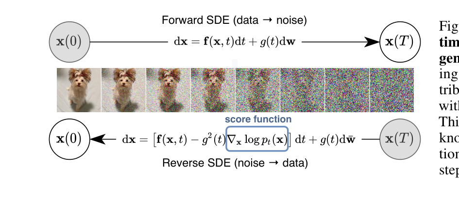
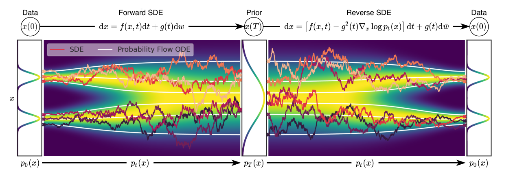
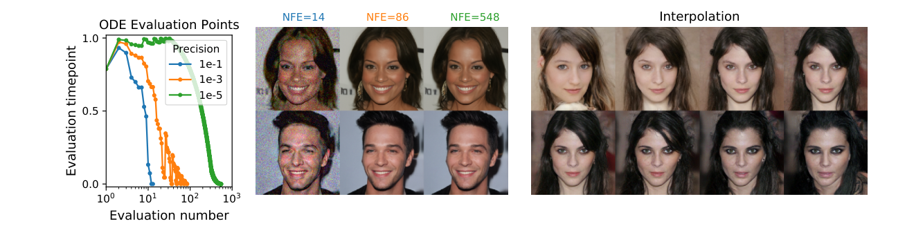
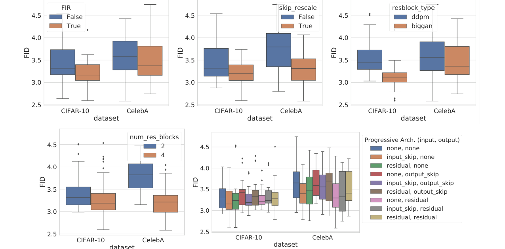
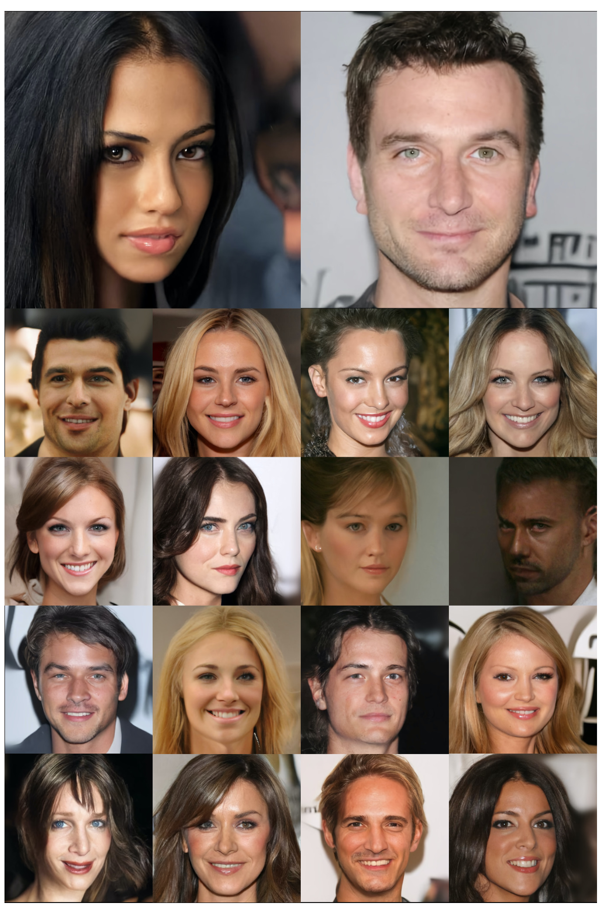
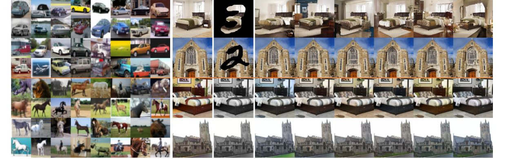

# Score SDE：把扩散模型写成连续时间生成过程

这篇论文最重要的贡献不是又提出一个单独的采样器，而是给扩散模型补了一套连续时间语言：**先用一个固定的前向 SDE 把数据扩散成先验噪声，再用依赖 score 的反向 SDE 把噪声逆回数据；同时存在一条 probability flow ODE，它和反向 SDE 共享边缘分布，并让 likelihood、latent encoding 和高效 ODE 采样变得可操作。**

## 它的效率贡献是什么

| Dimension | Contribution |
| --- | --- |
| Saved cost | Sampling and evaluation flexibility; not always fewer steps by default, but opens ODE solvers, adaptive NFE, PC samplers, and exact likelihood computation |
| Main mechanism | Reverse-time SDE + probability flow ODE + time-dependent score network |
| Training target | Continuous denoising score matching over \(t \in [0,T]\) |
| Architecture contribution | NCSN++ and DDPM++ recipes, plus continuous-time embeddings and deeper variants |
| Best reported CIFAR-10 sample result | NCSN++ cont. (deep, VE): FID `2.20`, IS `9.89` |
| Best reported CIFAR-10 likelihood result | DDPM++ cont. (deep, sub-VP): `2.99` bits/dim |
| Main risk | Mathematical unification does not remove sampling cost; sampler and SDE choice still require tuning |
| Connect to | [Score Matching 到 SDE](../../diffusion/score-matching-sde-and-probability-flow.md)、[噪声日程与参数化](../../diffusion/noise-schedules-and-parameterization.md)、[采样与推理加速](../../diffusion/inference.md) |

## 证据等级与外推边界

| Claim | Evidence | Evidence Level | What Transfers | What Does Not Transfer |
| --- | --- | --- | --- | --- |
| SMLD and DDPM can be unified as SDE discretizations | VE / VP derivation and reverse-time SDE | Theory + empirical sampler comparison | Later papers can discuss diffusion in continuous time instead of only fixed Markov chains | Does not imply all SDEs are equally good for all domains |
| Predictor-Corrector sampling improves sample quality | CIFAR-10 sampler comparison, LSUN qualitative results | Benchmark + qualitative evidence | Pair a numerical predictor with score-based MCMC correction when NFE budget allows | Does not make sampling GAN-fast |
| Probability flow ODE enables likelihood and latent encoding | ODE derivation, CIFAR-10 NLL table, interpolation figure | Theory + benchmark | Allows exact likelihood under the learned continuous model and deterministic encoding/decoding | ODE sample quality depends on solver tolerance, SDE, architecture, and checkpoint |
| Architecture and training details matter a lot | NCSN++ / DDPM++ ablations and training settings | Ablation evidence | Use FIR, skip rescale, BigGAN blocks, continuous embeddings, EMA, PC sampler tuning as practical knobs | The exact CIFAR-10 recipe is not automatically optimal for video, text-to-image, or world models |
| Unconditional score models can support controllable generation | Conditional reverse SDE and inpainting/colorization/class examples | Method + demo | Inverse problems can often be solved by modifying the reverse process instead of retraining the score model | Class conditioning still needs an auxiliary time-dependent classifier |

## 论文位置

在这篇论文之前，扩散模型主要有两条看似不同的线：

1. **SMLD / NCSN**：在不同噪声尺度上估计 score，然后用 annealed Langevin dynamics 采样；
2. **DDPM**：定义一个离散 Markov 加噪链，再训练反向去噪 Markov chain。

这篇论文把二者放进同一个连续时间框架里。前向过程写成：

\[
dx = f(x,t)dt + g(t)dw,
\]

其中 \(f(x,t)\) 是 drift，\(g(t)\) 是 diffusion coefficient，\(w\) 是 Wiener process。只要知道每个时刻边缘分布 \(p_t(x)\) 的 score：

\[
\nabla_x \log p_t(x),
\]

就可以写出反向 SDE：

\[
dx =
\left[
f(x,t)-g(t)^2\nabla_x\log p_t(x)
\right]dt + g(t)d\bar w.
\]

注意这里的 \(dt\) 是从 \(T\) 到 \(0\) 的反向时间步。也就是说，训练模型的任务变成了：**学一个时间条件 score 网络 \(s_\theta(x,t)\)，让它近似每个噪声时刻的 \(\nabla_x\log p_t(x)\)。**

{ width="720" }

<small>图源：`Score-Based Generative Modeling through Stochastic Differential Equations`，Figure 1。原论文图意：前向 SDE 把数据逐渐扩散为噪声；只要知道中间分布的 score，反向 SDE 就能从噪声生成数据。</small>

**Reverse SDE 图先看 score 如何把噪声带回数据。**
**输入输出**：输入是数据分布与固定的加噪 SDE，输出是一个可从 prior 噪声反向生成数据的 SDE。  
**效率机制**：它不是直接省掉训练，而是把采样问题变成可选择数值求解器的问题。  
**对主线意义**：后续少步 solver、ODE sampler、distillation 和 flow matching 都是在这个连续时间视角里讨论“路径怎么走得更快”。  
**不能证明什么**：一条漂亮的反向 SDE 不等于具体模型已低延迟、低 NFE 或可部署。

## 总体框架

论文 Figure 2 把三件事放在同一张图里：

1. 前向 SDE：从 data 到 prior；
2. 反向 SDE：从 prior 到 data；
3. probability flow ODE：一条确定性路径，和 SDE 有相同的边缘分布。

{ width="920" }

<small>图源：`Score-Based Generative Modeling through SDEs`，Figure 2。原论文图意：数据可通过前向 SDE 映射到噪声 prior；反向 SDE 与 probability flow ODE 都可用 score \(\nabla_x \log p_t(x)\) 构造。</small>

这张图里最容易忽略的是白色曲线：它代表 probability flow ODE。反向 SDE 是随机的，每次采样路径会被噪声扰动；probability flow ODE 是确定性的，但在每个时间点拥有同样的边缘分布 \(p_t(x)\)。因此它能做三件 SDE 路径不方便做的事：

| Capability | Why Probability Flow ODE Helps |
| --- | --- |
| Exact likelihood | Can use instantaneous change of variables as in neural ODEs |
| Latent encoding | A data point can be deterministically integrated to \(x(T)\) |
| Adaptive sampling | Black-box ODE solvers can trade tolerance for NFE |

对应 ODE 为：

\[
dx =
\left[
f(x,t)-\frac{1}{2}g(t)^2\nabla_x\log p_t(x)
\right]dt.
\]

和反向 SDE 相比，区别是 score 项前面的系数从 \(1\) 变成 \(\frac{1}{2}\)，并且没有随机 Wiener 项。

## 训练目标

训练时并不需要直接知道 \(p_t(x)\) 的归一化密度。论文使用 denoising score matching 的连续时间形式：

\[
\theta^*
= \arg\min_\theta
\mathbb E_t
\left\{
\lambda(t)
\mathbb E_{x(0)}
\mathbb E_{x(t)\mid x(0)}
\left[
\left\lVert
s_\theta(x(t),t)
- \nabla_{x(t)} \log p_{0t}(x(t)\mid x(0))
\right\rVert_2^2
\right]
\right\}.
\]

这条式子的读法是：

| Term | Meaning |
| --- | --- |
| \(t\sim U[0,T]\) | 随机抽一个连续噪声时刻 |
| \(x(0)\sim p_0\) | 从真实数据取 clean sample |
| \(x(t)\sim p_{0t}(x(t)\mid x(0))\) | 按前向 SDE 加噪到时刻 \(t\) |
| \(\nabla_{x(t)}\log p_{0t}(x(t)\mid x(0))\) | 对这次 perturbation kernel 的真实 denoising score |
| \(s_\theta(x(t),t)\) | 神经网络预测的 time-dependent score |
| \(\lambda(t)\) | 不同噪声时刻的 loss weight |

关键点：如果前向 SDE 的 transition kernel \(p_{0t}(x(t)\mid x(0))\) 是 Gaussian，训练就很方便，因为真实 denoising score 有闭式解。论文重点使用的 VE、VP、sub-VP SDE 都满足这个性质。

## 三类 SDE

论文把 SMLD 和 DDPM 分别解释成两类 SDE 的离散化，并引入 sub-VP SDE 改善 likelihood。

| SDE | Forward Process | Discrete Ancestor | Main Behavior | Practical Role |
| --- | --- | --- | --- | --- |
| VE SDE | \(dx=\sqrt{\frac{d[\sigma^2(t)]}{dt}}dw\) | SMLD / NCSN | variance exploding; signal mean roughly fixed while noise grows | strong sample quality with NCSN++ |
| VP SDE | \(dx=-\frac{1}{2}\beta(t)xdt+\sqrt{\beta(t)}dw\) | DDPM | variance preserving when data variance is normalized | connects directly to DDPM-style training and sampling |
| sub-VP SDE | \(dx=-\frac{1}{2}\beta(t)xdt+\sqrt{\beta(t)(1-e^{-2\int_0^t\beta(s)ds})}dw\) | proposed in this paper | lower variance than VP at intermediate times | stronger likelihood in reported CIFAR-10 setting |

这个表对工程判断很有用：**SDE 不是纯理论装饰，它会改变采样质量、likelihood 和最佳架构选择。**论文里 VE SDE 更偏向生成质量，sub-VP SDE 更偏向 likelihood。

## 采样：Predictor-Corrector

有了 score 网络后，可以用任意数值 SDE solver 近似反向 SDE。论文进一步提出 Predictor-Corrector sampler：

```text
predictor:
  用数值 SDE solver 从 t_i 走到 t_{i-1}

corrector:
  在同一个噪声时刻，用 Langevin MCMC / HMC 之类 score-based MCMC 修正 marginal distribution
```

直觉上，predictor 负责沿时间方向往回走，corrector 负责在当前噪声层上“横向校正”样本，让样本更贴近 \(p_t(x)\)。这解释了为什么 PC sampler 在同等或相近 NFE 下常常比只加 predictor 更稳。

论文 Table 1 比较了 CIFAR-10 上不同 reverse-time SDE solvers。下面按原英文列名重绘。

| Predictor | VE P1000 | VE P2000 | VE C2000 | VE PC1000 | VP P1000 | VP P2000 | VP C2000 | VP PC1000 |
| --- | ---: | ---: | ---: | ---: | ---: | ---: | ---: | ---: |
| ancestral sampling | 4.98 ± .06 | 4.88 ± .06 | - | **3.62 ± .03** | 3.24 ± .02 | 3.24 ± .02 | - | **3.21 ± .02** |
| reverse diffusion | 4.79 ± .07 | 4.74 ± .08 | 20.43 ± .07 | **3.60 ± .02** | 3.21 ± .02 | 3.19 ± .02 | 19.06 ± .06 | **3.18 ± .01** |
| probability flow | 15.41 ± .15 | 10.54 ± .08 | - | **3.51 ± .04** | 3.59 ± .04 | 3.23 ± .03 | - | **3.06 ± .03** |

<small>表源：`Score-Based Generative Modeling through SDEs`，Table 1。原论文表意：P1000 / P2000 是 predictor-only，C2000 是 corrector-only，PC1000 是 1000 predictor steps + 1000 corrector steps；指标是 CIFAR-10 FID，越低越好。</small>

这张表不应该读成“某个 sampler 永远最好”。更稳的读法是：

1. corrector-only 很贵而且效果差；
2. PC 通常比只增加 predictor steps 更值得；
3. probability flow 单独作为固定步 predictor 未必最好，但和 corrector 搭配时很强；
4. sampler 的好坏依赖 SDE、模型、步数和 SNR 超参。

## Probability Flow ODE

probability flow ODE 的价值有两层。第一，它把扩散模型和 neural ODE、normalizing flow 的工具连接起来，可以算 exact likelihood。第二，它给采样提供了 adaptive NFE 的空间。

{ width="920" }

<small>图源：`Score-Based Generative Modeling through SDEs`，Figure 3。原论文图意：ODE solver 的 evaluation points 可随数值精度变化；较少 NFE 仍可保持视觉质量；确定性 latent-to-image 映射支持 interpolation。</small>

**Probability Flow ODE 图看 NFE、质量和确定性编码。**
左图说明 ODE solver 会自动把函数评估集中到需要更高精度的时间段；中图显示从 NFE 548 降到 86 视觉质量仍接近，NFE 14 则明显退化；右图展示 deterministic encoding/decoding 支持 latent interpolation。它支撑的是“ODE 视角带来效率和表示能力”，不是“14 NFE 已经足够所有任务”。

论文 Table 2 报告了 probability flow ODE 用于 likelihood 和 ODE sampling 的结果。下面保留原英文表头。

| Model | NLL Test ↓ | FID ↓ |
| --- | ---: | ---: |
| RealNVP (Dinh et al., 2016) | 3.49 | - |
| iResNet (Behrmann et al., 2019) | 3.45 | - |
| Glow (Kingma & Dhariwal, 2018) | 3.35 | - |
| MintNet (Song et al., 2019b) | 3.32 | - |
| Residual Flow (Chen et al., 2019) | 3.28 | 46.37 |
| FFJORD (Grathwohl et al., 2018) | 3.40 | - |
| Flow++ (Ho et al., 2019) | 3.29 | - |
| DDPM (L) (Ho et al., 2020) | ≤ 3.70* | 13.51 |
| DDPM (Lsimple) (Ho et al., 2020) | ≤ 3.75* | 3.17 |
| DDPM | 3.28 | 3.37 |
| DDPM cont. (VP) | 3.21 | 3.69 |
| DDPM cont. (sub-VP) | 3.05 | 3.56 |
| DDPM++ cont. (VP) | 3.16 | 3.93 |
| DDPM++ cont. (sub-VP) | 3.02 | 3.16 |
| DDPM++ cont. (deep, VP) | 3.13 | 3.08 |
| DDPM++ cont. (deep, sub-VP) | **2.99** | **2.92** |

<small>表源：`Score-Based Generative Modeling through SDEs`，Table 2。`*` 表示 DDPM 原文的 ELBO 值是在 discrete data 上报告，论文正文特别说明这一点。</small>

这里要注意一个很实际的 tradeoff：最佳 likelihood 不是最佳 FID。DDPM++ cont. (deep, sub-VP) 的 likelihood 最好，但 CIFAR-10 sample quality 最强的是 NCSN++ cont. (deep, VE)。

## 架构与训练细节

这篇论文的训练细节很值得单独看，因为它的结果不是“只改理论就赢了”，而是理论、采样器、架构和训练 recipe 叠加出来的。

### 基础训练设置

论文 Appendix H.1 给了架构探索设置：

| Item | Setting |
| --- | --- |
| Architecture exploration iterations | `1.3M` unless otherwise noted |
| Checkpoint interval | every `50k` iterations |
| VE datasets | CIFAR-10 `32×32`, CelebA `64×64` |
| VP architecture search | CIFAR-10 only, to save compute |
| FID evaluation | `50k` samples, `tensorflow_gan` |
| Default architecture-search batch size | `128` |
| Sampler for architecture search | PC sampler with `1000` time steps |
| Predictor | reverse diffusion |
| VE corrector | one Langevin corrector step per predictor update, SNR `0.16` |
| VP corrector | usually omitted in architecture search to save doubled compute |
| Optimizer family | follows Ho et al. (2020): learning rate, gradient clipping, warm-up schedule |

官方代码里的 CIFAR-10 default config 进一步给出常用训练超参：

| Config Field | Value |
| --- | --- |
| `training.batch_size` | `128` |
| `training.n_iters` | `1300001` by default; deep continuous VE uses `950001` |
| `training.n_jitted_steps` | `5` |
| `model.sigma_min` / `model.sigma_max` | `0.01` / `50` for CIFAR-10 VE |
| `model.num_scales` | `1000` |
| `optim.optimizer` | `Adam` |
| `optim.lr` | `2e-4` |
| `optim.beta1` / `optim.eps` | `0.9` / `1e-8` |
| `optim.warmup` | `5000` |
| `optim.grad_clip` | `1.0` |

这些细节对复现很重要。比如同样叫 NCSN++ cont.，如果训练步数、EMA、SNR、predictor/corrector 选择或 continuous embedding 不一致，FID 差距可能非常明显。

### NCSN++ / DDPM++ 的设计

论文在 DDPM U-Net 体系上测试了几类架构组件：

1. FIR anti-aliasing upsampling/downsampling；
2. skip connection 乘 \(1/\sqrt{2}\) 做 rescale；
3. 把 DDPM residual block 换成 BigGAN residual block；
4. 每个 resolution 的 residual blocks 从 2 增到 4；
5. 测试 input / output 的 progressive architecture。

{ width="920" }

<small>图源：`Score-Based Generative Modeling through SDEs`，Figure 10。原论文图意：在 VE perturbations 下，不同 architecture components 对 CIFAR-10 和 CelebA FID 的影响。</small>

**这张训练 ablation 图怎么读。**
图里多数橙色配置比蓝色配置 FID 更低，说明这些组件不是装饰项：FIR、skip rescale、BigGAN block、更多 residual blocks 都能影响 score model 的质量。这里的结论更像训练配方筛选，而不是新的理论定理。

最终命名可以这样记：

| Model | Main Architecture Choice | SDE |
| --- | --- | --- |
| NCSN++ | FIR + skip rescale + BigGAN residual block + 4 res blocks/resolution + residual progressive input | VE |
| DDPM++ | Similar search space, but best VP config drops FIR and progressive growing | VP / sub-VP |
| NCSN++ cont. | NCSN++ with continuous objective and random Fourier time embedding | VE |
| NCSN++ cont. (deep) | doubles residual blocks per resolution, trained `0.95M` iterations | VE |
| DDPM++ cont. (deep) | continuous DDPM++ with doubled depth | VP / sub-VP |

连续时间条件的实现细节也很关键。论文把离散 timestep positional embedding 改成 random Fourier feature embeddings，scale 固定为 `16`。官方 deep continuous VE config 中，NCSN++ cont. (deep) 使用 `nf=128`、`ch_mult=(1,2,2,2)`、`num_res_blocks=8`、`attn_resolutions=(16,)`、`dropout=0.1`、`scale_by_sigma=True` 和 `ema_rate=0.999`。

### EMA、过拟合和 checkpoint 选择

论文强调 EMA 对性能影响明显：

| Setting | EMA |
| --- | ---: |
| VE perturbations | `0.999` works better |
| VP perturbations | `0.9999` works better |
| 1024×1024 CelebA-HQ | `0.9999` |

还有一个容易漏掉的评测细节：Table 3 的 FID / IS 用的是训练过程中 FID 最低的 checkpoint；Table 2 的 likelihood 和 ODE FID 用的是最后 checkpoint。因此不能把两个表里的数字当成同一个 checkpoint 的全面画像。

### CIFAR-10 sample quality

论文 Table 3 展示了最重要的 sample quality 结果。下面保留原英文表头。

| Model | FID ↓ | IS ↑ |
| --- | ---: | ---: |
| BigGAN (Brock et al., 2018), Conditional | 14.73 | 9.22 |
| StyleGAN2-ADA (Karras et al., 2020a), Conditional | 2.42 | 10.14 |
| StyleGAN2-ADA (Karras et al., 2020a), Unconditional | 2.92 | 9.83 |
| NCSN (Song & Ermon, 2019) | 25.32 | 8.87 ± .12 |
| NCSNv2 (Song & Ermon, 2020) | 10.87 | 8.40 ± .07 |
| DDPM (Ho et al., 2020) | 3.17 | 9.46 ± .11 |
| DDPM++ | 2.78 | 9.64 |
| DDPM++ cont. (VP) | 2.55 | 9.58 |
| DDPM++ cont. (sub-VP) | 2.61 | 9.56 |
| DDPM++ cont. (deep, VP) | 2.41 | 9.68 |
| DDPM++ cont. (deep, sub-VP) | 2.41 | 9.57 |
| NCSN++ | 2.45 | 9.73 |
| NCSN++ cont. (VE) | 2.38 | 9.83 |
| NCSN++ cont. (deep, VE) | **2.20** | **9.89** |

<small>表源：`Score-Based Generative Modeling through SDEs`，Table 3。原论文表意：NCSN++ cont. (deep, VE) 在 CIFAR-10 unconditional generation 上取得 FID 2.20 和 IS 9.89。</small>

### 高分辨率训练

论文还把 NCSN++ 推到 \(1024\times1024\) CelebA-HQ。这里训练设置和 CIFAR-10 明显不同：

| Item | 1024×1024 CelebA-HQ Setting |
| --- | --- |
| Model | modified NCSN++ with continuous objective |
| SDE | VE SDE |
| Batch size | `8` |
| EMA | `0.9999` |
| Training length | around `2.4M` iterations |
| Sampler | PC sampler with `2000` discretization steps |
| Predictor | reverse diffusion |
| Corrector | one Langevin step per predictor update |
| SNR | `0.15` |
| Fourier feature scale | `16` |
| Progressive architecture | `input skip` for input, `output skip` for output |

{ width="620" .atlas-figure-tall }

<small>图源：`Score-Based Generative Modeling through SDEs`，Figure 12。原论文图意：使用 VE SDE 训练的 modified NCSN++ 在 \(1024\times1024\) CelebA-HQ 上生成的样例。</small>

论文自己也承认这些高分辨率样本并不完美，比如人脸对称性仍有可见瑕疵。这个表述很重要：它证明了 score-based model 可以上到 1024 分辨率，但还不是说它在视觉质量、速度和可控性上全面超过 GAN。

## Controllable Generation

这篇论文还展示了一个很强的接口：如果你知道条件 \(y\) 和当前 noisy state \(x(t)\) 的关系，就可以把反向 SDE 改成条件反向 SDE：

\[
dx =
\left\{
f(x,t)
-g(t)^2
\left[
\nabla_x \log p_t(x)
+\nabla_x\log p_t(y\mid x)
\right]
\right\}dt
+g(t)d\bar w.
\]

这和后来的 guidance 思想非常接近：基础 score \(\nabla_x\log p_t(x)\) 负责生成自然图像，条件梯度 \(\nabla_x\log p_t(y\mid x)\) 负责把样本推向满足条件的区域。

{ width="920" }

<small>图源：`Score-Based Generative Modeling through SDEs`，Figure 4。原论文图意：左侧是 CIFAR-10 class-conditional samples；右侧是 LSUN 上的 inpainting 和 colorization。</small>

三类应用分别是：

| Task | Conditioning Signal | Extra Training? | Mechanism |
| --- | --- | --- | --- |
| Class-conditional generation | class label \(y\) | train time-dependent classifier | add \(\nabla_x\log p_t(y\mid x)\) to reverse SDE |
| Inpainting | known pixels \(\Omega(y)\) | no new score model | constrain / resample known dimensions during reverse process |
| Colorization | grayscale observation | no new score model | transform channels to decouple known and unknown dimensions, then impute |

这部分对后续 diffusion guidance 很有启发：扩散模型的条件控制不一定要在训练阶段全部做完，很多条件可以在反向过程里以梯度或 projection 方式注入。

## 训练实现清单

如果要按这篇论文复现或迁移到新任务，建议把训练拆成下面这张 checklist。

| Stage | Decision |
| --- | --- |
| Choose SDE | VE for sample quality baseline; VP / sub-VP when likelihood or DDPM compatibility matters |
| Choose objective | continuous denoising score matching for modern SDE-style training |
| Time embedding | random Fourier features for continuous \(t\), scale `16` in reported configs |
| Network | U-Net family with residual blocks, attention at selected resolutions, EMA, dropout |
| Weighting | \(\lambda(t)\) should balance score magnitude across noise levels |
| Sampler during eval | PC sampler for best quality; probability flow ODE for likelihood / latent / adaptive NFE |
| Corrector tuning | SNR is a real hyperparameter; official README notes typical `0.05-0.2` |
| Checkpointing | monitor FID across checkpoints, because the best sample checkpoint may not be the last |
| Report separately | sample FID / IS, ODE FID, NLL bits/dim, NFE, sampler steps |

这张清单的核心是：SDE、训练目标、架构和 sampler 不能分开调。只换 sampler 不改 SDE，或只换 SDE 不调 EMA/SNR/embedding，都可能得到完全不同的结论。

## 和后续论文的关系

| Later Direction | What It Inherits from Score SDE |
| --- | --- |
| DPM-Solver / DPM-Solver++ | diffusion sampling as solving ODE/SDE with better numerical integration |
| Consistency models / distillation | learn a faster mapping along a continuous-time generative path |
| DMD / DMD2 / Phased DMD | use score models and diffusion perturbations as distribution-matching signals |
| CausVid / video diffusion acceleration | treat video diffusion sampling as a path that can be causalized, cached, or distilled |
| Flow matching / rectified flow | asks whether the generative path can be made straighter or easier than diffusion paths |

可以把这篇论文看成扩散模型的“坐标系论文”。它未必是今天最快的生成方法，但它让后面很多方法都能在同一个坐标里比较：路径、score、noise schedule、ODE/SDE solver、NFE、likelihood、distillation。

## 局限与不可外推结论

1. 论文提升了 score-based model 的质量和表达能力，但采样仍慢于 GAN，这是作者在结论里明确承认的限制。
2. PC sampler 的效果依赖 predictor、corrector、SNR、步数和 SDE；不能只引用 Table 1 的最优数字。
3. probability flow ODE 能算 likelihood，但最佳 likelihood 模型不等于最佳 FID 模型。
4. 高分辨率 CelebA-HQ 结果证明了可扩展性，但样本仍有人脸对称性等瑕疵，不能外推出任意高分辨率域都稳定。
5. class-conditional generation 需要额外训练 time-dependent classifier；inpainting/colorization 虽可用 unconditional score model，但仍依赖任务结构和 projection / approximation 设计。
6. 这篇论文主要是图像生成和逆问题证据，不能直接推出视频、3D、机器人世界模型中的时序一致性、动作因果或闭环收益。

## 相关主线

- 想补数学主线：读 [Score Matching 到 SDE](../../diffusion/score-matching-sde-and-probability-flow.md)。
- 想看训练细节：读 [扩散训练与表示](../../diffusion/training.md) 和 [扩散训练配方与排障](../../diffusion/practical-training-recipes-and-failure-analysis.md)。
- 想看采样加速：接 [DPM-Solver++](dpm-solver-plus-plus.md)。
- 想看少步蒸馏：接 [DMD](dmd.md)、[DMD2](dmd2.md) 和 [Phased DMD](phased-dmd.md)。

**阅读结论。**
Score SDE 是扩散统一理论页：方法要抓 forward SDE、reverse-time SDE、probability-flow ODE 和 predictor-corrector 采样；实验说明同一 score 框架能覆盖图像生成、补全和可控任务。后续论文多是在这套公式上换参数化、求解器或蒸馏目标。
