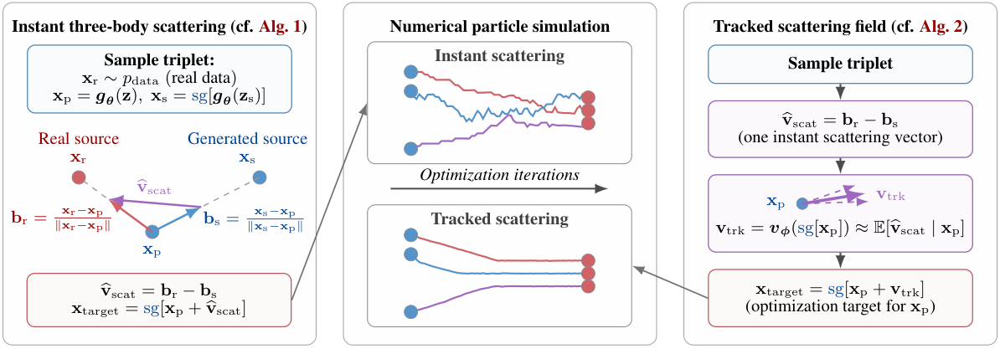
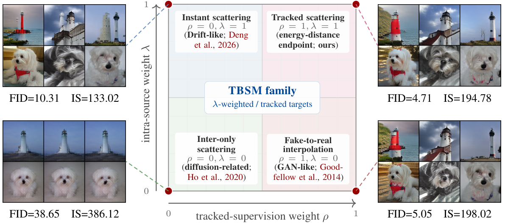
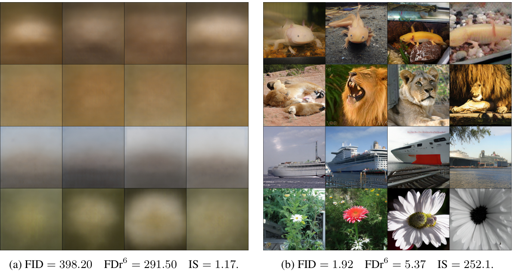
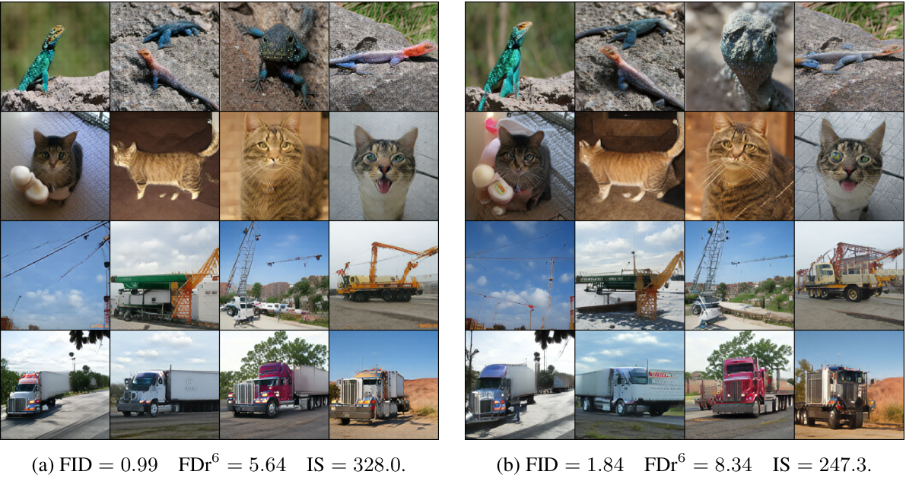

# TBSM：用三体散射把分布距离变成一步监督

!!! info "论文信息"
    **论文题名：** Three-Body Scattering for Generative Modeling。 
    **作者：** Peng Sun、Zhenglin Cheng、Deyuan Liu、Jun Xie、Xinyi Shang、Tao Lin。 
    **机构：** Westlake University、Zhejiang University、University College London。 
    **时间 / 主题：** 2026-07；生成模型与一步视觉生成。 
    **arXiv / 代码：** [2607.18198](https://arxiv.org/abs/2607.18198)；[github.com/sp12138/TBSM](https://github.com/sp12138/TBSM)。 
    **元数据与核验口径：** 来源为 arXiv HTML v1；Checked Date：2026-09-07；Repro Status：Paper / official code link reviewed, independent reproduction not claimed。

## 原论文故事线

TBSM 要解决的是一步生成器怎样获得分布级监督。扩散与 flow matching 通常先规定一条噪声到数据的路径，再训练沿途的去噪或速度预测；直接分布匹配则可以让生成器一次输出整张图像，但监督常需要整批真实样本与生成样本之间的相互作用。作者从 energy distance 出发，把一个分布目标拆成常数规模的随机事件，让每个生成样本只接触一个真实样本和另一个独立生成样本，就能得到期望正确的更新方向。

这三个对象分别叫 projectile、real source 和 generated source。真实 source 提供吸引，生成 source 提供排斥；两项相减才有机会同时改善真实性与分布覆盖。每次事件很便宜，方向却有噪声，因此论文再引入一个在线 tracker，学习在当前生成位置上对许多事件求平均后应当得到的向量，用其输出构造停止梯度的回归目标。

Figure 2 可以沿左到右读。左边先计算一个三样本方向，中间比较即时散射与跟踪散射的粒子路径，右边把 tracker 预测接回生成器目标。中间的横轴是优化迭代，展示的是训练期间分布移动的示意；推理时并不让单张图沿这些路径反复运动。

{ width="920" }

<small>图源：论文 Figure 2，PDF 第 2 页。左侧 real–generated–generated 三元组给出即时方向；右侧展示完全跟踪的能量距离端点。sg 表示 stop gradient。</small>

最终模型仍是 $x=g_\theta(z,c)$，一次生成器前向得到样本。ImageNet-256 上，像素空间 PixelDiT-XL 报告 FID 2.23，latent DiT-XL/2 报告 1.63。它们说明这种简单交互可以用于高维图像，但这些模型均从已有多步生成器初始化。论文的实质贡献在于有分布目标依据的训练接口、在线向量估计及其规模化实验，不能把它概括成新发现了 energy distance，或已证明任意一步神经网络训练都会收敛。[↗](https://arxiv.org/pdf/2607.18198v1#page=2)

## 从分布距离得到一个样本该往哪里走

### 真实—生成距离之外，为什么还需要生成—生成距离

设条件为 $c$，真实分布是 $Q(\cdot\mid c)$，生成器 $g_\theta(z,c)$ 将噪声分布推送成 $P_\theta(\cdot\mid c)$。暂时省略条件，energy distance 的平方为

$$
D_E^2(P,Q)=2\mathbb E\|x_p-x_r\|_2
-\mathbb E\|x_p-x_s\|_2
-\mathbb E\|x_r-x_r'\|_2,
$$

其中 $x_p,x_s$ 独立来自 $P$，$x_r,x_r'$ 独立来自 $Q$，两组之间也独立。论文优化

$$
F(\theta)=\mathbb E_c\left[\frac12D_E^2(P_\theta(\cdot\mid c),Q(\cdot\mid c))\right].
$$

第一项让生成样本靠近真实分布，第二项防止所有生成点只聚到一个便于靠近真实样本的位置。最后的真实—真实项对生成器参数是常数，训练不必为每个事件真的再抽第二个真实 source，但它对于定义一个零值有明确意义的分布差异很重要。

在欧氏空间与有限一阶矩条件下，这个量非负，且为零当且仅当 $P=Q$。这种性质称为 proper discrepancy，保证总体目标的零点对应完整分布匹配。它比仅匹配均值更强，也不意味着任意有限批次估计、任意特征投影、任意优化器都自动保留同样结论。[↗](https://arxiv.org/pdf/2607.18198v1#page=3)

只保留吸引会发生什么，可以从目标本身看出来。令

$$
f_Q(x)=\mathbb E_{y\sim Q}\|x-y\|_2.
$$

若优化 $\int f_Q(x)P(dx)$，最优生成分布可以把全部质量放到 $f_Q$ 的最小点集合，也就是几何中位数集合。若这个集合只有一个点 $x^*$，最优解就是 $\delta_{x^*}$，通常并非 $Q$。这解释了为什么“每张假图都更接近一张真图”不足以定义生成分布学习，排斥项承担了实际的统计作用。[↗](https://arxiv.org/pdf/2607.18198v1#page=30)

### 变分中的二分之一为什么消失

对固定条件，将 $F(P)=\tfrac12D_E^2(P,Q)$ 看成关于整个分布的泛函。忽略与 $P$ 无关的常数，它的一阶变分可以写成

$$
\frac{\delta F}{\delta P}(x)
=\mathbb E_{x_r\sim Q}\|x-x_r\|_2
-\mathbb E_{x_s\sim P}\|x-x_s\|_2.
$$

原目标中的生成—生成项带 $1/2$，这里却不带。原因是该项的两个输入都来自待优化分布 $P$，对分布求变分时会产生对称的两份贡献，抵消前面的二分之一。遗漏这一步，就会错误地把排斥强度减半。

在 2-Wasserstein 梯度流几何中，下降速度为负的空间梯度

$$
v_\theta(x,c)
=-\nabla_x\frac{\delta F}{\delta P}(x)
=\mathbb E_{x_r\mid c}\frac{x_r-x}{\|x_r-x\|_2}
-\mathbb E_{x_s\mid c}\frac{x_s-x}{\|x_s-x\|_2}.
$$

这两项是单位方向的期望。近处和远处的 source 在单次事件中都提供至多单位长度的 bearing，距离影响方向分布，却不直接让一个很远的 source 获得无限大的力。这里的 Wasserstein 描述怎样在分布空间中下降，所下降的目标仍是 energy distance，不能把两种距离当成同一个量。

若能对所有 source 求期望，任意位置 $x$ 都有一个确定的场 $v_\theta(x,c)$。直接计算这个场往往昂贵，TBSM 下一步所做的，就是给它一个常数规模的随机估计。[↗](https://arxiv.org/pdf/2607.18198v1#page=4)

### 三体事件是场的随机估计

给定条件 $c$，独立采样 $z,z_s$，得到

$$
x_p=g_\theta(z,c),\qquad
x_s=\operatorname{sg}[g_\theta(z_s,c)],\qquad
x_r\sim Q(\cdot\mid c).
$$

$x_p$ 是要接受梯度的 projectile，$x_r$ 和 $x_s$ 是本次事件固定的 source。计算

$$
b_r=\frac{x_r-x_p}{\|x_r-x_p\|_2},\qquad
b_s=\frac{x_s-x_p}{\|x_s-x_p\|_2},\qquad
\widehat v=b_r-b_s.
$$

$b_r$ 朝向真实点，$-b_s$ 远离生成点。源采样独立时，固定 projectile 后有

$$
\mathbb E[\widehat v\mid x_p,c]=v_\theta(x_p,c).
$$

因此，一个方向可能很不准，但反复抽样的平均值是所需分布场。三体是这个带符号的三样本交互的名称，并未使用牛顿引力、反平方力或物理散射模拟。每个 projectile 只有两次 source 交互，$B$ 个 projectile 对应 $O(B)$ 次样本交互；这个复杂度没有把生成器、图像编码器与 tracker 的每样本计算变成常数时间。

单位方向还给出一个与维度无关的上界。$\|\widehat v\|_2\le2$，单次源采样的条件方差迹不超过 2；若给同一个 projectile 独立抽 $K$ 对 source 后平均，则

$$
\mathbb E\|\overline v_K-v_\theta(x_p,c)\|_2^2
=\frac{\operatorname{tr}\operatorname{Cov}_Q(b_r)+
\operatorname{tr}\operatorname{Cov}_{P_\theta}(b_s)}{K}
\le\frac2K.
$$

它说明增加独立 source 可以降低方差，也说明这一成本会随 $K$ 增加。论文随后用 tracker 尝试从历次事件中学习平均场，而不在每次更新都显式增加 source 数。[↗](https://arxiv.org/pdf/2607.18198v1#page=29)

## 冻结目标怎样把向量变成神经网络训练

### 回归的是当前位置加一个位移

得到 $\widehat v$ 后，论文构造

$$
x_{\mathrm{target}}
=\operatorname{sg}\left[x_p+
\widehat v(\operatorname{sg}[x_p];x_r,x_s)\right],
$$

并使用

$$
\mathcal L_{\mathrm{gen}}(\theta)
=\frac12\mathbb E\|g_\theta(z,c)-x_{\mathrm{target}}\|_2^2.
$$

这个目标看起来像一个普通 MSE，但它的作用要从当前参数处的梯度理解。固定生成 target 时的参数 $\bar\theta$，令 $J_{\bar\theta}$ 为 projectile 对生成器参数的 Jacobian。由于目标完全停止梯度，当前输出减目标等于 $-\widehat v$，所以

$$
\left.\nabla_\theta\mathcal L_{\mathrm{gen}}(\theta;\bar\theta)
\right|_{\theta=\bar\theta}
=-\mathbb E[J_{\bar\theta}^{\top}\widehat v]
=-\mathbb E[J_{\bar\theta}^{\top}v_{\bar\theta}]
=\nabla_\theta F(\bar\theta).
$$

中间等式需要 source 对 projectile 的噪声及其 Jacobian 保持独立。只检查“固定图像后方向平均无偏”还不够，最终用于参数更新的是乘过 Jacobian 的向量。在几乎处处可微、可交换求导与期望等正则条件下，正确采样与 detach 使这条局部梯度等价能够成立。精确 bearing 在重合点取零；经典梯度恒等式还要求重合事件概率为零。[↗](https://arxiv.org/pdf/2607.18198v1#page=5)

这也给出三个具体实现判断。第一，source 与 projectile 可以共享生成器参数，但当前 source 分支不回传梯度；下一次参数更新后，它的分布仍会随共享生成器改变。第二，不能让 $z_s=z$，否则生成—生成项退化，失去独立源估计的含义。第三，target 中的当前位置也要 detach；若直接对目标构造反传，原来的 $-\widehat v$ 梯度就会混入额外导数。

上式是当前参数处的梯度一致性，不是说回归损失的数值等于 energy distance。当前 MSE 的值为 $\tfrac12\|\widehat v\|^2$ 的平均，它记录即时位移尺度，不能据其绝对值给不同生成模型排质量名次。Algorithm 1 省略的 $1/2$ 只会把梯度整体乘二，可以由学习率吸收。[↗](https://arxiv.org/pdf/2607.18198v1#page=24)

### 自由粒子和共享生成器不能混为一谈

若直接优化一个自由粒子 $x_p$，一步梯度下降就是 $x_p\leftarrow x_p+\eta\widehat v$。神经生成器却把所有输出绑定到同一组 $\theta$，一次参数更新会同时影响许多输入噪声对应的样本，不能保证每张图都精确完成自己的欧拉位移。局部梯度匹配把分布目标传给了网络，后续优化仍受参数化能力、Jacobian 和优化器影响。

这也是 TBSM 与经典线性时间 MMD 的关系。距离诱导核可以取

$$
k_a(x,y)=\frac12\left(\|x-a\|_2+\|y-a\|_2-\|x-y\|_2\right),
$$

这里 $a$ 是任意固定锚点，其 MMD 平方等于 $\tfrac12D_E^2$。经典随机配对估计的生成器梯度，可分成两个对称的三体 projectile 更新；随机选择其中一份并采用相应缩放，期望相同。论文明确不把这个线性时间估计本身作为新发明。它将已有随机梯度组织成 source-detached 的显式回归目标，使 tracker 可以直接学习该目标方向，并将这种接口用于高维图像。[↗](https://arxiv.org/pdf/2607.18198v1#page=22)

## Tracker 学什么，以及什么时候值得相信它

### 在线目标来自散射事件，不来自教师图像

完整算法引入两个控制量。$\lambda\in[0,1]$ 定义

$$
Y=\widehat v_\lambda=b_r-\lambda b_s,
$$

同时规定 tracker 的查询位置

$$
\alpha\sim\mathcal U(0,1-\lambda),\qquad
\widetilde x=\alpha x_r+(1-\alpha)\operatorname{sg}[x_p].
$$

当 $\lambda=1$ 时，$\alpha=0$，查询就在 projectile；减小 $\lambda$ 时，查询可以进入 projectile 到真实 source 之间的线段。tracker 输出 $h_\phi=v_\phi(\widetilde x,c)$，生成器使用混合方向

$$
\widehat v_{\mathrm{mix}}=(1-\rho)Y+\rho h_\phi,
\qquad \rho\in[0,1].
$$

生成器仍回归 $\operatorname{sg}[x_p+\widehat v_{\mathrm{mix}}]$，tracker 则另行优化

$$
\mathcal L_{\mathrm{trk}}(\phi)
=\mathbb E\|v_\phi(\widetilde x,c)-\operatorname{sg}[Y]\|_2^2.
$$

两个网络各有自己的监督。生成器接收停止梯度的混合位移，tracker 接收当前三体事件的向量标签。tracker 并不判断图像真伪，也不需要从一个预训练扩散教师取得 score。[↗](https://arxiv.org/pdf/2607.18198v1#page=6)

一次训练迭代先用当前 tracker 对新三元组查询，再分别更新生成器与 tracker。附录的误差分析以采样新事件之前的历史为条件，此时两套网络固定；它没有允许先在该事件上更新 tracker，再把刚拟合过同一随机标签的输出当作独立平均场。$\rho=0$ 时，未参与生成器监督的 tracker 分支可以完全省去。

### λ=1 时，回归最优解就是需要的平均场

先看理论最清楚的 $\lambda=1$。固定 $x_p,c$，令

$$
s_\theta(x_p,c)
=\mathbb E\|Y-v_\theta(x_p,c)\|_2^2,\qquad
 e_\phi(x_p,c)=\|h_\phi-v_\theta(x_p,c)\|_2^2.
$$

前者是即时源采样的方差，后者是 tracker 对真实平均场的平方误差。平方回归的最优函数是条件期望，所以理想 tracker 输出 $v_\theta(x_p,c)$。混合误差可以精确分解为

$$
\mathbb E\|\widehat v_{\mathrm{mix}}-v_\theta\|_2^2
=(1-\rho)^2s_\theta+\rho^2e_\phi.
$$

展开平方后，交叉项为零，因为 $Y-v_\theta$ 在固定查询处均值为零，而 tracker 当前误差是固定的。这个等式说明混合并非简单折中口号。增加 $\rho$ 会按平方压低即时噪声，却按平方放大 tracker 误差的贡献。

若允许每个位置选择不同权重，最优值为

$$
\rho^*(x_p,c)=\frac{s_\theta}{s_\theta+e_\phi}.
$$

实际算法使用固定权重。令 $S=\mathbb E s_\theta$、$E_\phi=\mathbb E e_\phi$，对应最优常数是 $S/(S+E_\phi)$。完全依赖 tracker 优于完全即时估计，当且仅当 $E_\phi<S$。这些是基于真实误差的理论最优值，主实验并没有声称实时准确估计它们并自动选择 $\rho$。[↗](https://arxiv.org/pdf/2607.18198v1#page=25)

理想 tracker 消除的是固定 projectile 下的 source-sampling variance。生成器输入噪声、条件以及有限批次的随机性仍存在。因此，即使 tracker 完全学对，也不是所有训练梯度都变成确定量。

### 两次独立源采样可以诊断 tracker，而不必知道真实场

附录给出一个可操作的诊断。固定查询 $q=(x_p,c)$、网络和历史，独立重抽两对完整 source，得到 $Y_1,Y_2$。则

$$
S=\frac12\mathbb E\|Y_1-Y_2\|_2^2,
$$

$$
E_\phi=\mathbb E\langle h_\phi(q)-Y_1,
 h_\phi(q)-Y_2\rangle.
$$

第一个式子利用两份独立噪声相减后方差相加；第二个式子利用独立、零均值残差消掉噪声交叉项，只留下 tracker 对平均场的误差。于是可以在某个训练快照上比较 tracker 误差与即时方差，不必先显式计算 $v_\theta$。

这要求同一条件下能够重新抽到独立真实 source。每个文本只配一张图像时，直接重复那张图不等同于对真实条件分布独立抽样，诊断的统计含义会变化。有限样本下，误差估计还可能受噪声影响而为负，代入比例得到的 $\rho$ 也只是需要约束的插件估计，并非无偏最优权重或生成质量保证。[↗](https://arxiv.org/pdf/2607.18198v1#page=25)

### 对向量预测有利，不必对参数更新同样有利

生成器真正接收的是 $J^\top\widehat v$。若把前面的方差和误差改为 Jacobian 回传后的 $S_J,E_{J,\phi}$，独立源条件下同样有

$$
\mathbb E\|J^\top(\widehat v_{\mathrm{mix}}-v_\theta)\|_2^2
=(1-\rho)^2S_J+\rho^2E_{J,\phi}.
$$

因此参数更新空间的最优常数为 $S_J/(S_J+E_{J,\phi})$，未必等于特征空间的最优值。某个 tracker 错误方向在特征空间很小，却可能被生成器 Jacobian 放大；反之，一些较大的向量误差可能几乎无法改变生成器参数。论文这部分分析把“tracker 更准确”连接到训练时实际受影响的量，而没有把 tracker MSE 改善直接等同于 FID 改善。[↗](https://arxiv.org/pdf/2607.18198v1#page=26)

## 从精确端点到实际训练，哪些东西改变了

### λ 同时改目标和查询，不能只理解成更弱的排斥

先暂时忽略 tracker，仅看 $Y=b_r-\lambda b_s$ 的源期望。它对应的泛函为

$$
F_\lambda(P;Q)=\mathbb E\|x-x_r\|_2
-\frac\lambda2\mathbb E\|x-x'\|_2.
$$

与 $\lambda=1$ 比较，有

$$
F_\lambda=F_1+\frac{1-\lambda}{2}\mathbb E\|x-x'\|_2.
$$

减小 $\lambda$ 相当于加上一个惩罚生成样本分散程度的正项。它可能提高某些质量指标，却也可能把最优分布从真实 $Q$ 移开；前面吸引-only 的几何中位数就是极端例子。这是目标层面的变化，不是对同一目标使用不同学习率。

与此同时，tracker 的条件变量变成 $q=(\widetilde x,c)$。$\widetilde x$ 混合了真实点与 projectile，通常不能唯一确定原 projectile。理想 tracker 学的是

$$
m_\lambda(q)=\mathbb E[Y\mid q],
$$

而生成器需要判断的仍是固定 $x_p$ 后的平均更新。一般没有

$$
\mathbb E[m_\lambda(q)\mid x_p,c]
=\mathbb E[Y\mid x_p,c].
$$

这两组条件信息通常不存在可直接套用条件期望塔式法则的包含关系。因此，即使 tracker 对它自己的任务达到最优，$\lambda<1$ 的混合更新也未必等于 $F_\lambda$ 的梯度。论文将这个差异单独称为 corridor mismatch，而不是全部归入“tracker 还没训练好”。[↗](https://arxiv.org/pdf/2607.18198v1#page=25)

接近端点仍可给出控制。未经过 corridor 条件化的场满足

$$
\|v_\lambda(x)-v_1(x)\|_2\le1-\lambda.
$$

令 $u_\rho$ 为给定 projectile 的平均混合场，$E_\phi$ 为 tracker 相对 $m_\lambda$ 的均方误差，附录进一步得到

$$
\|u_\rho-v_1\|_{L^2(P)}
\le(1-\lambda)+\rho\left(C_\lambda+\sqrt{E_\phi}\right).
$$

右边依次是排斥重加权、理想 tracker 也可能存在的查询错位、有限 tracker 的回归误差。$\lambda=1$ 时 $C_1=0$，只剩有限估计误差。这种分解给出调参时应区分的机制，但没有保证三个误差都能在实际图像网络中直接测准。[↗](https://arxiv.org/pdf/2607.18198v1#page=31)

### 分母平滑不是随意改公式，也不是完全不改目标

精确 unit bearing 在重合点不易处理。所有报告实验都使用固定的 $\epsilon=10^{-6}$，把方向改成

$$
\beta_\epsilon(y-x)=\frac{y-x}{\|y-x\|_2+\epsilon}.
$$

分母是欧氏范数加 $\epsilon$，不是范数平方加 $\epsilon$。这个形式在 source 很接近 projectile 时连续减小方向长度，避免除零。

它还能由一个具体径向势推出。定义

$$
\psi_\epsilon(r)=r-\epsilon\log(1+r/\epsilon),
\qquad \psi_\epsilon'(r)=\frac r{r+\epsilon}.
$$

代入链式法则就得到

$$
\nabla_x\psi_\epsilon(\|x-y\|_2)
=\frac{x-y}{\|x-y\|_2+\epsilon}.
$$

把 energy distance 中的每个距离 $r$ 换成 $\psi_\epsilon(r)$，就得到平滑泛函 $F_\epsilon$。论文证明，在 $\lambda=1$ 和有限一阶矩下，它仍非负且仅在 $P=Q$ 时为零。因此这项数值稳定措施保留了总体分布匹配的正确零点，同时改变了样本相互作用的几何。[↗](https://arxiv.org/pdf/2607.18198v1#page=29)

其证明将平滑势联系到一族 Gaussian kernel 的 MMD 积分，而不是仅凭“$\epsilon$ 很小”宣称无害。非重合处，单个 bearing 的误差范数是 $\epsilon/(r+\epsilon)$；当两种 source 距离均至少为 $\delta>0$，总场误差可界为 $2\epsilon/(\delta+\epsilon)$。靠近重合点时，这个几何改变仍可能显著。固定 $\epsilon$ 下的平滑场在空间中具有 Lipschitz 性，但它的常数随 $1/\epsilon$ 增大，不能由此推出任意离散步长都稳定。[↗](https://arxiv.org/pdf/2607.18198v1#page=30)

### 下降、驻点和分布收敛是三种不同结论

对理想全空间粒子流，在链式法则与连续性方程有效时，精确场满足

$$
\frac{d}{dt}F(P_t)
=-\int\|v_t(x)\|_2^2P_t(dx)\le0.
$$

它直接保证能量不增，并给出场范数趋于较小值的控制。目标 proper 只说明其零值正确，不能独自排除非最优驻点。因此“能量一直下降”还不能自动推出 $P_t$ 最终等于真实分布。

跟踪流需要额外条件。设当前 tracker 为 $h_t$，误差 $e_t=h_t-v_t$，若沿训练轨迹存在 $0\le\gamma<1$、$c>0$、$q\ge1$，并满足相对误差与斜率下界

$$
\rho\|e_t\|_{L^2(P_t)}\le\gamma\|v_t\|_{L^2(P_t)},
\qquad
\|v_t\|_{L^2(P_t)}^2\ge cF(P_t)^q,
$$

就有

$$
\frac{d}{dt}F(P_t)\le-c(1-\gamma)F(P_t)^q.
$$

$q=1$ 导致指数衰减，$q>1$ 导致相应多项式衰减。第一项要求 tracker 随场信号变弱而保持足够小的相对误差；第二项把“场还在动”与“离目标还有多远”连接起来。论文给出的一维例子要求两种分布位于共同有限区间，且生成密度始终至少为 $m>0$，此时可取 $q=1,c=4m$。这并非高维神经图像分布天然满足的条件。[↗](https://arxiv.org/pdf/2607.18198v1#page=27)

有限生成器的分析另外假设参数目标具有光滑常数 $L$，并以下界 $F_*$ 控制目标值。对一阶随机递推、常步长 $\eta\le1/L$，带偏差 $b_t$、随机方差上界 $\sigma^2$ 时有

$$
\min_{0\le t<T}\mathbb E\|\nabla F(\theta_t)\|_2^2
\le\frac{2(F(\theta_0)-F_*)}{\eta T}
+L\eta\sigma^2
+\frac1T\sum_{t=0}^{T-1}\mathbb E\|b_t\|_2^2.
$$

它说明有限 tracker 误差可能留下优化误差底线。要再得到分布目标趋于零，还需要可实现性、参数空间梯度主导条件、相对偏差控制和衰减步长等更强假设。该推导没有覆盖报告实验的 AdamW 动量与预条件，也没有证明变化中的 EMA 特征和联合 tracker 自动满足这些条件。理论解释了误差怎样传入优化，不能保证报告的全部训练配置收敛。[↗](https://arxiv.org/pdf/2607.18198v1#page=28)

## 设计图怎样连接邻近方法

### 四个角展示训练接口，样例同时揭示了分布收缩

Figure 3 横轴为 tracked-supervision weight $\rho$，纵轴为 intra-source weight $\lambda$。先比较上方两角，它们都保留完整吸引与排斥，只改变即时方向与学习场的使用方式；再比较下方两个取消排斥的配置。

{ width="920" }

<small>图源：论文 Figure 3，PDF 第 8 页。四组均为 JiT-B 的 5,000 次生成器更新，global batch 256。λ 同时影响排斥与查询线段，因此不是完全因子化消融。</small>

| Configuration | ρ | λ | FID ↓ | IS ↑ |
| --- | ---: | ---: | ---: | ---: |
| Instant scattering | 0 | 1 | 10.31 | 133.02 |
| Tracked scattering | 1 | 1 | 4.71 | 194.78 |
| Inter-only scattering | 0 | 0 | 38.65 | 386.12 |
| Fake-to-real interpolation | 1 | 0 | 5.05 | 198.02 |

上方 tracked 的 FID 4.71 低于 instant 的 10.31，支持在线平均场在这个预算下比单次 noisy target 更有效。左下的灯塔与狗样例则明显相似，FID 最差却有最高 IS 386.12，与吸引-only 目标的收缩倾向相容。IS 较高无法单独排除类内变化不足。

比较匹配的是生成器更新次数。tracked 配置还更新额外 tracker，总训练算力不相同；图也没有把 $\lambda$ 的两个作用拆成独立开关。因此它支持这套组合设置的效果，不精确识别每一部分各贡献多少。[↗](https://arxiv.org/pdf/2607.18198v1#page=8)

### “Drift-like”和“diffusion-related”各自指什么

$(\rho,\lambda)=(0,1)$ 直接使用吸引—排斥方向，与 Drifting 的粒子分布运动相近。区别在监督估计：TBSM 每个 projectile 只用一个独立真实 source 和一个独立生成 source，原论文对照的 Drifting 构造批次内的核相互作用场。能量距离场的保守性来自它的显式势，不应由外观相似就推及任意归一化的 drifting field。

$(0,0)$ 只向独立真实样本吸引，并不等于扩散目标。要形成严格的去噪训练，还要输入与某个 $x_0$ 配对的带噪 $x_t$、提供时间条件，并把标签换成干净样本、噪声或速度目标。仅仅“生成器输入是高斯噪声”不足以建立等价。

论文把带配对噪声输入、冻结感知表征的吸引监督与 PFM、PixelGen 联系起来，指的是用特征比较 clean prediction 与目标图像的接口。它同时说明，这些模型仍保留时间路径及各自感知损失，而原 TBSM 的标签是归一化 bearing。[↗](https://arxiv.org/pdf/2607.18198v1#page=9)

### GAN-like 需要改成位移目标，再要求场来自标量势

右下角 $(1,0)$ 使用沿 fake-to-real 线段查询的 tracker。为了得到明确的 GAN-like 势函数解释，论文另写 Algorithm 3，把 unit bearing 换成完整位移 $\Delta=x_r-x_p$。这已经不是仅调整 $(\rho,\lambda)$ 的同一个算法。

再要求 tracker 是某个标量势的梯度 $v_\phi=\nabla_xu_\phi$，令 $x_\alpha=(1-\alpha)x_p+\alpha x_r$，则线积分恒等式给出

$$
\int_0^1\nabla_xu_\phi(x_\alpha,c)^\top\Delta\,d\alpha
=u_\phi(x_r,c)-u_\phi(x_p,c).
$$

展开位移回归损失，得到

$$
\mathcal L_{\mathrm{trk}}^{\mathrm{disp}}
=\mathbb E\|\nabla_xu_\phi(x_\alpha,c)\|_2^2
-2\left(\mathbb E u_\phi(x_r,c)-\mathbb E u_\phi(x_p,c)\right)+C,
$$

其中 $C=\mathbb E\|\Delta\|^2$ 对 tracker 固定。于是最小化回归损失可解释为增大真实与生成的势差，并惩罚线段上的梯度平方范数。这建立了一个具体、带条件的 critic 类比。

实际实验使用的是向量输出 tracker，且 Algorithm 2 保留 unit bearing；一般向量场未必是保守场，没有同一标量势。生成器还在随机 corridor 点查询场，而非总在自己的输出处查询。因此不能把 tracker 直接叫作 GAN 判别器，或声称所有配置严格等价于传统 minimax GAN。[↗](https://arxiv.org/pdf/2607.18198v1#page=7)

相近关系还包括两个有用特例。位移 tracker 若只看条件 $c$，最优输出为真实与生成特征均值之差，生成器对应均值匹配；这只覆盖 FD-loss 的一阶部分，没有其协方差匹配。与 DMD 的共同点则是辅助网络在线跟随生成分布、为生成器提供停止梯度方向，但 DMD 使用教师与生成分布的 score 差，TBSM 的位移类比回归独立端点之间的方向，不能把两者的概率目标混写。

## 自然图像中的训练信号怎样流动

### 像素输出与 latent 输出都在图像表征空间比较

小尺度图像可以直接在原始像素中散射；ImageNet 实验采用冻结表征。对第 $k$ 个编码器 $f_k$，先构造

$$
h_p^{(k)}=f_k(x_p),\qquad
h_r^{(k)}=\operatorname{sg}[f_k(x_r)],\qquad
h_s^{(k)}=\operatorname{sg}[f_k(x_s)],
$$

再在该空间中计算 bearing、查询 tracker，并构造特征回归损失。不同编码器有不同维度和几何，每一条支路都有自己的 tracker、目标与 MSE；最后相加的是标量损失，绝不把不兼容的特征向量直接相加。

JiT 和 PixelDiT 直接输出像素，因此 projectile 经冻结图像编码器后回传。DiT 输出 SD-VAE latent，则先通过冻结 decoder 变成图像，再经过这些编码器；梯度穿过 decoder 与 encoder 回到 DiT。表中的 Pixel/Latent 描述生成器输出域，并不表示 latent 方案直接在 VAE latent 上计算这组散射损失。[↗](https://arxiv.org/pdf/2607.18198v1#page=19)

这里“冻结”指不更新编码器参数，不能理解成整个 encoder 前向都放在 `no_grad` 中。projectile 分支必须保留对输入的导数，否则生成器无法从特征损失学习。source 分支则不需要这条梯度。推理时 tracker 与损失编码器都不再参与，latent 生成器仍需 decoder 将输出转换为图像。

### 归一化的两个轴容易混淆

ImageNet 使用 supervised ResNet-18、SigLIP2-B 和 MAE-B 的最终层 feature map，不聚合多个中间阶段。对 $F\in\mathbb R^{B\times C\times H\times W}$，每批计算各通道在 $(B,H,W)$ 上的均值与标准差，并维护 decay 0.999 的停止梯度 EMA 统计量。

当前损失先用更新前的 running statistics 对各通道白化，再在每个空间位置沿 $C$ 维做 $\ell_2$ 归一化。到计算 bearing 时，又把完整 $C\times H\times W$ 样本展平，分母用全局欧氏范数，也即整个张量的 Frobenius norm。因此，“逐位置通道归一化”不等于“每个 patch 单独计算一个单位散射向量”。

只有形成当前损失后，才用当前 minibatch 更新 EMA 统计。这个顺序让当前事件的预处理映射在给定历史时固定，支持逐步条件化的估计关系；理论没有同时证明整个训练期间缓慢变化的白化映射等价于优化某个始终不变的全局目标。[↗](https://arxiv.org/pdf/2607.18198v1#page=20)

### 特征损失的 properness 不自动返回到像素分布

在 $\lambda=1$ 下，每个固定表征的能量差异为零，意味着 $f_k$ 投影后的生成与真实分布相同。多个损失同时为零，只能先得到每个投影边缘都匹配，并不自动得到这些特征的联合分布相同，更不能自动保证原图像分布相同。

这解释了为什么编码器选择会影响生成。某个 encoder 丢掉的颜色细节、纹理或空间关系，可能不会受到该支路约束；增加其他表征可能补足它，也可能增加计算却只重复已有信息。只有当这些投影足以确定原分布时，才能进一步谈完整图像匹配。表征实验应当检查这种互补性，而不能只引用原空间 energy distance 的性质。

### Tracker 的规模与训练预算

每个表征使用一个约 30M 参数的条件 Transformer tracker，四层、hidden dimension 736、8 个 attention heads、MLP expansion ratio 4。输入有二维正弦位置编码以及联合 class–timestep embedding，block 使用 RMSNorm、残差连接和 spectral normalization，末端线性向量 head 投影回输入特征维度。

标量势版本可以先预测并汇总 token potential，再对输入求导取得向量场，但训练会需要更昂贵的高阶自动微分。报告实验选择直接向量输出，降低这个开销，同时放弃结构上保证 exact conservativity。三表征各一套约 30M tracker，约 90M 的合计只是按论文给定规模相加，不包括冻结编码器和生成器。

共享训练配置如下。每次迭代有一次生成器更新；$\rho>0$ 时还用同一 triplet minibatch 更新 tracker。

| Configuration | Shared setting |
| --- | --- |
| Generator optimizer | AdamW |
| Generator learning rate | $1.0\times10^{-5}$ |
| Generator betas | $(0.9,0.999)$ |
| Tracker optimizer | AdamW |
| Tracker learning rate | $1.0\times10^{-3}$ |
| Tracker betas | $(0.9,0.999)$ |
| Generator EMA decay | 0.999 |
| Training precision | BF16 |
| Bearing denominator smoothing | $\epsilon=10^{-6}$ |

| Experiment | Generator | Global batch size | Training steps |
| --- | --- | ---: | ---: |
| Table 3 | JiT-B | 256 | 100,000; 200,000 for † |
| Table 3 | PixelDiT-XL | 128 | 100,000 |
| Table 3 | DiT-XL/2 | 256 | 50,000 |
| Figure 4, ImageNet-512 | DiT-XL/4 | 256 | 25,000 |
| Table 2; Figures 3 and 5 | JiT-B | 256 | 5,000 |

它们是 TBSM 阶段的预算。除 FD-loss 继续训练案例外，ImageNet 生成器都来自与架构、分辨率匹配的多步 checkpoint：JiT、PixelDiT 使用原作者公开 checkpoint，DiT 使用 UCGM 发布的多步 DiT-XL/2 或 XL/4。初始化之后，TBSM 更新不再查询这些多步模型的预测，不用教师 score 或一致性标签；但预训练成本已经体现在初始参数中。[↗](https://arxiv.org/pdf/2607.18198v1#page=20)

## 表征消融回答的是互补性与成本

Table 2 在 ImageNet-256 上固定 JiT-B、batch 256 和 5,000 次生成器更新，只改变冻结表征集合。它也是论文唯一改变 ImageNet 编码器集合的实验，其他 ImageNet 设置均相加三种编码器的损失。

除 FID 和 IS 外，论文报告 $\mathrm{FD}_{r}^{6}$。它在六个特征空间计算 generated-to-training 的 Fréchet distance，用各空间 validation-to-training 的距离归一化，再求平均。它试图从多个表征评价分布差异；上标 6 指六个评价空间，不能与训练用的三个 encoder 混淆。FID 与 $\mathrm{FD}_{r}^{6}$ 越低越好，IS 越高越好。

| Representation | FID ↓ | FDr6 ↓ | IS ↑ | Avg. sec/step ↓ |
| --- | ---: | ---: | ---: | ---: |
| ResNet-18 | 13.47 | 36.49 | 104.58 | 0.1389 |
| SigLIP2-B | 21.87 | 39.01 | 131.49 | 0.1736 |
| MAE-B | 16.18 | 27.74 | 93.25 | 0.1583 |
| ResNet-18 + SigLIP2-B | 9.12 | 27.49 | 149.91 | 0.1982 |
| SigLIP2-B + MAE-B | 9.36 | 21.80 | 161.36 | 0.2184 |
| ResNet-18 + MAE-B | 11.45 | 27.50 | 113.14 | 0.1832 |
| ResNet-18 + MAE-B + SigLIP2-B | 8.29 | 22.25 | 152.23 | 0.2411 |

单个 ResNet-18 的 FID 最好，单个 MAE-B 的 FDr6 更低，而 SigLIP2-B 的单独 FID 最差，加入组合后却很有用。含 SigLIP2 的两种双编码器组合，在三项质量指标上都优于任一单编码器结果，说明单独生成效果与组合中的互补价值不是同一个判断。

三编码器的 FID 8.29 最低，但 SigLIP2-B＋MAE-B 的 FDr6 21.80 优于 22.25，IS 161.36 优于 152.23，单步也更快。从这组双编码器增加到三编码器，时间由 0.2184 秒变成 0.2411 秒，按原表计算增加约 10.4%，FID 下降 1.07。作者固定三编码器用于后续实验，是选择最低 FID 配置，并不表示它支配全部指标。

这里的时间是该消融的每训练 step 统计，不是生成一张图片的推理时延。它有助于判断添加特征支路的相对成本；原表没有足够硬件与完整执行上下文，不能把这个数字直接外推到不同分辨率或其他机器。[↗](https://arxiv.org/pdf/2607.18198v1#page=9)

## ImageNet 一步结果怎样比较

### 先在相同生成器内读参数变化

所有报告的 ImageNet 指标使用 50,000 张生成图像和训练集参考统计。Table 3 的参数量只统计推理时生成器，NFE 统计一张样本需要的生成器前向次数，TBSM 行均为 1；tracker 和特征编码器不包含在这个参数列里。

| Backbone | Space | Params | ρ | λ | FID ↓ | FDr6 ↓ | IS ↑ |
| --- | --- | ---: | ---: | ---: | ---: | ---: | ---: |
| JiT-B/16 | pixel | 131M | 1.0 | 1.0 | 3.09 | 10.73 | 208.6 |
| JiT-B/16 | pixel | 131M | 0.9 | 1.0 | 3.35 | 11.60 | 205.3 |
| JiT-B/16 | pixel | 131M | 0.9 | 0.9 | 2.92 | 13.21 | 228.7 |
| JiT-B/16 † | pixel | 131M | 0.9 | 0.9 | 2.69 | 13.21 | 247.4 |
| PixelDiT-XL/16 | pixel | 797M | 0.9 | 1.0 | 2.23 | 7.15 | 210.0 |
| PixelDiT-XL/16 | pixel | 797M | 0.9 | 0.9 | 2.23 | 7.59 | 230.9 |
| DiT-XL/2 | latent | 675M | 0.9 | 0.9 | 1.63 | 6.76 | 243.0 |

† 为 200,000 steps，其他 JiT-B 主表行为 100,000 steps。先读 JiT-B 前两行，完全跟踪在三项指标上都优于 $\rho=0.9$，所以“混合总比完全跟踪稳定”不受这组结果支持；混合的好处取决于 tracker 误差与即时方差。

再固定 $\rho=0.9$，将 $\lambda$ 从 1 改到 0.9。JiT-B 的 FID 3.35→2.92，IS 205.3→228.7，但 FDr6 11.60→13.21，方向相反。PixelDiT 两行 FID 都四舍五入为 2.23，IS 提高到 230.9，FDr6 同样恶化。它与理论上减弱排斥后引入分布收缩偏好的解释相容，但这些指标本身不能单独测量全部多样性，也没有拆开 corridor 变化的影响。

作者将这种调节效果类比 CFG。两者都可能改变质量与分布覆盖的取舍，但 $\lambda$ 加权的是生成—生成散射，没有做条件与无条件预测的线性外推。报告的 TBSM 训练和推理都没有 CFG，也没有额外 guidance-scale sweep；不能因此把 $\lambda$ 说成已经实现了标准 CFG。[↗](https://arxiv.org/pdf/2607.18198v1#page=11)

长训 JiT-B 将 FID 从 2.92 降到 2.69、IS 提到 247.4，FDr6 在报告精度下保持 13.21。增加训练时间对指标的作用仍不完全一致。更大 PixelDiT 的 FDr6 明显更好，但模型、初始化与 batch 等条件都改变了，不能将全部收益视为只增加参数量的消融。

### 不同范式的主表支持能力范围，没有证明全面领先

以下保留 Table 3 的对照数值。它们来自不同架构与训练方案，使用 NFE 说明采样形式；不能把跨方法 NFE 比值直接当成实测端到端加速比。

| Method | Space | Backbone | NFE | Params | FID ↓ | FDr6 ↓ | IS ↑ |
| --- | --- | --- | ---: | ---: | ---: | ---: | ---: |
| ADM | pixel | U-Net cascade | 250+250 | 608M | 3.94 | — | 215.8 |
| VDM++ | pixel | U-ViT-L/2 | 512×2 | 2B | 2.12 | — | 267.7 |
| DiT | latent | DiT-XL/2 | 250×2 | 675M | 2.27 | — | 278.2 |
| JiT | pixel | JiT-H/16 | 200 | 953M | 1.97 | 7.66 | 296.0 |
| PixelDiT | pixel | PixelDiT-XL/16 | 100×2 | 797M | 1.61 | — | 292.7 |
| VAR | discrete | VAR-d30 | 10×2 | 2B | 1.97 | 6.70 | 304.6 |
| BAR | discrete | BAR-L | 2048 | 1.1B | 1.01 | 3.57 | 281.9 |
| MAR | latent | MAR-H | 51,200 | 942M | 1.56 | 5.61 | 299.5 |
| BigGAN | pixel | BigGAN-deep | 1 | — | 6.95 | — | 171.4 |
| StyleGAN | pixel | StyleGAN-XL | 1 | — | 2.30 | — | 265.1 |
| iCT | latent | DiT-XL/2 | 1 | 675M | 34.24 | — | — |
| Shortcut | latent | DiT-XL/2 | 1 | 676M | 10.60 | — | — |
| MeanFlow | latent | DiT-XL/2 | 1 | 676M | 3.43 | — | — |
| pMF | pixel | pMF-H/16 | 1 | 935M | 2.29 | 6.87 | 267.2 |
| Drift | pixel | DiT-L/16 | 1 | 465M | 1.43 | 10.51 | 305.8 |
| FD-loss | pixel | JiT-H/16 | 1 | 953M | 0.75 | 2.65 | 313.0 |

TBSM 的 PixelDiT FID 2.23 与 pMF 的 2.29、StyleGAN-XL 的 2.30 位于相近区间，但它们的模型大小、IS、FDr6 和训练配方不同。FD-loss 在表内有最低 FID 0.75、最低 FDr6 2.65，TBSM 没有取得全表最佳质量。Drift 的 FID 1.43 低于 TBSM latent 的 1.63，FDr6 却是 10.51 对 6.76，体现评价空间不同带来的排序差异。

表里还列出真实 validation images 相对训练统计的 FID 1.68、FDr6 1.00、IS 232.2。这帮助理解这些指标的参照含义：生成样本 FID 低于 validation 的 1.68，不等于图像“比真实数据更真实”。它只是相对选定特征和参考统计的距离。

TBSM latent 的 1.63 低于表中多步 DiT 的 2.27，也不能当作严格同 checkpoint 的受控转换差值。TBSM 的 DiT 初始化来自 UCGM，训练目标和后训练预算也改变了。主表证明了多个 backbone 能以一步输出取得有竞争力的结果，未提供对所有成熟方法匹配总训练计算的效率排名。[↗](https://arxiv.org/pdf/2607.18198v1#page=10)

## 512 转换实验使用了一个重要的课程

Figure 4 问的是能否把现成的多步 DiT-XL/4 改成 ImageNet-512 一步模型。先看左边，它将多步 checkpoint 强行以 NFE=1 运行，图像近乎模糊色块；右边则经过 TBSM 后训练，适配到一步部署。

{ width="920" }

<small>图源：论文 Figure 4，PDF 第 18 页。两边均为随机、未筛选网格。左侧是未转换多步模型的一次调用输出，不是它按正常多步 sampler 得到的质量。</small>

| Stage | NFE | FID ↓ | FDr6 ↓ | IS ↑ |
| --- | ---: | ---: | ---: | ---: |
| Pretrained multi-step DiT-XL/4, evaluated single-pass | 1 | 398.20 | 291.50 | 1.17 |
| After TBSM training | 1 | 1.92 | 5.37 | 252.1 |

训练共 25,000 次生成器更新，$\rho=\lambda=0.9$。前半段不是始终从纯噪声生成，而是等概率抽 $t\in\{0.5,1.0\}$，构造

$$
x_t=tz+(1-t)x_r,\qquad x_p=g_\theta(x_t,t,c).
$$

tracker 同时接收 $t$。独立生成 source 却始终用

$$
x_s=\operatorname{sg}[g_\theta(z_s,1,c)].
$$

当 $t=0.5$ 时，projectile 的输入已经以 0.5 的系数混入当前真实 source，破坏了精确三体推导中的真实 source—projectile 独立性；projectile 与生成 source 也不再从同一当前生成 law 独立抽取。作者将其明确定位为稳定训练的经验课程，没有让收敛证明覆盖它。

后半程固定 $t=1$，回到推理使用的纯噪声输入。这个顺序说明，从多步权重到直接一步映射，作者在高分辨率上利用了一个渐变的训练接口，而不是简单把原算法不加调整地扩大分辨率。相同优化设置下，PixelDiT-XL 在 ImageNet-512 报告 FID 3.84、FDr6 8.17、IS 236.44。

两组结果支持高分辨率转换的可行性。左图 398.20 的意义是“未适配的一次调用失败”，不能据此宣称 TBSM 比原多步模型正常采样提高了同样幅度的质量。[↗](https://arxiv.org/pdf/2607.18198v1#page=19)

## FD-loss 继续训练案例为什么没有宣布指标胜利

Figure 5 从一个 FD-loss 训练的 JiT-B checkpoint 开始，在 ImageNet-256 上继续做 5,000 次 TBSM 更新，$\rho=\lambda=0.9$。这与前面的多步初始化不同，起点已经是一个质量很好的单步模型。论文关心的是已有图像中的块状和网格状伪影能否缓解。

{ width="920" }

<small>图源：论文 Figure 5，PDF 第 18 页。左为 FD-loss checkpoint，右为继续 TBSM 训练后的随机未筛选样本；两边都采用一次生成器调用。</small>

| Stage | FID ↓ | FDr6 ↓ | IS ↑ |
| --- | ---: | ---: | ---: |
| Before TBSM refinement | 0.99 | 5.64 | 328.0 |
| After TBSM refinement | 1.84 | 8.34 | 247.3 |

作者从展示网格中观察到部分 block-like、grid-like artifacts 减少，但三项汇总指标全部变差。原图中的物体姿态、纹理和背景也发生变化，因此不能把继续训练简单描述成只删除一种伪影、其他质量不受影响。

这个案例的价值在于揭示一种评价错位的可能性。选定特征统计对某些人工可见局部缺陷不够敏感，另一个目标可能改变它们，却同时恶化统计距离。它没有证明 TBSM 全面优于 FD-loss，也没有通过这一个 checkpoint 否定 FD-loss 这类方法；若把它用于实际细化，需要把希望修复的缺陷和可接受的指标变化一起定义。[↗](https://arxiv.org/pdf/2607.18198v1#page=19)

## 文生图展示扩展了接口，但用了另一端的配置

论文还直接从原始多步 Qwen-Image-20B 初始化，在 1024×1024 上展示 NFE=1 文生图。它没有经过一个中间蒸馏阶段，后续生成器与 tracker 更新都用 Algorithm 2，也没有 CFG。

与 ImageNet 相比，tracker 增加了对 Qwen-Image 所用 Qwen2.5-VL 文本条件序列的 cross-attention；三个冻结表示改为 Qwen2.5-VL、DINOv3 和 SigLIP。这里是 SigLIP，不是 ImageNet 消融中的 SigLIP2-B。各表征仍有独立 tracker，并沿用白化、归一化与损失相加接口。

| Configuration | Text-to-image setting |
| --- | --- |
| Initialization | Original pretrained multi-step Qwen-Image-20B |
| Resolution / NFE | 1024×1024 / 1 |
| ρ / λ | 1 / 0 |
| Generator updates / batch size | 1,000 / 16 |
| Generator learning rate / betas | $5\times10^{-6}$ / $(0.9,0.99)$ |
| Tracker learning rate / betas | $1\times10^{-5}$ / $(0.9,0.999)$ |
| Representation models | Qwen2.5-VL, DINOv3, SigLIP |
| Classifier-free guidance | Not used in training or inference |

最值得注意的是 $\rho=1,\lambda=0$。它完全依赖在 fake-to-real corridor 查询的 tracker，且取消生成—生成排斥，使用的仍是 unit-bearing Algorithm 2。这个配置既不在精确 energy-distance 端点，也不是前面为 GAN-like 推导额外修改的 displacement algorithm。因此文生图样例不能用作 $\lambda=1$ 理论收敛的实验证明。[↗](https://arxiv.org/pdf/2607.18198v1#page=21)

下面网格可以观察材质、光照和组合场景。透明多米诺、镜前白兔、机械蜂鸟等样例展示了一次调用输出复杂图像的可能性；图中没有逐张附上完整 prompt，也没有同 prompt 的基线并排结果，因而不能仅凭这些样例给出文本遵循或物理一致性的定量比较。

{ width="920" }

<small>图源：论文 Figure 6，PDF 第 20 页。Qwen-Image-20B 经 1,000 次 TBSM 生成器更新后的 1024×1024 一步样例；属于初步定性研究。</small>

这一实验把常数规模条件监督接到了大型文本生成器，显示接口不仅适用于 ImageNet 类别条件。原文没有在该节报告成套文本基准、直接基线对照、训练硬件或墙钟成本，所以它提供的是初步规模化可行性，而非完整的文生图加速评测。

## 真正可以复用的是监督接口与误差分解

如果目标是检验方法本身，最清楚的起点是 $\lambda=1$。同一条件下独立抽两个生成噪声，为 projectile 保留梯度，为 source 和整个 target 停止梯度，在一个固定特征空间里计算平滑 bearing，再分别训练生成器和 tracker。这个设置保留明确的总体目标，也让 tracker 的误差分解直接围绕所需场成立。

如果目标是取得较低 FID，主表表明 $\lambda<1$ 可以成为有效调节，但应同时保留 FDr6、IS 和样本变化的判断。ImageNet 中的反例已经说明，FID 改善可能伴随另一个分布指标恶化；512 的稳定课程与文生图的 $\lambda=0$ 又进一步改变了训练假设。采用这些配置时，经验效果应由各自实验支持，不能统称为同一个精确目标的无偏训练。

条件监督还有一个统计边界。一次 loss 只要求一个真实图像—条件对，使接口适合“一段文本对应一张图”的数据形态；但总体 $Q(\cdot\mid c)$ 并不等于那张图组成的点质量。若直接把有限数据中的唯一配对当作全部条件分布，目标可能鼓励复现它。跨条件共享结构、数据增强或额外正则化仍承担生成多样性的统计支持，常数规模交互没有消除这个问题。

计算上，TBSM 删除了训练中的路径教师查询，并将 sample interactions 保持为线性规模，但一轮仍包括独立 source 生成、冻结表征计算、projectile 反传与多个 tracker 更新。它建立了单步推理能力，没有建立从随机初始化训练的完整成本优势。实际部署时，只保留生成器及必要 decoder；训练资源则应按全部支路评估。

**Energy Distance（能量距离）**：由真实—生成、生成—生成和真实—真实距离组成的分布差异，在相应条件下零值等价于分布相同。

**Projectile / Source（受更新样本 / 参考源）**：一次三体事件中，projectile 接收梯度，两个 source 为该事件提供固定方向；source 的分布仍随生成器训练变化。

**Bearing（单位方位向量）**：从 projectile 指向某个 source 的归一化方向；代码的分母平滑使近重合处方向长度连续减小。

**Frozen-target Regression（冻结目标回归）**：将当前样本加上计算得到的位移后停止梯度，以普通回归梯度传递所需更新方向。

**Tracker（向量场跟踪器）**：在线回归随机散射标签的辅助网络，在 λ=1 时学习 projectile 条件下的平均场。

**Corridor Conditioning（线段查询条件化）**：在生成样本与真实样本之间查询 tracker；改变可用条件信息，可能使其平均输出偏离原 projectile 的梯度场。

TBSM 最值得留下的认识，是分布目标不一定要以整批样本损失的形式进入生成器。一个有正确期望的局部随机方向，加上清楚的 detach 接口，就能成为一步模型的训练信号；在线 tracker 则把降低噪声的问题转化为可分析的回归问题。理论端点、特征投影和经验训练配置之间的区别，也因此能够逐项写清，而不必用“一步生成”掩盖它们。

## 继续阅读

TBSM 把分布距离改写成一步监督，适合先补读[扩散蒸馏](../../diffusion/distillation.md)，再用[DMD2](dmd2.md)比较不同 score 或 critic 信号的作用。
