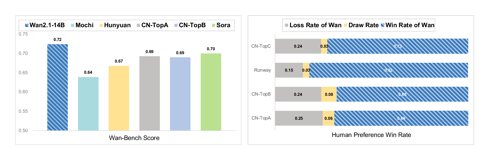
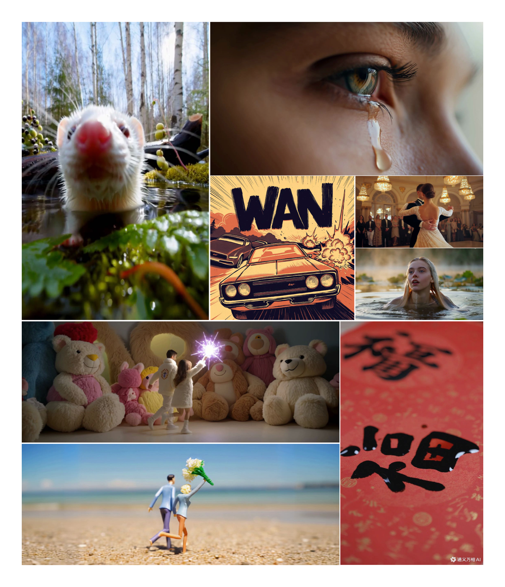
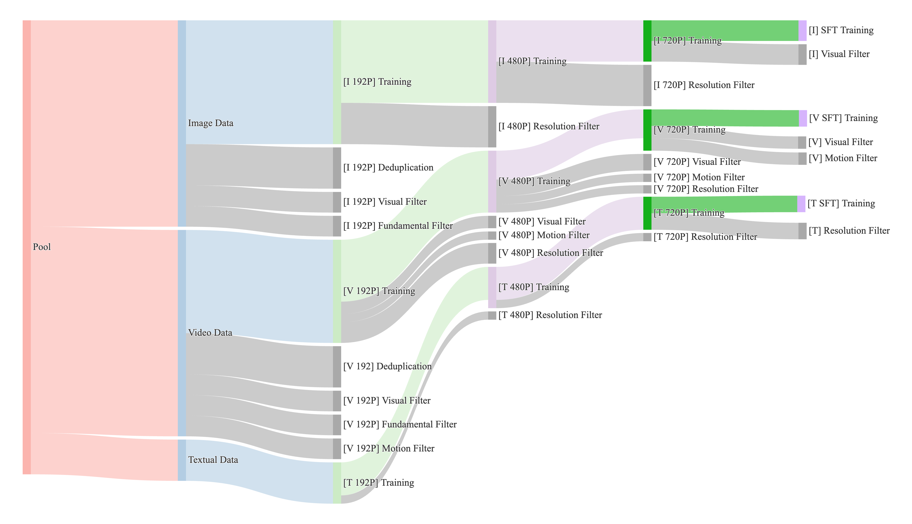
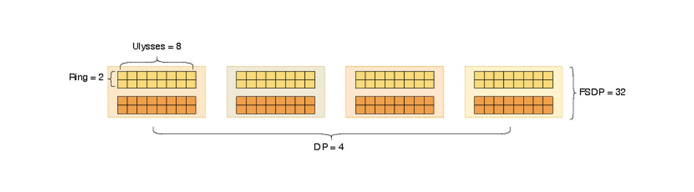
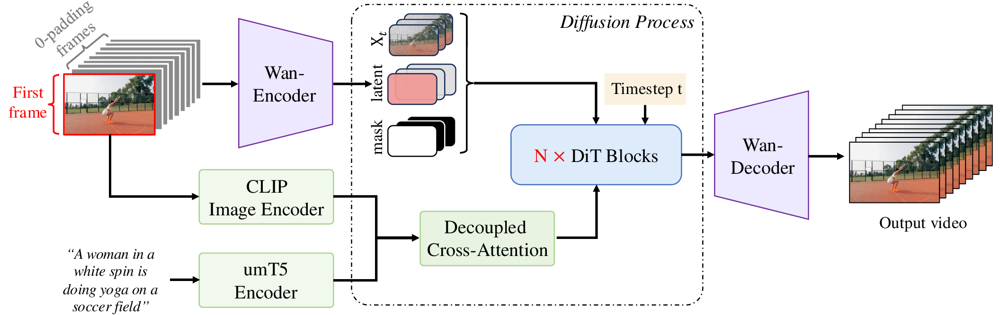
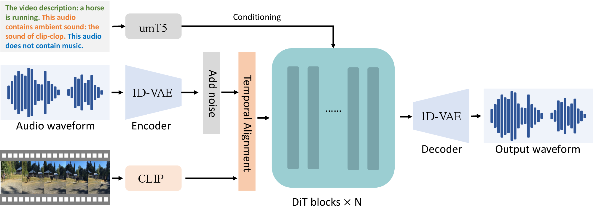
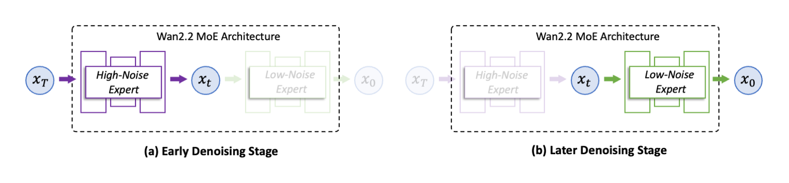
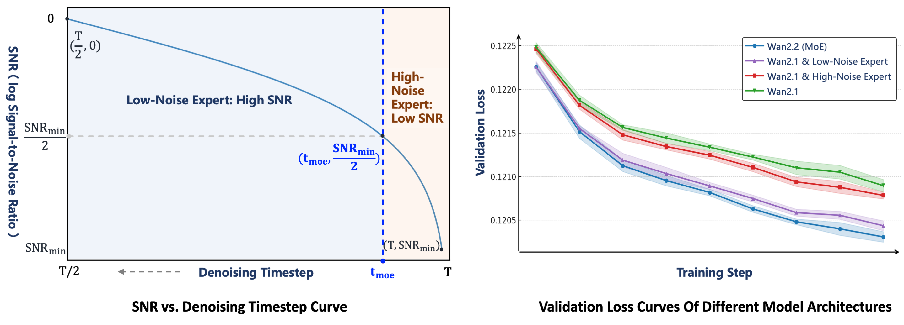
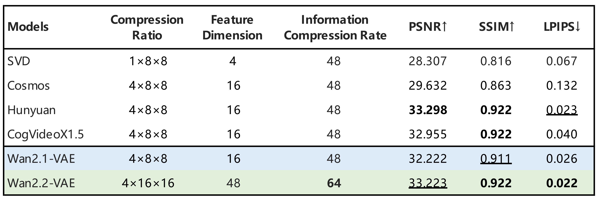
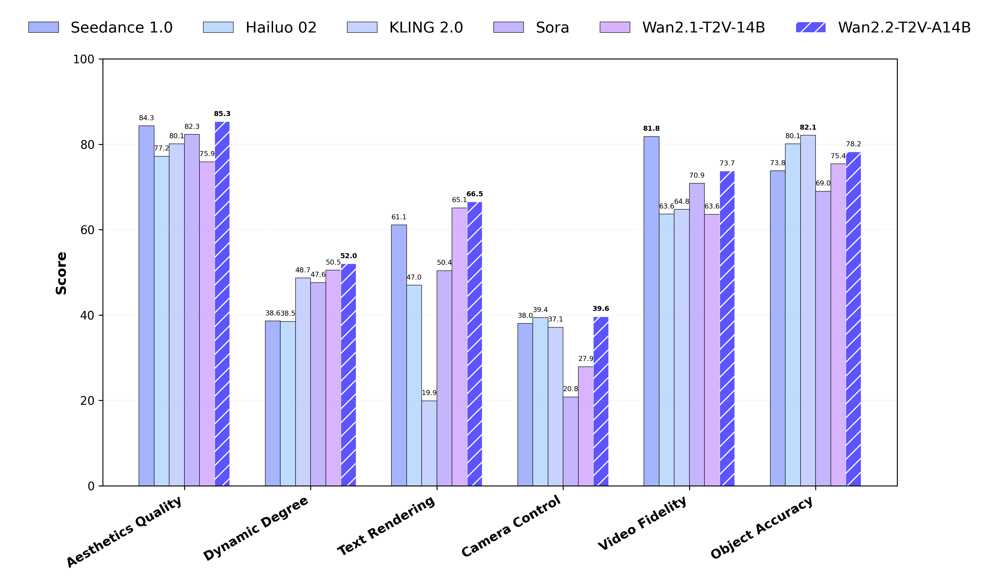

# Wan2.1：开源视频生成系统路线

!!! info "论文信息"
    - 论文：`Wan: Open and Advanced Large-Scale Video Generative Models`
    - 链接：[arXiv:2503.20314](https://arxiv.org/abs/2503.20314)
    - 代码与模型：[Wan-Video/Wan2.1](https://github.com/Wan-Video/Wan2.1)
    - Wan2.2 官方资料：[Wan-Video/Wan2.2 README](https://github.com/Wan-Video/Wan2.2)
    - 关键词：Video DiT、Flow Matching、velocity prediction、3D causal VAE、T2V、I2V、VACE、V2A、Wan-Bench、2D Context Parallelism、Wan2.2 MoE

Wan 这篇技术报告值得精读，不只是因为它把开源视频生成模型的效果往前推了一步，更因为它把**视频基础模型从数据、VAE、DiT、Flow Matching、分布式训练、后训练、评测和推理优化**完整摊开了。很多视频扩散论文只讲一个模块，Wan 更像一份系统设计说明：为什么要先训视频 VAE，为什么 DiT 要用 full spatio-temporal attention，为什么速度预测适合视频 latent，为什么 14B 视频模型必须把 Context Parallel、FSDP、offloading 和 cache 一起考虑。

如果把 Wan2.1 看作开源视频 foundation model 的基线，Wan2.2 则是它后续工程演进的一次明显升级。用户补充说 Wan2.2 没有单独论文，这一点需要在阅读时区分清楚：**本页前半部分以 Wan2.1 论文为主，后半部分把 Wan2.2 官方 README 的介绍作为补充资料**，不把 README 内容说成论文结论。

{ width="920" }

<small>图源：`Wan: Open and Advanced Large-Scale Video Generative Models`，Figure 1。原论文图意：Wan 与开源、闭源视频生成模型在 benchmark 和人工评测下的总体比较。</small>

!!! note "这张图怎么读"
    **输入输出**：输入是视频 VAE、DiT/多模态条件和训练数据配方，输出是开源视频生成系统。  
    **效率机制**：通过 VAE 压缩、模型结构和数据阶段控制视频生成成本。  
    **对主线意义**：它提供视频底座证据，但要再接动作条件和 causal rollout 才靠近世界模型。  
    **不能证明什么**：视频生成样例不能证明 planning utility、物理因果或机器人安全。

{ width="720" .atlas-figure-tall }

<small>图源：`Wan: Open and Advanced Large-Scale Video Generative Models`，Figure 2。原论文图意：Wan 生成样例，覆盖大幅运动、高保真细节、中英文视觉文字、T2V、I2V 和视频编辑能力。</small>

## 论文位置

Wan 的核心问题不是“再做一个 text-to-video 模型”，而是回答开源视频基础模型的三道工程题：

1. **质量**：开源模型如何缩小和闭源商业模型在复杂运动、画质、文字生成和指令跟随上的差距；
2. **能力面**：一个底座能否同时支撑 T2V、I2V、视频编辑、个性化、实时生成和音频生成；
3. **可用性**：14B 模型如何训练和评测，1.3B 模型如何让消费级 GPU 用户也能调用。

这篇论文适合和站内三条线一起读。第一条是 [视频与多模态扩散](../../diffusion/video-and-multimodal-diffusion.md)，它解释视频扩散为什么比图像扩散多了时间一致性和条件融合问题。第二条是 [噪声日程与参数化](../../diffusion/noise-schedules-and-parameterization.md)，因为 Wan 的训练目标本质上是在 latent video space 里预测速度场。第三条是少步蒸馏路线，例如 [CausVid](causvid.md) 和 [Phased DMD](phased-dmd.md)，它们后续都把 Wan 系列当成重要底座来压缩采样步数或改造成流式视频生成器。

| Layer | Wan design | Why it matters |
| --- | --- | --- |
| Data engine | billions of images and videos, dense captioning, motion/quality/text filtering | 让模型同时学到空间语义、运动模式、镜头语言和视觉文字 |
| Video tokenizer | 3D causal Wan-VAE, compression `4 x 8 x 8`, latent channels 16 | 把视频压到 DiT 可训练的 latent 序列，同时尽量保留时序信息 |
| Generator backbone | full spatio-temporal DiT with text cross-attention | 用同一主干建模空间布局、时间运动和文本条件 |
| Objective | Flow Matching / Rectified Flow velocity prediction | 直接学习从噪声 latent 流向视频 latent 的方向，便于 ODE 采样和少步化 |
| Training system | staged image-video curriculum, FSDP, 2D Context Parallelism, activation offloading | 解决长视频高分辨率下的吞吐、显存和稳定性问题 |
| Product interface | T2V, I2V, editing, personalization, real-time, V2A | 证明底座不是单任务 demo，而是多任务视频生成平台 |

## 数据管线：先把视频分布修好

视频生成模型很容易被低质数据拖垮。Wan 的数据管线强调三件事：规模足够大、分布足够多样、质量过滤足够细。论文使用内部版权来源和公开数据构建候选集，规模达到 billions of videos and images，然后用四类过滤和再标注流程逐步收紧。

{ width="920" }

<small>图源：`Wan: Open and Advanced Large-Scale Video Generative Models`，Figure 3。原论文图意：不同训练阶段的数据供给策略会动态调整 motion、quality 和 category 的比例。</small>

!!! note "Figure 3 怎么读"
    这张图不要按“一批数据从左到右过滤一次”来读，它更像一张训练数据调度图。左侧的 `Pool` 是原始候选池，先被拆成 `Image Data`、`Video Data` 和 `Textual Data`；后面的 `[I]`、`[V]`、`[T]` 分别表示 image、video、textual 数据流，`192P / 480P / 720P` 表示不同分辨率训练阶段。灰色带子是过滤或去重，绿色块是进入训练的部分，紫色块多和分辨率筛选相关。

    核心信息是：Wan 不是固定一个数据配比从头训到尾，而是在不同阶段重新决定“给模型看什么”。早期 `192P` 阶段更看重规模和覆盖面，用较低成本让模型先学基本语义、构图和粗时序；到 `480P / 720P` 阶段，数据会经过更强的 visual filter、motion filter 和 resolution filter，训练集中高画质、高分辨率、运动更有意义的视频比例会上升；到 SFT 阶段，数据进一步收窄，更多服务最终观感、复杂动作、文字生成和用户偏好。

    图注里的 `motion / quality / category` 可以这样理解：`motion` 是视频运动分布的重采样，避免模型被静态、抖动或低质量运动视频带偏；`quality` 是画质、清晰度、压缩噪声、审美和分辨率门槛随阶段提高；`category` 是图像、视频、文字数据以及内容类别的比例控制，防止只追求高分样本而丢掉长尾场景、物体、风格和文字能力。换句话说，这张图想表达的不是“过滤越多越好”，而是**每个训练阶段都在重新平衡数据的运动、画质和类别覆盖**。

最底层过滤先处理“明显不该进训练集”的样本：OCR/text coverage 过高、审美分低、NSFW、水印和 logo、黑边、过曝、生成图污染、模糊、时长和分辨率不达标。论文特别提到，少量生成图污染也会明显伤害模型表现，所以训练了 synthetic image detector 来过滤。这一步会去掉约 50% 初始数据。

第二层是视觉质量。团队把数据聚成 100 个 cluster，再从每个 cluster 抽样人工打 1 到 5 分，训练专家质量评分器。这比直接全局排序更稳，因为视频数据有长尾：如果只按平均质量筛，很容易把小众但有价值的运动、场景或风格删掉。

第三层是运动质量。Wan 把视频分成 `Optimal motion`、`Medium-quality motion`、`Static Videos`、`Camera-driven Motion`、`Low-quality Motion`、`Shaky camera footage` 六类。这个划分很关键：静态访谈视频可能画质高，但对大幅运动帮助有限；航拍镜头有强相机运动，但主体运动少；抖动素材会把运动模糊和镜头噪声教给模型。

第四层是视觉文字数据。Wan 一边合成数亿张含中文字符的纯底文字图，一边从真实图片和视频里用 OCR 抽取中英文文字，再用 Qwen2-VL 生成包含精确文字内容的自然描述。这个设计解释了论文为什么强调 Wan 能生成中英文视觉文本：它不是单靠大模型“涌现”，而是数据构造明确把 OCR、caption 和渲染样本接进了训练。

!!! note "Dense caption 为什么重要"
    用户 prompt 往往很短，但训练视频需要知道对象、动作、镜头、风格、颜色、空间关系和文字内容。Wan 训练了内部 caption model，把网页原始短描述扩成 dense captions。这个 caption model 使用 LLaVA-style 架构：ViT 提取图像和视频帧特征，MLP 投到 Qwen LLM；视频输入按 3 FPS 采样，最多 129 帧，并用 slow-fast encoding 降低视觉 token 成本。训练分三阶段：先冻结 ViT/LLM 只训 MLP，对齐视觉和语言空间；再全参训练；最后用小规模高质量数据端到端收口。

## Wan-VAE：视频模型的压缩器不是配角

视频 DiT 的 token 数随时间、分辨率快速膨胀，所以 VAE 决定了后面模型能不能训练。Wan-VAE 是 3D causal VAE，把视频从像素空间压到 latent 空间，时空压缩比例是 `4 x 8 x 8`，latent channel 是 16。输入视频记作 \(V \in \mathbb{R}^{(1+T)\times H\times W\times 3}\)，编码后 latent 形状变成：

\[
x \in \mathbb{R}^{(1+T/4)\times H/8\times W/8\times 16}.
\]

{ width="920" }

<small>图源：`Wan: Open and Advanced Large-Scale Video Generative Models`，Figure 4。原论文图意：Wan-VAE 用 3D causal 结构实现 `4 x 8 x 8` 时空压缩；橙色块表示时空 2x 压缩，绿色块表示空间 2x 压缩。</small>

Wan-VAE 有几个细节值得记住。第一帧只做空间压缩，不做时间压缩，这让模型更自然地兼容图像数据和 I2V 的首帧条件。所有 GroupNorm 被替换成 RMSNorm，用来保持 temporal causality；空间上采样层把输入 feature channel 减半，让推理显存降低约 33%；模型规模控制在 127M 参数。

VAE 的训练也不是一步完成：

| Stage | Training setup | Purpose |
| --- | --- | --- |
| 2D image VAE | train the same-structure 2D VAE on images | 先学稳定空间压缩先验 |
| Inflate to 3D causal VAE | train on low-resolution `128 x 128`, 5-frame videos | 让视频 VAE 快速获得时序建模能力 |
| High-quality video fine-tuning | train on videos with different resolutions and frame numbers, add GAN loss from a 3D discriminator | 修复高分辨率细节、动态场景和真实视频纹理 |

训练损失由 L1 reconstruction、KL 和 LPIPS 组成，权重分别是 `3`、`3e-6` 和 `3`；最后阶段加入 3D discriminator 的 GAN loss。论文的一个实用结论是：Wan-VAE 在相同压缩率和 latent channel 下重建速度比 Hunyuan Video VAE 快 2.5x，这会直接影响后续 DiT 训练吞吐。

!!! note "为什么 causal VAE 要配 feature cache"
    causal convolution 不能看未来帧，所以长视频可以按 chunk 编码/解码。Wan-VAE 把视频切成和 latent 时间步对应的 chunk，每个 chunk 最多处理 4 帧，并缓存上一段 causal convolution 需要的历史 feature。这样既不会破坏时间因果性，又能避免一次性把整段长视频塞进显存。

## Video DiT 与 Flow Matching

Wan 的生成主干由三部分组成：Wan-VAE、diffusion transformer 和 umT5 text encoder。VAE 冻结后，DiT 在视频 latent 上学习去噪/流场。给定 latent \(x\)，patchifying 模块使用 kernel size 为 `(1, 2, 2)` 的 3D convolution，把 latent 展平为序列：

\[
L=(1+T/4)\times H/16\times W/16.
\]

{ width="920" }

<small>图源：`Wan: Open and Advanced Large-Scale Video Generative Models`，Figure 5。原论文图意：Wan 架构由 Wan-VAE、Video DiT 和 umT5 text encoder 组成，DiT 通过 cross-attention 接入文本条件。</small>

Transformer block 内部用 full spatio-temporal self-attention 建模时空关系，再通过 cross-attention 注入文本。时间步 embedding 经过一个共享 MLP 预测六组 modulation 参数；这个 MLP 在所有 blocks 间共享，但每个 block 学不同 bias。论文说这个设计减少约 25% 参数，并在同等规模下带来更好表现。这个点很像在问：参数应该花在每层 adaLN 上，还是花在更深的主干上？Wan 的消融支持后者。

### 速度预测到底在预测什么

Wan 使用 Flow Matching / Rectified Flow 风格目标。训练时先取真实视频或图片 latent \(x_1\)，再取高斯噪声 \(x_0\sim\mathcal{N}(0,I)\)，时间 \(t\in[0,1]\) 从 logit-normal distribution 采样。中间状态是线性插值：

\[
x_t=t x_1+(1-t)x_0.
\]

这条路径上的真实速度是：

\[
v_t=\frac{d x_t}{dt}=x_1-x_0.
\]

模型输出 \(u(x_t,c_{txt},t;\theta)\)，直接回归这条速度：

\[
\mathcal{L}=
\mathbb{E}_{x_0,x_1,c_{txt},t}
\left\|
u(x_t,c_{txt},t;\theta)-v_t
\right\|^2.
\]

这里 \(c_{txt}\) 是长度为 512 token 的 umT5 文本 embedding。

!!! note "Velocity 不是视频里物体的运动速度"
    这里的 velocity 是高维 latent 空间里的生成方向：当前 noisy video latent 应该沿哪个方向流向干净视频 latent。它不是 optical flow，也不是人物或相机在画面中的物理速度。对视频 DiT 来说，这种目标比“只预测噪声”更接近采样器实际要积分的 ODE 方向，因此和少步采样、蒸馏、缓存优化更容易衔接。

!!! note "v-prediction 与 Flow Matching 的区别"
    扩散模型里常说的 \(v\)-prediction 通常是换一个监督坐标：模型仍围绕给定噪声日程学习 denoising target。Flow Matching 更直接：先定义从噪声分布到数据分布的连续路径，再让网络拟合路径上的 vector field。Wan 采用的是后者的训练语言，因此推理可以看成从随机 video latent 出发，沿速度场积分到数据 latent，再由 VAE 解码成视频。

## 预训练与后训练：从图像语义到 720P 视频

Wan 没有从一开始就直接训练 720P 长视频。论文指出直接高分辨率长视频联合训练会遇到两个问题：81 帧、1280x720 这类序列让吞吐严重下降；显存压力又迫使 batch size 太小，导致梯度方差尖峰和训练不稳定。因此 14B 模型先做低分辨率图像预训练，再逐步引入视频。

| Phase | Data and resolution | Main function |
| --- | --- | --- |
| Image pre-training | low-resolution `256 px` text-to-image | 建立文本语义、几何结构和跨模态对齐 |
| Joint stage 1 | `256 px` images + 5-second videos at `192 px`, `16 fps` | 用低成本视频建立基础时空关系 |
| Joint stage 2 | images and videos upgraded to `480 px`, fixed 5-second duration | 提升画质和运动细节 |
| Joint stage 3 | images and 5-second videos upgraded to `720 px` | 对齐高分辨率生成目标 |
| Post-training | curated `480 px` and `720 px` video data | 强化视觉保真、运动动态和用户偏好相关能力 |

预训练配置上，Wan 使用 bf16 mixed precision、AdamW、weight decay `1e-3`、initial learning rate `1e-4`，并根据 FID 和 CLIP Score plateau 动态降低学习率。后训练保持同样模型结构和 optimizer 配置，从预训练 checkpoint 初始化，用高质量后训练视频数据在 480P 和 720P 上联合训练。

!!! note "为什么图像数据还要一直混进视频训练"
    视频数据负责运动和时序，图像数据负责高质量空间语义、构图、文字和细节覆盖。只训视频会受限于视频帧质量、压缩噪声和内容分布；只训图像又不会自然学到运动。Wan 的 staged image-video joint training，本质上是在用图像补空间分布，用视频补时间分布。

## 大规模训练系统：注意力才是主要瓶颈

Wan 的系统章节很有价值，因为它把视频 DiT 和 LLM 的成本差异讲清楚了。训练时只有 DiT 优化，VAE encoder 和 text encoder 冻结。DiT 占总训练计算超过 85%。对 DiT 来说，计算量可近似写成：

\[
L(\alpha b s h^2+\beta b s^2 h),
\]

其中 \(L\) 是层数，\(b\) 是 micro batch size，\(s\) 是 sequence length，\(h\) 是 hidden dimension。视频 \(s\) 很容易到几十万甚至百万，attention 的 \(s^2\) 项会逐渐压过线性层。论文说当 sequence length 到 1M 时，attention 可占端到端训练时间 95%。

显存同样麻烦。DiT activation memory 可写成 \(\gamma Lbsh\)，而视频 DiT 的 \(\gamma\) 往往大于普通 LLM；14B DiT 在 1M tokens、micro batch size 1 的场景下，activation 可超过 8 TB。

这里的 \(\gamma\) 可以理解成**每一层、每个 token、每个 hidden channel 需要额外保存多少份中间激活的常数系数**。\(Lbsh\) 只描述了“层数 × batch × 序列长度 × hidden 维度”这个基本体积，但训练反向传播不能只保存 block 输入，还要保存 attention 的 Q/K/V、attention output、MLP 中间结果、norm / modulation、dropout 或 mask 相关状态，以及为了分布式通信和重排产生的临时 buffer。把这些额外项合在一起，就得到论文里用来粗略估算 activation memory 的 \(\gamma\)。

为什么视频 DiT 的 \(\gamma\) 往往更大？一方面，视频 token 同时包含时间和空间维，sequence length \(s\) 已经很大；另一方面，full spatio-temporal attention、3D patch/reshape、cross-attention 和长序列并行会让训练时需要保留更多中间张量。普通 LLM 的 token 序列通常是一维文本，kernel 和并行实现也更成熟，很多 activation 可以更稳定地重算或融合；视频 DiT 的中间状态更重、更碎，所以即使公式都写成 \(Lbsh\) 量级，前面的 \(\gamma\) 也会把显存需求放大很多。

{ width="720" }

<small>图源：`Wan: Open and Advanced Large-Scale Video Generative Models`，Figure 8。原论文图意：128 GPUs 下，内层用 Ulysses=8 与 Ring=2 组成 2D Context Parallelism，外层用 FSDP=32 和 DP=4。</small>

Wan 的并行策略是：

| Module | Parallelism | Reason |
| --- | --- | --- |
| VAE | DP | 显存占用小，直接数据并行即可 |
| Text encoder | DP + weight sharding | text encoder 超过 20GB，需要权重切分 |
| DiT parameters | FSDP | 参数、梯度和 optimizer states 无法单卡容纳 |
| DiT activations | 2D Context Parallelism | 沿 sequence/context 维切分，降低长序列 attention 显存 |

2D Context Parallelism 把 Ring Attention 放在外层，Ulysses 放在内层。Ulysses 对跨机通信敏感，Ring Attention 对 block size 有要求，把两者组合起来可以更好地隐藏通信。论文给出的例子是 256K sequence、16 GPUs、2 machines：2D CP 把通信开销从 Ulysses 的 10% 以上降到 1% 以下。

!!! note "activation offloading 为什么优先于 checkpointing"
    长视频场景里 attention 计算很重，计算时间足够覆盖一部分 PCIe activation offload 时间。Wan 因此优先使用 activation offloading，把部分 activation 挪到 CPU 内存并和计算重叠；当 CPU 内存也吃紧时，再结合 gradient checkpointing，优先 checkpoint 那些 GPU memory / compute ratio 高的层。

## 推理优化：50 步视频采样怎么降延迟

Wan 的默认推理仍然是多步采样，论文说通常约 50 sampling steps。对 14B 模型，如果没有额外优化，单张高端 GPU 上推理可到约 30 分钟量级，所以推理优化不是锦上添花，而是能否使用的前提。

推理侧主要有三类优化：

| Technique | Wan implementation | Reported effect |
| --- | --- | --- |
| FSDP + 2D CP | training-side parallelism reused for inference | 14B DiT 多 GPU 近似线性加速 |
| Diffusion cache | reuse attention outputs across steps; reuse conditional output for CFG later stages with residual compensation | 14B T2V inference speedup `1.62x` |
| FP8 GEMM | per-tensor weight quantization, per-token activation quantization for GEMM in DiT block | BF16 GEMM 约 2x 算力，DiT speedup `1.13x` |
| 8-bit FlashAttention | Int8 for `S=QK^T`, FP8 for `O=PV`, FP32 cross-block accumulation | 95% MFU on NVIDIA H20, inference speedup `>1.27x` |

这里的 cache 不是简单“偷懒少算”。论文观察到两个相似性：同一 DiT block 的 attention output 在相邻采样步之间相似；CFG 后期 conditional 与 unconditional 输出也相似。因此可以选择部分 step 真正跑 attention 或 unconditional branch，其余 step 复用并做 residual compensation。视频模型每步都很贵，这类跨步复用的收益会比图像模型更明显。

## 评测：Wan-Bench 不只看 FVD/FID

Wan 认为 FVD/FID 和人类感知不够对齐，于是提出 Wan-Bench。它分成 dynamic quality、image quality、instruction following 三大维度，共 14 个细粒度指标。简单任务用传统 detector，复杂任务用 MLLM；最终分数用超过 5,000 组 pairwise human comparisons 学出来的偏好权重加权。

| Wan-Bench Dimension | CNTopB | Hunyuan | Mochi | CNTopA | Sora | Wan 1.3B | Wan 14B |
| --- | ---: | ---: | ---: | ---: | ---: | ---: | ---: |
| Large Motion Generation | 0.405 | 0.413 | 0.420 | 0.284 | **0.482** | 0.468 | 0.415 |
| Human Artifacts | 0.712 | 0.734 | 0.622 | **0.833** | 0.786 | 0.707 | 0.691 |
| Pixel-level Stability | 0.977 | **0.983** | 0.981 | 0.974 | 0.952 | 0.976 | 0.972 |
| ID Consistency | 0.940 | 0.935 | 0.930 | 0.936 | 0.925 | 0.938 | **0.946** |
| Physical Plausibility | 0.836 | 0.898 | 0.728 | 0.759 | 0.933 | 0.912 | **0.939** |
| Smoothness | 0.765 | 0.890 | 0.530 | 0.880 | **0.930** | 0.790 | 0.910 |
| Comprehensive Image Quality | 0.621 | 0.605 | 0.530 | **0.668** | 0.665 | 0.596 | 0.640 |
| Scene Generation Quality | 0.369 | 0.373 | 0.368 | 0.386 | **0.388** | 0.385 | 0.386 |
| Stylization Ability | **0.623** | 0.386 | 0.403 | 0.346 | 0.606 | 0.430 | 0.328 |
| Single Object Accuracy | **0.987** | 0.912 | 0.949 | 0.942 | 0.932 | 0.930 | 0.952 |
| Multiple Object Accuracy | 0.840 | 0.850 | 0.693 | 0.880 | **0.882** | 0.859 | 0.860 |
| Spatial Position Accuracy | 0.518 | 0.464 | 0.512 | 0.434 | 0.458 | 0.476 | **0.590** |
| Camera Control | 0.465 | 0.406 | **0.605** | 0.529 | 0.380 | 0.483 | 0.527 |
| Action Instruction Following | **0.917** | 0.735 | 0.907 | 0.783 | 0.721 | 0.844 | 0.860 |
| **Weighted Score** | 0.690 | 0.673 | 0.639 | 0.693 | 0.700 | 0.689 | **0.724** |

<small>表源：`Wan: Open and Advanced Large-Scale Video Generative Models`，Table 1。原论文表格标题：`Performance comparison of commercial and open-source models using Wan-Bench.`</small>

VBench 上，Wan 14B 也给出了比较强的公开结果：

| Model Name | Quality Score | Semantic Score | Total Score |
| --- | ---: | ---: | ---: |
| MiniMax-Video-01 | 84.85% | 77.65% | 83.41% |
| Hunyuan (Open-Source Version) | 85.09% | 75.82% | 83.24% |
| Gen-3 (2024-07) | 84.11% | 75.17% | 82.32% |
| CogVideoX1.5-5B (5s SAT prompt-optimized) | 82.78% | 79.76% | 82.17% |
| Kling (2024-07 high-performance mode) | 83.39% | 75.68% | 81.85% |
| Sora | 85.51% | 79.35% | 84.28% |
| Wan 1.3B | 84.92% | 80.10% | 83.96% |
| Wan 14B (2025-02-24) | **86.67%** | **84.44%** | **86.22%** |

<small>表源：`Wan: Open and Advanced Large-Scale Video Generative Models`，Table 3。原论文表格标题：`Model performance scores on Vbench.`</small>

## 多任务扩展：底座能力如何接到产品接口

### Image-to-Video

I2V 把首帧作为条件，让文本不再独自决定整个视频。Wan 的做法是把条件图像拼成首帧加零帧序列，送入 Wan-VAE 得到 condition latent；再用 binary mask 标记哪些帧要保留、哪些帧要生成。noise latent、condition latent 和 mask 沿 channel 维拼接后送进 DiT。由于输入 channel 从 \(c\) 变成 \(2c+s\)，I2V DiT 前面加了一个 zero-init projection layer，避免一开始破坏 T2V 预训练能力。

{ width="920" }

<small>图源：`Wan: Open and Advanced Large-Scale Video Generative Models`，Figure 15。原论文图意：Wan-I2V 用 mask mechanism 统一支持 image-to-video、video continuation、first-last frame transformation 等任务。</small>

训练上，I2V 先用和 T2V 相同的数据做联合预训练，让模型学会在 mask 框架下判断哪些位置保留、哪些位置生成；SFT 阶段再加入 CLIP image encoder 和 decoupled cross-attention。数据过滤也服务于任务特性：I2V 用 SigLIP 过滤首帧与后续视频差异过大的样本，video continuation 过滤前 1.5 秒与后 3.5 秒不一致的样本，first-last frame transformation 则提高首尾变化显著样本比例。

### Unified Video Editing

Wan 的视频编辑来自 VACE 思路，把 text prompt、context frames 和 masks 组合进 Video Condition Unit。关键是 concept decoupling：用 mask 把要修改的 reactive frames 和要保留的 inactive frames 分开，分别编码进 latent，再和 noisy video tokens 对齐。训练有两种模式：一种是 fully fine-tuning 整个 Wan，另一种是 Context Adapter Tuning，把 context tokens 经由 adapter 接回原 DiT block，减少对底座权重的改动。

{ width="920" }

<small>图源：`Wan: Open and Advanced Large-Scale Video Generative Models`，Figure 17。原论文图意：统一可控生成与编辑框架，用 Concept Decoupling、Context Latent Encode 和 Context Embedder 处理 frames 与 masks。</small>

### Video-to-Audio

V2A 模块说明 Wan 不只把视频扩散当作视觉生成器。它用 DiT + Flow Matching 在音频 latent 里生成 ambient sound 和 background music，明确排除 speech/vocal。音频压缩器不是 mel-spectrogram 图像 VAE，而是直接处理 raw waveform 的 1D-VAE，输出 \(T^a\times C^a\) latent，以保留时间对齐。训练数据来自视频集过滤，移除无声、语音和人声音乐视频，规模是 \(\mathcal{O}(1)\) thousand hours；音频 caption 用 Qwen2-audio 生成，并分成 dense video description、ambient sound、background music 三部分。

{ width="920" }

<small>图源：`Wan: Open and Advanced Large-Scale Video Generative Models`，Figure 23。原论文图意：V2A 模型同时处理视频 chunk 和文本描述，合成语义一致且时间对齐的音频。</small>

## Wan2.2 README 补充：没有单独论文，但有官方路线说明

Wan2.2 官方 GitHub README 仍然把论文链接指向 Wan2.1 的 arXiv 报告。因此更准确的说法是：**Wan2.2 目前主要由官方 README、模型权重、Diffusers/ComfyUI 集成和若干分支技术报告构成，不应把它当成一篇独立论文来读**。不过 README 的介绍非常值得放进 Wan 专题，因为它展示了 Wan 系列从 2.1 到 2.2 的工程演进。

README 开头列出四个升级点：

| Innovation | Official README explanation | Reading note |
| --- | --- | --- |
| Effective MoE Architecture | introduces MoE into video diffusion models and separates denoising across timesteps | 按扩散时间分专家，而不是 LLM 式 token router |
| Cinematic-level Aesthetics | curated aesthetic data with labels for lighting, composition, contrast and color tone | 后训练数据更贴近影视风格控制 |
| Complex Motion Generation | `+65.6%` more images and `+83.2%` more videos than Wan2.1 | 数据扩展主要服务 motion、semantics、aesthetics 泛化 |
| Efficient High-Definition Hybrid TI2V | 5B model with Wan2.2-VAE, `16 x 16 x 4` compression, 720P@24fps, can run on 4090 | 用更高压缩和统一 T2V/I2V 接口换部署可达性 |

<small>表源：`Wan-Video/Wan2.2` 官方 README。表格根据 README 开头 `With Wan2.2, we have focused on incorporating the following innovations` 部分重绘，保留英文字段。</small>

### Wan2.2 A14B：按噪声阶段分工的 MoE

Wan2.2 最核心的新信息是 A14B 系列的两专家 MoE。README 说每个 expert 约 14B 参数，总参数约 27B，但每一步只激活约 14B，因此推理计算和显存接近原 14B dense 模型。分工方式沿 denoising timestep / SNR 发生：高噪声早期用 high-noise expert，负责整体 layout；低噪声后期用 low-noise expert，负责视频细节。

{ width="920" }

<small>图源：`Wan-Video/Wan2.2` 官方 README，`assets/moe_arch.png`。原 README 图意：Wan2.2 把两个专家按 denoising 阶段接入视频扩散模型，每一步只激活对应专家。</small>

{ width="920" }

<small>图源：`Wan-Video/Wan2.2` 官方 README，`assets/moe_2.png`。原 README 图意：专家切换点由 SNR 决定，高噪声阶段激活 high-noise expert，低噪声阶段切换到 low-noise expert，并通过 validation loss 比较 MoE 组合效果。</small>

!!! note "高噪声专家为什么负责 layout"
    扩散/Flow 采样一开始离数据分布很远，latent 里还没有稳定对象、镜头和运动结构。这一段的错误会影响整段视频，比如主体位置、场景布局、运动方向和镜头路线。后期低噪声阶段结构已经基本成形，模型更多是在修边缘、纹理、局部闪烁和细节。因此 Wan2.2 按 SNR 切专家，比随机路由或 token-level router 更符合视频生成的时间结构。

### Wan2.2 TI2V-5B：高压缩换 720P 可部署

Wan2.2 的另一个重点是 TI2V-5B。README 介绍它使用 high-compression Wan2.2-VAE，\(T\times H\times W\) 压缩率为 `4 x 16 x 16`，总压缩率为 64；再经过额外 patchification layer 后，总压缩比达到 `4 x 32 x 32`。它原生支持 text-to-video 和 image-to-video，在 720P@24fps 下可运行于消费级显卡如 RTX 4090。README 的运行示例也说明：TI2V-5B 单卡命令推荐配合 `--offload_model True`、`--convert_model_dtype` 和 `--t5_cpu`，最低显存说明为 24GB；A14B T2V/I2V/S2V 单卡示例则标注至少 80GB VRAM。

{ width="920" }

<small>图源：`Wan-Video/Wan2.2` 官方 README，`assets/vae.png`。原 README 图意：Wan2.2-VAE 采用更高空间压缩，服务 TI2V-5B 的 720P 高效生成。</small>

| Models | Download Links | Description |
| --- | --- | --- |
| T2V-A14B | Huggingface / ModelScope | Text-to-Video MoE model, supports 480P & 720P |
| I2V-A14B | Huggingface / ModelScope | Image-to-Video MoE model, supports 480P & 720P |
| TI2V-5B | Huggingface / ModelScope | High-compression VAE, T2V+I2V, supports 720P |
| S2V-14B | Huggingface / ModelScope | Speech-to-Video model, supports 480P & 720P |
| Animate-14B | Huggingface / ModelScope | Character animation and replacement |

<small>表源：`Wan-Video/Wan2.2` 官方 README，`Model Download` 表格。这里重绘表格并保留原英文表头和 Description。</small>

{ width="920" }

<small>图源：`Wan-Video/Wan2.2` 官方 README，`assets/performance.png`。原 README 图意：Wan2.2 在 Wan-Bench 2.0 上与主流闭源商业模型对比。</small>

把 Wan2.1 和 Wan2.2 放在一起看，演进逻辑很清楚：Wan2.1 先证明开放视频 DiT 底座可行，公开了训练和系统方案；Wan2.2 再围绕**更大容量但不显著增加每步成本**和**更高压缩下的 720P 部署**继续推进。MoE 是模型容量方向，TI2V-5B 是部署方向。

## 消融与工程结论

Wan 的消融支持几个可复用判断：

| Question | Wan evidence | Engineering takeaway |
| --- | --- | --- |
| AdaLN 参数是否越多越好 | Full-shared-AdaLN-1.5B 比 Half-shared-AdaLN-1.5B 更低训练 loss；Non-shared-AdaLN-1.7B 也不占优 | DiT 容量更值得放在 depth 和主干表达上，而不是盲目堆每层调制参数 |
| 文本编码器是否必须用 decoder-only LLM | umT5 在收敛和构图上优于 Qwen2.5-7B-Instruct、GLM-4-9B 等方案 | 视频扩散更需要双向文本表征和稳定 cross-attention embedding |
| VAE 能否用 diffusion loss 替代重建目标 | VAE-D 在 T2I FID 上不如常规 VAE | 视频生成底座仍需要强重建、低失真、稳定 latent 空间 |
| 小模型是否有意义 | 1.3B 只需 8.19GB VRAM，VBench 总分 83.96% | 开源生态需要一个可普及的调试和创作模型，不只需要最强 14B |

这些结论都指向同一个系统观：视频生成的质量不是某一个模块单独决定的。数据分布、VAE 压缩、Flow path、DiT 深度、文本编码器、并行策略、推理 cache 和评测权重相互牵制。Wan 报告的价值就在于它把这些接口都讲了出来。

## 局限

论文也明确给出三类限制。第一，大幅运动中的细粒度细节仍然难保，复杂动作越强，局部纹理和身份一致性越容易受损。第二，14B 模型推理成本仍高；没有额外优化时单卡推理可能接近 30 分钟，因此少步蒸馏、cache、量化和多 GPU 并行仍是必要方向。第三，通用视频底座不自动具备领域专业性，在教育、医疗等专业场景还需要领域数据和安全评测。

对后续研究来说，Wan 提供的是一个开放底座和系统配方，而不是终点。后续的 Wan2.2 MoE、[Phased DMD](phased-dmd.md) 少步蒸馏、[Self Forcing](../world-models/self-forcing.md) 因果 rollout、[LingBot-World](../world-models/lingbot-world.md) 交互世界模拟，都可以看成在这个底座上分别补容量、速度、因果性和动作条件。

## 读完可以带走什么

Wan 最值得复用的不是某个单点 trick，而是完整训练路线：

1. 先把视频 VAE 训练成可扩展、可缓存、时序稳定的 tokenizer；
2. 用图像预训练建立文本语义和空间结构，再逐步加入高分辨率视频；
3. 在视频 latent 上用 Flow Matching 直接学习速度场；
4. 用 full spatio-temporal DiT 承接文本、运动和镜头关系；
5. 用 2D Context Parallelism、FSDP、offloading 解决长序列训练；
6. 用 diffusion cache、FP8 GEMM 和 8-bit attention 解决推理延迟；
7. 用 human-aligned benchmark 把动态质量、画质和指令跟随拆开评估。

如果要把 Wan 当作工程参考，最重要的问题不是“模型有多大”，而是：你的数据过滤、VAE、训练阶段、条件接口和推理预算是否和目标应用一致。视频生成系统的失败往往不是公式错，而是这些接口没有对齐。
