# Wan2.1：开源视频生成系统路线

!!! info "论文信息"
    **论文题名：** Wan: Open and Advanced Large-Scale Video Generative Models。 
    **作者：** Team Wan、Ang Wang、Baole Ai、Bin Wen、Chaojie Mao、Chen-Wei Xie、Di Chen、Feiwu Yu、Haiming Zhao、Jianxiao Yang 等（共 62 人）。 
    **机构：** 未在公开元数据中稳定解析；以 arXiv/PDF 或官方页 affiliation block 为准。 
    **时间 / 主题：** 2025-03；扩散模型。 
    **arXiv / 官方报告：** arXiv：[2503.20314](https://arxiv.org/abs/2503.20314)；官方材料：[huggingface.co/Wan-AI](https://huggingface.co/Wan-AI)。 
    **GitHub / 项目：** GitHub：[github.com/Wan-Video/Wan2.2](https://github.com/Wan-Video/Wan2.2)；项目页：[huggingface.co/Wan-AI](https://huggingface.co/Wan-AI)。 
    **元数据来源与核验口径：** 来源：[arXiv](https://arxiv.org/abs/2503.20314)；[GitHub API / repo](https://github.com/Wan-Video/Wan2.2)；[官方 / 项目材料](https://huggingface.co/Wan-AI)；Checked Date：2026-06-04；Repro Status：Paper / official materials reviewed, independent reproduction not claimed。

## 原论文故事线

读 Wan2.1 时，先看一条具体的工程链路：视频先被筛选和描述，随后压成时空 latent，DiT 在 latent 上反复预测速度，最后由 VAE 解码回视频。每一步都在解决一个不同的约束。数据可能静止、模糊或把字幕当成内容；压缩以后序列仍然很长，全时空注意力会迅速增加显存；同一个底座还要接收首帧、参考身份、编辑掩码和镜头轨迹等条件。报告的重点不只是 14B 这个数字，而是怎样把这些约束拆开处理。[↗](https://arxiv.org/pdf/2503.20314v2#page=3)

这条信息流也限定了后文的阅读范围。图生视频和编辑主要改动条件的组织方式，流式生成改动时间窗口与去噪调度，视频配音还需要带音频表示的另一套生成器。共同底座减少了重复建模，报告里的演示却不等于基础权重天然具备全部能力；每个扩展仍有自己的数据、训练和评估。

最显眼的结果是 T2V 比较。Figure 1 左侧给出作者自建 Wan-Bench 得分，右侧给出作者人工比较中的胜、平、负比例。两部分分别回答“自动评测总体得分如何”和“配对样例中人更偏好谁”，并不共用一个分母。右侧 Wan 对 CN-TopA 的三项比例约为 0.69、0.06、0.25，对 Runway 为 0.82、0.03、0.15；这些绝对比例也有助于理解后文人工表格中含混的 win-rate gap 口径。

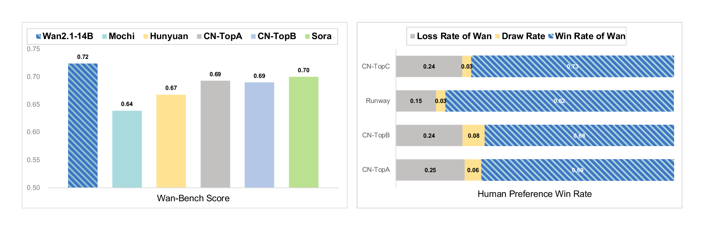{ width="920" }

*图源：[Wan technical report](https://arxiv.org/abs/2503.20314)，Figure 1，原报告第 1 页。Wan-Bench 与人工偏好是两套证据；人工比较保留 draw，胜率差不能直接当成获胜比例。*

Figure 2 展示了模型希望覆盖的内容跨度，包括真实与风格化画面、人物、动物、空间运动和文字。它的作用是说明任务范围。单帧截图能显示外观和构图，连续样例才涉及运动变化，而整张展示图仍不足以给出复杂动作的成功率。后文需要用分维度结果补上这层判断。

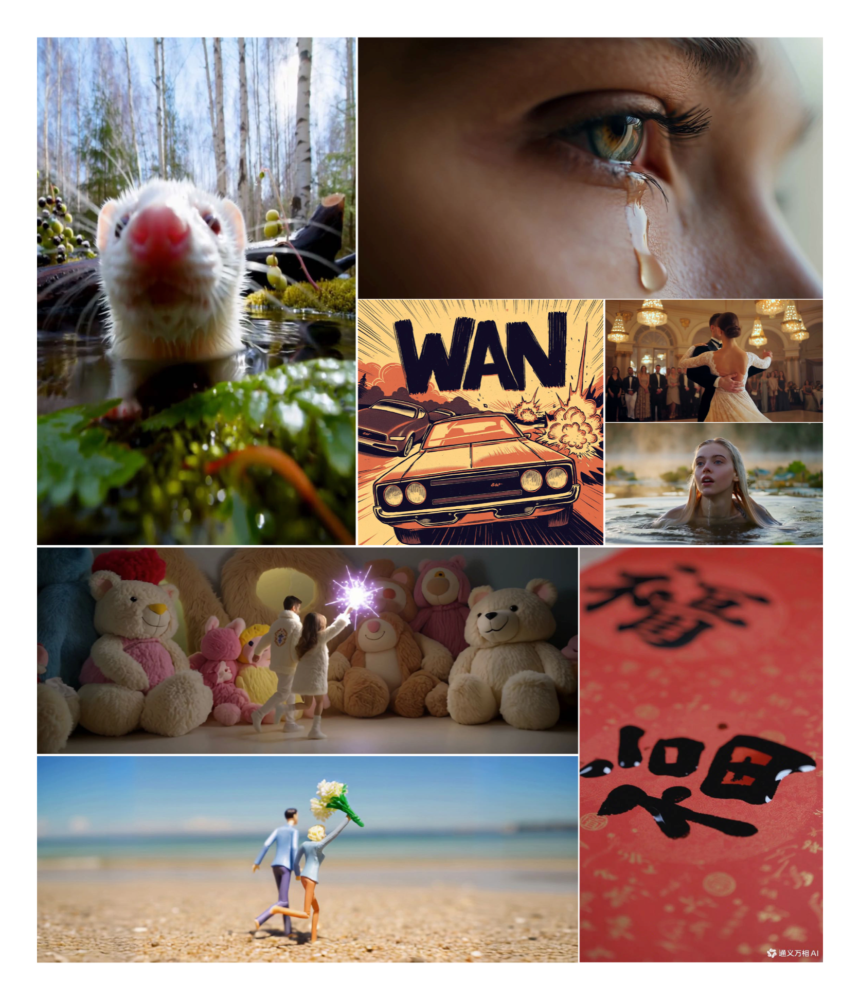{ width="720" .atlas-figure-tall }

*图源：[Wan technical report](https://arxiv.org/abs/2503.20314)，Figure 2，原报告第 4 页。展示范围比单一视频基准更广，不能由精选样例推导每一类都同样可靠。*

## 数据工程先决定模型能学到什么

### 基础过滤、专家评分与运动分层分别处理什么

视频数据的缺陷有几种不同来源。模糊、黑边和过曝损害视觉监督；字幕、水印和后期加工会改变画面分布；一段几乎没有主体运动的视频，即使画质很好，也很难教会模型生成动作。Wan 因此把数据处理分成逐级收缩的流程，而没有用一个美学分数承担所有筛选任务。初始来源包括内部版权数据和公开数据，去重之后做基础过滤，作者报告这一阶段移除了约一半数据。[↗](https://arxiv.org/pdf/2503.20314v2#page=6)

Figure 3 可以沿数据从预训练走向后训练的路径阅读。最早的筛选保证样本能用，中间的语义与质量评价提高平均质量，最后的小规模高质量集合决定模型细节与运动表现的调整方向。三个阶段筛选的属性不同，不能简化成不断提高同一个阈值。

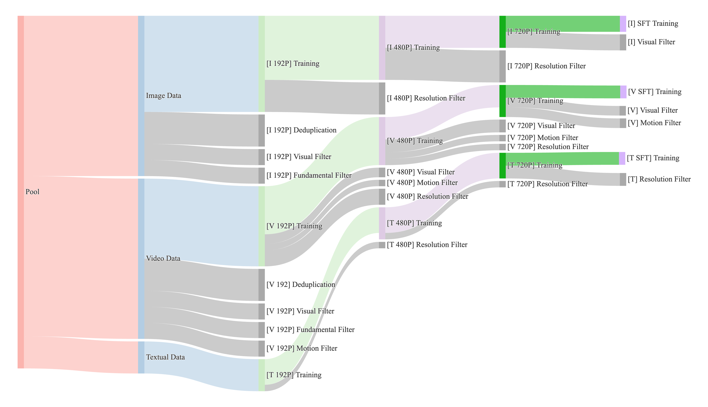{ width="920" }

*图源：[Wan technical report](https://arxiv.org/abs/2503.20314)，Figure 3，原报告第 7 页。数据供给被分成基础过滤、质量与运动筛选、高质量后训练集合等阶段。*

基础过滤包含 OCR 覆盖率、LAION aesthetic score、NSFW 检测、水印与黑边裁剪、过曝、模糊、生成图像过滤、视频时长和分辨率要求。视频时长筛选包含大于 4 秒的要求，分辨率门槛则跟随后续训练阶段。这里有两点需要放在各自语境理解。第一，报告认为少量生成图像混入也可能损害训练，甚至提到低于 10% 的比例；这是作者的数据经验，文中没有给出足以建立通用阈值的完整污染比例消融。第二，OCR 过滤用于控制普通训练素材中过量字幕等问题，而模型学习文字绘制另有专门的数据支路，不能概括成“所有有文字的画面都删除”。

通用美学模型也会把不同内容类型混在一起。Wan 将数据聚成 100 个类别，用人工 1–5 分评分训练专家模型，按类别判断质量。这个设计的目的，是避免统一评分偏爱某些常见、精致的画面，而把内容稀少但有学习价值的长尾类别全部筛掉。过滤的目标同时包含质量和覆盖范围，最高平均分并非唯一目标。[↗](https://arxiv.org/pdf/2503.20314v2#page=6)

运动数据又使用独立的六类划分。Optimal 和 Medium 提供主要的有效动作；Static 降低采样权重；Camera-only 的运动主要来自镜头，而主体没有充分运动，采样权重进一步降低；Low-quality 与 Shaky 被移除。这样区分的原因是，像素发生变化不等于主体完成动作。若只按光流幅度选片，快速摇镜、抖动和真正的肢体运动很容易混在一起。相应地，偏好动态数据也不能无条件等同于“越剧烈越好”，失真运动仍应被剔除。

后训练阶段进一步提高门槛。图像采用两条收集途径：一条按专家评分选取前 20%，同时兼顾风格与类别；另一条由人工从不同类别和来源收集高质量图像，补足缺失概念。两者合成百万级高质量集合。视频则分别组织百万级简单运动、复杂运动素材，并覆盖 12 类内容。简单运动数据有利于稳定外观和基本动态，复杂运动数据承担更难的动作与交互学习；二者分开组织，让后训练不必只依赖一个总分来决定配比。报告没有公开完整的数据清单和全部阶段的采样比例，因此可以复用这套分层思路，却不能仅凭描述恢复原训练分布。

### 画面文字为什么需要独立支路

中英文文字生成要求模型同时学习字形、排布和文字与背景的关系。Wan 收集真实中英文 OCR 数据，并构建数亿张白底中文合成图；多种 OCR 识别结果用于提高文本标注的可靠性，再由 Qwen2-VL 生成描述。白底合成图提供可控字形监督，真实图像提供文字嵌入招牌、海报和场景的分布。二者承担的作用不同，单纯把白底文字样本扩大很多倍，不能自动覆盖复杂背景中的布局与遮挡。[↗](https://arxiv.org/pdf/2503.20314v2#page=7)

这也说明数据规则必须跟随任务。一般视频训练需要抑制大量后期字幕形成的捷径，文字绘制训练却必须主动保留并标注文字。把二者合成一句“过滤 OCR”会丢失真正的工程逻辑。模型最终在文字方面表现较好，既与多语言文本编码有关，也与这些专用视觉监督有关，报告没有将两者的贡献完全拆开。

## Caption 与 prompt alignment 构成文字条件的两端

### 描述模型如何同时看细节和长时间变化

caption 决定视频中的哪一部分变化被明确对应到文本。只有“一个人在室外”这样的粗描述，无法监督转身、奔跑、镜头推进或文字出现的区别。Wan 的描述数据覆盖细粒度类别、空间关系、短描述扩写、两图编辑指令、图像组描述以及人工稠密标注。这些任务让描述模型不只识别主体，还要组织可用于生成的关系与变化。[↗](https://arxiv.org/pdf/2503.20314v2#page=8)

结构采用 ViT → 两层 MLP → Qwen LLM。图像使用动态高分辨率切块，最多 7 个 patch，每块视觉表示池化为 $12\times12$ 网格，以控制送入语言模型的 token 数。视频按 3 FPS 采样，上限为 129 帧；每隔 4 帧保留较完整的空间表示，其他帧做全局平均池化。这个 slow-fast 设计保留两种信息，一部分帧负责物体、场景和细节，其余帧以更便宜的表示跟踪时间变化。若每一帧都保留全分辨率 token，长视频描述的序列成本会很高；若所有帧都只留一个全局向量，又容易丢掉空间细节。[↗](https://arxiv.org/pdf/2503.20314v2#page=9)

报告给出一个与这种取舍直接相关的结果，VideoMME 的无字幕设置由 67.6% 提高到 69.1%。它支持该视频编码策略改善长视频理解，但不是下游视频生成质量提高同等百分点的证据。caption 模型与生成器之间还隔着描述采样、数据混合和扩散训练，不能把中间任务指标直接移植到生成结果上。

描述模型分三阶段训练。第一阶段冻结 ViT 与 LLM，仅训练 MLP，把视觉输出接入语言模型空间，学习率为 $10^{-3}$；第二阶段解冻全部参数；第三阶段在小规模高质量数据上端到端调整。后两个阶段的 LLM 与 MLP 学习率为 $10^{-5}$，ViT 为 $10^{-6}$。较低的视觉学习率减少视觉表征在语言适配时被大幅改变，最后阶段的人工高质量描述则为输出风格提供更直接的约束。[↗](https://arxiv.org/pdf/2503.20314v2#page=10)

### 描述评估说明了哪些强项，也暴露了什么

CAPability 评估将描述拆成 10 个维度，每个维度使用 1,000 个视频，报告 F1。Figure 4 应按同一维度的两根柱子比较，而不是把所有柱子的高度混成一个“整体超越”。最明显的差异在 Camera Angle，Wan caption 为 87.5，Gemini 1.5 Pro 为 52.6；Style 为 72.1 对 59.5，Color 为 63.1 对 52.6。它们都与后续视频生成所需的可控条件直接相关。

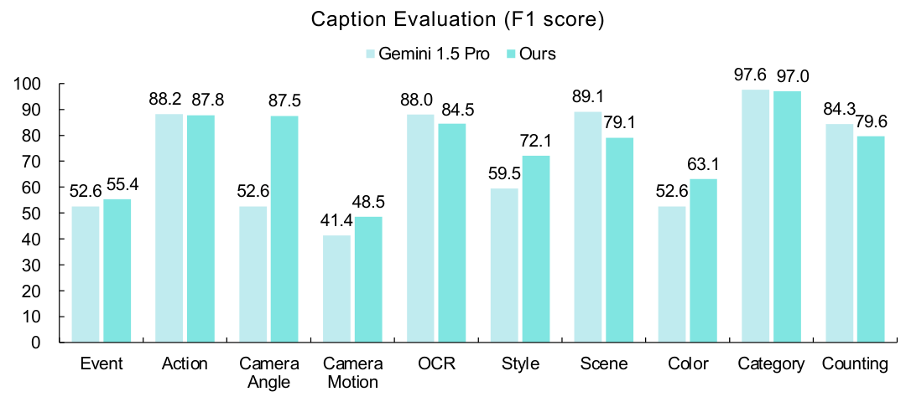{ width="920" }

*图源：[Wan technical report](https://arxiv.org/abs/2503.20314)，Figure 4，原报告第 9 页。指标是 caption F1；Wan 在部分生成相关维度更强，但 Scene、OCR、Counting 等维度仍有落后。*

| Dimension | Gemini 1.5 Pro | Ours |
| --- | ---: | ---: |
| Event | 52.6 | 55.4 |
| Action | 88.2 | 87.8 |
| Camera Angle | 52.6 | 87.5 |
| Camera Motion | 41.4 | 48.5 |
| OCR | 88.0 | 84.5 |
| Style | 59.5 | 72.1 |
| Scene | 89.1 | 79.1 |
| Color | 52.6 | 63.1 |
| Category | 97.6 | 97.0 |
| Counting | 84.3 | 79.6 |

这组结果支持“定制描述器可以改善目标属性的标注”，同时保留了一个实际提醒。生成模型使用更长、更详细的 caption，并不意味着监督自动更准确。如果描述器把数量、场景或 OCR 认错，更丰富的文字反而可能把错误说得更具体。这里的分维度测量，比单独展示若干长 caption 更能说明数据供给端的能力边界。

### 训练描述与用户短提示之间如何对齐

训练时，Wan 为同一图像或视频配多种长度和风格的描述，包括长、中、短描述，以及正式、非正式、诗意等表达。这样，同一视觉内容不只对应一种稠密长文本，模型更有机会学到用户简短指令与完整场景之间的映射。推理时再使用 Qwen2.5-Plus 改写提示，使输入更接近训练描述分布。[↗](https://arxiv.org/pdf/2503.20314v2#page=19)

Table 1 的例子显示，改写会增加人物服装、光照、镜头角度和背景等细节。它可以减少欠指定提示带来的不确定性，但也实质改变了送给生成器的条件。比如“镜头跟随海上追逐海豚的摩托艇”被扩写后，增加了驾驶者装备、天空、光照和景别。因而“保留原意”应被理解为改写目标，不是无须验证的性质。比较模型时，是否启用扩写、扩写器是否相同、增加了哪些限定，都可能影响指令匹配与画面质量的结果。

## Wan-VAE 将视频压缩问题与流式计算问题一起处理

### 时间上的第一帧为什么单独保留

Wan-VAE 接收形状为 $(1+T)\times H\times W\times3$ 的视频，输出形状为 $(1+T/4)\times(H/8)\times(W/8)\times16$ 的潜表示。首帧只做空间压缩，其余帧按时间四倍压缩；通常把输入长度组织为 $1+4k$。首帧特殊处理让单张图像也能使用同一编码体系，并使图像训练与视频训练更容易接在一起。空间、时间压缩率和 latent 通道数必须同时保留，只报“压缩 256 倍”会忽略通道变化，无法正确估算存储和后续投影成本。[↗](https://arxiv.org/pdf/2503.20314v2#page=10)

Figure 5 展示了因果编码器与解码器。沿时间轴追踪下采样，比只数残差块更重要，因为时间压缩决定某个 latent 对应哪些视频帧，因果卷积则决定当前块是否需要未来帧。后续图生视频、首末帧条件与分块推理都建立在这套表示上。

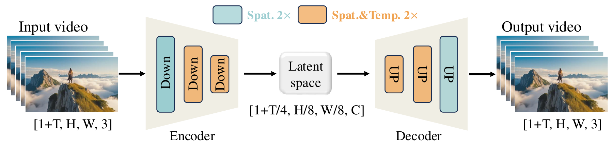{ width="920" }

*图源：[Wan technical report](https://arxiv.org/abs/2503.20314)，Figure 5，原报告第 10 页。时间压缩为 4 倍、空间每轴为 8 倍，首帧走仅空间压缩的边界处理。*

架构中将 GroupNorm 替换为 RMSNorm，以维持时间因果性。如果归一化统计跨越整段时间，单看卷积的因果核仍不足以保证当前输出不依赖未来；分块计算也可能因块长变化而改变归一化结果。报告还将空间上采样层的特征通道减半，给出推理显存下降 33% 的结果。配合基础通道数调整，VAE 总参数量为 127M。这些改动针对的是编码解码的实际成本，不能直接写成整个视频生成器显存下降 33%。

### 三阶段训练分别建立空间先验、时间表示和细节

VAE 先训练同结构的 2D 图像自编码器，然后将其扩展成 3D 视频 VAE。这个顺序让模型先学会空间重建，再在视频上学习时间压缩。初始视频阶段使用 $128\times128$、5 帧的短片段，缩小每次更新的成本。损失包含 L1 重建、KL 与 LPIPS，权重依次为 3、$3\times10^{-6}$、3。L1 约束像素重建，LPIPS 提供感知特征约束，KL 约束潜分布；很小的 KL 系数也说明它不是将全部训练压力放在严格匹配简单先验上。[↗](https://arxiv.org/pdf/2503.20314v2#page=11)

最后在多分辨率、多帧数的高质量视频上微调，加入来自 3D 判别器的 GAN loss。这个阶段面向纹理与时序细节，而初始低分辨率训练先保证可用的压缩映射。VAE 重建损失与后续 DiT 的 flow matching 损失是两个训练问题，前者学习视频表示，后者学习这些表示的生成分布；混成一个联合目标会误读整个系统的优化过程。

### Feature cache 如何使分块结果保持时间连续

VAE 要支持长视频，不能把所有帧同时留在显存里。Wan 将视频分成对应单个 latent 时间位置的小块，首块对应首帧，后续块最多对应 4 帧。每次只计算当前块，并缓存必要的历史特征。缓存位于因果卷积内部，保存的是该层需要的特征，不是把已经输出的 RGB 帧简单贴回输入。

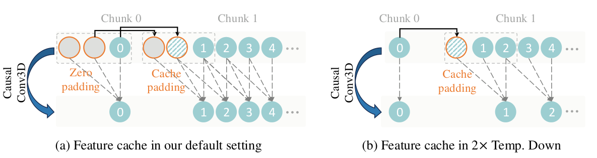{ width="920" }

*图源：[Wan technical report](https://arxiv.org/abs/2503.20314)，Figure 6，原报告第 11 页。左图是时间核为 3 的普通因果卷积，右图是时间步幅为 2 的下采样；二者的缓存边界不同。*

默认情况下，卷积时间核为 3，当前处理块需要前面两个时间位置。初始块没有历史，用两个零位置填充；后续块复用前一块末尾的两个特征，并丢弃更早的数据。时间下采样步幅为 2 时，非初始块使用单帧缓存，以保证输出长度和下采样节奏正确。如果所有层都不加区分地缓存两帧，跨块时的长度对应可能发生偏移。这是 Figure 6 两个面板分别存在的原因。[↗](https://arxiv.org/pdf/2503.20314v2#page=12)

因果计算与缓存让视频编码、解码的工作集保持有限，并使相邻块具有连续的卷积上下文。因此，VAE 可以处理没有预先固定总长度的流。但它只解决表示层的流式计算；DiT 是否拥有足够的时间上下文、人物是否能在几分钟后保持身份，是生成模型与调度层的问题。后文 Streamer 还要做额外训练和窗口设计，不能从 VAE 的“任意长”直接跳到生成系统的“任意长一致”。

### 重建质量与速度的比较需要同时看压缩条件

Figure 7 在 200 个视频上比较重建，统一为 25 帧、$720\times720$，横轴是单位延迟处理的帧数，纵轴是 PSNR，圆面积表示参数量。Wan-VAE 的点在右上方，127M 的规模明显小于若干比较对象，同时保持有竞争力的 PSNR。作者在相同硬件下报告其重建速度为 Hunyuan Video VAE 的 2.5 倍。

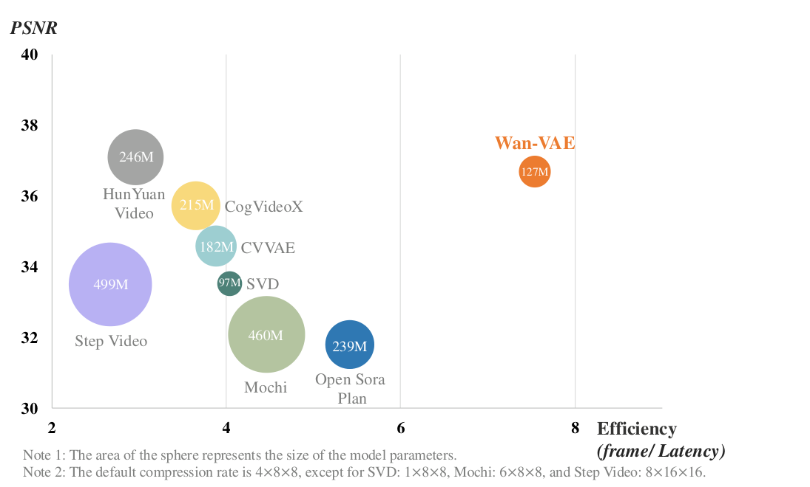{ width="920" }

*图源：[Wan technical report](https://arxiv.org/abs/2503.20314)，Figure 7，原报告第 12 页。Wan 的主要优势是质量与处理速度的组合；图中 Hunyuan 的 PSNR 仍略高，不能写成 Wan 在每一轴都第一。*

多数方法使用 $4\times8\times8$ 压缩与 16 个 latent 通道，但有例外。Open-Sora Plan 同样的几何压缩对应 4 个通道；SVD 是 $1\times8\times8$、4 通道；Mochi 是 $6\times8\times8$、12 通道；Step Video 是 $8\times16\times16$、64 通道。它们编码的信息预算不同，所以散点图展示的是若干成品 VAE 的系统取舍，不能当成只改变网络结构、其余完全一致的消融。2.5 倍也只属于这里的 VAE 重建过程，不等于完整 T2V 推理快 2.5 倍。

## DiT 主干如何接收视频、文字与去噪时间

### 全时空 token 与跨模态条件

视频进入 DiT 前先做 kernel size 为 $(1,2,2)$ 的 3D patch convolution，在 latent 空间继续将空间每轴减半，不再压缩时间。展平后得到 $(B,L,D)$ 的序列，$B$ 是 batch size，$D$ 是隐藏维度，序列长度为

$$
L=\left(1+\frac{T}{4}\right)\frac{H}{16}\frac{W}{16}.
$$

这个式子直接连接输出尺寸与注意力成本。例如，用 81 帧、$720\times1280$ 作一个尺寸计算例，VAE 输出为 $21\times90\times160\times16$，patchify 后是 $21\times45\times80=75{,}600$ 个视频 token。这里的 75,600 是由结构算出的示例，不是报告另一个 benchmark 的实际配置。即使已经经过两级空间缩减，视频 token 仍远多于普通文本输入，后面的并行系统正是为这个量级服务。[↗](https://arxiv.org/pdf/2503.20314v2#page=14)

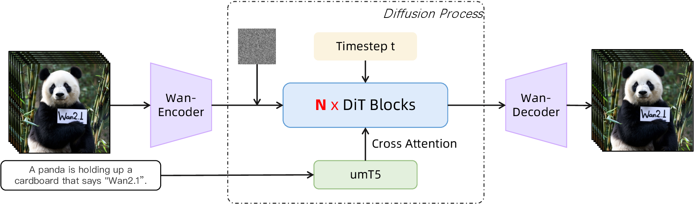{ width="920" }

*图源：[Wan technical report](https://arxiv.org/abs/2503.20314)，Figure 9，原报告第 13 页。先区分视频 VAE 与文本编码器两条路径，再看它们如何进入潜空间 DiT；生成结束后才用 VAE 解码。*

Transformer block 使用全时空 self-attention，让不同帧、不同空间位置直接交换信息；文本通过 cross-attention 注入。文本编码器选用 umT5，文本序列长度为 512。把文本编码与视频编码分开，使语言条件可以作用于全部视频位置；这不意味着模型已显式拥有对象轨迹或三维场景变量，它仍在学习一个受文字条件约束的视频 token 生成映射。

时间嵌入经过 Linear 与 SiLU 组成的 MLP，预测六组调制参数。这个 MLP 在全部 block 之间共享，各 block 再学习自己的 bias。共享部分减少重复的时间调制参数，局部 bias 保留层间差别。报告称相应设计能减少约 25% 参数，并在相近参数规模下改善表现；它的比较范围是该 DiT 的调制设计，不是包括 VAE、文本编码器和全部应用分支的系统总参数。后面的 adaLN 消融进一步检验，节省下来的参数投到网络深度是否更合适。

### Flow matching 的监督信号与采样方向

设 $x_1$ 为干净的视频或图像 latent，$x_0\sim\mathcal N(0,I)$ 为噪声，$t\in[0,1]$ 为时间。Wan 使用线性路径

$$
x_t=t x_1+(1-t)x_0,
\qquad
v_t=\frac{dx_t}{dt}=x_1-x_0.
$$

模型接收 $x_t$、$t$ 和文本条件，预测速度场 $v_\theta$，用均方误差拟合 $x_1-x_0$。因此一次训练样本不需要先跑完一条去噪轨迹，只需采样干净 latent、噪声和时间，然后合成对应的中间状态。时间从 logit-normal 分布采样，让训练在不同噪声水平上分配更新。[↗](https://arxiv.org/pdf/2503.20314v2#page=15)

按这里的符号，$t=0$ 是噪声，$t=1$ 是数据；推理时从噪声出发，多次调用网络近似积分速度场，最终得到待解码的 latent。训练时直接构造中间样本，与推理时需要多步数值求解是两件事。报告中的常规推理约为 50 个采样步，后面的缓存与量化在这些重复调用上节省成本。不能把“训练无须先模拟整条路径”改写为“生成不需要迭代”，也不应仅凭这个 MSE 形式就宣称获得了精确的最大似然训练。

## 图像到视频、低分辨率到高分辨率的训练课程

直接从最长、最高分辨率视频开始训练，每个样本都昂贵，模型还尚未建立基本的外观与文字对应。Wan 14B 先用 256px 图像预热，然后逐步加入视频、提升分辨率。报告中的主要课程如下；“5 秒、16 FPS”描述的是这里的视频数据设置，不能据此把全部下游实验和测速默认成相同配置。[↗](https://arxiv.org/pdf/2503.20314v2#page=15)

| Stage | Image setting | Video setting | Training purpose |
| --- | --- | --- | --- |
| Image pre-training | 256px | — | 建立空间内容与文本对应 |
| Joint training 1 | 256px | 192px, 5 s, 16 FPS | 接入时间维度，控制初期序列成本 |
| Joint training 2 | 480px | 480px, 5 s | 增加空间细节 |
| Joint training 3 | 720px | 720px, 5 s | 学习更高分辨率视频分布 |
| Post-training | — | High-quality videos at 480px / 720px | 调整细节、动态与成片质量 |

训练只更新 DiT，VAE 和文本编码器冻结。优化器为 AdamW，weight decay 为 $10^{-3}$，起始学习率为 $10^{-4}$，使用 BF16；当 FID 与 CLIP 等指标趋于平台时降低学习率。冻结表示模块可以避免生成器训练期间目标 latent 空间持续漂移，也方便复用预先建立的压缩与语言表示。它同时意味着 VAE 本身丢失的细节，不能指望 DiT 的训练自动修改编码器来补回。

报告给出图像与视频合计数十亿级、总量约 $O(1)$ 万亿 tokens 的粗粒度规模，但没有完整的训练步数、每阶段图像视频配比、精确数据量和总 GPU-hour。[↗](https://arxiv.org/pdf/2503.20314v2#page=3) 阶段顺序与已公开的训练设置能够帮助理解为什么采用课程学习，无法严格估算重训完整模型的总成本。这里最可复用的经验是把空间先验、时间建模和高分辨率细节分阶段建立，再用高质量集合调整输出分布；每个阶段的预算仍需由自己的数据和硬件验证。

## 长序列训练为什么需要按模块切换并行策略

### 真正的瓶颈随序列长度变化

报告测得 DiT 占训练总计算量的 85% 以上，其成本可以概括为

$$
N_{\mathrm{layer}}\left(\alpha b s h^2+\beta b s^2 h\right).
$$

这里 $b$ 为 micro-batch size，$s$ 为序列长度，$h$ 为隐藏维度，$N_{\mathrm{layer}}$ 为层数；第一项对应线性层，第二项对应注意力。原文在本节用 $L$ 表示层数，为避免与前文 token 长度混淆，这里换成 $N_{\mathrm{layer}}$。对 Wan 的非因果注意力，报告给出的 $\beta$ 前向为 4、反向为 8。这个式子最重要的用途是解释规模变化，序列加长时注意力按 $s^2$ 增长，不能把为短文本模型选择的并行策略直接照搬过来。[↗](https://arxiv.org/pdf/2503.20314v2#page=15)

在 1M token 的特定长序列情形，注意力可占端到端训练时间的 95%，14B 模型、micro-batch 为 1 时的激活存储可超过 8 TB。这些数字描述极长序列压力，不能当成任意 5 秒视频的固定显存需求。它们说明的是，参数分片只能解决一部分问题；即使权重放得下，激活和注意力计算仍必须沿序列维度分摊。

VAE、文本编码器与 DiT 的压力又不同。优化后的 VAE 显存较小，可以用 Data Parallelism；文本编码器需要超过 20 GB 显存，使用 DP 加 FSDP 分片权重；DiT 需要同时分片参数、梯度、优化器状态和长序列激活。用同一策略覆盖三个模块，容易在便宜模块上做重复工作，在昂贵模块上又没有充分拆开序列。

### FSDP 与二维 Context Parallelism 如何重叠

DiT 的参数分片采用 FSDP。激活沿序列维度分片，使用外层 Ring Attention、内层 Ulysses 的二维 Context Parallelism。内层处理一组较快互联设备之间的交换，外层通过环形组织跨组数据；组合的目标是缓解单独 Ulysses 的跨机器通信压力，同时让 Ring 的分块计算足够大，以便与通信重叠。在 256K 序列、两台机器共 16 GPU 的测试中，报告将通信占比从单用 Ulysses 的超过 10% 降至不足 1%。这是指定拓扑与序列下的结果，不是所有集群的常数。[↗](https://arxiv.org/pdf/2503.20314v2#page=16)

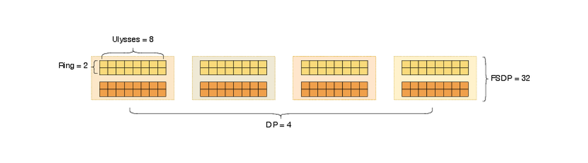{ width="820" }

*图源：[Wan technical report](https://arxiv.org/abs/2503.20314)，Figure 11，原报告第 16 页。CP、FSDP 与 DP 的分组存在重叠，不能把图中的全部数字直接相乘。*

图中共有 128 GPU。CP 大小为 $8\times2=16$，FSDP 大小为 32，因而一个 FSDP 组内可以容纳两份独立 micro-batch；最外层 DP 为 4，得到全局 batch $8b$。若误把 FSDP=32、CP=16、DP=4 看成相互独立维度，就会得到错误的设备数。这里的解释也展示了设计顺序，先满足单样本长序列的显存与延迟要求，再把剩余设备用于增加独立数据吞吐。

编码模块与 DiT 之间还有一次布局转换。CP 组内的设备在执行 DiT 时需要共同处理同一份样本，但如果 VAE 和文本编码阶段也让全部设备读取同样的数据，就会重复编码。Wan 先让组内设备各自编码不同数据，再依次广播这些已编码结果，轮流进入 DiT 的 CP 计算。于是编码开销可摊到多份后续计算中，报告将其时间占比描述为原来的 $1/\mathrm{CP}$。这属于工作调度与摊销，不是让单个 VAE 算子获得 CP 倍加速。[↗](https://arxiv.org/pdf/2503.20314v2#page=17)

### 为什么优先考虑 activation offloading

长序列下计算按平方增长，激活存储主要按线性增长，因此搬运一层激活的 PCIe 时间可能被后续几层很长的计算覆盖。报告给出的范围是，一层激活 offload 的搬运可与 1–3 个 DiT 层的计算重叠。与直接丢弃激活、反向时重算相比，能够充分隐藏传输时，offloading 可以减少显存而不付出同等的重计算成本。

CPU 内存也不是无限的，所以实现仍将 offloading 与 gradient checkpointing 结合，对显存占用相对计算成本高的层优先重计算。它是一组受显存、主存、PCIe 带宽和层执行时间共同决定的选择。报告还描述了坏节点检测、隔离与自动恢复等集群机制，但没有给出可比较的故障率或有效训练时间提升，因此不能由这些机制介绍推出具体可靠性倍数。

## 推理优化要区分减少调用与加速单次调用

### 多卡并行与缓存解决不同部分的延迟

常规生成需要约 50 次采样更新。多卡 Context Parallelism 将同一视频的长序列计算摊开，FSDP 分摊大模型权重。Figure 12 的横轴是 GPU 数，纵轴是相对加速；实际曲线接近理想线，但随着设备增加仍存在差距。这组结果回答多卡能否有效减少单视频延迟，不能据此推导单卡消费级设备的绝对生成秒数。

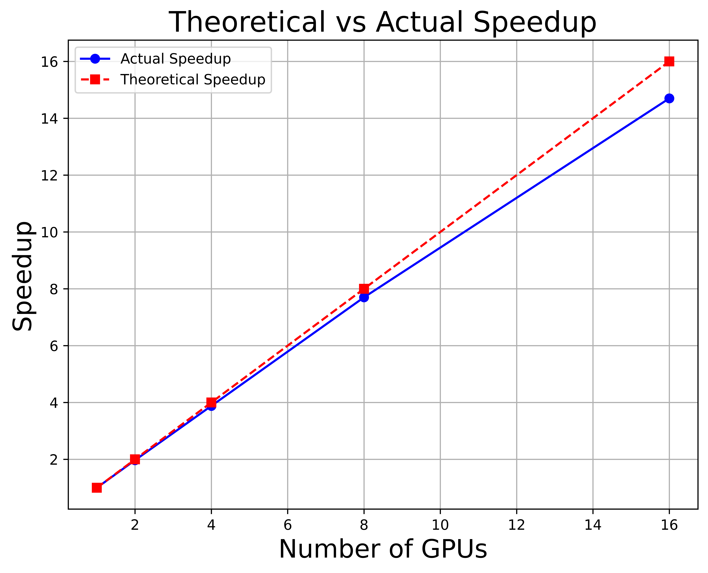{ width="820" }

*图源：[Wan technical report](https://arxiv.org/abs/2503.20314)，Figure 12，原报告第 17 页。Wan 14B 的 2D CP 加 FSDP 在展示范围内接近线性扩展，图中是相对速度而非固定输出设置的通用耗时表。*

缓存则减少重复工作。报告观察到，同一 DiT block 在相邻采样步的 attention 输出具有相似性，于是只在选定步重新计算 attention，其他步复用缓存。另一个相似性出现在采样后期的 conditional 与 unconditional 输出之间，用于 CFG 的无条件分支不必在每一步完整执行，可以结合条件结果和残差补偿近似恢复。前者复用 block 内结果，后者减少 guidance 分支工作，不能混为单一的 KV cache。[↗](https://arxiv.org/pdf/2503.20314v2#page=18)

在 Wan 14B T2V 上，作者报告 diffusion cache 带来 1.62 倍推理加速，缓存步选择依赖验证集。它说明冗余计算可以被减少，但“相似”不是“相等”；缓存刷新频率与残差补偿是质量预算的一部分。若迁移到更剧烈动作、不同采样器或新的条件任务，不能直接假设同样日程无损。

### FP8 GEMM 快两倍，为何 DiT 只快 1.13 倍

DiT block 的 GEMM 使用 FP8，权重按 tensor 量化，激活按 token 量化。作者报告 FP8 GEMM 相对 BF16 GEMM 达到两倍性能，但整个 DiT 模块只有 1.13 倍加速。两个数字并不矛盾，GEMM 只占全部运行的一部分，attention、归一化、数据搬运和其他操作仍需执行。把算子吞吐提升写成整模型速度提升，会系统性高估部署收益。

attention 的低精度处理更谨慎。原生 FA3 的 FP8 版本在作者实验中造成明显的视频质量下降，因此采用混合方案，$QK^\top$ 使用 INT8，$PV$ 使用 FP8，跨 block 的累加使用 FP32。长序列会扩大累加误差，报告指出原生 FP8 WGMMA 的低精度累加路径存在问题；保留块内低精度吞吐、将跨块结果放到 FP32 寄存器累加，正是为控制这种数值风险。实现还将累加与重缩放融合，并调整 block size，避免寄存器压力抵消低精度收益。[↗](https://arxiv.org/pdf/2503.20314v2#page=19)

作者报告优化后的 8-bit FlashAttention 在 NVIDIA H20 上达到 95% MFU，并给出超过 1.27 倍的推理效率提升。95% 是该 attention kernel 的利用率口径，不能写成整个生成系统始终达到硬件峰值的 95%。1.62、1.13 与 1.27 也不应直接相乘，缓存会改变各算子的时间占比，量化和并行优化之间可能互相影响，报告没有提供足以确认这几个独立数字可连乘的完整联合测速表。

## Wan-Bench 评测的对象、代理指标与人工权重

### 十四个维度如何对应视频失败

单一 FID 或 FVD 很难区分视频到底失败在外观、动作、身份还是指令。Wan-Bench 将评估分成 Dynamic Quality、Image Quality 与 Instruction Following 三组、共 14 个细维度。它的价值在于把错误拆开，而不是让一个总分替代所有观察。[↗](https://arxiv.org/pdf/2503.20314v2#page=20)

运动相关维度使用不同的测量工具。Large Motion Generation 用 RAFT 光流幅度判断大运动；Pixel-level Stability 用光流找静态区域，再计算这些区域的逐帧差异；ID Consistency 比较逐帧 DINO 特征；Human Artifacts 使用在 20,000 张人工标注生成图像上训练的 YOLOv3 类检测器，结合伪影位置、置信度与持续时间。Physical Plausibility 和 Smoothness 则由 Qwen2-VL 根据视频问答判断。这些指标各自对应可见错误，但也带入检测器的能力与偏差，尤其“物理合理性”是视觉语言模型的判断，未执行物理模拟或测量真实三维动力学。

图像质量综合 MANIQA、LAION aesthetic predictor 与 MUSIQ；场景质量结合帧间 CLIP 一致性和文本图像匹配；风格化由 Qwen2-VL 评估。指令遵循包括单物体、多物体、空间关系、镜头与动作。镜头部分有 130 个提示，覆盖平移、升降、缩放、航拍和跟随；较简单运动由光流识别，复杂镜头交给视觉语言模型。动作评估进一步询问动作是否匹配、是否完成、是否存在伪影。这个设计比只判断“画面里有没有某个名词”更贴近视频任务，但仍是多个代理判断的组合。[↗](https://arxiv.org/pdf/2503.20314v2#page=21)

最终分数没有简单平均。作者收集超过 5,000 组视频配对偏好，用自动分数与人工评分的 Pearson 相关性推导维度权重。主比较为每个候选模型生成 1,035 个样例；另有超过 700 个任务、超过 20 位评审参与人工评价。权重因此体现该提示集与偏好标注中的重要性。它能够改善指标与人类偏好的对应，但改变用户群、提示分布或任务需求后，原权重未必仍是最佳选择。

### 总分提升在哪些单项上成立

下面保留 Table 2 的全部维度，便于看到总体领先与单项短板同时存在。所有数值按原表记录，Weighted Score 是作者的加权结果。[↗](https://arxiv.org/pdf/2503.20314v2#page=22)

| Wan-Bench Dimension | CNTopB | Hunyuan | Mochi | CNTopA | Sora | Wan 1.3B | Wan 14B |
| --- | ---: | ---: | ---: | ---: | ---: | ---: | ---: |
| Large Motion Generation | 0.405 | 0.413 | 0.420 | 0.284 | 0.482 | 0.468 | 0.415 |
| Human Artifacts | 0.712 | 0.734 | 0.622 | 0.833 | 0.786 | 0.707 | 0.691 |
| Pixel-level Stability | 0.977 | 0.983 | 0.981 | 0.974 | 0.952 | 0.976 | 0.972 |
| ID Consistency | 0.940 | 0.935 | 0.930 | 0.936 | 0.925 | 0.938 | 0.946 |
| Physical Plausibility | 0.836 | 0.898 | 0.728 | 0.759 | 0.933 | 0.912 | 0.939 |
| Smoothness | 0.765 | 0.890 | 0.530 | 0.880 | 0.930 | 0.790 | 0.910 |
| Comprehensive Image Quality | 0.621 | 0.605 | 0.530 | 0.668 | 0.665 | 0.596 | 0.640 |
| Scene Generation Quality | 0.369 | 0.373 | 0.368 | 0.386 | 0.388 | 0.385 | 0.386 |
| Stylization Ability | 0.623 | 0.386 | 0.403 | 0.346 | 0.606 | 0.430 | 0.328 |
| Single Object Accuracy | 0.987 | 0.912 | 0.949 | 0.942 | 0.932 | 0.930 | 0.952 |
| Multiple Object Accuracy | 0.840 | 0.850 | 0.693 | 0.880 | 0.882 | 0.859 | 0.860 |
| Spatial Position Accuracy | 0.518 | 0.464 | 0.512 | 0.434 | 0.458 | 0.476 | 0.590 |
| Camera Control | 0.465 | 0.406 | 0.605 | 0.529 | 0.380 | 0.483 | 0.527 |
| Action Instruction Following | 0.917 | 0.735 | 0.907 | 0.783 | 0.721 | 0.844 | 0.860 |
| Weighted Score | 0.690 | 0.673 | 0.639 | 0.693 | 0.700 | 0.689 | 0.724 |

Wan 14B 的加权分数 0.724 高于表中其他模型，ID Consistency、Physical Plausibility 与 Spatial Position Accuracy 也较强。但它的大运动得分 0.415 低于 Wan 1.3B 的 0.468 与 Sora 的 0.482；Stylization Ability 为 0.328，低于 1.3B 的 0.430 和 Sora 的 0.606；Human Artifacts 也没有占优。这里不能得出“更大模型在所有视频能力上更好”。更准确的判断是，14B 在这套权重下的综合结果更强，部分空间与一致性能力改善，同时仍保留运动、风格和伪影方面的具体弱项。

不同维度还可能出现张力。一个视频主体变化较少，可能更容易保持身份与局部稳定，却未必完成大幅动作；仅提高总体质量也可能掩盖某种动态不足。Table 2 没有单独证明这种因果关系，但它说明为什么选型时应先确定目标任务，再读相应行，而不是只按最后一行排序。

### 人工比较表的 gap 不能直接读成绝对胜率

Table 3 标题为 “Win rate gap of T2V”，脚注却将单元格描述为获胜比例。两种口径不一致。其 Overall Ranking 的 44.0%、44.0%、48.9%、67.6%，与 Figure 1 中相应胜率减负率的百分数接近，例如 CN-TopA 约为 $69\%-25\%=44\%$。因此下表沿用原名 gap，不把 44.0% 写成“Wan 只赢了 44% 的样本”。精确绝对胜、平、负比例应看 Figure 1，而非自行根据含混脚注重算。[↗](https://arxiv.org/pdf/2503.20314v2#page=24)

| Dimension / Win rate gap | CN-TopA | CN-TopB | CN-TopC | Runway | All Rounds |
| --- | ---: | ---: | ---: | ---: | ---: |
| Visual Quality | 30.6% | 15.9% | 27.8% | 48.1% | 5710 |
| Motion Quality | 16.1% | 9.7% | 14.9% | 40.3% | 5785 |
| Matching | 46.0% | 57.9% | 56.7% | 69.1% | 5578 |
| Overall Ranking | 44.0% | 44.0% | 48.9% | 67.6% | 5560 |

这里 All Rounds 是该维度的比较轮次数，不能拿来当每个模型都各自拥有的独立任务数。四个维度均给出正 gap，支持作者在这套配对评价上的总体偏好优势；商业模型使用匿名 CN-Top 名称，具体版本、完整数据与评审细节的公开程度又限制了外部完全复现这些差距。

公开 VBench 则使用另一套评价，Table 4 给出的结果如下。保留原表版本说明很重要，尤其不能把 2025 年的比较写成后续版本持续有效的排名。

| Model Name | Quality Score | Semantic Score | Total Score |
| --- | ---: | ---: | ---: |
| MiniMax-Video-01 | 84.85% | 77.65% | 83.41% |
| Hunyuan (Open-Source Version) | 85.09% | 75.82% | 83.24% |
| Gen-3 (2024-07) | 84.11% | 75.17% | 82.32% |
| CogVideoX1.5-5B (5s SAT prompt-optimized) | 82.78% | 79.76% | 82.17% |
| Kling (2024-07 high-performance mode) | 83.39% | 75.68% | 81.85% |
| Sora | 85.51% | 79.35% | 84.28% |
| Wan 1.3B | 84.92% | 80.10% | 83.96% |
| Wan 14B (2025-02-24) | 86.67% | 84.44% | 86.22% |

14B 在原表的 Quality、Semantic 和 Total 三列均最高，1.3B 也在较小模型规模下取得 83.96% 总分。这组结果提供了作者自建 Wan-Bench 之外的支持，但两套总分的定义、提示与权重不同，不能把 0.724 与 86.22% 放到同一数轴上，或据此计算统一的提升比例。

报告另给出 1.3B 推理占用约 8.19 GB VRAM 的结果，说明消费级单卡运行的可行性；该处未列齐时长、分辨率和优化开关，不能据此推算任意输出设置的峰值显存。[↗](https://arxiv.org/pdf/2503.20314v2#page=3)

## 消融究竟支持哪些架构选择

### 省下 adaLN 参数后加深网络是否更划算

adaLN 消融控制其他参数，比较四种配置，均从头进行 T2I 训练 200,000 步，global batch size 为 1,536。它测量的是训练阶段 latent 空间 L2 loss，因此主要用于比较收敛与参数分配，未直接给出最终视频质量的同等比例变化。[↗](https://arxiv.org/pdf/2503.20314v2#page=24)

| Configuration | Parameters | Blocks | Sharing |
| --- | ---: | ---: | --- |
| Full-shared-adaLN-1.3B | 1.3B | 30 | 全部 block 共享 |
| Half-shared-adaLN-1.5B | 1.5B | 30 | 前 15 个 block 共享 |
| Full-shared-adaLN-1.5B | 1.5B | 35 | 全部 block 共享 |
| Non-shared-adaLN-1.7B | 1.7B | 30 | 各 block 独立 |

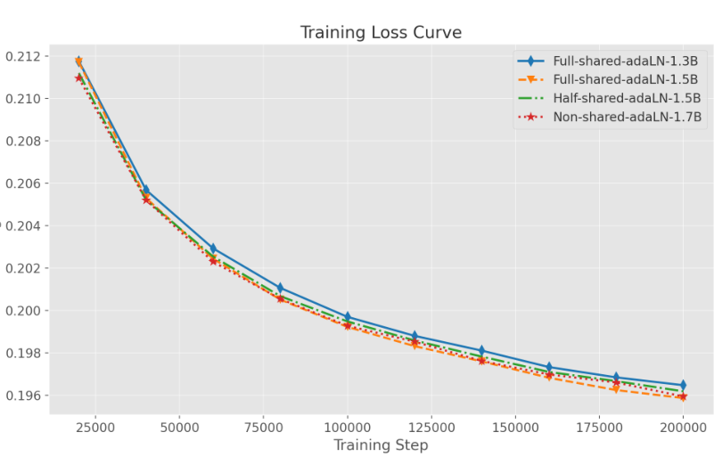{ width="800" }

*图源：[Wan technical report](https://arxiv.org/abs/2503.20314)，Figure 16，原报告第 25 页。最有解释力的比较是两条同为 1.5B 的曲线，完整共享并增至 35 层的模型得到更低训练损失。*

1.3B 全共享模型的损失稍高，说明节省参数并非没有代价；但在同为 1.5B 时，把额外参数投入深度优于只取消部分共享。1.7B 完全不共享也没有超过 1.5B、35 层方案。这支持在这套架构与训练任务下，时间调制网络并非最值得增加容量的位置。它不证明所有 diffusion transformer 都应采用相同共享比例，尤其不同条件接口、隐藏宽度和训练预算可能改变最佳分配。

### 为什么选择 umT5，而没有直接用更强的通用 LLM

文本理解 benchmark 较强，不保证中间表示最适合给扩散模型做 cross-attention。作者比较 umT5 5.3B、Qwen2.5-7B-Instruct 与 GLM-4-9B；后两个模型取倒数第二层表示，在相同设置、batch 1,536 的文生图任务中观察训练损失。Figure 17 的 umT5 曲线更低。作者还为 decoder-only LLM 加入双向 token refiner，但训练损失与可视化仍更偏向 umT5。[↗](https://arxiv.org/pdf/2503.20314v2#page=25)

这组设计围绕一个具体差异，生成器在每个视频位置读取文本时，需要整段条件的可用表示，而自回归语言模型的因果注意力与双向编码器提供的信息结构不同。refiner 的实验尝试缓解这种差异，却没有把所有问题归结为注意力 mask，也未证明语言模型参数越大就越差。

Table 6 进一步比较 Qwen-VL-7B 的特征层选择。FID 越低越好。

| Models | umT5 | Qwen-VL-7B (last layer) | Qwen-VL-7B (second last layer) |
| --- | ---: | ---: | ---: |
| FID ↓ | 43.01 | 43.72 | 42.91 |

倒数第二层的 42.91 略优于 umT5 的 43.01，最后一层则为 43.72。它说明“哪一层特征”本身就会影响生成结果，不能把一个 LLM 的最终输出层视作唯一合理选择。umT5 的采用是在性能、双语表示、收敛与规模之间做选择；原表并不支持“umT5 在任何比较中绝对最好”。

### VAE-D 对照检验的是生成表示，而非重建指标本身

作者还构建 VAE-D，将自编码器的重建损失替换为 diffusion loss，然后分别使用预训练的 VAE 与 VAE-D 做文生图训练，比较 FID。这个实验的问题是，另一种重建训练方式产生的 latent 是否更利于后续生成，而不只是解码器重建看起来是否更锐利。

| Model / Training steps | VAE | VAE-D |
| --- | ---: | ---: |
| 10k steps | 42.60 | 44.21 |
| 15k steps | 40.55 | 41.16 |

上表保留 Table 5 印出的 10k、15k 行名，但正文写的是训练至 150,000 步、在 100,000 与 150,000 步测量，两个位置存在步数冲突，不能据此认定准确 checkpoint。两行中 VAE 的 FID 都更低，这一相对排序不受冲突影响。它支持报告最终采用普通 VAE 的经验判断，不能推广成“扩散解码器总是不利于生成”，因为具体表示容量、训练配方与生成预算仍会改变结果。[↗](https://arxiv.org/pdf/2503.20314v2#page=26)

## I2V 用可保留帧与全局图像语义共同约束生成

### 条件图像为何同时走 latent 与 image encoder

图生视频需要保留输入图像的外观，又要根据文字生成后续动态。Wan-I2V 首先将输入图像放在视频首帧位置，其余待生成位置填零，使用 Wan-VAE 编成条件 latent $z_c$。它与带噪视频 latent 在通道维拼接，再加一个标记已知与未知帧的 mask。这里 mask 的 1 表示保留，0 表示生成，后面 VACE 使用相反约定，实际实现时必须按任务接口分别处理。[↗](https://arxiv.org/pdf/2503.20314v2#page=26)

mask 在压缩后空间大小上表示每个时间位置，按照 VAE 时间步幅 $s=4$ 重排，将相邻时间信息变成 4 个通道，与压缩后的 latent 对齐。噪声 latent 16 通道、条件 latent 16 通道、mask 4 通道，合计 36 通道。因为基础 T2V 输入只有 16 通道，需要增加投影处理新条件，新增投影采用零初始化，避免刚接入时立即破坏已有生成先验。这条通道条件提供直接的画面位置与内容信息。

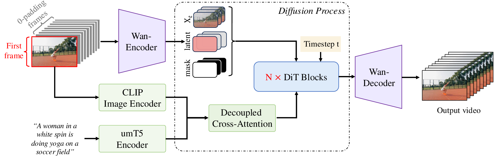{ width="920" }

*图源：[Wan technical report](https://arxiv.org/abs/2503.20314)，Figure 18，原报告第 27 页。局部 latent 条件与 CLIP 全局条件承担不同作用；mask 说明哪些帧已经给定，哪些帧需要合成。*

另一条路径使用 CLIP 提取图像特征，经三层 MLP 投影，再以 decoupled cross-attention 提供全局上下文。这能补充仅靠局部 latent 难以表达的整体语义与外观信息。但它并非从训练开始就一直启用，报告先在没有 image encoder 分支的多任务阶段训练，保持模型对文字的敏感性，在 SFT 阶段才加入全局图像条件。这样安排针对一个常见冲突，若图像条件过早过强，模型可能满足“画面像输入”却忽略文字要求的新动作。[↗](https://arxiv.org/pdf/2503.20314v2#page=30)

### 一个掩码接口如何覆盖多种时间条件

同一框架可处理首帧生成、视频续写、首末帧变换以及随机帧插值。改变的是已知帧的摆放与 mask，而不必为每一种任务完全重建 DiT。数据选择则跟随任务分别处理。首帧任务用 SigLIP 比较第一帧与其余帧平均语义表示，保留相似度高于阈值的视频，避免首帧与后续内容差异过大、妨碍稳定学习。续写数据比较前 1.5 秒与后 3.5 秒的 SigLIP 特征，筛选时间上较一致的视频；这个分段用于一致性测量，不能单凭它确定所有续写训练的条件长度。首末帧变换则增加首尾具有显著过渡的样本比例，因为该任务需要在两个不同端点之间生成平滑变化。[↗](https://arxiv.org/pdf/2503.20314v2#page=27)

这种统一性主要体现在接口，不代表所有任务的学习难度相同。只给首帧时，未来运动具有较大自由度；给首末帧时，模型还要找到通向终点的变化路径；续写需要沿已有动作继续。条件稀疏程度和训练样本构造会影响结果，因此报告又在 480p 与 720p 的预训练 checkpoint 上做相应调整。

Table 7 的人工比较仍使用 “Win rate gap” 标题，脚注却称比例。CN-TopA 的 Matching 为负值，进一步证明这些数值不能解释为绝对获胜比例。[↗](https://arxiv.org/pdf/2503.20314v2#page=30)

| Dimension / Win rate gap | CN-TopA | CN-TopB | CN-TopC | CN-TopD | All Rounds |
| --- | ---: | ---: | ---: | ---: | ---: |
| Visual Quality | 29.2% | 60.8% | 24.6% | 55.6% | 896 |
| Motion Quality | 21.7% | 21.7% | 32.5% | 67.0% | 890 |
| Matching | -4.2% | 35.0% | 51.7% | 72.2% | 896 |
| Overall Ranking | 10.8% | 47.5% | 50.8% | 81.6% | 890 |

总体排名的 gap 都为正，但对 CN-TopA 的 Matching 为 -4.2%。因此报告中“所有维度均有优势”的概括过强，表格支持的是综合偏好优势，以及至少一个明确的匹配弱项。图像保持、动作生成与文字匹配不能互相代替，这也是 I2V 同时需要局部条件和全局语义、还要分阶段训练的原因。

## VACE 把编辑任务转成统一的条件表示

### 先告诉模型哪些内容可改，哪些必须保留

视频编辑的输入可能是原视频、掩码、参考图、姿态、深度或其他控制信息。VACE 使用 Video Condition Unit，将它们组织成 $V=[T;F;M]$，其中 $T$ 是文本，$F$ 是 RGB 帧序列，像素归一化到 $[-1,1]$，$M$ 是与帧在时空上对齐的二值 mask。这里 **1 表示编辑、0 表示保留**，与上一节 I2V 的保留帧 mask 相反。[↗](https://arxiv.org/pdf/2503.20314v2#page=31)

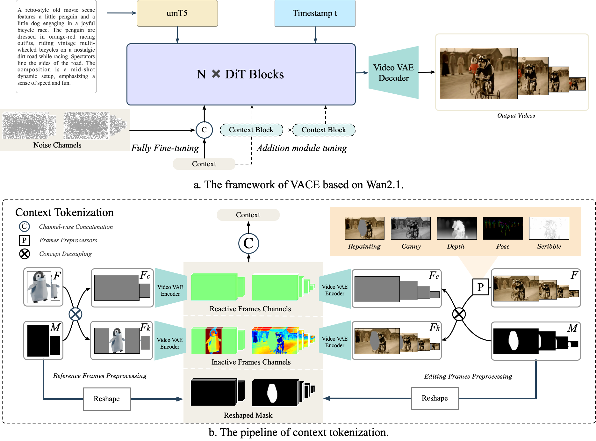{ width="920" }

*图源：[Wan technical report](https://arxiv.org/abs/2503.20314)，Figure 21，原报告第 31 页。先看下半部分的条件拆分与编码，再看上半部分 full fine-tuning 与 context adapter 两条训练路径。*

在编码之前，concept decoupling 根据 mask 将输入分成

$$
F_c=F\odot M,
\qquad
F_k=F\odot(1-M).
$$

$F_c$ 保存待修改部分的上下文，$F_k$ 保存不应改变的部分。二者形状相同，但角色明确区分，再分别由 Wan-VAE 映射到 latent。这样的拆分让模型知道同一输入像素在任务中是可变条件还是保留约束，避免所有模态、所有区域未经区分地混进一个条件张量。图像修补、视频扩展与重新渲染可以共用表示，但 mask 和文本共同决定它们要求的改动。[↗](https://arxiv.org/pdf/2503.20314v2#page=32)

参考图像单独编码，再沿时间轴拼到视频条件中，解码时移除相应参考位置。单独编码的意义在于避免把互不连续的参考图当成真实相邻视频帧交给时间压缩。mask 则通过直接重排和插值，与视频 latent 的时间、空间大小对齐；它没有必要被当成普通 RGB 视频去学习复杂重建。最终条件特征经 context embedder 进入生成模型，与带噪视频 token 一同决定更新。

### Full fine-tuning 与 context adapter 的差别

第一种训练方式直接用 VCU 条件微调整个 Wan。第二种使用额外 Context Blocks，让条件信息经 adapter 注入原有 DiT，冻结基础模型权重。后者方便保留并复用基础生成器，但增加参数，并需要训练 adapter。因而“无需修改基础权重”不能写成“无需训练”或“完全没有额外推理成本”。它在保存底座与新增条件能力之间做了明确取舍。[↗](https://arxiv.org/pdf/2503.20314v2#page=34)

统一接口也需要统一的数据生产。报告先做 shot slicing，再按分辨率、美学和运动幅度筛选；首帧用 RAM 标注，经 Grounding DINO 定位目标，剔除目标过小或过大的样本；随后 SAM2 传播分割到视频各帧，再按 mask 面积阈值计算有效帧比例，过滤持续性不足的实例。这条数据链比“给原视频加一个随机 mask”更具体，因为参考对象、局部编辑与跨帧保留都依赖可靠的实例对应。

训练从 Wan-T2V-14B 出发，支持到 720p，先学习 inpainting、extension 等基础任务，再加入多参考与组合条件，最后用更高质量、更长序列的数据调整。报告中的深度、姿态、线稿、布局、物体和人脸等结果，展示接口能够覆盖多种输入；但本节主要以可视化说明这些能力，没有提供一套统一量化表来证明每种编辑任务都超过所有专用方法。因此它最直接的技术价值，是提供可组合的条件表达和对应的数据构造流程。

图像生成也是同一底座的一条延伸。报告提到训练图像数量约为视频的十倍，图像既帮助建立空间先验，也支持文本生成静态图像。本节样例展示了这种能力，没有给出与视频主表同等完整的文生图定量评测，不能把 T2V 的排名自动延伸成 T2I 排名。[↗](https://arxiv.org/pdf/2503.20314v2#page=35)

## 个性化把参考人脸放进生成序列的前缀

### 为什么直接使用 VAE 人脸表示

个性化生成需要把输入身份转成适合视频生成器使用的条件。报告没有把 ArcFace 或 CLIP embedding 直接作为主要生成条件，而是将人脸图像送入 Wan-VAE，复用与视频内容相同的表示空间。这样可以保存参考外观的更多信息，也减少身份编码器特征与视频 latent 之间的接口差异。ArcFace 仍用于数据筛选与评估，因此这里的“没有用 ArcFace 作条件”不能扩展成“系统完全不使用 ArcFace”。[↗](https://arxiv.org/pdf/2503.20314v2#page=35)

Figure 26 将 $K$ 张参考人脸放在目标视频之前，沿时间轴形成扩展序列。参考脸分割、对齐到与视频同尺寸的黑色 canvas；在通道条件中，这 $K$ 个位置提供人脸图像与全 1 mask，后续视频位置提供空白图像与全 0 mask。扩散模型对扩展序列执行 inpainting 式生成，前缀重建参考人脸，后续位置生成具有相同身份的新视频。

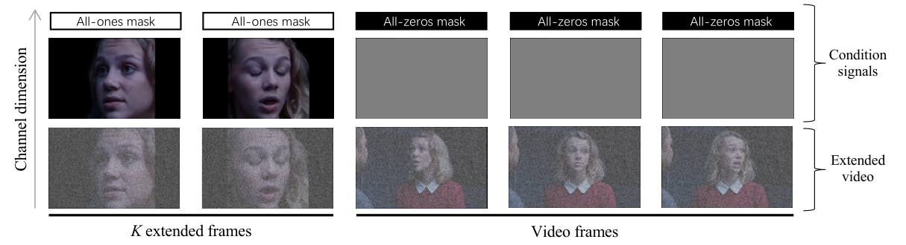{ width="920" }

*图源：[Wan technical report](https://arxiv.org/abs/2503.20314)，Figure 26，原报告第 37 页。上排是条件信号，下排是参与去噪的扩展视频；参考前缀在最终输出中移除。*

训练时随机丢弃一部分参考脸，支持 0 到 $K$ 张参考图的条件数量。推理从扩展序列的噪声出发，将用户给定的人脸及 mask 放在对应条件位置，生成后去掉前缀。这个设计将多张身份参考与目标视频放在同一时空生成框架里，不需要每增加一个参考就创建新的独立身份模块。不过身份保持仍依赖模型在训练中学到跨位置对应，通道拼接本身并不保证绝对一致。

### 数据筛选与身份分数保留了哪些信息

数据从约 $O(100)$ million 个人物视频起步，按 1 FPS 检测人脸，剔除任意帧出现多个人脸、或超过 10% 帧检测不到人脸的视频，再通过相邻帧 ArcFace 相似度排除身份不一致。经过分割和关键点对齐，最终形成约 $O(10)$ million 个视频，每个平均配 5 张参考脸。这里保留小面积人脸，因为小脸常对应全身人物，全部删除会使个性化模型过度偏向近景。[↗](https://arxiv.org/pdf/2503.20314v2#page=37)

为了扩展风格、姿态、光照与遮挡，作者从中选约 $O(1)$ million 个视频，结合超过 100 种风格提示、其他视频估计的人体姿态与 Instant-ID 合成人脸，再用 ArcFace 相似度筛选。合成数据在这里承担有明确条件的身份多样化任务，与基础预训练中排除不受控生成图像污染的做法并不矛盾。是否使用合成数据，需要连同用途、筛选和训练阶段一起判断。

Table 8 在未见测试集合上比较输入脸与输出视频人脸的 ArcFace 相似度，视频按 1 FPS 取样并求平均。

| Metric | Wan | CN-TopA | CN-TopB | CN-TopC |
| --- | ---: | ---: | ---: | ---: |
| Arcface Similarity | 0.5526 | 0.5655 | 0.5197 | 0.4998 |

Wan 高于 CN-TopB、CN-TopC，低于 CN-TopA，因此属于有竞争力的结果。该指标主要检验身份外观相似性，不能单独证明动作自然、全身一致或用户指令完成。随机选取的 Pexels 输入图与样例展示补充了可用性信息，但身份指标与整体视频质量仍是不同目标。[↗](https://arxiv.org/pdf/2503.20314v2#page=38)

## 镜头控制把相机几何转成逐层调制

文本可以要求“向左平移”或“镜头推进”，但精确轨迹需要更明确的几何条件。Wan 的 camera motion 模块接收每帧外参 $[R,t]\in\mathbb R^{3\times4}$ 与内参 $K_f\in\mathbb R^{3\times3}$，将其转成每个像素的 Plücker 表示，得到 $6\times F\times H\times W$ 的相机条件。这里的 $F$ 表示帧数。它把相机参数转换成与画面位置对应的几何信号，避免只用一个全局相机向量承载整幅图像的视线差异。[↗](https://arxiv.org/pdf/2503.20314v2#page=38)

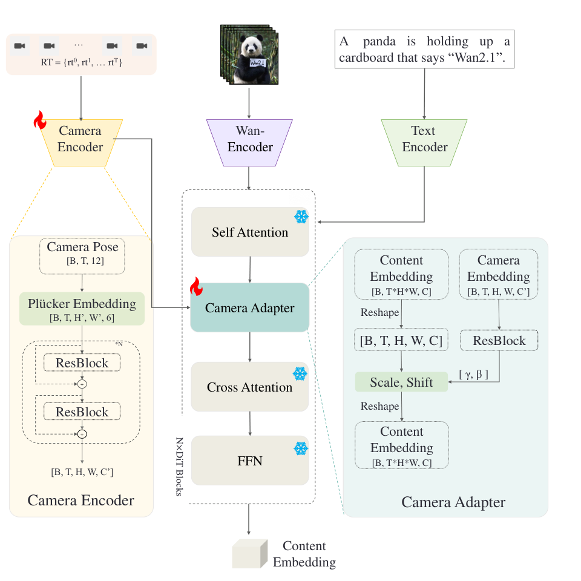{ width="820" }

*图源：[Wan technical report](https://arxiv.org/abs/2503.20314)，Figure 28，原报告第 40 页。左侧相机编码器生成多层特征，右侧 adapter 将其转成 scale、shift 后注入 DiT。*

PixelUnshuffle 在降低空间分辨率的同时增加通道，使相机条件与视频 latent 分辨率对齐；随后卷积模块提取对应不同 DiT block 的特征。每层 adapter 用两个零初始化卷积预测 $\gamma_i$ 与 $\beta_i$，按

$$
f_i=(1+\gamma_i)\odot f_{i-1}+\beta_i
$$

调制视频特征。初始 $\gamma_i=0$、$\beta_i=0$ 时近似恒等映射，因此新的相机分支从“不扰动原模型”的状态开始学习。这里的零初始化与 I2V 新条件投影有相近目的，都是将新增控制信号平稳接到已训练的生成器上，但具体注入位置和参数不同。

训练数据由 VGG-SfM 从具有显著相机运动的视频中估计轨迹，数量约为 $O(1)$ thousand 个片段，使用 Adam 训练控制模块。报告以轨迹引导样例展示能力，没有给出完整的轨迹误差、重投影误差或三维一致性表。因此可以将该模块视为明确的几何条件接口，不能把定性相机跟随直接写成已经恢复可度量、完全一致的三维世界。

## Streamer 同时改变时间窗口与采样预算

### 不固定总长度，需要怎样的去噪队列

原始视频 DiT 通常一次处理固定长度片段，延长片段会扩大注意力的时间范围。Streamer 的前提是把可用依赖限制在一个有限时间窗口，保持活动 token 数不随输出总时长增长。窗口内的 token 处于不同噪声水平，左端较旧、噪声较低，右端较新、噪声较高。完成规定去噪更新后，左端 token 出队并缓存，右端加入新的 Gaussian noise token，窗口继续向前滑动。[↗](https://arxiv.org/pdf/2503.20314v2#page=42)

这改变了生成的组织方式。固定片段方法先等待整段 latent 完成，再解码输出；流式队列让已经成熟的时间位置逐步离开队列，新的位置同时进入计算。但有限窗口也限制了模型直接访问的历史，持续输出不意味着对全部过去帧维持全局注意力。长时间后的人物身份、场景布局与因果关系仍可能漂移，窗口连续性不能代替长期记忆。

训练从预训练 DiT 微调，每次采样长度 $2w$ 的 video token 序列，其中 $w$ 是窗口长度，通常设为 solver 的步数 $T$。这个小节中的 $T$ 指去噪求解步数，与前面表示视频长度的 $T$ 不是同一个量。前 $w$ 个 token 用于 warmup，不参与损失，后 $w$ 个 token 计算训练损失；推理同样丢弃前 $w$ 个 warmup 输出，从第 $w+1$ 个 token 开始交付视频。[↗](https://arxiv.org/pdf/2503.20314v2#page=43)

为使相邻窗口衔接，已生成 token 以噪声水平 0 重新进入队列，作为后续去噪的历史条件。这使新内容能看到最近的已完成结果，减少窗口边界跳变。训练必须覆盖这种混合状态，否则推理时“部分已干净、部分仍有噪”的输入分布会与常规整段同噪声训练不一致。Streamer 需要连同训练样本、损失位置与历史缓存一起调整，给原始 checkpoint 套上外部循环并不能得到同样的输入分布。

### 四步蒸馏与实时速度分别说明什么

窗口化减少了无限增长的注意力负担，却没有自动减少每个 token 需要的去噪调用。报告进一步借助 LCM 与 VideoLCM，将原去噪过程和 CFG 蒸馏成四步 consistency model，给出 10–20 倍加速与约 8–16 FPS 的生成速度范围。这里的蒸馏承担步数压缩，窗口承担持续生成，两个改动解决不同瓶颈。[↗](https://arxiv.org/pdf/2503.20314v2#page=44)

测速必须保留具体出处。Figure 30 展示用 8 张 A100 以 8 FPS 生成 15 分钟视频。Figure 31 的图注写单张 RTX 4090、INT8 与 TensorRT、20 FPS；同一节正文却写单张 RTX 4090 可达 8 FPS。报告没有充分列出造成两种数值差异的模型规模、分辨率与全部设置，因此不能合并成一个统一的“4090 实时 20 FPS”承诺，更不能默认这些演示都使用基础 14B、720p 配置。

量化与 TensorRT 优化还涉及质量取舍。作者提到 INT8 主要缓解显存，TensorRT 可以加速，但可能带来伪影和闪烁。对需要实时交互的应用，这些细节比单一最高 FPS 更有用，需要同时检查首帧延迟、warmup、稳定输出速度和画面错误。报告的长视频演示证明该流水线能够持续运行，未提供足以证明所有内容在 15 分钟中都保持身份、物理与故事一致性的长期基准。

## V2A 为视频生成环境声与音乐

### 音频表示为什么保留显式时间轴

Wan 的 V2A 是单独训练的音频生成分支，输入视频和文本，输出与视觉事件相关的环境声及背景音乐。目标既包括画面内事件，如马蹄或倒水，也允许文字指定画外声音与音乐风格。它不等同于语音驱动人物、口型同步或有声对白，训练数据有意排除了语音与人声音乐。[↗](https://arxiv.org/pdf/2503.20314v2#page=44)

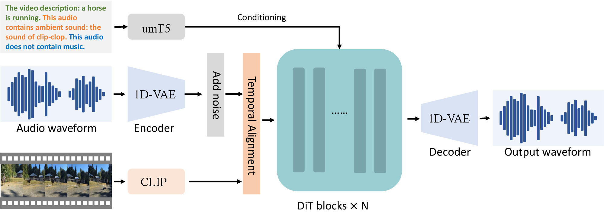{ width="920" }

*图源：[Wan technical report](https://arxiv.org/abs/2503.20314)，Figure 32，原报告第 45 页。音频经 1D-VAE 建立时间 latent，视频帧特征对齐后与音频特征融合，文本提供声音内容与风格条件。*

常见音频表示会先把波形变成 mel-spectrogram，再用图像 VAE 得到二维 latent；如果随后 patchify、展平，时间与频率会一同进入序列，给视觉音频的逐时间对齐增加困难。Wan 训练直接处理原始波形的 1D-VAE，输出 $T_a\times C_a$ 表示，保留明确的时间维。这里的核心取舍是接口，视频条件需要映射到音频时间位置，而不是仅给整段音频一个全局语义向量。

视频逐帧由 CLIP 编码，通过特征复制适配音频 latent 的时间采样率；投影到 DiT 维度后，视频与音频特征逐元素相加。文本由冻结的 umT5 编码。这样，视觉条件在对应时间位置提供发生了什么、文本提供期望声音及风格，DiT 在音频 latent 上执行 flow matching。特征复制与对齐提供了同步建模的条件，但最终声响是否准确落在碰撞、脚步等时刻，仍需由数据与模型学习，不能由“有时间轴”直接保证逐帧无误。[↗](https://arxiv.org/pdf/2503.20314v2#page=45)

### 数据、尺寸与评价范围

数据从视频训练集合中筛出，去除无音轨、语音和含人声音乐的样本，得到约 $O(1)$ thousand 小时。Qwen2-audio 生成声音描述，分为环境声和音乐，音乐进一步描述风格、节奏、旋律与乐器；最终 caption 拼合视频内容、环境声、背景音乐三部分。训练时随机省略环境声或音乐描述，迫使模型在没有完整声音文本时也从视觉线索生成，同时保留用户以文本控制声音的能力。

实现支持最长 12 秒、44.1 kHz 立体声音频。umT5-XXL 的文本 embedding 为 4,096 维，CLIP 视频 embedding 为 1,024 维，音频和视频特征投影到 DiT 的 1,536 维空间。12 秒视频采成 48 帧，即 4 FPS 的视觉输入；一次处理的音频 latent 序列长度为 256。这些数字描述条件与 latent 的采样率，44.1 kHz 是最终音频采样率，不能把它们当成相同时间分辨率。[↗](https://arxiv.org/pdf/2503.20314v2#page=47)

与 MMAudio 的比较使用 T2V 生成的 5 秒视频，报告给出若干定性声音样例，并描述倒咖啡、打字、步行与马蹄等场景中的差异。本节没有完整量化同步或音质基准，作者对“更干净、更自然”的判断不能替代跨场景统计。语音、笑声和哭声仍是明确短板，主要与训练数据排除人声有关。后续版本新增的语音能力也不能倒写成这份 Wan2.1 报告中的 V2A 已具备。

## Wan2.2 的后续技术补充需要与报告分开理解

以下机制和四张图来自 [Wan2.2 官方 README](https://github.com/Wan-Video/Wan2.2#introduction-of-wan22)，属于 Wan2.1 报告之后的更新。它提供两条不同路线，A14B 用高噪声、低噪声专家增加去噪容量，TI2V-5B 用更高压缩的 VAE 降低 token 成本。不能把二者的参数量、压缩率和单卡运行条件合并成一个模型。

### A14B 的专家按去噪阶段切换

Wan2.2 A14B 有两个约 14B 的专家，总参数约 27B，每一步激活约 14B。高噪声阶段的专家侧重整体布局，低噪声阶段的专家侧重细节。这里的路由单位是去噪阶段，图中两套生成网络在不同阶段接力；它不同于语言模型中按 token 为 FFN 选择若干专家的结构。

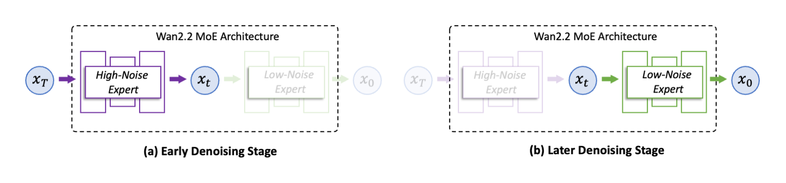{ width="920" }

*图源：[Wan2.2 官方 README](https://github.com/Wan-Video/Wan2.2#introduction-of-wan22)，MoE 架构图。左侧是早期高噪声阶段，右侧是后期低噪声阶段，每步只使用对应专家。*

这把“一个网络必须同时擅长确定大结构和修复细节”的任务分配给两个容量更集中的网络。每步激活量接近原 14B，不代表总权重存储只有 14B，也不意味着任意部署都会保持相同显存；是否同时驻留两套权重、何时 offload、文本编码器怎样放置都会影响运行条件。官方 A14B 的单卡示例给出至少 80 GB 显存，不能借用 5B 路线的 24 GB 数字。

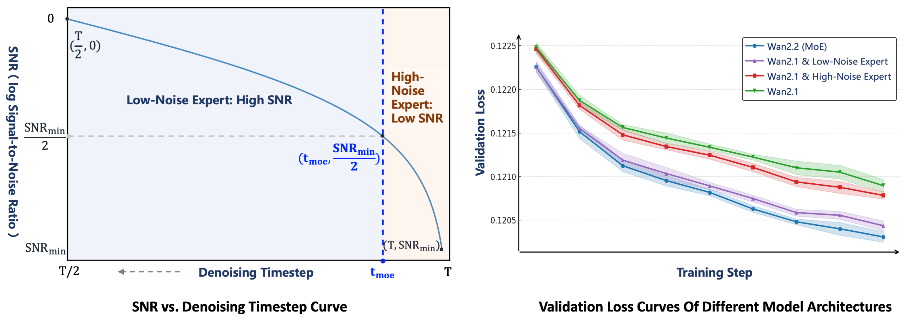{ width="920" }

*图源：[Wan2.2 官方 README](https://github.com/Wan-Video/Wan2.2#introduction-of-wan22)，SNR 与 validation loss 图。左图显示按噪声阶段切换，右图比较两个单独替换专家的混合方案与完整 MoE。*

右图四组配置为 Wan2.1、仅替换高噪声专家、仅替换低噪声专家和完整 Wan2.2 MoE。完整 MoE 的验证损失最低，两个局部替换也有改善，支持两个阶段的专门化都可能贡献收益。但较低 validation loss 不能直接证明生成分布在所有距离定义下“最接近真实分布”，更不能代替视觉质量与动作评价。

左图纵轴标为 log Signal-to-Noise Ratio，而 README 对切换阈值使用“最小 SNR 的一半”的说法；线性 SNR 与 log SNR 混写会改变阈值含义。这张图足以说明高噪声到低噪声的分工，具体复现时应以对应模型配置和调度实现确定边界，不宜把图示文字直接当成完整公式。

官方还报告训练图像增加 65.6%、视频增加 83.2%，并加入更细的美学标签。因此 Wan2.2 的成品质量变化包含数据、标注和架构共同作用，不能将全量模型相对 Wan2.1 的所有提升都归因于 MoE。右侧损失曲线用于讨论专家替换，最终生成比较则仍应保留这层训练条件变化。

### TI2V-5B 用更高空间压缩换取更短序列

另一条路线是 5B dense 模型，同时支持文字和图像条件。Wan2.2-VAE 的几何压缩为 $4\times16\times16$，latent 通道为 48；再经过 patchify，生成器对应的几何缩减达到 $4\times32\times32$。与 Wan2.1 的 $4\times8\times8$、16 通道相比，空间 token 数显著减少，但 latent 通道增加，不能只按几何倍率估算总信息元素压缩。

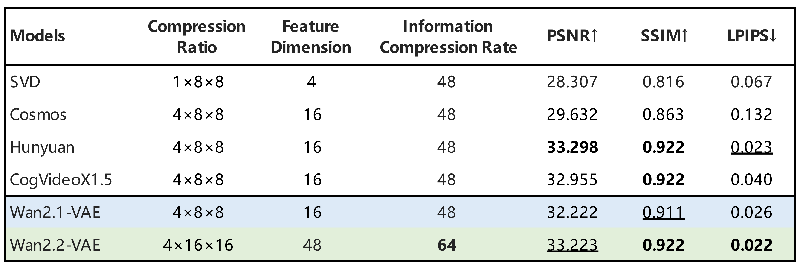{ width="920" }

*图源：[Wan2.2 官方 README](https://github.com/Wan-Video/Wan2.2#introduction-of-wan22)，VAE 比较表。Compression Ratio 描述时空轴缩减，Feature Dimension 描述 latent 通道，Information Compression Rate 另计 RGB 与 latent 元素数量。*

忽略首帧边界后，按元素数量计算，Wan2.1 约为 $3\times4\times8\times8/16=48$，Wan2.2 约为 $3\times4\times16\times16/48=64$。这是表中 48 与 64 的来源，既不是“只压缩时间 64 倍”，也不是新模型的全部 token 减少 64 倍。表中 Wan2.1-VAE 的 PSNR、SSIM、LPIPS 为 32.222、0.911、0.026，Wan2.2-VAE 为 33.223、0.922、0.022；Hunyuan 的 PSNR 33.298 仍略高。新 VAE 在更高元素压缩下保持了较好的重建指标，但这张后续表的协议不能与原报告 Figure 7 的 PSNR 散点直接拼接比较。

官方称 TI2V-5B 在单张消费级 GPU 上生成 5 秒 720P 视频不到 9 分钟，输出为 24 FPS。24 FPS 是成片播放帧率，不能读成每秒生成 24 帧的实时速度。运行示例中的“720P”尺寸是 $1280\times704$ 或 $704\times1280$，在启用 `offload_model`、`convert_model_dtype` 与 `t5_cpu` 等选项时，给出至少 24 GB 显存的条件。降低显存通常要交换设备数据或调整精度，因此这个可运行配置与最大速度配置不是同一承诺。[↗](https://github.com/Wan-Video/Wan2.2#run-text-image-to-video-generation)

### Wan-Bench 2.0 的结果仍有维度差异

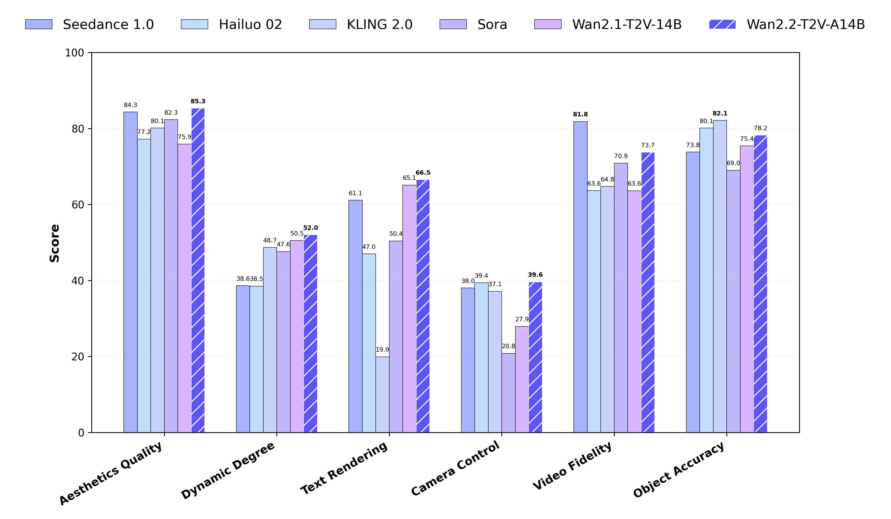{ width="920" }

*图源：[Wan2.2 官方 README](https://github.com/Wan-Video/Wan2.2#introduction-of-wan22)，Wan-Bench 2.0 比较图。它是后续的新基准，不能与 Wan2.1 Table 2 的数值混成同一排行榜。*

A14B 在图中的 Aesthetics Quality、Dynamic Degree、Text Rendering 与 Camera Control 等维度表现较强，例如美学质量 85.3、文字绘制 66.5、镜头控制 39.6。但 Video Fidelity 为 73.7，低于 Seedance 1.0 的 81.8；Object Accuracy 为 78.2，低于 KLING 2.0 的 82.1。图支持多个方向的改善，同时保留了保真和物体准确率上的差距。它与 Wan2.1 的经验一致，综合能力提升需要按任务维度解释，不能把产品名称后面的版本号当成每项能力必然单调上升的证据。

## 从系统中真正可以复用的设计

Wan 最有用的部分，是把“底座能力”和“任务接口”连接得很具体。若要构建视频生成系统，可以先明确训练数据到底缺少什么监督，分别组织质量、运动、文字与高质量后训练集合；随后让 VAE 表示、DiT token 长度和并行策略一起确定可承担的训练尺度。仅替换一个更大的 DiT，无法弥补错误 caption、静态数据占比过高或编码器损失的信息。

扩展任务时，应先写清条件在时间、空间和通道上的位置。I2V 用已知帧 latent 与保留 mask；VACE 拆分编辑与保留区域；个性化将参考人脸放进时间前缀；镜头控制将几何编码转成逐层调制。这些接口都能复用底座，但训练数据必须包含相应的条件到目标关系，且 mask 约定、参考位置移除和新增分支初始化都影响实现是否正确。只模仿架构图中的连接线，通常不足以复现能力。

效率也应按层次核算。VAE cache 缩小编码解码工作集，CP/FSDP 拆分长序列与权重，diffusion cache 减少重复计算，量化降低单次算子成本，consistency distillation 减少求解步数，Streamer 让活动窗口不随输出总长增加。每一项都对应不同约束，收益没有自动可乘性。报告最后提到未经额外优化的 14B 在单张高端 GPU 上约需 30 分钟，但没有在该句给出完整输出尺寸与时长，不能将其作为所有部署的固定基准。[↗](https://arxiv.org/pdf/2503.20314v2#page=47)

仍需优先解决的限制也很具体，大幅运动时的细节保持、复杂交互的可靠性、专门领域知识，以及长时间生成的稳定性。分数较高的 Physical Plausibility 不能保证教育或医学场景正确，连续流式输出也不能保证情节和身份长期一致。对实际应用，更有价值的验收方法是围绕目标场景保留失败维度，例如动作是否完成、对象数量是否正确、参考身份是否持续、音效是否在事件发生时出现，并连同硬件、分辨率、生成时长和延迟一起记录。

## 关键术语

**Causal Video VAE（因果视频变分自编码器）** 指当前时间位置的表示只依赖允许的历史，支持通过缓存分块处理视频；它约束表示计算，不等于生成器具备无限历史记忆。

**Flow Matching（流匹配）** 在这里用线性噪声到数据路径构造中间状态，训练网络预测速度 $x_1-x_0$，推理时再数值积分。

**Adaptive Layer Normalization / adaLN（自适应层归一化）** 用去噪时间等条件生成调制参数；Wan 共享时间调制 MLP，并保留各 block 的偏置。

**Context Parallelism（上下文并行）** 沿视频 token 序列分摊计算与激活；Wan 组合 Ring Attention 与 Ulysses，并与 FSDP 分组重叠。

**Video Condition Unit / VCU（视频条件单元）** 以文字、帧、mask 表示编辑输入；它的编辑 mask 与 I2V 保留 mask 采用相反的 0/1 含义。

**Plücker Embedding（普吕克坐标嵌入）** 将相机几何转换为逐像素六维表示，用于建立轨迹条件与视频位置之间的对应。

**Consistency Distillation（一致性蒸馏）** 将多步去噪及 guidance 的行为迁移到少步生成器；在 Streamer 中，它负责压缩采样预算，滑动窗口另负责持续输出。

**Denoising-stage MoE（按去噪阶段分工的混合专家）** 是 Wan2.2 A14B 的后续设计，用高噪声与低噪声专家接力执行生成，与 token 级 FFN 路由不同。

把这篇放回主线时，可以先看[视频与多模态扩散](../../diffusion/video-and-multimodal-diffusion.md)理解视频 token 和条件分支，再看[Ring Attention](../world-models/ringattention.md)对照长序列通信。若要讨论训练而不是架构图，接着读[扩散模型训练](../../diffusion/training.md)，把 flow matching、时空数据和采样预算放在同一张实验表里。
