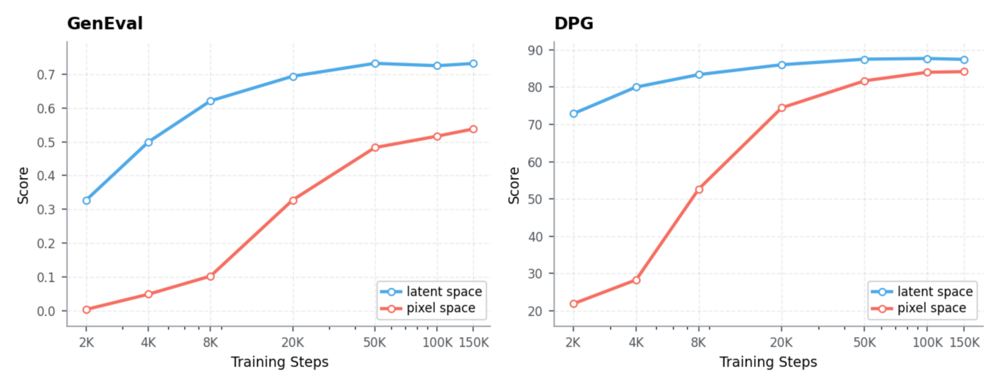
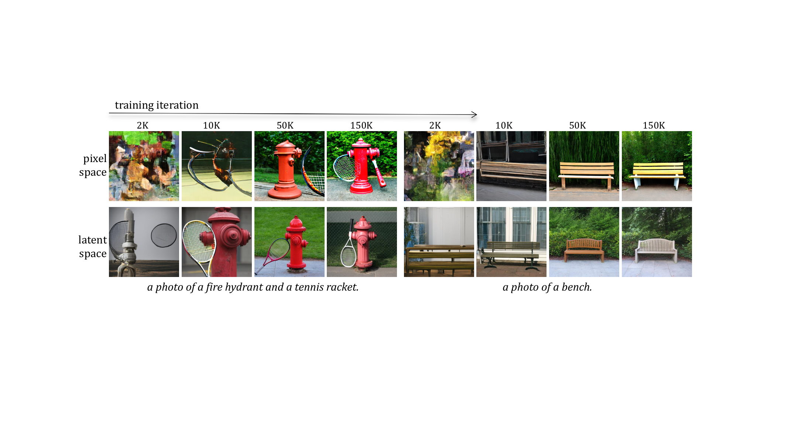
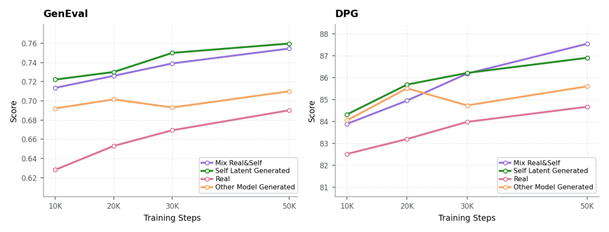
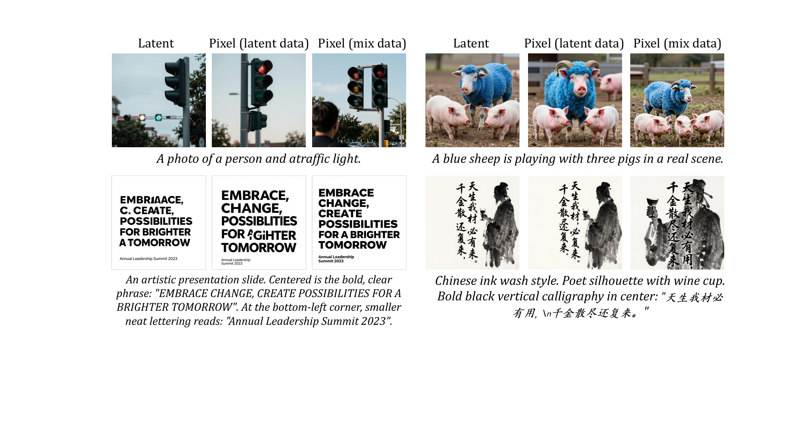
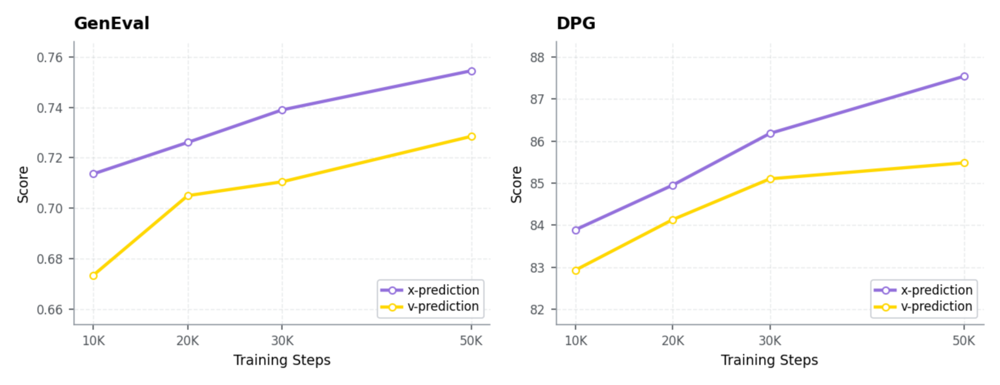
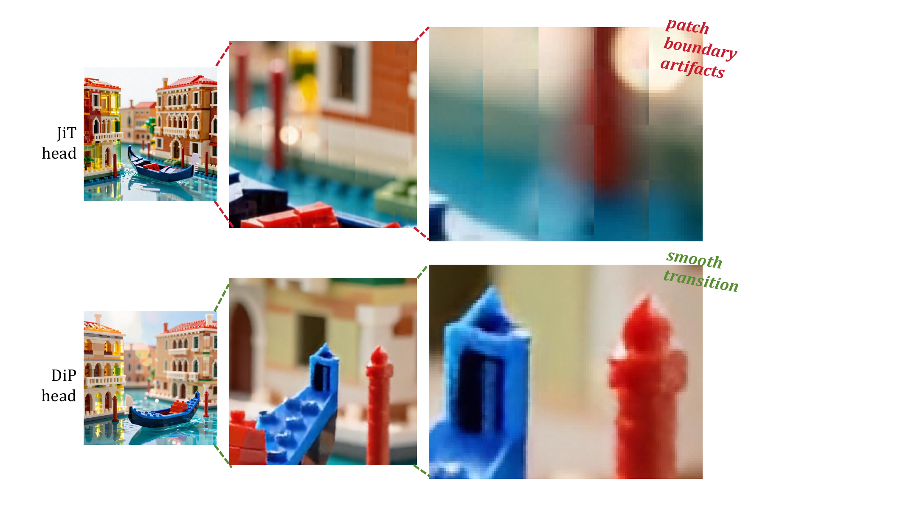
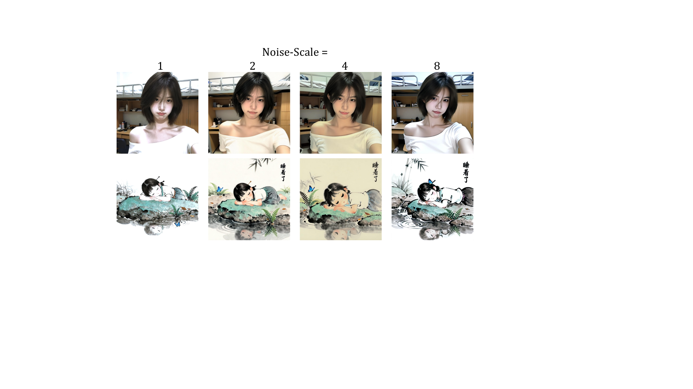
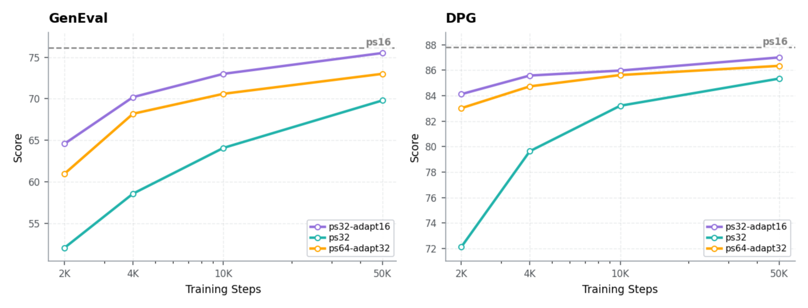
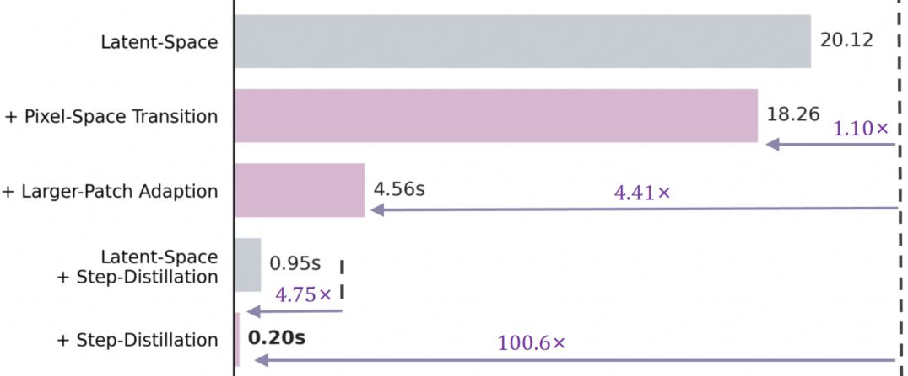

# Z-Image-Pixel：像素扩散更适合 post-training，而不是 pre-training

!!! info "论文信息"
    **论文题名：** An Empirical Study of Training Pixel-Space Text-to-Image Diffusion Models。<br>
    **作者：** Dengyang Jiang、Ruoyi Du、Zhennan Chen、Dongyang Liu、Zanyi Wang、Mingzhe Zheng、Xiangpeng Yang、Huanqia Cai、Aiming Hao、Yuming Jiang、Peng Gao、Harry Yang、Steven Hoi。<br>
    **机构：** Alibaba Token Hub, Alibaba Group；The Hong Kong University of Science and Technology；Nanjing University；University of California, San Diego。<br>
    **时间 / 主题：** arXiv v1：2026-08-17；论文未标注会议接收信息。主题是大规模像素空间文生图、latent-to-pixel 权重迁移和像素扩散后训练配方。<br>
    **arXiv / PDF：** arXiv：[2608.16887](https://arxiv.org/abs/2608.16887)；PDF：[arxiv.org/pdf/2608.16887](https://arxiv.org/pdf/2608.16887)；TeX source：[arxiv.org/e-print/2608.16887](https://arxiv.org/e-print/2608.16887)。<br>
    **相关官方仓库：** [Tongyi-MAI/Z-Image](https://github.com/Tongyi-MAI/Z-Image)。截至核验日，仓库公开的是 Z-Image 基础模型与推理代码，论文对应的 pixel checkpoint 和完整 post-training code 未在论文或仓库 README 中明确发布。<br>
    **元数据来源与核验口径：** 来源：arXiv 页面、论文 PDF、arXiv TeX source、Z-Image 官方 GitHub；Checked Date：2026-08-18；Repro Status：Paper and source reviewed, base-model repository available, paper-specific pixel training code/weights not confirmed, independent reproduction not claimed。

## 原论文故事线

### 研究背景

主流文生图系统几乎都把大规模预训练放在 VAE latent space：VAE 先把 RGB 图像压缩成更短、更结构化的 latent token，扩散 Transformer 再学习文本条件下的生成分布。像素空间扩散则绕过 VAE，直接从噪声生成 RGB，理论上没有 VAE 重建上限，也省去推理末端固定的 VAE decode。

过去的 pixel diffusion 工作大多停留在 ImageNet class-conditional 或较小规模 T2I。真正欠缺的不是“像素能不能生成”，而是一个更实际的问题：当数据、模型和训练预算都进入现代 T2I 规模时，pixel space 能否像 latent space 一样高效地吸收知识？如果不能，应该把像素训练放在哪个阶段？

### 问题（Challenge）

作者先做了一个受控的大规模比较：latent 与 pixel 模型使用相同的 Z-Image Transformer、Qwen3-4B 文本条件、训练数据、算力、优化配置和 Transformer token 长度，只改变预测空间。两者都看过超过 20B 图文对，但 pixel-space 模型在相同预算内收敛更慢，早期全局结构和文本对齐明显落后，训练末期也没有追平 latent baseline。

这意味着 pixel diffusion 的主要障碍不只是 token 多。论文已经把两条路线都控制在 $64\times64$ token grid，差距仍然存在。Pixel 模型必须一边从原始 RGB 中发现局部冗余和高频规律，一边学习全局语义、文本对齐与去噪；latent 模型则直接接收 VAE 整理过的感知表示。

### Finding

论文最重要的 finding 不是“pixel diffusion 不行”，而是 **latent space 和 pixel space 适合不同训练阶段**：

- 大规模 pre-training 的目标是用有限算力快速吸收视觉知识和文本对齐，latent representation 更容易优化。
- post-training 的目标是把一个已有生成器变成最终可部署形态，pixel supervision 可以移除 VAE 上限与 decode 成本。
- 因此更合理的路线是先在 latent space 预训练，再把共享 Transformer 权重迁移到 pixel model，做较短的全参数 post-training。

换句话说，VAE 不只是一种压缩器，也像是大规模生成预训练的 learned preconditioner；等先验学完，再把 VAE 从最终生成路径里拿掉，可能比从头在 RGB 上硬学更划算。

### 方法

作者以 Z-Image 为主实验底座，把 latent checkpoint 的 Transformer 和条件模块迁移到 pixel model，新建 pixel-specific input/output modules，并在 1K 分辨率做全参数后训练。论文逐项消融了五个迁移决定：权重初始化、post-training 数据、$v$-prediction 或 $x_0$-prediction、RGB decoder head、noise scale。

最终配方是：latent-pretrained initialization；同一 latent teacher 的 self-generated data 与高质量 real data 按 1:1 混合；切换到 $x_0$-prediction；采用轻量卷积 U-Net 形式的 DiP head；使用 $\gamma=2$ 的像素噪声尺度。随后模型先从 patch size 16 迁移到 patch size 32，再做 Decoupled-DMD 与 DMDR 少步蒸馏。

### 结论

在论文报告的系统对比中，这套 recipe 能迁移到 Z-Image 和 FLUX2-klein 两个模型族。100 NFE 时，像素模型相对 latent counterpart 获得 3.18x-4.41x 端到端加速；4 NFE 时获得 3.29x-4.75x 加速，同时在 GenEval、DPG、OneIG、LongText 上整体保持相近或更优，但不是每个指标都胜出。

证据边界也要说清楚。论文证明的是“matched compute 下 pixel pre-training 更慢”和“精心设计的 pixel post-training 有效”，不是数学上证明 pixel pre-training 永远不能 scale。20B 是训练语料规模，不等于公开了 20B 数据配方；最终扩大后的 post-training 数据量、训练迭代数、总算力和 paper-specific code/weights 也没有完整公开。

### 关键术语

- **Pixel-Space Diffusion（像素空间扩散）**：直接在 RGB 空间定义加噪和去噪过程，最终输出无需 VAE decode。
- **Latent-to-Pixel Adaptation（潜空间到像素空间迁移）**：复用 latent diffusion 的 Transformer 先验，再把输入输出接口和监督空间换成 RGB。
- **Post-Training（后训练）**：这里指大规模 latent pre-training 之后的 pixel-space 全参数适配，不只是常见的 SFT 或 RL。
- **Self-Generated Data（自生成数据）**：由提供初始化权重的同一个 latent model 离线生成的图文样本，用来降低迁移时的分布偏移。
- **Prediction Target（预测目标）**：模型直接输出 velocity $v$ 或 clean image $x_0$；两者可以转换到同一个 velocity-space loss 和 ODE solver。
- **Noise Scale（噪声尺度）**：论文在 flow path 中用 $\gamma$ 调整 RGB 噪声幅值，以校准 latent 到 pixel 后信噪比分布的变化。
- **Progressive Patch-Size Adaptation（渐进式 patch 尺寸迁移）**：先完成 latent-to-pixel，再逐步增大 RGB patch，避免同时改变预测空间和 token 粒度。

## 论文位置

这篇论文和 [PixelDiT](pixeldit.md) 都讨论 pixel diffusion，但两者的回答层级不同。PixelDiT 更像一篇 architecture paper：怎样用 dual-level Transformer 和 pixel token compaction 从头做像素建模；这篇工作更像一篇 training recipe paper：现成的大规模 latent generator 怎样迁移成 pixel generator。

| Route | Main question | Core choice | Evidence emphasis |
| --- | --- | --- | --- |
| Latent diffusion | 怎样高效吸收大规模图文知识 | VAE latent pre-training | 训练效率、成熟 scaling recipe |
| [PixelDiT](pixeldit.md) | 怎样让 pixel-space Transformer 可计算 | patch-level + pixel-level dual path | ImageNet / T2I 架构消融 |
| JiT / DiP | 怎样稳定训练原生 pixel model | $x_0$-prediction 或局部 decoder bias | pixel modeling 与 decoder 设计 |
| L2P / AsymFlow | 怎样把 latent model 迁移到 pixel | latent-to-pixel adaptation | 迁移可行性 |
| This paper | 大规模 pixel T2I 应放在 pre-train 还是 post-train | latent pre-train + pixel post-train | 20B 对照、五项 recipe 消融、两模型族系统结果 |

真正值得迁移的不是某一个组件，而是训练阶段的重新分工：**latent 负责学知识，pixel 负责做最终生成器。**

## 为什么超过 20B 图文对仍没有追平

{ width="900" }

<small>图源：`An Empirical Study of Training Pixel-Space Text-to-Image Diffusion Models`，Figure 2。两条曲线使用相同训练设置，只改变 prediction space。</small>

**这张图怎么读：先看早期斜率，再看 150K steps 是否闭合。** Latent model 在 2K steps 已经取得明显的 GenEval 和 DPG 分数，pixel model 的早期语义学习非常慢。到 150K steps，pixel 曲线继续改善，但 GenEval 仍保留明显差距，DPG 也没有完全追平。

### 受控比较到底控制了什么

| Component | Latent-space model | Pixel-space model |
| --- | --- | --- |
| Backbone | Same Z-Image Transformer | Same Z-Image Transformer |
| Text conditioning | Pre-trained Qwen3-4B | Pre-trained Qwen3-4B |
| Visual representation | Flux-AE latent, 8x spatial downsampling | RGB pixels |
| Patch size | latent patch size 2 | RGB patch size 16 |
| Effective compression | 16x | 16x token spacing |
| Token grid at 1024x1024 | 64x64 | 64x64 |
| Data | More than 20B image-text pairs | Same corpus |
| Recipe | Z-Image progressive 256² to 512² pre-training | Same batch size, LR, optimizer and schedule |
| Varied factor | Prediction space | Prediction space |

这个设计排除了一个常见反驳：pixel model 慢不是因为 Transformer sequence 更长。两边都是 4096 个视觉 token，backbone computation 基本可比。差异主要来自每个 token 要预测的表示：latent token 已经经过 Flux-AE 的感知压缩；RGB patch 仍包含大量局部冗余、颜色统计和高频细节。

{ width="900" }

<small>图源：论文 Figure 3。上排是 pixel-space，下排是 latent-space；列方向展示 2K、10K、50K、150K training iterations。</small>

定性样本进一步说明差距发生在哪里。Latent model 很早就能形成消防栓、球拍和长椅的全局结构；pixel model 早期更像在同时解决低级纹理与物体组合，直到 50K 之后才出现稳定语义。论文把原因归因于 VAE latent 对原始图像分布做了预先整理：抑制局部冗余和高频变化，同时保留生成所需的语义与外观。

这里可以给出一个更准确的工程判断：**VAE 的价值不只是把 $H\times W$ 变小，它还改变了优化问题的条件。** 论文没有直接测量 Hessian、gradient noise 或频谱学习速度，所以“learned preconditioner”是对实验的机制性解释，而不是作者给出的严格优化理论。

## Latent-to-Pixel 总体路线

完整训练路径可以压缩成四段：

```text
large-scale image-text data
  -> latent-space Z-Image pre-training
  -> transfer Transformer + conditioning weights
  -> pixel-space full-model post-training at 1K
  -> ps16 -> ps32 adaptation -> 4-NFE distillation
```

迁移时，共享 Transformer 和 conditioning weights 从 latent checkpoint 加载；pixel-specific input projection 与 RGB output head 从头初始化。后训练并不是只更新新 head，论文明确写的是 optimize the full model。默认全参数 post-training 配置为 global batch size 128、learning rate $5\times10^{-5}$、直接训练 1K resolution。

这条路线成立的前提是共享 backbone 已经学到了可迁移的文本条件生成先验。Weight initialization 消融表明，同样的数据、架构和优化配置下，从 latent checkpoint 初始化的 pixel model 在 GenEval、DPG 和定性结构形成速度上都远好于完全从头训练。

## Post-Training 数据：teacher 样本搭桥，真实图像纠错

{ width="900" }

<small>图源：论文 Figure 6。比较 Real、Self Latent Generated、Other Model Generated 与 Mix Real & Self 四种数据来源。</small>

论文比较了四种 post-training corpus：

| Data source | Construction | Role in adaptation | Main issue |
| --- | --- | --- | --- |
| Real images | Z-Image 最新 SFT data | 提供真正的 RGB 细节与纠错监督 | 单独使用时收敛慢 |
| Self-generated | 初始化所用 Z-Image latent checkpoint 默认采样 | 与 source model 分布最接近，迁移快 | 继承 latent model 与 VAE 错误 |
| Other-model generated | FLUX2-klein-9B，用同一 prompt pool 离线生成 | 测试“任意 synthetic data 是否都有效” | 分布不匹配，弱于 self-generated |
| Real + Self | Self-generated : Real = 1:1 | 同时保先验、补像素细节 | 需要两类高质量数据管线 |

曲线中 self-generated data 的 GenEval 收敛最快，说明它像一座低 distribution shift 的桥：输入 prompt 和输出分布都接近初始化模型，pixel model 主要学习“把同一生成能力改写成 RGB 输出”。用另一个强模型 FLUX2-klein-9B 生成的数据反而更弱，说明 synthetic data 的作用不是一般意义上的数据扩充，而是 source-distribution matching。

但 teacher 样本无法自动突破 teacher 的错误。它们经过 source latent generator 与 VAE decoder，文字错误、对象关系错误和重建损失都会进入监督。因此作者加入 real images，让后训练同时承担两件事：保持原有生成先验，并用真实 RGB 恢复 latent compression 丢掉的信息。

{ width="900" }

<small>图源：论文 Figure 7。每组依次为 latent baseline、只用 source latent data 的 pixel model、real + self mixed data 的 pixel model。</small>

**这张图怎么读：重点看文字，不只看照片质感。** 只用 self-generated data 时，pixel model 很容易复刻 teacher 的残缺英文和中文书法；加入真实数据后，部分字符结构得到纠正。这也给 post-training 数据配方一个很实用的分工：synthetic teacher data 负责 continuity，real data 负责 correction。

论文没有公开 real SFT subset 的样本数、清洗规则、caption 来源和最终扩大后的数据规模。因此可以迁移“1:1 self + real”的方向，但不能把它当成已完全复现的开放数据 recipe。

## 为什么 $x_0$-prediction 优于 $v$-prediction

{ width="900" }

<small>图源：论文 Figure 8。两组实验共享 latent initialization、flow path、timestep sampler、noise scale、decoder、loss weighting 与 solver。</small>

论文问得很具体：source latent model 原本是 $v$-prediction，迁移到 pixel 后要不要保留原目标？实验显示 latent initialization 足以让 $v$ 和 $x_0$ 两种参数化都稳定收敛，但直接预测 clean RGB 的 $x_0$-prediction 在 10K-50K steps 的 GenEval 和 DPG 上持续更好。

Flow path 写成：

\[
\mathbf{x}_t
=
t\mathbf{x}_0
+
(1-t)\gamma\boldsymbol{\epsilon},
\qquad
\boldsymbol{\epsilon}\sim\mathcal{N}(\mathbf{0},\mathbf{I}).
\]

其速度场是：

\[
\mathbf{v}_t
=
\frac{d\mathbf{x}_t}{dt}
=
\mathbf{x}_0-\gamma\boldsymbol{\epsilon}.
\]

为了让比较只反映 output parameterization，作者没有给 $x_0$ 版本换一套 loss。模型先输出 $\hat{\mathbf{x}}_0$，再转换成对应 velocity，在相同 velocity-space objective 下训练，并在推理时转换回同一 ODE solver 需要的 velocity field。于是两边共享 timestep 的 logit-normal sampling、loss weighting、数值求解器与采样 schedule。

这个结果的合理解释是：pixel output 具有直接、稳定的监督目标，模型可以显式恢复 RGB；$v$-prediction 同时混合 clean signal 和 noise，在 raw pixel statistics 下更难。论文数据支持“在这套 latent-to-pixel recipe 中 $x_0$ 更好”，但没有覆盖所有噪声参数化、所有网络或从头 pixel pre-training，不能外推为 $v$-prediction 在像素空间永远不可用。

## Decoder：线性 head 太硬，PiT 又太重

{ width="860" }

<small>图源：论文 Figure 9。上排 JiT linear head 在 patch 边界出现块状不连续；下排 DiP head 用局部卷积交互平滑相邻 patch。</small>

Pixel model 不再调用 VAE decoder，但 Transformer token 仍要还原成 $16\times16$ RGB patch。这个 output head 不能随便选：完全独立的线性映射最便宜，却容易让相邻 patch 互不沟通；大 Transformer decoder 质量高，但会把省下的 VAE 成本重新加回来。

| Metric | JiT | DiP | PiT | Deco | VAE |
| --- | ---: | ---: | ---: | ---: | ---: |
| GenEval ↑ | 0.7380 | 0.7545 | **0.7697** | 0.7347 | - |
| DPG ↑ | 86.19 | **87.54** | 86.36 | 86.10 | - |
| Params (M) ↓ | **2.95** | 10.09 | 2249.82 | 315.92 | 49.55 |
| Latency (ms) ↓ | **0.07** | 6.02 | 74.96 | 5.01 | 91.88 |
| GFLOPs ↓ | **24.16** | 834.03 | 19731.88 | 2587.05 | 10472.20 |

<small>表源：论文 Table 1。decoder-only latency / GFLOPs 在单张 H800、1024x1024、batch size 1 下测量。</small>

PiT 的 GenEval 最高，但 decoder 自身有 2.25B 参数，相当于 6B backbone 的 37.5%，工程上过重。JiT linear head 只有 2.95M 参数和 0.07 ms，却有明显 patch boundary artifacts。DiP 是折中点：10.09M 参数、6.02 ms、最高 DPG，并通过轻量 convolutional U-Net 的局部性与权重共享平滑相邻 patch。

这部分和 PixelDiT 的答案很有意思地分叉了。PixelDiT 接受较重的 pixel-level Transformer 来换取 dense refinement；这篇工作以部署效率为目标，选择小卷积 decoder head。它说明 pixel diffusion 并没有唯一架构，decoder 选择取决于最终瓶颈是质量、参数还是端到端延迟。

## 加噪方式：理论上的 $\gamma=8$ 为什么输给 2

从 Flux-AE latent 转到 RGB 后，数据的空间分辨率、方差与频谱都变了。直接复用 latent noise schedule，会让同一个 timestep 对应完全不同的 SNR。作者没有重新设计整条 schedule，只加一个全局 noise-scale $\gamma$：

\[
\mathbf{x}_t=t\mathbf{x}_0+(1-t)\gamma\boldsymbol{\epsilon}.
\]

如果把 VAE encoder 粗略近似成对 RGB 做 $r\times r$ average pooling，那么独立噪声方差会缩小 $r^2$，有：

\[
\operatorname{SNR}_{\mathrm{pixel}}^{\downarrow r}(t)
\approx
\frac{r^2}{\gamma^2}
\operatorname{SNR}_{\mathrm{latent}}(t).
\]

Flux-AE 空间下采样率是 $r=8$，按这个简化推导，SNR matching 应取 $\gamma=8$。但 VAE encoder 并不是 average pooling，latent 与 RGB 的 signal statistics、prediction target 也不同，结果是理论参考值并不最优。

| Metric | $\gamma=1$ | $\gamma=2$ | $\gamma=4$ | $\gamma=8$ |
| --- | ---: | ---: | ---: | ---: |
| GenEval ↑ | 0.6811 | **0.7545** | 0.7413 | 0.7316 |
| DPG ↑ | 84.03 | **87.54** | 86.01 | 85.64 |

<small>表源：论文 Table 2。四组共享 timestep distribution、prediction target、loss weighting、初始化与优化 schedule。</small>

{ width="760" }

<small>图源：论文 Figure 10。比较 $\gamma\in\{1,2,4,8\}$；$\gamma=1,4,8$ 出现不同程度色偏，$\gamma=2$ 的颜色更平衡。</small>

这项消融的重要性在于：latent-to-pixel 不是“换一下输入输出层”就结束。噪声路径本身定义在数据空间上，一旦 representation 变了，SNR calibration 也必须重做。论文选择 $\gamma=2$，并在训练和 sampling 的 noise initialization 中使用相同值。

## 先迁移 prediction space，再增大 patch

Pixel-space 的另一个部署收益是可以直接用更大 RGB patch 降低 token 数，而不需要把 VAE 压缩率继续加大。1024x1024 下：

| Configuration | Token grid | Relative token count | Initialization |
| --- | --- | ---: | --- |
| ps16 | 64x64 | 1x | latent checkpoint -> pixel ps16 |
| ps32 | 32x32 | 1/4x | latent checkpoint -> pixel ps32 directly |
| ps32-adapt16 | 32x32 | 1/4x | converged pixel ps16 -> ps32 |
| ps64-adapt32 | 16x16 | 1/16x | converged ps32-adapt16 -> ps64 |

直接从 latent checkpoint 切到 ps32 同时改变了两件事：预测空间从 latent 变成 RGB，token 粒度也从等效 16x 变成 32x。实验中它收敛慢、局部 artifact 明显。ps32-adapt16 把两个 distribution shift 拆开：先在相同 $64\times64$ grid 上学会 pixel output，再把 patch size 翻倍。

{ width="900" }

<small>图源：论文 Figure 11。虚线是 ps16 reference；ps32-adapt16 明显快于 direct ps32，并接近 ps16。</small>

权重扩展也不是随机初始化。patch 从 $p$ 变成 $2p$ 时，一个新 patch 包含四个旧 sub-patches，作者把第一层 projection MLP 权重扩成：

\[
\mathbf{W}'
=
\frac{1}{2}
[\mathbf{W},\mathbf{W},\mathbf{W},\mathbf{W}].
\]

复制后乘 $1/2$ 用来补偿 fan-in 变成四倍，近似维持 activation variance；bias 直接复制，其余 Transformer 与 decoder 参数保持不变。迁移后的 Transformer 和 decoder 使用 5000-step linear warm-up，新扩展的 input projection 不 warm up，从第一步就用目标学习率快速适应。

ps32-adapt16 用四分之一 token 获得接近 ps16 的 GenEval / DPG，是最终效率配方。继续到 ps64-adapt32 虽然再减四倍 token，但局部细节和 benchmark 下滑，说明 pixel space 可以承受更大 patch，却不是无限压缩。

## 少步蒸馏为什么在 pixel space 更值钱

Latent diffusion 做到 4 NFE 后，DiT denoising 已经很短，固定的一次 VAE decode 会占越来越大的端到端比例。继续减少 diffusion steps，收益会被 VAE latency 截住。Pixel model 直接输出 RGB，这个固定成本不存在，所以 step distillation 更容易转化为真实延迟下降。

作者从收敛的 ps32-adapt16 checkpoint 开始，第一阶段使用 Decoupled-DMD，第二阶段使用 DMDR + Z-Reward，最后用 4 NFE ODE sampler，无需 CFG。它与本站的 [DMD](dmd.md) 和 [DMD2](dmd2.md) 可以连起来读：这里不是提出新的 DMD objective，而是把分布匹配蒸馏放到无 VAE 的 pixel pipeline 中。

{ width="760" }

<small>图源：论文 Figure 13。图注标注单张 NVIDIA H100、1024x1024、无 FlashAttention 等系统优化；Table 3 的系统对比则标注 H800，硬件口径不能混为同一组测量。</small>

读图时要分清三个增益来源：

- 只把 latent output 换成 pixel output，20.12 s 到 18.26 s，只有 1.10x，因为 100-step DiT 仍是主要成本。
- 迁移到 ps32 后，token 数降到四分之一，延迟到 4.56 s，相对 latent baseline 为 4.41x。
- 4-step 蒸馏后，pixel model 为 0.20 s，latent distilled counterpart 为 0.95 s，相对为 4.75x；相对最初 20.12 s pipeline 为 100.6x。

因此论文真正的部署结论不是“去掉 VAE 就快 4.75 倍”。单独去 VAE 只有 1.10x；大的收益来自 **pixel transition + larger patch + few-step distillation** 的组合，而且随着 NFE 降低，VAE 固定成本才越来越显眼。

## 最终训练配方

| Stage | Setting | Why it exists |
| --- | --- | --- |
| Latent pre-training | Z-Image / FLUX2-klein latent model | 高效吸收大规模视觉知识与文本对齐 |
| Weight transfer | Transformer + conditioning weights | 保留生成先验，避免 pixel from-scratch 慢收敛 |
| Pixel modules | Input/output modules initialized from scratch | 适配 RGB patch 和 pixel decoder |
| Pixel post-training | Full-model optimization, 1K, global batch 128, LR $5\times10^{-5}$ | 让 backbone 与 RGB 接口共同适配 |
| Data | Self-generated + real, default 1:1 | synthetic 搭桥，real 纠错 |
| Target | $x_0$-prediction, converted to velocity loss | 更适合 clean RGB，同时保持 solver 对照一致 |
| Decoder | DiP lightweight convolutional U-Net | 在质量、边界连续性和开销间折中 |
| Flow path | logit-normal timesteps, $\gamma=2$ | 重新校准 pixel SNR |
| Token reduction | ps16 -> ps32-adapt16 | 把空间迁移和粒度迁移分开 |
| Distillation | Decoupled-DMD -> DMDR + Z-Reward, 4 NFE, no CFG | 把无 VAE 优势放大到端到端延迟 |

没有公开到可复现级别的部分包括：20B corpus 组成与清洗、最新 Z-Image SFT real subset 规模、最终扩大后的 mixed dataset、最终 post-training updates、总训练算力，以及两模型族适配中的全部 architecture-specific modifications。

## 系统级实验

| Model | NFE | Latency (s) ↓ | GenEval ↑ | DPG ↑ | OneIG ↑ | LongText ↑ |
| --- | ---: | ---: | ---: | ---: | ---: | ---: |
| Z-Image (latent-space) | 100 | 20.12 | 0.7510 | 86.91 | **0.566** | **0.9332** |
| L2P (pixel-space) | 100 | 18.26 | 0.7612 | 86.00 | 0.499 | 0.7798 |
| **Ours (pixel-space)** | 100 | **4.56 (4.41x)** | **0.7644** | **87.60** | 0.564 | 0.9252 |
| Z-Image-Turbo (latent-space) | 4 | 0.95 | 0.7625 | 85.31 | **0.520** | 0.8639 |
| **Ours-Turbo (pixel-space)** | 4 | **0.20 (4.75x)** | **0.7698** | **86.85** | 0.512 | **0.8732** |
| FLUX2-klein-Base (latent-space) | 100 | 20.25 | 0.8027 | 84.89 | 0.541 | 0.5456 |
| AsymFlow (pixel-space) | 100 | 21.42 | **0.8181** | 86.70 | 0.508 | 0.4498 |
| **Ours (pixel-space)** | 100 | **6.38 (3.18x)** | 0.8096 | **86.88** | **0.554** | **0.6632** |
| FLUX2-klein (latent-space) | 4 | 0.92 | 0.8142 | 84.36 | **0.537** | 0.4763 |
| **Ours-Turbo (pixel-space)** | 4 | **0.28 (3.29x)** | **0.8185** | **86.00** | 0.530 | **0.6105** |

<small>表源：论文 Table 3。图像使用 benchmark 原始 prompts，不使用 Prompt-Enhanced variants；latency 为单张 H800、1024x1024、无系统级优化。</small>

这张表支持三层结论。第一，Z-Image 路线在 100 NFE 和 4 NFE 都能大幅降低延迟，并保持整体质量。第二，recipe 可以迁移到 FLUX2-klein，不只是 Z-Image 特例。第三，不能说 pixel model 全面超过 latent model：Z-Image 的 OneIG、FLUX2-klein 100 NFE 的 GenEval、4 NFE 的 OneIG 等指标仍由 baseline 或 AsymFlow 更高。

此外，100 NFE 结果里的 4.41x / 3.18x 不只是“pixel vs latent”，还包含 ps32 progressive patch adaptation；4 NFE 结果又叠加了蒸馏。把整套系统收益全部归因于去 VAE 会夸大 pixel representation 本身的贡献。

## 主要贡献

1. 在超过 20B 图文对、同 backbone、同 token grid 和 matched compute 下，给出 latent 与 pixel 大规模预训练的直接对照，显示 pixel pre-training 明显更慢。
2. 把 pixel diffusion 的定位从“替代 latent pre-training”改成“接在 latent pre-training 后面的最终生成器后训练”。
3. 系统拆解 latent-to-pixel transition 的五个关键选择，并给出可操作 recipe：latent initialization、self + real data、$x_0$-prediction、DiP head、$\gamma=2$。
4. 通过 ps16 -> ps32 progressive adaptation 和 4-NFE distillation，把表示空间优势转化为端到端 3.18x-4.75x 加速。
5. 在 Z-Image 与 FLUX2-klein 两个模型族上验证迁移性，而不是只报告单一 backbone。

## 局限与风险

- **不是 pixel pre-training 的不可能性证明。** 实验结论限定在相同 Z-Image recipe 和 matched compute；新的架构、课程学习、频谱目标或更大预算可能改变结论。
- **20B 数据不可复现。** 论文只说明沿用 Z-Image pre-training corpus 和 recipe，没有公开数据组成、过滤、重复率和许可信息。
- **最终 recipe 缺少完整训练账单。** 扩大后的 mixed data、最终 steps、GPU 数、wall-clock 和总 FLOPs 未报告。
- **主要 benchmark 是自动指标。** GenEval、DPG、OneIG、LongText 覆盖组合与文本能力，但不能替代大规模人类偏好、真实性和安全评测。
- **硬件口径有差异。** Figure 13 标注 H100，Table 3 标注 H800；不同图表的绝对 latency 不宜直接拼成新的精确硬件结论。
- **数据闭环会继承 teacher 偏差。** Self-generated data 是迁移桥，也是错误放大器；真实图像比例、质量和覆盖不足时，pixel model 可能只学会复刻 latent teacher。
- **大 patch 仍有细节上限。** ps32 是当前折中，ps64 已出现局部退化；去掉 VAE 不代表可以无限增大 patch。
- **代码与权重状态有限。** 截至核验日，arXiv source 可读、Z-Image base repo 可用，但 paper-specific pixel training code 和 checkpoint 未确认公开。

## 阅读结论

这篇论文最值得记住的不是某个单点 SOTA，而是一条训练资源分配原则：**不要要求 pixel diffusion 在最不擅长的阶段完成全部学习。** 大规模 pre-training 先借助 VAE latent 把语义、构图和文本对齐学快；post-training 再把这些权重迁移回 RGB，用真实像素监督补细节、去掉 VAE ceiling，并为大 patch 和少步蒸馏打开更直接的端到端加速空间。

如果把它和 PixelDiT 放在一起读，可以看到 pixel diffusion 正分成两条路线：一条试图改架构，让像素空间从头预训练变得可行；另一条接受 latent pre-training 的优化优势，把 pixel space 变成 final-stage representation。这篇论文给出的证据更支持第二条路线，尤其适合已有强 latent checkpoint、希望降低 VAE 固定成本并继续做 few-step post-training 的团队。

但工程决策仍需保留条件：pixel transition 单独只带来约 1.10x，真正的 3x-5x 来自更大 patch 与少步蒸馏的组合；而完整数据配方和训练成本尚未公开。它是一份很强的经验路线图，还不是一份任何团队都能原样复刻的 recipe card。

## 外部精读

- 原论文：[arXiv 2608.16887](https://arxiv.org/abs/2608.16887)
- 论文 PDF：[An Empirical Study of Training Pixel-Space Text-to-Image Diffusion Models](https://arxiv.org/pdf/2608.16887)
- 官方基础模型仓库：[Tongyi-MAI/Z-Image](https://github.com/Tongyi-MAI/Z-Image)
- 相关本站精读：[PixelDiT：无 VAE 的像素空间 DiT](pixeldit.md)
- 相关本站精读：[DMD：一步扩散蒸馏](dmd.md)
- 相关本站精读：[DMD2：更稳的少步分布匹配蒸馏](dmd2.md)
