# Z-Image-Pixel：像素扩散更适合 post-training，而不是 pre-training

!!! info "论文信息"
    **论文题名：** An Empirical Study of Training Pixel-Space Text-to-Image Diffusion Models。 
    **作者：** Dengyang Jiang、Ruoyi Du、Zhennan Chen、Dongyang Liu、Zanyi Wang、Mingzhe Zheng、Xiangpeng Yang、Huanqia Cai、Aiming Hao、Yuming Jiang、Peng Gao、Harry Yang、Steven Hoi。 
    **机构：** Alibaba Token Hub, Alibaba Group；The Hong Kong University of Science and Technology；Nanjing University；University of California, San Diego。 
    **时间 / 主题：** arXiv v1：2026-08-17；论文未标注会议接收信息。主题是大规模像素空间文生图、latent-to-pixel 权重迁移和像素扩散后训练配方。 
    **arXiv / PDF：** arXiv：[2608.16887](https://arxiv.org/abs/2608.16887)；PDF：[arxiv.org/pdf/2608.16887](https://arxiv.org/pdf/2608.16887)；TeX source：[arxiv.org/e-print/2608.16887](https://arxiv.org/e-print/2608.16887)。 
    **相关官方仓库：** [Tongyi-MAI/Z-Image](https://github.com/Tongyi-MAI/Z-Image)。截至核验日，仓库公开的是 Z-Image 基础模型与推理代码，论文对应的 pixel checkpoint 和完整 post-training code 未在论文或仓库 README 中明确发布。 
    **元数据来源与核验口径：** 来源：arXiv 页面、论文 PDF、arXiv TeX source、Z-Image 官方 GitHub；Checked Date：2026-08-18；Repro Status：Paper and source reviewed, base-model repository available, paper-specific pixel training code/weights not confirmed, independent reproduction not claimed。

## 原论文故事线

这篇论文提出的判断有明确阶段性。大规模文生图预训练中，latent 表示让模型更快学到物体结构与文字对应；当这些能力已经形成后，再转到 RGB 像素空间训练，可以摆脱固定 VAE 解码器的输出限制，并进一步压缩推理成本。因此，作者把研究重点放在 latent-to-pixel 迁移配方，而没有将“直接生成像素”当成从头训练每个阶段都更优的理由。[↗](https://arxiv.org/pdf/2608.16887v1#page=2)

最终方案沿一条有依赖关系的路径推进。先取得已训练的 latent diffusion 权重，在与原模型相同的空间 token 网格上接入 RGB 输入和输出；用源模型生成数据与高质量真实图像共同训练；采用 clean-image prediction，但仍在 velocity 空间计算损失；选择轻量卷积像素头并校准噪声幅度；待像素模型稳定后，再将 patch 从 16 扩到 32，最后通过两阶段蒸馏得到四次网络调用的 Turbo 模型。每一步都针对迁移中的不同变化，直接把全部变化同时施加到模型上并不等价。

结果中最醒目的数字是 Z-Image 系列四步像素模型的 0.20 秒与 4.75 倍加速。它们对应 Table 3 中单张 H800、$1024\times1024$、4 NFE、未做系统级优化的比较，latent Turbo 基线为 0.95 秒。100 NFE 的像素模型为 4.56 秒，latent 基线为 20.12 秒。这些速度收益同时来自更少视觉 token、更轻的像素输出路径和少步生成，不能全部归于“去掉 VAE”。而且不同质量指标仍有小幅升降，论文支持的是可用的质量与效率取舍。[↗](https://arxiv.org/pdf/2608.16887v1#page=8)

## 为什么像素空间的优势没有直接转成预训练优势

### 去掉表示瓶颈，也去掉了一部分已经学好的视觉结构

latent diffusion 先用 VAE 把 RGB 图像编码为更紧凑的表示，扩散模型在这个空间中学习生成，最后再解码回像素。它带来两个效果。一方面，生成器不必直接处理所有局部像素变化，训练难度下降；另一方面，最终图像受到自编码器表示和重建能力的限制，一些细节可能在编码阶段丢失，独立的解码过程也有固定开销。

像素生成取消了最后这个独立 VAE 解码环节，训练监督可以直接作用到 RGB。但若从随机初始化开始，模型既要建立物体、布局和文本对齐，又要处理局部纹理、高频变化与噪声。作者将像素预训练较慢的现象解释为，VAE 除了压缩计算，还提供了一种经过大规模数据学习的视觉表示；去掉它以后，原来由表示模块承担的一部分组织工作转移到了生成器。这是对实验现象的机制解释，论文没有把语义结构、局部冗余和频率分布分别做因果干预，因此不能将其当成已严格分解的理论结论。[↗](https://arxiv.org/pdf/2608.16887v1#page=3)

### 受控比较首先要控制 Transformer 的序列长度

原实验使用相同 Z-Image Transformer 主干与预训练 Qwen-3-4B 文本条件模块。latent 路径使用 FLUX-AE，空间每轴下采样 8 倍，再以 latent patch size 2 分块，等效每轴缩减 16 倍；pixel 路径直接使用 $16\times16$ RGB patch。在 $1024\times1024$ 分辨率下，两者都给主干提供 $64\times64=4096$ 个视觉 token。因此，看到的收敛差异不能简单解释成“像素模型用了长得多的主干序列”。[↗](https://arxiv.org/pdf/2608.16887v1#page=13)

两者使用同一个超过 20B 图文对的训练语料和原 Z-Image 预训练配方，包括 $256^2\rightarrow512^2$ 的渐进分辨率，以及相同 batch、学习率、优化器等设置。这里 $1024^2$ 用于说明表示对应关系，预训练对照本身的分辨率课程仍是 $256^2$ 到 $512^2$，不能写成两者全程都在 1K 训练。作者控制了这次生成器训练中的主要配置和资源；预训练 VAE 的历史成本并未另列，因此比较回答的是“给定这两种表示，生成器怎样学习”，不是从零建立全部组件的全生命周期成本排名。

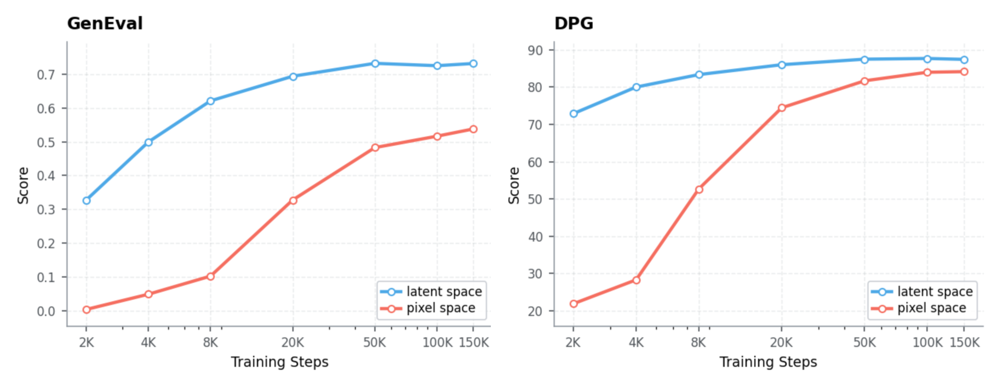{ width="900" }

*Figure 2，原论文第 3 页。横轴为训练更新数，左为 GenEval、右为 DPG；两条曲线使用相同主干 token 网格，差异主要来自预测表示。*

曲线最显著的差距出现在早期。按图估读，2K 更新时 latent 的 GenEval 已约为 0.33，pixel 还接近零；到 150K，latent 约为 0.73，pixel 约为 0.54。DPG 的后期差距较小，分别约为 87 和 84，但仍未闭合。这里是从图中读取的近似值，不能与后文表格中的四位小数当成相同精度。两项指标显示，像素模型在继续学习，却没有在给定预算内追上。

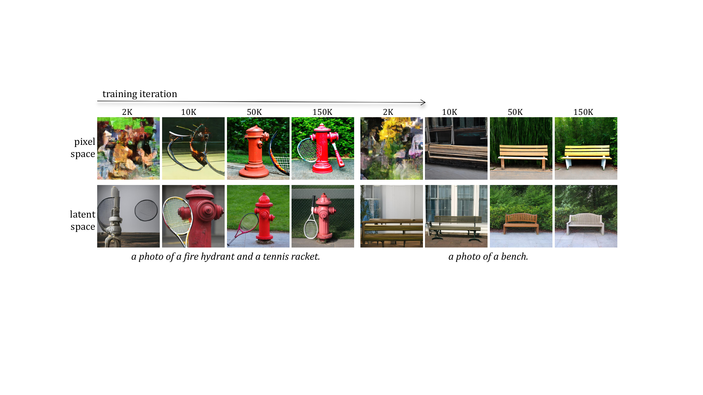{ width="900" }

*Figure 3，原论文第 3 页。上排 pixel、下排 latent，同一提示从 2K 走到 150K，观察对象身份与布局何时变得可辨认。*

消防栓与球拍、长椅两个提示把分数差异变成具体的学习过程。latent 在较早阶段已经出现可辨认对象，而 pixel 的早期样例仍是混乱局部形状，之后才逐渐组织成完整场景。这些例子支持更快学习结构的观察，但不足以说明所有内容类别都具有相同差距，也没有证明无限算力下像素模型的最终上限一定较低。论文标题中的经验研究，适用范围正是这组大规模训练设置及其有限预算。

## 迁移首先保留生成先验，再学习新的输入输出接口

### 哪些权重被继承，哪些模块仍从头学习

latent-to-pixel 不是简单把原 latent decoder 的输出叫作像素。输入变为带噪 RGB patch，输出需要直接重建 RGB；不再先预测某个独立 VAE 的 latent 再调用其 decoder。可复用的是 Transformer 与条件模块已经学到的文字视觉关系、布局和生成先验，像素专用输入与输出模块仍需建立新的表示接口。

初始化实验中，latent-initialized 模型加载源模型的 Transformer 与 conditioning 权重；像素专用输入输出模块与 from-scratch 对照采用相同初始化。两组使用相同架构、混合数据、优化器、学习率日程与更新数。这样，差异主要来自可迁移生成知识，不是其中一组额外获得了一个预训练好的像素 decoder。[↗](https://arxiv.org/pdf/2608.16887v1#page=13)

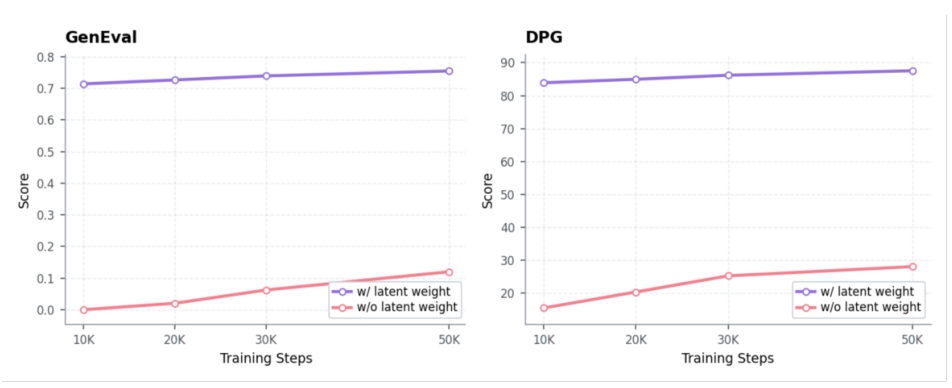{ width="900" }

*Figure 4，原论文第 4 页。两组都在像素空间训练；紫线继承 latent 权重，红线按从头训练方案初始化。*

按图估读，50K 更新时，继承权重的一组 GenEval 约 0.75、DPG 约 87，而从头训练的一组约为 0.12 与 28。这里与上一节预训练曲线的绝对差距不能直接对比，因为这一节进入了不同的后训练数据与配置；可比较的是本图两组共享设置下的初始化作用。Figure 5 的定性例子也显示，继承 latent 权重后，人物、场景与风格结构更早形成。

这说明表示空间发生变化，并不意味着全部生成知识失效。主干此前处理的是空间 token 与文本条件之间的关系，只要迁移初期保留相近的 token 网格，就有机会让新接口接到这些已有特征上。这个观察支持用 latent 预训练作为初始化，但没有把已有预训练的成本抹掉；对已有成熟 checkpoint 的团队与必须从零训练的团队，它的经济含义不同。

### 组件消融围绕同一个基线，只改变指定变量

后训练实验在 1K 分辨率直接优化完整模型，global batch size 为 128，学习率为 $5\times10^{-5}$。默认配置是 latent 初始化、真实与源模型生成数据混合、x-prediction、DiP 像素头、噪声尺度 $\gamma=2$、patch size 16。除被消融项外，文本条件、数据预处理、优化与评测协议保持一致。这里并非只冻结主干训练一个输出头，而是允许生成器在新的表示和监督下整体调整。[↗](https://arxiv.org/pdf/2608.16887v1#page=14)

下表压缩整理 Appendix Tables 4–5 的控制关系。它的用途是明确一条曲线改变了什么，不能将这些单项结果当成所有组合都已穷举。

| Study | Varied setting | Other settings |
| --- | --- | --- |
| Weight initialization | From scratch / Latent-pretrained | Mixed data, x-prediction, DiP, γ=2, ps16 |
| Training data | Real / Self-generated / Other-model / Mixed | Latent-pretrained, x-prediction, DiP, γ=2, ps16 |
| Prediction target | v-prediction / x-prediction | Latent-pretrained, Mixed data, DiP, γ=2, ps16 |
| Decoder architecture | JiT / DiP / PiT / Deco; VAE reference | Latent-pretrained, Mixed data, x-prediction, γ=2, ps16 |
| Noise scale | γ∈{1,2,4,8} | Latent-pretrained, Mixed data, x-prediction, DiP, ps16 |
| Patch size | ps16 / ps32 / ps32-adapt16 / ps64-adapt32 | Latent-pretrained lineage, Mixed data, x-prediction, DiP, γ=2 |

这是一种围绕工作基线展开的组件研究，适合得到可执行配方，但不同组件之间可能存在交互。例如更换 decoder 后，最好的噪声尺度或 patch size 可能变化；论文没有用完整交叉实验证明每个最佳选项在所有组合中独立成立。最终整套模型的结果用于检验这些选项放在一起能否工作，和单项机制解释承担不同证据作用。

## 真实图像与源模型生成图像解决不同的迁移问题

### 为什么同一源模型的数据比任意合成图像更容易迁移

像素监督的一个吸引力，是可以直接学习真实 RGB 中被 VAE 损失的细节。但实验发现，只用真实图像，迁移反而收敛较慢。作者比较四组数据，真实图像来自最新 Z-Image SFT 集合；self-generated 图像由提供初始化权重的同一个 Z-Image latent checkpoint 按默认设置生成；other-model 图像由 FLUX2-klein-9B 使用相同 prompt pool 生成；mixed 按 self-generated 与 real 的 1:1 比例采样。合成数据离线生成，与原始提示配对。[↗](https://arxiv.org/pdf/2608.16887v1#page=13)

这个设置把“合成数据”进一步拆成是否与源模型一致。模型原来的条件分布由该 latent checkpoint 表达，使用其生成样本时，新模型在改变输出表示的同时，仍面对较熟悉的内容分布；直接切到真实图像，表示变化与目标分布变化叠加。作者据此提出较低 distribution shift 的解释。外部 FLUX 生成样本弱于同源样本，与该解释相容，但外部模型的风格、错误和质量分布也同时不同，不能仅凭四组曲线证明唯一原因就是分布距离。

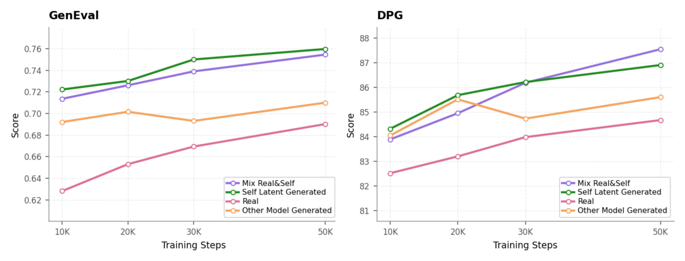{ width="900" }

*Figure 6，原论文第 4 页。绿色为源 latent 模型生成数据，紫色为 1:1 混合，粉色为真实图像，橙色为其他模型生成图像。*

图中 real-only 始终较慢，self-generated 迅速获得较高分数。50K 附近按图估读，GenEval 中 self-generated 约 0.760，mixed 约 0.755，other-model 约 0.710，real-only 约 0.690；DPG 则 mixed 约 87.5，self-generated 约 86.9，other-model 约 85.6，real-only 约 84.7。混合数据并非两个 benchmark 都第一，它在保持较快适应的同时取得更高 DPG，并在部分细节样例上改善。这比“真实加合成一定全面最好”更符合图中的证据。

### 为什么只复制源分布会继承源模型的错误

源模型生成图像已经通过原 VAE 解码，包含源生成器与 decoder 的共同缺陷。只使用这些图像训练，即使最终网络直接输出 RGB，也没有获得纠正错误的新监督。比如源图像的文字拼写错误、局部结构扭曲或对象关系缺陷，可能继续进入像素模型；取消独立 VAE 并不会凭空生成正确目标。

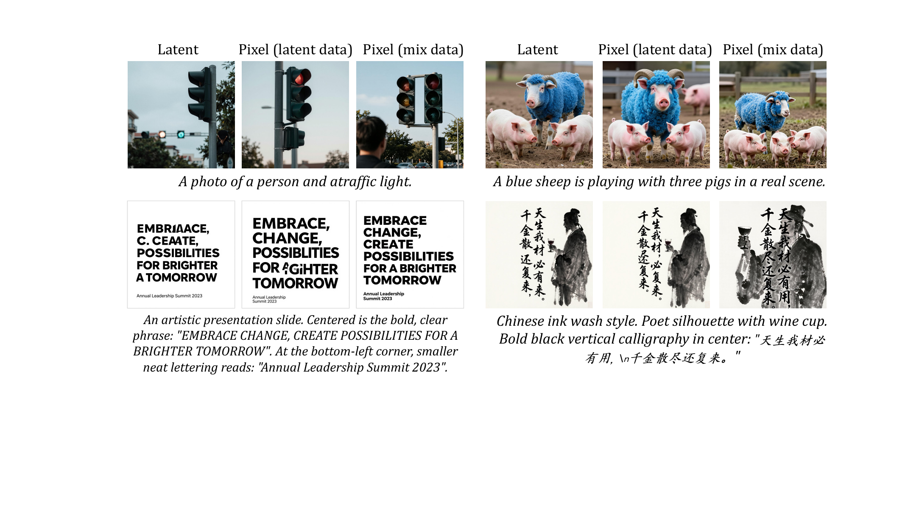{ width="900" }

*Figure 7，原论文第 4 页。每组三列依次为原 latent、仅用源模型数据的 pixel、混合数据的 pixel；文字和对象组合提供不同观察入口。*

英文海报的例子能直接看到，仅用源生成图像的像素模型仍可能保留破损拼写，混合真实图像后文字更完整。人物与交通灯、蓝色羊与三只猪的例子展示对象和关系的差异。它们支持真实监督可以修正部分继承缺陷，但精选图不能给出全部文字的纠错率，也不能证明任意真实图像都能带来同样收益。真实数据的质量、描述准确性以及与目标任务的关联仍然重要。

因此，1:1 混合并非简单的数据量扩充。self-generated 约束迁移初期不要丢失既有生成能力，真实 SFT 图像提供源模型自身输出之外的像素目标。实际成本也有两部分，后训练更新之外，还需离线生成和存储合成样本。论文给出了比例和来源，没有完整列出最终混合数据量、合成采样预算与全部 GPU-hour，不能由推理加速倍数反推出训练投入很小。

## x-prediction 的优势来自参数化，损失仍在速度空间

### 先区分网络输出、监督目标与采样器接口

源 latent 模型使用 v-prediction，迁移后可以继续输出速度，也可以改为预测干净图像。论文 Figure 8 表明，latent 初始化足以让两种像素模型都收敛，x-prediction 在展示训练区间内得分更高。这一结果没有复现“像素 v-prediction 必然发散”的强说法，也没有说明原 latent 权重因目标变化而无法利用。[↗](https://arxiv.org/pdf/2608.16887v1#page=5)

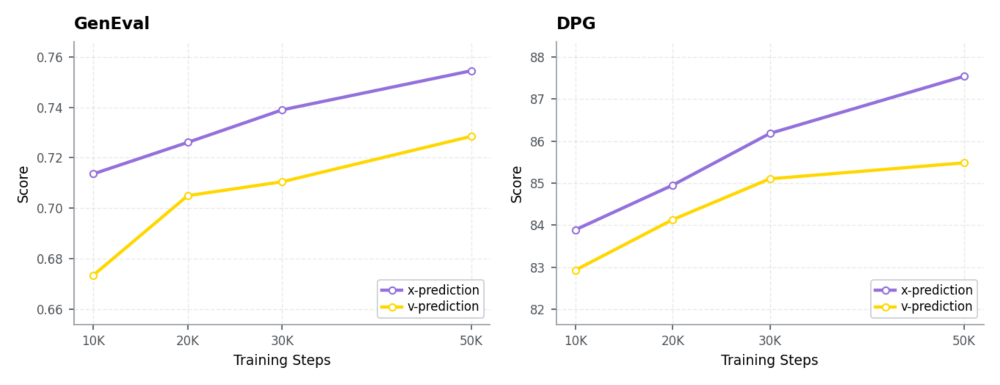{ width="900" }

*Figure 8，原论文第 5 页。紫线为 x-prediction、黄线为 v-prediction，两组都继承 latent 权重，并共享 velocity-space objective。*

按图估读，50K 时 x-prediction 的 GenEval 约 0.755、DPG 约 87.5，v-prediction 约为 0.729、85.5。这里比较的关键条件在附录，两组使用相同 flow path、logit-normal 时间采样、噪声尺度、主干、像素头和求解器，而且都使用 velocity-space loss。x-prediction 输出必须先转换为对应速度，才能计算损失与执行 ODE 采样。若把它实现成无权重的 clean-image MSE，就已经改变了论文实验。[↗](https://arxiv.org/pdf/2608.16887v1#page=13)

### 从论文路径推导 clean image 到 velocity 的转换

原文将干净 RGB 记为 $x_0$，但采用的插值是

$$
x_t=t x_0+(1-t)\gamma\epsilon,
\qquad \epsilon\sim\mathcal N(0,I).
$$

因此时间端点仍是 $t=0$ 对应噪声、$t=1$ 对应干净图像，不能因为干净样本下标叫 0 就反转采样方向。$\gamma$ 控制噪声标准差，后面单独讨论其校准。[↗](https://arxiv.org/pdf/2608.16887v1#page=6)

根据这条路径，可以直接得到以下解释性推导。固定一对 $x_0,\epsilon$，路径速度为

$$
v_t=\frac{dx_t}{dt}=x_0-\gamma\epsilon
=\frac{x_0-x_t}{1-t},\qquad t<1.
$$

若网络直接输出 $\hat x_0=f_\theta(x_t,t,c)$，其中 $c$ 是文本条件，那么交给 velocity loss 和 ODE solver 的量为

$$
\hat v_\theta=\frac{f_\theta(x_t,t,c)-x_t}{1-t}.
$$

在固定的 $t<1$ 上，两者的速度误差满足

$$
\lVert\hat v_\theta-v_t\rVert^2
=\frac{\lVert f_\theta(x_t,t,c)-x_0\rVert^2}{(1-t)^2}.
$$

这说明“输出干净图像”与“按相同权重最小化干净图像误差”并非同一训练方案。论文将两种参数化放在共同的速度目标下，变化的是网络需要直接表示什么；x-prediction 把输出约束到结构化 RGB 目标，再通过解析转换适配采样器。上面的式子由原路径和附录描述推出，并非论文额外提出的新损失。

当 $t$ 接近 1，转换中的分母会变小，端点处理对数值稳定性有实际影响。论文没有在这组说明中列出精确 clipping 或端点截断实现，因而复现时需要与所用 JiT/L2P 及求解器实现保持一致，不能随意在 $t=1$ 直接除以零。这个局部实现边界不影响两条曲线的主要判断，却影响“照公式写代码”能否得到相同训练行为。

## 像素 decoder 决定每个 token 怎样变成连续画面

### 移除独立 VAE，仍然需要从主干特征生成 RGB

像素模型依然需要一个将 Transformer 特征映射成 RGB 的输出模块。它属于每次去噪网络调用的一部分，与 latent 模型在整个去噪轨迹结束后单独执行一次的 VAE decoder 不同。这一区分影响质量，也影响成本，不能因为最终输出是像素就认为所有解码工作都消失了。

论文固定主干、latent 初始化、混合数据、x-prediction、$\gamma=2$ 与 ps16，只替换输出 head。JiT 使用线性投影，每个视觉 token 直接产生其 patch 对应的像素；DiP 使用与 L2P 一致的轻量卷积 U-Net；PiT 采用 PixelDiT 风格的 4 个额外 Transformer block；Deco 使用频率分解的输出设计；FLUX-AE 列为 VAE 参考。像素 head 从头初始化，共享主干从同一 latent checkpoint 继承。[↗](https://arxiv.org/pdf/2608.16887v1#page=13)

Table 1 的 Params、Latency 与 GFLOPs 都是 decoder 本身，测试为单 H800、$1024^2$、batch size 1。GenEval 和 DPG 则来自使用对应 head 的生成模型，不能把 6.02 ms 当成 DiP 模型生成一张图的总时长。

| Metric | JiT | DiP | PiT | Deco | VAE |
| --- | ---: | ---: | ---: | ---: | ---: |
| GenEval ↑ | 0.7380 | 0.7545 | 0.7697 | 0.7347 | — |
| DPG ↑ | 86.19 | 87.54 | 86.36 | 86.10 | — |
| Params (M) ↓ | 2.95 | 10.09 | 2249.82 | 315.92 | 49.55 |
| Latency (ms) ↓ | 0.07 | 6.02 | 74.96 | 5.01 | 91.88 |
| GFLOPs ↓ | 24.16 | 834.03 | 19731.88 | 2587.05 | 10472.20 |

PiT 的 GenEval 最高，为 0.7697，但 head 达到约 2.25B 参数，相当于 6B 主干的 37.5%，单次约 19,731.88 GFLOPs。它展示容量可以改善某些分数，同时也说明若目标是低延迟部署，不能只看最高分。JiT 最轻、最快，却在 GenEval 和局部画面连续性上付出代价。DiP 的 DPG 为最高的 87.54，GenEval 为 0.7545，在 10.09M 参数下取得较好的综合取舍。[↗](https://arxiv.org/pdf/2608.16887v1#page=6)

这里还有一个反直觉但有用的比较，Deco 的 FLOPs 为 2587.05，高于 DiP 的 834.03，实际 head latency 却是 5.01 ms，略低于 DiP 的 6.02 ms。算子组织、并行性和硬件利用率会使计算量与实测延迟不完全同序。因此论文选 DiP 的依据是质量、规模、计算和细节表现的组合，不能概括为“DiP 每项成本都最小”。VAE 的质量栏为未列结果，也不能将横杠当成零分来排名。

### 相邻 patch 的边界为什么需要局部交互

线性 head 对每个 token 独立输出像素，主干虽然可以交换全局信息，最后的像素映射仍容易在 patch 边缘形成不连续。DiP 的卷积局部性与权重共享让邻近特征在像素合成时继续交互，对连续边缘与平滑区域提供更直接的结构偏置。

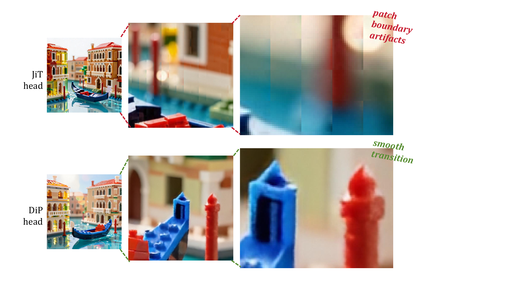{ width="860" }

*Figure 9，原论文第 5 页。观察放大区域的规则网格边界，上排 JiT 更明显，下排 DiP 的过渡更平滑。*

原图的远景差别不一定显著，放大后，JiT 在相邻 patch 边界出现规则块状痕迹，而 DiP 的局部连续性更好。这给轻量卷积头的选择提供了可见依据。不过两者参数量与结构同时不同，局部归纳偏置是作者提出的解释，实验没有把卷积共享、容量和感受野各自的贡献全部隔离。可复用的结论是，在当前大规模文生图迁移中，极简线性输出的速度优势会伴随可观察的边界问题，较小的卷积模块提供了有效修补方向。

此外，Table 1 不能用来计算整个推理路径的简单“VAE 91.88 / DiP 6.02”倍数。latent 的 VAE 在最后调用一次，pixel head 随去噪网络反复调用；Table 1 的 ps16 与最终 ps32 也不同。真正部署收益需要把主干 token 数、NFE 和输出模块一起计时，后文 Table 3 才是端到端证据。

## 噪声尺度需要校准表示变化，不能只按分辨率套公式

### γ 改变的是噪声标准差与有效信噪比

迁移后，网络面对的表示从 VAE latent 变成归一化到 $[-1,1]$ 的 RGB，空间尺寸与信号统计同时变化。论文在已有线性 flow path 中引入单个噪声尺度 $\gamma$，不全面重写时间日程。由

$$
x_t=t x_0+(1-t)\gamma\epsilon
$$

可以看到，同一 $t$ 下，$\gamma$ 越大，噪声标准差越大；其方差按 $\gamma^2$ 变化。它不是 CFG strength，也不是将采样时间简单乘以一个常数。训练时间仍来自相同的 logit-normal 分布，噪声尺度实验保持预测目标、损失权重、初始化和优化日程一致。[↗](https://arxiv.org/pdf/2608.16887v1#page=14)

### 分辨率推导为什么只得到参考值 8

设 RGB 与 VAE latent 的每轴分辨率比为 $r$，此处 $r=8$。如果用 $r\times r$ 平均池化近似压缩，独立像素噪声的平均包含 $r^2$ 个随机量。均值噪声的方差为

$$
\operatorname{Var}\!\left(\frac{1}{r^2}\sum_{i=1}^{r^2}\gamma\epsilon_i\right)
=\frac{\gamma^2}{r^2}.
$$

这一步要求噪声独立、方差相同。进一步假设信号统计在对应尺度可比较，就得到论文的近似关系

$$
\mathrm{SNR}^{\downarrow r}_{\mathrm{pixel}}(t)
\approx\frac{r^2}{\gamma^2}\mathrm{SNR}_{\mathrm{latent}}(t).
$$

若只考虑分辨率变化，匹配两边 SNR 会给出 $\gamma=r=8$。它是一个建立在平均池化和可比信号假设上的参考，VAE encoder 具有学习到的非线性表示、通道和尺度变化，不能等同于平均池化。RGB 与 latent 的信号分布、预测目标也不同，所以几何比例不足以唯一决定迁移的最佳噪声强度。[↗](https://arxiv.org/pdf/2608.16887v1#page=6)

### 实验最优值为 2，而非理论参考值 8

Table 2 固定其他设置，只比较四个噪声尺度。GenEval 与 DPG 均为越高越好。

| Metric | γ=1 | γ=2 | γ=4 | γ=8 |
| --- | ---: | ---: | ---: | ---: |
| GenEval ↑ | 0.6811 | 0.7545 | 0.7413 | 0.7316 |
| DPG ↑ | 84.03 | 87.54 | 86.01 | 85.64 |

$\gamma=2$ 在这四点中最优。与默认不放大噪声的 1 相比，GenEval 增加 0.0734、DPG 增加 3.51；与分辨率推导的 8 相比，也分别高 0.0229 和 1.90。这里的差值由表中数字直接计算。它支持经验校准的重要性，未证明 2 是连续区间的全局最优，更没有证明所有分辨率、数据标准化和模型都应采用 2。

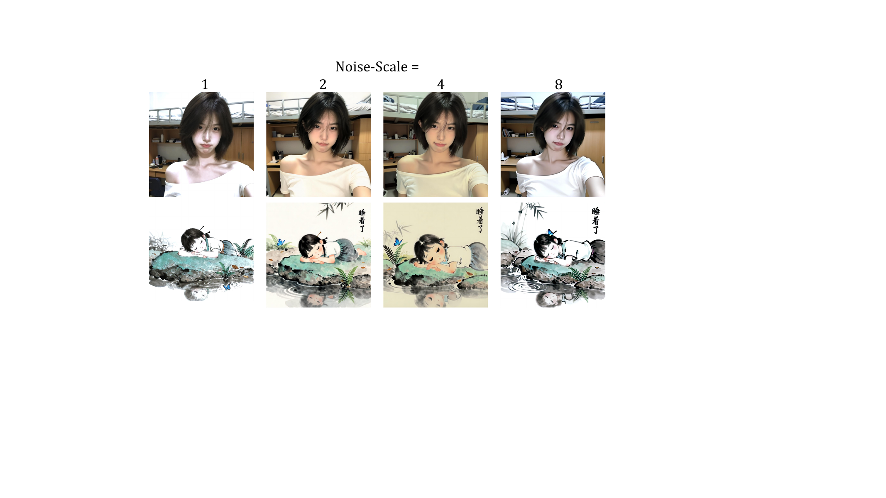{ width="760" }

*Figure 10，原论文第 6 页。两种风格样例按噪声尺度横向比较，作者指出 1、4、8 存在可见色偏，2 的色彩较平衡。*

人物与水墨风格的样例使噪声变化的影响不只表现为抽象分数，还体现在色彩与局部视觉分布上。它们不构成独立的大规模色彩准确性基准，但提醒迁移后应检查像素统计，而不只检查是否出现了正确对象。

推理必须使用训练时同一个 $\gamma$ 初始化噪声，即从相应的 $\gamma\epsilon$ 出发。若训练用 2、推理仍从标准差 1 的噪声出发，就改变了模型所学习的路径端点。论文明确保持这一对应关系；只修改训练端加噪幅度、忽略采样初始化，并不是原配方。

## 大 patch 的效率来自渐进适应，不是直接扩大就能保住细节

### 三种空间网格改变了什么

在 $1024\times1024$ 图像上，ps16、ps32、ps64 分别对应 $64\times64$、$32\times32$、$16\times16$ 的 token 网格。每次 patch 边长翻倍，token 数变成四分之一。这里较大的 patch 是可学习输入投影的覆盖范围，最终仍在完整 RGB 图像上监督；它与将 VAE latent 更强压缩并不是同一个操作。[↗](https://arxiv.org/pdf/2608.16887v1#page=7)

| Setting | Patch size | Token grid at 1024² | Visual tokens | Initialization |
| --- | ---: | --- | ---: | --- |
| ps16 | 16 | 64 × 64 | 4096 | Latent checkpoint |
| ps32 | 32 | 32 × 32 | 1024 | Latent checkpoint |
| ps32-adapt16 | 32 | 32 × 32 | 1024 | Converged ps16 pixel checkpoint |
| ps64-adapt32 | 64 | 16 × 16 | 256 | Converged ps32-adapt16 checkpoint |

direct ps32 也从 latent 主干初始化，不是从随机权重开始。它同时改变预测表示和空间网格，每个 token 覆盖更大的 RGB 区域，源模型原来在较细网格上形成的局部先验更难接入。ps32-adapt16 先完成同网格的 latent-to-pixel 迁移，再从已收敛像素模型适应更粗网格，将两类变化分开。

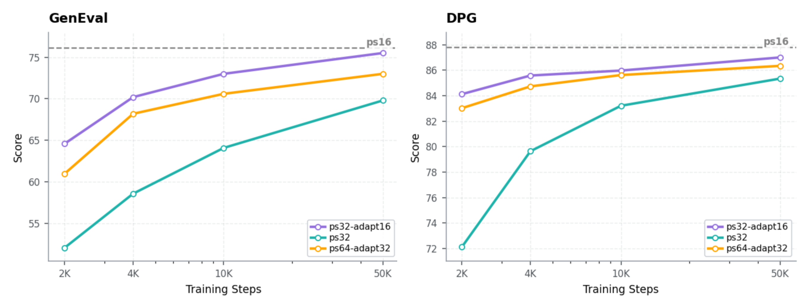{ width="900" }

*Figure 11，原论文第 7 页。紫色 ps32-adapt16 优于直接 ps32，橙色 ps64-adapt32 再次出现性能下降；虚线为 ps16 参考。*

50K 时按图估读，ps32-adapt16 的 GenEval 约为 75.5，直接 ps32 约为 69.8，ps64-adapt32 约为 73.0；DPG 分别约为 87.0、85.3、86.3。这里 GenEval 图使用接近百分数的纵轴写法，75.5 对应约 0.755，不能误读成比前面 0.75 高两个数量级。ps32-adapt16 接近 ps16，但虚线仍略高，因此“token 减少四倍、质量完全不变”也超出了图中证据。

横轴表示本阶段适应更新数，渐进方案还包含此前 ps16 或 ps32 的训练。图显示的是更好初始化带来的适应效率，没有把所有阶段累计 GPU-hour 做成严格匹配的总训练成本比较。对已有收敛 checkpoint 的使用者，这种迁移效率很有价值；若从零计算总预算，必须把前序阶段算进去。

### 扩展输入投影的 1/2 系数在保护什么

附录给出了关键实现。Transformer 与 decoder 的架构不变，其余权重直接继承；patch 从 $p$ 扩到 $2p$ 时，输入投影 MLP 第一层需要接受四个原尺寸子块。设旧权重为 $W$，新权重沿输入维拼接为

$$
W'=\frac12[W,W,W,W],
\qquad b'=b.
$$

新输入维度扩大四倍，bias 直接复制。这不是把主干复制四份，也不是将旧 patch embedding 的平均值取成 $1/4$。论文用 $1/2$ 补偿 fan-in 增长，近似保持初始化激活方差。[↗](https://arxiv.org/pdf/2608.16887v1#page=14)

可以用一个简化计算理解系数。若四个子块经旧投影得到的响应互不相关、方差相同为 $\sigma^2$，那么未缩放的响应之和方差为 $4\sigma^2$；乘以 $1/2$ 后，方差变为 $(1/2)^2\times4\sigma^2=\sigma^2$。真实图像子块存在相关性，因此这只是方差保持的近似动机，不保证每个新 token 与原 token 输出完全相同。按平均值使用 $1/4$ 会产生不同的方差尺度，不能当成等价替换。

优化日程也对新旧参数区别处理。继承的 Transformer 与 decoder 使用 5,000 步线性 learning-rate warmup，扩展的输入投影 MLP 从第一步就使用目标学习率。输入接口要尽快适应新的像素组织，已有生成先验则缓慢增加更新幅度；把所有模块都放进同一个 warmup 会改变这个策略。ps64-adapt32 使用相同的权重扩展方式。[↗](https://arxiv.org/pdf/2608.16887v1#page=15)

论文交代了投影权重和训练日程，但没有在正文逐层展开不同 patch 网格进入 DiP 的全部张量布局。实际重建模型仍应与其采用的 DiP/L2P 实现对齐，不能仅凭 $W'$ 公式自行假定输出头怎样重排所有空间位置。这是接口实现需要补齐的地方，不是渐进迁移结果本身缺少实验支持。

### ps64 的反例说明局部信息没有无限压缩空间

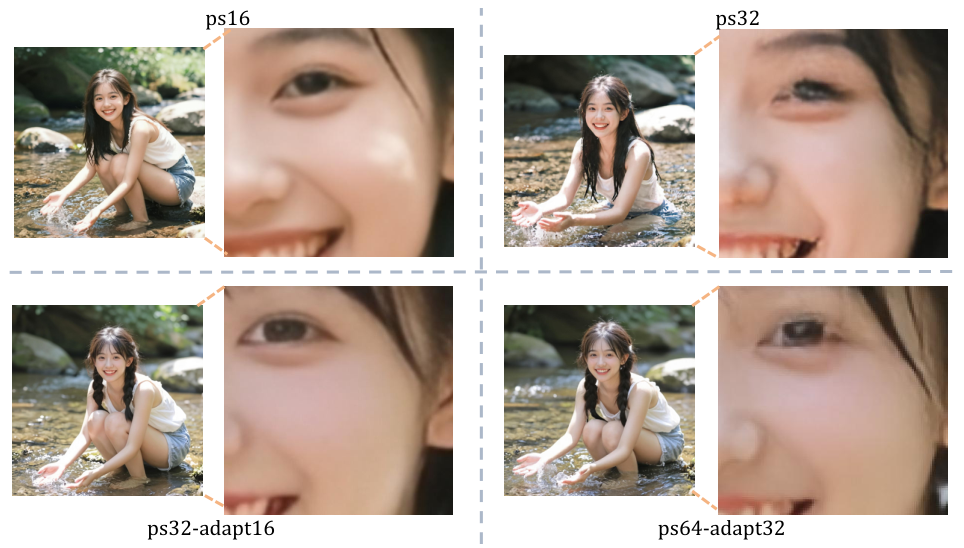{ width="900" }

*Figure 12，原论文第 7 页。ps16 与 ps32-adapt16 的局部细节更稳定，直接 ps32 与进一步压到 ps64 的样例出现局部伪影。*

放大眼睛和面部边缘后，可以看到直接 ps32 的局部结构问题，而 ps32-adapt16 改善了这些细节；继续到 ps64，伪影重新出现。其 benchmark 也下降，因此失败不是只由某一个精选截图得出。更大的 patch 将更多局部变化压到单个 token 的表示与输出处理中，即使监督仍然是完整像素，也可能超过当前网络和训练配方能够保留的细节范围。

token 减少四倍也不等于端到端恰好加速四倍。主干中线性层与注意力的序列依赖不同，文本 token、像素 head、数据搬运与固定开销未必同比缩减；最理想的纯视觉 attention 二次项甚至有不同的缩减比例。最终选择 ps32-adapt16，需要同时依靠质量曲线、局部观察和实测端到端延迟，不能只凭 token 数做结论。

## 少步蒸馏把更短序列的收益带到最终延迟

### 两阶段训练，而非推理时直接少走几步

作者从收敛的 ps32-adapt16 像素模型初始化 DMD 训练，第一阶段使用 Decoupled-DMD，第二阶段使用 DMDR 并引入 Z-Reward。相关损失系数、fake-sample 更新频率和时间采样分布遵循所引用的 DMD2、Decoupled-DMD 方法；本论文没有逐项重印全部数值。因此其贡献主要是将既有少步蒸馏流程接到已完成像素迁移的模型上，不是另行提出一个新的分布匹配目标。[↗](https://arxiv.org/pdf/2608.16887v1#page=15)

最终 Turbo 使用 ODE sampler，4 次 function evaluation，不需要 CFG。对照的 latent distilled baseline 也使用相同 NFE。这一条件重要，因为带 CFG 的一次求解更新可能需要条件与无条件两路计算，表中的 NFE 应按实际网络调用口径理解，不能任意将 4 NFE 再乘二。这里比较的是已经训练成少步生成器的模型，不是把一个普通 100 NFE checkpoint 的推理循环改成四次就会得到相同质量。

第二阶段还引入奖励优化，因此 final Turbo 与多步模型之间的质量变化可能包含蒸馏与奖励塑形共同作用。不能把某个 benchmark 上的改善全部解释成“少步本身比多步更好”。同样，论文与官方 latent Turbo 的比较是最终成品比较，并非证明两种表示在完全相同蒸馏训练预算下的唯一差异。

### 固定 VAE 开销为何在少步时更显眼

一个简化成本模型能帮助理解这条路线。latent 推理包含 $N$ 次去噪网络调用，再加一次 VAE 解码；pixel 推理包含 $N$ 次主干与像素 head 调用，最后直接得到 RGB。把这些部分写成解释性计时式，可表示为

$$
T_{\mathrm{latent}}\approx N C_{\mathrm{latent}}+D_{\mathrm{VAE}}+C_{\mathrm{other}},
$$

$$
T_{\mathrm{pixel}}\approx N(C_{\mathrm{backbone}}+C_{\mathrm{head}})+C'_{\mathrm{other}}.
$$

这里 $C$ 表示相应单次耗时，$D_{\mathrm{VAE}}$ 为一次独立解码，其他开销包括文本处理和运行固定成本。这个式子只是拆解计时的分析模型，未声称论文逐项测出了这些常量。当 $N$ 很大，主干计算占主导；当 $N$ 很小，无法随 NFE 一起减少的 VAE 解码占比上升。pixel head 同样有成本，但与更短序列和少步生成一起设计后，可以得到更有利的端到端取舍。[↗](https://arxiv.org/pdf/2608.16887v1#page=7)

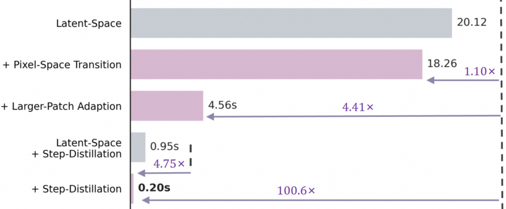{ width="760" }

*Figure 13，原论文第 8 页。图比较各阶段整体延迟，未单独测出 VAE 与 head 的每一项耗时；图注写 H100，而同页 Table 3 写 H800，硬件标注存在冲突。*

原 latent 为 20.12 秒，单纯 pixel-space transition 的比较点为 18.26 秒，约 1.10 倍；加入 larger-patch adaptation 后为 4.56 秒，相对原 latent 约 4.41 倍；四步 pixel 为 0.20 秒，相同四步 latent 为 0.95 秒，约 4.75 倍。这个顺序说明，迁移空间本身只带来有限变化，缩短 token 序列是多步模型的大幅收益来源，少步训练再进一步降低总调用成本。

图中 100.6 倍来自 $20.12/0.20$，起点是 100 NFE latent，终点是 4 NFE pixel，跨越了表示、patch 和蒸馏多个变化。它适合描述整条升级路径，不能写成相同采样预算下 pixel 对 latent 的纯架构优势。图中 18.26 秒也与 Table 3 的 L2P 对应；应把它作为报告提供的迁移参考点，不能将整幅图误当成所有训练条件严格相同的逐项因果消融。

Table 3 标注单 H800，Figure 13 图注标注单 H100，但显示同一组主要时间。论文没有在这里解释差异，因此后文表格按其明确写出的 H800 口径转录，图注冲突保留在对应位置。它不妨碍读取作者报告的相对时间，但限制了将 0.20 秒当成任意 H100/H800 环境必然可复现的硬件承诺。

## 最终模型在两个家族上保留了哪些能力

### 最终训练规模与组件消融不同

完成组件研究后，作者扩大混合训练集并延长像素后训练，再得到 Table 3 的最终模型。不能将最终分数直接当成前面 50K 单项曲线的末点，也不能用 Table 2 中 0.7545 与最终 0.7644 的差值单独归因于 patch 变化。这里还有数据规模与训练时长的变化。[↗](https://arxiv.org/pdf/2608.16887v1#page=15)

第二个模型家族从 FLUX2-klein-9B-Base 初始化，仍使用 synthetic-to-real 1:1、x-prediction、DiP、$\gamma=2$ 和渐进 patch 适应，只做该家族所需的架构接口调整。这比只在 Z-Image 上报告一组结果更能支持配方的可迁移性，但两个家族仍不能覆盖所有 VAE、文本编码器、分辨率和生成任务。

评测使用 benchmark 原始提示，没有使用 Prompt-Enhanced 版本。延迟对应 $1024\times1024$、单 H800、未进行系统级优化。L2P 与 AsymFlow 的比较使用各自官方开源 checkpoint 和推理设置；它们不是在本文统一预算下从头重训的算法消融。下面将原 Table 3 按模型家族分成两部分，数值和列名保留原口径。[↗](https://arxiv.org/pdf/2608.16887v1#page=8)

### Z-Image 在组合与长文本指标上并非完全同向

| Model | NFE | Latency (s) ↓ | GenEval ↑ | DPG ↑ | OneIG ↑ | LongText ↑ |
| --- | ---: | ---: | ---: | ---: | ---: | ---: |
| Z-Image (latent-space) | 100 | 20.12 | 0.7510 | 86.91 | 0.566 | 0.9332 |
| L2P (pixel-space) | 100 | 18.26 | 0.7612 | 86.00 | 0.499 | 0.7798 |
| Ours (pixel-space) | 100 | 4.56 (4.41×) | 0.7644 | 87.60 | 0.564 | 0.9252 |
| Z-Image-Turbo (latent-space) | 4 | 0.95 | 0.7625 | 85.31 | 0.520 | 0.8639 |
| Ours-Turbo (pixel-space) | 4 | 0.20 (4.75×) | 0.7698 | 86.85 | 0.512 | 0.8732 |

100 NFE 时，Ours 相对原 latent 的 GenEval 从 0.7510 到 0.7644，DPG 从 86.91 到 87.60；OneIG 从 0.566 略降到 0.564，LongText 从 0.9332 降到 0.9252。与此同时，延迟从 20.12 秒降到 4.56 秒。因而主要结论是，在较接近的整体质量下获得明显提速，且部分对齐指标上升；“四个 benchmark 全部超过 latent”不成立。

与 L2P 比，Ours 四项质量指标都更高，特别是 OneIG 0.564 对 0.499、LongText 0.9252 对 0.7798，并且更快。这个对照说明较完整的迁移配方能够缓解早期 latent-to-pixel 方法在某些能力上的损失。它不能把每项改善分解到某一个组件，因为最终训练规模、配方与 checkpoint 来源也不同。

4 NFE 时，Ours-Turbo 的 GenEval 0.7698、DPG 86.85、LongText 0.8732 高于对应 latent Turbo 的 0.7625、85.31、0.8639，但 OneIG 为 0.512，低于 0.520。4.75 倍速度对应的是相同 NFE 比较，比 100.6 倍更适合回答“已经有四步 latent 模型时，迁移方案还能带来多少收益”。若应用特别关注 OneIG 涵盖的综合能力，仍需检查这项下降是否在实际需求中可接受。

也不能只因为某些指标提高就宣称完全没有质量代价。GenEval、DPG、OneIG、LongText 看不同方面，表中没有提供重复运行误差或显著性区间；0.002 这样的差距与大幅延迟变化应使用不同强度的语言。较稳妥的读法是，速度改善幅度清楚，质量整体接近并有分项得失。

### FLUX2-klein 验证迁移性，也留下明确反例

| Model | NFE | Latency (s) ↓ | GenEval ↑ | DPG ↑ | OneIG ↑ | LongText ↑ |
| --- | ---: | ---: | ---: | ---: | ---: | ---: |
| FLUX2-klein-Base (latent-space) | 100 | 20.25 | 0.8027 | 84.89 | 0.541 | 0.5456 |
| AsymFlow (pixel-space) | 100 | 21.42 | 0.8181 | 86.70 | 0.508 | 0.4498 |
| Ours (pixel-space) | 100 | 6.38 (3.18×) | 0.8096 | 86.88 | 0.554 | 0.6632 |
| FLUX2-klein (latent-space) | 4 | 0.92 | 0.8142 | 84.36 | 0.537 | 0.4763 |
| Ours-Turbo (pixel-space) | 4 | 0.28 (3.29×) | 0.8185 | 86.00 | 0.530 | 0.6105 |

100 NFE 时，FLUX 系 Ours 在四项质量指标上都高于原 latent，延迟从 20.25 秒降到 6.38 秒，论文标注为 3.18 倍。LongText 从 0.5456 到 0.6632，说明这个家族没有简单重复 Z-Image 的 LongText 小幅下降，迁移影响依赖源模型和训练条件。表中倍数沿用论文报告；仅用已四舍五入的延迟反算，会与某些标注存在末位差异，不能从展示精度推断更精确的原始计时。

AsymFlow 的 GenEval 为 0.8181，高于 Ours 的 0.8096；其 DPG、OneIG、LongText 则较低，且延迟 21.42 秒较高。因此 Ours 对既有 pixel 方法的优势主要是大部分指标与速度的组合，并未在本组全部质量列压过 AsymFlow。这也是为什么实际选型不应把 “pixel-space” 当成单一统一架构，不同迁移和输出方案可能得到不同能力分布。

4 NFE 时，Ours-Turbo 的 GenEval、DPG、LongText 分别为 0.8185、86.00、0.6105，高于 latent 的 0.8142、84.36、0.4763；OneIG 从 0.537 降至 0.530。0.92 秒到 0.28 秒对应约 3.29 倍，方向与 Z-Image 的少步结果一致。两个家族的 Turbo 都出现 OneIG 小幅下降，至少提醒读者，少步像素配方的综合能力仍需要保留多维检查，而不能只凭 GenEval 改善认为全部能力更强。

### 系统收益的适用条件

论文明确未使用系统级优化，Figure 13 甚至以 FlashAttention 为例说明未启用的优化类型。因而速度表最适合比较所报告实现中的结构收益，不等同于经过编译、低精度、融合算子与高度优化 attention 后的最终产品差距。改变软件栈可能同时改变主干、head 和固定开销比例，倍数未必保持不变。

0.20 秒与 0.28 秒也只对应单张 1K 图像、指定设备与四次调用，不能外推到消费卡、批量吞吐、多图条件、视频或更高分辨率。论文没有完整给出显存曲线、能耗或端到端训练成本，因而“推理更快”具有直接计时证据，“完整生命周期一定更省”仍需要额外预算核算。对部署方，这意味着先在自己的输出尺寸、batch、硬件和系统栈上复测，再决定迁移训练的投入是否值得。

## 如何把论文配方转成可检查的迁移流程

如果已经有成熟 latent 文生图模型，最先应检查的是是否能在 RGB 表示下保持原来的空间 token 网格。本文先用 ps16 对齐原 $8\times2$ 的等效空间尺度，让可迁移主干面对相近的 token 布局。然后只接入必要的像素输入输出模块，并让生成器在新的监督中整体适应。初始化实验说明，这个已有先验是收敛速度的主要来源之一，不能把像素输出头单独拿来替换原 decoder 就期待相同效果。

数据应同时检验迁移稳定性与纠错来源。本文用同 checkpoint 离线生成图像保持源条件分布，再混合高质量真实 SFT 图像；应分别观察是否遗忘原有内容、是否继承源错误、真实数据是否具有可靠描述。其他模型生成图像不是当然等价的替代品，1:1 也只是已验证的工作点，论文没有做完整比例扫描来证明它适合每个数据集。

训练目标需要将输出参数化、损失和求解器接口一起定义。若采用 x-prediction，仍按原线性路径转成 velocity 再计算共享目标；图像归一化、$\gamma$ 和推理初始噪声必须一致。随后以相同质量协议比较 head 的局部伪影与端到端成本，不能仅用 GFLOPs 或单次 decoder latency 决定输出结构。

等 ps16 稳定后，再用复制缩放的输入投影与分组 warmup 适应 ps32。渐进路线的收益来自减少同时发生的分布与空间粒度变化，代价是额外训练阶段；ps64 结果提醒不能无限扩大 patch。最后才进行本文采用的两阶段少步蒸馏，在相同 NFE 下对比 latent Turbo，并同时测量综合质量和尾部失败，而不是只报告最好的单项分数。

这套流程中有足够明确的接口、公式和超参数可以作为实验起点，但完整复现还需要源 checkpoint、真实 SFT 数据、离线生成集合、decoder 具体布局以及所依赖蒸馏实现。最终数据量、延长训练的准确预算等没有在报告中全部列出，不能仅凭“global batch 128、学习率 5e-5”估算训练到最终结果的时间。对研究工作，先在可控样本上验证迁移曲线与局部图像变化，比直接照搬整张速度表更有意义。

## 论文结论的边界与下一步问题

最有支撑的结论是，表示空间可以按训练阶段选择。在本文的大规模设置下，latent 预训练更快建立生成能力，pixel 后训练则提供直接 RGB 监督与新的部署效率空间。这个结论同时依赖已有 latent 权重、适合迁移的数据、经过选择的输出参数化和像素 head；它没有证明“所有像素模型从头训练都不值得”，也没有否认未来更好的架构或优化可能缩小预训练差距。

三项尚未完全拆开的因素尤其影响后续研究。其一，真实与同源合成混合的最优比例是否随源模型质量和真实数据规模变化；其二，ps64 的失败有多少来自单 token 容量、局部输出结构或适应预算；其三，系统优化与更少 NFE 会如何重新分配主干、像素 head 和固定开销。论文分别提供了可观察的起点，但没有给出这些问题的统一最优解。

对于已有 latent 模型的团队，最值得带走的是迁移顺序。先在原空间粒度上保存语义能力，再让真实像素监督修正源输出，随后改变粒度并压缩采样预算。把这些阶段分开，既有助于训练稳定，也让失败能够被定位到数据、表示、局部细节或速度环节。最终的 3.18–4.75 倍同 NFE 加速，是这组相互配合的选择在两类文生图模型上的系统结果。

## 关键术语

**Latent-to-Pixel Adaptation（潜空间到像素空间迁移）** 将已学会在 VAE 表示上生成的主干转为直接处理、预测 RGB，保留可迁移权重并重新训练表示接口。

**Prediction Parameterization（预测参数化）** 指网络直接输出 clean image 还是 velocity；它与最终计算损失的空间可以不同，本文两种参数化都使用 velocity loss。

**Source-model-generated Data（源模型生成数据）** 由提供初始化的同一 latent checkpoint 生成，用于降低迁移中的目标分布变化，仍会继承源生成器及 VAE 的错误。

**Pixel Decoder Head（像素解码头）** 将 Transformer 特征映射到 RGB 的网络内模块，每次去噪调用都会使用；它与去噪结束后独立执行一次的 VAE decoder 不同。

**Noise Scale γ（噪声尺度）** 线性插值路径中高斯噪声的标准差倍率，训练加噪与推理初始化要保持一致。

**Progressive Patch-size Adaptation（渐进 patch 大小适应）** 先完成 ps16 像素迁移，再继承其权重扩展到 ps32，通过分阶段训练分开表示变化与 token 粒度变化。

**Fan-in Variance Preservation（输入规模变化下的方差保持）** 将输入投影复制四份时乘以 1/2，以近似补偿输入维度四倍增长带来的激活方差变化，并非对四个子块求平均。

**Number of Function Evaluations / NFE（网络函数调用次数）** 采样所需的模型评估预算；本文 Turbo 为 4 NFE、无 CFG，与 100 NFE 模型的比较必须明确预算变化。
