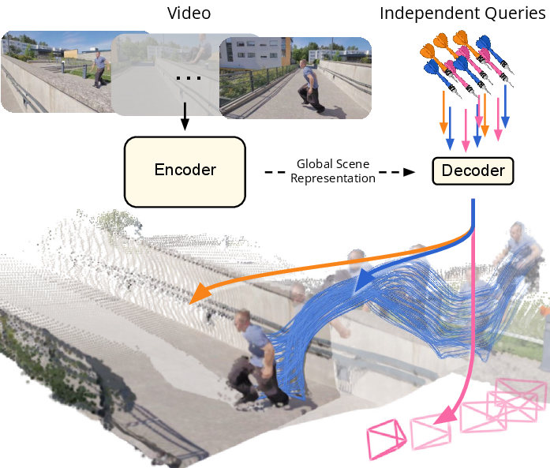
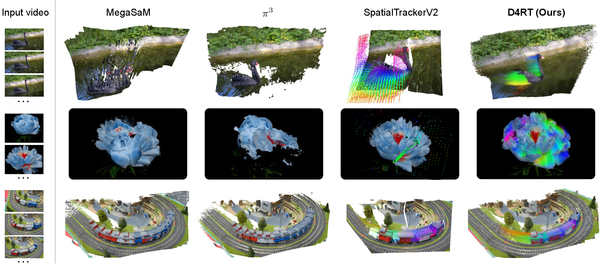
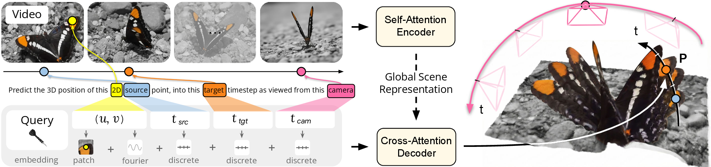
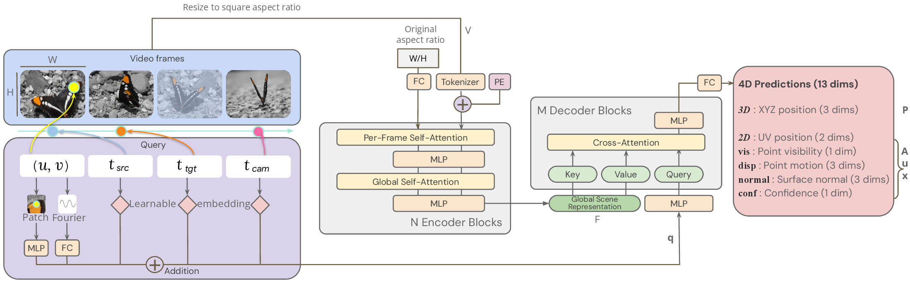
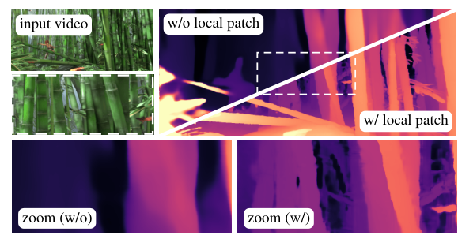
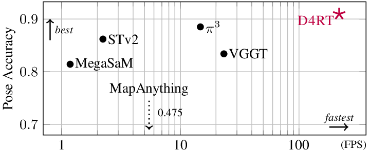
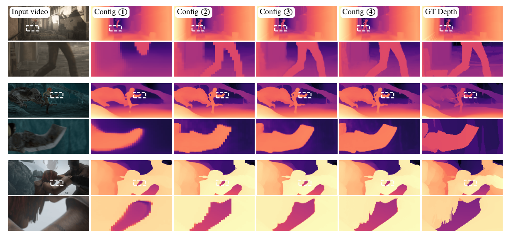
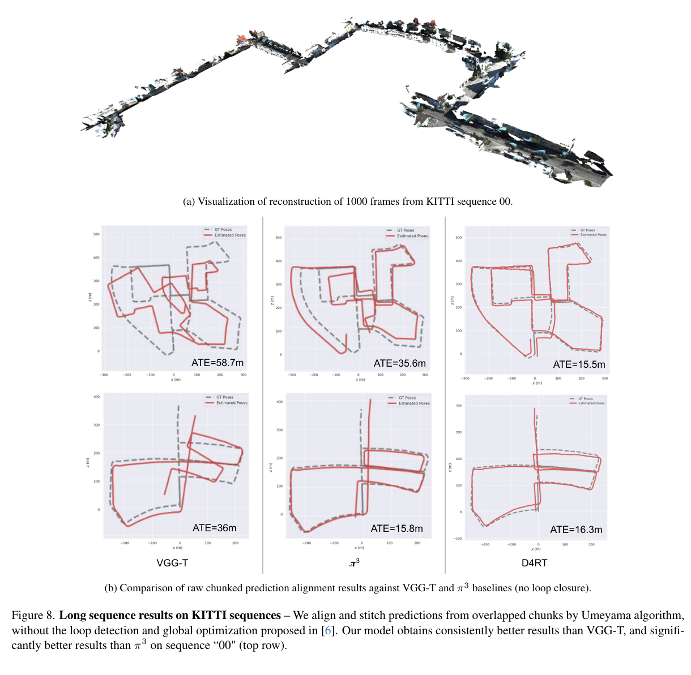
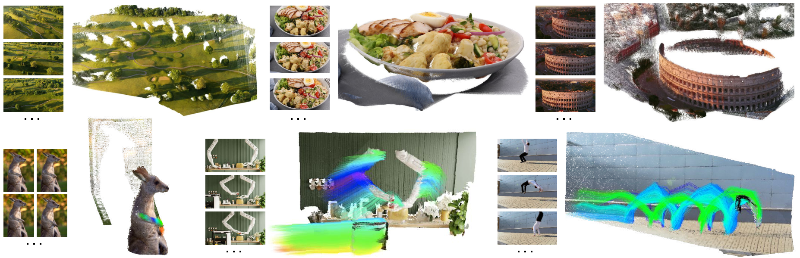

# D4RT：动态场景的 4D 重建与跟踪

!!! info "论文信息"
    **论文题名：** Efficiently Reconstructing Dynamic Scenes One D4RT at a Time。 
    **作者：** Chuhan Zhang、Guillaume Le Moing、Skanda Koppula、Ignacio Rocco、Liliane Momeni、Junyu Xie、Shuyang Sun、Rahul Sukthankar、Joëlle K. Barral、Raia Hadsell、Zoubin Ghahramani、Andrew Zisserman、Junlin Zhang、Mehdi S. M. Sajjadi。 
    **机构：** Google DeepMind、University College London、University of Oxford。 
    **时间 / 主题：** 2025-12；具身智能 / 4D reconstruction / tracking。项目页标注 CVPR 2026 Best Paper。 
    **arXiv / 官方报告：** arXiv：[2512.08924](https://arxiv.org/abs/2512.08924)；项目页：[d4rt-paper.github.io](https://d4rt-paper.github.io/)；Google DeepMind blog：[D4RT](https://deepmind.google/blog/d4rt-teaching-ai-to-see-the-world-in-four-dimensions/)。 
    **GitHub / 项目：** GitHub：未找到官方代码链接；项目页提供论文、arXiv、blog 和交互式可视化。 
    **元数据来源与核验口径：** 来源：[arXiv](https://arxiv.org/abs/2512.08924)；[项目页](https://d4rt-paper.github.io/)；[Google DeepMind blog](https://deepmind.google/blog/d4rt-teaching-ai-to-see-the-world-in-four-dimensions/)；Checked Date：2026-06-15；Repro Status：Paper / official materials reviewed, independent reproduction not claimed。

## 动态场景需要回答的，不只是每一帧有多深

D4RT 的核心贡献是一种可查询的四维场景表示。它先编码整段视频，再让一个共享解码器回答这样的问题：**源帧中这个像素对应的物理点，在目标时刻位于哪里，用哪一帧相机的坐标表达？**只要改变查询，便能取得深度、三维轨迹、统一坐标下的点云，以及恢复相机参数所需的点对应。

这个接口解决了动态重建中容易混在一起的三件事。点的身份由选作起点的帧与像素位置确定，点的状态随着物体运动而变化，数值坐标还会随着参考相机改变。把它们拆开，模型就可以既描述物体运动，又保持共同的空间参考，不必为每种输出配置一套大型解码网络。

Figure 1 中，视频只经过左侧编码器一次。右侧不同颜色的查询，从同一个场景表示中取出点云、点轨迹与相机信息；下方蓝色运动轨迹和粉色相机路径则是不同对象，不应把两者都归结为“画面在移动”。

{ width="720" }

*Figure 1，同一个全局场景表示支持多种几何查询。*[↗](https://arxiv.org/pdf/2512.08924v2#page=1)

这一设计带来的效率也很具体。需要少量轨迹时，只解码这些轨迹；需要相机位姿时，只查询粗网格；需要完整场景时，再增加覆盖点。编码整段视频仍有固定成本，但输出成本能够随应用真正需要的信息量调整。论文在 A100 上报告的 200+ FPS 是相机估计吞吐，完整密集四维重建则必须另看查询数量。

## 静态点云、单帧跟踪各自漏掉了什么

把多帧深度恢复为三维点并堆在一起，对静态环境很自然；面对移动物体，同一个实体在不同时间的位置却会同时留在点云中。反过来，只从第一帧选点并跟踪，虽然保留了运动对应，但第一帧被遮挡的背景、后来转向相机的表面，都没有可跟踪的起点。

Figure 4 把这两个问题分开呈现。先看第一行天鹅，静态点云积累出现多个位置的重复形体；再看 SpatialTrackerV2 的天鹅后方，以及第三行小火车经过的位置，单帧起点造成的覆盖缺口仍然存在。

{ width="920" }

*Figure 4，不同方法的重建对比。D4RT 可以从后续帧补充源点，并把它们放进统一时空表示。*

D4RT 的改动是允许任意源时刻发起查询。一个表面在后来的帧才显露，就从那一帧选点，查询它在其他时刻的位置。这样，覆盖范围不再完全由第一帧决定。不过“所有像素”仍指输入视频中被观察到的像素，不能据此认为模型重建了从未进入任何视野的全部物体表面。[↗](https://arxiv.org/pdf/2512.08924v2#page=5)

与论文直接比较的方案相比，区别主要落在信息组织方式上。MegaSaM 将多个深度、运动等模块与测试时优化结合；VGGT 等方法为不同几何任务配置独立输出头；SpatialTrackerV2 能处理动态轨迹，但需要更重的多阶段与迭代处理。D4RT 将这些任务首先改写成点的时空查询，再用同一个轻量解码器回答。统一的是任务接口与解码主干，不表示网络只有一个输出数值，也不表示没有几何后处理。[↗](https://arxiv.org/pdf/2512.08924v2#page=4)

## 三个时间索引怎样把物体运动与相机运动分开

### 源时刻确定身份，目标时刻确定状态，相机时刻确定参考系

输入为 $T$ 帧视频，编码器先得到全局特征。

$$
V\in\mathbb R^{T\times H\times W\times3},
\qquad F=E(V)\in\mathbb R^{N\times C}.
$$

$N$ 是表示中的 token 数，$C$ 为特征维度。随后固定 $F$，对任意查询独立解码。

$$
q=(u,v,t_{\mathrm{src}},t_{\mathrm{tgt}},t_{\mathrm{cam}}),
\qquad P=D(q,F)\in\mathbb R^3.
$$

$(u,v)\in[0,1]^2$ 是源帧中的归一化像素坐标。$t_{\mathrm{src}}$ 与它一起指定被询问的物理点；$t_{\mathrm{tgt}}$ 指定这个点的状态属于哪一时刻；$t_{\mathrm{cam}}$ 指定用哪个相机参考系表达三维坐标。

可以用一个解释性例子理解。选择第一帧中人的手腕，查询第十帧时手腕的位置，同时仍用第一帧相机的坐标系表达。此时 source 是 1、target 是 10、camera 是 1。若只把 camera 改成 10，询问的手腕和物理时刻都不变，变化的只是坐标表达。若保持 camera 为 1、让 target 遍历视频，就能在同一参考系中看到手腕真正的运动。

Figure 2 的黄色、橙色和粉色分别对应源点、目标状态与相机参考。顺着三种颜色进入 query，再看右侧三维点的位置，可以比仅记住五个变量更直观地理解这种分离。

{ width="920" }

*Figure 2，点身份、物理时间和相机参考分别进入查询。*[↗](https://arxiv.org/pdf/2512.08924v2#page=2)

### 同一接口怎样变成不同输出

| Desired output | Query configuration | 输出含义 |
| --- | --- | --- |
| Depth map at frame $i$ | $t_{\mathrm{src}}=t_{\mathrm{tgt}}=t_{\mathrm{cam}}=i$，遍历像素 | 取 $P$ 的 $Z$ 分量 |
| Camera-coordinate point track | 固定源点，令 $t_{\mathrm{tgt}}=t_{\mathrm{cam}}=k$ 遍历视频 | 每一时刻在当时相机中的坐标 |
| World-coordinate point track | 固定源点及 $t_{\mathrm{cam}}$，遍历 $t_{\mathrm{tgt}}$ | 同一参考系中的点运动 |
| Point cloud in a shared reference | 从多帧选源点，固定 $t_{\mathrm{cam}}$ | 直接将不同观测放到共同坐标系 |
| Scene state at target time $j$ | 多个源点共同设置 $t_{\mathrm{tgt}}=j$，固定 $t_{\mathrm{cam}}$ | 将不同来源的点查询到同一物理时刻 |

“统一参考系”与“统一物理时刻”是两个条件。若只固定 camera，却让每个点保留各自被观察时的 target，得到的是不同时间的观测集合；若要一个具体时刻的动态场景，还要统一 target。这一区别正是动态重建不能只做坐标对齐的原因。

这些时间索引都在输入视频的 $1,\ldots,T$ 范围内。D4RT 可以查询遮挡期间的点状态，但本文接口与训练并不等于在视频结束后任意外推未来运动，更不是输入候选机器人动作后模拟其后果。[↗](https://arxiv.org/pdf/2512.08924v2#page=2)

## 相机参数为什么可以从点查询中恢复

### 估计相机变化时，先把物体的物理状态固定住

若想估计相机帧 $i$ 与 $j$ 的相对位姿，从帧 $i$ 的粗网格取源点 $(u_k,v_k)$，构造两组查询。

$$
q_{i,k}=(u_k,v_k,i,i,i),\qquad
q_{j,k}=(u_k,v_k,i,i,j).
$$

注意第二组的 target 仍是 $i$。这样，两组输出描述的是**同一时刻、同一批物理点**，只是分别用相机 $i$、$j$ 作参考。模型不需要假设这个物体在两个视频时刻之间没有运动。若误把第二组 target 也设为 $j$，两组差异就会同时包含相机运动和物体运动，不能直接全部解释成相机刚性变换。

拿到两组对应点之后，使用 Umeyama 算法求刚性对齐，核心步骤只是一个 $3\times3$ 的 SVD。相机估计由统一点查询加一个小型几何计算完成，因此只需解码粗网格，无须先恢复全部像素的稠密点云。[↗](https://arxiv.org/pdf/2512.08924v2#page=3)

### 内参由投影关系恢复，但仍有相机模型假设

对于同帧查询得到的 $P=(p_x,p_y,p_z)$，论文采用主点位于 $(0.5,0.5)$ 的针孔模型，计算归一化焦距。

$$
f_x=\frac{p_z(u-0.5)}{p_x},\qquad
f_y=\frac{p_z(v-0.5)}{p_y}.
$$

这来自针孔投影中图像偏移与 $p_x/p_z$、$p_y/p_z$ 的关系。对粗网格多个点分别估计，再取中位数，减小个别点误差的影响。这里的归一化焦距不能直接当作像素单位的焦距。

作者提出鱼眼等畸变模型可在初始估计后追加非线性优化，但主要公式仍建立在针孔与中心主点条件上。统一三维查询消除了独立大相机头，并没有自动取消所有相机标定假设。[↗](https://arxiv.org/pdf/2512.08924v2#page=3)

## 全局视频编码与局部外观怎样配合

### 查询彼此独立，场景上下文仍然共享

编码器交替进行逐帧局部 self-attention 与跨帧全局 self-attention，让不同位置、不同时间的信息先在全视频表示 $F$ 中交互。为支持不同宽高比，输入视频被缩放到固定正方形；原始 $W/H$ 被嵌入为额外 token，一并传入编码器。

查询 token 则由三类信息相加。$(u,v)$ 用 Fourier features 表示连续空间位置；三个时间索引分别采用可学习离散 embedding；源像素周围 $9\times9$ 的 RGB patch 提供局部外观。解码器只让该 query cross-attend 到 $F$，没有 query 之间的 self-attention。

这一约束首先保证输出接口可自由改变。训练时只抽一小批点，推理时可以解码另一批完全不同的点，也可以把大批查询切成多块。某个点的输出不应因为同批次附带了哪些其他查询而改变。作者报告早期加入 query self-attention 反而明显损害性能，但没有给出可复刻的逐项数值表，不能将它当成普遍禁止点间交互的结论。[↗](https://arxiv.org/pdf/2512.08924v2#page=3)

独立解码也不意味着各点没有共同几何依据。它们全部读取同一个经过全局时空交互的 $F$，共享关系已经在编码阶段建立。真正被移除的是输出 query 之间额外的依赖，收益是推理并行和任意采样，而非放弃场景整体理解。

### 一个共享主干输出十三个标量

下面这张图是附录 Figure 7 的完整架构。先看中间原始宽高比如何进入编码器，再看左下 query 的外观与位置输入，最后看右侧各项预测。

{ width="920" }

*Figure 7，完整模型与 13 维预测接口。*

共享解码特征通过轻量投影得到 XYZ 位置 3 维、UV 位置 2 维、可见性 1 维、运动向量 3 维、表面法向 3 维、置信度 1 维，合计 13 维。后面这些辅助量既提供训练约束，也支持置信筛选和可见性判断。所以“单解码器”指共享时空推理主干，不是只保留一个 XYZ 回归量。[↗](https://arxiv.org/pdf/2512.08924v2#page=12)

## 稀疏点监督如何训练一个完整场景表示

### 三维主损失控制尺度与远点的影响

最主要的监督是三维点位置。论文先分别用预测点集、真实点集各自的平均深度归一化，再对坐标分量施加

$$
g(x)=\operatorname{sign}(x)\log(1+|x|),
$$

最后计算 L1 误差。归一化减小不同场景尺度的影响；对数变换则压低很远的点对损失的支配，使近处几何细节也能提供有效梯度。它保留坐标符号，并非简单对深度直接取对数。

置信度 $c$ 加权三维误差，同时承担 $-\log c$ 惩罚。原式中可明确读出的这一部分是

$$
c\lambda_{3D}\mathcal L_{3D}-\lambda_{\mathrm{conf}}\log c.
$$

降低 $c$ 可以减少难点的误差权重，但对数项防止模型把所有置信度压到零来逃避监督。这个机制是否有用，应由消融判断，不能仅凭公式就把预测置信度当成已经校准的成功概率。

辅助损失包括二维位置 L1、法向余弦相似度、可见性 binary cross-entropy，以及运动向量 L1；只在相应真值可用的位置计算。这让含不同几何标签的数据可以参与同一训练。附录给出的权重为 $\lambda_{3D}=1.0$、$\lambda_{2D}=\lambda_{\mathrm{vis}}=\lambda_{\mathrm{disp}}=0.1$、$\lambda_{\mathrm{normal}}=0.5$、$\lambda_{\mathrm{conf}}=0.2$。

完整损失的印刷式还额外列出 $\lambda_{\mathrm{conf}}\mathcal L_{\mathrm{conf}}$，权重说明也重复了 confidence 项，却未单独定义这个 $\mathcal L_{\mathrm{conf}}$。因此可以理解主损失与辅助约束的作用，但不能仅凭这一行公式擅自补齐一份严格可复现的 confidence 实现。[↗](https://arxiv.org/pdf/2512.08924v2#page=12)

### 点在哪里采样，会改变模型把能力用在哪里

每个训练片段只解码 2048 个查询。它们从带真值的轨迹中抽取，其中 30% 的空间位置偏向深度不连续或运动边界，边界预处理使用深度图上的 Sobel filter。这使训练信号更集中于物体轮廓、前后景分界等难点，而不被大块平坦区域淹没。

三个时间索引通常均匀随机采样，但以 0.4 的概率强制 $t_{\mathrm{tgt}}=t_{\mathrm{cam}}$。此时目标点直接表达在目标帧相机中，强化常用的相机坐标跟踪配置。其余查询仍学习物理时刻与参考相机分离的情况，保留统一接口的灵活性。

稀疏查询节省的是解码与监督成本。全视频编码器仍然处理完整输入片段，不能把“2048 点监督”写成整个系统只看到了 2048 个像素。相反，局部点损失通过共享 $F$ 反向传播，训练编码器组织能够支持这些查询的时空信息。[↗](https://arxiv.org/pdf/2512.08924v2#page=12)

### 主模型的资源与数据来源

| Component / setting | Reported configuration |
| --- | --- |
| Encoder | ViT-g，40 layers，约 1B parameters |
| Decoder | 8 cross-attention layers，约 144M parameters |
| Clip / resolution | 48 frames，$256\times256$ |
| Spatio-temporal patch | $2\times16\times16$ |
| Queries per clip | 2048 |
| Training | 500K steps，64 TPU chips，local batch size 1 |
| Optimizer | AdamW，weight decay 0.03 |
| Learning rate | 2500-step warmup 至 $10^{-4}$，cosine decay 至 $10^{-6}$ |
| Gradient clipping | maximum L2 norm 10 |
| Reported training time | 略多于两天 |

训练混合公共与内部数据，论文列出的来源包括 BlendedMVS、Co3Dv2、Dynamic Replica、Kubric、MVS-Synth、PointOdyssey、ScanNet++、ScanNet、TartanAir、VirtualKitti 和 Waymo Open。它们覆盖静态多视图与动态轨迹等监督。原文没有给出全部混合比例和内部数据规模，因此这些名称与超参数尚不足以保证从公开资源完全重建训练分布。[↗](https://arxiv.org/pdf/2512.08924v2#page=5)

数据增强保持视频内部的颜色变化一致，包含 brightness、saturation、contrast、hue 调整；color drop 概率 0.2，Gaussian blur 概率 0.4。空间裁剪范围为原尺寸比例 0.3–1.0，宽高比在对数域均匀采样，另以 0.05 概率缩放放大；时间上随机 stride 抽帧。这里的目的不仅是图像多样化，还要避免增强本身制造不真实的帧间对应变化。[↗](https://arxiv.org/pdf/2512.08924v2#page=12)

## 动态跟踪实验首先要分清坐标系与内参条件

### 已知内参的优势，不能直接搬到未知内参场景

TAPVid-3D 包含 DriveTrack、ADT、PStudio 三个子集。相机坐标评测要求模型预测同一个点在各帧相机下的位置，报告 APD3D，即落在规定误差阈值内的点比例；OA 为遮挡判断准确率；AJ 为结合跟踪与可见性表现的 Average Jaccard。三者考察的错误不完全相同。

Table 4 还明确区分是否提供真实相机内参。下表保留主要方法的 AJ 与 APD3D，两项都越高越好；每格依次为 **AJ / APD3D**。

| GT intrinsics | Method | DriveTrack | ADT | PStudio |
| --- | --- | ---: | ---: | ---: |
| No | CoTracker3 + UniDepthV2 | 0.038 / 0.062 | 0.102 / 0.146 | 0.119 / 0.176 |
| No | CoTracker3 + VGGT | 0.129 / 0.189 | 0.132 / 0.190 | 0.045 / 0.070 |
| No | SpatialTrackerV2 | 0.064 / 0.100 | 0.260 / 0.342 | 0.097 / 0.152 |
| No | D4RT | 0.257 / 0.345 | 0.240 / 0.319 | 0.138 / 0.186 |
| Yes | CoTracker3 + UniDepthV2 | 0.147 / 0.225 | 0.173 / 0.254 | 0.205 / 0.311 |
| Yes | CoTracker3 + VGGT | 0.245 / 0.342 | 0.175 / 0.250 | 0.215 / 0.318 |
| Yes | DELTA | 0.170 / 0.238 | 0.199 / 0.258 | 0.175 / 0.261 |
| Yes | SpatialTrackerV2 | 0.195 / 0.275 | 0.303 / 0.404 | 0.175 / 0.270 |
| Yes | D4RT | 0.304 / 0.410 | 0.307 / 0.408 | 0.372 / 0.498 |

真实内参可用时，D4RT 在三个子集的 AJ 和 APD3D 均领先这组比较对象。PStudio 的 AJ 从 SpatialTrackerV2 的 0.175 到 0.372，差距较大；ADT 则只有 0.303 到 0.307，不能一概描述成同样明显的提升。

未知内参时，ADT 上 D4RT 的 AJ 为 0.240，低于 SpatialTrackerV2 的 0.260，APD3D 也从后者的 0.342 降到 0.319。提供内参后，两者顺序才改变。这个对照说明“模型具备内参恢复接口”与“在所有真实场景中恢复得足够准确”是两回事，也提醒部署者把内参条件视为任务的一部分。

遮挡指标同样不是全面领先。D4RT 在三个子集的 OA 为 0.875、0.926、0.897；SpatialTrackerV2 为 0.865、0.936、0.805。ADT 的遮挡判断仍是后者更高，CoTracker3 组合在那里还能达到 0.937。三维位置改善不保证可见性判断同步改善。[↗](https://arxiv.org/pdf/2512.08924v2#page=6)

### 共同世界坐标进一步检验跨帧几何一致性

相机坐标轨迹允许每一时刻使用不同参考系。世界坐标评测则要求所有点落在一个一致空间中，因此还检验隐式参考系转换是否正确。PStudio 没有相机运动，这一任务与前者基本重合，论文因此只报告 DriveTrack 和 ADT。

| GT intrinsics | Method | DriveTrack APD3D ↑ | DriveTrack L1 ↓ | ADT APD3D ↑ | ADT L1 ↓ |
| --- | --- | ---: | ---: | ---: | ---: |
| No | St4RTrack | 0.020 | 0.499 | 0.062 | 0.839 |
| No | CoTracker3 + VGGT | 0.205 | 0.170 | 0.192 | 0.736 |
| No | SpatialTrackerV2 | 0.101 | 0.139 | 0.336 | 0.238 |
| No | D4RT | 0.373 | 0.020 | 0.319 | 0.096 |
| Yes | CoTracker3 + VGGT | 0.292 | 0.160 | 0.234 | 0.755 |
| Yes | SpatialTrackerV2 | 0.201 | 0.117 | 0.378 | 0.263 |
| Yes | D4RT | 0.470 | 0.017 | 0.398 | 0.093 |

DriveTrack 未知内参的 L1 从 SpatialTrackerV2 的 0.139 降到 0.020，APD3D 同时大幅提高，说明收益不只是单帧点位置更接近，还体现在跨帧共同参考下的轨迹。

ADT 未知内参则更有辨析价值。D4RT 的 L1 为 0.096，明显低于 0.238，但 APD3D 为 0.319，仍低于 0.336。平均整体偏差更小，并不必然意味着落进每组阈值的点比例更高。把这两项压缩成一句“跟踪精度更好”，会遗漏实际选择时可能重要的误差分布差异。表中 L1 沿用作者协议数值，不将其未经定义地换算为厘米精度。[↗](https://arxiv.org/pdf/2512.08924v2#page=6)

## 统一动态表示有没有损害普通三维重建

### 点云评测看共同空间中的几何误差

点云重建要求把各帧观察到的像素表达在同一世界坐标系中。论文在动态 Sintel 和静态室内 ScanNet 上评测，按所采用的协议先对预测与真值点云进行 mean-shifting 对齐，再报告平均 L1。

| Method | Sintel point cloud L1 ↓ | ScanNet point cloud L1 ↓ |
| --- | ---: | ---: |
| MegaSaM | 1.531 | 0.072 |
| VGGT | 1.582 | 0.063 |
| MapAnything | 1.718 | 0.064 |
| SpatialTrackerV2 | 1.375 | 0.036 |
| π3 | 1.139 | 0.030 |
| D4RT | 0.768 | 0.028 |

D4RT 在两组数据中都得到最低误差。Sintel 与 π3 的差值为 0.371，ScanNet 则只有 0.002。它支持统一动态建模没有以明显牺牲静态点云质量为代价，同时显示最突出差距仍在复杂动态内容中。这里比较的是对齐后的几何结果，不能直接视为绝对世界原点和真实尺度都已无误恢复。[↗](https://arxiv.org/pdf/2512.08924v2#page=7)

### 视频深度使用整段序列的对齐，不能逐帧消掉漂移

Depth 通过同帧查询的 $Z$ 得到。评测分别采用 scale-only（S）与 scale-and-shift（SS）对齐，按整段视频确定共享对齐参数。S 只调整尺度，SS 允许额外 shift；它们不是每一帧单独寻找最佳尺度，因此时间不一致不能全部被逐帧对齐掩盖。

下表摘录 Table 5 的代表方法，每格为 **AbsRel (S) / AbsRel (SS)**，越低越好。

| Method | Sintel | ScanNet | KITTI | Bonn |
| --- | ---: | ---: | ---: | ---: |
| MegaSaM | 0.342 / 0.249 | 0.050 / 0.047 | 0.109 / 0.101 | 0.056 / 0.056 |
| VGGT | 0.318 / 0.247 | 0.044 / 0.040 | 0.094 / 0.067 | 0.055 / 0.051 |
| π3 | 0.241 / 0.163 | 0.021 / 0.019 | 0.055 / 0.053 | 0.033 / 0.032 |
| D4RT | 0.171 / 0.148 | 0.020 / 0.018 | 0.055 / 0.051 | 0.036 / 0.036 |

Sintel 的 S-AbsRel 从 π3 的 0.241 到 0.171，说明其优势并非只靠更宽松的 shift 对齐出现。KITTI 的 S 指标则同为 0.055；Bonn 上 D4RT 的 0.036/0.036 还略差于 π3 的 0.033/0.032。动态表示对复杂场景有价值，不意味着每个静态或相对容易的数据域都会继续获得相同比例的收益。[↗](https://arxiv.org/pdf/2512.08924v2#page=7)

### 相机位姿必须把整体轨迹与相对旋转分开

相机评测采用 Sim(3) 对齐后的 ATE、相对平移 RPE-T、相对旋转 RPE-R，并在 Re10K 报告 Pose AUC@30。Sintel 使用包含运动模糊和大气效果的 14 序列子集，不能把这里的数值当成无噪声渲染的结果。

| Method | Sintel ATE ↓ | RPE-T ↓ | RPE-R ↓ | ScanNet ATE ↓ | RPE-T ↓ | RPE-R ↓ | Re10K Pose AUC@30 ↑ |
| --- | ---: | ---: | ---: | ---: | ---: | ---: | ---: |
| MegaSaM | 0.074 | 0.030 | 0.126 | 0.029 | 0.016 | 0.839 | 71.0 |
| VGGT | 0.168 | 0.056 | 0.428 | 0.016 | 0.012 | 0.316 | 70.2 |
| SpatialTrackerV2 | 0.126 | 0.053 | 1.052 | 0.018 | 0.012 | 0.324 | 75.7 |
| π3 | 0.086 | 0.039 | 0.248 | 0.015 | 0.010 | 0.291 | 78.7 |
| D4RT | 0.065 | 0.024 | 0.126 | 0.014 | 0.010 | 0.302 | 83.5 |

D4RT 在 Sintel 的 ATE 和相对平移更低，旋转与 MegaSaM 相同；Re10K AUC 从 π3 的 78.7 到 83.5，提高 4.8 个点。但 ScanNet 的相对旋转为 0.302，仍略高于 π3 的 0.291。整体轨迹对齐更好和每一局部旋转都更准确，是不同判断。[↗](https://arxiv.org/pdf/2512.08924v2#page=7)

## 局部 patch 与辅助损失分别贡献了什么

下面的控制实验默认采用 ViT-L、6 层 decoder、300K iterations、batch size 16。它们用于分辨设计作用，不能直接当成前面 ViT-g、500K steps 完整模型的最终成绩。

### 高层场景 token 仍需要低层外观来定位边界

Figure 6 重点比较放大后的细长结构与前后景轮廓。无 local patch 时深度边缘更平滑、细节更容易融合；加入源点周边 RGB 后，窄结构与边缘分界更清晰。

{ width="720" }

*Figure 6，局部 RGB patch 对深度细节的作用。*

| Local appearance patch | AbsRel (S) ↓ | AbsRel (SS) ↓ | ATE ↓ | RPE-T ↓ | RPE-R ↓ |
| --- | ---: | ---: | ---: | ---: | ---: |
| Without | 0.366 | 0.306 | 0.173 | 0.031 | 0.262 |
| With | 0.302 | 0.257 | 0.091 | 0.028 | 0.245 |

ATE 从 0.173 降到 0.091，说明 patch 的作用不止是让输出看起来锐利。作者将其解释为两方面：局部外观帮助 query 在全局时空特征中寻找可靠对应，低层图像线索又帮助区分物体与周边背景。这是对观察到的收益的机制解释，实验没有把两项贡献单独量化。[↗](https://arxiv.org/pdf/2512.08924v2#page=8)

附录的 patch size 曲线显示 9–12 像素附近具有较好的总体权衡，默认采用 $9\times9$。更大的 patch 并非自动更好，15 的深度平均误差反而回升。这意味着 query 需要足够外观上下文，但把更大邻域全部压进同一个局部 embedding，并不能保证继续提高匹配质量。[↗](https://arxiv.org/pdf/2512.08924v2#page=15)

### 辅助任务不是各自单调提高所有指标

Table 8 报告的是相对完整控制模型的变化量。正号代表误差变大，负号代表误差变小。

| Removed loss | Δ AbsRel (S) | Δ AbsRel (SS) | Δ ATE | Δ RPE-T | Δ RPE-R |
| --- | ---: | ---: | ---: | ---: | ---: |
| 2D position | +0.071 | +0.063 | +0.002 | +0.002 | −0.028 |
| Normal | +0.043 | +0.026 | +0.003 | +0.003 | −0.022 |
| Displacement | +0.011 | +0.007 | +0.011 | +0.003 | +0.007 |
| Visibility | −0.003 | −0.025 | +0.012 | +0.011 | +0.022 |
| Confidence | +0.002 | −0.025 | +0.126 | +0.061 | +0.115 |

二维位置与法向对深度最明显，移除后 S-AbsRel 分别增加 0.071 和 0.043。位移监督带来的收益较小，却覆盖所有列。Confidence 最明显地影响相机估计，移除后 ATE 从 0.091 增加到 0.217，这是按表中基准加变化量得到的值。

与此同时，去掉 confidence 或 visibility，SS 深度误差都会下降 0.025；去掉二维或法向监督，RPE-R 反而降低。作者选择的是联合任务间的总体权衡，而非每个辅助项都在每个指标上提供正收益。复用方法时，如果应用只看某一个深度指标，损失组合的选择可能与同时重建相机和动态轨迹时不同。[↗](https://arxiv.org/pdf/2512.08924v2#page=8)

### 预训练和规模也占有实际份额

Appendix Table 11 将随机初始化与 VideoMAE 初始化直接比较。

| Model initialization | AbsRel (S) ↓ | AbsRel (SS) ↓ | ATE ↓ | RPE-T ↓ | RPE-R ↓ |
| --- | ---: | ---: | ---: | ---: | ---: |
| None | 0.738 | 0.520 | 0.334 | 0.139 | 1.126 |
| VideoMAE | 0.302 | 0.257 | 0.091 | 0.028 | 0.245 |

差异覆盖深度和相机各列。统一 query 接口提供了训练与推理组织方式，但好结果还明显依赖视频编码器预训练，不能只照搬接口、从随机权重开始，就预期得到相同性能。[↗](https://arxiv.org/pdf/2512.08924v2#page=15)

编码器规模实验进一步显示容量的作用。

| Backbone | AbsRel (S) ↓ | AbsRel (SS) ↓ | ATE ↓ | RPE-T ↓ | RPE-R ↓ |
| --- | ---: | ---: | ---: | ---: | ---: |
| ViT-B | 0.319 | 0.232 | 0.145 | 0.034 | 0.266 |
| ViT-L | 0.256 | 0.214 | 0.073 | 0.027 | 0.191 |
| ViT-H | 0.226 | 0.173 | 0.070 | 0.028 | 0.186 |
| ViT-g | 0.191 | 0.168 | 0.078 | 0.026 | 0.160 |

从 B 到 g，深度与相对旋转总体持续改善，但 ATE 在 H 为 0.070，优于 g 的 0.078。更大模型带来更强表征，仍不能概括成每个几何误差都随参数量单调下降。此表的 ViT-L 数值也不同于局部 patch 消融的基准，两张表应分别按各自控制实验阅读，不能拼成同一轮训练逐步加组件的轨迹。[↗](https://arxiv.org/pdf/2512.08924v2#page=8)

## 按需解码怎样真正节省计算

### 追踪所有像素，不必从每个像素重复发起整条轨迹

如果视频有 $THW$ 个像素位置，而每个位置都独立查询一条包含 $T$ 个时刻的轨迹，朴素做法需要

$$
O(T^2HW)
$$

次点查询。浪费来自同一个物理点在许多帧中反复出现，逐帧重新发起轨迹，会重复解释已被覆盖的内容。

论文的 Algorithm 1 使用大小为 $T\times H\times W$ 的 occupancy grid，记录哪些时空像素已被轨迹访问。编码一次视频后，循环从尚未访问的位置采样源点；对每个源点令 $t_{\mathrm{tgt}}=t_{\mathrm{cam}}=k$，解码它在全部 $k=1,\ldots,T$ 中的位置；将轨迹可见时穿过的像素标记为已访问，保存轨迹，然后继续补充剩余位置。

它与只跟第一帧的区别，在于源点可以来自任何仍未覆盖的帧。先前被遮挡的区域后来出现，就可以产生新的轨迹；已经被已有轨迹解释的位置，则无需再重复起步。Visibility 参与覆盖判断，因此从机制上看，可见性估计错误也可能影响覆盖决策；论文没有给出将这一影响单独量化的消融。

作者报告该策略按视频运动复杂度带来约 5–15 倍加速。这个范围来自具体视频，不是把最坏查询复杂度严格降成某个统一线性上界。任意源点、独立查询和较低单点成本共同使这一算法可行，只有“全帧一次共同解码”的接口难以同样灵活地跳过冗余位置。[↗](https://arxiv.org/pdf/2512.08924v2#page=3) [↗](https://arxiv.org/pdf/2512.08924v2#page=4)

### 轨迹数量、视频吞吐和相机估计速度是不同账本

Table 3 在单张 A100 上测量的是，为维持指定 FPS，最多能输出多少条完整视频三维轨迹。D4RT 每条轨迹仍包含 $T$ 个独立点查询。

| Method | Max. tracks @60 FPS | @24 FPS | @10 FPS | @1 FPS |
| --- | ---: | ---: | ---: | ---: |
| DELTA | 0 | 5 | 408 | 5,770 |
| SpatialTrackerV2 | 29 | 84 | 219 | 2,290 |
| D4RT | 550 | 1,570 | 3,890 | 40,180 |

例如在 24 FPS 条件下，D4RT 支持 1570 条，SpatialTrackerV2 支持 84 条，前者约为 18.7 倍；相对 DELTA 的 5 条则约为 314 倍。这解释了论文概括的 18–300 倍效率优势来自哪些预算与对照。

但倍数不应脱离表格泛化到每一格。1 FPS 下 40180/5770 约为 7.0，因而不能说在任何目标吞吐下都至少快 18 倍。不同方法有不同固定开销和扩展曲线，应用应按实际所需轨迹密度读取对应列。[↗](https://arxiv.org/pdf/2512.08924v2#page=5)

Figure 3 则只比较相机估计。横轴为 A100 上 FPS，采用对数尺度；纵轴将 Sintel 与 ScanNet 的若干位姿误差综合为 accuracy。右上角意味着在这个综合口径下更快且误差更低。

{ width="650" }

*Figure 3，相机估计的速度与综合准确率，不能替代完整稠密输出的吞吐表。*

作者为了比较相机任务，移除了基线中与相机估计无关的 decoder heads。即便如此，D4RT 仍报告 200+ FPS，约为 VGGT 的 9 倍、MegaSaM 的 100 倍。其优势与相机只需粗网格查询有关，不能把该速度直接写成“所有像素完整四维轨迹达到 200 FPS”。此外，模型先读取一段视频的全局上下文，离线吞吐没有直接测量因果在线系统在新帧到达后的反馈延迟。[↗](https://arxiv.org/pdf/2512.08924v2#page=4) [↗](https://arxiv.org/pdf/2512.08924v2#page=7)

## 更密的查询能否恢复低分辨率编码丢掉的细节

连续空间坐标让解码分辨率不必等于编码分辨率。即使全局编码器始终读取 $256\times256$ 视频，也可以在原图大小的坐标网格上查询。这里有一个重要区别：更多输出位置可以减少像素块状观感，却未必能凭空恢复编码器没保留下来的高频外观。

附录 C 通过四种配置检验这一点。所有编码器分辨率都固定为 $256\times256$；PDBE 是用于度量深度边界的误差指标，数值越低越好。

| Config. | RGB patch | Output resolution | Patch source resolution | AbsRel (S) ↓ | PDBE (S) ↓ | AbsRel (SS) ↓ | PDBE (SS) ↓ |
| --- | --- | --- | --- | ---: | ---: | ---: | ---: |
| 1 | No | 256×256 | — | 0.254 | 3.323 | 0.219 | 3.307 |
| 2 | Yes | 256×256 | 256×256 | 0.218 | 2.254 | 0.179 | 2.243 |
| 3 | Yes | Original | 256×256 | 0.217 | 2.266 | 0.178 | 2.258 |
| 4 | Yes | Original | Original | 0.220 | 2.193 | 0.176 | 2.185 |

从配置 2 到 3，仅提高查询密度，S-AbsRel 只从 0.218 到 0.217，PDBE 还从 2.254 小幅升到 2.266。它说明更多输出点与更准确边缘并不是同一件事。配置 4 进一步从原始高分辨率图像提取局部 RGB patch，PDBE 才降到 2.193，SS 条件下也从 2.258 降到 2.185。

Figure 9 的底部毛发边缘最容易体现差别。先比较配置 2 的像素化边界与配置 3 的平滑边界，再看配置 4 是否出现细小轮廓；后一变化来自查询端获得了高分辨率外观线索。

{ width="920" }

*Figure 9，固定全局编码分辨率，通过原始分辨率的局部 patch 改善细节。*

配置 4 的 S-AbsRel 为 0.220，略高于配置 3 的 0.217，说明边缘更细并不等于所有整体深度误差同步下降。它提供的是一种有价值的分工：全局编码负责场景和时空关系，局部高分辨率输入补充精细边界。

该设计无须把整个全局编码器提升到原图分辨率，避免相应的高分辨率编码开销。但完整输出查询数增加时，解码工作量仍然增加；不能把“固定编码分辨率”扩大成“任意提高输出密度都完全零成本”。[↗](https://arxiv.org/pdf/2512.08924v2#page=14)

## 长视频需要分段对齐，单个全局表示并不覆盖无限时间

训练片段长度为 48 帧。对更长视频，作者采用重叠分段分别预测，从重叠区域取置信度最高的 85% 点，用 Umeyama 求 Sim(3) 变换，将相邻片段对齐。这里的 Sim(3) 包含尺度，与前面在同一片段中恢复两相机参考的刚性对应，不应混成同一个用途。

为直接检验模型原始预测的拼接精度，实验省去了回环检测和全局优化。Figure 8 上方展示 KITTI sequence 00 的 1000 帧重建，下方红色为预测轨迹、灰色虚线为真值。阅读时应看长距离累积后形状是否逐渐偏离，而不只看局部道路是否像真实场景。

{ width="920" }

*Figure 8，重叠片段对齐后的长视频结果，没有加入回环和全局优化。*

| Example | VGGT ATE ↓ | π3 ATE ↓ | D4RT ATE ↓ |
| --- | ---: | ---: | ---: |
| KITTI sequence 00, first example | 58.7 m | 35.6 m | 15.5 m |
| Second example in Figure 8 | 36.0 m | 15.8 m | 16.3 m |

第一组中 D4RT 的累积误差明显更小；第二组与 π3 接近，并略高于后者。15.5 m 和 16.3 m 也表明，长序列拼接仍存在实际漂移。这些结果支持较好的跨片段原始一致性，不能写成无需 SLAM 后端就已解决长距离无漂移建图。

这里同样不是一次将 1000 帧输入同一个全局注意力编码器。实验使用分段和几何对齐延伸长度，论文没有完整给出所有 chunk 长度与 overlap 参数，因此部署时仍需围绕片段跨度、对齐点质量和回环需求选择系统配置。[↗](https://arxiv.org/pdf/2512.08924v2#page=13)

## 这项工作提供的是可按任务取用的几何接口

Figure 5 展示了这个接口对不同内容的适应方式。静态环境重点看整体表面结构，动态场景则额外看三维点随实体运动的轨迹。它们是能力示例，不能代替前面按指标、内参和对齐协议拆开的评测。

{ width="920" }

*Figure 5，静态场景重建与动态三维轨迹共享模型和查询接口。*[↗](https://arxiv.org/pdf/2512.08924v2#page=6)

对需要几何感知的系统，D4RT 有三处接口值得拿来做对照。点身份、物理时刻和参考坐标被分开记录，动态物体的运动才不会直接混进相机运动。查询端还带着局部外观，全局编码负责时空关系，局部 patch 负责边缘和纹理。输出密度则交给应用决定，相机估计可以用粗网格，目标跟踪只查少量点，缺失区域再补查询。

这些选择也规定了使用边界。需要公制尺度时，应额外核对尺度监督与标定条件，不能仅凭对齐后的深度分数；需要实时反馈时，应测完整窗口获取和编码延迟，不能只引用 FPS；需要长距离建图时，应把分段漂移和回环优化纳入系统。D4RT 使多种几何任务可以共享一份可查询表示，真正的工程收益来自对查询配置、精度要求和输出预算的共同设计。
## 继续读

继续看[立体匹配与 cost volume](../../embodied-ai/stereo-matching-and-cost-volume.md)理解几何观测，再看[坐标变换与手眼标定](../../embodied-ai/coordinate-transforms-and-hand-eye-calibration.md)核对部署坐标系。
