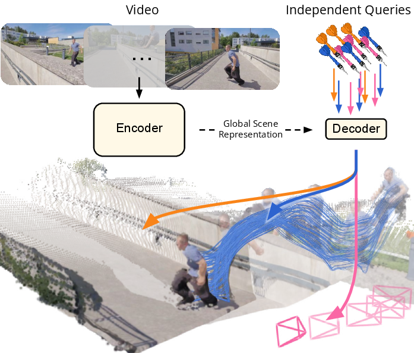
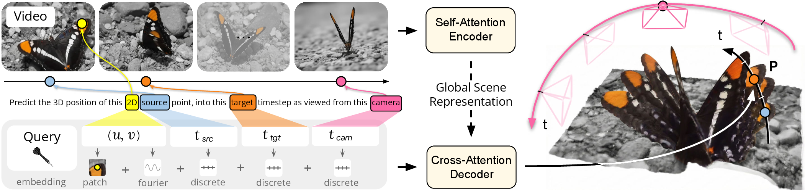
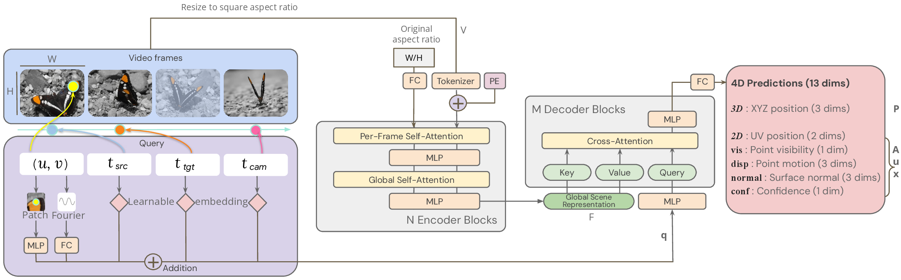
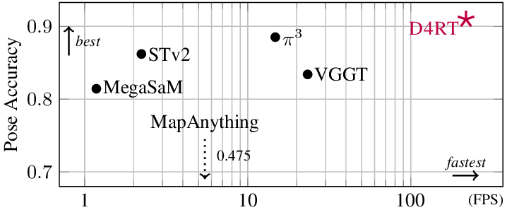
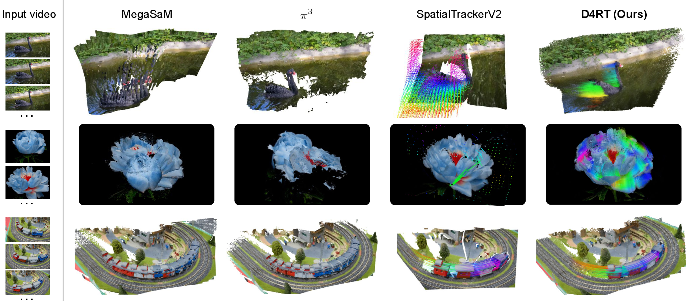
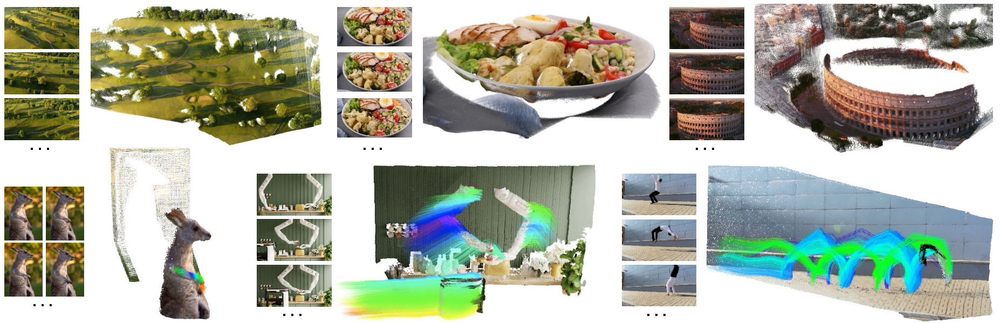

# D4RT：动态场景的 4D 重建与跟踪

!!! info "论文信息"
    **论文题名：** Efficiently Reconstructing Dynamic Scenes One D4RT at a Time。<br>
    **作者：** Chuhan Zhang、Guillaume Le Moing、Skanda Koppula、Ignacio Rocco、Liliane Momeni、Junyu Xie、Shuyang Sun、Rahul Sukthankar、Joëlle K. Barral、Raia Hadsell、Zoubin Ghahramani、Andrew Zisserman、Junlin Zhang、Mehdi S. M. Sajjadi。<br>
    **机构：** Google DeepMind、University College London、University of Oxford。<br>
    **时间 / 主题：** 2025-12；具身智能 / 4D reconstruction / tracking。项目页标注 CVPR 2026 Best Paper。<br>
    **arXiv / 官方报告：** arXiv：[2512.08924](https://arxiv.org/abs/2512.08924)；项目页：[d4rt-paper.github.io](https://d4rt-paper.github.io/)；Google DeepMind blog：[D4RT](https://deepmind.google/blog/d4rt-teaching-ai-to-see-the-world-in-four-dimensions/)。<br>
    **GitHub / 项目：** GitHub：未找到官方代码链接；项目页提供论文、arXiv、blog 和交互式可视化。<br>
    **元数据来源与核验口径：** 来源：[arXiv](https://arxiv.org/abs/2512.08924)；[项目页](https://d4rt-paper.github.io/)；[Google DeepMind blog](https://deepmind.google/blog/d4rt-teaching-ai-to-see-the-world-in-four-dimensions/)；Checked Date：2026-06-15；Repro Status：Paper / official materials reviewed, independent reproduction not claimed。

## 原论文故事线

### 研究背景

D4RT 处在动态 3D/4D 重建、视频跟踪和具身感知的交叉点。传统 3D reconstruction 更擅长回答静态场景里的几何问题：相机怎么动、表面在哪里、点云如何融合。但机器人、AR 和世界模型面对的是动态世界，里面同时存在相机运动、物体运动、遮挡和再出现。上层策略要在这种世界里行动，首先需要一个稳定的几何状态接口。

已有方法通常把问题拆成多个模块：单目深度、metric depth、motion segmentation、camera pose、2D/3D tracking 再各自估计，然后通过优化或后处理拼起来。VGGT 这类 feed-forward 模型已经把很多静态几何任务统一起来，但动态区域的跨时间对应仍然不足；SpatialTrackerV2 能处理动态跟踪，却仍有独立流程和迭代 refinement 的成本。D4RT 的背景就是：动态 4D 场景理解需要一个统一、可扩展、可按需查询的表示。

### 问题（Challenge）

论文要解决的问题是：**如何从单段普通视频中，高效地同时恢复动态场景的深度、相机参数、点云和 3D 点轨迹。** 这个问题难在三件事叠在一起：同一像素可能对应运动物体，物体可能被遮挡后再出现，坐标还会随着相机参考帧改变。如果每个任务都用独立 decoder 或独立模型，不仅计算重，还很难保证几何一致。

这个问题的价值在于它提供了具身系统的底层状态接口。机器人不一定每次都需要完整稠密重建，但经常需要问“这个任务相关点在未来几帧的 3D 位置在哪里”“这帧深度和相机位姿是否一致”“动态物体是否有连续轨迹”。D4RT 试图让这些问题都落到同一个查询接口上。

### Finding

作者的 finding 是：**动态 4D 重建不必先密集解码每一帧，也不必为每个几何任务设计一个专用 head；只要视频先被编码成全局场景表示，后续可以通过独立的点查询来按需取出任意时空点的 3D 位置。** 这个洞见把“完整重建整个视频”翻转成“对全局表示提出低层几何查询”。

这个 finding 能解决挑战，是因为动态场景里的 depth、tracking、camera pose 和 point cloud 本质上都可以写成同一种问题：给定源帧里的一个 2D 点、目标时间和参考相机时间，预测该点在目标时刻、目标坐标系中的 3D 位置。查询彼此独立后，训练时只需采样少量点即可监督，推理时则可按需查询少量点或所有像素，避免密集 per-frame decoder 的固定成本。

### 方法

D4RT 使用 encoder-decoder 架构。输入是一段视频 \(V\)，encoder 通过全局 self-attention 得到 Global Scene Representation \(F=E(V)\)，表示整段视频的场景结构、跨帧对应和时间变化。decoder 是轻量 query-based cross-attention decoder，输入 query 与全局表示，输出某个点的 3D 坐标。

每个 query 包含 \((u, v, t_{\text{src}}, t_{\text{tgt}}, t_{\text{cam}})\)：\((u,v)\) 是源帧 2D 点，\(t_{\text{src}}\) 定义这个点来自哪一帧，\(t_{\text{tgt}}\) 定义要查询哪个时间状态，\(t_{\text{cam}}\) 定义输出表达在哪个相机参考系。decoder 还使用源点附近的 local RGB patch embedding 帮助识别细节。模型训练时对 depth、3D point、point track、camera/intrinsics 等任务统一采样查询，用同一个接口监督；推理时可以构造不同 query 组合得到稀疏 3D tracking、稠密 point cloud、depth map 和相机参数。

### 结论

实验覆盖 4D reconstruction、depth/point cloud estimation 和 3D point tracking 等任务。论文报告 D4RT 在多项动态 4D 重建和跟踪指标上达到新的 state of the art，并且相比把 CoTracker、UniDepth/VGGT 或 SpatialTrackerV2 拼起来的管线，在动态区域和全像素重建上更统一。可视化中，D4RT 对动态物体如动物、车辆、花等场景更能保持连续轨迹，避免静态重建方法把运动物体重复融合成多个残影。

额外结论是效率来自查询接口本身：encoder 只计算一次，decoder 成本随查询点数线性增长。少量查询适合机器人任务点跟踪，密集查询则可以恢复全视频点云。边界也很明确：D4RT 是几何/运动感知模型，不直接学习动作策略、接触动力学或闭环控制；它给具身智能提供状态表示，而不是替代策略学习。

### 关键术语

- **Dynamic 4D Reconstruction（动态四维重建）**：从视频中恢复随时间变化的 3D 场景几何，第四维指时间。
- **Global Scene Representation（全局场景表示）**：encoder 对整段视频形成的 latent 表示，用于承载场景结构、跨帧对应和动态信息。
- **Query-Based Decoder（查询式解码器）**：通过低层几何 query 按需预测点的 3D 位置，而不是固定输出所有任务结果。
- **Spatio-Temporal Correspondence（时空对应）**：同一物理点或区域在不同时间和视角中的对应关系。
- **Camera Reference Time（相机参考时间）**：query 中指定输出 3D 坐标所在相机坐标系的时间索引。
- **Dense Tracking（稠密跟踪）**：对视频中大量像素甚至所有像素建立跨帧轨迹。

D4RT 放在具身智能专题里，不是因为它直接输出机器人动作，而是因为它补了一块很底层、很关键的状态接口：**从普通视频里同时恢复动态 3D 几何、点轨迹、深度、相机参数和可见性。**

如果把 VLA、机器人 planner 或世界模型看成“要在空间里行动的上层模块”，它们首先要知道世界在哪里、物体怎么动、相机自己怎么动。D4RT 试图把这些几何问题统一成一个查询接口，而不是为 depth、pose、tracking、point cloud 分别接一堆模型。

## 一句话核心

D4RT 的核心机制是：

```text
input video
  -> global self-attention encoder
  -> Global Scene Representation
  -> lightweight pointwise cross-attention decoder
  -> query any point in space and time
```

它的查询写成：

\[
q = (u, v, t_{\text{src}}, t_{\text{tgt}}, t_{\text{cam}})
\]

其中 \((u, v)\) 是源帧里的 2D 点，\(t_{\text{src}}\) 是这个点来自哪一帧，\(t_{\text{tgt}}\) 是想查询哪个时刻的 3D 位置，\(t_{\text{cam}}\) 是希望结果表达在哪个相机坐标系里。模型输出：

\[
\mathbf{P} = \mathrm{Dec}(q, F) \in \mathbb{R}^3,\quad F=\mathrm{Enc}(V)
\]

最重要的是：查询之间彼此独立。训练时只要采样少量 query 就能产生监督；推理时可以按需要查几个点，也可以查所有像素。这个设计让它同时服务 sparse tracking 和 dense reconstruction。

{ width="720" }

<small>Figure source: `Efficiently Reconstructing Dynamic Scenes One D4RT at a Time`, Figure 1。原论文图意：D4RT 用统一接口输出 point cloud、point tracks 和 camera parameters。本站读法：先看“统一输出”而不是单项指标，D4RT 的价值在于把动态 4D 场景理解变成同一个 query-decoder 问题。</small>

## 它解决的不是静态 3D，而是动态 4D

传统 3D reconstruction 更像回答“这一堆照片对应的静态几何是什么”。但机器人、AR 和世界模型面对的是动态世界：人会走动，物体会遮挡，摄像头也在动。这里同时有三类运动：

| Motion source | What changes | Why it is hard |
| --- | --- | --- |
| Camera motion | viewpoint and coordinate frame | 同一个静态点在不同帧里的投影变化，不等于物体自身运动 |
| Object motion | dynamic foreground geometry | 动态物体不能简单用静态 SfM / MVS 融合 |
| Occlusion and reappearance | visibility over time | 点可能短暂不可见，但 3D track 仍应保持连续 |

D4RT 的查询参数把这三件事拆开：\((u,v,t_{\text{src}})\) 定义源点，\(t_{\text{tgt}}\) 定义世界处于哪个时间状态，\(t_{\text{cam}}\) 定义用哪个相机坐标系表达。这个拆分使它能问出很多具体问题：

1. 这个像素在后续每一帧的 3D 位置在哪里；
2. 某一帧所有像素在同一参考相机下组成什么点云；
3. 这段视频每帧的 depth map 是什么；
4. 两个相机参考系之间的相对位姿是什么；
5. 当前帧内参如何从一组 3D 点反推出。

这也是它对具身智能有用的地方：上层策略不一定需要完整电影级重建，但经常需要“某些任务相关点在 3D 空间里怎样运动”。

## 方法图怎么读

{ width="920" }

<small>Figure source: `Efficiently Reconstructing Dynamic Scenes One D4RT at a Time`, Figure 2。原论文图意：全局 self-attention encoder 先把输入视频变成 Global Scene Representation，轻量 decoder 再根据 \((u,v,t_{\text{src}},t_{\text{tgt}},t_{\text{cam}})\) 查询任意点的 3D 位置，query 还包含源点附近的 local video patch embedding。</small>

这张图要分三层看。

第一层是 encoder。D4RT 不是逐帧独立估深度，而是先用全局 self-attention 编码整段视频，让表示里包含跨帧对应、时间流动和场景结构。

第二层是 query。query 不是一个语义 prompt，而是低层几何问题：源点坐标、源时间、目标时间、参考相机时间。这个接口非常“笨”，但也正因为笨，depth、tracking、pose、point cloud 都能落到同一组变量上。

第三层是 decoder。decoder 只做 cross-attention，不让不同 queries 之间 self-attend。论文明确说早期实验中让 queries 互相交互会导致明显性能下降。这里的直觉是：每个 query 都应该独立地从全局场景表示中取答案；如果 query 之间互相通信，训练时少量 query 的分布和推理时密集 query 的分布会更容易错位。

## Table 1：统一查询接口

论文 Table 1 是理解 D4RT 的入口。下面保留原表的英文列名和单元格格式。

| Task | \(u\) | \(v\) | \(t_{src}\) | \(t_{tgt}\) | \(t_{cam}\) |
| --- | --- | --- | --- | --- | --- |
| Point Track | Fixed | Fixed | Fixed | \(1 \ldots T\) | \(1 \ldots T\) |
| Point Cloud | \(1 \ldots W\) | \(1 \ldots H\) | \(1 \ldots T\) | \(1 \ldots T\) | Fixed |
| Depth Map | \(1 \ldots W\) | \(1 \ldots H\) | \(1 \ldots T\) | \(1 \ldots T\) | \(1 \ldots T\) |
| Extrinsics | \(1 \ldots h\) | \(1 \ldots w\) | Fixed | Fixed | \(1 \ldots T\) |
| Intrinsics | \(1 \ldots h\) | \(1 \ldots w\) | \(1 \ldots T\) | \(1 \ldots T\) | \(1 \ldots T\) |

<small>表源：`Efficiently Reconstructing Dynamic Scenes One D4RT at a Time`，Table 1。原论文表格含义：不同几何任务都能通过 Cartesian product of query entries 推出；intrinsics / extrinsics 为了速度只查 coarse \((h,w)\) grid。</small>

**Point Track。** 固定一个源点和源帧，扫过 \(t_{\text{tgt}}\) 与 \(t_{\text{cam}}\)，得到这个点在视频全过程中的 3D trajectory。

**Point Cloud。** 扫所有像素和时间，把点都表达在固定参考相机下，就能得到同一坐标系里的点云。它不需要先估每帧相机再把点云硬融合。

**Depth Map。** 令 \(t_{\text{src}}=t_{\text{tgt}}=t_{\text{cam}}\)，再只取输出 \(\mathbf{P}\) 的 Z 维，就是对应帧的 depth。

**Extrinsics。** 论文用同一批 grid source points，在两个参考相机坐标系下查询同一组 3D 点，再用 Umeyama algorithm 求刚体变换。

**Intrinsics。** 对一个 grid 解码 3D 点，假设 pinhole camera principal point 在 \((0.5,0.5)\)，由

\[
f_x = p_z(u-0.5)/p_x,\quad f_y = p_z(v-0.5)/p_y
\]

估计 focal length，并取 median 增强鲁棒性。

## 模型结构

D4RT 的主干是 ViT 风格 encoder 加 pointwise decoder。

| Component | D4RT choice | Why it matters |
| --- | --- | --- |
| Encoder | Vision Transformer with interleaved local frame-wise and global self-attention | 局部 attention 保留帧内结构，全局 attention 建立跨帧场景关系 |
| Input resizing | resize input video to fixed square resolution | 简化 tokenization，同时用额外 token 编码 original aspect ratio |
| Query embedding | Fourier feature for \((u,v)\) + learned timestep embeddings for \(t_{src}, t_{tgt}, t_{cam}\) | 让连续 2D 坐标和离散时间索引都能进入 decoder |
| Local patch | \(9 \times 9\) local RGB patch centered at \((u,v)\) | 给 decoder 低层纹理和边界线索，弥补全局表示的分辨率损失 |
| Decoder | small cross-attention transformer | query 独立 cross-attend 到 Global Scene Representation |
| Output head | 3D position plus auxiliary predictions | 同时监督 3D、2D、visibility、motion、normal、confidence |

{ width="920" }

<small>Figure source: `Efficiently Reconstructing Dynamic Scenes One D4RT at a Time`, Appendix Figure。原论文图意：完整展示视频输入、aspect-ratio token、query embedding、encoder / decoder blocks 和 13 维 4D predictions。本站读法：注意右侧输出不只有 XYZ，还包括 UV、visibility、point motion、surface normal 和 confidence，这些辅助头是训练稳定和几何质量的一部分。</small>

## 训练细节

这部分值得认真读，因为 D4RT 的效率不是只来自“模型小”。它靠的是训练时只采样 query、推理时按需解码，以及用多种辅助监督稳定几何表示。

### 主模型训练配置

| Detail | Value |
| --- | --- |
| Implementation | Kauldron |
| Encoder variant | ViT-g |
| Encoder depth | 40 layers |
| Spatio-temporal patch size | \(2 \times 16 \times 16\) |
| Encoder parameters | 1B |
| Decoder | 8-layer cross-attention decoder |
| Decoder parameters | 144M |
| Training clips | 48-frame clips |
| Training resolution | \(256 \times 256\) |
| Queries per clip | 2048 random queries |
| Query sampling | oversampled on challenging regions |
| Optimizer | AdamW |
| Main training steps | 500k |
| Hardware | 64 TPU chips |
| Local batch size | 1 |
| Training time | just over 2 days |

论文没有把 D4RT 训练成一个逐帧密集预测器。每个 batch 只解码一批 sampled queries，因此 decoder 训练成本随 query 数线性增长。这个设计非常重要：如果每步都要求对 48 帧所有像素做 dense decoding，训练会被输出分辨率和时间长度拖垮。

### 数据混合

论文主文明确列出的训练数据包括公开和内部数据：

| Dataset type | Listed datasets |
| --- | --- |
| Multi-view / reconstruction | BlendedMVS, Co3Dv2, MVS-Synth, ScanNet++, ScanNet |
| Dynamic / synthetic | Dynamic Replica, Kubric, PointOdyssey, VirtualKitti |
| Navigation / driving | Tartanair, Waymo Open |

这里要注意外推边界：论文训练混合包含 internal datasets，公开信息不足以完全复现实验数据配方。因此本站只把训练数据表作为“模型能力来源”理解，不把它写成可复现 recipe。

### Loss 设计

主监督是 normalized 3D point position 的 \(L_1\) loss。论文会先按 mean depth 对预测点和目标点归一化，再经过

\[
\mathrm{sign}(x)\cdot \log(1+|x|)
\]

来减弱远距离点对 loss 的影响。除此之外，decoder 输出还接多个辅助头：

| Auxiliary prediction | Loss |
| --- | --- |
| 2D coordinates | \(L_1\) |
| 3D surface normals | cosine similarity |
| target point visibility | binary cross-entropy |
| point motion / displacement | \(L_1\) |
| confidence | confidence penalty and confidence-related supervision |

Appendix 中给出的 composite loss 可以概括为：

\[
\mathcal{L}
= \frac{1}{N}\sum_i
\left(
c\lambda_{3D}\mathcal{L}_{3D}
-\lambda_{\text{conf}}\log c
+\lambda_{2D}\mathcal{L}_{2D}
+\lambda_{\text{vis}}\mathcal{L}_{\text{vis}}
+\lambda_{\text{disp}}\mathcal{L}_{\text{disp}}
+\lambda_{\text{conf}}\mathcal{L}_{\text{conf}}
+\lambda_{\text{normal}}\mathcal{L}_{\text{normal}}
\right)_i
\]

对应权重：

| Weight | Value |
| --- | --- |
| \(\lambda_{3D}\) | 1.0 |
| \(\lambda_{2D}\) | 0.1 |
| \(\lambda_{vis}\) | 0.1 |
| \(\lambda_{disp}\) | 0.1 |
| \(\lambda_{conf}\) | 0.2 |
| \(\lambda_{normal}\) | 0.5 |

读这组 loss 时，不要把 auxiliary heads 当成附属装饰。D4RT 要同时推 depth、pose、tracks 和 point cloud，单纯监督 3D 点可能无法稳定分解可见性、局部边界和相机坐标变化。辅助头给了模型更多几何约束。

### Optimizer 和 schedule

Appendix 给出更细的优化配置：

| Hyperparameter | Value |
| --- | --- |
| Optimizer | AdamW |
| Weight decay | 0.03 |
| Warmup | 2,500 steps |
| Peak learning rate | \(10^{-4}\) |
| Schedule after warmup | cosine annealing |
| Final learning rate | \(10^{-6}\) |
| Gradient clipping | max \(L^2\)-norm 10 |

### Data augmentation

训练增强覆盖颜色、空间和时间：

| Augmentation | Detail |
| --- | --- |
| Color jitter | random brightness, saturation, contrast, hue |
| Color drop | probability 0.2 |
| Gaussian blur | probability 0.4 |
| Random crop | scale ratio 0.3 to 1.0 |
| Aspect ratio | sampled uniformly in log domain |
| Random zoom-in during crop | probability 0.05 |
| Temporal sampling | frames subsampled with random stride |

这说明 D4RT 不是只在规整多视角数据上学习。随机 stride 和强 spatial / color augmentation 会逼模型处理真实视频里的视角、尺度、颜色和时间采样变化。

### Query sampling

论文对 training queries 的处理很值得借鉴：

| Query detail | Setting |
| --- | --- |
| Source | sampled from available ground-truth point trajectories |
| Challenging regions | 30% of \((u,v)\) queries near depth discontinuities or motion boundaries |
| Boundary detection | pre-computed using Sobel filter on depth maps |
| Time sampling | \(t_{src}, t_{tgt}, t_{cam}\) sampled uniformly at random |
| Special constraint | enforce \(t_{tgt}=t_{cam}\) with probability 0.4 |

这比“随机采点”更强。深度边界和运动边界正是 4D 重建最容易错的地方：物体轮廓、遮挡边缘、动态前景和背景分离。把 30% queries 放在这些区域，相当于把训练预算花到几何决策边界上。

## 推理效率：为什么 query decoder 快

普通 dense reconstruction 很容易变成：

```text
每一帧都解 depth / pose / track / flow
  -> 再做跨帧融合或优化
  -> 动态物体处还要单独处理 correspondence
```

D4RT 的成本结构不同：

```text
encode video once
  -> cache Global Scene Representation
  -> ask only the queries needed by the task
```

如果只需要少量 3D tracks，就只查那些点；如果需要 dense reconstruction，再查所有像素。也就是说，encoder 成本固定，decoder 成本随 query 数线性扩展。

论文还提出 all-pixels dense tracking 的加速算法。朴素做法需要 \(O(T^2HW)\) queries，因为每个时空像素都要追踪到所有时间。D4RT 用 occupancy grid 记录已经被可见 track 覆盖的时空像素，只从未访问像素启动新 track。论文报告这带来 5-15x 自适应加速，具体取决于视频运动复杂度。

{ width="650" }

<small>Figure source: `Efficiently Reconstructing Dynamic Scenes One D4RT at a Time`, Figure 3。原论文图意：比较 pose accuracy 和 throughput，throughput 在 A100 GPU 上测量。本站读法：D4RT 右上角的位置说明它不是单靠牺牲精度换速度，而是用 query-based decoder 改变了计算路径。</small>

吞吐表也能体现这个差异：

| Method | 60 FPS | 24 FPS | 10 FPS | 1 FPS |
| --- | ---: | ---: | ---: | ---: |
| DELTA | 0 | 5 | 408 | 5,770 |
| SpatialTrackerV2 | 29 | 84 | 219 | 2,290 |
| D4RT (Ours) | 550 | 1,570 | 3,890 | 40,180 |

<small>表源：`Efficiently Reconstructing Dynamic Scenes One D4RT at a Time`，Table 3。原论文表格含义：在单张 A100 GPU 上，不同方法在目标 FPS 下能维持的 full-video 3D point tracks 数量。论文总结 D4RT 相比先前方法快 18-300x。</small>

Google DeepMind blog 还给了一个更直观的系统口径：D4RT 处理一分钟视频约 5 秒，而先前 SOTA 方法可能需要约 10 分钟；这对应约 120x 的应用级速度差。这个数字来自官方 blog，不是论文主表里的标准 benchmark，应作为部署直觉而非可复现实验配置。

## 实验怎么读

D4RT 的实验覆盖三层问题。

第一层是 qualitative reconstruction：动态物体是不是被重建成连续对象，而不是在不同位置重复出现。

{ width="920" }

<small>Figure source: `Efficiently Reconstructing Dynamic Scenes One D4RT at a Time`, Figure 4。原论文图意：比较 Input video、MegaSaM、\(\pi^3\)、SpatialTrackerV2 和 D4RT。本站读法：看动态前景是否被重复、漏掉，或只追踪一帧来源的稀疏区域。D4RT 的重点是 full 4D representation including all pixels。</small>

这张图很适合说明 D4RT 和静态 reconstruction 的差别。MegaSaM / \(\pi^3\) 这类重建方法在动态物体上会出现重复或缺失；SpatialTrackerV2 能处理动态轨迹，但通常只从一帧出发追踪，导致遮挡后区域有缺口；D4RT 通过 all-pixels tracking 试图补齐完整动态场景。

第二层是 in-the-wild visualization：它能不能处理真实静态和动态视频。

{ width="920" }

<small>Figure source: `Efficiently Reconstructing Dynamic Scenes One D4RT at a Time`, Figure 5。原论文图意：展示 D4RT 在静态和动态 in-the-wild videos 上的重建；动态场景还展示 3D point trajectories。</small>

第三层是 quantitative benchmark：论文在 TAPVid-3D、point cloud、video depth、camera pose 上和 MegaSaM、VGGT、MapAnything、SpatialTrackerV2、\(\pi^3\) 等对比。对本站主线来说，不必背每个数字，但要知道证据覆盖了哪些输出：

| Output | Benchmarks / metrics in paper | What it supports |
| --- | --- | --- |
| 3D tracking | TAPVid-3D, AJ, APD3D, OA, L1 | 动态点轨迹和世界坐标 tracking |
| Point cloud | Sintel, ScanNet, L1 | 同一坐标系下的场景重建 |
| Video depth | Sintel, ScanNet, KITTI, Bonn, AbsRel | 单视频深度估计能力 |
| Camera pose | Sintel, ScanNet, Re10K, ATE / RPE / Pose AUC | 相机轨迹和位姿恢复 |
| Throughput | target FPS on A100 | query decoder 的效率优势 |

## 消融：训练设计里哪些真的有用

### Local RGB patch

local \(9 \times 9\) patch 是 D4RT 最容易被忽略的小设计。它把源点附近的 RGB 局部外观编码进 query，帮助 decoder 找对应点和边界。

| w/ local appear. patch | AbsRel (S) ↓ | AbsRel (SS) ↓ | ATE ↓ | RPE-T ↓ | RPE-R ↓ |
| --- | ---: | ---: | ---: | ---: | ---: |
| ✗ | 0.366 | 0.306 | 0.173 | 0.031 | 0.262 |
| ✓ | 0.302 | 0.257 | 0.091 | 0.028 | 0.245 |

<small>表源：`Efficiently Reconstructing Dynamic Scenes One D4RT at a Time`，Local RGB patch ablation table。原论文表格含义：在 Sintel 上比较 ViT-L 模型是否把 local appearance patch 输入 decoder。</small>

这个消融说明，全局 video representation 不足以保留所有低层细节。尤其在物体边缘、细小结构和遮挡边界处，query 附带局部 RGB patch 能显著改善 depth 和 pose。

### Backbone size

| Backbone size | AbsRel (S) ↓ | AbsRel (SS) ↓ | ATE ↓ | RPE-T ↓ | RPE-R ↓ |
| --- | ---: | ---: | ---: | ---: | ---: |
| ViT-B | 0.319 | 0.232 | 0.145 | 0.034 | 0.266 |
| ViT-L | 0.256 | 0.214 | 0.073 | 0.027 | 0.191 |
| ViT-H | 0.226 | 0.173 | 0.070 | 0.028 | 0.186 |
| ViT-g | 0.191 | 0.168 | 0.078 | 0.026 | 0.160 |

<small>表源：`Efficiently Reconstructing Dynamic Scenes One D4RT at a Time`，Backbone size ablation table。原论文表格含义：在 Sintel 上比较不同 encoder backbone size 的 depth 和 camera pose 表现。</small>

这个表的信号很清楚：D4RT 的统一 query 接口并不意味着小模型就够。encoder 需要强全局场景表示来承载跨帧对应、动态物体和相机运动；decoder 轻量，但 encoder 不能太弱。

### Pretrained encoder

Appendix 还比较了从随机初始化和 VideoMAE 初始化出发的差异：

| Model weight initialization | AbsRel (S) ↓ | AbsRel (SS) ↓ | ATE ↓ | RPE-T ↓ | RPE-R ↓ |
| --- | ---: | ---: | ---: | ---: | ---: |
| None | 0.738 | 0.520 | 0.334 | 0.139 | 1.126 |
| VideoMAE | 0.302 | 0.257 | 0.091 | 0.028 | 0.245 |

这个结果很重要。D4RT 不是只靠几何 loss 从零学出一切，它明显受益于视频预训练初始化。对具身智能系统来说，这和 VLA / world model 路线有相似经验：底层时空表征先验通常比从零拟合小规模机器人数据更可靠。

### Auxiliary losses

论文逐项移除 auxiliary losses，观察到不同 loss 对 depth 和 pose 的贡献不同。最值得记的是：

| Ablation | Main effect |
| --- | --- |
| w/o 2D position | depth 明显变差 |
| w/o normal | depth 明显变差 |
| w/o confidence | camera pose 明显变差 |
| w/o displacement / visibility | 对部分指标有较小但仍可见影响 |

这说明 D4RT 的输出头不是“为了多任务好看”。2D position、normal、visibility、motion、confidence 都在帮模型把动态 4D 几何拆成可学习的约束。

## 和 VGGT / MapAnything 的关系

D4RT 应该接在 [VGGT](vggt.md) 和 [MapAnything](mapanything.md) 后面读。

| Model | Strong at | D4RT changes |
| --- | --- | --- |
| VGGT | feed-forward camera / depth / point map / tracks for static or mostly rigid settings | D4RT 更强调 dynamic correspondence 和 single query decoder |
| MapAnything | 融合 images、intrinsics、poses、depth 等 auxiliary geometric inputs | D4RT 更强调从单视频统一查询 4D point state |
| SpatialTrackerV2 | dynamic point tracking | D4RT 用全局视频表示和独立 query decoder 支持 all-pixels tracking 和更多几何任务 |
| MegaSaM / \(\pi^3\) | reconstruction / geometry recovery | D4RT 针对动态物体和高效查询补上短板 |

如果说 VGGT 是“前向几何底座”，MapAnything 是“可吃多种几何输入的 metric reconstruction 底座”，D4RT 更像是“动态视频里的点级 4D 状态查询器”。三者都不是机器人 policy，但都能成为机器人状态估计、数据质检、world model grounding 的底层模块。

## 对具身智能的启发

D4RT 对具身智能最有价值的不是论文标题里的 4D，而是它把几何状态做成了可查询接口。

| Embodied need | D4RT output that helps | Remaining gap |
| --- | --- | --- |
| Navigation in dynamic scenes | camera pose, point cloud, moving object tracks | 还需要 collision checking、local planner 和实时传感器融合 |
| Manipulation with moving objects | 3D point tracks, visibility, depth | 还需要接触、物体刚柔性、抓取 affordance |
| Robot dataset debugging | reconstructed trajectories, camera motion, confidence | 还需要和 robot state/action 时间同步 |
| World model grounding | disentangle camera motion, object motion, static geometry | D4RT 不是动作条件动力学模型 |
| AR / spatial computing | low-latency geometry and camera state | 还需要设备端部署、漂移控制和交互稳定性 |

最关键的边界是：D4RT 是 perception / reconstruction 模型，不是闭环控制器。它能告诉你“点在 3D/4D 中可能在哪里”，但不能直接决定机器人应该怎么抓、怎么避障、怎么在失败后恢复。

不过，把它作为中间状态层很自然。例如一个机器人系统可以用 D4RT 产生：

```text
video episode
  -> camera pose / depth / point cloud / dynamic tracks / confidence
  -> task-relevant state extraction
  -> VLA policy / planner / world model / failure analysis
```

这里的好处是失败归因更清楚。VLA 失败时，可以检查：是相机位姿错了、动态物体 track 丢了、深度边界不可信，还是策略本身动作选择错了。

## 证据链快照

| 论文主张 | 主要证据 | 读数边界 |
| --- | --- | --- |
| 单一 query interface 能统一 4D geometry tasks | Table 1、Figure 2、method derivation | 统一接口不等于所有任务部署约束都解决 |
| 独立 pointwise decoder 提高训练和推理效率 | decoder design、throughput table、speed figure | encoder 仍较大，训练仍依赖大规模数据和 TPU |
| D4RT 能处理动态 correspondence | TAPVid-3D、qualitative dynamic reconstructions | benchmark 不等于真实机器人长尾场景全覆盖 |
| local patch 和 auxiliary heads 很关键 | local patch / loss ablations | 不是一个纯架构 trick，数据和监督质量同样重要 |
| 视频预训练初始化很重要 | VideoMAE initialization ablation | 从零训练或公开数据复现难度较高 |

## 阅读结论

D4RT 最值得带走的知识点是：**动态 4D 场景理解可以被组织成一个“点在任意时间、任意参考相机下的位置查询”问题。** 这个抽象把 depth、tracking、pose 和 point cloud 放进同一个 decoder，不需要为每个任务单独堆模块。

对具身智能来说，D4RT 更像一个几何状态层，而不是动作模型。它能给机器人、AR 或世界模型提供更稳定的 camera / depth / point track / dynamic reconstruction 输入；但闭环控制、安全约束、接触建模和动作选择仍然要由 VLA、planner、controller 或 world model 继续承担。

## 外部精读

1. [arXiv:2512.08924](https://arxiv.org/abs/2512.08924)
2. [D4RT project page](https://d4rt-paper.github.io/)
3. [Google DeepMind blog: D4RT](https://deepmind.google/blog/d4rt-teaching-ai-to-see-the-world-in-four-dimensions/)
4. [VGGT](https://arxiv.org/abs/2503.11651)：理解 D4RT 为什么要强调 single query decoder 和 dynamic correspondence。
5. [MapAnything](https://arxiv.org/abs/2509.13414)：作为 metric reconstruction 与几何输入融合路线对照。

## 相关阅读与下一步

- 站内下一步：[VGGT：前向恢复相机、深度、点云与轨迹](vggt.md)。
- 站内下一步：[MapAnything：统一前向 Metric 3D 重建骨干](mapanything.md)。
- 站内下一步：[Depth Anything 3：任意视角 3D 几何底座](depth-anything-3.md)。
- 站内下一步：[具身智能专题](../../embodied-ai/index.md)。
- 站内下一步：[论文精读专题](../index.md)。
