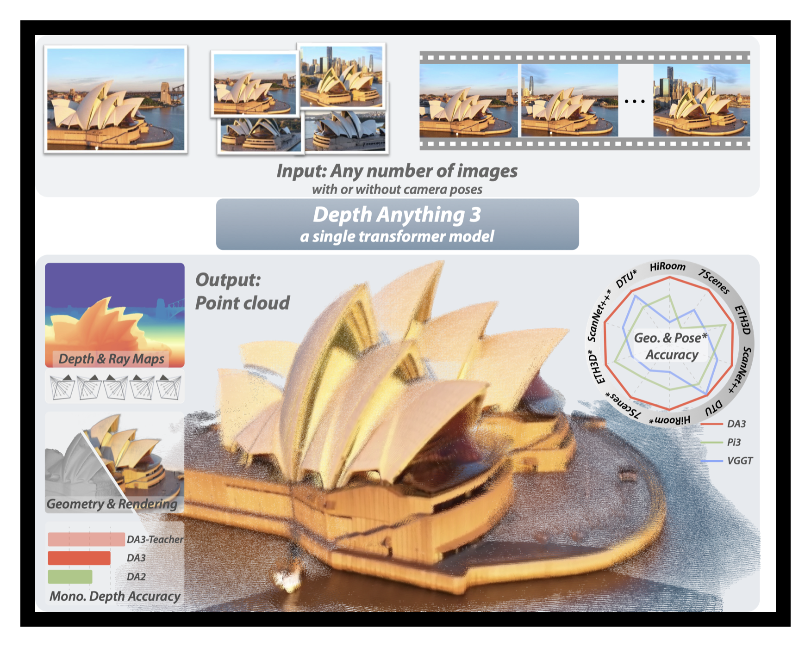
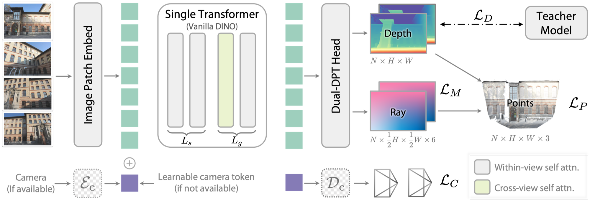
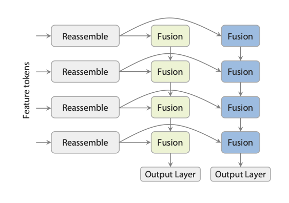
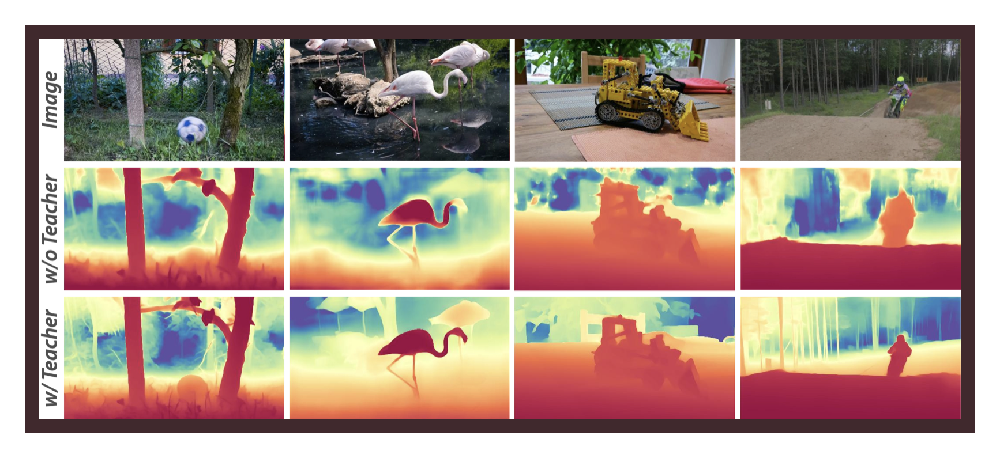
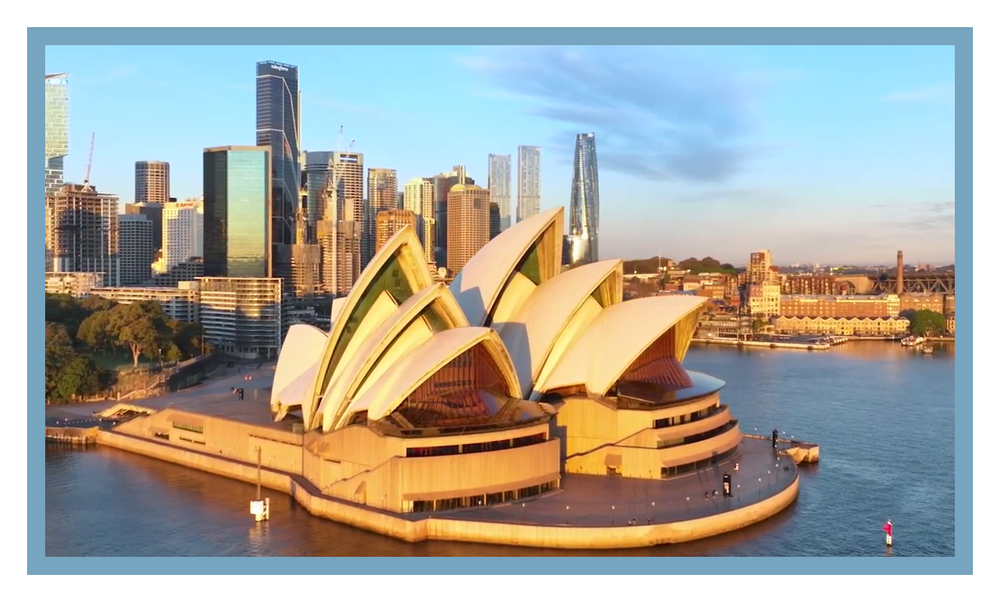
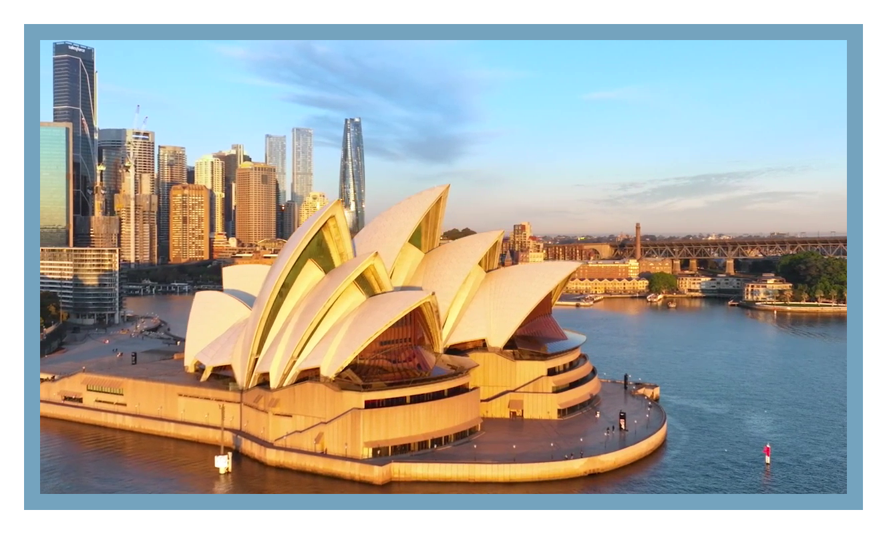
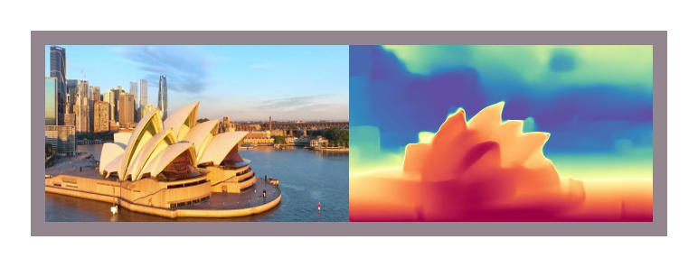

# Depth Anything 3：任意视角的 3D 几何底座

!!! info "论文信息"
    **论文题名：** Depth Anything 3: Recovering the Visual Space from Any Views。<br>
    **作者：** Haotong Lin、Sili Chen、Junhao Liew、Donny Y. Chen、Zhenyu Li、Guang Shi、Jiashi Feng、Bingyi Kang。<br>
    **机构：** 未在公开元数据中稳定解析；以 arXiv/PDF 或官方页 affiliation block 为准。<br>
    **时间 / 主题：** 2025-11；具身智能。<br>
    **arXiv / 官方报告：** arXiv：[2511.10647](https://arxiv.org/abs/2511.10647)；官方材料：[depth-anything-3.github.io/](https://depth-anything-3.github.io/)。<br>
    **GitHub / 项目：** GitHub：[github.com/ByteDance-Seed/Depth-Anything-3](https://github.com/ByteDance-Seed/Depth-Anything-3)；项目页：[depth-anything-3.github.io/](https://depth-anything-3.github.io/)。<br>
    **元数据来源与核验口径：** 来源：[arXiv](https://arxiv.org/abs/2511.10647)；[GitHub API / repo](https://github.com/ByteDance-Seed/Depth-Anything-3)；[官方 / 项目材料](https://depth-anything-3.github.io/)；Checked Date：2026-06-22；Repro Status：Paper / official materials reviewed, independent reproduction not claimed。

Depth Anything 3 放在具身智能专题里，是因为它补的是机器人闭环最基础的一层：**从 RGB、多视角或视频恢复稳定的 3D 几何状态**。VLA 可以输出动作，世界模型可以预测未来，但真正执行抓取、导航、避障和视角规划时，系统仍然要知道物体在哪里、相机在哪里、深度是否一致、点云能不能融合。

可以先想一个机器人数据管线里的小场景：你有一段厨房操作视频，腕部相机看见杯子边缘，第三人称相机看见桌面和机械臂，另一个视角看见杯子后面的遮挡。如果每一帧只是一张 RGB 图，VLA 只能在像素上猜“杯子离夹爪多远”；如果能把这些视角恢复成一致的 depth、ray、camera pose 和 point cloud，后续抓取候选、可达性检查和失败回放才有可计算的空间状态。DA3 的核心价值就在这里：它不是替代策略模型，而是把普通视觉输入变成几何接口。

## 论文位置

DA3 的主线可以概括成一句话：把 Depth Anything 系列的单目深度能力扩展到任意数量视角，并让输出从一张深度图升级为可融合、可估姿、可渲染的 visual space。

这里有三条前置线索需要先分清：

- [Depth Anything / DA](depth-anything.md)：核心是强单目深度估计。它把大规模视觉先验转成相对深度，对细节和开放域泛化很强，但主要处理单张图像。
- [Depth Anything 2 / DA2](depth-anything-v2.md)：是 DA 路线的更强版本，也是 DA3 对比和继承的重要对象。DA2 在单目相对深度上很稳，但它本身不解决多视角一致性、相机位姿和点云融合。
- [VGGT](vggt.md)：是另一条 feed-forward visual geometry 路线，目标是一次前向预测 camera parameters、depth maps、point maps、tracks 等 3D 属性。DA3 和 VGGT 对的是同一类多视角几何问题，但 DA3 认为更简单的 depth-ray 目标和单个预训练 Transformer 更有效。

所以 DA3 不是简单的 “DA2 + 多图输入”。它更像是把 DA/DA2 的深度细节、VGGT 的任意视角几何目标，以及具身系统需要的相机/点云/3DGS 接口合到了一起。

如果从传统 3D 视觉任务读，DA3 的位置会更清楚：

| 传统任务 | 输入是什么 | 输出是什么 | DA3 对应关系 |
| --- | --- | --- | --- |
| Monocular Depth Estimation / 单目深度估计 | 一张 RGB 图 | 每个像素的深度 | DA3 在单张输入时自然退化成单目深度，但输出仍服务后续几何接口 |
| Structure from Motion / SfM | 同一场景的多张图，通常未知相机运动 | 稀疏 3D 结构和相机轨迹 | DA3 直接前向估计 camera、depth 和 ray，不走传统特征匹配 + BA（bundle adjustment）管线 |
| Multi-View Stereo / MVS | 多视角图像，通常有已知或估计位姿 | 更稠密的表面几何 | DA3 用跨视角 depth / ray 一次性生成更适合融合的 dense geometry |
| SLAM | 连续视频或传感器流 | 在线定位和地图 | `DA3-Streaming` 更接近长序列几何感知层，但不等价于完整 SLAM 系统 |

这也是论文反复强调 minimal modeling 的原因：它不是把 MDE、SfM、MVS、SLAM 各自做一个任务头再硬拼成多任务网络，而是把共同部分抽象成“任意数量视觉输入 -> 像素对齐的 depth + ray”。这样既能复用 DINOv2 这类大规模预训练视觉主干，又避免从零训练一个高度定制化的多任务系统。

{ width="760" }

<small>图源：`Depth Anything 3`，Figure 1。原论文图意：DA3 接收任意数量图像和可选相机位姿，输出一致的 depth maps 与 ray maps，并进一步融合为点云、相机和 3D Gaussian 表示。</small>

**DA3 teaser 先看 depth、ray、camera 三个输出接口。**
**输入输出**：输入是任意视角图像，输出是 depth、ray、camera 和 3D geometry。
**效率机制**：把多视角几何恢复做成统一前向感知底座，减少手写几何管线成本。
**对主线意义**：它服务世界模型的 geometry/state interface，而不是替代 dynamics。
**不能证明什么**：几何重建不能证明动作因果、接触建模或真实机器人策略安全。

## 核心表示：Depth + Ray

DA3 最关键的设计不是预测更多任务，而是把预测目标压到最小：每个像素预测 depth，再预测一条 camera ray。讲课时可以把它拆成两个问题：

- `ray map` 回答“这个像素对应世界里的哪条光线”：从哪里出发、朝哪里走。
- `depth map` 回答“沿着这条光线走多远会碰到物体表面”。

只有 depth，你知道近远关系，但没有统一世界坐标下的射线，很难把多张图融合到同一 3D 空间。只有 ray，你知道像素射线，却不知道表面点落在射线上的哪个位置。DA3 把二者绑在一起，才得到可以融合、可估姿、可接点云的几何表示。

对第 \(i\) 个视角的像素 \((u,v)\)，模型输出深度 \(D_i(u,v)\)、ray origin \(o_i\) 和 ray direction \(d_i(u,v)\)，3D 点可以写成：

$$
X_i(u,v) = o_i + D_i(u,v) d_i(u,v).
$$

这比直接预测 point map 或相机矩阵有几个好处。第一，depth 保留了 Depth Anything 系列擅长的局部结构和边界细节。第二，ray map 可以看成把相机内参 \(K\) 和外参 \(R,t\) 对每个像素的作用展开成逐像素表示，不需要模型直接回归一个必须满足旋转矩阵约束的 pose。第三，depth 与 ray 分开后，给定外部相机位姿时也容易做 pose-conditioned depth，让多视角深度更一致。

论文还说明，ray direction 不做单位归一化，方向向量的尺度会保留投影几何信息。需要显式相机参数时，可以从 ray map 里用 DLT 和 RQ decomposition 恢复相机；工程上则额外提供轻量 camera head，方便直接输出 intrinsics / extrinsics。

## 架构：单个 DINOv2 + Cross-view Attention + Dual-DPT

DA3 的建模思路很克制。它没有堆两个专用 Transformer，也没有把 camera、depth、point、track 都变成独立复杂任务，而是用一个 vanilla DINOv2 ViT 作为主干，再通过 token 重排让同一个主干在单图和多图之间切换。

{ width="860" }

<small>图源：`Depth Anything 3`，Figure 2。原论文图意：DA3 使用单个 DINOv2 主干，通过 input-adaptive cross-view self-attention 做跨视角推理，再用 Dual-DPT head 输出 depth 与 ray。</small>

**Pipeline 要按三段读。**
第一段是 image tokens 进入 DINOv2 主干，提供单视角视觉先验；第二段是 cross-view attention 和 camera token，把不同视角放到同一个几何上下文里；第三段是 Dual-DPT head，同时输出 depth 和 ray。图里的重点不是“多了一个 head”，而是 DA3 把多视角一致性放进 backbone 推理过程，再把结果落到可融合的几何接口。

架构里有三个容易混淆的点：

1. **Input-adaptive self-attention**：前 \(L_s\) 层主要在单张图内部做视觉特征提取，后 \(L_g\) 层交替做跨视角和视角内 attention。输入只有单张图时，它自然退化成单目深度模型；输入多视角时，同一主干又能跨视角对齐几何。
2. **Camera token**：如果有相机参数，就把 FOV、quaternion、translation 编码成每个视角的 camera token；如果没有，就用可学习 token。camera token 会参与所有 attention，而不是只在输出端做后处理。
3. **Dual-DPT head**：depth 和 ray 共用 DPT reassembly 的一部分，再分成两个分支输出。这样比完全独立 head 更轻，也比单一混合输出更容易分别约束深度细节和相机几何。

{ width="400" .atlas-figure-compact }

<small>图源：`Depth Anything 3`，Dual-DPT architecture figure。图本身信息密度较低，这里缩小显示，重点看 shared reassembly 与 depth/ray 两个分支的关系。</small>

**Dual-DPT 看 shared 和 split。**
上半部分的 shared reassembly 负责把 ViT token 还原成多尺度 spatial features；下半部分再拆成 depth branch 和 ray branch。读这张图时不要把 ray 当成相机参数表，它更像每个像素对应的空间射线表示，和 depth 相乘后才能落成 3D 点。

## 为什么说它不是 VGGT-style

VGGT 的贡献是把 feed-forward 3D geometry 推到很强的统一接口：输入一组图像，输出相机、深度、点、track 等几何属性。DA3 赞同这个问题设定，但对建模选择有不同判断。它反对的不是“统一几何模型”这个方向，而是为统一任务引入过多专用结构、冗余预测目标和从零联合训练成本。

DA3 的消融里，`VGGT Style` 指使用两个不同 Transformer 组合成更复杂的结构；在近似参数量下，它不如单个完整预训练的 ViT-L 主干。论文的解释是：单个 DINOv2 主干可以完整继承预训练视觉特征，而 VGGT-style 结构里有更多未充分预训练的 block。另一个关键消融是预测目标：`depth + ray` 明显强于 `depth + cam` 或 `depth + pcd + cam`，说明“少而准”的几何目标比把所有显式任务都塞进去更稳。

论文里的 prediction-target 消融可以改写成下面这张表，保留原始英文指标名方便和原文对照：

| Methods | HiRoom Auc3 | HiRoom F1 | ETH3D Auc3 | ETH3D F1 | DTU Auc3 | DTU CD | 7Scenes Auc3 | 7Scenes F1 | ScanNet++ Auc3 | ScanNet++ F1 |
| --- | --- | --- | --- | --- | --- | --- | --- | --- | --- | --- |
| depth + pcd + cam | 9.1 | 12.8 | 19.0 | 60.4 | 42.3 | 4.918 | 20.8 | 43.4 | 22.0 | 43.0 |
| depth + cam | 10.8 | 16.5 | 9.9 | 48.0 | 23.3 | 5.316 | 13.0 | 38.5 | 13.3 | 41.0 |
| depth + ray | 48.7 | 60.3 | 25.5 | 65.4 | 46.5 | 3.919 | 24.0 | 46.5 | 35.5 | 53.4 |
| depth + ray + cam | 37.2 | 45.4 | 22.3 | 59.4 | 56.3 | 3.066 | 25.7 | 45.6 | 34.1 | 56.5 |

<small>表源：`Depth Anything 3`，ablation of prediction-target combinations。原表要点：在无 camera condition 的设置下，depth + ray 是最核心的预测目标；camera head 有工程便利性，但 ray 本身已经能承载相机几何。</small>

这张表最适合讲一个判断：DA3 不是“输出越多越好”。`depth + pcd + cam` 看起来更全，但点、深度、相机之间会互相约束，一旦某个分支学偏，其他分支也会被拖住。`depth + ray` 反而把目标压回最少的几何变量，让模型既能继承单目深度的细节，又能恢复跨视角相机关系。额外 camera head 更像工程便利接口，而不是核心几何表示。

## 训练：DA2 细节 + 多视角几何

DA3 的训练有两层：先训练一个强单目 teacher，再用 teacher-student 方式训练任意视角 DA3。

### Teacher 如何继承又改造 DA2

论文明确说 teacher 是在 [Depth Anything 2](depth-anything-v2.md) 路线上扩展出来的，但改了两个关键点。

第一，数据更偏 synthetic geometry。真实 RGB-D、COLMAP 或 LiDAR 深度常常稀疏、噪声大、边界不干净；如果直接监督，会把错误深度也教给模型。因此 teacher 主要用高质量合成数据训练，再给真实数据生成更干净的 relative depth pseudo-label。

第二，表示从 disparity 转向 depth。DA2 常见路线更偏相对深度/视差表达；DA3 teacher 直接预测 scale-shift-invariant depth，并用 exponential depth 改善近处几何分辨率。这个变化在 2D benchmark 上未必看起来特别夸张，但在点云和 3D reconstruction 里更重要，因为近处物体、桌面边缘、机械臂可达区域都会放大几何误差。

Teacher 的目标函数不只是普通 depth loss，还加入 depth-gradient、global-local ranking、surface normal、sky mask、object mask 等约束。直观上说，depth loss 管绝对顺序，gradient 管边界和局部形状，normal 管表面朝向，sky/object mask 管那些普通深度监督很容易出错的区域。

### 如何把 teacher 用到 DA3

DA3 训练时会遇到一个现实问题：多视角真实数据需要 pose 泛化，但真实深度往往不干净。论文做法是让 teacher 先给出高质量 relative depth，再用 RANSAC scale-shift least squares 把 teacher depth 对齐到 sparse/noisy metric depth。这样得到的监督既保留 teacher 的干净几何，又和真实场景的尺度、pose 更一致。

{ width="820" }

<small>图源：`Depth Anything 3`，teacher supervision visualization figure。原论文图意：真实深度可能稀疏或噪声明显，teacher 提供更连续的相对深度，再通过 robust alignment 变成可用于 DA3 的监督。</small>

**Teacher 不是替代真实深度。**
这张图要从监督质量读：真实 metric depth 提供尺度和几何锚点，但会有空洞、噪声或边界问题；teacher depth 更连续，负责补充可学习的相对结构。DA3 的做法是先对齐 teacher 与真实深度，再把二者组合成训练信号，所以它证明的是监督清洗和对齐的重要性，不是说伪标签天然比传感器真值可靠。

DA3 主模型的 loss 由 depth、ray、point、optional camera、gradient 等部分组成，整体以 L1 类损失为主。训练细节里最值得记的是这些数字：

| Setting | Value |
| --- | --- |
| Hardware | 128 H100 GPUs |
| Training steps | 200K |
| Warm-up | 8K steps |
| Peak learning rate | `2e-4` |
| Base resolution | `504 x 504` |
| Random resolutions | `504x504`, `504x378`, `504x336`, `504x280`, `336x504`, `896x504`, `756x504`, `672x504` |
| Number of views | uniformly sampled from `[2, 18]` for `504x504` |
| Batch strategy | dynamic batch size to keep token count roughly constant |
| Teacher-label transition | switch from GT depth to teacher labels at 120K steps |
| Pose conditioning | activated with probability `0.2` |

这个 recipe 对具身系统很有启发：多视角几何模型不能只靠“相机参数很准、深度很干净”的理想数据。真正可泛化的训练需要把 synthetic clean geometry、real noisy geometry、teacher pseudo-label、pose conditioning 混起来。

**Training datasets table from the paper。**

| Usage | Dataset | #Scenes | Data Type |
| --- | --- | --- | --- |
| Pose-geometry benchmark | HiRoom (ours) | 29 | Synthetic |
| Pose-geometry benchmark | ETH3D | 11 | LiDAR |
| Pose-geometry benchmark | DTU | 22 | LiDAR |
| Pose-geometry benchmark | 7Scenes | 7 | LiDAR |
| Pose-geometry benchmark | ScanNet++ | 20 | LiDAR |
| Pose-geometry Training | AriaDigitalTwin | 237 | Synthetic |
| Pose-geometry Training | AriaSyntheticENV | 99950 | Synthetic |
| Pose-geometry Training | ArkitScenes | 4388 | LiDAR |
| Pose-geometry Training | BlendedMVS | 503 | 3D Recon |
| Pose-geometry Training | Co3dv2 | 30616 | Colmap |
| Pose-geometry Training | DL3DV | 6379 | Colmap |
| Pose-geometry Training | HyperSim | 344 | Synthetic |
| Pose-geometry Training | MapFree | 921 | Colmap |
| Pose-geometry Training | MegaDepth | 268 | Colmap |
| Pose-geometry Training | MegaSynth | 6049 | Synthetic |
| Pose-geometry Training | MvsSynth | 121 | Synthetic |
| Pose-geometry Training | Objaverse | 505557 | Synthetic |
| Pose-geometry Training | Omniobject | 5885 | Synthetic |
| Pose-geometry Training | OmniWorld | 1039 | Synthetic |
| Pose-geometry Training | PointOdyssey | 44 | Synthetic |
| Pose-geometry Training | ReplicaVMAP | 17 | Synthetic |
| Pose-geometry Training | ScanNet++ | 230 | LiDAR |
| Pose-geometry Training | ScenenetRGBD | 16866 | Synthetic |
| Pose-geometry Training | TartanAir | 355 | Synthetic |
| Pose-geometry Training | Trellis | 557408 | Synthetic |
| Pose-geometry Training | vKitti2 | 50 | Synthetic |
| Pose-geometry Training | WildRGBD | 23050 | LiDAR |

## 应用：Feed-forward NVS / 3DGS

论文还用 feed-forward novel view synthesis，FF-NVS，验证 DA3 的几何理解能不能迁移到渲染任务。这里先把术语分清：

| 概念 | 含义 | 和 DA3 的关系 |
| --- | --- | --- |
| NVS / Novel View Synthesis | 给定一个场景的若干已知视角，合成一个没有直接拍摄过的新视角 | 需要模型理解场景 3D 几何，否则新视角容易出现漂浮、断裂和遮挡错误 |
| FF-NVS / Feed-forward NVS | 通过一次前向推理直接生成 3D 表示或新视角结果，避免每个场景单独优化 | DA3 可以作为 image-to-3D 的几何 backbone |
| 3DGS / 3D Gaussian Splatting | 用一组 3D Gaussian 表示场景，再从新相机位姿渲染图像 | 论文给 DA3 加额外 GS-DPT head，预测像素对齐的 3D Gaussian 参数 |

这部分的关键不是“DA3 重新发明了 NVS”，而是说明：如果一个 backbone 已经能稳定恢复 depth、ray 和 camera，那么它天然适合作为 FF-NVS 的几何底座。论文做法是在 DA3 主干上微调一个 GS-DPT head，预测 opacity、rotation、scale、RGB / view-dependent color 等 Gaussian 参数，再用预测深度把这些局部 Gaussian unproject 到世界坐标中渲染新视角。

这里的证据边界也要讲清。FF-NVS 结果能说明强几何 backbone 对渲染质量有帮助，尤其是薄结构、遮挡和宽基线视角；但它不能直接证明 DA3 已经解决机器人动作预测、接触动力学或闭环控制。对具身专题来说，这部分更像一个旁证：几何状态越稳，后续渲染、仿真资产和世界模型状态接口越有可用基础。

## 实验结论怎么读

DA3 的实验不要读成“一个模型包打天下”，而要按 claim、证据和边界分开：

| 论文主张 | 主要证据 | 读数边界 |
| --- | --- | --- |
| `depth + ray` 是核心表示 | prediction-target 消融里 `depth + ray` 整体优于 `depth + cam`、`depth + pcd + cam` | 证明的是该 benchmark 和设置下的目标选择，不等于所有场景都不需要显式 camera / point head |
| 单个预训练 Transformer 足够强 | VGGT-style 消融和 DINOv2 backbone 继承预训练能力 | 不能外推成所有复杂架构都没价值；更准确的说法是 DA3 这组任务里简单主干更占优 |
| teacher-student 能改善真实数据监督 | synthetic teacher + RANSAC scale-shift 对齐稀疏 / 噪声深度，提升 label 完整性 | teacher label 不是传感器真值；尺度、动态物体和失败 case 仍要单独验收 |
| 几何能力能迁移到渲染 | 加 GS-DPT head 后做 FF-NVS / 3DGS，新视角渲染质量更好 | 渲染质量不等于机器人策略安全，也不等于 closed-loop 成功率 |

## 模型规模、速度与选择

DA3 不是只发布一个大模型。论文分析表里同时给出 Giant、Large、Base、Small，并和 VGGT 做参考比较。

| Model | Max # of Images | Backbone | DualDPT | CameraHead | Running Speed |
| --- | --- | --- | --- | --- | --- |
| VGGT(Reference) | 400-500 | 0.91B | 0.064B | 0.22B | 34.1 FPS |
| DA3-Giant | 900-1000 | 1.130B | 0.050B | 0.018B | 37.6 FPS |
| DA3-Large | 1500-1600 | 0.300B | 0.047B | 0.008B | 78.37 FPS |
| DA3-Base | 2100-2200 | 0.086B | 0.015B | 0.004B | 126.5 FPS |
| DA3-Small | 4000-4100 | 0.022B | 0.003B | 0.001B | 160.5 FPS |

<small>表源：`Depth Anything 3`，model analysis table。原表要点：DA3 的小模型能处理更多图像并有更高吞吐，Giant 则追求更强几何质量；实际部署还要看分辨率、显存、输出格式和是否启用 3DGS。</small>

对具身工程来说，可以这样选：

- 离线资产重建、数据标注、仿真场景几何补全：优先看 `DA3-Giant`、`DA3-Large` 或 nested 模型。
- 单目 metric depth 或在线感知辅助：先看 `DA3Metric-Large`、`DA3-Base`、`DA3-Small`，再按延迟和显存调分辨率。
- 长视频、巡检、移动机器人记录流：关注 `DA3-Streaming`，它用 chunk streaming 管理长序列显存，但它仍然是几何感知管线，不等价于完整 SLAM 系统。

## GitHub 仓库怎么读

官方仓库不是只放权重链接，而是提供了比较完整的工具链。

`Model Zoo` 分成三类：Main Series 处理 any-view geometry，Metric Series 面向单目 metric depth，Monocular Series 面向高质量相对单目深度。README 还提醒，带 `-1.1` 后缀的 refreshed checkpoints 修复了训练 bug，街景等场景通常应优先使用新版权重。

Python API 的核心接口是 `DepthAnything3.from_pretrained(...).inference(...)`，输入可以是图片路径、PIL 或 numpy array；可选传入 `extrinsics` 和 `intrinsics` 做 pose-conditioned depth。输出对象里包含 `processed_images`、`depth`、`conf`、`extrinsics`、`intrinsics` 等字段。工程上最常用的几个开关是：

- `use_ray_pose=True`：从 ray head 推 pose，通常更准但稍慢；
- `ref_view_strategy="middle"`：视频序列常用中间帧作为参考视角；
- `export_format="mini_npz-glb-depth_vis-feat_vis"`：按需要导出 npz、glb、深度可视化或特征可视化；
- `infer_gs=True`：启用 Gaussian Splatting 分支，主要用于支持 GS 的模型和导出格式。

CLI 则更适合批处理：可以对图片集、视频帧目录或机器人采集序列直接导出 `glb`、`ply`、`npz`、depth images、3DGS video 等结果。对具身数据管线来说，这意味着 DA3 可以作为“把 RGB 轨迹转成几何资产”的中间层：先跑 DA3 得到 depth / pose / point cloud，再交给抓取候选生成、可达性检查、仿真资产构建或数据质检。

### 本地 demo：SOH 两视角导出点云

下面这个命令可以当作仓库 CLI 的最小可读案例：

```bash
da3 auto assets/examples/SOH \
  --model-dir depth-anything/DA3-SMALL \
  --export-format mini_npz-glb \
  --export-dir workspace/demo_soh \
  --process-res 336 \
  --auto-cleanup
```

这次运行可以理解成：把 `assets/examples/SOH` 里的两张图当作同一个场景的多视角输入，分别估计深度、相机内外参，再融合导出一个 3D 点云场景。输入目录里有：

```text
assets/examples/SOH/000.png
assets/examples/SOH/010.png
```

把输入图也放进日志里会更直观：读者可以先看到两个 view 只是相机位置略有变化，后面再理解为什么 DA3 能把它们当作同一场景融合。

| View 0：`000.png` | View 1：`010.png` |
| --- | --- |
| { width="360" } | { width="360" } |

<small>图源：DA3 的 GitHub 示例图片。两张图来自同一个场景，是悉尼歌剧院附近的相邻视角，适合作为多视角几何恢复 demo。</small>

它们会按文件名排序，作为第 0、1 个 view 输入。原图是 `1208x680`，推理时长边被缩到 `336`，并调整到 patch size 的倍数，所以日志里看到：

```text
torch.Size([2, 3, 196, 336])
```

含义是 `2` 张图，`3` 个 RGB 通道，处理后高度 `196`、宽度 `336`。这也提醒一个容易漏掉的点：后面导出的内参对应的是处理后的 `336x196` 分辨率，而不是原始 `1208x680`。

输出目录是 `workspace/demo_soh`，关键文件可以这样读：

| 文件 | 作用 | 怎么看 |
| --- | --- | --- |
| `scene.glb` | 融合后的 3D 点云 / 相机场景 | 用 GLB viewer 打开，快速检查两张图是否拼到同一几何空间里 |
| `scene.jpg` | 快速预览图 | 这次实际是第 0 张 `depth_vis`，适合打开目录时先看一眼结果 |
| `depth_vis/0000.jpg` | 第 0 张输入图的深度可视化 | 看近远关系是否合理，薄结构、边缘和遮挡处是否破碎 |
| `depth_vis/0001.jpg` | 第 1 张输入图的深度可视化 | 和第 0 张一起检查跨视角深度是否一致 |
| `exports/mini_npz/results.npz` | 数值结果 | 后续接点云融合、数据质检、机器人几何管线时主要读这个 |

对应的 `depth_vis` 可以一起作为运行日志保存。每张图左侧是处理后的输入视图，右侧是 DA3 产生的深度伪彩色可视化：

| `depth_vis/0000.jpg` | `depth_vis/0001.jpg` |
| --- | --- |
| { width="420" .atlas-figure-compact } | { width="420" .atlas-figure-compact } |

<small>图源：输入图来自 DA3 的 GitHub 示例图片；右侧深度图是用上面命令在本地运行 DA3 后生成的 `depth_vis` 输出。暖色区域通常表示相对更近，冷色区域通常表示相对更远，重点是看同一建筑轮廓在两个 view 中是否保持一致。</small>

**这两张 depth_vis 怎么读。**
两张可视化要横向比较同一建筑、栏杆和地面边界在不同视角下是否保持近远关系一致。颜色是相对深度提示，不是直接的物理距离标尺；真正接机器人几何管线时，还要回到 `results.npz` 里的 depth、confidence、intrinsics 和 extrinsics 做数值检查。

`results.npz` 里这次包含四类数组：

| 字段 | 形状 | 含义 |
| --- | --- | --- |
| `depth` | `(2, 196, 336)` | 每张图的深度 |
| `conf` | `(2, 196, 336)` | 每个深度像素的置信度 |
| `extrinsics` | `(2, 3, 4)` | 每个 view 的相机外参，方向是 `world-to-camera` |
| `intrinsics` | `(2, 3, 3)` | 每个 view 的相机内参，对应处理后的 `336x196` 图像 |

实际 inspect 一遍 `results.npz`，可以把下面这张表当作运行日志里的“数值体检”：

| 字段 | dtype | min / max / mean | 读法 |
| --- | --- | --- | --- |
| `depth` | `float32` | `0.5287 / 3.5556 / 1.4738` | 深度值范围正常，但这里是相对几何尺度，不能直接解释成米 |
| `conf` | `float32` | `1.0000 / 2.8500 / 1.4005` | 置信度不是 0 到 1 概率，更适合做相对过滤和低质量像素筛选 |
| `extrinsics` | `float32` | `-0.2169 / 1.0000 / 0.2439` | 这是两个 `3x4` 的 `world-to-camera` 矩阵；统计值只能检查是否有限、是否量级异常，真正调试要看矩阵本身 |
| `intrinsics` | `float32` | `0.0000 / 420.9074 / 113.4363` | 内参对应处理后分辨率；第一张图里能看到 \(c_x=168\)、\(c_y=98\)，正好接近 `336x196` 的图像中心 |

**`results.npz` inspect 摘要。**

```text
keys (4): ['depth', 'conf', 'extrinsics', 'intrinsics']

depth:      shape (2, 196, 336), dtype float32, min 0.5287, max 3.5556, mean 1.4738
conf:       shape (2, 196, 336), dtype float32, min 1.0000, max 2.8500, mean 1.4005
extrinsics: shape (2, 3, 4),     dtype float32, min -0.2169, max 1.0000, mean 0.2439
intrinsics: shape (2, 3, 3),     dtype float32, min 0.0000, max 420.9074, mean 113.4363
```

这段日志对博客是有用的，因为它把“模型输出了什么”从概念变成了可复现的数组契约。读者照着这四个字段，就能知道后处理代码该读取哪些 key、按什么形状遍历、哪些值能做点云、哪些值只能做质量筛选。

这里用的是 `DA3-SMALL`，它属于 any-view / relative depth 模型，不是 metric depth 专用模型。因此 `depth` 里的数值更适合理解为模型内部一致的相对深度尺度，用于重建和相对几何；不要直接当成真实世界的“米”。如果要做机器人抓取距离、避障安全距离或尺寸测量，就需要 metric 模型、真实 RGB-D / 双目、标定尺度，或额外的尺度对齐。

日志里几个关键项也很有信息量：

```text
Detected input type: IMAGES
Auto-cleaning existing export directory: workspace/demo_soh
conf_thresh_percentile: 40.0
num max points: 1000000
```

`Detected input type: IMAGES` 说明 `da3 auto` 判断输入是图片目录。`--auto-cleanup` 会让旧的 `workspace/demo_soh` 输出被清掉后重新生成。`conf_thresh_percentile: 40.0` 表示导出 `scene.glb` 时会按置信度过滤低质量点；`num max points: 1000000` 表示最多保留 100 万个点。这次只有 `2 * 196 * 336 = 131712` 个像素点，所以上限不是瓶颈。

**目录输入不是无关图片批处理。**
这里最重要的输入理解是：目录输入不是“批量处理两张无关图片”，而是“把多张图片当作同一场景的多视角输入”。如果两张图是同一物体或同一场景的不同视角，`scene.glb` 才有几何意义；如果是完全无关的两张图，建议分开跑，每张图一个输出目录。

放到具身智能里看，这个 demo 是一个很小但很实用的桥：它把普通 RGB 多视角图像转成 `depth + confidence + camera pose + point cloud`。这些结果可以继续接到点云融合、可见性检查、抓取候选生成、世界模型数据质检，或者仿真资产构建流程里。

`DA3-Streaming` 是仓库里值得单独看的部分。它基于 DA3 和 VGGT-Long 思路，用滑窗 chunk 处理超长视频，输出 `camera_poses.txt`、`intrinsic.txt` 和融合点云。README 报告在 A100 上接近 10 FPS 的视频处理速度，并给出 KITTI / TUM RGB-D 的 ATE RMSE 对比。这个模块的意义不是替代成熟 SLAM，而是把 DA3 的几何先验变成更适合长序列工程处理的形态。

## 对具身智能的启发

DA3 对机器人和 VLA 的价值，不是让模型“看图更清楚”这么泛。它把三类接口变得更直接：

1. **感知状态接口**：depth、confidence、camera pose、point cloud 可以进入 grasping、navigation、tracking 和 safety checker。
2. **数据生产接口**：真实机器人视频、仿真渲染、多相机采集可以被转成统一几何资产，方便后续标注和失败回放。
3. **世界模型接口**：视频世界模型如果只生成 RGB，仍然难以判断物理可达性；DA3 这类几何底座可以把未来帧或历史帧补成 depth / pose / 3D state，让规划器有更多可验证信号。

也要注意边界。DA3 不直接输出机器人动作，也不解决接触动力学、力控、安全策略和长时记忆。它更像具身系统里的几何传感与重建层：给 VLA、WAM、planner 和仿真器提供更可靠的空间状态。

## 外部精读

1. [Depth Anything 3 technical report](https://arxiv.org/abs/2511.10647)：读 depth + ray、teacher supervision、model analysis 和数据表；具体数字以当前版本为准。
2. [Depth Anything 3 project page](https://depth-anything-3.github.io/)：看任意视角 demo、ICLR 2026 paper 入口和模型系列说明。
3. [ByteDance-Seed/Depth-Anything-3](https://github.com/ByteDance-Seed/Depth-Anything-3)：确认 CLI、Python API、model zoo、streaming 和 3DGS 导出路径。
4. [DepthAnything3 API documentation](https://github.com/ByteDance-Seed/Depth-Anything-3/blob/main/docs/API.md)：写工程教程时优先核对输入格式、输出字段和 pose-conditioned depth 参数。
5. [DA3-Streaming README](https://github.com/ByteDance-Seed/Depth-Anything-3/tree/main/da3_streaming)：理解长视频 chunk、相机轨迹和点云融合的工程入口。
6. [Hugging Face: DA3-LARGE](https://huggingface.co/depth-anything/DA3-LARGE)：查看模型卡、权重入口和部署依赖。
7. [Depth Anything V2](https://arxiv.org/abs/2406.09414)：理解 DA3 teacher 为什么强调 synthetic clean geometry 与相对深度细节。
8. [VGGT](https://arxiv.org/abs/2503.11651)：对比 feed-forward 3D geometry 的另一条路线，帮助分清 DA3 为什么选择 depth + ray。

## 阅读结论

DA3 的关键接口是“多视角 RGB 输入 -> 一致 depth / ray / camera / point cloud 输出”。Dual-DPT 和 teacher supervision 负责把单图深度先验改造成跨视角几何约束；SOH demo 则把这个接口落到可复现数组和导出文件上。读这篇时不要把它当普通单目深度升级，也不要把跨视角一致性直接等同于 metric SLAM 完成：相机标定、动态物体、尺度对齐和机器人安全距离仍要由外部系统验收。
