# Depth Anything 3：任意视角的 3D 几何底座

!!! info "论文信息"
    **论文题名：** Depth Anything 3: Recovering the Visual Space from Any Views。 
    **作者：** Haotong Lin、Sili Chen、Junhao Liew、Donny Y. Chen、Zhenyu Li、Guang Shi、Jiashi Feng、Bingyi Kang。 
    **机构：** 未在公开元数据中稳定解析；以 arXiv/PDF 或官方页 affiliation block 为准。 
    **时间 / 主题：** 2025-11；具身智能。 
    **arXiv / 官方报告：** arXiv：[2511.10647](https://arxiv.org/abs/2511.10647)；官方材料：[depth-anything-3.github.io/](https://depth-anything-3.github.io/)。 
    **GitHub / 项目：** GitHub：[github.com/ByteDance-Seed/Depth-Anything-3](https://github.com/ByteDance-Seed/Depth-Anything-3)；项目页：[depth-anything-3.github.io/](https://depth-anything-3.github.io/)。 
    **元数据来源与核验口径：** 来源：[arXiv](https://arxiv.org/abs/2511.10647)；[GitHub API / repo](https://github.com/ByteDance-Seed/Depth-Anything-3)；[官方 / 项目材料](https://depth-anything-3.github.io/)；Checked Date：2026-06-22；Repro Status：Paper / official materials reviewed, independent reproduction not claimed。

## 从一张深度图走向可以组合的空间几何

Depth Anything 3（DA3）将单图、多视图和视频帧的几何恢复写成同一个问题：对每张输入图像，预测与像素对应的**深度图和射线图**，再把它们组合成一致坐标系中的三维点。输入还可以携带已知相机参数，因此模型既能从未知相机的照片集合恢复场景，也能利用已有标定或位姿信息改善几何。

论文的关键不只是增加输入张数。单目深度可以在各图中独立给出合理的远近关系，但多张“各自正确”的相对深度，并不自动组成同一个三维场景。各视角的尺度、相机中心、方向和投影关系必须协调。DA3 通过 depth-ray 分解为这种协调提供显式接口，并用跨视图注意力从图像之间取得证据。

Figure 1 先看上方的单图、多图和视频输入，再看左下 depth、ray 与中央点云。右侧几何与位姿雷达图、左下单目结果属于不同评测，说明模型覆盖多种任务，不能合成一个“空间理解准确率”。

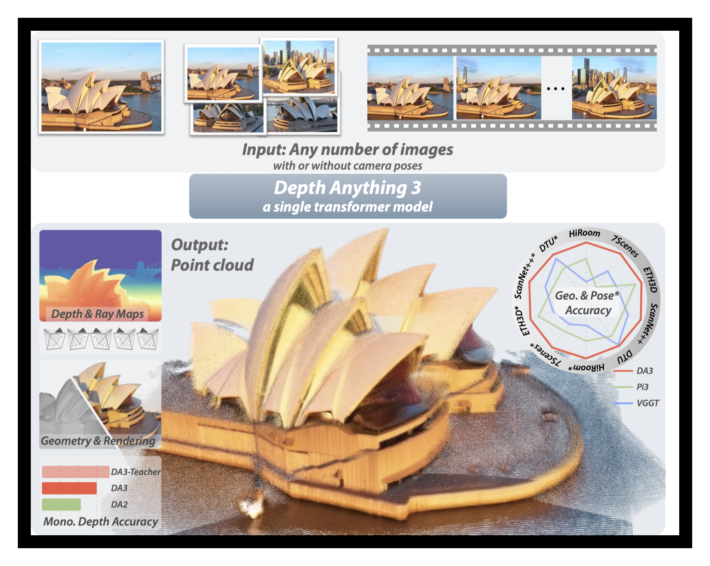{ width="760" }

*Figure 1，从任意数量的视图和可选相机信息恢复空间几何。*[↗](https://arxiv.org/pdf/2511.10647v1#page=3)

这条路线包含三个相互配合的改变。第一，用深度与射线分解几何，不必同时直接回归许多冗余三维目标。第二，把一个完整预训练的 ViT 改成能交换跨视图信息的骨干，尽量保留原有视觉能力。第三，用合成数据训练的教师改善真实数据的深度标签，再通过原始几何测量为教师输出固定尺度。模型结构的简洁并不意味着训练数据、标签处理或评测协议可以同样省略。

## Depth-ray 表示怎样把每个像素放进三维世界

### 射线保留方向和投影尺度，深度才有一致含义

对一张图像，设像素齐次坐标为 $p=(u,v,1)^\top$，内参为 $K$，从相机坐标到世界坐标的旋转和平移为 $R,t$。常规反投影为

$$
P=R\bigl(D(u,v)K^{-1}p\bigr)+t.
$$

DA3 把它拆成每个像素的射线起点和方向。

$$
d=RK^{-1}p,\qquad r=(t,d)\in\mathbb R^6,
\qquad P=t+D(u,v)d.
$$

射线图的前三个通道表示相机中心，后三个通道表示像素指向的方向。虽然同一张图的理想射线应共享起点，模型以稠密形式回归它们，使监督与图像位置对齐。由深度和射线逐像素相乘、相加，便得到点云。

这里的 $d$ **不归一化为单位向量**。$D$ 对应相机深度，$K^{-1}p$ 的尺度与其匹配；如果把 $d$ 改成单位向量，却仍乘同一个 $D$，结果会改变，因为欧氏射线长度与光轴方向的深度一般不同。这个细节决定了输出是否能被正确反投影，不能把它当作任意可替换的归一化操作。

直接回归 $R$ 需要满足旋转正交约束，而稠密射线可以像其他像素预测一样训练。这并未从数学上强制每条预测射线都严格来自同一个理想相机，因而还需要射线、深度与组合点云监督共同约束。表示提供结构，训练负责让结构一致。[↗](https://arxiv.org/pdf/2511.10647v1#page=6)

### 相机输出头与射线监督解决不同问题

理论上可以从射线恢复相机参数。原文式（1）对射线起点求均值得到相机中心。

$$
t_c=\frac{1}{HW}\sum_{h=1}^{H}\sum_{w=1}^{W}M(h,w,:3).
$$

方向部分则通过像素与射线对应拟合一个单应矩阵，使用 DLT 求解，再分解旋转与内参。这里有一处会影响实现的原文约定不一致。前面定义为 $d=RK^{-1}p$，因此按这一映射方向，像素到预测方向的矩阵应与 $RK^{-1}$ 成比例；相机恢复段却写成 $H=KR$，并据此描述 RQ 分解。两段不能在相同坐标约定下直接同时成立，不能不核对映射方向就将恢复公式照搬成代码。

最终系统另设轻量 camera head，直接从每张图的 camera token 预测平移 3 个值、旋转四元数 4 个值与两个 FoV 参数。这里是 9 个表示数值，不表示物理相机拥有 9 个互相独立的自由度。作者报告该头计算约为骨干的 0.1%，主要价值是省去从稠密射线拟合相机的成本；是否有助训练准确率，则需要单独看消融。[↗](https://arxiv.org/pdf/2511.10647v1#page=6) [↗](https://arxiv.org/pdf/2511.10647v1#page=7) [↗](https://arxiv.org/pdf/2511.10647v1#page=17)

## 一个预训练 Transformer 怎样处理不同数量的视图

Figure 2 中，绿色层执行跨视图注意力，灰色层仍在图内处理。先沿 patch token 看它们何时开始交换不同图像的信息，再看下方 camera token 进入同一主干，最后追踪深度、射线和组合点云的监督。

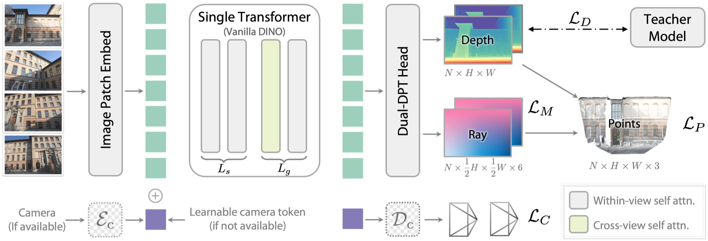{ width="860" }

*Figure 2，单个视觉 Transformer、相机条件与深度—射线输出。*

### 保留前部图像特征，再在后部交换视图信息

骨干是标准预训练 ViT，例如 DINOv2。总计 $L$ 个 block 分成前部 $L_s$ 与后部 $L_g$，采用

$$
L=L_s+L_g,\qquad L_s:L_g=2:1.
$$

前 $L_s$ 层只在每张图内部做 self-attention。后 $L_g$ 层交替执行跨视图与图内 self-attention，具体通过重排 token 的组织维度实现。没有再串接一整套大型、随机初始化的几何 Transformer，全部主干层都能继承图像预训练。

这个安排使模型先形成每幅图的局部视觉表示，再利用后部层判断多视角对应与相机关系。若输入只剩一张图，跨视图操作自然退化为单图操作，架构仍然成立。不过输入接口支持单图，并不等于统一模型在所有单目数据集上都优于专门训练的单目模型。[↗](https://arxiv.org/pdf/2511.10647v1#page=7)

### 相机条件用于输入，相机头用于输出

每个视图前面有一个 camera token。已有相机参数时，将 FoV、四元数和平移送入小型 MLP，得到条件 token；没有相机参数时，使用共享的可学习 token 作为占位。它与图像 patch 一起参加注意力，模型因而可以在同一套权重下处理 posed 与 unposed 输入。

这与上一节的 camera head 是两个方向。条件编码器把已知几何送进网络，相机头则把网络特征变成相机预测。实验中的“去掉 camera condition”不能等同于“去掉相机输出能力”；提供真值相机用于最终点云融合，也不能等同于模型在推理时已读取这些相机条件。

### Dual-DPT 的共享与分离各有用途

深度和射线来自相同图像，但回归内容不同。Dual-DPT 先共享 reassembly 模块，将多层 token 恢复成适合稠密预测的特征，再分别通过两组 fusion layers 和 output layers 输出深度与射线。

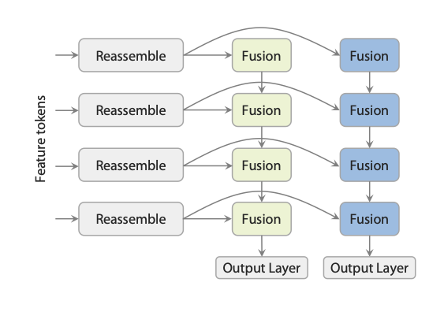{ width="400" .atlas-figure-compact }

*Figure 3，两条分支共享 reassembly，保留独立的特征融合与输出。*

共享前部减少两种几何输出各自形成不一致中间表示的机会，独立末端则保留不同回归目标所需的自由度。因此它既不同于将两个完全独立的 DPT 接在骨干上，也不同于强迫所有输出共用最后一层参数。Figure 2 示意中的 ray map 采用半分辨率输出，而方法的几何定义按像素描述六通道射线；概念上的像素对应关系不应与每一支的原生输出尺寸混为一谈。[↗](https://arxiv.org/pdf/2511.10647v1#page=5) [↗](https://arxiv.org/pdf/2511.10647v1#page=7)

## 损失同时检查深度、射线和组合后的点云

两条分支各自接近标签，还不足以说明组合结果具有正确几何。DA3 的训练同时监督深度、射线、反投影点云，并可加入相机头监督。

$$
\mathcal L=
\mathcal L_D(\hat D,D)+\mathcal L_M(\hat R,M)
+\mathcal L_P(\hat D\odot d+t,P)
+\beta\mathcal L_C(\hat c,v)
+\alpha\mathcal L_{\mathrm{grad}}(\hat D,D).
$$

这里 $\hat R$ 是原文用于表示预测 ray map 的符号，并非前文的旋转矩阵；$d,t$ 为射线组成，$\hat c,v$ 为相机预测与标签。$\mathcal L_P$ 检查的是两支组合后的三维位置，防止单独合理的预测在组合时产生几何冲突。

计算损失前，各类真值使用共同尺度归一化，这个尺度为有效反投影点的平均 L2 范数。它使深度、相机平移和三维点的数值保持可比，而非为每个输出头各自任意选一个尺度。论文采用 L1 为基础，设 $\alpha=\beta=1$。

深度项还引入置信度，原式写为

$$
\mathcal L_D=
\frac{1}{Z_\Omega}\sum_{p\in\Omega}m_p
\left(D_{c,p}|\hat D_p-D_p|-\lambda_c\log D_{c,p}\right).
$$

$m_p$ 选出有效监督位置，$D_{c,p}$ 为深度置信度，$Z_\Omega$ 为归一化项。误差项允许不同像素承担不同权重，对数惩罚则避免将置信度全部压低以逃避误差。原文未在这一段给出 $\lambda_c$ 的具体数值，不宜从其他模型的习惯配置补入。

梯度损失约束相邻像素的变化。

$$
\mathcal L_{\mathrm{grad}}=
\|\nabla_x\hat D-\nabla_xD\|_1+
\|\nabla_y\hat D-\nabla_yD\|_1.
$$

它让深度边界与局部平面结构也进入训练，而不只关心逐像素绝对误差。所有这些约束仍依赖标签质量，下一步便是解释为什么教师模型和数据清洗占据论文很大篇幅。[↗](https://arxiv.org/pdf/2511.10647v1#page=8)

## 教师提供细节，真实数据提供几何尺度

### 为什么不直接信任真实深度，也不直接照搬单目教师输出

真实数据中的相机位姿和几何测量，对跨场景泛化很有价值；但 COLMAP 深度可能稀疏，传感器深度也可能有孔洞和粗边界。DA3 先用合成数据训练单目教师，再用教师生成更完整、细致的深度监督。

教师自身只输出相对深度，不能直接覆盖所有真实标签。若每张图的教师输出具有不同尺度与偏移，多视图之间就会失去几何一致性。原有稀疏测量负责锚定尺度和偏移，教师负责补充结构，两者需要通过显式对齐结合。

设教师深度为 $\tilde D$，原有有效测量为 $D$，有效掩码为 $m_p$，原文式（8）为

$$
(\hat s,\hat t)=
\arg\min_{s>0,t}\sum_{p\in\Omega}m_p
\bigl(s\tilde D_p+t-D_p\bigr)^2,
\qquad D_{T\to M}=\hat s\tilde D+\hat t.
$$

这里的 $t$ 是标量深度偏移，与相机三维平移不是同一个变量。正尺度 $s>0$ 保持远近顺序。实际通过 RANSAC least squares 降低异常测量影响，inlier threshold 使用残差相对残差中位数的平均绝对偏差。得到的 $D_{T\to M}$ 才进入统一几何模型的训练。

这条路径不会凭空消除原始测量的系统偏差，却使真实标签的几何尺度与教师的稠密细节各自发挥作用。它比让每个视角使用未经对齐的单目伪标签，更符合跨视图点云组合的要求。[↗](https://arxiv.org/pdf/2511.10647v1#page=10)

### 教师为什么改成预测深度

DA2 使用 scale–shift-invariant disparity，DA3 教师改用 scale–shift-invariant depth。多视图反投影和公制深度任务都直接在 depth 空间操作，改为深度能减少下游表示转换与几何失真的问题。作者还采用 exponential depth 输出，以改善深度表示相对 disparity 在近相机区域的分辨能力。

教师仍采用 DINOv2 加 DPT，训练数据全部来自合成来源，涵盖室内、驾驶、物体级和多样环境。新增或扩展的来源包括 Hypersim、TartanAir、IRS、vKITTI2、SPRING、UnrealStereo4K、GTA-SfM、MatrixCity、PointOdyssey、Structured3D、Objaverse、TRELLIS 等。它们扩展的是场景和几何监督分布，不是让某一种新深度参数化独自承担全部收益。[↗](https://arxiv.org/pdf/2511.10647v1#page=9)

教师目标除梯度项和 global–local depth loss 外，还加入局部法向约束。在中心像素邻域构造未归一化法向 $n_i$，按其他法向模长之和为其分配权重，再组合单位化法向。把原文式（4）至（6）省略具体求和上下标，可写成

$$
w_i=\sum_j\|n_j\|-\|n_i\|,
\qquad n_m=\sum_i w_i\frac{n_i}{\|n_i\|},
$$

$$
\mathcal L_N=
\mathcal E(\hat n_m,n_m)+\sum_i\mathcal E(\hat n_i,n_i),
$$

其中 $\mathcal E$ 为角度误差。作者希望降低较远邻域对局部平均法向的影响，同时约束平均表面方向与各局部方向。原文将邻域描述为四个邻点，但求和下标写成 $0\ldots4$；它没有充分展开邻点与法向的具体构造，不能单凭这些式子补造精确采样代码。

天空和纯物体数据的背景往往没有有效深度，教师还预测 sky mask 与 object mask，以 MSE 监督。完整目标为

$$
\mathcal L_T=0.5\mathcal L_{\mathrm{grad}}
+\mathcal L_{\mathrm{gl}}+\mathcal L_N
+\mathcal L_{\mathrm{sky}}+\mathcal L_{\mathrm{obj}}.
$$

这些掩码将“没有定义的深度”与正常几何区域区分开，而不是要求网络给所有背景都回归一个虚假的有限距离。[↗](https://arxiv.org/pdf/2511.10647v1#page=10)

### 合成数据的真值也需要清洗

附录并未把合成标签视作天然准确。Figure 13 的红箭头指向图像轮廓和深度轮廓错位的位置；若直接训练，即使像素损失下降，也会学到错误边界。

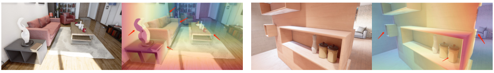{ width="860" }

*Figure 13，IRS 数据中的图像与深度空间错位。*

IRS 的处理先分别对灰度图与深度图做 Canny edge detection，将边缘膨胀 1 像素和 3 像素，比较两种容差下的交叠比例，再过滤比例过低的样本。具体过滤阈值未在附录展开，但方法解释了如何区分正常边界误差与显著配准错位。

其他清洗包括删除 TartanAir 的无效 skybox 场景 `amusement`；删除 UnrealStereo4K 中大面积错误的 `00003`、有裁剪问题的 `00004`，并过滤 `00008` 中海面缺失深度的样本；移除 PointOdyssey 两个地面深度错误场景；过滤 TRELLIS 中没有纹理的特定文件后缀样本。不同数据还设置不同深度上限，例如 GTA-SfM 为 1000、KenBurns 为 50000、OmniObject3D 为 10，不能把它们当作一个适用于所有原始单位的通用阈值。

这部分给出的可复用做法，是先检查图像—深度配准、无效区域与数据集尺度，再谈扩大合成训练。更多样本只有在监督语义一致时才更有价值。[↗](https://arxiv.org/pdf/2511.10647v1#page=31) [↗](https://arxiv.org/pdf/2511.10647v1#page=32)

## 主模型如何组织公共数据与训练预算

作者强调所有模型使用公共学术数据训练。Table 1 的 pose-geometry 训练清单同时包含合成几何、COLMAP 重建和 LiDAR 数据，下面保留其规模口径。

| Dataset | #Scenes | Data Type |
| --- | ---: | --- |
| AriaDigitalTwin | 237 | Synthetic |
| AriaSyntheticENV | 99,950 | Synthetic |
| ArkitScenes | 4,388 | LiDAR |
| BlendedMVS | 503 | 3D Recon |
| Co3dv2 | 30,616 | Colmap |
| DL3DV | 6,379 | Colmap |
| HyperSim | 344 | Synthetic |
| MapFree | 921 | Colmap |
| MegaDepth | 268 | Colmap |
| MegaSynth | 6,049 | Synthetic |
| MvsSynth | 121 | Synthetic |
| Objaverse | 505,557 | Synthetic |
| Omniobject | 5,885 | Synthetic |
| OmniWorld | 1,039 | Synthetic |
| PointOdyssey | 44 | Synthetic |
| ReplicaVMAP | 17 | Synthetic |
| ScanNet++ | 230 | LiDAR |
| ScenenetRGBD | 16,866 | Synthetic |
| TartanAir | 355 | Synthetic |
| Trellis | 557,408 | Synthetic |
| vKitti2 | 50 | Synthetic |
| WildRGBD | 23,050 | LiDAR |

原列名为 `#Scenes`，其中也包含大量物体级资产，不能将这些计数直接当成同质视频时长或训练图像数。它们也不是采样权重。ScanNet++ 的 230 个训练场景与评测场景严格分开，而后面的 NVS 任务使用另一套 DL3DV 场景数量，不能把不同阶段的数据表混为同一份配方。[↗](https://arxiv.org/pdf/2511.10647v1#page=9)

主模型在 128 张 H100 上训练 200K steps，warm-up 为 8K steps，峰值学习率 $2\times10^{-4}$。分辨率从 $504\times504$、$504\times378$、$504\times336$、$504\times280$、$336\times504$、$896\times504$、$756\times504$、$672\times504$ 中采样。在 $504\times504$ 下，视图数均匀采样 2–18，通过动态 batch 使每步 token 数近似恒定。

前 120K steps 使用原始深度监督，此后切换到教师标签；位姿条件以 20% 概率启用。这个过程让模型既接触原始几何锚点，又学习教师的细结构，并在训练中同时经历相机已知和未知两种条件。

完整 Giant 模型报告耗时约十天。主要消融改用 ViT-L、最多 10 个视图，在 32 张 H100 上约四天；表示消融明确使用 batch size 128、120K steps。不同表的控制模型不能直接视为完整 Giant 的廉价等价替代。[↗](https://arxiv.org/pdf/2511.10647v1#page=8) [↗](https://arxiv.org/pdf/2511.10647v1#page=16)

## 深度与射线的收益，怎样从控制实验中辨认

### 增加更多几何输出，并没有自动提高一致性

Table 6 固定 ViT-L、训练步数、batch 和视图数，比较 `depth`、直接点云 `pcd`、相机 `cam` 与射线 `ray` 的组合。所有配置都没有相机条件 token，避免把“模型读到了真值相机”混入表示能力比较。

下表每格依次为 **Auc3 / reconstruction metric**；HiRoom、ETH3D、7Scenes、ScanNet++ 的重建指标是 F1，越高越好，DTU 为 Chamfer Distance，越低越好。

| Prediction targets | HiRoom | ETH3D | DTU | 7Scenes | ScanNet++ |
| --- | ---: | ---: | ---: | ---: | ---: |
| depth + pcd + cam | 9.1 / 12.8 | 19.0 / 60.4 | 42.3 / 4.918 | 20.8 / 43.4 | 22.0 / 43.0 |
| depth + cam | 10.8 / 16.5 | 9.9 / 48.0 | 23.3 / 5.316 | 13.0 / 38.5 | 13.3 / 41.0 |
| depth + ray | 48.7 / 60.3 | 25.5 / 65.4 | 46.5 / 3.919 | 24.0 / 46.5 | 35.5 / 53.4 |
| depth + ray + cam | 37.2 / 45.4 | 22.3 / 59.4 | 56.3 / 3.066 | 25.7 / 45.6 | 34.1 / 56.5 |

最明确的结果是 `depth + ray` 优于两种不含 ray 的方案。HiRoom 的 Auc3 从 `depth + cam` 的 10.8 到 48.7，F1 从 16.5 到 60.3；简单增加直接点云头并没有解决这个问题，`depth + pcd + cam` 反而只有 9.1/12.8。

加入 camera head 后是任务之间的权衡。HiRoom 从 48.7/60.3 降到 37.2/45.4，但 DTU 的 Auc3 从 46.5 提高到 56.3，CD 从 3.919 降到 3.066。最终选择 `depth + ray + cam` 还考虑了直接输出相机的便利，不能把这张表解读为相机头处处提升或处处无效。

这项消融支持 depth-ray 是有效且足够紧凑的几何接口。它没有单独隔离表示形式、稠密监督和 Dual-DPT 的全部作用，因为 ray 分支本身使用了这种共享结构；进一步的架构消融才检验后者。[↗](https://arxiv.org/pdf/2511.10647v1#page=17)

### 单个完整预训练骨干，优于本实验中的额外堆叠

Table 7 比较近似参数规模的设计。`VGGT Style` 使用更小的 ViT-B 构造堆叠结构，使参数量与单 ViT-L 可比；它是作者训练的架构控制组，不是直接拿完整公开 VGGT 主结果来替换比较。

| Architecture | HiRoom Auc3 / F1 ↑ | ETH3D Auc3 / F1 ↑ | DTU Auc3 ↑ / CD ↓ | 7Scenes Auc3 / F1 ↑ | ScanNet++ Auc3 / F1 ↑ |
| --- | ---: | ---: | ---: | ---: | ---: |
| Proposed Arch. | 39.2 / 47.0 | 21.0 / 55.4 | 45.8 / 3.82 | 26.2 / 47.6 | 30.3 / 51.1 |
| VGGT Style | 3.72 / 14.5 | 2.31 / 27.4 | 1.38 / 6.93 | 0.97 / 21.4 | 2.03 / 12.2 |
| Full Alt. | 24.7 / 29.3 | 13.1 / 51.9 | 44.6 / 4.23 | 21.1 / 48.6 | 27.7 / 47.5 |
| w/o Dual DPT | 5.59 / 11.5 | 13.6 / 33.4 | 21.7 / 5.14 | 14.2 / 49.4 | 26.5 / 46.6 |

堆叠方案明显较弱。作者将差距主要归因于 DA3 能完整利用预训练，而该堆叠结构中大量 block 未经同等预训练；这项实验并不是在严格相同预训练覆盖下只改变网络连接，因此不宜推导成“任何双 Transformer 都不如单 Transformer”。

`Full Alt.` 在全部层交替图内与跨图注意力，主要指标低于保留前部图内层的方案，但 7Scenes F1 从 47.6 升到 48.6。移除 Dual-DPT、让两支独立预测也大多下降，却同样在 7Scenes F1 达到更高的 49.4。共享与部分交替的总体价值很明确，原文“所有指标都下降”的概括却需要按表格保留这一例外。[↗](https://arxiv.org/pdf/2511.10647v1#page=18)

### 教师细化标签的收益也受数据域影响

移除 teacher labels 后，HiRoom Auc3/F1 从 39.2/47.0 降到 11.2/16.0，7Scenes 从 26.2/47.6 到 23.3/40.3，ScanNet++ 从 30.3/51.1 到 26.2/47.7。相反，DTU 的 Auc3/CD 从 45.8/3.82 改善为 52.5/3.29，ETH3D 的 F1 也从 55.4 到 57.6。

Figure 8 应先看火烈鸟的细腿、玩具机械的结构和树林的竖直边界。加入教师监督后，这些细节更清晰，解释了为何它对细结构丰富的场景尤其有用；但图中的视觉改善不能替代各数据集的数值变化。

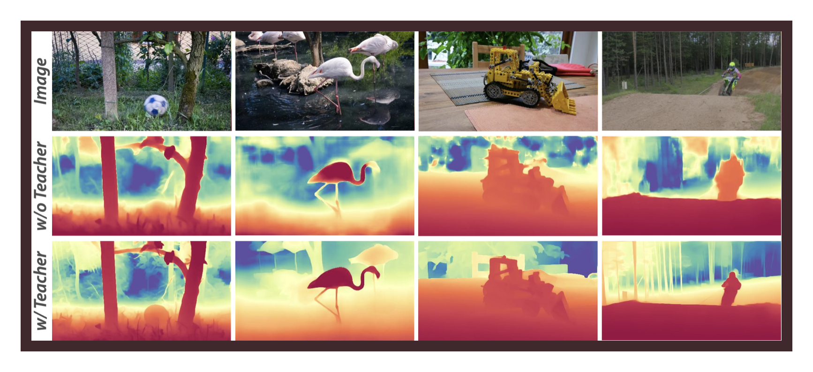{ width="820" }

*Figure 8，教师标签对统一几何模型深度细节的影响。*

论文将 HiRoom 的大幅收益与其丰富细结构联系起来，这是合理的实验解释；控制组没有进一步单独拆分标签噪声、细节分布和教师偏差，不能把所有域间差异都归于单一原因。[↗](https://arxiv.org/pdf/2511.10647v1#page=18) [↗](https://arxiv.org/pdf/2511.10647v1#page=19)

## 联合几何基准测的究竟是什么

### 位姿与点云指标有不同协议

论文建立了 HiRoom、ETH3D、DTU、7Scenes、ScanNet++ 五组几何评测。Table 1 分别列出 29、11、22、7、20 个场景，合计 89；HiRoom 的数据集介绍另写 30 个场景，因此这里使用基准表口径。

每场景使用可用图像，超过上限时以固定随机种子抽取 100 张。Pose AUC 来自相对旋转与相对平移的角误差曲线，综合 RRA 与 RTA，并报告 3 度和 30 度阈值。Auc3 对精细位姿更严格，Auc30 对较大误差更宽容，不能互相替代。

重建则将预测相机与深度共同用于融合。预测位姿先通过 evo 与真值对齐；为减少错误相机的影响，使用随机位姿子集产生候选变换，按平移误差判定 inliers，选择支持最多的变换，再进行深度融合。因而最终几何成绩既取决于深度，也取决于相机和对齐，不是单独深度头的独立评测。[↗](https://arxiv.org/pdf/2511.10647v1#page=12)

F1 同时检查重建是否准确与完整。Precision 统计重建点中有多少接近真值，recall 统计真值点中有多少被重建覆盖，二者以调和平均合并。各数据集采用不同距离容差和融合设置。

| Dataset | Reconstruction metric | F1 distance threshold | Fusion / sampling detail |
| --- | --- | --- | --- |
| HiRoom | F1 ↑ | 0.05 m | TSDF voxel 0.007 m |
| ETH3D | F1 ↑ | 原文设为 0.25 | TSDF voxel 0.039 m，使用全部帧 |
| DTU | CD ↓，mm | — | 22 evaluation scans，RMBG 2.0 去背景，专用深度融合 |
| 7Scenes | F1 ↑ | 0.05 m | TSDF voxel 0.007 m，帧数降采样 11 倍 |
| ScanNet++ | F1 ↑ | 0.05 m | TSDF voxel 0.02 m，帧数降采样 5 倍，laser-scan 深度真值 |

DTU 报告 Chamfer Distance，数值越低越好；其他四组 F1 越高越好。不同 F1 距离阈值也使跨数据集绝对分数不能直接当作难度排名。[↗](https://arxiv.org/pdf/2511.10647v1#page=13)

### 相机条件与真值位姿融合必须分开

Table 7 的 pose-conditioning 消融中，两组都使用真值相机作最终融合，区别是模型是否也读取相机条件。

| Pose conditioning, GT pose fusion | HiRoom F1 ↑ | ETH3D F1 ↑ | DTU CD ↓ | 7Scenes F1 ↑ | ScanNet++ F1 ↑ |
| --- | ---: | ---: | ---: | ---: | ---: |
| Without | 65.8 | 63.2 | 3.65 | 58.4 | 62.8 |
| With | 73.8 | 70.9 | 2.14 | 46.0 | 65.7 |

HiRoom、ETH3D、DTU、ScanNet++ 改善，说明把相机作为网络输入可以帮助深度预测，而不只是改善最终坐标摆放。7Scenes 却从 58.4 降到 46.0，不能跟随正文的“所有指标一致提高”表述。真实部署已有相机时，模型能够使用这些条件是便利，但仍需在目标数据域检查它是否确实改善重建。[↗](https://arxiv.org/pdf/2511.10647v1#page=18)

## 主结果在哪些条件下领先

### 严格位姿精度提升明显，大模型也有例外

Table 2 的核心位姿结果如下，每格为 **Auc3 / Auc30**。

| Method | HiRoom | ETH3D | DTU | 7Scenes | ScanNet++ |
| --- | ---: | ---: | ---: | ---: | ---: |
| VGGT | 49.1 / 88.0 | 26.3 / 80.8 | 79.2 / 99.8 | 23.9 / 85.0 | 62.6 / 95.1 |
| Pi3 | 67.0 / 94.8 | 35.2 / 87.3 | 62.5 / 94.9 | 25.5 / 86.3 | 50.7 / 92.1 |
| DA3-Giant | 80.3 / 95.9 | 48.4 / 91.2 | 94.1 / 99.4 | 28.5 / 86.8 | 85.0 / 98.1 |
| DA3-Large | 58.7 / 94.2 | 32.2 / 86.9 | 70.2 / 96.7 | 29.2 / 86.6 | 60.2 / 94.7 |
| DA3-Base | 19.0 / 83.2 | 15.1 / 74.6 | 60.1 / 95.9 | 20.1 / 82.9 | 25.1 / 83.4 |
| DA3-Small | 9.49 / 75.2 | 8.59 / 62.1 | 30.6 / 91.2 | 14.0 / 78.7 | 10.9 / 71.9 |

Giant 在五组 Auc3 中都超过列出的外部基线，ScanNet++ 从 VGGT 的 62.6 到 85.0，是明显的严格阈值收益。不过 DTU 的 Auc30 为 99.4，低于 VGGT 的 99.8；DA3 系列内部，Large 的 7Scenes Auc3 29.2 也高于 Giant 的 28.5。

缩小模型后，HiRoom、ETH3D 和 ScanNet++ 的严格位姿指标下降较快。这说明“同一接口能够缩放到小模型”与“小模型保留同样精确的跨视图相机恢复”是两回事，选择模型时不能只看它是否支持任意视图输入。[↗](https://arxiv.org/pdf/2511.10647v1#page=14)

### 已知相机并不保证所有模型都获得相同收益

下表摘录重建结果，每格为 **without pose / with pose**。DTU 的单位为 mm 且越低越好，其余均为 F1，越高越好。

| Method | HiRoom F1 ↑ | ETH3D F1 ↑ | DTU CD ↓ | 7Scenes F1 ↑ | ScanNet++ F1 ↑ |
| --- | ---: | ---: | ---: | ---: | ---: |
| MapAnything | 32.4 / 69.2 | 54.8 / 71.9 | 7.91 / 3.97 | 44.8 / 55.2 | 39.4 / 71.3 |
| Pi3 | 75.8 / 85.0 | 72.7 / 80.6 | 3.28 / 1.72 | 44.2 / 57.5 | 63.1 / 73.3 |
| VGGT | 56.7 / 70.2 | 57.2 / 66.7 | 2.05 / 1.44 | 47.9 / 51.4 | 66.4 / 70.7 |
| DA3-Giant | 85.1 / 95.6 | 79.0 / 87.1 | 1.85 / 1.85 | 53.5 / 56.5 | 77.0 / 79.3 |
| DA3-Large | 69.5 / 87.1 | 65.8 / 75.2 | 2.08 / 1.23 | 56.3 / 49.2 | 67.9 / 75.7 |

未知相机时，Giant 在五个数据集均超过外部对照；同系列 Large 在 7Scenes 的 56.3 则更高。已知相机时，Giant 在 HiRoom 提高到 95.6，但 DTU 仍是 1.85，没有改善，并落后 VGGT 的 1.44 和 Large 的 1.23；7Scenes 的 Pi3 57.5 也高于 Giant 56.5。Large 的 7Scenes 还从 56.3 降到 49.2。

这些结果使“已有相机时更适合嵌入现有流程”的判断更具体。接口上确实可以利用标定信息，准确率收益则受到模型容量、深度本身和数据域影响，不能一律期待已知位姿消除所有重建问题。[↗](https://arxiv.org/pdf/2511.10647v1#page=15)

Figure 6 中可直接比较办公桌面和物体边缘的厚度、浮点噪声。DA3 点云更规整的案例与主表一致，但这里只是两个场景的可视化，不是额外的独立复现实验。

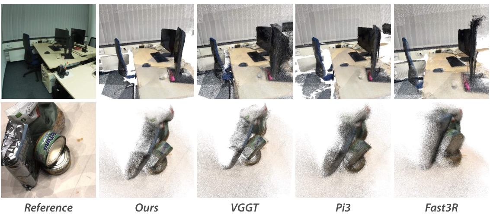{ width="920" }

*Figure 6，点云结构与噪声的定性比较。*[↗](https://arxiv.org/pdf/2511.10647v1#page=16)

## “DA3 单目性能”至少对应三种不同模型

### 统一主模型、教师与专门单目学生不能混用成绩

主模型接受一张输入图时也能输出深度，但论文还另外训练了单目学生。学生沿用教师—学生范式，在未标注真实图像上学习教师伪标签，输出相对深度，并采用教师对应的损失。它不是将统一模型的视图数量设成一就得到的另一个运行模式。

下面并列保留 Table 4 与 Table 10 的 $\delta_1$，数值以百分数显示，越高越好。

| Model / evaluation source | KITTI | NYU | SINTEL | ETH3D | DIODE |
| --- | ---: | ---: | ---: | ---: | ---: |
| DA2, Table 4 / 10 baseline | 94.6 | 97.9 | 77.2 | 86.5 | 95.2 |
| VGGT, Table 4 | 91.7 | 97.9 | 67.9 | 97.5 | 95.3 |
| DA3 unified model, Table 4 | 95.3 | 97.4 | 75.5 | 98.6 | 95.4 |
| DA3 Teacher, Table 4 | 97.2 | 97.9 | 81.4 | 99.8 | 96.6 |
| DA3 mono-student, Table 10 | 97.1 | 98.0 | 82.3 | 98.8 | 96.5 |

统一 DA3 在 ETH3D 从 DA2 的 86.5 到 98.6，但 NYU 为 97.4，低于 97.9；SINTEL 为 75.5，也低于 77.2。所以“统一模型单目表现整体有竞争力”不能改写为每个单目基准都超过 DA2。

专门的 ViT-L 单目学生在五列都超过该 DA2 对照。SINTEL 从 77.2 到 82.3，提高的是 5.1 个百分点；ETH3D 从 86.5 到 98.8，提高 12.3 个百分点。教师在某些数据集仍高于学生，而 SINTEL 学生 82.3 又高于教师 81.4，说明教师质量与真实图像蒸馏共同影响最终泛化，学生并非机械复制教师的每项分数。[↗](https://arxiv.org/pdf/2511.10647v1#page=15) [↗](https://arxiv.org/pdf/2511.10647v1#page=19) [↗](https://arxiv.org/pdf/2511.10647v1#page=20)

### 教师的改进主要来自哪些选择

Teacher 消融使用 ViT-L、batch size 64，在 KITTI、NYU、ETH3D、SUN-RGBD 和 DIODE 上取平均；这组平均不包含上表的 SINTEL，因此不能把不同平均值直接相减。

| Data configuration | $\delta_1$ ↑ | AbsRel ↓ | SqRel ↓ |
| --- | ---: | ---: | ---: |
| V2 datasets | 0.919 | 0.087 | 0.596 |
| V3 datasets | 0.929 | 0.079 | 0.508 |
| V3 + multi-resolution | 0.938 | 0.072 | 0.452 |

扩大数据从 V2 到 V3，以及增加多分辨率训练，三项指标均持续改善。这是较清楚的数据与训练配置收益，不能全部归因于法向损失或深度参数化。

| Geometry target | $\delta_1$ ↑ | AbsRel ↓ | SqRel ↓ |
| --- | ---: | ---: | ---: |
| Disparity | 0.919 | 0.095 | 1.033 |
| Pointmap | 0.912 | 0.096 | 0.693 |
| Depth | 0.918 | 0.089 | 0.637 |

Depth 在 AbsRel、SqRel 上更好，$\delta_1$ 则比 Disparity 略低。它更适合下游几何并拥有更低的平均相对误差，不表示所有常用深度指标都必须同时提升。

| Teacher loss | $\delta_1$ ↑ | AbsRel ↓ | SqRel ↓ |
| --- | ---: | ---: | ---: |
| MAE-Loss | 0.918 | 0.089 | 0.637 |
| Without distance-weighted normal | 0.918 | 0.087 | 0.600 |
| Full loss | 0.919 | 0.087 | 0.596 |

完整损失进一步改善，但幅度明显小于前面数据扩展带来的变化。法向监督有助于局部几何，实验不支持把它宣传成教师全部优势的唯一来源。[↗](https://arxiv.org/pdf/2511.10647v1#page=19)

## 公制深度需要另外处理相机焦距与尺度

### Canonical camera space 让不同焦距的训练数据可比较

相对深度模型的输出不能直接当作以米为单位的距离。DA3-Metric 是另外训练的模型，采用 canonical camera space transformation，将不同相机焦距的标签变换到共同参考。

设真实焦距为 $f$，标准焦距为 $f^c$，训练标签按比例变换。

$$
D^c=D\frac{f^c}{f},\qquad f^c=300.
$$

这个变换将焦距引起的深度歧义显式纳入接口。相应地，若模型输出处于 canonical 空间，换回原相机的深度应遵循该定义的逆比例；不能在改变图像缩放或焦距后继续使用不匹配的标定数值。

公制训练同样将教师相对深度与测量标签做尺度、偏移对齐。训练中 20% 概率仍使用原始真值，其余采用对齐教师预测；立体数据还使用 FoundationStereo 生成训练标签。数据来源涵盖室内扫描和驾驶集合，包括 Taskonomy、DDAD、Waymo、ScanNet++、ARKitScenes、DSEC 等。

实现采用 AdamW，encoder 学习率 $5\times10^{-6}$，decoder 为 $5\times10^{-5}$，batch size 64，训练 160K iterations。基础分辨率为 504，结合多种宽高比；以 5% 概率施加 90 或 270 度旋转增强。目标组合 depth、gradient 和 sky-mask loss。这些是公制模型的配方，不能挪作前面 128 H100 主模型全部超参数的补充。[↗](https://arxiv.org/pdf/2511.10647v1#page=11)

### 公制模型更擅长哪类场景

Table 11 的每格依次为 **$\delta_1$ / AbsRel**，前者越高越好，后者越低越好。DIODE 使用 indoor 子集。

| Method | NYUv2 | KITTI | ETH3D | SUN-RGBD | DIODE |
| --- | ---: | ---: | ---: | ---: | ---: |
| DepthPro | 0.932 / 0.093 | 0.843 / 0.121 | 0.386 / 0.349 | 0.950 / 0.126 | 0.734 / 0.173 |
| UniDepthv1 | 0.980 / 0.061 | 0.978 / 0.051 | 0.234 / 0.464 | 0.971 / 0.113 | 0.570 / 0.266 |
| UniDepthv2 | 0.968 / 0.064 | 0.968 / 0.076 | 0.863 / 0.152 | 0.977 / 0.111 | 0.856 / 0.123 |
| DA3-Metric | 0.963 / 0.070 | 0.953 / 0.086 | 0.917 / 0.104 | 0.973 / 0.105 | 0.838 / 0.128 |

DA3-Metric 在 ETH3D 的两项都优于这组对照，SUN-RGBD 的 AbsRel 也最低。但 NYUv2、KITTI 的 UniDepthv1 更强，DIODE 的 UniDepthv2 为 0.856/0.123，也好于 DA3-Metric 的 0.838/0.128。这组结果更支持跨域能力与细节质量的价值，而非一个不依任务分布的统一最佳选项。[↗](https://arxiv.org/pdf/2511.10647v1#page=20) [↗](https://arxiv.org/pdf/2511.10647v1#page=21)

### 教师让边缘更清晰，却可能降低某些数值指标

公制模型的教师消融使用略有不同的训练分辨率，所以它的 `with teacher` 行与最终模型行并不完全一致。

| Metric-model supervision | NYUv2 $\delta_1$ / AbsRel | KITTI | ETH3D | SUN-RGBD | DIODE |
| --- | ---: | ---: | ---: | ---: | ---: |
| With teacher | 0.966 / 0.073 | 0.947 / 0.086 | 0.906 / 0.105 | 0.973 / 0.104 | 0.824 / 0.132 |
| Without teacher | 0.969 / 0.066 | 0.965 / 0.067 | 0.907 / 0.105 | 0.975 / 0.099 | 0.816 / 0.134 |

去掉教师后，NYUv2、KITTI 和 SUN-RGBD 的数值都更好；DIODE 则保留教师更好。仅看这些全局深度指标，无法说明教师在所有数据上都提高精度。

Figure 10 提供另一类证据。先看台灯支架、椅子和植物轮廓，再比较相邻两列的边缘是否融进背景。有教师时结构更锐利，解释了为何作者仍希望保留这类监督。

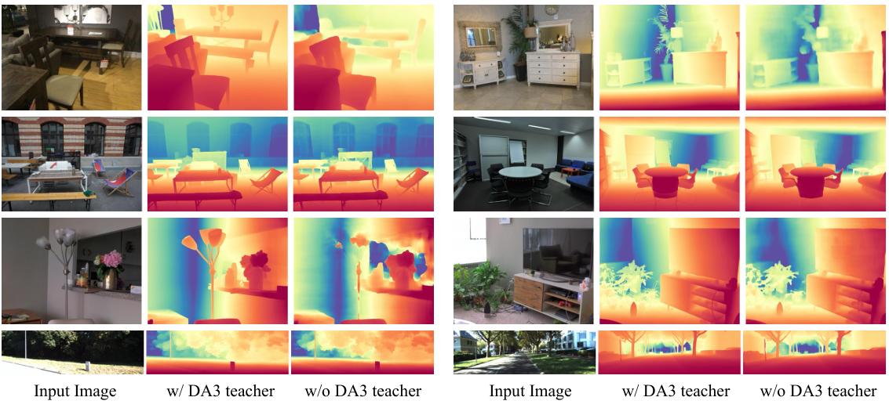{ width="920" }

*Figure 10，公制深度模型中的教师监督，重点是细结构与边界质量。*

应用若关心障碍物轮廓、前后景分界或渲染边缘，细节质量有独立价值；若主要关心某个域的平均深度误差，则应结合表中反例选择配置。视觉锐利与公制距离准确不能互相代替。[↗](https://arxiv.org/pdf/2511.10647v1#page=21)

## 几何骨干如何用于前馈 3D Gaussian Splatting

### 让几何确定位置，再学习可渲染的高斯属性

为了检验几何表示是否能支持其他任务，作者加入 GS-DPT head，预测像素对应的 3D Gaussian 参数。深度经反投影确定高斯中心；新头预测旋转、尺度和颜色，透明度由相应 confidence head 输出。模型先在局部相机空间表示这些量，再放到共同世界坐标中渲染新视角。

这样不需要每个测试场景重新进行耗时优化，便可以前馈生成一组可渲染高斯。训练不仅使用新视角的 MSE、LPIPS 图像损失，也保留输入视图深度监督。后者约束模型不要为了某些渲染画面而任意牺牲几何结构。[↗](https://arxiv.org/pdf/2511.10647v1#page=11)

论文进一步提出 pose-adaptive 版本。相机已知时，将预测深度与高斯对齐到已知位姿；未知时使用网络预测位姿。GS-DPT 还增加 depth offset，以缓解表面几何与渲染质量之间的冲突，并将简单 RGB 改成 spherical harmonic coefficients，表达与观察方向有关的外观。

这个面向灵活输入的版本冻结预训练 DA3 骨干，只训练 GS-DPT；高分辨率输入配较少视图，低分辨率配更多视图，以控制训练预算。它与用于统一比较的 pose-conditioned NVS 方案需要分开理解，不能因为存在一个可处理未知相机的变体，就把后面的全部基准结果描述成 pose-free 渲染。[↗](https://arxiv.org/pdf/2511.10647v1#page=12)

### NVS 比较使用已知相机和固定十二张上下文图

训练使用 DL3DV 的 10015 个场景，评测的 140 个 DL3DV 场景与训练互斥。域外评测为 Tanks and Temples 的 6 个场景、MegaDepth 的 19 个场景，总计 165 个测试场景。

每场景约有 300–400 个视图，每 8 个取一个作为目标新视角；其余视图根据相机平移和旋转距离做 farthest point sampling，选出 12 张上下文。模型使用给定的 COLMAP 位姿，分辨率固定为 $270\times480$。这是一套明确的 posed NVS 协议。

对比方法均按该设置重训，并加入深度训练损失。通常使用 8 张 A100、200K steps、batch size 1；pixelSplat 因 epipolar attention 较慢，只训练 100K steps。两组训练步数不同，这个条件必须与结果一起保留。[↗](https://arxiv.org/pdf/2511.10647v1#page=12) [↗](https://arxiv.org/pdf/2511.10647v1#page=21)

| Method / backbone | DL3DV PSNR ↑ / LPIPS ↓ | Tanks and Temples PSNR ↑ / LPIPS ↓ | MegaDepth PSNR ↑ / LPIPS ↓ |
| --- | ---: | ---: | ---: |
| pixelSplat | 16.55 / 0.480 | 13.81 / 0.558 | 13.87 / 0.561 |
| MVSplat | 18.13 / 0.393 | 14.81 / 0.508 | 14.67 / 0.533 |
| DepthSplat | 19.24 / 0.322 | 15.80 / 0.418 | 15.90 / 0.450 |
| Fast3R | 19.30 / 0.320 | 16.24 / 0.409 | 16.43 / 0.421 |
| MV-DUSt3R | 20.01 / 0.294 | 17.04 / 0.370 | 16.20 / 0.437 |
| VGGT | 20.96 / 0.253 | 17.18 / 0.347 | 16.45 / 0.417 |
| DA3 | 21.33 / 0.241 | 18.10 / 0.311 | 17.89 / 0.351 |

DA3 不只在训练域 DL3DV 上提高。Tanks and Temples 相比 VGGT 的 PSNR 从 17.18 到 18.10，MegaDepth 从 16.45 到 17.89，LPIPS 同时降低。这是几何骨干改善能够传递到渲染的具体证据。Table 5 的 SSIM 也分别从 VGGT 的 0.697、0.550、0.500，提高到 DA3 的 0.711、0.578、0.561。

各方法在域外整体更弱，说明训练与测试分布仍然重要。作者将其与轨迹和位姿分布联系起来，但没有通过独立控制场景内容、相机轨迹来排除其他解释，因此不能把域外差距全部归因于轨迹。[↗](https://arxiv.org/pdf/2511.10647v1#page=17)

Figure 11 中，每个场景连续两行是两个目标视角。先看细柱、屋檐和大基线外景中的结构能否保持，再看纹理是否清晰；几何错位往往会同时破坏两个视角的结构。

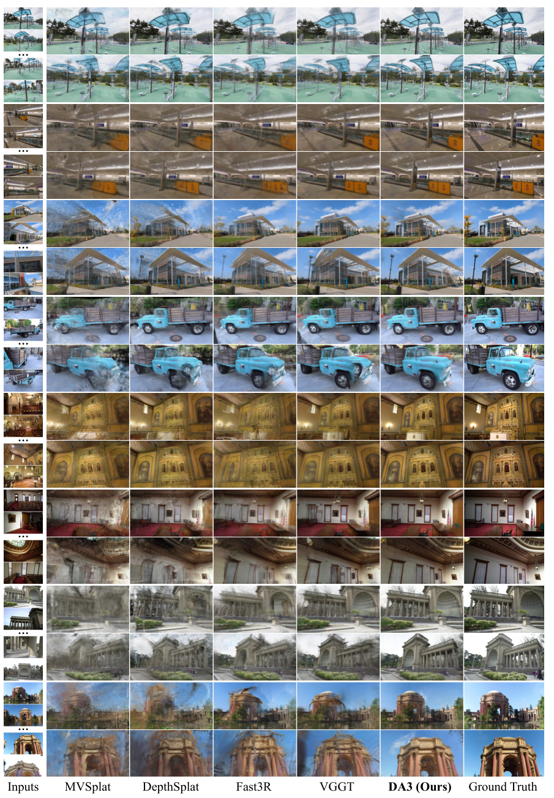{ width="920" }

*Figure 11，前馈新视角合成的定性比较，前三组来自 DL3DV，随后为 Tanks and Temples 与 MegaDepth。*[↗](https://arxiv.org/pdf/2511.10647v1#page=23)

## 模型大小、视图数量与实际吞吐要一起看

Table 8 在 80 GB A100 上测最大输入图像数；吞吐则另用 32 张图像的场景测量，报告平均每图速度，分辨率为 $504\times336$。

| Model | Max # of images | Backbone / Dual-DPT / CameraHead parameters | Running speed |
| --- | ---: | --- | ---: |
| VGGT, reference | 400–500 | 0.91B / 0.064B / 0.22B | 34.1 FPS |
| DA3-Giant | 900–1000 | 1.130B / 0.050B / 0.018B | 37.6 FPS |
| DA3-Large | 1500–1600 | 0.300B / 0.047B / 0.008B | 78.37 FPS |
| DA3-Base | 2100–2200 | 0.086B / 0.015B / 0.004B | 126.5 FPS |
| DA3-Small | 4000–4100 | 0.022B / 0.003B / 0.001B | 160.5 FPS |

Large 的速度约为 Giant 的两倍，同时能容纳更多视图；前面的严格位姿表也显示，小模型在若干数据集明显损失精度。输出接口相同，实际应按重建精度与输入规模选择。

参数数量有一处报告差异。主结果 Table 2 将 Giant 列为 1.10B，Table 8 的三部分按表相加则为 1.198B；这里保留各表原值，不能声称两者完全一致。Large 的 0.300B 是骨干部分，包含输出头后约 0.355B，与主表约 0.36B 接近，因此也不宜把 backbone 参数单独拿去与其他模型总参数比较。

最大可输入图像数表示这一显存设置下的容量，不意味着在数千视图上已经评测出同样准确的长程几何。论文还提出把部分中间 token 放到 CPU 可以处理更多视图，但没有给出统一的额外吞吐结果。32 图场景的平均 FPS 也不是新视频帧到达后立即可用的流式延迟。[↗](https://arxiv.org/pdf/2511.10647v1#page=18)

## 从示例到实际使用，需要保留输出的几何语义

下面两组 SOH 示例展示了输入图与深度的像素对应。先看歌剧院屋顶、远处建筑和水面的边界，确认模型的深度结构如何跟随输入视角变化。深度可视化文件本身已经包含左右并排的 RGB 与伪彩色深度。

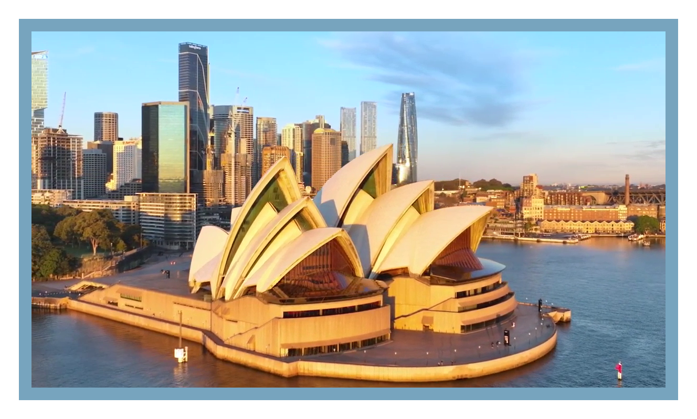{ width="360" }

{ width="420" .atlas-figure-compact }

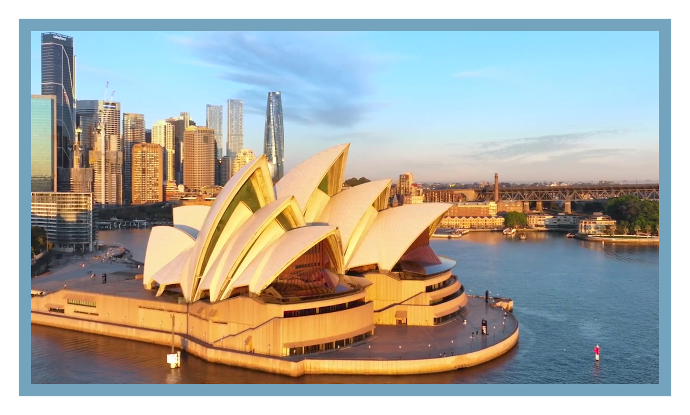{ width="360" }

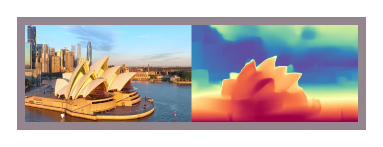{ width="420" .atlas-figure-compact }

*SOH 示例输入及对应深度可视化，用于观察像素对齐关系，不属于上述基准的新增测量。*

真正采用这套模型时，第一步是区分所需输出。如果只要单图相对深度，应看单目学生的质量与预算；需要公制距离，应使用相应模型并保持焦距、缩放和尺度一致；需要多视角重建，则要同时检查位姿、深度、坐标系和融合协议。已有相机信息的系统可以利用 camera condition，但仍应验证目标域中的收益。

DA3 最可复用的设计，是让深度与射线保留明确几何含义，让完整预训练骨干通过有限的注意力重排处理多视图，再通过经过尺度锚定的教师标签补充细节。论文把动态场景推理列为后续方向，输入支持视频不等于已经获得动态点对应或动作条件世界模型。它提供的是较统一的几何基础，下一层应用仍需根据时间变化、尺度要求和实时预算组织自己的接口。[↗](https://arxiv.org/pdf/2511.10647v1#page=22)
