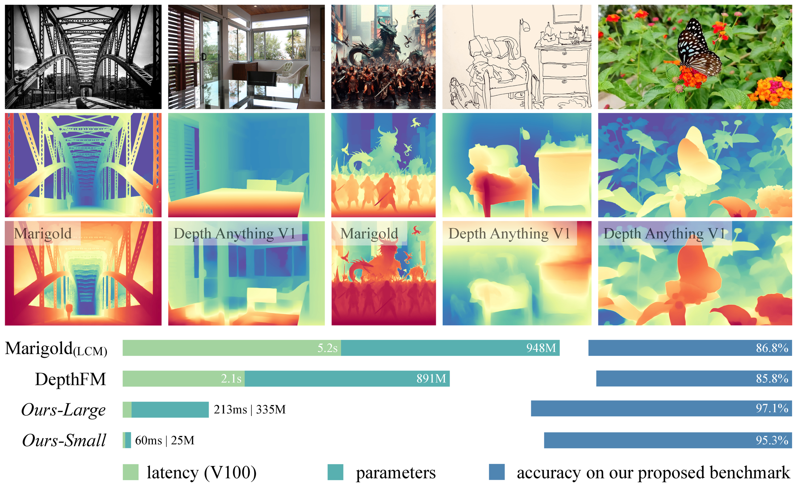
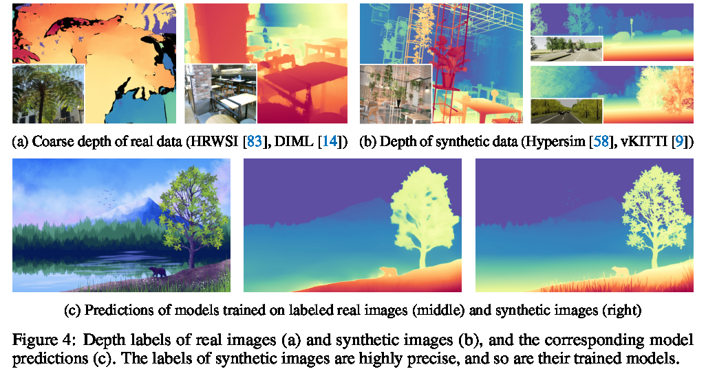
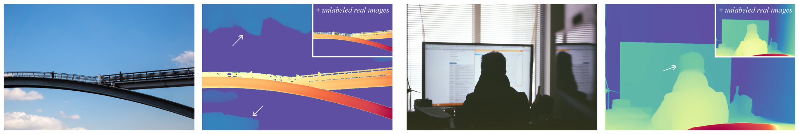
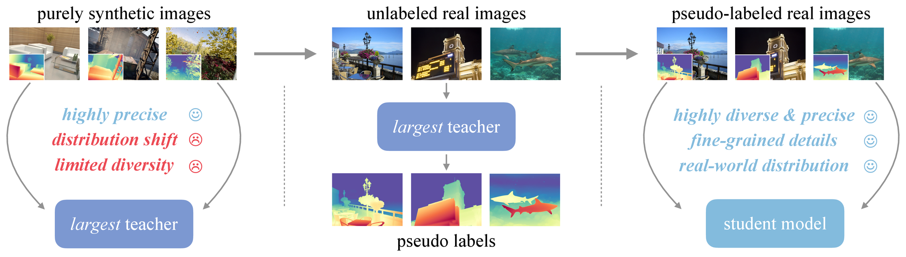
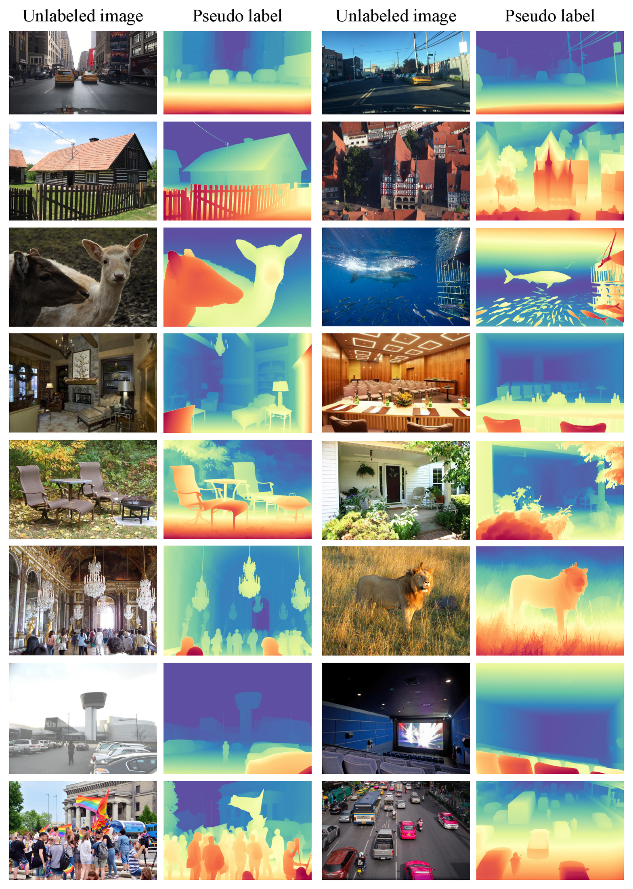
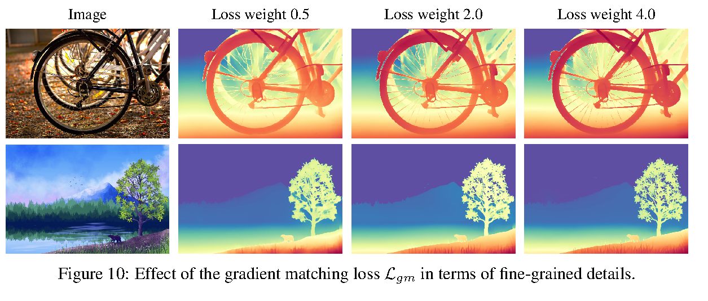
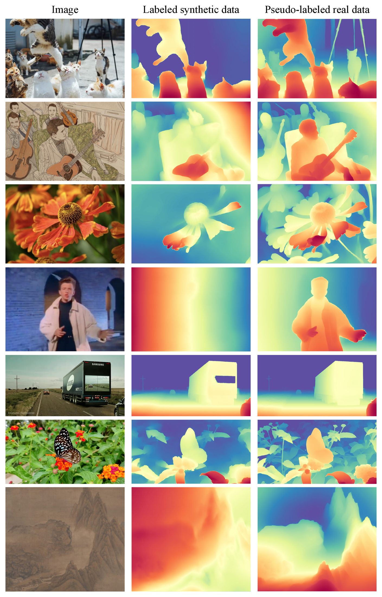

# Depth Anything V2：单目深度的数据配方

!!! note "读法定位"
    这页先按“论文证据节点”读：先问它解决哪一个瓶颈，再看核心图表、实验 setting 和不能外推的边界。背景概念先回 [论文专题讲解](../index.md) 和 [具身智能](../../embodied-ai/index.md)。
    **前置**：不必先读完所有相关论文，但要知道本篇的输入、训练/推理路径和评测口径分别对应什么。
    **主线关系**：读完后把结论回填到「具身智能」路线里，判断它改变的是机制、成本、数据配方、评测口径，还是仍停留在前沿假设。

!!! info "论文信息"
    - 论文：`Depth Anything V2`
    - 系统：`Depth Anything V2 / DA2`
    - 链接：[arXiv:2406.09414](https://arxiv.org/abs/2406.09414)
    - 项目页：[depth-anything-v2.github.io](https://depth-anything-v2.github.io/)
    - 代码与模型：[DepthAnything/Depth-Anything-V2](https://github.com/DepthAnything/Depth-Anything-V2)
    - 关键词：monocular depth、DINOv2、DPT、synthetic data、pseudo label、teacher-student、metric depth、DA-2K


Depth Anything V2 放在具身智能专题里，不是因为它直接输出机器人动作，而是因为它补了机器人闭环里最基础的视觉状态：**从普通 RGB 图像得到更细、更稳、更开放域的深度先验**。抓取、导航、避障、重建、VLA 状态编码和仿真数据质检，都需要这层几何信号。

DA2 的核心贡献很朴素：它几乎没有靠新奇结构取胜，而是把单目深度训练的数据链路重新排了一遍：

```text
precise synthetic labels
  -> train the largest DINOv2-G teacher
  -> pseudo-label 62M real images
  -> train smaller and deployable students on pseudo-labeled real images
```

这条路线解释了为什么 DA2 能同时接近 diffusion depth model 的细节、保持 discriminative depth model 的效率，并比 [DA1](depth-anything.md) 更能处理透明、反光、复杂布局和薄结构。

## 它的效率贡献是什么

| 维度 | 贡献 |
| --- | --- |
| 节省的成本 | 不是依赖大规模人工深度标注，而是用 595K 高质量合成深度训练 teacher，再把 62M 真实无标注图像转成 pseudo labels；学生模型从 24.8M 到 335.3M 可部署 |
| 核心机制 | synthetic teacher、label-level distillation、pseudo-labeled real images、DINOv2 + DPT、scale-shift-invariant / gradient matching loss |
| 对具身主线的意义 | 给 VLA、几何规划、资产重建和数据质检提供单目深度底座；也是 [Depth Anything 3](depth-anything-3.md) 继续扩展到任意视角几何的重要前置 |
| 主要风险 | 基础模型输出仍是 affine-invariant inverse depth，不天然拥有绝对尺度；metric depth 需要额外 fine-tune；单目估深度不能替代标定、RGB-D、力控和安全层 |
| 应接到本站哪里 | [Depth Anything](depth-anything.md)、[相机、深度与机器人视觉](../../embodied-ai/cameras-depth-and-robot-vision.md)、[资产到轨迹：感知、抓取与数据管线](../../embodied-ai/asset-perception-grasp-and-trajectory-pipeline.md)、[Depth Anything 3](depth-anything-3.md) |

## 论文位置

DA2 回答的是一个很具体的问题：**单目深度模型到底是因为 discriminative architecture 不够强才缺细节，还是因为训练标签本身太粗、太噪？**

论文的判断是后者。[DA1](depth-anything.md)、MiDaS、Metric3D 这类 discriminative depth 模型通常很快、泛化好，但在透明物体、反光表面、薄结构和边界细节上容易糊。Marigold、Geowizard 这类基于 Stable Diffusion 的 depth model 细节更强，但推理重、速度慢，也不一定在复杂真实场景里更稳。

DA2 的目标是把这两边的优点合起来：

- 保留 DINOv2 + DPT 这类 discriminative model 的效率和开放域泛化；
- 用高精度 synthetic depth 把薄结构、边界、透明和反光监督补上；
- 用大规模真实无标注图像把 synthetic-to-real 的 domain gap 补上；
- 用 teacher-student 方式把 1.3B teacher 的能力迁移到小模型。

{ width="920" }

<small>图源：`Depth Anything V2`，Figure 1。原论文图意：DA2 相比 DA1 有更细的结构和更强鲁棒性；相比 SD-based depth model，在效率、参数量和精度上更适合实际使用。</small>

!!! note "这张图怎么读"
    **输入输出**：输入是真实/合成图像、伪标签和深度监督，输出是更稳的单目深度模型。  
    **效率机制**：通过数据配方和伪标签质量控制改善深度泛化。  
    **对主线意义**：它帮助世界模型获得更稳几何观测，但不负责动作后果。  
    **不能证明什么**：深度 benchmark 不能替代机器人闭环和接触失败回放。

## 为什么真实深度标签反而会伤模型

这篇论文最值得记住的第一点，是它把“真实标注数据更多一定更好”这个直觉拆掉了。

真实深度标签常来自 RGB-D sensor、stereo matching、SfM / COLMAP、LiDAR 或其他重建管线。这些数据当然有价值，但它们在单目深度基础模型训练里有几个明显问题：

| Source of real depth | Typical noise |
| --- | --- |
| Depth sensor | transparent / reflective surfaces are missing or wrong |
| Stereo matching | low-texture or repetitive patterns are unstable |
| SfM / COLMAP | dynamic objects and outliers can break geometry |
| Dataset post-processing | ignored masks and sparse maps remove fine structures |

对机器人来说，这些问题不是学术细枝末节。玻璃杯、镜面、电器屏幕、细杆、网格、透明包装、桌面边缘，恰恰是抓取、避障和放置里最容易出错的区域。如果训练标签在这些区域本来就是空洞或错误的，模型学到的就会是“看起来合理但几何上不可靠”的深度。

DA2 的关键观察是：**合成图像的视觉分布不如真实图像自然，但它的深度标签可以是真正完整、干净、边界精确的。**

{ width="920" }

<small>图源：`Depth Anything V2`，Figure 4。原论文图意：真实深度标签经常粗糙或缺失细节，而 synthetic depth 能保留薄结构、边界和透明/反光物体的真实几何；用 synthetic labels 训练出的模型也更容易保住细粒度预测。</small>

这不是说 synthetic data 单独就够。论文紧接着指出 synthetic data 有两个硬伤：分布偏移和场景覆盖不足。图像风格太干净、布局太规整、类别太有限，导致小模型直接从 synthetic transfer 到真实图像时会崩。

{ width="920" }

<small>图源：`Depth Anything V2`，Figure 5。原论文图意：只在 synthetic images 上训练后，只有 DINOv2-G 能较好迁移到真实图像；较小模型和其他 encoder 容易出现明显泛化问题。</small>

即使用 DINOv2-G 这个最大 teacher，只靠 synthetic 训练也不稳。论文展示了 sky 和 human head 的失败案例：teacher 在 synthetic training set 覆盖不到的真实模式上仍会犯错。

{ width="920" }

<small>图源：`Depth Anything V2`，Figure 6。原论文图意：只用 synthetic images 训练的 DINOv2-G teacher 仍可能在真实天空、人像等分布覆盖不足的区域失败。</small>

所以 DA2 的方案不是“synthetic 替代 real”，而是更精细的三段式分工：

1. synthetic labels 用来训练最强 teacher，保证几何监督干净；
2. unlabeled real images 用来覆盖真实视觉分布；
3. teacher 给真实图像打 pseudo labels，学生只学习这批更真实、更细的 pseudo-labeled real images。

## 训练总路线

DA2 的 Figure 7 可以看成整篇论文的工程路线图。

{ width="920" }

<small>图源：`Depth Anything V2`，Figure 7。原论文图意：先用 precise synthetic images 训练最大 teacher，再用 teacher 给 unlabeled real images 生成 pseudo labels，最后用 pseudo-labeled real images 训练 student models。</small>

!!! note "这张图怎么读"
    左侧 synthetic images 的优点是 `highly precise`，缺点是 `distribution shift` 和 `limited diversity`。中间 unlabeled real images 的作用是引入真实世界分布。右侧 pseudo-labeled real images 同时拥有真实图像分布和 teacher 生成的细粒度深度标签，所以更适合作为学生模型的最终训练数据。

    关键点是学生阶段不是把 synthetic 和 pseudo-real 简单混起来。论文的 ablation 显示，对 ViT-S / ViT-B 这类小模型，**只用 pseudo-labeled real images** 反而略好。这说明 teacher 已经把 synthetic 的干净几何知识转译到了真实图像上，学生再直接学习真实分布更有效。

## 训练数据

Table 7 is redrawn below with the original English fields.

| Dataset | Indoor | Outdoor | # Images |
| --- | --- | --- | --- |
| **Precise Synthetic Images (595K)** |  |  |  |
| BlendedMVS | ✓ | ✓ | 115K |
| Hypersim | ✓ |  | 60K |
| IRS | ✓ |  | 103K |
| TartanAir | ✓ | ✓ | 306K |
| VKITTI 2 |  | ✓ | 20K |
| **Pseudo-labeled Real Images (62M)** |  |  |  |
| BDD100K |  | ✓ | 8.2M |
| Google Landmarks |  | ✓ | 4.1M |
| ImageNet-21K | ✓ | ✓ | 13.1M |
| LSUN | ✓ |  | 9.8M |
| Objects365 | ✓ | ✓ | 1.7M |
| Open Images V7 | ✓ | ✓ | 7.8M |
| Places365 | ✓ | ✓ | 6.5M |
| SA-1B | ✓ | ✓ | 11.1M |

<small>表源：`Depth Anything V2`，Table 7。原论文表格要点：teacher 阶段使用 5 个高精度 synthetic datasets；student 阶段使用 8 个真实无标注图像源，经 teacher 生成 pseudo depth 后训练。</small>

这里有两个很有工程味的选择。

第一，DA2 不对数据集做复杂重平衡，而是直接 concatenate training datasets。这个选择看起来粗糙，但它强调了作者真正依赖的是“标签质量 + 总体覆盖 + DINOv2 预训练先验”，不是复杂 sampling policy。

第二，论文在 appendix 里专门分析了 unlabeled data 的必要性。只用单一 SA-1B 训练更多轮，不能替代多来源 62M 图像。原因很直接：单一数据源的循环次数不能补足场景多样性。对具身系统也一样，重复采很多相似桌面轨迹，不能替代厨房、仓库、户外、透明物体、拥挤遮挡和失败恢复的覆盖。

## 模型结构：没有花活，但分工清楚

DA2 结构上延续 [Depth Anything V1](depth-anything.md)：DINOv2 encoder + DPT depth decoder。

| Component | DA2 choice | Why it matters |
| --- | --- | --- |
| Encoder | DINOv2 ViT-S / B / L / G | 继承大规模视觉预训练的开放域语义和几何先验 |
| Decoder | DPT | 把 ViT 多尺度特征重组为 dense depth map |
| Output | affine-invariant inverse depth | 更适合跨数据集相对深度训练，但不直接给绝对尺度 |
| Model scales | 24.8M, 97.5M, 335.3M, 1.3B | 从部署小模型到最大 teacher 覆盖不同成本区间 |

官方仓库发布的相对深度模型包括：

| Model | Params | Role |
| --- | --- | --- |
| Depth-Anything-V2-Small | 24.8M | 实时、移动端或轻量感知候选 |
| Depth-Anything-V2-Base | 97.5M | 质量和成本折中 |
| Depth-Anything-V2-Large | 335.3M | 常用高质量推理基线 |
| Depth-Anything-V2-Giant | 1.3B | 论文 teacher / 最强模型尺度 |

对机器人应用要特别小心 `affine-invariant inverse depth` 这句话。基础 DA2 更擅长相对深度：哪个更近、边界在哪里、结构如何连续。它不保证“这个点离相机 0.37 米”。如果任务需要绝对距离，仍要接 metric depth fine-tuning、相机标定、多视角几何或真实 depth sensor。

## 损失函数和训练细节

DA2 的训练细节非常值得看，因为它的收益主要来自数据和目标函数配合，而不是换了一个大模型名。

### 1. Teacher stage

teacher 使用 DINOv2-G，纯 synthetic data 训练：

| Setting | Value |
| --- | --- |
| Backbone | DINOv2-G |
| Decoder | DPT |
| Training data | 595K precise synthetic labeled images |
| Input resolution | `518 x 518` after resizing shorter side to `518` and random crop |
| Batch size | `64` |
| Iterations | `160K` |
| Optimizer | Adam |
| Encoder learning rate | `5e-6` |
| Decoder learning rate | `5e-5` |
| Dataset sampling | concatenate datasets, no balancing |

teacher 阶段的目标是“宁可视觉分布不完整，也要深度标签干净”。它用 synthetic depth 教会模型细边界、薄结构、透明和反光这些真实标签经常坏掉的区域。

### 2. Pseudo-labeling stage

teacher 给 62M 真实无标注图像生成 pseudo depth。这个阶段不是普通 feature distillation，而是 label-level distillation：学生看到的是真实图像和 teacher 生成的 dense depth label。

论文强调这种做法比直接做 feature-level / logit-level distillation 更稳，尤其当 teacher 和 student 尺度差距很大时。直观上，学生不必模仿 teacher 的内部表征，只要学习 teacher 在真实图像上输出的深度结构。

{ width="820" }

<small>图源：`Depth Anything V2`，Figure 17。原论文图意：teacher 在 BDD100K、Google Landmarks、ImageNet-21K、LSUN、Objects365、Open Images V7、Places365 和 SA-1B 等不同真实图像源上生成 pseudo depth labels。</small>

### 3. Student stage

student 在 pseudo-labeled real images 上训练：

| Setting | Value |
| --- | --- |
| Student backbones | DINOv2 ViT-S / ViT-B / ViT-L / ViT-G |
| Training data | pseudo-labeled real images |
| Input resolution | `518 x 518` |
| Batch size | `192` |
| Iterations | `480K` |
| Optimizer | Adam |
| Encoder learning rate | `5e-6` |
| Decoder learning rate | `5e-5` |
| Dataset sampling | concatenate datasets, no balancing |
| Pseudo-label filtering | ignore top-10% largest-loss regions per pseudo-labeled sample |

忽略每个 pseudo-labeled sample 中 top-10% largest-loss regions 是一个很实用的降噪技巧。teacher 再强也会在某些区域犯错；把这些区域从训练损失里排掉，可以避免学生被 pseudo-label 的局部错误拖偏。

### 4. Loss design

在 labeled synthetic images 上，DA2 使用两个 MiDaS 系目标：

| Loss | Role |
| --- | --- |
| `L_ssi` | scale- and shift-invariant loss，约束相对深度结构 |
| `L_gm` | gradient matching loss，强调边界、薄结构和局部几何变化 |

论文设置 `L_ssi : L_gm = 1 : 2`。这个比例很关键，因为 DA2 发现 gradient matching loss 只有在 synthetic labels 足够完整、足够细时才真正有用。如果真实 depth map 本身粗糙、稀疏或有 ignored holes，梯度损失只是在强化噪声和缺失。

{ width="820" }

<small>图源：`Depth Anything V2`，Figure 10。原论文图意：在 synthetic labels 上提高 gradient matching loss 权重，会让细结构和边界更清晰；论文最终取权重 2.0 作为精度和锐度折中。</small>

在 pseudo-labeled real images 上，论文还沿用 DA1 的 feature alignment loss，用来保留 DINOv2 encoder 里的语义信息。这个设计对具身场景有意义：深度图不只是几何连续面，还要和物体、场景、语义边界对齐，否则 VLA 或 planner 消费时会出现“深度边界和对象边界错位”的问题。

## 为什么学生只吃 pseudo-real 反而更好

DA2 的 ablation 很有意思。直觉上，学生训练似乎应该混合 synthetic labeled data 和 pseudo-labeled real data。但论文发现，对 ViT-S 和 ViT-B，去掉 synthetic、只用 pseudo-labeled real images 还略好。

可以把原因理解成两层。

第一，synthetic 的价值已经被 teacher 吸收了。teacher 通过 synthetic labels 学到精细深度，再把这些知识翻译到真实图像上。学生直接学 pseudo-real，等于在真实视觉分布里学习 synthetic 几何知识。

第二，小模型容量有限。让它同时适配 synthetic style 和 real style，可能会浪费容量；只训练在真实图像分布上，反而更符合最终推理环境。

{ width="760" }

<small>图源：`Depth Anything V2`，Figure 16。原论文图意：ViT-S 只用 synthetic labels 时真实场景泛化不足；加入 pseudo-labeled real images 后，复杂真实图像上的鲁棒性明显提升。</small>

## 评测：为什么 DA-2K 很重要

DA2 没有只盯传统 NYU-D、KITTI、Sintel、ETH3D、DIODE 这些 benchmark。论文认为这些测试集也存在 label noise、场景单一和分辨率偏低的问题，很难反映模型对透明、反光、薄结构、非真实图像、航拍、水下等开放场景的能力。

因此作者构建了 DA-2K：1K images、2K relative depth pairs，覆盖 8 类场景。标注方式是稀疏成对比较：给一张图的两个点，判断哪个更近。候选点来自 SAM mask，分歧较大的模型预测会被拿出来给人工标注，标注还会交叉检查。

Table 3 is redrawn below with the original English fields.

| Method | Marigold | Geowizard | DepthFM | Depth Anything V1 | ViT-S | ViT-B | ViT-L | ViT-G |
| --- | --- | --- | --- | --- | --- | --- | --- | --- |
| Accuracy (%) | 86.8 | 88.1 | 85.8 | 88.5 | 95.3 | 97.0 | 97.1 | **97.4** |

<small>表源：`Depth Anything V2`，Table 3。原论文表格要点：在 DA-2K 上，即使最小的 DA2 ViT-S 也超过 Marigold、Geowizard、DepthFM 和 DA1；ViT-G 达到 97.4% relative depth accuracy。</small>

这张表的结论不是“所有传统 benchmark 都没用”，而是：当模型已经很强时，旧 benchmark 的噪声和覆盖不足会掩盖真正差异。对具身系统尤其如此，真实部署更关心透明/反光/薄结构/极端场景，而不是只在固定 indoor 或 street 数据集上刷分。

## Metric depth：能做，但要单独 fine-tune

DA2 基础模型输出的是 affine-invariant inverse depth，所以它天然更像相对深度 foundation model。为了服务实际应用，论文又把 encoder 转到 metric depth estimation。

有两条路线：

1. 按 DA1 / ZoeDepth pipeline，把 DA2 encoder 放进 metric depth model，在 NYU-D、KITTI 等 in-domain data 上训练；
2. 为了服务 multi-view synthesis 等真实应用，在 Hypersim 和 Virtual KITTI synthetic datasets 上 fine-tune indoor / outdoor metric depth models。

这对机器人很关键。抓取和避障通常需要绝对尺度；如果只用 DA2 相对深度，系统知道“杯子比桌面近”，但不知道“夹爪还差 3cm 还是 12cm”。要进入控制闭环，就必须把 DA2 和相机内参、标定、多视角、RGB-D 或 metric fine-tuning 接起来。

## 和 DA1、DA3 的关系

Depth Anything 系列可以这样串起来：

| Version | What it mainly solves | What it does not solve |
| --- | --- | --- |
| [Depth Anything / DA1](depth-anything.md) | 大规模 unlabeled data + auxiliary supervision 带来的开放域单目深度泛化 | 细结构、透明/反光和某些复杂几何仍不够稳 |
| Depth Anything V2 / DA2 | synthetic teacher + pseudo-labeled real images，让单目深度更细、更稳、更高效 | 仍主要是单图相对深度，不直接解决多视角 pose 和 3D 融合 |
| Depth Anything 3 / DA3 | 把 DA/DA2 的单目深度扩展到任意视角 geometry，输出 depth、ray、camera 和可融合 3D 表示 | 不直接解决机器人动作、接触动力学和控制安全 |

所以 DA2 是 DA3 的重要前置，但二者解决层级不同。DA2 把“单张图的深度估计”做得更稳；DA3 才进一步把多视角相机几何、ray map、点云融合和 3DGS 接口纳入系统。

## 对具身智能的启发

DA2 给具身智能的启发，主要不是“拿来就能控制机器人”，而是四条更底层的工程经验。

第一，**深度数据的标签质量比数量更关键**。真实数据如果标签粗、噪、缺洞，多喂只会把错误模式教给模型。对机器人轨迹也类似：大量干净成功 demo 不一定能教会失败恢复，低质量自动标注可能会系统性污染 policy。

第二，**synthetic 和 real 应该分工，而不是互相替代**。synthetic 适合提供精确几何和可控长尾；real 适合提供真实分布和场景多样性。DA2 用 teacher 把 synthetic precision 转译到 real distribution，这个思路很适合机器人数据引擎。

第三，**teacher-student 不一定要蒸馏内部特征**。在 teacher 和 student 差距很大时，label-level distillation 可能更稳。具身数据里也可以借鉴：用强模型或仿真器给真实轨迹补标签，再让轻量策略在真实分布上学习。

第四，**评测要覆盖任务真正怕的区域**。如果 benchmark 不含透明、反光、薄结构、极端视角和高分辨率场景，那么分数可能无法预测真实部署风险。对 VLA 来说也是一样，不能只测短技能成功率，还要测无效指令、遮挡、失败恢复和长尾物体。

## 局限与风险

DA2 的边界也要说清楚。

1. **相对深度不是绝对测量**：基础 DA2 输出 affine-invariant inverse depth，不能直接当成机器人控制里的厘米级距离。
2. **单目估计仍受先验影响**：新相机、新尺度物体、新材料、新安装位置都可能带来偏差。
3. **pseudo labels 仍可能有系统性错误**：top-10% loss filtering 能缓解局部噪声，但不能证明所有 long-tail 都被修正。
4. **训练成本不低**：62M unlabeled real images 和 480K student iterations 本身就是相当重的数据与计算工程。
5. **不解决多视角一致性**：点云融合、相机位姿、3D reconstruction 需要 DA3、VGGT、SLAM 或传统几何管线继续补。
6. **不等于具身策略**：它提供视觉几何状态，不负责任务规划、动作生成、接触控制和安全恢复。

## 阅读结论

DA2 最值得记住的一句话是：**单目深度 foundation model 的进步，不只来自更大模型，也来自把“干净几何监督”和“真实世界分布”拆成 teacher-student 数据路线。**

这对具身智能很有用。机器人系统最怕的不是模型不会在 benchmark 上报高分，而是感知状态在真实边界条件下不可信。DA2 提供的经验是：先用 synthetic 获取可控、精确、完整的几何标签，再用真实无标注数据扩展分布，最后把能力蒸馏进可部署模型。这个模式会反复出现在后续 VLA、世界模型、仿真数据引擎和几何底座里。

## 参考链接

1. [arXiv:2406.09414](https://arxiv.org/abs/2406.09414)
2. [Depth Anything V2 project page](https://depth-anything-v2.github.io/)
3. [DepthAnything/Depth-Anything-V2](https://github.com/DepthAnything/Depth-Anything-V2)
4. [DA-2K Benchmark](https://huggingface.co/datasets/depth-anything/DA-2K)

这一页最后回到三个验收点：方法上，DA2 把重点从“更多无标注”推进到“更干净 teacher 与合成/真实数据配方”，用高质量伪标签降低 DA1 的噪声继承。实验上，读 zero-shot、metric depth 和可视化时，要分清相对深度泛化与绝对尺度能力。诊断上，synthetic-only failure、add-unlabeled 和 pseudo-label 图，说明数据质量比单纯数据量更关键。

!!! info "本站判断"
    Depth Anything V2 要读成 DA1 的数据质量升级：方法核心是合成数据、真实无标注数据和 teacher/student 细化，实验重点是相对深度、metric depth、跨域可视化和 pseudo-label 消融。它提高几何先验，不直接保证抓取距离或避障阈值。

!!! tip "下一站"
    - 回到论文总入口：[论文专题讲解](../index.md)，用同一套 claim / 图表 / 边界口径横向比较。
    - 把本篇结论接回主题：[具身智能](../../embodied-ai/index.md)。
    - 按导航顺序继续：[VGGT：feed-forward 3D 几何](vggt.md)。
