# Depth Anything V2：单目深度的数据配方

!!! info "论文信息"
    **论文题名：** Depth Anything V2。 
    **作者：** Lihe Yang、Bingyi Kang、Zilong Huang、Zhen Zhao、Xiaogang Xu、Jiashi Feng、Hengshuang Zhao。 
    **机构：** 未在公开元数据中稳定解析；以 arXiv/PDF 或官方页 affiliation block 为准。 
    **时间 / 主题：** 2024-06；具身智能。 
    **arXiv / 官方报告：** arXiv：[2406.09414](https://arxiv.org/abs/2406.09414)；官方材料：[depth-anything-v2.github.io/](https://depth-anything-v2.github.io/)。 
    **GitHub / 项目：** GitHub：[github.com/DepthAnything/Depth-Anything-V2](https://github.com/DepthAnything/Depth-Anything-V2)；项目页：[depth-anything-v2.github.io/](https://depth-anything-v2.github.io/)。 
    **元数据来源与核验口径：** 来源：[arXiv](https://arxiv.org/abs/2406.09414)；[GitHub API / repo](https://github.com/DepthAnything/Depth-Anything-V2)；[官方 / 项目材料](https://depth-anything-v2.github.io/)；Checked Date：2026-06-04；Repro Status：Paper / official materials reviewed, independent reproduction not claimed。

## 问题从“能否预测深度”变成“监督允许模型看见什么”

Depth Anything V2 的核心是重新安排深度知识的来源。先用精确合成深度训练一个足够强的教师，再让它标注大量真实图像，最后只用这些带伪标签的真实图像训练不同大小的学生。合成数据负责几何细节，真实图像负责外观与场景覆盖，大教师负责把两者连接起来。

这条路线针对 V1 的一个具体短板。V1 已经利用大量真实图像获得较好的开放场景泛化，但树叶、车轮辐条、椅子腿、玻璃和镜面仍可能预测粗糙。V2 发现，问题未必来自判别式网络无法产生细节，训练标签本身常常就没有给出正确细节。继续扩大同类标签数量，可能只是更稳定地学到相同错误。

先看 Figure 1 的金属结构与透明、反射区域，再看复杂人物场景。作者希望同时获得细结构和完整场景的可靠解释，而非仅在其中一类图片上表现好。图底部将这些能力与模型大小、V100 延迟并列，意味着最终目标还包括把大教师的能力交给可部署的小模型。

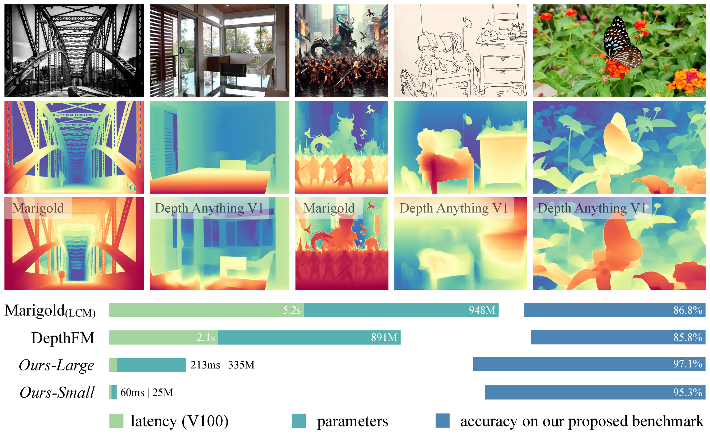{ width="920" }

*Figure 1，V2 的细节、复杂场景与效率比较。具体延迟条件在后文单独讨论。*[↗](https://arxiv.org/pdf/2406.09414v2#page=1)

V2 没有提出新的深度解码器或扩散采样过程。它继续使用 DINOv2 编码器与 DPT 解码器，真正需要理解的是训练数据怎样经过三阶段转换，以及哪些实验能分别验证标签质量、教师能力和真实图像覆盖的作用。

## 真实标签为什么会抹掉模型应该预测的结构

论文区分了两类监督问题。第一类是标签错误。深度传感器可能无法准确测量透明表面，立体匹配在无纹理或重复纹理处可能出错，SfM 则容易受到动态物体与异常匹配影响。第二类是标签不完整或过度平滑。树冠中的孔洞、细线、物体轮廓可能被忽略或填平；即使这些位置没有明显错误数值，也没有提供恢复精细结构所需的监督。

Figure 4 上半部分比较真实数据与合成数据的标签，下半部分再比较相应模型。应先看合成标签中的金属网格、树叶和容器表面，然后观察它们是否出现在预测中。这个顺序把“输出太平滑”的问题追溯到训练目标，而不是直接假定网络容量或输出分辨率不足。

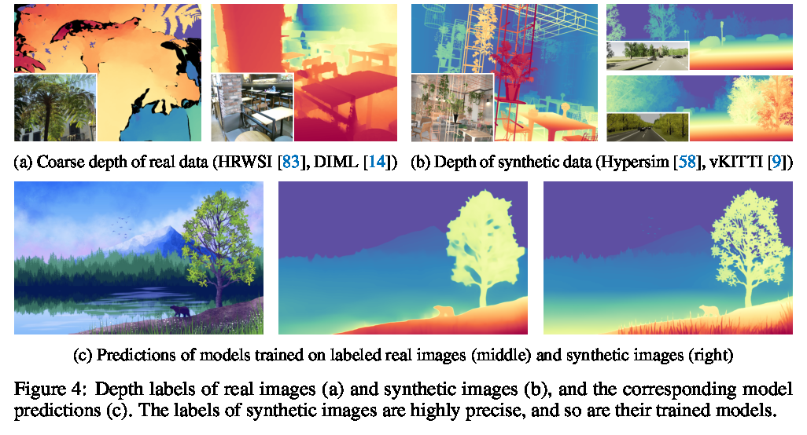{ width="920" }

*Figure 4，真实与合成深度标签，以及不同标签来源训练出的预测。*

合成引擎能提供场景表面的几何，即便这个表面透明或反光，也可以知道它在空间中的位置。这里希望模型学到的是表面几何，不是玻璃后背景或镜中虚像的视觉距离。因此，透明区域“看起来像背景”与“应该标成背景深度”并不是同一回事。[↗](https://arxiv.org/pdf/2406.09414v2#page=3) [↗](https://arxiv.org/pdf/2406.09414v2#page=4)

一个自然的补救办法是混入真实标签来改善合成到真实的迁移。附录 B.9 专门检验了这个选择，将 V1 中表现较好的真实来源 HRWSI 加入合成训练集。它只占总训练图像约 5%，却已经在定性结果中明显损害细节。

Figure 12 的三列依次是输入、纯合成训练、合成加 HRWSI。树叶边缘、教堂座椅间的缝隙和羊身前的细线，是比大块颜色更有用的观察位置。混入真实粗标签后，模型仍能判断大体前后关系，但这些结构更容易被平滑掉。

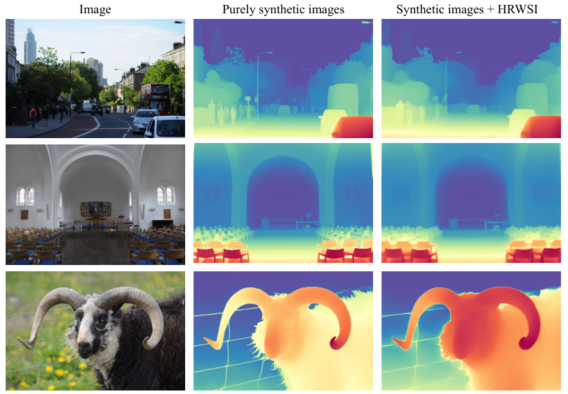{ width="920" }

*Figure 12，少量粗糙真实标签对细结构预测的影响。*

这项实验解释了为什么教师阶段最终采用纯合成监督。不过 5% 是这组实验的设置，不是“真实标签超过 5% 就必然有害”的通用阈值；图示也没有给出所有真实数据源都更差的结论。[↗](https://arxiv.org/pdf/2406.09414v2#page=15)

## 三阶段流程与模型实际输出

合成数据的困难也很明确。它们的颜色、材质和布局与真实照片存在分布差异，场景又通常来自预先建立的有限环境。一个游戏世界能生成很多帧，不等于覆盖了人体、云层、水下、复杂室内布局等所有现实模式。V2 因而让真实图像参与学习，但使用教师提供的深度标签。

Figure 7 可以沿箭头读成三个不同的训练或计算阶段。

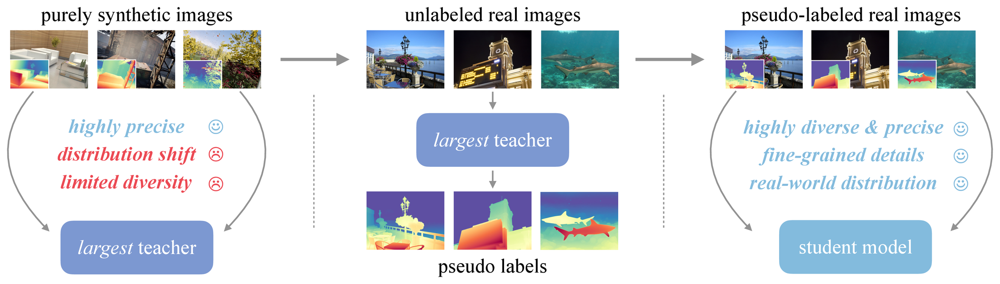{ width="920" }

*Figure 7，精确合成监督经过大教师转移到真实图像，再训练学生。*

1. **训练教师。** 用 DINOv2-G 加 DPT，在五个合成集合上训练深度预测。其任务是尽可能保留几何标签中的精度，同时依靠预训练视觉表示跨越外观差异。
2. **离线生成伪标签。** 将八个真实图像集合输入教师，保存预测深度。教师不需要这些真实图像原有的深度标注；数据集的原有分类、检测或分割标签也不是这里的深度监督。
3. **训练学生。** 使用带伪标签的真实图像，训练 DINOv2-S、B、L、G 四种规模。最终方案在这个阶段去掉合成样本，部署时只需要所选学生的一次编码器与解码器前向。

教师向学生传递的是深度预测。这种输出级蒸馏允许约 1.3B 参数教师指导约 25M 参数学生，不要求两者的中间特征维度、容量或表征方式一一对应。学生训练还包含保留预训练语义的特征约束，但那与强行让小学生逐维复制大教师隐藏状态是两件不同的事。[↗](https://arxiv.org/pdf/2406.09414v2#page=6)

基础模型的输出是 **affine-invariant inverse depth（仿射不变逆深度）**。它适合表达哪些区域更近、哪些更远，却没有直接确定以米为单位的距离。为说明接口含义，可把预测与真实深度的关系概括成下式；这是对“仿射逆深度”的解释，不是论文另行提出的回归公式。

$$
q(p)\approx a\,z(p)^{-1}+b.
$$

这里 $p$ 是像素，$z$ 是真实深度，$q$ 是预测，$a,b$ 是尚未确定的尺度与偏移。因为存在 $b$，对输出简单取倒数也不能自动得到米制深度。把两张图各自归一化着色后放在一起，同样不表示两张图已经共享三维尺度。这一输出语义决定了后面为什么还需要单独的公制深度微调。

## 为什么要用大教师，而不是让每个模型直接学合成数据

Figure 5 将相同真实图片输入不同编码器构建的深度模型；所有模型都在合成数据上学习。要观察的是猫等物体的整体形状和遮挡关系是否稳定，而非仅看颜色是否平滑。

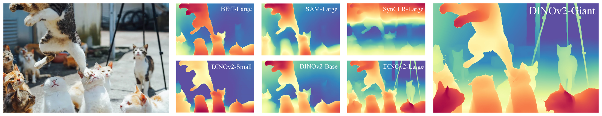{ width="920" }

*Figure 5，合成训练后直接迁移到真实图像的编码器比较。*

作者在这组例子中发现 DINOv2-G 最可靠。附录 Table 13 给出了更完整的定量对照，下表保留五个数据集的 AbsRel，均为越低越好，训练仍是纯合成。

| Encoder | KITTI AbsRel ↓ | NYU-D AbsRel ↓ | Sintel AbsRel ↓ | ETH3D AbsRel ↓ | DIODE AbsRel ↓ |
|---|---:|---:|---:|---:|---:|
| BEiT-L | 0.149 | 0.068 | 0.777 | 0.145 | 0.103 |
| SAM-L | 0.104 | 0.186 | 0.703 | 0.143 | 0.108 |
| SynCLR-L | 0.278 | 0.344 | 1.608 | 0.301 | 0.262 |
| DINOv2-L | 0.081 | 0.048 | 0.516 | 0.133 | 0.071 |
| DINOv2-L Reg | 0.078 | 0.049 | 0.522 | 0.138 | 0.068 |
| DINOv2-G | 0.075 | 0.044 | 0.530 | 0.131 | 0.066 |
| DINOv2-G Reg | 0.084 | 0.061 | 0.753 | 0.141 | 0.086 |

这支持 DINOv2 系列在本文合成到真实迁移中的优势，也说明大教师的选择不只是追求参数量。尤其在 Giant 规模，带 register 的版本五列 AbsRel 都差于原始 DINOv2-G，作者因此选择不带 register 的初始化。Large 规模的 register 结果则有好有坏，不能进一步概括成 register 对深度任务一律有害。

容量收益也不是每列单调。DINOv2-L 在 Sintel 为 0.516，优于 Giant 的 0.530。大教师提供的是总体更可靠的迁移基础，并不保证所有数据集或每张图片都更好。[↗](https://arxiv.org/pdf/2406.09414v2#page=14)

即便选择 Giant，合成数据缺少的模式仍会造成问题。Figure 6 展示了天空被误判为较近区域，以及人头与身体深度不一致。右上角加入真实无标签图像后的结果说明，单纯把教师做大还没有完成场景覆盖。

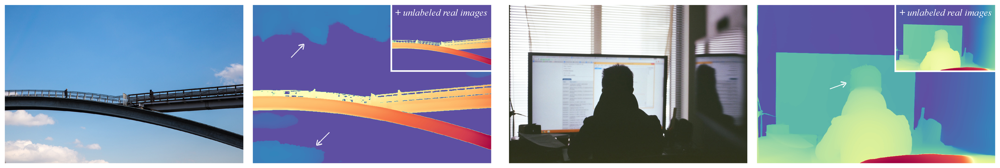{ width="920" }

*Figure 6，纯合成训练的 Giant 仍会在天空和人体上失败。*

因此，完整路径中“大教师”与“真实图像桥接”承担不同职责。前者提高从合成标签向真实输入推断的质量，后者让最终模型在大量真实外观与组合方式上直接学习这种深度知识。[↗](https://arxiv.org/pdf/2406.09414v2#page=5)

## 数据与训练预算怎样落地

Table 7 的数据来源如下。教师阶段需要合成深度，学生阶段只取真实集合的图像，再使用教师生成的深度。

| Stage | Dataset | Indoor | Outdoor | # Images |
|---|---|:---:|:---:|---:|
| Synthetic teacher | BlendedMVS | ✓ | ✓ | 115K |
| Synthetic teacher | Hypersim | ✓ |  | 60K |
| Synthetic teacher | IRS | ✓ |  | 103K |
| Synthetic teacher | TartanAir | ✓ | ✓ | 306K |
| Synthetic teacher | VKITTI 2 |  | ✓ | 20K |
| Pseudo-labeled student | BDD100K |  | ✓ | 8.2M |
| Pseudo-labeled student | Google Landmarks |  | ✓ | 4.1M |
| Pseudo-labeled student | ImageNet-21K | ✓ | ✓ | 13.1M |
| Pseudo-labeled student | LSUN | ✓ |  | 9.8M |
| Pseudo-labeled student | Objects365 | ✓ | ✓ | 1.7M |
| Pseudo-labeled student | Open Images V7 | ✓ | ✓ | 7.8M |
| Pseudo-labeled student | Places365 | ✓ | ✓ | 6.5M |
| Pseudo-labeled student | SA-1B | ✓ | ✓ | 11.1M |

论文称合成训练总量为 595K，但 Table 7 展示的五个分项相加为 604K；上表保留分项原值，不把不一致的数据量改成一份看似精确的新配方。真实图像总量以约 62M 描述。两阶段均直接拼接数据集，没有再按来源做平衡采样，因此数量大小也会影响训练时各来源被看到的频率。[↗](https://arxiv.org/pdf/2406.09414v2#page=12)

| Training item | Synthetic teacher | Pseudo-labeled student |
|---|---|---|
| Encoder | DINOv2-G | DINOv2-S / B / L / G |
| Decoder | DPT | DPT |
| Image preprocessing | Short side 518, random 518 × 518 crop | Short side 518, random 518 × 518 crop |
| Batch size | 64 | 192 |
| Iterations | 160K | 480K |
| Optimizer | Adam | Adam |
| Encoder learning rate | 5 × 10⁻⁶ | 5 × 10⁻⁶ |
| Decoder learning rate | 5 × 10⁻⁵ | 5 × 10⁻⁵ |
| Dataset balancing | None; concatenate | None; concatenate |

按 batch size 乘迭代数计算，两个阶段分别包含约 10.24M 和 92.16M 次样本呈现。这是训练中读取样本的总次数，包含重复与随机裁剪，不能视为额外收集的独立图片数。62M 次教师标注又是训练学生之前的独立计算工作；学生推理快速，并不意味着整条训练流程成本低。论文在局限中明确将大规模无标签数据的计算负担列为问题。[↗](https://arxiv.org/pdf/2406.09414v2#page=8) [↗](https://arxiv.org/pdf/2406.09414v2#page=17)

## 损失如何利用精确标签，又怎样防止伪标签支配训练

V2 沿用 MiDaS 的 scale-and-shift-invariant loss $\mathcal L_{ssi}$ 与 gradient matching loss $\mathcal L_{gm}$。前者在不要求统一绝对尺度的条件下约束深度关系，后者约束预测与标签的空间变化，帮助细边界和孔洞进入训练目标。按照论文报告的 1:2 权重，深度监督部分可写成

$$
\mathcal L_{\mathrm{depth}}=\mathcal L_{ssi}+2\mathcal L_{gm}.
$$

这里的改进不是发明新的梯度算子，而是让梯度监督有了足够准确的目标。如果标签已经把网格中的孔洞填平，增大梯度项只会更强地要求网络拟合这个粗糙目标；换成精确合成深度后，同一类损失才有机会学习真实细节。

Figure 10 固定输入，改变梯度项权重。自行车车轮中的辐条与树叶边缘会随着 0.5、2.0、4.0 的权重变化逐渐清晰。作者最终选择 2.0，在数值表现与锐利度之间折中，不能据此认为 4.0 是所有任务的最佳设置。

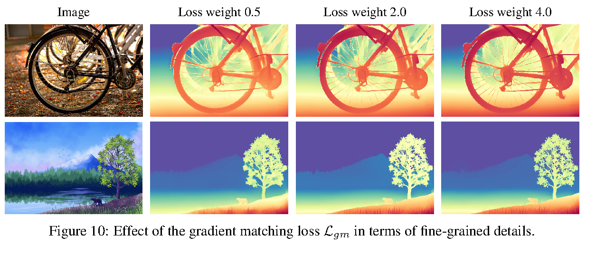{ width="820" }

*Figure 10，梯度匹配权重与细节的定性关系。*[↗](https://arxiv.org/pdf/2406.09414v2#page=14)

真实图像的深度仍来自模型预测，因而需要处理教师错误。V2 对每张伪标签样本忽略损失最大的 10% 区域，将其视为可能有噪声的监督。这是按当前损失进行的筛选，不是拥有真实错误位置，也不能保证保留的 90% 都正确。它的作用是减少少数严重不一致区域对梯度的影响。

此外，学生在伪标签图像上沿用 V1 的特征对齐损失，保留预训练 DINOv2 的语义信息。深度输出约束负责几何，特征约束避免只为深度拟合而遗失有用视觉语义。论文没有将这项损失作为新的蒸馏算法，也没有单独给出其在 V2 中贡献多少的消融，不能把后面的所有分割收益都归于这一项。[↗](https://arxiv.org/pdf/2406.09414v2#page=6)

## 真实图像桥接到底帮助了什么

Table 5 先问一个基础问题，学生能否直接从合成标签学到足够好的真实场景深度。$D^l$ 表示带精确标签的合成数据，$D^u$ 表示经教师标注的真实图像。下表同时保留传统测试的 AbsRel 与 DA-2K 的相对前后关系准确率。

| Encoder | Training data | KITTI AbsRel ↓ | NYU-D AbsRel ↓ | Sintel AbsRel ↓ | DA-2K Acc (%) ↑ |
|---|---|---:|---:|---:|---:|
| ViT-S | $D^l$ | 0.104 | 0.084 | 0.518 | 89.8 |
| ViT-S | $D^l+D^u$ | 0.085 | 0.054 | 0.491 | 94.1 |
| ViT-S | $D^u$ | 0.078 | 0.053 | 0.500 | 95.3 |
| ViT-B | $D^l$ | 0.094 | 0.062 | 0.618 | 92.9 |
| ViT-B | $D^l+D^u$ | 0.080 | 0.049 | 0.515 | 96.7 |
| ViT-B | $D^u$ | 0.078 | 0.049 | 0.495 | 97.0 |
| ViT-L | $D^l$ | 0.081 | 0.048 | 0.516 | 96.0 |
| ViT-L | $D^l+D^u$ | 0.075 | 0.045 | 0.542 | 97.3 |
| ViT-L | $D^u$ | 0.074 | 0.045 | 0.487 | 97.1 |

最稳定的变化是加入真实伪标签后，小模型显著改善。ViT-S 的 NYU-D AbsRel 从 0.084 降到 0.054，DA-2K 从 89.8 升到 94.1。进一步去掉学生阶段的合成图像，KITTI、NYU-D 和 DA-2K 还略有改善，于是作者采用更简单的纯伪标签方案。

但移除合成数据不是每项都更好。ViT-S 的 Sintel 从 0.491 变成 0.500；ViT-L 的 DA-2K 从混合训练的 97.3 变成 97.1，ETH3D AbsRel 也从 0.130 变成 0.131。最终训练路线反映整体效果与流程简单性的选择，不能被改写成合成数据在学生阶段没有任何价值。[↗](https://arxiv.org/pdf/2406.09414v2#page=9)

Figure 16 固定小模型，左边用合成标签直接训练，右边通过真实伪标签训练。应看动物、人物和室内物体能否维持完整且一致的几何，而不只是边缘是否锐利。

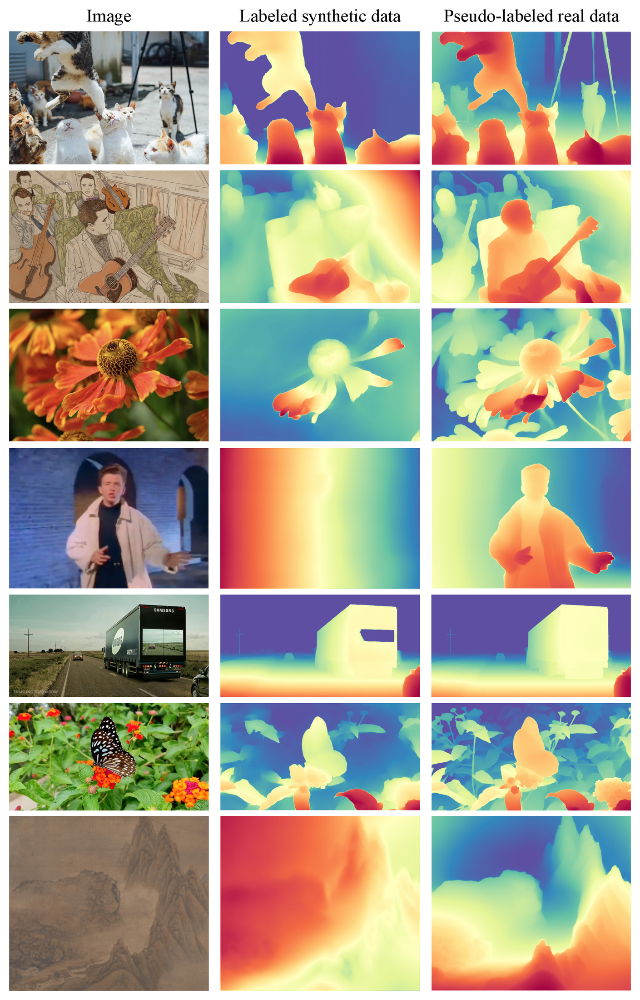{ width="760" }

*Figure 16，DINOv2-S 在两种训练输入分布下的开放场景预测。*

右侧改善说明真实图像桥接不是单纯压缩大教师参数。它把学生的学习问题从“在有限合成世界学几何并自行跨域”改成“在真实图像分布上模仿强模型的几何判断”。这使小容量模型也有机会获得稳定的复杂场景预测。[↗](https://arxiv.org/pdf/2406.09414v2#page=21)

## 固定图像再换标签，能否排除“只是用了更多数据”

Table 6 使用同一来源 DIML 的真实图像，仅比较原有标签与教师生成标签训练出的迁移表现。原表将前者命名为 `Manual Label`，下表沿用这个行名。

| Label Source | KITTI AbsRel ↓ | NYU-D AbsRel ↓ | Sintel AbsRel ↓ | ETH3D AbsRel ↓ | DIODE AbsRel ↓ | DA-2K Acc (%) ↑ |
|---|---:|---:|---:|---:|---:|---:|
| Manual Label | 0.122 | 0.074 | 0.581 | 0.159 | 0.126 | 80.2 |
| Pseudo Label | 0.099 | 0.062 | 0.514 | 0.147 | 0.084 | 89.7 |

五列 AbsRel 均降低，DA-2K 提高 9.5 个百分点。这里没有把原图集合替换成额外 62M 图像，因此它比直接比较两套完整训练流程更清楚地支持“监督质量本身影响结果”。原有真实标签在该设置下没有构成不可超越的上限，强教师可以给出更适合学习的标签。

这个结论针对 DIML 和本文教师，不等于任意伪标签都比传感器测量准确。教师仍会带有错误与偏差，V2 依靠模型能力、输入覆盖和高损失区域过滤共同控制这些问题。[↗](https://arxiv.org/pdf/2406.09414v2#page=10)

Figure 17 展示了教师面对八个真实集合时的伪标签。由上到下分别对应驾驶、地标、一般物体、室内、物体检测、开放图像、场景和 SA-1B。需要关注的是同一种监督接口能否覆盖这些不同外观，并保持物体完整与边缘细节。

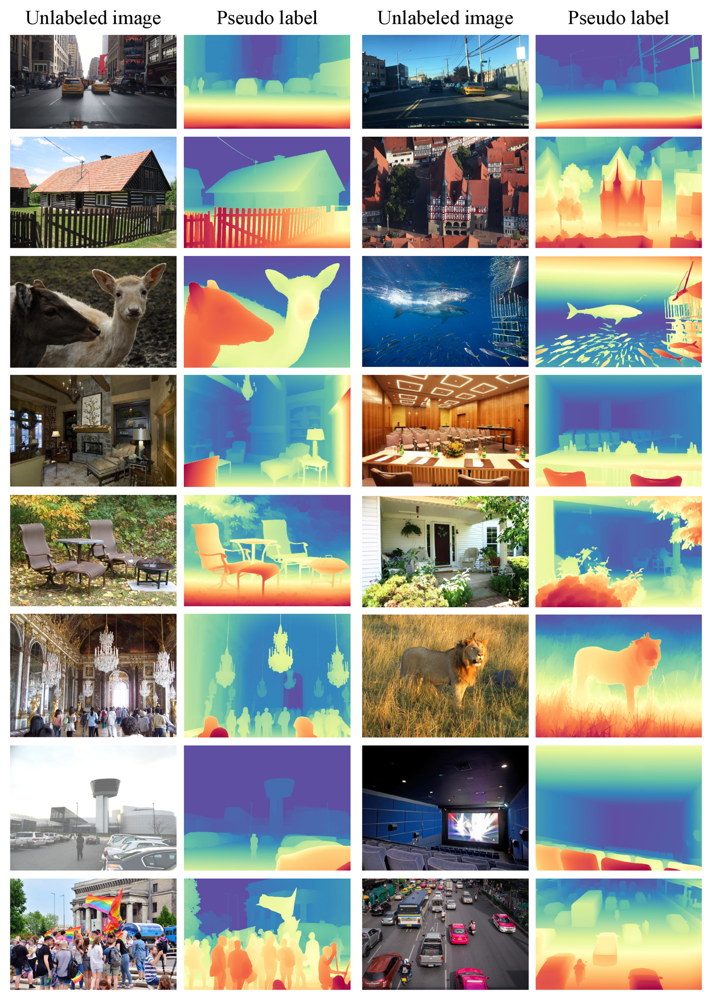{ width="820" }

*Figure 17，不同真实图像来源上的教师伪标签。定性例子展示覆盖范围，不代表每张自动标签都达到同等质量。*[↗](https://arxiv.org/pdf/2406.09414v2#page=22)

## 数据来源的作用不能压缩成一个总图片数

附录分别检验合成来源与真实来源。先看 Table 9，固定 ViT-L，单独使用各合成来源训练后测试泛化。

| Labeled Dataset | KITTI AbsRel ↓ | NYU-D AbsRel ↓ | Sintel AbsRel ↓ | ETH3D AbsRel ↓ | DIODE AbsRel ↓ |
|---|---:|---:|---:|---:|---:|
| BlendedMVS | 0.088 | 0.069 | 0.538 | 0.150 | 0.095 |
| Hypersim | 0.086 | 0.054 | 0.550 | 0.123 | 0.088 |
| IRS | 0.100 | 0.055 | 0.435 | 0.149 | 0.084 |
| TartanAir | 0.094 | 0.063 | 0.618 | 0.159 | 0.088 |
| VKITTI 2 | 0.102 | 0.127 | 0.887 | 0.215 | 0.134 |
| All labeled data | 0.081 | 0.048 | 0.516 | 0.133 | 0.071 |

两种纯室内来源 Hypersim 与 IRS 具有很强的跨域价值。Hypersim 在 ETH3D 的 0.123 甚至优于混合后的 0.133，IRS 在 Sintel 的 0.435 也优于混合后的 0.516。这提醒读者，多源训练的意义是扩大综合能力，不是保证每个测试域都达到单源最佳。

VKITTI 2 的平均指标较差，但作者观察到它有益于树叶等细节；BlendedMVS 则有助鸟瞰视角。后两点属于论文的定性经验，表中并没有单独测量“锐利度贡献”或“鸟瞰提升幅度”。因此不能只按这五列误差删除某个来源，也不能将不同大小数据集的比较视为严格等样本量实验。[↗](https://arxiv.org/pdf/2406.09414v2#page=12)

真实数据的来源消融采用 ViT-S，在合成训练基础上分别加入某个伪标签集合。Table 10 中，加入室内 LSUN 后，NYU-D 的 $\delta_1$ 从 0.928 升到 0.970；KITTI 也从 0.889 升到 0.913，说明覆盖一个域并不只帮助同域测试。反过来，增加真实数据也不保证所有测试都改善，Sintel AbsRel 从基线 0.518 变为加入 LSUN 的 0.529、加入 SA-1B 的 0.652。这是合成游戏测试集与真实图像学习之间的具体反例。

随后 Table 11 控制训练迭代数为 480K，比较重复使用约 11M SA-1B 与使用约 62M 八源集合。两行都来自数据规模消融设置，不能与最终纯伪标签学生的 Table 2 数值混用。

| Unlabeled Sets | # Images | Iterations | KITTI AbsRel ↓ | NYU-D AbsRel ↓ | Sintel AbsRel ↓ | ETH3D AbsRel ↓ | DIODE AbsRel ↓ |
|---|---:|---:|---:|---:|---:|---:|---:|
| SA-1B | 11M | 480K | 0.090 | 0.073 | 0.588 | 0.141 | 0.073 |
| All eight sets | 62M | 480K | 0.085 | 0.054 | 0.491 | 0.143 | 0.074 |

KITTI、NYU-D、Sintel 受益明显，NYU-D 的 $\delta_1$ 也从 0.948 升至 0.971；ETH3D 与 DIODE 的这些指标却略差。相同训练步数下，反复看一个大集合不能完整替代多来源数据。这个实验同时改变样本数量和来源构成，支持扩大覆盖的价值，但无法独立证明 62M 是必要门槛，也不能把全部提升只归于“更多图片”。[↗](https://arxiv.org/pdf/2406.09414v2#page=13)

## 传统稠密测试给出的结果，比“V2 全面更强”复杂

Table 2 在 KITTI、NYU-D、Sintel、ETH3D、DIODE 上比较零样本相对深度。下面每格为 `AbsRel / δ₁`，前者越低越好，后者越高越好。保留同为 ViT-L 的 V1/V2 是判断代际变化的主要入口。

| Method | Encoder | KITTI | NYU-D | Sintel | ETH3D | DIODE |
|---|---|---:|---:|---:|---:|---:|
| MiDaS V3.1 | ViT-L | 0.127 / 0.850 | 0.048 / 0.980 | 0.587 / 0.699 | 0.139 / 0.867 | 0.075 / 0.942 |
| Depth Anything V1 | ViT-L | 0.076 / 0.947 | 0.043 / 0.981 | 0.458 / 0.760 | 0.127 / 0.882 | 0.066 / 0.952 |
| Depth Anything V2 | ViT-S | 0.078 / 0.936 | 0.053 / 0.973 | 0.500 / 0.718 | 0.142 / 0.851 | 0.073 / 0.942 |
| Depth Anything V2 | ViT-L | 0.074 / 0.946 | 0.045 / 0.979 | 0.487 / 0.752 | 0.131 / 0.865 | 0.066 / 0.952 |
| Depth Anything V2 | ViT-G | 0.075 / 0.948 | 0.044 / 0.979 | 0.506 / 0.772 | 0.132 / 0.862 | 0.065 / 0.954 |

V2-L 的 KITTI AbsRel 略好，但 $\delta_1$ 略差；DIODE 两项相同；NYU-D、Sintel 和 ETH3D 两项都不及 V1-L。即便相对 MiDaS，V2-L 的 NYU-D、ETH3D $\delta_1$ 也有小幅退步。表内结果不支持逐项全面胜出。

作者认为旧基准存在噪声、低分辨率与场景覆盖有限的问题，无法充分反映细结构、透明表面和复杂布局的改善。Figure 8 的镜面和细结构标签错误给出了这种担忧的具体例子。但发现一些标签错误，并不能直接证明所有分数下降都来自评测偏差。合理的阅读方式是保留传统基准的实际退步，再用针对新主张的评测检验额外能力。[↗](https://arxiv.org/pdf/2406.09414v2#page=7) [↗](https://arxiv.org/pdf/2406.09414v2#page=8)

## DA-2K 测量相对关系，也带有明确的样本选择条件

为覆盖更丰富场景，作者构建 DA-2K，包含 1K 图像、2K 像素对，分为 Indoor、Outdoor、Non-real、Transparent / Reflective、Adverse style、Aerial、Underwater、Object 八类。图像由 GPT-4 生成场景关键词后从 Flickr 获取，多数分辨率约为 1500 × 2000。标注问题是两个像素中哪一个更近，而不是逐像素给出米制距离。

Figure 9 展示自动筛选路径。SAM 提供可提示出物体的关键点，然后随机选择点对，请 V1、V2、Marigold、Geowizard 判断前后顺序；出现分歧时交给人标注，全部一致时重新采样。这里使用的是 SAM 的关键点，不是直接把分割掩码当深度标签。

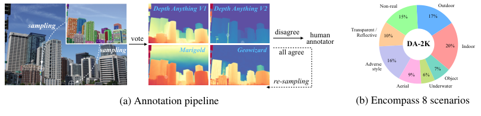{ width="920" }

*Figure 9，模型分歧筛选与八类场景组成。*

这种路径可能漏掉四个模型一起犯错的情况，因此另有人工直接寻找困难点对的路径。Transparent 与 Object 两类完全依靠人工选取，其余场景混合使用两种方式。人可以跳过难以确定的样本，标注还由另外两名人员复核。

附录 C.3 进一步说明，只向标注者呈现预测深度比大于 3 的点对，以减少歧义与标注负担。这是作者的候选筛选条件，不应解释成真实米制距离比一定大于 3，也不代表评测充分覆盖了两个几乎等深表面的辨别能力。V2 自身参与候选筛选，影响的是样本分布；最终前后标签由人确定。[↗](https://arxiv.org/pdf/2406.09414v2#page=7) [↗](https://arxiv.org/pdf/2406.09414v2#page=17)

| Method | DA-2K Accuracy (%) ↑ |
|---|---:|
| Marigold | 86.8 |
| Geowizard | 88.1 |
| DepthFM | 85.8 |
| Depth Anything V1 | 88.5 |
| Depth Anything V2 Small | 95.3 |
| Depth Anything V2 Base | 97.0 |
| Depth Anything V2 Large | 97.1 |
| Depth Anything V2 Giant | 97.4 |

Small 相对 V1 提高 6.8 个百分点，Giant 相对 Marigold 提高 10.6 个百分点。这两个差值按表中百分比直接相减，不是相对百分比增幅。更值得注意的是，Small 到 Base 提升 1.7 个百分点，Base 到 Giant 只再提升 0.4 个百分点；在这组任务上，最小模型已获得主要收益，参数继续增加的边际变化明显较小。

DA-2K 的优势是可以检查噪声较少、场景明确的空间排序。它的限制也来自同一个接口，只要两个点顺序正确，距离差得很远仍可能得分。因此它补充传统稠密测试，不能替代点云重建、绝对距离或局部表面精度评测。论文自身也明确把它定位为补充基准。[↗](https://arxiv.org/pdf/2406.09414v2#page=8)

按场景拆开，还能看到真实伪标签最明显帮助了什么。下表取 Table 14 的 Small 和 Large，数值均为准确率百分比。

| Encoder / Data | Indoor | Outdoor | Non-real | Transparent | Adverse style | Aerial | Underwater | Object | Mean |
|---|---:|---:|---:|---:|---:|---:|---:|---:|---:|
| ViT-S / Synthetic | 88.1 | 87.8 | 90.8 | 86.9 | 90.6 | 93.8 | 94.9 | 89.9 | 89.8 |
| ViT-S / Pseudo real | 92.9 | 93.0 | 98.4 | 94.4 | 95.7 | 96.4 | 99.2 | 96.6 | 95.3 |
| ViT-L / Synthetic | 94.5 | 93.9 | 98.4 | 93.9 | 96.3 | 97.4 | 99.2 | 98.0 | 96.0 |
| ViT-L / Pseudo real | 96.4 | 93.9 | 99.0 | 96.3 | 97.3 | 99.5 | 99.2 | 98.0 | 97.1 |

Small 在全部八类改善，Non-real 从 90.8 到 98.4、Transparent 从 86.9 到 94.4，说明桥接并不只适用于普通照片。Large 的 Outdoor、Underwater、Object 已较高，加入真实伪标签后保持不变。这样的分布更符合“补足小模型的泛化能力”的主张，而非每个模型每个场景都同幅提升。`Mean` 保留原表结果，不用八个类别的简单算术平均重算，因为类别样本比例不同。[↗](https://arxiv.org/pdf/2406.09414v2#page=16)

## 透明表面的独立检验

DA-2K 是作者新建的排序基准，透明表面还需要在另一套监督与指标下验证。附录采用 NTIRE 2024 Transparent Surface Challenge 的验证集，报告 $\delta_1$。

| Setting | Method | δ₁ ↑ |
|---|---|---:|
| Zero-shot | MiDaS V3.1 | 0.259 |
| Zero-shot | Depth Anything V1 | 0.535 |
| Zero-shot | Depth Anything V2 | 0.836 |
| Simple fine-tuning | DINOv2 | 0.758 |
| Simple fine-tuning | Depth Anything V2 | 0.912 |
| Challenge result | First place | 0.917 |

V2 零样本相对 V1 从 0.535 提高到 0.836，即提高 30.1 个百分点。这项结果与“精确合成监督可以改善透明表面”直接对应。微调后，V2 初始化达到 0.912，比直接从 DINOv2 初始化的 0.758 高 15.4 个百分点，说明深度预训练保留了可转移价值。

0.912 接近冠军的 0.917，但它们不是统一训练预算下的消融；也不能把微调后的 0.912 描述成零样本成绩。对导航应用而言，这些结果增强了使用 V2 作为几何先验的理由，仍需另行验证具体相机、材质和距离范围下的公制误差。[↗](https://arxiv.org/pdf/2406.09414v2#page=13)

## 公制深度与语义分割，验证的是两种不同的可迁移能力

基础输出只有相对逆深度。公制迁移实验先沿用 ZoeDepth 框架，将其 MiDaS 编码器替换为 V2 预训练编码器，再在 NYU-D 或 KITTI 上训练。Table 4 明确是 in-domain 设置，训练与测试属于同一数据域。

| Method | NYU-D δ₁ ↑ | NYU-D AbsRel ↓ | NYU-D RMSE ↓ | KITTI δ₁ ↑ | KITTI AbsRel ↓ | KITTI RMSE ↓ |
|---|---:|---:|---:|---:|---:|---:|
| ZoeDepth | 0.951 | 0.077 | 0.282 | 0.971 | 0.054 | 2.281 |
| Ours (ViT-S) | 0.961 | 0.073 | 0.261 | 0.973 | 0.053 | 2.235 |
| Ours (ViT-B) | 0.977 | 0.063 | 0.228 | 0.979 | 0.048 | 1.999 |
| Ours (ViT-L) | 0.984 | 0.056 | 0.206 | 0.983 | 0.045 | 1.861 |

在两个域内任务上，Small 都超过这里的 ZoeDepth 对照，Large 改善更明显。但“小模型超过大模型”不应扩大到所有基线。原表 NYU-D 的 VPD 为 $\delta_1=0.964$、AbsRel 0.069、RMSE 0.254，仍优于 V2-S 的 0.961、0.073、0.261。

更关键的是，这组好看的域内分数并没有消除真实深度标签的细节问题。作者指出，在 NYU-D 或 KITTI 上训练的模型仍可能损失细结构和透明表面可靠性。因此论文另外采用 Hypersim 与 Virtual KITTI 的合成公制标签，分别训练面向室内与室外的公制模型。它们与 Table 4 的真实数据域内微调实验不能混成同一组零样本结论。[↗](https://arxiv.org/pdf/2406.09414v2#page=9)

Figure 15 比较合成数据微调的模型与 ZoeDepth。自行车辐条、礼堂座椅之间的间隔和前景椅子轮廓更清楚，是这组图能直接支持的观察。彩色深度图本身没有给出每个像素的米制误差，不能仅凭视觉锐利判断所有绝对距离都更准。

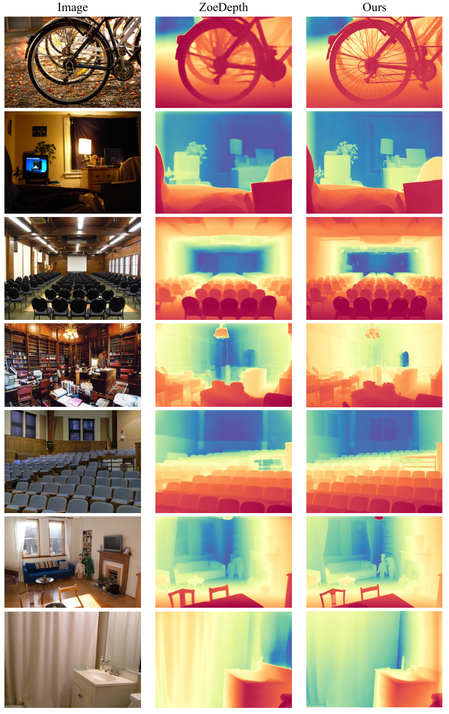{ width="820" }

*Figure 15，ZoeDepth 与合成数据微调公制模型的细节比较。*[↗](https://arxiv.org/pdf/2406.09414v2#page=20)

另一条迁移实验将编码器接入 Mask2Former，微调语义分割，检验深度学习后是否仍保留有用语义。Table 8 给出的结果如下，作者说明没有使用 Mapillary 或 COCO 预训练。

| Depth Anything V2 encoder | Cityscapes mIoU ↑ | ADE20K mIoU ↑ |
|---|---:|---:|
| Small | 82.9 | 53.9 |
| Base | 83.9 | 57.1 |
| Large | 85.6 | 58.6 |

原表中 OneFormer 配 ConvNeXt-XL 在 Cityscapes 为 83.6，ADE20K 的 ViT-Adapter 配 BEiT-L 为 58.3。V2-L 的 85.6 与 58.6 支持它作为下游初始化的价值。不过这些对照包含不同分割系统与骨干，不能单独归因于某一个深度损失；其直接含义是，V2 预训练没有把编码器局限成只能输出相对深度的模型。[↗](https://arxiv.org/pdf/2406.09414v2#page=12)

## 推理分辨率、延迟与实际采用方式

默认测试时把图像短边缩放到 518 并保持宽高比，和训练时随机裁成方形不同。附录 B.8 发现，在测试时提高输入分辨率可以得到更细预测，无需为每种分辨率另训模型。

Figure 11 的重点是设备上的细绳与餐厅椅子轮廓。输入从基础分辨率变为 2 倍、4 倍，即短边约 1036、2072 后，原先模糊的窄结构更清楚。

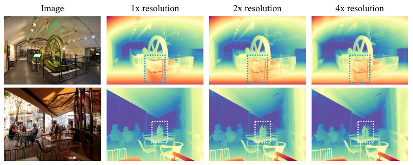{ width="920" }

*Figure 11，提高测试分辨率带来的细结构变化。*

这提供了一种按任务预算调整空间细节的办法。它展示的是定性锐利度收益，没有同时给出全部数据集的误差变化或高分辨率延迟，不能理解为没有计算代价的质量提升。[↗](https://arxiv.org/pdf/2406.09414v2#page=14) [↗](https://arxiv.org/pdf/2406.09414v2#page=15)

Figure 1 报告的 V100 延迟与参数量如下。这里的延迟对应作者图中的配置，不能直接套到上述 4 倍输入分辨率。

| Method | Parameters | Latency on V100 | DA-2K Accuracy (%) ↑ |
|---|---:|---:|---:|
| Marigold (LCM) | 948M | 5.2 s | 86.8 |
| DepthFM | 891M | 2.1 s | 85.8 |
| Ours-Large | 335M | 213 ms | 97.1 |
| Ours-Small | 25M | 60 ms | 95.3 |

这些数值支持单次判别式预测在所报告条件下具有显著效率优势，并提供了可实际选择的容量梯度。但图中没有完整展开精度、预处理和各生成式方法的采样配置，因此不应把某个延迟比当成跨硬件、跨实现的固定倍数。[↗](https://arxiv.org/pdf/2406.09414v2#page=1)

需要图像编辑遮挡关系、场景层次或稠密视觉先验时，可以直接采用相对深度学生；需要以米为单位的距离时，应选择并验证公制模型；需要多帧一致几何时，还要加入尺度对齐与时间一致性处理。V2 的单图接口本身没有提供相机位姿、跨帧对应或动作预测。

这篇论文最值得复用的做法，是先检查监督究竟把哪些结构标对了，再安排模型容量与数据分工。强教师可以承担困难的合成到真实迁移，大规模真实图像把这种能力变成学生可学习的监督，而最终应用应根据相对关系、公制误差、细结构和延迟各自选择验证方式。

这篇的深度误差最好接到[相机、深度与机器人视觉](../../embodied-ai/cameras-depth-and-robot-vision.md)，把尺度、坐标和传感器噪声对齐后再讨论模型差异；机器人规划侧可看[坐标变换与手眼标定](../../embodied-ai/coordinate-transforms-and-hand-eye-calibration.md)。若深度只用于视觉展示，不能直接把单目指标换算成抓取成功率。
