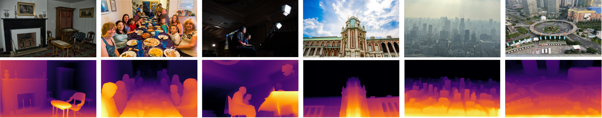
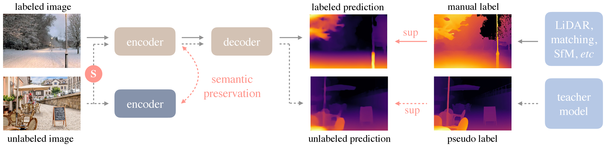
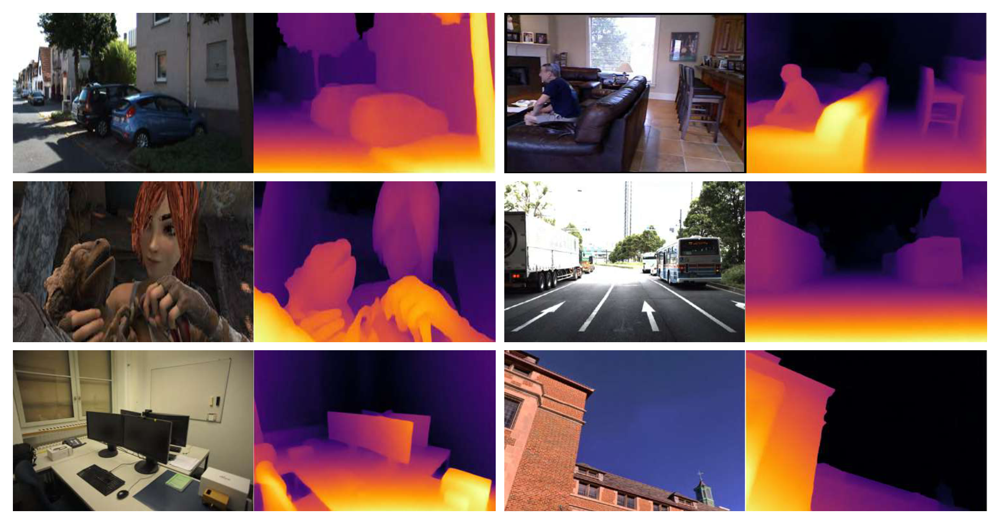
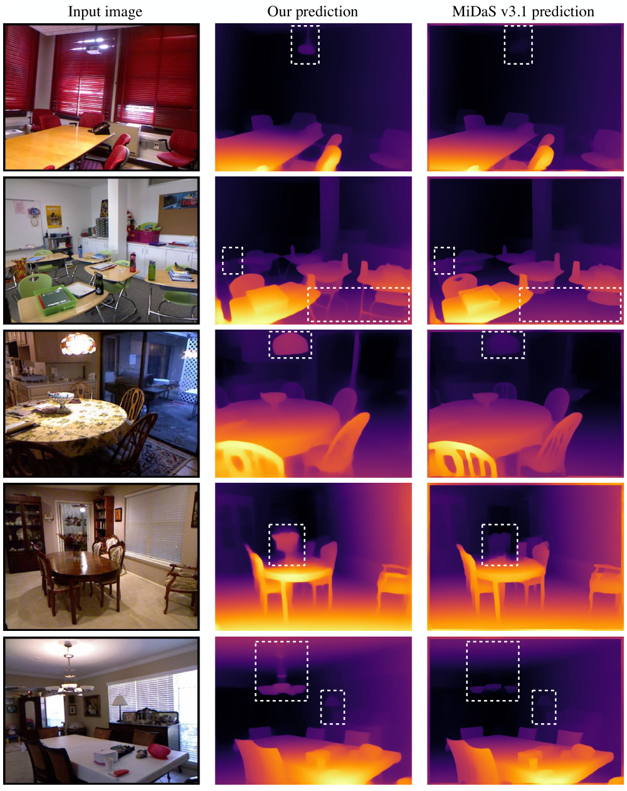
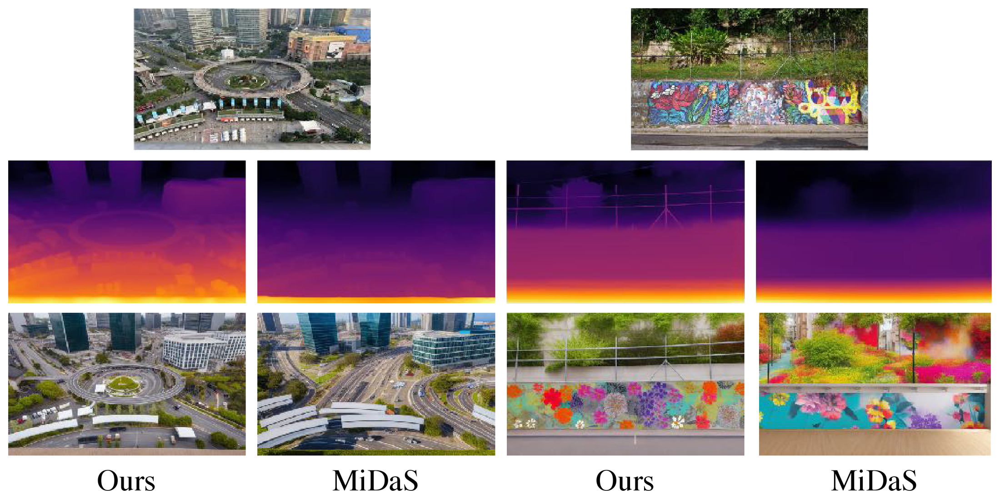

# Depth Anything：无标注图像怎样变成单目深度基础模型

!!! info "论文信息"
    **论文题名：** Depth Anything: Unleashing the Power of Large-Scale Unlabeled Data。 
    **作者：** Lihe Yang、Bingyi Kang、Zilong Huang、Xiaogang Xu、Jiashi Feng、Hengshuang Zhao。 
    **机构：** 未在公开元数据中稳定解析；以 arXiv/PDF 或官方页 affiliation block 为准。 
    **时间 / 主题：** 2024-01；具身智能。 
    **arXiv / 官方报告：** arXiv：[2401.10891](https://arxiv.org/abs/2401.10891)；官方材料：[depth-anything.github.io/](https://depth-anything.github.io/)。 
    **GitHub / 项目：** GitHub：[github.com/LiheYoung/Depth-Anything](https://github.com/LiheYoung/Depth-Anything)；项目页：[depth-anything.github.io/](https://depth-anything.github.io/)。 
    **元数据来源与核验口径：** 来源：[arXiv](https://arxiv.org/abs/2401.10891)；[GitHub API / repo](https://github.com/LiheYoung/Depth-Anything)；[官方 / 项目材料](https://depth-anything.github.io/)；Checked Date：2026-06-15；Repro Status：Paper / official materials reviewed, independent reproduction not claimed。

## 为什么更多伪标签不会自动带来更强的深度模型

Depth Anything 的关键发现是，大量无标签图像只有变成一个足够有学习价值的任务，才会改善单目深度。作者先训练深度教师，为约 6200 万张真实图像生成伪标签；学生看的是受到强扰动的图像，却要恢复教师在干净输入上给出的深度。同时，学生保留预训练编码器的语义能力，又不被要求与它完全相同。

这个安排针对一种容易被忽略的失败。这个设置已经拥有充分的有标签数据，教师与学生又采用相近的强预训练和结构。如果只是让学生再看同一张干净图片、重复教师输出，新增加的图片数量很大，新增的学习信号却可能有限。论文真正研究的是怎样让强模型继续从无标签数据获得收益，而非低标签条件下最简单的伪标签自训练。

Figure 1 展示了目标覆盖的场景。先看低光照、多人聚集、雾中远楼与俯视城市，再看深度是否仍维持合理的物体层次。左两列来自 COCO，中间两列来自未用于本文训练的 SA-1B 子集，右两列为作者拍摄的照片。它们说明模型希望应对的输入跨度，量化证据还要看后面的跨数据集测试。

{ width="920" }

*Figure 1，开放场景的相对深度预测样例。*[↗](https://arxiv.org/pdf/2401.10891v2#page=1)

系统最终输出一张与图像对齐的相对逆深度图。它没有直接输出相机位姿、绝对米制距离或机器人动作。因而这篇论文的贡献需要在三个层次上理解，先看训练方法是否改善相对几何，再看这种表示能否迁移到公制深度，最后看编码器是否仍适合更高层的语义任务。

## 一次教师标注，两条学生数据流

模型沿用 DINOv2 编码器与 DPT 深度解码器。DINOv2 提供预训练视觉表示，DPT 将图像特征用于稠密深度回归。网络并没有因为引入 6200 万张图像而变成复杂的多阶段推理系统；额外的教师与语义编码器主要出现在数据生成和训练阶段。

Figure 2 的实线是有标签图像，直接使用已有深度监督；虚线是无标签图像，先由教师提供深度，学生输入端再施加强扰动。旁边的冻结编码器负责语义保持，最终部署时无需保留这个辅助分支。

{ width="920" }

*Figure 2，深度监督、强扰动和语义保持共同作用于学生。*

设有标签数据为 $\mathcal D^l=\{(x_i,d_i)\}_{i=1}^{M}$，无标签数据为 $\mathcal D^u=\{u_i\}_{i=1}^{N}$。第一阶段只用 $\mathcal D^l$ 训练教师 $T$。第二阶段在干净无标签图像上运行教师，得到

$$
\widehat{\mathcal D}^u
=\{(u_i,T(u_i))\mid u_i\in\mathcal D^u\}_{i=1}^{N}.
$$

随后训练学生 $S$，数据是 $\mathcal D^l\cup\widehat{\mathcal D}^u$。这里重新初始化学生，而非直接从教师的深度训练权重继续微调；编码器仍使用 DINOv2 预训练初始化。教师因此提供学习目标，而不是把自身全部深度权重交给学生原地继续训练。

教师、学生与冻结语义编码器的职责也应分清。教师给出像素深度目标，学生学习如何在更多图像和更难输入下恢复深度，冻结编码器约束学生不要丢失过多语义表示。这三者并非三个需要同时部署的深度预测器。[↗](https://arxiv.org/pdf/2401.10891v2#page=3) [↗](https://arxiv.org/pdf/2401.10891v2#page=4)

## 仿射不变目标怎样让不同来源的深度共同训练

不同数据集的深度由不同过程产生，尺度、偏移与有效区域并不统一。论文先将深度转为逆深度，再逐图归一到 0–1。若用 $z$ 表示物理深度，逆深度就是 $d=1/z$；近处对应较大的逆深度值。数据处理中还利用预训练语义分割器识别天空，将其逆深度设为 0，表示最远区域。

真正用于监督比较的 **affine-invariant loss（仿射不变损失）** 继续消除每张图的平移和尺度。对一张逆深度图 $d$，论文定义

$$
t(d)=\operatorname{median}(d),\qquad
s(d)=\frac{1}{HW}\sum_{i=1}^{HW}|d_i-t(d)|,
$$

并得到归一化结果

$$
\hat d_i=\frac{d_i-t(d)}{s(d)}.
$$

$H,W$ 是图像高宽，$t(d)$ 是整张图的中位数；$s(d)$ 是相对这个中位数的**平均绝对偏差**，不是再对绝对偏差取中位数。预测与标签各自计算这两个统计量，然后比较它们的相对形状。

沿用论文符号，$d_i^*$ 是预测，$d_i$ 是标签，有标签损失为

$$
\mathcal L_l=\frac{1}{HW}\sum_{i=1}^{HW}\rho(d_i^*,d_i),
\qquad
\rho(d_i^*,d_i)=|\hat d_i^*-\hat d_i|.
$$

这个设计可以通过一个解释性例子理解。若标签为 $[1,2,3]$，预测为 $[5,7,9]$，两者只差一个正尺度和偏移。分别去除中位数并除以平均绝对偏差后，二者都成为 $[-1.5,0,1.5]$，损失为零。这不是论文实验数据，而是说明目标主动忽略哪类差异。

好处是模型可以联合学习来自立体匹配、SfM 等流程的相对几何，不被每个来源的标定方式绑住。代价是目标没有要求恢复唯一的公制尺度。对输出直接取倒数，也无法消除未知的逆深度偏移；把预测颜色与某个“米数”对应起来，需要另外的尺度信息或公制训练。[↗](https://arxiv.org/pdf/2401.10891v2#page=3)

## 让学生面对更难输入，关键在目标与扰动的不对称

作者的初始自训练方案没有获得稳定提升。对这一现象，论文的解释是教师与学生具有相似预训练与架构，已经容易作出相近预测，单纯加入教师标签没有强迫学生学习新的稳健性。这是指导方法设计的解释，后面的消融才检验具体修改是否有效。

第一种扰动是 color jittering 与 Gaussian blurring。教师在干净输入上生成深度，学生则在颜色、对比和局部清晰度改变后恢复同一目标。几何监督因而要求模型利用更稳定的场景线索，而不是依赖某一种颜色或纹理外观。

第二种扰动是 **CutMix**，将两张无标签图像按矩形区域拼接。设 $M$ 是矩形内为 1、其他位置为 0 的二值掩码，则

$$
u_{ab}=u_a\odot M+u_b\odot(1-M).
$$

论文中的 $u_a,u_b$ 在送入学生前已经受到颜色扰动；教师伪标签则由对应的干净图像生成。CutMix 以 50% 概率使用。拼接破坏了原有完整上下文，让学生在局部结构和周围场景不再自然匹配时仍学习深度，而不是把拼接图当成一个真实存在的三维场景。

### 为什么不能直接把两张伪深度图拼成一个统一目标

两张图的逆深度都只有各自的仿射尺度。同一个数值在图 $u_a$ 和图 $u_b$ 中，不一定对应同一个真实距离。如果把两张教师输出直接拼接，再用一个全图尺度去对齐，便会把两幅互不相关图像之间并不存在的深度关系引入损失。

因此原文先在两个有效区域分别计算仿射不变损失。省略逐像素求和后，它写成

$$
\begin{aligned}
\mathcal L_u^M
&=\rho\big(S(u_{ab})\odot M,\ T(u_a)\odot M\big),\\
\mathcal L_u^{1-M}
&=\rho\big(S(u_{ab})\odot(1-M),\ T(u_b)\odot(1-M)\big).
\end{aligned}
$$

这里掩码表示**只在对应有效区域计算**，不是把无效区域填成零后仍纳入中位数和尺度统计。每个区域保留自身的相对几何约束，再按面积合并

$$
\mathcal L_u=
\frac{\sum M}{HW}\mathcal L_u^M+
\frac{\sum(1-M)}{HW}\mathcal L_u^{1-M}.
$$

例如，若矩形占图像四分之一，两项权重就是四分之一与四分之三。这只是公式的解释，说明较小区域不会仅因单独归一化，就与覆盖绝大部分图像的区域拥有相同总权重。

这一步使 CutMix 适用于相对深度。增强改变输入难度，分区域仿射处理则避免增强本身制造错误的跨图尺度监督。论文的总体消融把颜色与 CutMix 作为强扰动组合，未单独报告两者各贡献多少。[↗](https://arxiv.org/pdf/2401.10891v2#page=4)

## 语义保持为什么既要存在，又不能太强

深度估计也需要理解图像中是什么。知道区域属于车、墙面或天空，可以帮助预测几何。作者最初采用 RAM、GroundingDINO 与 HQ-SAM，为无标签图像生成约 4K 类语义分割标签，让共享编码器同时连接深度和分割两个解码器，但没有得到预期的深度提升。

作者认为，离散类别掩码丢掉了连续视觉表示中的大量信息。当深度模型已很强时，“这是车”这一类别标签可能不足以提供新的细粒度监督。因此，最终方法直接保留冻结 DINOv2 的连续特征，而不再以这组 4K 类分割标签作为辅助输出目标。[↗](https://arxiv.org/pdf/2401.10891v2#page=4)

论文给出的基础特征对齐式为

$$
\mathcal L_{feat}
=1-\frac{1}{HW}\sum_{i=1}^{HW}\cos(f_i,f'_i).
$$

$f_i$ 来自学生深度编码器，$f'_i$ 来自冻结 DINOv2，$\cos$ 表示两个特征向量的余弦相似度。作者不额外加入随机初始化的 projector，理由是它会在训练早期造成较大的对齐损失，干扰其他目标。

不过完全对齐也会制造冲突。同一辆车的前端和后端具有相似语义，语义编码器可能把它们编码得很接近；深度模型却需要分辨它们到相机的不同距离。因此，实际训练设置容忍阈值 $\alpha$，某个位置的相似度高于 $\alpha$ 后，便不再计算该位置的特征约束。默认 $\alpha=0.85$。

上式是原文展示的未展开门控形式，不能理解为实现始终对所有位置持续优化到余弦相似度 1。阈值的作用是允许“语义已经足够接近”的表示继续因深度任务发生变化。它不是伪深度的置信度阈值，也不是对预测深度大小进行截断。

完整方案将特征约束放在**无标签分支**。有标签图像继续提供直接深度目标，伪标签图像在深度监督之外获得语义约束。整体目标平均组合 $\mathcal L_l$、$\mathcal L_u$ 和 $\mathcal L_{feat}$。三个损失的分工分别是可信几何、扰动下的伪标签学习、适度的语义保持。[↗](https://arxiv.org/pdf/2401.10891v2#page=5) [↗](https://arxiv.org/pdf/2401.10891v2#page=9)

## 数据来源、训练日程与部署时保留的计算

Table 1 列出六个有标签来源与八个无标签来源。原表把有标签深度来源概括为 Stereo 或 SfM；框架图中的传感器示意不意味着这些训练数据都来自 LiDAR。

| Group | Dataset | Label | # Images |
|---|---|---|---:|
| Labeled | BlendedMVS | Stereo | 115K |
| Labeled | DIML | Stereo | 927K |
| Labeled | HRWSI | Stereo | 20K |
| Labeled | IRS | Stereo | 103K |
| Labeled | MegaDepth | SfM | 128K |
| Labeled | TartanAir | Stereo | 306K |
| Unlabeled | BDD100K | None | 8.2M |
| Unlabeled | Google Landmarks | None | 4.1M |
| Unlabeled | ImageNet-21K | None | 13.1M |
| Unlabeled | LSUN | None | 9.8M |
| Unlabeled | Objects365 | None | 1.7M |
| Unlabeled | Open Images V7 | None | 7.8M |
| Unlabeled | Places365 | None | 6.5M |
| Unlabeled | SA-1B | None | 11.1M |

正文将有标签总量概括为 1.5M；表内分项相加约为 1.60M，上表保留各来源原值。无标签来源约 62M，使用的是原始图像，不需要它们原本的分类、检测或分割标签。

作者没有使用 NYUv2 与 KITTI 的训练图像，以便在这两个集合上做零样本相对深度测试。相较 MiDaS 的 12 个有标签来源，本文只用六个，原因还包括部分数据不可获取，以及部分来源质量较差。它试图通过更容易获得的无标签图像扩大覆盖，而非把“标签数据集越多”作为唯一目标。[↗](https://arxiv.org/pdf/2401.10891v2#page=3)

| Training item | Teacher | Student |
|---|---|---|
| Data | Labeled data | Labeled + pseudo-labeled data |
| Schedule | 20 epochs | One sweep over unlabeled data |
| Labeled : unlabeled in each batch | Labeled only | 1 : 2 |
| Encoder initialization | DINOv2 | DINOv2; reinitialize student |
| Encoder learning rate | 5 × 10⁻⁶ | 5 × 10⁻⁶ |
| Decoder learning rate | 5 × 10⁻⁵ | 5 × 10⁻⁵ |
| Optimizer / schedule | AdamW / linear decay | AdamW / linear decay |
| Training image size | 518 × 518 crop | 518 × 518 crop |

有标签来源直接拼接，不进行来源重采样；有标签图像除统一的缩放、裁剪外，只施加水平翻转增强。强颜色扰动与 CutMix 用于无标签分支。教师标注采用表现最好的 ViT-L 模型，学生可选择不同容量。[↗](https://arxiv.org/pdf/2401.10891v2#page=5)

附录说明，图像短边先缩放到 518，并保持原宽高比。训练时裁成 518 × 518；推理时不裁剪，并让输入尺寸符合 DINOv2 的 14 像素 patch 网格，最后将深度插值回原图分辨率。因此“训练是方图”不表示部署必须把任意照片裁成正方形。[↗](https://arxiv.org/pdf/2401.10891v2#page=9)

| Released model | Parameters |
|---|---:|
| ViT-S | 24.8M |
| ViT-B | 97.5M |
| ViT-L | 335.3M |

参数表提供了容量选择，但论文没有给出这三者在统一设备、精度与输入尺寸下的完整延迟表，不能直接由参数量推算控制频率。离线数据标注和训练时的冻结编码器会增加训练成本；部署学生时，这些额外分支都不需要运行。[↗](https://arxiv.org/pdf/2401.10891v2#page=5)

## 消融直接回答“数据更多”何时变成“模型更强”

Table 9 使用 ViT-L，逐步加入无标签数据、强扰动 $S$ 与特征约束。下表所有数值为 AbsRel，越低越好。

| Labeled loss | Unlabeled loss | Strong perturbation | Feature alignment | KITTI | NYUv2 | Sintel | DDAD | ETH3D | DIODE |
|:---:|:---:|:---:|:---:|---:|---:|---:|---:|---:|---:|
| ✓ |  |  |  | 0.085 | 0.053 | 0.492 | 0.245 | 0.134 | 0.070 |
| ✓ | ✓ |  |  | 0.085 | 0.054 | 0.481 | 0.242 | 0.138 | 0.073 |
| ✓ | ✓ | ✓ |  | 0.081 | 0.048 | 0.469 | 0.235 | 0.134 | 0.068 |
| ✓ | ✓ | ✓ | ✓ | 0.076 | 0.043 | 0.458 | 0.230 | 0.127 | 0.066 |

第一行到第二行是“直接加伪标签”。Sintel 和 DDAD 略有改善，KITTI 不变，但 NYUv2、ETH3D、DIODE 反而变差。所以原文所说朴素自训练失败，应理解为无法获得一致的整体收益，而不是每个数据集都下降。

第二行到第三行加入强扰动，六个集合均改善。例如 NYUv2 从 0.054 降到 0.048，ETH3D 从 0.138 降到 0.134。这是全文对“让学生承担更难任务”最直接的支持。它说明在本文数据与模型条件下，伪标签的使用方法会决定数据扩展是否有效。

第三行到第四行加入语义约束，六列再次改善，NYUv2 为 0.048 到 0.043，DDAD 为 0.235 到 0.230。这个增量说明在已有强增强的模型上，保留语义仍有价值。

但该表不是完整的因素组合实验。它没有单独分离颜色扰动与 CutMix，也没有给出“只加特征约束、不加无标签数据”等所有组合。因此可以按行判断这套流程中的增量，不能把每个组件的贡献推广为与数据量、初始化和其他组件无关的固定收益。[↗](https://arxiv.org/pdf/2401.10891v2#page=8)

## 特征约束的两个细节，都有独立消融

附录改用 ViT-S，首先检查为什么特征对齐不能追求完全一致。Table 12 将 $\alpha$ 从 1.00 降到 0.85、0.70。

| α | KITTI AbsRel ↓ | NYUv2 | Sintel | DDAD | ETH3D | DIODE | Mean |
|---|---:|---:|---:|---:|---:|---:|---:|
| 1.00 | 0.085 | 0.055 | 0.523 | 0.250 | 0.134 | 0.079 | 0.188 |
| 0.85 | 0.080 | 0.053 | 0.464 | 0.247 | 0.127 | 0.076 | 0.175 |
| 0.70 | 0.079 | 0.054 | 0.482 | 0.248 | 0.127 | 0.077 | 0.178 |

$\alpha=1$ 基本上一直要求特征继续靠近，平均误差为 0.188；允许在 0.85 后停止约束，降到 0.175。这个结果与“语义相似不代表深度相同”的机制解释一致。

进一步降到 0.70，KITTI 更好，平均误差却回升到 0.178。它说明允许调整表示很重要，但并非语义约束越弱越好。默认 0.85 是这组实验中的折中，而不是一个由公式必然推导出的常数。

第二个问题是约束应该放在哪条数据流上。Table 13 有三行，分别是不加特征约束、只在无标签数据上加、只在有标签数据上加。

| Feature alignment on U | Feature alignment on L | KITTI AbsRel ↓ | NYUv2 | Sintel | DDAD | ETH3D | DIODE | Mean |
|:---:|:---:|---:|---:|---:|---:|---:|---:|---:|
|  |  | 0.083 | 0.055 | 0.478 | 0.249 | 0.133 | 0.080 | 0.180 |
| ✓ |  | 0.080 | 0.053 | 0.464 | 0.247 | 0.127 | 0.076 | 0.175 |
|  | ✓ | 0.084 | 0.054 | 0.472 | 0.252 | 0.133 | 0.081 | 0.179 |

无标签分支受益更明确，有标签分支的平均值只从 0.180 到 0.179，且部分列变差。作者认为已有标签含有更可靠的几何信息，额外语义约束可能干扰它；伪标签相对有噪声，更需要辅助信息。这是与结果相符的解释，实验本身没有直接测量每张标签的噪声。

原表没有“同时在 U 与 L 上加”的第四行，因此不能把第三行误读成 U+L，再据此声称两条分支一起约束更差。附录与主文消融的模型规模也不同，不能跨表直接相减得到组件收益。[↗](https://arxiv.org/pdf/2401.10891v2#page=9)

## 一个只有 20K 图像的来源，为什么仍值得保留

Table 6 固定 ViT-L，分别用一个有标签来源训练，再测试六个未见集合。它让“需要数据多样性”变得更具体。下表的具体数据集列为 AbsRel，最后两列保留六域平均 AbsRel 与 $\delta_1$。

| Training set | # Images | KITTI ↓ | NYUv2 ↓ | Sintel ↓ | DDAD ↓ | Mean AbsRel ↓ | Mean δ₁ ↑ |
|---|---:|---:|---:|---:|---:|---:|---:|
| BlendedMVS | 115K | 0.089 | 0.068 | 0.556 | 0.305 | 0.210 | 0.844 |
| DIML | 927K | 0.099 | 0.055 | 0.573 | 0.381 | 0.226 | 0.837 |
| HRWSI | 20K | 0.095 | 0.062 | 0.502 | 0.270 | 0.200 | 0.846 |
| IRS | 103K | 0.105 | 0.057 | 0.568 | 0.328 | 0.215 | 0.840 |
| MegaDepth | 128K | 0.217 | 0.071 | 0.632 | 0.479 | 0.274 | 0.780 |
| TartanAir | 306K | 0.088 | 0.061 | 0.602 | 0.332 | 0.222 | 0.841 |
| All labeled data | — | 0.085 | 0.053 | 0.492 | 0.245 | 0.180 | 0.874 |

HRWSI 只有 20K 图像，却在单源平均指标上最好。DIML 图像多得多，平均误差反而更高。这说明单看样本量无法判断来源价值，场景覆盖、标签性质和样本重复程度都会影响迁移；该实验同时改变了这些因素，并未单独证明其中某一个是全部原因。

混合六源后平均 AbsRel 为 0.180，比任何单一来源都好。这个结果属于仅用有标签数据的基线，后续再加入无标签数据与训练策略才得到最终模型，不能把 0.180 当成最终系统的平均水平。

MegaDepth 的这组六域平均较弱，作者却观察到它对超远建筑的估计有帮助。这是一个有实际意义的选源提醒，常见基准之外的视角或距离范围可能被平均分隐藏。不过论文没有给出独立远距离测试表，因此应把它视为作者的定性经验，而不是已量化的航拍优势。[↗](https://arxiv.org/pdf/2401.10891v2#page=7)

## 零样本相对深度的成绩，需要和真值对齐条件一起读

论文在 KITTI、NYUv2、Sintel、DDAD、ETH3D、DIODE 六个集合上测试。预测先插值回原图尺寸，**再利用真值对齐预测的尺度与偏移**。这是相对深度的评测协议，评的是去除仿射歧义后的几何质量，不是在没有任何真值帮助时直接输出米制距离。

AbsRel 衡量相对误差，越低越好；$\delta_1$ 是满足 $\max(d^*/d,d/d^*)<1.25$ 的像素比例，越高越好。下表每格为 `AbsRel / δ₁`，对应 Table 2。

| Method | Encoder | KITTI | NYUv2 | Sintel | DDAD | ETH3D | DIODE |
|---|---|---:|---:|---:|---:|---:|---:|
| MiDaS v3.1 | ViT-L | 0.127 / 0.850 | 0.048 / 0.980 | 0.587 / 0.699 | 0.251 / 0.766 | 0.139 / 0.867 | 0.075 / 0.942 |
| Depth Anything | ViT-S | 0.080 / 0.936 | 0.053 / 0.972 | 0.464 / 0.739 | 0.247 / 0.768 | 0.127 / 0.885 | 0.076 / 0.939 |
| Depth Anything | ViT-B | 0.080 / 0.939 | 0.046 / 0.979 | 0.432 / 0.756 | 0.232 / 0.786 | 0.126 / 0.884 | 0.069 / 0.946 |
| Depth Anything | ViT-L | 0.076 / 0.947 | 0.043 / 0.981 | 0.458 / 0.760 | 0.230 / 0.789 | 0.127 / 0.882 | 0.066 / 0.952 |

同为 ViT-L，Depth Anything 在六个集合两项指标都优于所列 MiDaS。KITTI AbsRel 从 0.127 到 0.076，DDAD 从 0.251 到 0.230，显示收益不限于一个数据域。MiDaS 使用过 KITTI 和 NYUv2 的训练图像，Depth Anything 的深度训练没有使用这两组训练图像，因此这两列还包含不同的训练数据暴露条件。

小模型也有明显价值，但需保留反例。ViT-S 在 KITTI、Sintel、DDAD、ETH3D 上超过 MiDaS-L，在 NYUv2 和 DIODE 却较差。ViT-B 的 NYUv2 AbsRel 更好，$\delta_1=0.979$ 仍略低于 MiDaS 的 0.980。所以“小模型优于大模型”只对部分指标和域成立。

模型扩大也不是每项单调。ViT-B 的 Sintel AbsRel 0.432 好于 ViT-L 的 0.458，ETH3D 为 0.126 对 0.127；Large 则在其他多数列更强。部署时应结合目标域和预算选型，不能只按参数量排序。[↗](https://arxiv.org/pdf/2401.10891v2#page=5) [↗](https://arxiv.org/pdf/2401.10891v2#page=9)

Figure 3 给出六种测试分布的预测，补充观察物体与背景的分离、道路远端和室内布局。

{ width="860" }

*Figure 3，六个未见数据集的预测示例。*[↗](https://arxiv.org/pdf/2401.10891v2#page=8)

附录 Figure 6 则直接对比 NYUv2 上的 MiDaS。虚线框中的吊灯、椅子和局部结构，在两组深度中有不同完整度。它帮助理解平均误差之外的具体错误，但每行都是挑选的定性样本，不能用这些框估计总体改善比例。

{ width="820" }

*Figure 6，NYUv2 的结构细节比较；MiDaS 使用过该数据集的训练图像。*[↗](https://arxiv.org/pdf/2401.10891v2#page=11)

## 公制深度需要另外微调，域外绝对尺度仍然困难

相对深度编码器可以作为公制模型的初始化，但这一步增加了目标域的米制标签。作者使用 ViT-L，在 ZoeDepth 框架中替换编码器，深度解码器随机初始化。论文分别检查训练与测试同域，以及在一个域训练后转移到其他域。

附录给出了具体微调预算。NYUv2 分辨率为 392 × 518，KITTI 原文列为 384 × 768；batch size 16，训练 5 epochs。编码器学习率设为解码器的 1/50，而 MiDaS 初始化时使用 1/10。因此不能把结果描述成除编码器权重外，连所有训练超参数也完全相同。KITTI 列出的尺寸与 14 像素 patch 的整除要求并不一致，复现时需要核对实际尺寸调整方式，不能仅据这两个数推断预处理实现。[↗](https://arxiv.org/pdf/2401.10891v2#page=9)

| Dataset | Method | δ₁ ↑ | AbsRel ↓ | RMSE ↓ |
|---|---|---:|---:|---:|
| NYUv2 | ZoeDepth, reproduced | 0.951 | 0.077 | 0.282 |
| NYUv2 | VPD | 0.964 | 0.069 | 0.254 |
| NYUv2 | Depth Anything | 0.984 | 0.056 | 0.206 |
| KITTI | ZoeDepth, reproduced | 0.971 | 0.054 | 2.281 |
| KITTI | NDDepth | 0.978 | 0.050 | 2.025 |
| KITTI | Depth Anything | 0.982 | 0.046 | 1.896 |

Table 3、4 支持预训练对域内公制深度有帮助。NYUv2 的 AbsRel 相对 VPD 从 0.069 降为 0.056，KITTI 相对所列 ZoeDepth 从 0.054 降为 0.046。但这些分数使用目标域标签微调，不应与前面的零样本相对深度列混为同一种能力。[↗](https://arxiv.org/pdf/2401.10891v2#page=6)

域外测试更接近“在一种环境学会测距后，换地方还能否保持尺度”。用 NYUv2 微调的模型测试三个室内来源，用 KITTI 微调的模型测试两个室外来源；ZoeDepth 在同一环境复现，下表每格为 `AbsRel / δ₁`。

| Method | SUN RGB-D | iBims-1 | HyperSim | Virtual KITTI 2 | DIODE Outdoor |
|---|---:|---:|---:|---:|---:|
| ZoeDepth, reproduced | 0.520 / 0.545 | 0.169 / 0.656 | 0.407 / 0.302 | 0.106 / 0.844 | 0.814 / 0.237 |
| Depth Anything | 0.500 / 0.660 | 0.150 / 0.714 | 0.363 / 0.361 | 0.085 / 0.913 | 0.794 / 0.288 |

所有列均改善，但绝对表现差距很大。Virtual KITTI 2 的 $\delta_1$ 达到 0.913，而 DIODE Outdoor 只有 0.288，AbsRel 仍高达 0.794。SUN RGB-D 的 $\delta_1$ 从 0.545 到 0.660，提高 11.5 个百分点，AbsRel 却只从 0.520 降到 0.500，说明不同指标对误差分布的响应并不相同。

因此，强相对几何预训练确实改善公制迁移，但没有消除未知相机和场景下的尺度问题。需要绝对避障距离时，应直接在目标传感配置与环境中测试公制误差，而非用相对深度可视化的合理程度代替测距验证。[↗](https://arxiv.org/pdf/2401.10891v2#page=7)

## 改善来自深度训练，还是只是 DINOv2 初始化本来就强

将最终编码器迁移到语义分割，可以检查深度训练后是否仍有高层视觉能力。作者用 MMSegmentation 中的 Mask2Former，ADE20K 与 Cityscapes 均以 896 × 896 训练，batch size 16；编码器学习率为 $3\times10^{-6}$，解码器为其十倍。ADE20K 训练 160K iterations，Cityscapes 为 80K，没有额外 COCO 或 Mapillary 预训练。[↗](https://arxiv.org/pdf/2401.10891v2#page=9)

| Method | Encoder | Cityscapes mIoU, single-scale ↑ | Cityscapes mIoU, multi-scale ↑ |
|---|---|---:|---:|
| Mask2Former | Swin-L | 83.3 | 84.3 |
| OneFormer | ConvNeXt-XL | 83.6 | 84.6 |
| Depth Anything + Mask2Former | ViT-L | 84.8 | 86.2 |

ADE20K 上，Depth Anything 编码器得到 59.4 mIoU，原表 ViT-Adapter 配 BEiT-L 为 58.3。跨系统比较说明这份编码器可以成为强初始化，但网络、数据和训练配方仍有差异，不能只凭这几行将全部收益归于特征约束。[↗](https://arxiv.org/pdf/2401.10891v2#page=7)

更有针对性的证据是 Table 10、11，分别把 MiDaS 编码器、原始 DINOv2 编码器和经过深度训练的编码器用于下游微调。

| Encoder initialization | NYUv2 AbsRel ↓ | NYUv2 δ₁ ↑ | KITTI AbsRel ↓ | KITTI δ₁ ↑ | ADE20K mIoU ↑ |
|---|---:|---:|---:|---:|---:|
| MiDaS | 0.077 | 0.951 | 0.054 | 0.971 | 52.4 |
| Original DINOv2 | 0.066 | 0.973 | 0.058 | 0.971 | 58.8 |
| Depth Anything | 0.056 | 0.984 | 0.046 | 0.982 | 59.4 |

与 MiDaS 相比，ADE20K 提高 7.0 个 mIoU 点；换成更强的原始 DINOv2 对照，增量是 0.6 点。后一个比较避免把 DINOv2 原本具有的能力都算作深度训练的贡献。公制深度上也仍有增益，NYUv2 AbsRel 从 DINOv2 的 0.066 降到 0.056，KITTI 从 0.058 降到 0.046。

这些结果支持“深度训练没有仅仅消耗预训练语义，还能产生更适合下游的编码器”。但这里比较的是完整训练流程，并没有进一步控制只移除 $\mathcal L_{feat}$ 后的分割结果，因此不能把这 0.6 个 mIoU 点全部指定为语义保持损失的独立贡献。[↗](https://arxiv.org/pdf/2401.10891v2#page=8)

## 深度作为控制接口时，哪些收益可以直接观察

Figure 4 把深度预测送入 ControlNet 做图像生成。应先比较圆形广场和墙面图案的深度结构，再看生成图是否保持对应布局。它展示深度模型可以作为其他系统的几何条件，而不仅是单独输出一张彩色图。

{ width="920" }

*Figure 4，MiDaS 与 Depth Anything 深度及其条件生成示例。*

作者还说明，基于 Depth Anything 重新训练了深度条件 ControlNet，以提供更好的图像合成与视频编辑控制。论文这里没有给出统一的人评或生成质量定量表，因此这组例子支持接口可用性和可见的结构差异，不能用来推导固定的生成质量增幅。重训条件网络也意味着应用系统需要适应深度表示分布，不能假定更换输入深度后所有已有控制器都会自动改善。[↗](https://arxiv.org/pdf/2401.10891v2#page=8)

这份模型适合作为相对空间布局先验、公制深度任务的初始化，以及语义感知编码器。若任务需要视频中的稳定尺度、跨帧点对应或实时控制，还需额外处理时间一致性、标定和推理预算。论文将更大的 Giant 教师与更高训练分辨率列为后续方向，V1 本身仍是以 ViT-L 为最大规模、518 分辨率训练的系统。[↗](https://arxiv.org/pdf/2401.10891v2#page=9)

最值得带走的训练经验，是为伪标签学习设计明确的不对称。教师负责干净输入上的目标，学生承担扰动后的恢复任务，语义约束只保留必要的相似性。扩大图像覆盖因此与训练目标相互配合，才能让重复学习模型预测转化为可验证的泛化改善。

## 继续阅读

单目深度的误差要放到相机坐标和控制接口里理解，可以继续读[坐标变换与手眼标定](../../embodied-ai/coordinate-transforms-and-hand-eye-calibration.md)；数据和泛化边界见[具身数据集](../../embodied-ai/state-action-robot-datasets.md)。
